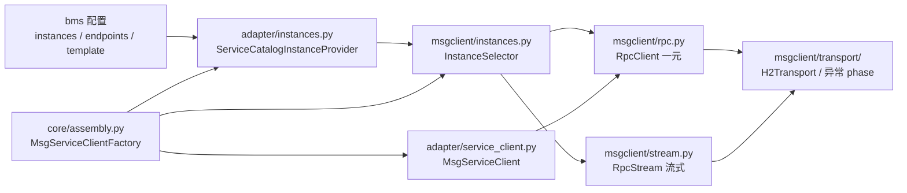
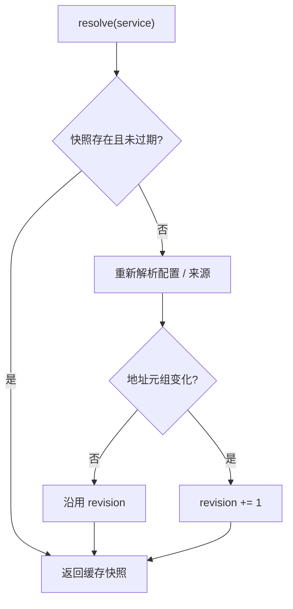
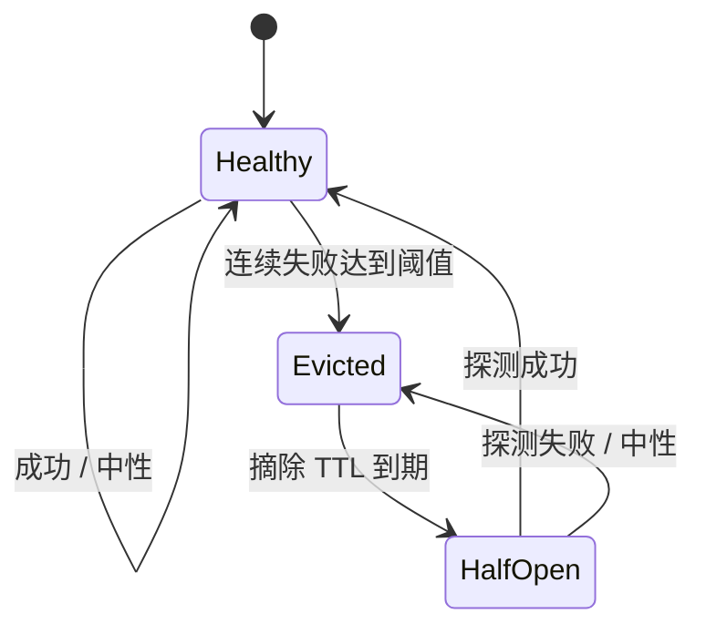
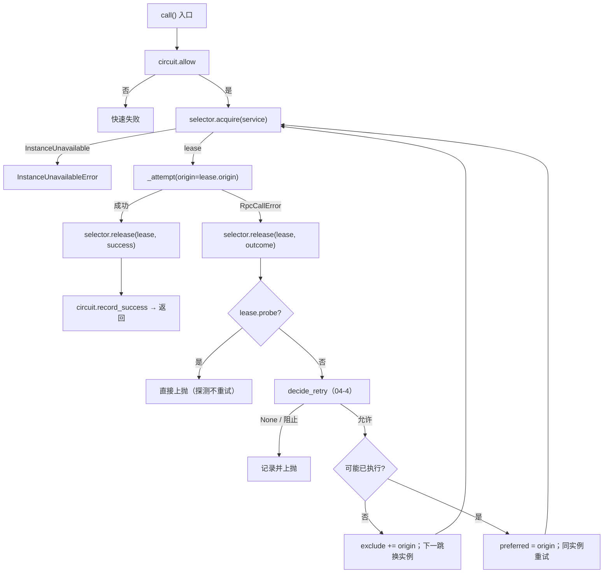
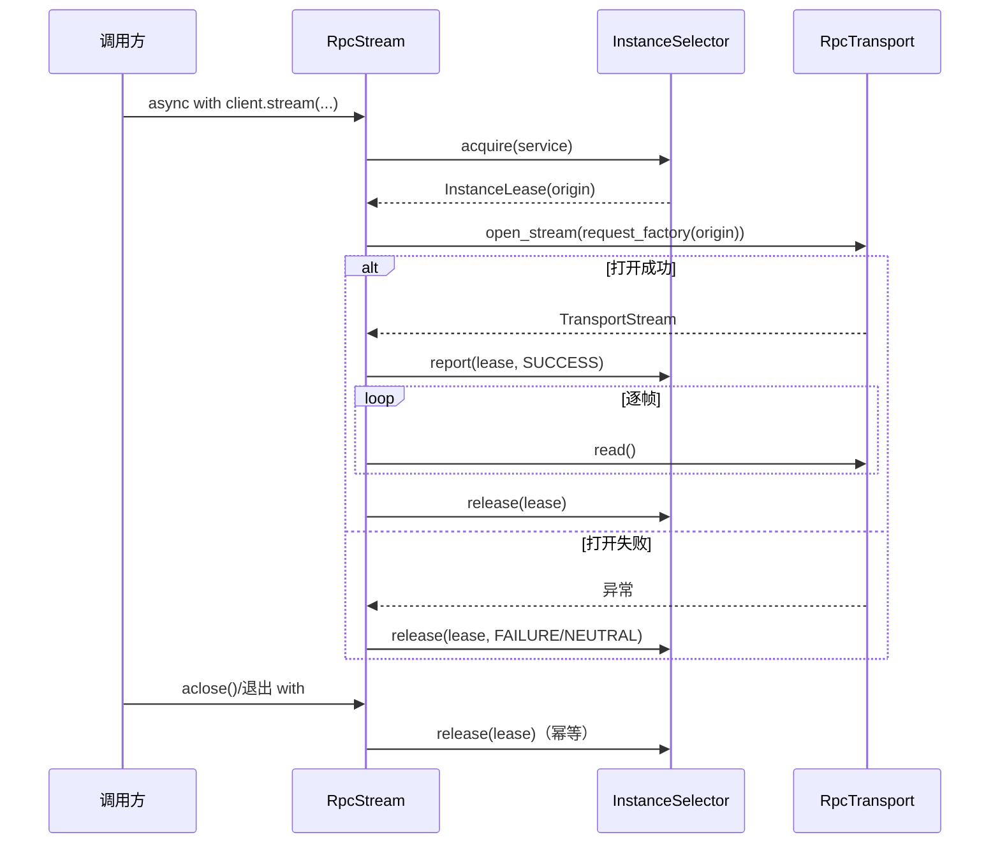

# 04-6 服务发现与负载均衡详细设计

> 一句话定位：在 `bms_core.msgclient` 内把「一个地址」抽象升级为「一组可刷新、可摘除、可选择」的 msg 平台实例，RPC 一元与流式共用同一选择器，失败换实例复用 04-4 的预算与幂等判定。

[文档首页](../../../../../../文档首页.md) › [消息平台规划](../../../../../../规划/01_规划_消息平台.md) › [阶段计划](../../../../计划/01_计划_消息平台.md) › [04 RPC](../../04_RPC.md) › [04-6 服务发现与负载均衡](../04_RPC_06_服务发现与负载均衡.md) › 详细设计

---

## 1. 概述 <a id="overview"></a>

### 1.1 目标

1. 定义 msg 侧的**实例来源**与**实例选择**抽象：来源只负责「有哪些实例」，选择器负责「选哪个、失败怎么摘、何时恢复」。
2. 首期接 bms 服务目录：从 `[service_client].instances["msg"]` / `endpoints["msg"]` / `base_url_template` 解析 msg 平台实例，地址不写死在代码里。
3. 默认轮询、可选最少在途；单实例自动退化为直连，但走同一 `InstanceSelector` 抽象。
4. 失败换实例只发生在「确定未执行」的错误上；结果未知、非幂等无键、协议错一律不换，重试预算与幂等判定复用 04-4。
5. 连续失败摘除 + TTL 半开探测恢复；桩健康状态、在途计数与快照版本都按池维护。
6. 流式调用参与实例选择与「打开阶段」健康反馈，但不进重试层；租约覆盖整条流，`aclose` / 正常结束释放。
7. 服务目录不可用（快照为空 / 过期解析失败）快速失败，不静默回退到写死地址。

### 1.2 边界与承接

| 范围 | 本任务 | 归口 |
| --- | --- | --- |
| `InstanceProvider` / `InstanceSelector` / `InstancePolicy` / 值对象 | ✅ `bms_core/msgclient/instances.py` | — |
| bms 服务目录 provider + 多实例配置解析 | ✅ `bms_core/msgclient/adapter/instances.py` | — |
| 一元换实例重试、流式选实例与健康反馈 | ✅ 改 `rpc.py` / `stream.py` / `transport/` | — |
| bms 装配接线（`MsgServiceClientFactory`） | ✅ 改用目录 provider + selector | — |
| 事件发布侧多实例负载均衡 / 故障切换 | ❌ 只共用地址来源（取首个实例） | 8B_04 / 后续 |
| 跨实例幂等去重（同一键在两个实例同时执行） | ❌ 保持进程内去重 | 8B_05 |
| 分区 leader 路由、broker 副本选主 | ❌ | 8B_05 |
| DNS / 静态文件 / 外部注册中心 | ❌ 只留来源接口；不接 Consul / etcd | 后续 / 明确不做 |
| 网关负载均衡 | ❌ | 部署层 |
| bms 业务迁移、真实跨服务方法迁移 | ❌ | 8B_08 |
| 实例选择指标出口 | ❌ 只出结构化日志 | 06-3 |

### 1.3 口径来源

- [需求 04-6](../../../../需求/04_需求_RPC.md#r04-6)、[任务 04-6](../04_RPC_06_服务发现与负载均衡.md) §2~§3；
- [架构设计 · 接入面 §8.1 寻址与负载均衡](../../../../../../设计/架构设计/05_架构设计_接入面_协议与客户端.md#discovery)；
- bms《[RPC 模型](../../../../../../../bms文档/资料/知识档案/消息与事件驱动/09_事件驱动_RPC模型.md)》第 10 节；
- [消息平台规划](../../../../../../规划/01_规划_消息平台.md) 第 8 节；
- [04-1 详细设计](../../04_RPC_01_一元调用/设计/01_详细设计_04_RPC_01_一元调用.md) §10.2 / §10.3（`InstanceProvider` 端口与 `RpcClient` 雏形）；
- [04-4 详细设计](../../04_RPC_04_错误语义与幂等重试/设计/01_详细设计_04_RPC_04_错误语义与幂等重试.md) §5（分类 / 预算 / 幂等 / 熔断）；
- [04-5 详细设计](../../04_RPC_05_与bms端口适配/设计/01_详细设计_04_RPC_05_与bms端口适配.md)（协议链归属与 bms 适配层）；
- [04-7-1 详细设计](../../04_RPC_07_客户端精确取消/04_RPC_07_客户端精确取消_01_H2传输层/设计/01_详细设计_04_RPC_07_客户端精确取消_01_H2传输层.md) §4（按 origin 分池、传输层异常梯度）；
- 现有实现：`bms_core/msgclient/rpc.py`、`stream.py`、`transport/`、`adapter/`、`core/assembly.py`、`core/service_endpoints.py`。

## 2. 现状与差距 <a id="gap"></a>

| 现状 | 差距 | 本任务动作 |
| --- | --- | --- |
| `RpcClient` 构造接收 `InstanceProvider`，只有 `next() -> str` | 无法表达「快照 / 刷新 / 在途 / 健康 / 摘除」 | 新增 `InstanceSnapshot` / `InstanceSelector` / `InstanceLease`，`RpcClient` 改为接收 selector |
| `StaticInstanceProvider` 单地址或静态列表 + 轮询 | 无失败计数、无摘除、无半开、无最少在途 | 保留为来源实现；选择逻辑全部进 `InstanceSelector` |
| `RpcClient` 每次尝试都调 `next()`，重试天然可能换地址 | 不区分「确定未执行」与「可能已执行」，会重放已提交请求 | 新增错误判定矩阵 + 传输层 `phase`，只对确定未执行换实例 |
| 传输层异常只有四条梯度，连接失败与读体中断不可区分 | 无法判断请求是否已发出 | `RpcTransportClosedError` 增 `phase` 与 `may_have_been_sent` |
| bms 装配 `StaticInstanceProvider([base_url])` | 目录 provider 未实现，地址变更仍要改代码 | 新增 `ServiceCatalogInstanceProvider`，装配切到 selector |
| bms 配置只有单地址 `endpoints` / `base_url_template` | 无多实例配置面 | 新增 `[service_client].instances.<service>` 列表与校验 |
| 流式 `RpcStream` 构造时已定 `origin` | 惰性打开时无法选实例、无法反馈健康 | `RpcStream` 持 selector + `request_factory`，打开时选实例 |
| 04-4 熔断按 `service` 维度 | 实例失败与依赖熔断粒度不同 | 实例失败按 `(pool_key, origin)` 独立计数，两者都记录 |

## 3. 分工与依赖方向 <a id="direction"></a>



**依赖方向**：`adapter` → `msgclient` → `core`（`Clock` / `ConcurrentStable*` / `BaseValueObject`）；`core/assembly` 只做装配，不反向被 `msgclient` 引用。`instances.py` 不 import `rpc.py`、不 import bms 端口，避免环。

**为什么核心落 bms 仓**：04-5 已把整条协议链上移 `bms_core/msgclient`；msg 仓若再持实例选择实现，bms 适配层只能反向依赖 `bms_msg`，违反 04-5 红线。msg 仓保留任务文档与跨仓契约用例。

## 4. 实例模型与接口 <a id="model"></a>

### 4.1 模块与值对象

新增 `bms_core/msgclient/instances.py`：

```python
class InstanceStrategy(StrEnum):
    ROUND_ROBIN = "round_robin"
    LEAST_INFLIGHT = "least_inflight"


class InstanceOutcome(StrEnum):
    SUCCESS = "success"
    """收到响应（含错误帧 / 4xx / 5xx）：实例可达。"""
    FAILURE = "failure"
    """传输失败 / 本地超时：实例不可达或不可用。"""
    NEUTRAL = "neutral"
    """协议错（帧不可解析 / 版本不符）：不归咎实例，不计数。"""


@dataclass(frozen=True)
class InstanceSnapshot(BaseValueObject):
    pool_key: str
    addresses: tuple[str, ...]
    revision: int
    fetched_at_ms: int
    stale: bool = False


@dataclass(frozen=True)
class InstanceLease(BaseValueObject):
    pool_key: str
    origin: str
    revision: int
    probe: bool = False


@dataclass(frozen=True)
class InstancePolicy(BaseValueObject):
    strategy: InstanceStrategy = InstanceStrategy.ROUND_ROBIN
    failure_threshold: int = RPC_INSTANCE_FAILURE_THRESHOLD
    evict_ttl_ms: int = RPC_INSTANCE_EVICT_TTL_MS
    snapshot_ttl_ms: int = RPC_INSTANCE_SNAPSHOT_TTL_MS
    half_open_max_probes: int = RPC_INSTANCE_HALF_OPEN_MAX_PROBES


@dataclass(frozen=True)
class InstanceEntryView(BaseValueObject):
    origin: str
    failures: int
    evicted: bool
    evicted_at_ms: int | None
    probes: int
    inflight: int


@dataclass(frozen=True)
class InstancePoolView(BaseValueObject):
    pool_key: str
    revision: int
    entries: tuple[InstanceEntryView, ...]
    stale: bool
```

`InstancePolicy.__post_init__` 校验：`failure_threshold >= 1`、`evict_ttl_ms >= 0`、`snapshot_ttl_ms >= 0`、`half_open_max_probes >= 1`，非法抛 `ValueError`（装配期即拒）。

### 4.2 `InstanceProvider` 协议与实现

```python
class InstanceProvider(Protocol):
    def resolve(self, service: str) -> InstanceSnapshot: ...
```

**同步而不是异步**：来源是 bms 配置（进程内读取）与未来的 DNS 缓存；选择本身是纯内存操作，不引入额外 `await`。未来 DNS 刷新由 provider 内部用后台任务维护快照，`resolve()` 仍同步返回最近快照。

`StaticInstanceProvider`（从 `rpc.py` 迁入，`rpc.py` 保留 re-export）：

```python
class StaticInstanceProvider:
    def __init__(self, endpoints: Sequence[str], *, pool_key: str = "static") -> None: ...
    def resolve(self, service: str) -> InstanceSnapshot: ...
```

- 地址去尾斜线、去重；空列表抛 `ValueError`（构造期）。
- `revision = 0`、`fetched_at_ms = 0`、`stale = False`；静态列表不刷新。

`ServiceCatalogInstanceProvider`（`bms_core/msgclient/adapter/instances.py`）：

```python
class ServiceCatalogInstanceProvider:
    def __init__(
        self,
        *,
        settings: Settings,
        mapping: Mapping[str, str] | None = None,
        default_source_key: str = MSG_ENDPOINT_KEY,
        clock: Clock | None = None,
        ttl_ms: int = RPC_INSTANCE_SNAPSHOT_TTL_MS,
    ) -> None: ...
    def resolve(self, service: str) -> InstanceSnapshot: ...
```

- **映射表**：`source_key = mapping.get(service) or mapping.get("*") or default_source_key`；首期缺省 `{"*": "msg"}`，无需配置。
- **地址解析**：按来源键取 `[service_client].instances.<source_key>` → `endpoints.<source_key>` → `base_url_template.format(service=source_key)`；优先级与 `msg_instance_addresses()` 同一实现。
- **快照缓存**：`fetched_at_ms + ttl_ms` 内直接返回缓存；到期重新解析配置。地址元组变化时 `revision += 1`。
- **不可用**：解析结果为空、模板缺 `{service}`、地址非 `http(s)` → 抛 `InstanceUnavailable`（内部异常），由 RPC 层映射为 `InstanceUnavailableError`。
- **不热加载**：配置在启动期加载；运行期重解析读的是同一份 `Settings`，配置变更仍需重启。`stale` 字段为未来 DNS / 远程目录预留，首期恒 `False`。

### 4.3 `InstanceSelector`

```python
class InstanceSelector:
    def __init__(
        self,
        provider: InstanceProvider,
        *,
        policy: InstancePolicy | None = None,
        clock: Clock | None = None,
    ) -> None: ...

    def acquire(
        self,
        service: str,
        *,
        exclude: Collection[str] = (),
        preferred: str | None = None,
    ) -> InstanceLease: ...

    def report(self, lease: InstanceLease, outcome: InstanceOutcome) -> None: ...

    def release(self, lease: InstanceLease, outcome: InstanceOutcome | None = None) -> None: ...

    def snapshot(self, pool_key: str) -> InstancePoolView: ...


def selector_for(
    provider: InstanceProvider,
    *,
    policy: InstancePolicy | None = None,
    clock: Clock | None = None,
) -> InstanceSelector: ...


class StaticInstanceSelector(InstanceSelector):
    def __init__(self, endpoints: Sequence[str], *, policy=None, clock=None) -> None: ...
```

**三方法职责**：

| 方法 | 在途计数 | 健康状态 | 用途 |
| --- | --- | --- | --- |
| `acquire` | +1 | 只读 | 选一个租约；半开到期时置 `probe=True` |
| `report` | 不变 | 更新 | 流式打开成功 / 失败只反馈健康，租约还挂着 |
| `release` | -1 | 可选更新 | 一元一次尝试结束；流结束 / `aclose` |

**同一租约只释放一次**：调用方用布尔标志保证幂等；重复 `release` 不重复减在途、不重复计数。

### 4.4 异常与映射

`instances.py` 内部异常：

```python
class InstanceUnavailable(Exception):
    def __init__(self, message: str, *, pool_key: str | None = None, reason: str = "") -> None: ...
```

`rpc.py` 对外异常：

```python
class InstanceUnavailableError(RpcCallError):
    def __init__(
        self,
        message: str = "无可用 RPC 实例",
        *,
        pool_key: str | None = None,
        reason: str = "",
    ) -> None:
        super().__init__(
            0,
            message,
            retryable=True,
            layer="transport",
            category=ErrorCategory.TRANSIENT,
        )
        self.pool_key = pool_key
        self.reason = reason
```

- **不新增产品码**：复用 transport 层 `RpcCallError`，适配层仍按 `RpcCallError` 捕获。
- `retryable=True` / `transient`：04-4 预算内可再试（下一次 `acquire` 可能拿到已恢复实例）；首次失败是快速的，不会挂起等待。
- `RpcStream._open` 同样把 `InstanceUnavailable` 映射为 `InstanceUnavailableError`。

### 4.5 与 `RpcClient` / `RpcStream` 的接线

`RpcClient` 构造签名（破坏性）：

```python
class RpcClient:
    def __init__(
        self,
        selector: InstanceSelector,
        *,
        tenant: str | None = None,
        deadline_ms: int | None = None,
        transport: RpcTransport | None = None,
        retry_policy: RetryPolicy | None = None,
        circuit: BaseCircuitBreaker | None = None,
        clock: Clock | None = None,
        jitter: JitterSource | None = None,
    ) -> None: ...
```

- `selector` 是唯一实例入口；旧 `instances=` 关键字不保留（拍板「破坏 + 便捷工厂」）。
- 调用点迁移：`selector_for(StaticInstanceProvider([...]))` 或 `StaticInstanceSelector([...])`。

`RpcStream` 构造签名：

```python
class RpcStream:
    def __init__(
        self,
        *,
        transport: RpcTransport,
        selector: InstanceSelector,
        request_factory: Callable[[str], RpcHttpRequest],
        request_id: str,
        service: str,
        method: str,
        budget_ms: int,
    ) -> None: ...
```

- `request_factory(origin)` 由 `RpcClient._http_request` 闭包提供，复用同一份组帧逻辑。
- `__aenter__` / 首次 `__anext__` 才 `acquire` + 生成请求，保持惰性打开。

## 5. 选择算法 <a id="selection"></a>

### 5.1 快照同步与 `revision`



选择器在每次 `acquire` 时取快照，与池内 `revision` 比对：

- **相同**：不动状态。
- **不同**：保留交集 origin 的健康 / 在途状态；删除消失 origin；新增 origin 默认健康；游标对 `len(addresses)` 取模；记录一次 `msg_rpc_instance_selected` 前的调试日志（不单列事件）。
- **地址为空**：不建池、直接 `InstanceUnavailable(reason="empty_snapshot")`。

### 5.2 轮询

按地址插入序维护 `cursor`：

```text
candidates = 健康且未排除的 origin（含半开到期的探测候选）
从 cursor 起按列表顺序找第一个候选 → 选中 → cursor = (index + 1) % len(addresses)
```

- `exclude` 优先于游标：被排除的 origin 跳过。
- 若 `exclude` 覆盖了全部健康实例（单实例场景），允许回退到被排除但健康的实例；否则 `InstanceUnavailable(reason="all_excluded")`。
- `preferred` 优先于游标：指定 origin 存在且健康时直接选它；不存在或已摘除 → `InstanceUnavailable(reason="preferred_unavailable")`。

### 5.3 最少在途

```text
candidates = 健康且未排除的 origin
target = min(candidates, key=lambda o: (inflight[o], round_robin_index(o)))
```

- 平局按轮询游标顺序取第一个，并推进游标（拍板「平局走轮询游标」）。
- 在途计数在 `acquire` 时 +1、`release` 时 -1；流式整条流持有租约。
- 单实例时两种策略结果相同，自动退化直连。

### 5.4 实例健康状态机



状态字段（每 `(pool_key, origin)` 一份）：

| 字段 | 含义 |
| --- | --- |
| `failures` | 连续失败次数（成功清零；中性不变） |
| `evicted_at_ms` | 摘除起始时刻；`None` 表示健康 |
| `probes` | 当前半开探测在途数（`0 ~ half_open_max_probes`） |
| `inflight` | 当前在途调用数（流式覆盖整条流） |

**成功**：`failures = 0`、`probes = 0`；若原为摘除态且来自半开探测 → 恢复并记 `msg_rpc_instance_recovered`。

**失败**：`failures += 1`；达到 `failure_threshold` 或来自半开探测 → 置 `evicted_at_ms = now`，记 `msg_rpc_instance_removed`（`reason=failure_threshold` / `probe_failure`）。

**中性**：健康态不计数；半开探测时视为探测失败，续摘。

### 5.5 半开探测与全部摘除

- 摘除态且 `now - evicted_at_ms >= evict_ttl_ms` → 成为「半开候选」。
- `acquire` 选中半开候选时置 `probe=True`，`probes += 1`；其他请求在 `probes >= half_open_max_probes` 时跳过该实例。
- **探测成功** → 恢复；**探测失败 / 中性** → `evicted_at_ms = now`，重新计时。
- **所有实例都被摘除**：
  - 若存在到期半开实例 → 放一个 `probe` 租约尝试恢复（拍板「放一个探测」）。
  - 若都在 TTL 内 → `InstanceUnavailable(reason="all_evicted")`。
  - 若唯一实例的探测已在途 → `InstanceUnavailable(reason="probe_in_flight")`（快速失败，由 04-4 预算决定是否再试）。
- **单实例**：只有该实例；失败达到阈值后同样摘除，TTL 到期放探测；`exclude` 覆盖它时允许回退（避免单实例直接判死）。

## 6. 失败换实例 <a id="failover"></a>

### 6.1 「确定未执行」判定矩阵

| 错误来源 | 判定 | 换实例 | 依据 |
| --- | --- | --- | --- |
| 连接建立失败（`phase=connect`） | 确定未执行 | ✅ | 请求一个字节都没发出 |
| 请求体发送失败（`phase=send`） | 确定未执行 | ✅ | 帧未完整写出，服务端不会进入 handler |
| 限流拒绝（`429` / `350005`） | 确定未执行 | ✅ | 服务端明确拒绝 |
| 服务端错误帧（`category=transient` 且 `retryable=true`） | 确定未执行 | ✅ | 服务端已给出判定，handler 未成功 |
| 等响应头 / 读体中连接断开（`phase=await_headers` / `read_body` / `reset`） | 可能已执行 | ❌ | 请求已提交，结果未知 |
| 本地超时 / `350004` | 可能已执行 | ❌ | 结果未知 |
| `category=unknown` | 可能已执行 | ❌ | 结果未知 |
| 协议错（`layer=protocol`） | 可能已执行 | ❌ | 响应不可解析，不代表没执行 |
| 参数错 / 业务拒绝 / 服务端 bug | 不重试 | ❌ | 04-4 已判定不可重试 |
| 非幂等且无幂等键 | 不重试 | ❌ | 04-4 `RpcRetryBlockedError` |

**同一请求不得在两个实例同时执行**：04-6 串行尝试，不并发；结果未知时不换实例，因此不会在第二个实例重放一个可能仍在第一个实例执行的调用。跨实例幂等去重仍归 8B_05。

### 6.2 传输层 `phase`

`RpcTransportClosedError` 增字段与属性：

```python
PHASE_CONNECT = "connect"
PHASE_SEND = "send"
PHASE_AWAIT_HEADERS = "await_headers"
PHASE_READ_BODY = "read_body"
PHASE_RESET = "reset"
PHASE_UNKNOWN = "unknown"


class RpcTransportClosedError(RpcTransportError):
    def __init__(self, message: str, *, phase: str = PHASE_UNKNOWN) -> None: ...
    @property
    def may_have_been_sent(self) -> bool:
        return self.phase not in (PHASE_CONNECT, PHASE_SEND)
```

抛出点标注：

| 位置 | `phase` |
| --- | --- |
| `H2Transport._connect` 的 `OSError` | `connect` |
| `H2Transport.send` 的「传输层已关闭」 | `connect` |
| `H2ClientConnection.send_request` 的「连接不可用」/ stream id 用尽 | `connect` |
| `H2ClientConnection._send_body` 的 `OSError` | `send` |
| `H2Stream.on_reset` | `await_headers`（未收头）/ `read_body`（已收头） |
| `H2Stream.on_connection_error` | 同上，按 `_status` 判定 |
| `H2Stream.abort` 产生的本地中止错误 | `reset` |
| 其他未标注路径 | `unknown`（保守：不换实例） |

`RpcTransportTimeoutError` 不需要 `phase`：超时天然属于「可能已执行」，在 `RpcClient` 映射为 `RpcCallTimeoutError`。

### 6.3 `RpcClient` 重试循环



关键点：

- **每次尝试一个租约**；失败先 `release`（减在途、记健康），再决定下一跳。
- `exclude` 在本次调用内累积；`preferred` 只在「可能已执行」时设置，下一次 `acquire` 必须回到原实例。
- `preferred` 不可用（原实例已被摘除）→ 不再换其他实例，直接上抛本次 RPC 错误（避免把「结果未知」放大成「换个实例再来一次」）。
- `decide_retry` 抛 `RpcRetryBlockedError` 时，租约已释放，异常原样上抛。
- 退避、预算消费、`attempts` / `backoff_ms` 回填完全沿用 04-4，不新增第二套。
- 熔断仍在每次 `RpcCallError` 时 `record_failure`，成功时 `record_success`；实例失败另按 `(pool_key, origin)` 计数，两者独立。

### 6.4 预算 / 幂等 / 熔断的关系

| 能力 | 归属 | 04-6 的行为 |
| --- | --- | --- |
| 重试次数与退避 | 04-4 `RetryPolicy` / `RetryBudget` | 换实例复用同一 `RetryBudget` 对象，不重置、不额外消费 |
| 幂等键 | 04-4 `idempotency_key` | 换实例时键不变；服务端按 `(tenant, service, method, key)` 去重（进程内） |
| 非幂等无键 | 04-4 `RpcRetryBlockedError` | 不换实例、零重试 |
| 依赖熔断 | 04-4 `BaseCircuitBreaker` | 保持按 `service:<service>`；一次失败仍计熔断 |
| 实例健康 | 04-6 `InstanceSelector` | 按 `(pool_key, origin)` 独立计数与摘除 |

**为什么两套计数都保留**：熔断回答「这个依赖整体是否可用」，摘除回答「这个实例是否可用」。多实例下，一个实例坏掉不应让整个依赖熔断；全部实例坏掉时，熔断仍应快速失败。两者阈值独立（熔断 5 次 / 实例 3 次），恢复语义也不同。

## 7. 流式接入 <a id="stream"></a>

### 7.1 惰性打开与请求工厂

`RpcClient.stream()` 不再预先组请求，而是把「选实例 + 组请求」推迟到 `RpcStream._open()`：

```text
RpcClient.stream(service, method, ...)
  ├── request_id = uuid4().hex
  ├── factory = lambda origin: self._http_request(..., origin=origin, suffix="/stream")
  └── RpcStream(selector, factory, request_id, ...)
        └── __aenter__ / 首次 __anext__
              ├── lease = selector.acquire(service)
              ├── request = factory(lease.origin)
              └── transport.open_stream(request)
```

`request_factory` 复用 `RpcClient._http_request` 的组帧、租户头、`timeout_ms` 与 `trace`，流式模块不重写帧编码。

### 7.2 租约生命周期



- **打开阶段**反馈健康：成功 `SUCCESS`、传输失败 `FAILURE`、协议错 `NEUTRAL`。
- **读流阶段**不反馈健康：业务错 / `350024` 空闲超时 / 调用方取消都不摘除实例（拍板「只反馈打开阶段」）。
- 租约在流结束 / `aclose` / 异常退出时释放；`release` 幂等，保证在途计数不泄漏。
- 流式**不进重试层**：04-3 / 04-4 的边界不变；打开失败直接上抛，由调用方决定是否重开。

### 7.3 与一元共享的部分

| 共享项 | 说明 |
| --- | --- |
| `InstanceSelector` | 同一池、同一游标、同一健康状态；流式与一元互相可见 |
| 组帧逻辑 | `_http_request` 唯一实现，`suffix` 区分 `/stream` |
| 传输层 | 同一 `H2Transport`，按 origin 分池 |
| 观测 | 同一 `msg_rpc_instance_*` 事件；流式另有 `msg_rpc_client_stream` / `msg_rpc_client_cancel` |

## 8. 服务目录提供者与配置 <a id="config"></a>

### 8.1 配置形状

新增 `[service_client].instances`（服务键 → 地址列表）：

```toml
[service_client]
# 多实例地址（可选；优先于 endpoints 与 base_url_template）
[service_client.instances]
msg = ["http://msg-1:8000", "http://msg-2:8000"]

# 选择策略（round_robin / least_inflight，缺省 round_robin）
options = { attach_service_token = true, instance_strategy = "round_robin" }
```

`ServiceClientSettings` 增字段：

```python
instances: Annotated[
    ConcurrentStableDict[str, ConcurrentStableList[str]],
    CONTRACT_COLLECTION,
] = Field(default_factory=CONTRACT_STABLE_DICT)
```

### 8.2 优先级与校验

**优先级**：`instances.<key>` > `endpoints.<key>` > `base_url_template.format(service=key)`。

**校验**（`core/service_endpoints.py::normalize_service_instances`）：

1. 服务键去首尾空白后不得为空；
2. 地址列表不得为空（显式空列表视为配置错误）；
3. 每个地址须为 `http://` / `https://` 绝对地址；
4. 去尾斜线、按插入序去重；
5. 非法即 `ConfigError` 拒启，不静默跳过、不回落。

**为什么空列表拒启而不是回落**：显式配置空列表表达的是「这个来源暂时没有实例」，回落 `endpoints` 会把「配错了」伪装成「配置没写」，排障成本高。

### 8.3 映射表

`ServiceCatalogInstanceProvider` 的 `mapping`：

```python
mapping = {"*": "msg"}                 # 首期缺省
mapping = {"platform": "msg-pool-a", "*": "msg"}  # 未来多池
```

- 精确匹配优先，`"*"` 兜底，再回落 `default_source_key`。
- 首期所有逻辑 `service` 都映射到 `msg` 实例池；`service` 只用于日志与未来多池。
- 映射表由构造注入，不写进 `[service_client]` 配置（首期无需配置；后续需要时再加 `instance_mapping` 选项）。

### 8.4 快照 TTL 与刷新

- `snapshot_ttl_ms = 30s`：TTL 内直接返回缓存；到期重新解析配置。
- 配置在启动期加载，运行期不监听文件；变更需重启（拍板「TTL 预留、配置不热加载」）。
- 解析失败（空 / 非法模板）→ `InstanceUnavailable`，不返回旧快照；未来 DNS 场景同样「过期即失败」，`stale` 只用于诊断快照。
- 快照变化时 `revision += 1`，选择器按 revision 清理旧 origin 状态。

### 8.5 装配接线

`core/assembly.py::MsgServiceClientFactory.create()`：

```text
provider = ServiceCatalogInstanceProvider(settings=settings)
selector = selector_for(provider, policy=msg_instance_policy(settings))
RpcClient(selector, circuit=default_circuit())
```

`msg_instance_policy(settings)`：

- 读 `[service_client].options.instance_strategy`；
- 缺省 `round_robin`；非法值 `ConfigError` 拒启；
- 其余参数取 `InstancePolicy` 的仓内常量缺省。

**启动期校验**：工厂构造时先调用一次 `provider.resolve(MSG_ENDPOINT_KEY)`，把「模板缺 `{service}` / 实例列表非法 / 无可用实例」在装配期暴露为 `ConfigError`（与 07B `06_01` 的「缺实现即拒启」同口径），不把配置错误推迟到首次调用。

`msg_base_url(settings)` 改为复用 `msg_instance_addresses(settings)[0]`：

- 多实例时事件发布取**第一个**实例；事件侧负载均衡 / 故障切换不在本任务范围（归 8B_04 / 后续）。
- 单实例行为与现状完全一致。

## 9. 观测 <a id="observe"></a>

新增四个结构化日志事件（`get_logger("bms_core.msgclient")`，不新增指标）：

| 事件 | 触发 | 字段 |
| --- | --- | --- |
| `msg_rpc_instance_selected` | 每次 `acquire` 成功 | `pool_key` / `service` / `origin` / `strategy` / `probe` / `inflight` |
| `msg_rpc_instance_removed` | 摘除（阈值 / 探测失败） | `pool_key` / `origin` / `reason` / `failures` / `evict_ttl_ms` |
| `msg_rpc_instance_recovered` | 半开探测成功 | `pool_key` / `origin` / `reason=probe_success` |
| `msg_rpc_instance_unavailable` | 无实例可用 | `pool_key` / `service` / `reason` / `addresses` |

约束：

- 不输出堆栈、不输出租户 / 载荷；
- 事件名与 04-4 `msg_rpc_retry*`、04-7-2 `msg_rpc_client_cancel` 同族，06-3 可按前缀分流；
- 不可用事件只在抛异常前记一次，避免无实例时刷屏。

## 10. 测试设计 <a id="tests"></a>

### 10.1 bms 用例

| 文件 | 覆盖点 |
| --- | --- |
| `libs/bms_core/tests/msgclient/instances/test_instance_selector.py` | 轮询顺序 / 单实例 / `exclude` / `preferred` / 最少在途平局 / 在途计数；连续失败摘除、成功清零、TTL 半开、探测成功恢复、探测失败续摘、探测中性续摘；全部摘除未到期不可用、到期放一个探测、探测在途不可用；revision 变更清理；四个日志事件 |
| `libs/bms_core/tests/msgclient/instances/test_instance_provider.py` | 静态来源；目录来源 `instances` / `endpoints` / 模板优先级；映射精确 / 通配 / 缺省；TTL 缓存与 revision；地址去重 / 去尾斜线；空列表与非法地址 `ConfigError`；不可用 |
| `libs/bms_core/tests/msgclient/test_rpc_instance_failover.py` | `phase=connect` 换实例；`phase=reset` / 超时 / unknown 不换；协议错不换；非幂等无键阻止；单实例回退；`exclude` 累积；预算共享；熔断仍计数；`InstanceUnavailableError` 映射 |
| `libs/bms_core/tests/msgclient/test_rpc_stream_instances.py` | 流式打开时选实例；`request_factory` 使用 lease.origin；打开成功 / 失败健康反馈；流中错误不摘除；`aclose` / 正常结束释放租约；无重试 |
| `libs/bms_core/tests/msgclient/transport/test_transport_phases.py` | `connect` / `send` / `await_headers` / `read_body` / `reset` 标注；`may_have_been_sent`；默认 `unknown` 保守不换 |
| 存量用例适配 | `test_rpc_client*.py` / `test_rpc_stream*.py` / `test_rpc_circuit.py` / `test_rpc_retry_policy.py` / `test_rpc_idempotency.py` 改 `RpcClient(selector_for(...))`；`adapter/test_service_client.py` / `test_assembly.py` / `test_rollback.py` 改装配；`core/test_config.py` 增 `instances` 校验 |

### 10.2 msg 跨仓用例

`services/msg/tests/client/test_instance_failover_contract.py`（真 msg 应用 + 真帧）：

| 用例 | 断言 |
| --- | --- |
| 一个实例连接失败后切到健康实例 | 用按 `request.origin` 路由的传输替身：origin A 抛 `RpcTransportClosedError(phase=connect)`，origin B 驱动真 msg 应用；最终结果正确，handler 只执行一次 |
| 结果未知不换实例 | origin A 返回 `350004` / `unknown`；断言第二次尝试仍打 A，未打到 B；非幂等无键直接 `RpcRetryBlockedError` |
| 全部实例不可用 | 两个 origin 都连接失败；最终 `InstanceUnavailableError` / `RpcCallError`，`retryable=true`、`category=transient`，不写死地址 |
| 单实例退化 | 单 origin 正常调用；轮询与最少在途结果一致 |

**测试纪律**：不 mock 帧编解码、不 mock msg 路由；固定 `occurred_at` / `event_id`（若涉及事件）与幂等键；handler 调用计数用真 app 的注册表处理器记录；传输替身只负责「谁失败 / 谁成功」。

### 10.3 验收映射

| 任务 §3 完成标准 | 结论依据 |
| --- | --- |
| 停一个实例后有限次数内切到健康实例，且不产生重复提交 | bms `test_rpc_instance_failover.py`（connect / transient 换实例、unknown 不换）+ msg `test_instance_failover_contract.py`（真 app handler 只执行一次） |
| 地址变更只改配置 / 服务目录，不改客户端代码；单实例走同一抽象 | `test_instance_provider.py`（三级优先级、TTL、mapping）+ `test_assembly.py`（装配走目录 provider）+ 单实例用例 |
| 连续失败可摘除，探活通过后恢复；目录不可用快速失败 | `test_instance_selector.py`（摘除 / 半开 / 恢复 / 不可用）+ `test_instance_provider.py`（空 / 非法配置） |
| 变更模块行 + 分支覆盖率 100%，静态检查全绿 | §11 |

### 10.4 Kiwi

- 实施前回读平台最大号（04-5 为 2443，禁复用）→ `+1`；
- 登记**一条**用例：Category「平台骨架」、Priority `P2`、状态 `CONFIRMED`、Tag「自动化」；
- `text` 写覆盖范围（选择 / 摘除 / 换实例 / 流式 / 配置 / 跨仓）与四份用例文件路径；
- 回读核对编号与代码 `@pytest.mark.kiwi_id(<编号>)` 一致；
- 平台连不上时停下来问，不挂空号、不先编码后补号。

### 10.5 用例纪律

- 时间相关（TTL、半开、退避）一律 fake clock；selector 与 `RpcClient` 注入同一个 `FakeClock`，避免两套时间线。
- 传输层 phase 用例直接构造异常，不启网络；跨仓用例用真 app + 路由替身。
- 日志断言用 `structlog.testing.capture_logs()`（console 格式下 `assert_logged` 抓不到）。
- `msgclient_support` 不算覆盖率分母，但一次会话必须收集到。

## 11. 覆盖率与门禁 <a id="coverage"></a>

### 11.1 模块清单（bms 仓）

```text
bms_core.msgclient.instances
bms_core.msgclient.rpc
bms_core.msgclient.stream
bms_core.msgclient.constants
bms_core.msgclient.transport.base
bms_core.msgclient.transport.pool
bms_core.msgclient.transport.stream
bms_core.msgclient.transport.connection
bms_core.msgclient.adapter.instances
bms_core.msgclient.adapter.service_client
bms_core.core.config
bms_core.core.service_endpoints
bms_core.core.assembly
```

按最终改动文件复核增减，**宁多勿漏**；模块级行 + 分支 100%。

### 11.2 门禁

- 解释器：`bms/backend/.venv/Scripts/python.exe`（3.14）与同目录 `ruff.exe`；禁止 PATH 上的 `python`。
- 静态：改动文件 `ruff check` / `ruff format --check` / `pyright --pythonpath .venv/Scripts/python.exe`。
- 覆盖率：唯一入口 `scripts/tools/preflight/coverage_report.py --module <点分模块>`；缺口明细看 `.cache/coverage/gaps.txt`，不手工 `pytest --cov`。
- 提交环判改动行、推送环与 CI 判模块级 100%；本地不跑全量。
- `pragma: no cover` 必须带理由；分支写不出理由就补护栏用例。
- 文档三项：`check_links` / `check_docs_scope` / `engkit eol`。

## 12. 实施步骤 <a id="steps"></a>

| 步 | 动作 | 提交 |
| --- | --- | --- |
| 1 | 本详细设计定稿 + 决策汇总回显 | `docs(msg): 04-6 详细设计定稿` |
| 2 | 回读 Kiwi 最大号 → 登记 → 回读核对 | 并入第 3 步 |
| 3 | bms 核心：`instances.py`、`constants.py`、`transport/base.py` 与三个传输实现、`rpc.py`、`stream.py`、`__init__.py` | `feat(bms-core): 04-6 实例选择与摘除（Kiwi <编号>）` |
| 4 | bms 配置与装配：`core/config.py`、`core/service_endpoints.py`、`adapter/instances.py`、`core/assembly.py`、`config.toml` 注释 | 同上 |
| 5 | bms 用例：三份新增 + 存量适配 | `test(bms-core): 04-6 实例选择 / 摘除 / 换实例 / 流式用例（Kiwi <编号>）` |
| 6 | msg 跨仓用例 + 任务文档前置表 / 计划回写 | `test(msg): 04-6 跨仓换实例契约（Kiwi <编号>）` / `docs(msg): 04-6 收口` |
| 7 | bms 文档登记：基类清单 / 实现契约 / 07B 06_01 台账 / 配置说明 | `docs(bms): 04-6 实例发现登记与台账回写` |
| 8 | 偏差与遗留闭环、实施 / 测试记录 | 各仓独立提交 |

## 13. 交付物清单 <a id="deliverables"></a>

```text
bms/backend/libs/bms_core/src/bms_core/
├── msgclient/
│   ├── instances.py                    # 新增：Provider / Snapshot / Lease / Policy / Selector / 异常
│   ├── constants.py                    # 改：实例策略缺省值
│   ├── rpc.py                          # 改：selector 构造、换实例重试、phase 判定、InstanceUnavailableError
│   ├── stream.py                       # 改：selector + request_factory、租约生命周期、打开阶段健康反馈
│   ├── __init__.py                     # 改：导出新符号
│   ├── transport/
│   │   ├── base.py                     # 改：RpcTransportClosedError.phase / may_have_been_sent
│   │   ├── pool.py                     # 改：connect / await_headers 等抛出点标注
│   │   ├── connection.py               # 改：send / 读体 / GOAWAY 等抛出点标注
│   │   └── stream.py                   # 改：on_reset / on_connection_error / abort 标注
│   └── adapter/
│       ├── instances.py                # 新增：ServiceCatalogInstanceProvider / msg_instance_addresses
│       ├── service_client.py           # 改：构造 selector（仅装配差异）
│       └── __init__.py                 # 改：导出
├── core/
│   ├── config.py                       # 改：instances 字段 + 校验
│   ├── service_endpoints.py            # 改：normalize_service_instances
│   └── assembly.py                     # 改：目录 provider + selector + 策略解析 + msg_base_url
└── tests/msgclient/
    ├── instances/test_instance_selector.py       # 新增
    ├── instances/test_instance_provider.py       # 新增
    ├── test_rpc_instance_failover.py             # 新增
    ├── test_rpc_stream_instances.py              # 新增
    └── transport/test_transport_phases.py        # 新增

bms/backend/config.toml                 # 改：[service_client] 注释补 instances / instance_strategy

msg/backend/services/msg/tests/client/
└── test_instance_failover_contract.py  # 新增：真 msg 应用 + 路由替身

msg/msg文档/项目/08B_消息平台/任务/04_RPC/04_RPC_06_服务发现与负载均衡/
├── 设计/01_详细设计_04_RPC_06_服务发现与负载均衡.md   # 本文件
├── 实施/01_实施记录_04_RPC_06_服务发现与负载均衡.md   # 实施时新增
├── 测试/01_测试记录_04_RPC_06_服务发现与负载均衡.md   # 测试时新增
└── 04_RPC_06_服务发现与负载均衡.md                    # 回写前置契约与收口说明
```

## 14. 决策与对齐记录 <a id="align"></a>

### 14.1 决策

| # | 事项 | 结论 |
| --- | --- | --- |
| 1 | 核心代码落点 | `bms_core/msgclient`；msg 仓只留文档与跨仓用例 |
| 2 | 实例语义 | msg 平台节点；`service` 只做逻辑路由 |
| 3 | 来源 / 选择分层 | `InstanceProvider` + `InstanceSelector` 分离 |
| 4 | 目录 provider | 本任务实现 `ServiceCatalogInstanceProvider` 并接线 |
| 5 | 多实例配置 | `[service_client].instances.<service>` 嵌套列表 |
| 6 | 选择策略 | 轮询（缺省）+ 最少在途；单实例退化 |
| 7 | 摘除恢复 | 被动摘除 + TTL 半开；不做主动探活 |
| 8 | 换实例判定 | 只对「确定未执行」换；结果未知同实例重试 |
| 9 | 目录不可用 | 快照 TTL + 过期快速失败，不回落写死地址 |
| 10 | 流式参与 | 参与选择与打开阶段健康，不重试 |
| 11 | 错误码 | 不新增产品码；`InstanceUnavailableError(RpcCallError)` |
| 12 | 测试落点 | bms 核心用例 + msg 跨仓契约；一条 Kiwi |
| 13 | 装配接线 | 本任务替换 `MsgServiceClientFactory` |
| 14 | 缺省参数 | 失败 3 次 / 摘除 30s / 半开 1 个 / 快照 TTL 30s |
| 15 | 范围与交付内容 | 按确认范围全量：抽象 + 两种策略 + 摘除 / 半开 + 目录 provider + 配置 + 接线 + 两仓测试 |
| 16 | 提交 | bms 先、msg 后；两仓独立提交、不自动推送 |
| 17 | 快照形状 | `InstanceSnapshot` 值对象 |
| 18 | 结果未知 | 不换实例 |
| 19 | 流式健康边界 | 只反馈打开阶段 |
| 20 | `RpcClient` 构造 | 破坏性改为 `selector` + 便捷工厂 |
| 21 | 流式接入 | `RpcStream` 直接持选择器 + `request_factory` |
| 22 | 配置形状 | 按服务键嵌套列表 |
| 23 | 目录映射 | 精确 + `"*"` 通配 + 缺省键 |
| 24 | 刷新语义 | TTL 预留、配置不热加载 |
| 25 | 半开载体 | `InstanceLease.probe` |
| 26 | 失败计数维度 | `(pool_key, origin)` |
| 27 | 观测 | 四个结构化日志事件 |
| 28 | 选择器 API | 同步 `acquire` / `report` / `release` |
| 29 | 流式租约释放 | 流结束 / `aclose` |
| 30 | 全部摘除 | 放一个探测；未到期则不可用 |
| 31 | 快照过期 | 重解析、失败抛错 |
| 32 | 列表变更 | 按 revision 清理 |
| 33 | 最少在途平局 | 走轮询游标 |
| 34 | 配置校验 | 非法即拒启、instances 优先 |
| 35 | 基座登记 | 基类清单 + 实现契约表 |
| 36 | 台账回写 | bms 07B 06_01 + msg 04-6 两仓同步 |

### 14.2 与任务文档 / 既有设计的对齐

| 位置 | 原文 | 本设计 | 理由 |
| --- | --- | --- | --- |
| 任务 §2.1 | 「msg 侧定义 `InstanceProvider` 抽象」 | 落 `bms_core/msgclient` | 04-5 已把协议链上移；msg 仓再持客户端会形成仓级循环依赖 |
| 任务 §2.1 | 读 `service_endpoints` / `CapabilityTarget.base_url` | 读 `instances` / `endpoints` / 模板，实例是 msg 平台节点 | RPC 实际发往 msg；`CapabilityTarget` 是被调目标服务，当前不直连 |
| 任务 §2.1 | 「目录提供者随 bms 适配任务交付」 | 本任务实现并接线 | bms 06_01 已交付但只用了 `StaticInstanceProvider`，缺口在本任务闭环 |
| 任务 §2.4 | 「连接错误 / 可重试错误换实例」 | 细化为「确定未执行」判定矩阵 | 避免结果未知时跨实例重放 |
| 任务 §2.5 | 「被动 / 主动探活二选一或组合」 | 被动 + TTL 半开 | 不引入后台探测任务与健康端点约定 |
| 04-1 §10.2 | 04-6 只需新增一个 provider 实现 | 还改了 `RpcClient` / `RpcStream` / 传输层 phase | 选择、摘除、最少在途与健康反馈必须进入调用路径 |
| 04-4 §5.1 | 「04-6 换实例重试复用同一预算对象」 | 保留 `RetryBudget`，不新建预算 | 防重试风暴 |
| 04-4 §5.5 | 「流式零变化」 | 流式改选实例与租约，但不改帧 / 取消语义 | 04-6 的选择必须覆盖流式；行为契约不变 |
| 04-7-1 §4 | 池按 origin 分，选择权在 `InstanceProvider` | 选择权上移到 `InstanceSelector` | 池只管连接；选择与健康独立 |

## 15. 风险与开放项 <a id="risk"></a>

| # | 事项 | 处置 |
| --- | --- | --- |
| 1 | 配置变更需重启（不热加载） | 文档写明；热加载归后续配置中心 / 部署阶段 |
| 2 | 事件发布只取第一个实例 | 事件侧 LB / 故障切换归 8B_04 / 后续；本任务只统一地址来源 |
| 3 | 跨实例幂等去重仍不成立 | 归 8B_05；本任务通过「结果未知不换实例」降低重复风险 |
| 4 | 全部摘除且探测在途时并发请求快速失败 | 半开只放一个探测是有意保守；04-4 预算内可再试 |
| 5 | 传输层 `phase` 标注遗漏会把可换错误判成不可换 | 每个抛出点都有用例；默认 `unknown` 保守不换 |
| 6 | `instances` 的 TOML 嵌套列表类型与 `ConcurrentStableList` 兼容性 | 实施第一步先写配置校验用例实测；不兼容则改用 `list[str]` 并登记偏差 |
| 7 | bms 配置契约快照 / 文档漂移 | 同步更新 `config.toml` 注释、基类清单、实现契约与 07B 06_01 台账 |
| 8 | 多实例真实联调（真多进程） | 本地用多 origin + 真 app 路由替身；生产多副本联调归部署阶段 / 8B_05 |
| 9 | 实例选择日志量 | 只记 selected（每次调用一条）与状态变更；不记每次心跳 / 探测细节 |
| 10 | 单实例摘除后短暂不可用 | TTL 到期放探测；若业务要求「单实例永不摘除」，后续可用策略开关关闭摘除（本任务不做） |

## 16. 参考文档 <a id="ref"></a>

- [需求 04-6 服务发现与负载均衡](../../../../需求/04_需求_RPC.md#r04-6)
- [任务 04-6 服务发现与负载均衡](../04_RPC_06_服务发现与负载均衡.md)
- [架构设计 · 接入面：协议与客户端 §8.1](../../../../../../设计/架构设计/05_架构设计_接入面_协议与客户端.md#discovery)
- bms《[RPC 模型](../../../../../../../bms文档/资料/知识档案/消息与事件驱动/09_事件驱动_RPC模型.md)》第 10 节
- [消息平台规划](../../../../../../规划/01_规划_消息平台.md) 第 8 节
- [04-1 RPC 一元调用](../../04_RPC_01_一元调用/04_RPC_01_一元调用.md)、[04-4 错误语义与幂等重试](../../04_RPC_04_错误语义与幂等重试/04_RPC_04_错误语义与幂等重试.md)、[04-5 与 bms 端口适配](../../04_RPC_05_与bms端口适配/04_RPC_05_与bms端口适配.md)
- [04-7-1 H2 传输层](../../04_RPC_07_客户端精确取消/04_RPC_07_客户端精确取消_01_H2传输层/04_RPC_07_客户端精确取消_01_H2传输层.md)
- bms《[后端基类清单](../../../../../../../bms文档/后端基类清单.md)》「服务间调用基座」节
- bms《[后端基类实现契约](../../../../../../../bms文档/设计/基类体系/后端基类实现契约.md)》§6
- bms 07B `06_01` [详细设计](../../../../../../../bms文档/项目/07B_跨产品协同/任务/06_消息平台端口适配/06_消息平台端口适配_01_消息平台端口适配/设计/01_详细设计_01_消息平台端口适配.md)

---

> 依《[文档生成规范](../../../../../../../bms文档/规范/文档生成规范.md)》编写 · 与实施 / 测试记录同批提交
