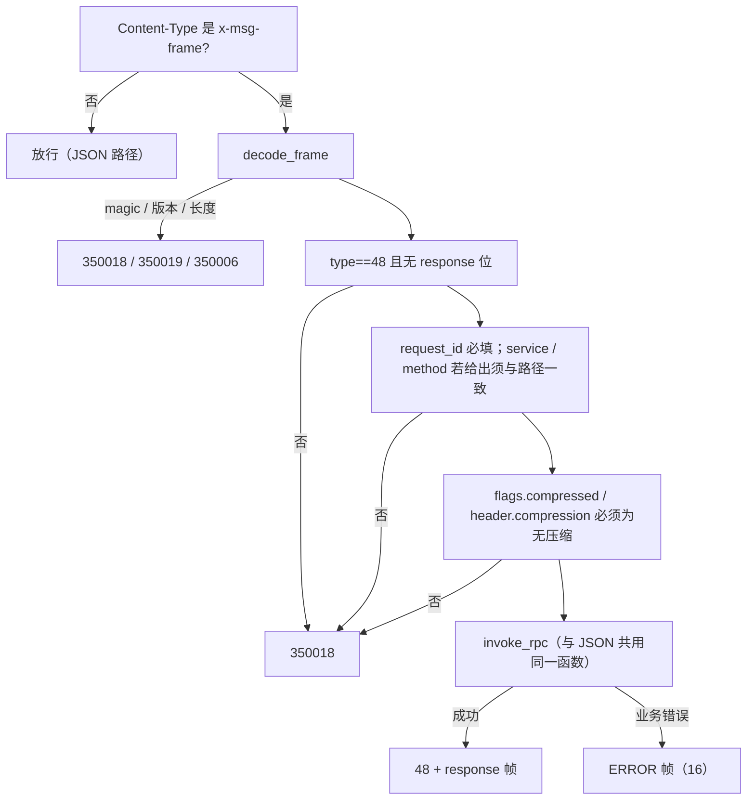
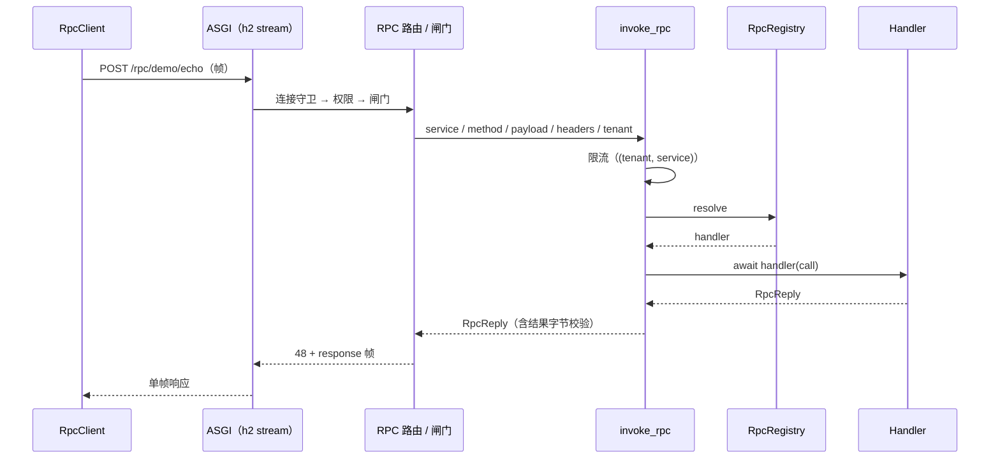

# 一元调用详细设计

> `POST /rpc/{service}/{method}` × 双形态（JSON / 帧）× `FrameType.RPC=48` 与 response 位 × `RpcRegistry` 装配期注入 × `350023` 未注册方法 × `(tenant, service)` 独立配额 × `bms_msg.client.RpcClient` 最小 stub

[文档首页](../../../../../../文档首页.md) › [消息平台规划](../../../../../../规划/01_规划_消息平台.md) › [阶段计划](../../../../计划/01_计划_消息平台.md) › [04-1 一元调用](../04_远程调用_01_一元调用.md) › 详细设计

---

## 1. 概述 <a id="overview"></a>

### 1.1 目标

在 03 域已交付的接入面上加**同步调用**语义，交付一条可用的跨服务一元调用链路：

1. **端点**：新增 `POST /rpc/{service}/{method}`，与 `/msg/*` 同挂根路径（不经 `/api/v1`），与事件共用同一条 HTTP/2 连接、各自占独立 stream。
2. **双形态**：JSON（`application/json`）与二进制帧（`application/x-msg-frame`）同一路径、同一实现——与 03-2 给 `/msg/*` 的口径一致，帧是「另一形态」不是「另一端点」。
3. **方法路由**：装配期静态注册表（`RpcRegistry`），按 `service + method` 分发；重复 `(service, method)` 即拒启；未注册方法返回 `350023`（`layer=business`、`retryable=false`），不裸抛 500。
4. **关联**：请求与响应以 HTTP/2 `stream_id` 关联，一 stream 一请求；不引入 `correlation_id`。stream 结束即释放（ASGI 请求作用域），**不建第二套在途表**。
5. **透传与记录**：`trace_id` / `caller` / `tenant` 透传进日志与响应头；本任务不做认证授权（05 域）。
6. **配额**：新增远程调用独立令牌桶维度 `(tenant, service)`，缺省关闭；与生产限流共用 `RateLimiter` 与 `350005`，不另造限流器。
7. **最小客户端**：`bms_msg.client.RpcClient.call(...)`——一元调用、帧编解码、错误映射骨架；地址来源已是「实例列表」抽象（`InstanceProvider`）。
8. **契约**：端点与错误码进 `deploy/contracts/msg.json`，方法清单进 `x-msg-frame.rpc`，`contract_snapshot check` 零漂移。

### 1.2 边界与承接

| 项 | 本任务 | 归口 |
| --- | --- | --- |
| 端点、双形态、方法注册、`350023`、远程调用配额、最小客户端、契约 | ✅ 交付 | 04-1 |
| deadline 传播、`350004`、`RST_STREAM` 取消、服务端处理中断 | ❌ 不做（客户端只有兜底超时） | 04-2 |
| 服务端流（`/rpc/{service}/{method}/stream`）、流内错误帧 | ❌ 不做 | 04-3 |
| 重试 / 退避 / 熔断 / 幂等键、`retryable` 的统一分类 | ❌ 只给字段、不做策略 | 04-4 |
| bms `BaseServiceClient` 适配、配置切换 | ❌ 不做（原口径「只保证 `bms_msg.client` 可被它 import」；**bms 07B `06_01` 立项时修正为「整条协议链上移 `bms_core/msgclient`、msg 仓删本地副本统一 import 基座」**——bms 直接 import `bms_msg` 会形成仓级循环依赖并违反架构 38 §8，且会让各产品仓各自部署一份客户端） | 04-5 / bms 07B `06_01` |
| 实例选择策略（轮询 / 最少在途）、失败摘除、探活 | ❌ 只留 `InstanceProvider` 端口 + 单地址实现 | 04-6 |
| 认证 / 授权（服务令牌、调用方白名单） | ❌ 只挂占位权限码 `msg:rpc` | 05 域 |
| 帧编解码、连接管理、h2 窗口、心跳 | ❌ 复用 | 03 域 |
| 存储 / 延迟区 / 位点 | ❌ 不碰（远程调用不写盘） | 02 域 |

### 1.3 口径来源

| 问题 | 定稿 | 出处 |
| --- | --- | --- |
| 端点路径 | `/rpc/{service}/{method}`，根路径聚合 | 需求 04-1 §2.1、架构 05 §3 |
| 关联方式 | HTTP/2 `stream_id`，一 stream 一请求 | 需求 04-1 §2.2、知识 09 §3 |
| 帧类型编号 | `48`，响应同 type + `flags.response` | 本设计 §4.1（决策 1） |
| 未注册方法错误码 | `350023`，`layer=business`、`retryable=false` | 本设计 §5.4（决策 2） |
| 注册表形态 | 装配期注入 `RpcRegistry` 实例 | 本设计 §6（决策 3） |
| 端点形态 | JSON + 帧双形态 | 本设计 §5.1（决策 4） |
| 配额键 | `(tenant, service)`，缺省关闭 | 本设计 §8（决策 5） |
| 租户来源 | 数据面口径（帧 header 不一致即 `350012`） | 本设计 §9（决策 6） |
| 客户端落点 | `bms_msg/client/rpc.py`，运行期依赖 `httpx[http2]` | 本设计 §10（决策 7） |
| stream 清理 | 请求作用域收口 + 复用连接登记 | 本设计 §7.4（决策 8） |
| 方法清单形态 | `x-msg-frame.rpc.methods`，对象数组 | 本设计 §12（决策 9 / 15） |
| 权限码 | 新增 `msg:rpc` | 本设计 §5.5（决策 10） |
| JSON 参数载体 | `payload` 为 base64 字符串 | 本设计 §5.2（决策 11） |
| 地址来源 | `InstanceProvider` + 单地址实现 | 本设计 §10.2（决策 12） |
| 连接守卫 | 挂同一 `CONNECTION_GUARD` | 本设计 §5.6（决策 13） |
| 客户端缺省超时 | 30s | 本设计 §10.4（决策 14） |

## 2. 现状与差距 <a id="gap"></a>

| 现状 | 差距 | 本任务处置 |
| --- | --- | --- |
| `FrameType` 只有 1~6 / 16 / 17 | 没有远程调用帧类型 | 增 `RPC = 48`（落在已登记的 `rpc 48-63` 区间内） |
| `reserved_types` 写 `data-plane-reserved 7-15` / `rpc 48-63` | 任务 §2.4 字面写「取 7~15」，与分组语义冲突 | 按分组语义取 48，回写任务 §2.4（§17.2 对齐记录） |
| 数据面四端点各有一个 `DataPlaneRoute` 规格 | 远程调用路径带两个 path 参数、请求模型不同，套不进 `DATA_PLANE_ROUTES` | 单端点单闸门，独立 `api/rpc/` 目录 |
| `build_frame_gate()` 的必填键与字段白名单取自数据面请求模型 | 远程调用请求模型不同，复用会带进 `namespace` / `topic` 等必填键 | 新建远程调用专用闸门 `api/rpc/gate.py` |
| `RateLimiter` 只有 tenant / topic 两级 | 任务 §2.6 的「按 path 分配配额」没有实现 | 增第三维 `(tenant, service)`，缺省关闭 |
| `bms_msg` 无调用方侧代码 | 04-5 适配时无东西可 import | 新建 `client/` 包 + 最小 `RpcClient` |
| 错误码到 `350022` | 无「方法未注册」码 | 新增 `350023`（transport 层之外唯一新码） |
| `httpx` 只在 dev 依赖组 | 客户端要在生产镜像可用 | 服务 `dependencies` 追加 `httpx[http2]` |

## 3. 交付物清单 <a id="deliverables"></a>

```text
backend/services/msg/src/bms_msg/
├── rpc/
│   ├── __init__.py                     # 出口（只导出不依赖 broker 的符号：类型 / 注册表 / 名称校验）
│   ├── registry.py                     # RpcRegistry / RpcHandler / RpcCall / RpcReply / RpcRegistrationError
│   ├── naming.py                       # ensure_rpc_name（服务端与客户端共用的形态判据）
│   ├── service.py                      # invoke_rpc：限流 → 超限 → 分发 → 结果（业务唯一出处）
│   ├── builtin.py                      # demo.echo / demo.length + default_rpc_registry()
│   └── contract.py                     # rpc_contract()：帧类型 / 响应约定 / 方法清单
├── api/rpc/
│   ├── __init__.py
│   ├── routes.py                       # POST /rpc/{service}/{method}（JSON 形态）+ 帧闸门挂载
│   └── gate.py                         # 帧形态：解码 / 校验 / 调 service / 编码
├── client/
│   ├── __init__.py                     # 出口（RpcClient / RpcReply / RpcCallError / InstanceProvider）
│   └── rpc.py                          # InstanceProvider / StaticInstanceProvider / RpcClient / 错误映射
├── schemas/rpc.py                      # RpcRequest / RpcResult
├── protocol/frame.py                   # 增 FrameType.RPC = 48
├── protocol/contract.py                # x-msg-frame 增 rpc 段
├── errors.py                           # 增 MsgErrorCode.RPC_METHOD_NOT_FOUND / MsgRpcMethodNotFoundError
├── broker/backpressure.py              # RateLimitTuning 增 rpc_per_second + check_rpc()
├── core/config.py                      # RPC 相关常量（缺省超时 / 正则 / 缺省速率）
├── api/deps.py                         # get_rpc_registry / RpcRegistryDep
├── api/router.py                       # 根路径聚合追加 rpc 路由
└── main.py                             # 装配 app.state.rpc_registry
```

| 类别 | 文件 | 说明 |
| --- | --- | --- |
| 契约快照 | `deploy/contracts/msg.json` | 重导（+1 路径 + 2 schema + `x-msg-frame.rpc`） |
| 声明 | `deploy/registry/msg.toml` | 新增 `[[errcodes]] 350023` |
| 依赖 | `backend/services/msg/pyproject.toml` | `httpx[http2]` 进运行期依赖 |
| 用例 | `tests/api/test_rpc_invoke.py`、`test_rpc_frame.py`、`test_rpc_quota.py`、`tests/rpc/test_registry.py`、`tests/client/test_rpc_client.py`、`backend/tests/ops/`（契约段） | 见 §13 |
| 文档 | 本设计 + 实施记录 + 测试记录 + 计划表回写 | — |

## 4. 协议扩展 <a id="frame"></a>

### 4.1 帧类型：`RPC = 48`，响应同 type + response 位

```python
class FrameType(IntEnum):
    ...
    RPC = 48
    """一元调用（请求帧；响应沿用本 type + `flags.response`，与 result_frame 同构）。"""
```

**为什么取 48 而不是任务文档字面的 7/8**：

| 论据 | 说明 |
| --- | --- |
| 契约已承诺分组区间 | `x-msg-frame.reserved_types` 与 `FrameType` 注释都写「数据面 1~15 / 控制面 16~31 / admin 32~47 / **rpc 48~63**」；取 7 会让远程调用落在「数据面」段，与已对外发布的区间语义冲突 |
| 保留数据面预留区 | `7-15` 是数据面后续扩展位（批量帧、背压帧等）；远程调用挤进去，未来新增数据面类型要与远程调用抢同一段 |
| 不新增第二个号 | 响应沿用 `flags.response`——这是仓内**唯一**的响应表达方式（`result_frame`、`open_frame`、心跳响应全部如此），客户端只需一套判定 |
| 二进制兼容 | 新增类型号对老客户端是兼容变更（未知类型忽略，铁律 2），不动 `reserved_types` 文本（48 落在 `rpc 48-63` 内），契约只多一条 `frame_types.48` |

**响应识别**：`type==48 且 flags.response 置位` → 结果帧；`type==16` → 错误帧（既有）。请求帧**不得**置 `response` 位（置位即 `350018`）。

### 4.2 帧头字段

| 键 | 必填 | 说明 |
| --- | --- | --- |
| `request_id` | ✅ | 既有 envelope 约定（`x-msg-frame.envelope.required`）；响应回显 |
| `service` | ❌ | 给出即校验与路径 `{service}` 一致，不一致 `350018`（防串包） |
| `method` | ❌ | 同上 |
| `caller` | ❌ | 调用方服务标识（透传进日志；与 HTTP 头冲突时的处置见 §9.2） |
| `trace_id` | ❌ | 链路标识（透传进日志与响应头） |
| `tenant` | ❌ | 给出即须与解析结果一致，不一致 `350012`（既有 `_ensure_tenant` 口径） |
| `content_type` | ❌ | 参数编码提示（`application/msgpack` / `application/json` / …），只透传给 handler，不做白名单拒绝 |
| `protocol_version` | ❌ | 版本可见（既有 envelope 可选键） |

**payload**：调用参数的**原始字节**（broker 不解析）。上限 1 MiB（复用 `MAX_FRAME_PAYLOAD_BYTES`）。

### 4.3 远程调用帧不接受压缩

`flags.compressed` 置位即 `350018`。理由：03-3 的口径是「broker 不解压、只透传」——这条对消息成立（broker 只搬运），对远程调用不成立（handler 就是 broker 内的业务代码，它收到的必须是**原始参数**）。接受压缩会造成「handler 拿到压缩字节却按原始参数解释」的静默错误，且无人解压。`header.compression` 同判（给了非 `none` 值即 `350018`）。

### 4.4 响应帧装配

```text
成功：type=48, flags=response, header={request_id, protocol_version, service, method, length}, payload=结果字节
失败：type=16（ERROR，既有），header={code, message, retryable, layer, request_id, detail?, retry_after_ms?}
```

`length` 为结果 payload 字节数（与 `message` 帧的 `length` 同口径，客户端据此切分）。错误一律走 ERROR 帧（既有 `classify()` 判定 layer / retryable），**不为远程调用另造错误帧类型**。

## 5. 端点契约 <a id="endpoint"></a>

### 5.1 路径与形态

| 项 | 值 |
| --- | --- |
| 路径 | `/rpc/{service}/{method}` |
| 方法 | `POST` |
| 聚合 | 根路径（`prefix=""`），与 `/msg/*` 并列；**不进** `/api/v1` |
| 形态 | `application/json`（缺省）与 `application/x-msg-frame` |
| 权限码 | `msg:rpc`（路由级依赖） |
| 连接守卫 | `CONNECTION_GUARD`（路由级依赖，与数据面同实例） |

**为什么挂在根路径**：需求 04-1 §2.1 与架构 05 §3 都把远程调用与 `/msg/*` 并列为「数据面入口」；`/api/v1` 是管理面与网关口径，远程调用走内网直连，不需要网关前缀。同时结果帧不能进 `/openapi.json`（生成式客户端会按 JSON 解析）。

**为什么是单路由 + 依赖闸门而不是两条路由**：03-2 已定（`gate.py` 头部注释）——同路径第二条 `include_in_schema=False` 路由会被基座 `hidden_route_violations()` 判隐藏路由；第二条可见路由会覆盖前者、抹掉 `/openapi.json` 里的请求体 schema。

### 5.2 JSON 形态请求 / 响应

```jsonc
// 请求
{
  "payload": "aGVsbG8=",          // base64；空串表示无参数
  "headers": {"x-biz": "audit"},  // 结构化头（透传给处理器；结果头由处理器决定）
  "trace_id": "4bf9…",            // 可选
  "caller": "identity"            // 可选
}

// 响应（统一 ApiResponse 包装）
{"code": 0, "message": "ok", "data": {"payload": "aGVsbG8=", "headers": {"handler": "demo.echo"}}}
```

| 决策 | 理由 |
| --- | --- |
| `payload` 用 base64 字符串 | 与 `/msg/publish` 的 `payload` 完全同口径；能承载任意二进制（protobuf / msgpack / 文本）；响应 schema 确定且非空，不撞基座「空 schema」门禁（`EMPTY_SCHEMA_ALLOWLIST` 为空集且禁业务 schema 入内） |
| 不做「`payload` 为任意 JSON 值」 | `Any` 型字段在 OpenAPI 里退化成空 schema；且帧路径（原始字节）与 JSON 路径（任意 JSON）会变成两套编码规则 |
| 沿用 `ApiResponse` | 全仓统一响应包装，前端 / SDK 只认一种 |

`service` / `method` 的形态在契约层拒绝（`10001`）：

| 参数 | 正则 | 长度 |
| --- | --- | --- |
| `{service}` | `^[a-zA-Z0-9._-]{1,64}$` | ≤ 64 |
| `{method}` | `^[a-zA-Z0-9._-]{1,128}$` | ≤ 128 |

### 5.3 帧形态

请求体恰好一帧（`decode_frame` 口径，尾部多余字节即 `350018`）。`type` 必须是 48 且未置 `response` 位。

**路径参数从 `request.path_params` 取，不声明成闸门函数的参数**（实施时踩到）：FastAPI 对同一路径参数
取「先遇到的 dependant」的参数定义，闸门里写 `service: str` 会让端点的 `Annotated[str, Path(pattern=...)]`
失效——公开契约里的 `pattern` / `minLength` 会整段消失。取 `path_params` 既不参与 schema 生成，也不改变
「依赖先于端点校验」的时序，形态仍由 `ensure_rpc_name` 在闸门里判一遍。

闸门流程：



**路径参数在闸门里拿**：FastAPI 允许依赖函数声明与路径同名的参数。但**依赖先于端点参数校验执行**，所以闸门自己也要按 §5.2 的正则再校验一次（非法 → `10001` 错误帧），不能指望端点那层先拦。

### 5.4 错误码

| 码 | 场景 | layer | retryable | HTTP |
| --- | --- | --- | --- | --- |
| `350023` | `service + method` 未在注册表（**新增**） | business | false | 404 |
| `10001` | `service` / `method` 形态非法、`payload` 非合法 base64、`headers` 形态非法 | protocol | false | 400 |
| `350006` | 参数或结果超过 1 MiB | transport | false | 413 |
| `350018` | 帧结构 / 类型不符 / 置了 response 位 / 带压缩 | protocol | false | 400 |
| `350019` | 协议主版本不支持 | transport | false | 400 |
| `350005` | 远程调用速率超配额 | business | true | 429 |
| `350012` | 租户不存在 / 帧头租户不一致 | business | false | 404 |
| `350011` | 租户已停用 | business | false | 403 |

**为什么 `350023` 不复用 `10001`**：`10001` 的既有语义是「改参可解」（协议层契约非法），而「方法未注册」改参无用，客户端应去查对端能力而不是重试；混用会让调用方朝错误方向排查，且两者 `layer` 必须在 protocol 与 business 之间二选一，任一都不准确。与 `350001`（主题不存在）/ `350013`（组不存在）同类，故归 business。

`350004` **不碰**：契约已注记为远程调用deadline 预留，归 04-2。

### 5.5 权限码 `msg:rpc`

新增常量并在路由级声明。无权限 provider 时 `require_permission` 恒放行（现状），行为不变；05 域落服务令牌时只换 provider，不改端点签名。

### 5.6 连接守卫

与数据面挂**同一实例** `CONNECTION_GUARD`：远程调用也计入 `max_connections`（`350020`）、也参与半开清扫、也能看到 drain 标记。理由：同一 h2 连接上的两类流量应受同一连接级约束，否则「只开远程调用连接」可以绕过连接数上限。

## 6. 方法注册表 <a id="registry"></a>

### 6.1 类型

```python
@dataclass(frozen=True)
class RpcCall:
    service: str
    method: str
    payload: bytes          # 原始字节（broker 不解压、不解析）
    headers: ConcurrentStableDict[str, str]
    tenant: str             # 租户编码（透传，不做授权）
    trace_id: str | None
    caller: str | None

@dataclass(frozen=True)
class RpcReply:
    payload: bytes = b""
    headers: ConcurrentStableDict[str, str] = ...

class RpcHandler(Protocol):
    async def __call__(self, call: RpcCall) -> RpcReply: ...
```

`RpcCall` / `RpcReply` 均为冻结值对象（`BaseValueObject` 派生），handler 拿到的参数不可变，避免「handler 改了 header 影响响应回显」的隐式耦合。

### 6.2 `RpcRegistry`

| 方法 | 语义 | 失败 |
| --- | --- | --- |
| `register(service, method, handler)` | 登记一个处理器 | 重复 `(service, method)` → `RpcRegistrationError`（装配期拒启，非业务码） |
| `resolve(service, method) -> RpcHandler \| None` | 取处理器 | 未注册返回 `None`（由服务层转 `350023`） |
| `methods() -> tuple[tuple[str, str], ...]` | 全部方法（插入序） | — |
| `services() -> tuple[str, ...]` | 去重后的服务名（插入序） | — |
| `__len__` | 方法总数 | — |

**为什么是实例而不是模块级全局**：与仓内「进程级状态一律 `app.state` + `Depends`」同口径（`offset_store` / `group_store` / `rate_limiter` 全部如此）；用例可各造一份、互不污染；04-5 复用时由 bms 自己的装配决定注册表内容。全局 registry 会在多 app 实例（monorepo 测试、同进程双服务）之间串扰。

**重复即拒启**：`register` 重复抛 `RpcRegistrationError`（`ValueError` 子类）。装配期在 `configure_service()` 里构造并登记，异常直接让服务拒启——这正是「启动期静态注册」要的效果。

### 6.3 内置处理器

| 方法 | 行为 | 用途 |
| --- | --- | --- |
| `demo.echo` | 结果 payload = 请求 payload 原样；`headers.handler = "demo.echo"` | 验证「原始字节透传」与跨服务调用闭环 |
| `demo.length` | 结果 payload = 十进制长度字节（如 `b"5"`）；`headers.handler = "demo.length"` | 验证「handler 能读参数并返回不同结果」 |

两者都只做字节运算，不引入任何编码假设（不需要假定 payload 是 JSON / UTF-8）。

### 6.4 方法清单与注册表同源

`default_rpc_registry()` 是唯一构造入口：装配（`main.py`）与契约导出（`rpc_contract()`）都调它，方法清单因此不可能与运行期注册表漂移。

## 7. 调用链 <a id="path"></a>

### 7.1 一次调用



### 7.2 `invoke_rpc` 判定顺序

1. **形态**：`service` / `method` 正则（契约层 `10001`）——与端点 / 闸门同正则，两处都判，防依赖先于端点校验执行。
2. **限流**：`(tenant, service)` 令牌桶，超限 `350005`（带 `retry_after_ms`）。
3. **参数上限**：`len(payload) > 1 MiB` → `350006`（不靠帧编码期抛错，JSON 路径没有帧编码期）。
4. **路由**：`resolve` 为空 → `350023`。
5. **执行**：`await handler(call)`。
6. **结果上限**：`len(reply.payload) > 1 MiB` → `350006`（否则帧编码在端点里抛错变 500）。

顺序理由：限流先于路由——打满时连注册表查询都不必做（与 03-4「连接类判定先于租户解析」同一取向）；上限先于路由——超大参数是客户端问题，不该因方法名顺手就先查表。

### 7.3 两种形态共用一处

`api/rpc/routes.py`（JSON）与 `api/rpc/gate.py`（帧）都只做「取参数 → 调 `invoke_rpc` → 编码结果」，语义不复制。JSON 形态把异常抛给基座统一错误响应；帧形态把异常转 ERROR 帧（`350018` / `350019` / `350006` / 业务错误分别编码，HTTP 恒 200）。

### 7.4 stream 生命周期

| 事件 | 处理 |
| --- | --- |
| 请求正常返回 | ASGI 请求作用域退出，无残留 |
| 客户端 `RST_STREAM` / 断开 | 协程被取消 → `CancelledError` 传播 → 作用域退出；handler 若已开始执行则其协程被取消（04-2 才补「取消后不再写响应」的语义） |
| 连接断开 | 同 h2 语义：所有在途 stream 取消 |

**不建在途表**：一元调用的 stream 就是一次请求，「连接 → 在途」表会是请求作用域的重复副本，任何漏删都是泄漏。验收断言改为「请求结束后连接登记的长驻流名额恒 0、连接数不膨胀」。

## 8. 配额 <a id="quota"></a>

### 8.1 第三维 `(tenant, service)`

```python
@dataclass(frozen=True)
class RateLimitTuning(BaseValueObject):
    tenant_per_second: int
    topic_per_second: int
    rpc_per_second: int      # 新增；0 = 不限（缺省关闭）
    burst_seconds: int

RpcKey = tuple[str, str]     # (tenant, service)

class RateLimiter:
    def check_rpc(self, *, tenant: str, service: str, now: float | None = None) -> RateVerdict: ...
```

| 项 | 取值 | 理由 |
| --- | --- | --- |
| 键 | `(tenant, service)` | 基数 = 租户数 × 注册表服务数，有界（典型十几个）；不再细分到 method，避免基数随方法数线性膨胀 |
| 缺省 | `0`（关闭） | 与 03-5「一开就生效、缺省不改既有行为」同口径；数值由 05-3 / 8B_12 给 |
| 桶上限 | 共用 `RATE_LIMIT_BUCKET_LIMIT` 与淘汰策略 | 不另造清理 |
| 错误码 | `350005` | 与生产限流同码（语义同为「速率超配额，退避可解」）；契约里 `rate_limit.scopes` 增 `rpc`，`350005` 描述由「生产限流」扩为「速率限流（生产 / 远程调用）」 |

### 8.2 与生产限流的分工

`check()`（生产，两级都判都扣）与 `check_rpc()`（远程调用，只判远程调用桶）**互不消耗**：大消息发布打满 topic 桶不会连带拒远程调用，反之亦然。这正是任务 §2.6「远程调用与事件并发时互不阻塞，大消息发布不得挤占远程调用」在配额层的落点；传输层隔离（独立 stream、h2 连接窗口共享）由 03 域保证。

## 9. 调用方与租户 <a id="identity"></a>

### 9.1 租户

沿用 `DataPlaneTenantDep`（中间件解析 + `frame_tenant()`），与 `/msg/*` 完全一致：只有一套解析与错误口径，帧不作为第二个鉴权入口。

帧头 `tenant` 给出时须与解析结果一致，否则 `350012`（不泄露租户是否存在）——与 `gate.py::_ensure_tenant` 同一判据。

### 9.2 调用方标识 `caller`

| 来源 | 优先级 | 处置 |
| --- | --- | --- |
| HTTP 头 `X-Caller-Service` | 高 | 有值即用 |
| 帧头 / JSON 体 `caller` | 低 | 仅在无 HTTP 头时使用 |
| 两者都有且不同 | — | 取 HTTP 头，记 `msg_rpc_caller_conflict` 告警日志（含两值），**不拒** |

**为什么不拒**：`caller` 不是鉴权字段（真正的授权归 05 域的服务令牌），拒绝会给 SDK 多一条失败分支而换不来安全；而 HTTP 头由网络栈 / 网关注入，可信度高于业务代码填的帧头——这与「租户以解析结果为准」的取向一致（可信来源优先）。

`caller` / `trace_id` 写入日志与响应头 `X-Caller-Service` / `X-Trace-Id`（响应头便于上游核对透传是否生效）。

## 10. 客户端 stub <a id="client"></a>

### 10.1 落点

`bms_msg/client/rpc.py`，出口 `bms_msg/client/__init__.py`。**不放进 `protocol/`**：`protocol` 是 broker 侧编解码（明确「不碰连接、不碰业务」），客户端会发网络请求；04-5 的 bms 适配只 import `bms_msg.client`，不会把 broker 侧模块拖进 bms 进程。

### 10.2 地址来源

```python
class InstanceProvider(Protocol):
    def next(self) -> str: ...

class StaticInstanceProvider:
    """静态地址列表 + 轮询（单地址即单元素列表）。"""
    def __init__(self, endpoints: Sequence[str]) -> None: ...
    def next(self) -> str: ...        # 插入序轮询，无随机（确定性、易断言）
```

对齐架构 05 §8.1：「首期单实例也走同一抽象，避免多实例时改客户端契约」。04-6 只需新增一个 provider 实现（DNS / 服务目录），`RpcClient` 签名与用例不动。

### 10.3 `RpcClient`

```python
class RpcClient:
    def __init__(
        self,
        instances: InstanceProvider,
        *,
        timeout_ms: int = RPC_DEFAULT_TIMEOUT_MS,
        transport: AsyncBaseTransport | None = None,   # 用例注入 ASGITransport
    ) -> None: ...

    async def call(
        self,
        service: str,
        method: str,
        payload: bytes = b"",
        headers: Mapping[str, str] | None = None,
        *,
        trace_id: str | None = None,
        caller: str | None = None,
        timeout_ms: int | None = None,
    ) -> RpcReply: ...

    async def aclose(self) -> None: ...
    async def __aenter__(self) -> RpcClient: ...
    async def __aexit__(self, *exc: object) -> None: ...
```

| 项 | 实现 |
| --- | --- |
| 传输 | `httpx.AsyncClient(http2=True)`（运行期依赖 `httpx[http2]`） |
| 租户 | 请求头 `X-Tenant-ID`：构造 `RpcClient(tenant=...)` 给缺省值，`call(tenant=...)` 覆盖。远程调用与 `/msg/*` 共用同一基座中间件，不带这个头服务端解析不到租户（`350012`） |
| 请求体 | **帧形态**（`application/x-msg-frame`）：`type=48`，header 带 `request_id`（`uuid4().hex`）/ `service` / `method` / `caller` / `trace_id`，payload 为参数原始字节 |
| 响应 | `decode_frame` 后：`type==16` → 抛 `RpcCallError`（从 header 取 `code` / `message` / `retryable` / `layer` / `retry_after_ms`）；`type==48 且 response 位` → `RpcReply` |
| URL | `f"{base}/rpc/{service}/{method}"`，base 取自 `instances.next()`（末位 `/` 归一） |
| 超时 | 单次调用 `timeout_ms`（缺省 30s），httpx `Timeout` → `RpcCallTimeoutError` |
| 非 200 | 429 → `RpcCallError(350005, retryable=True)`；413 → `350006`；其余 → `RpcCallError(code=0, layer="transport")` |

**本任务不做**：不重试、不熔断、不负载均衡策略（04-4 / 04-6）、不传播 deadline（04-2）。

### 10.4 缺省超时 30s

与 `SUBSCRIBE_MAX_WAIT_MS`（长轮询缺省 30s）同尺度，运维只需记一个时间量级；给 04-2 的 deadline 传播留出足够预算空间。需要更快失败时由调用方显式传 `timeout_ms`。

### 10.5 错误映射

```python
class RpcCallError(Exception):
    code: int          # 产品码 / 0（无法映射时）
    message: str
    retryable: bool
    layer: str         # transport / protocol / business / system

class RpcCallTimeoutError(RpcCallError):
    """客户端兜底超时（04-2 的 deadline 超时用 350004，本任务不占该码）。"""
```

`RpcCallError` 只搬运服务端给的判定，**不自行分类**：`retryable` 由服务端的 `classify()` 决定（唯一出处），客户端照用——否则两端会各有一张码表并逐渐漂移。

## 11. 装配与接线 <a id="assembly"></a>

### 11.1 改动点

| 文件 | 改动 |
| --- | --- |
| `main.py::configure_service` | `app.state.rpc_registry = default_rpc_registry()`（一行；插在其它进程级状态之后） |
| `api/deps.py` | `get_rpc_registry(request) -> RpcRegistry` + `RpcRegistryDep` |
| `api/router.py` | `frame_router` 的登记表追加 `rpc_routes.router` |
| `api/rpc/routes.py` | `BaseRouter(key="msg_rpc", prefix="/rpc", tags=["msg-rpc"], dependencies=[Depends(CONNECTION_GUARD), Depends(require_permission(RPC_PERMISSION))])` |
| `pyproject.toml` | `httpx[http2]` 进 `dependencies` |

### 11.2 第二装配路径的陷阱（必须同步三处）

帧闸门是「直调端点实现」的第二条装配路径。本任务的远程调用闸门**不走** `gate.py::_invoke`（那是数据面四端点的分发器），因此不涉及「改 `_invoke` / `_handle_frame` / 闸门函数三处」那条历史陷阱；但同类风险换了个位置，必须守住：

| 约束 | 说明 |
| --- | --- |
| 端点与闸门只共享 `invoke_rpc` | 语义只写一遍；任何一个形态新增校验，另一形态必须同时生效（共享处改一份） |
| 路径参数正则两处都判 | 依赖先于端点参数校验执行，闸门不能指望端点先拦 |
| 新增 `Depends` 时同步闸门参数 | 端点签名新增依赖（如将来的 deadline 上下文），闸门函数必须同时加同名参数，否则帧形态拿不到该依赖 |

### 11.3 契约导出

`ops/contract_snapshot.py` **不改**：`frame_contract()` 内部已聚合 `rpc_contract()`，OpenAPI 自动包含新端点。只需重导快照。

## 12. 契约影响面 <a id="contract"></a>

| 变化 | 内容 |
| --- | --- |
| `paths` | +1：`/rpc/{service}/{method}`（POST，`x-error-codes: [350011, 350012, 350005, 350006, 350023]`） |
| `components.schemas` | +2：`RpcRequest` / `RpcResult` |
| `x-msg-frame.frame_types` | +1：`"48": "rpc"` |
| `x-msg-frame.rpc` | 新增段（见下） |
| `x-msg-frame.reserved_types` | **不改**（48 落在 `rpc 48-63` 内） |
| `x-msg-frame.backpressure.rate_limit.scopes` | `["tenant", "namespace+topic", "rpc"]` |
| 错误码声明 | `deploy/registry/msg.toml` +1 条 `350023` |
| 契约版本 | 不变（`0.1.0`；新增端点与新增帧类型都是兼容变更，架构 05 §10） |

`x-msg-frame.rpc` 结构：

```jsonc
{
  "frame_type": 48,
  "response": "same type + flags.response",
  "request_required": ["request_id"],
  "request_optional": ["service", "method", "caller", "trace_id", "tenant", "content_type", "protocol_version"],
  "payload": "调用参数原始字节（broker 不解析；上限 1 MiB；不接受压缩）",
  "compression": "不支持（flags.compressed 置位即 350018）",
  "errors": {"method_not_found": 350023},
  "methods": [{"service": "demo", "method": "echo"}, {"service": "demo", "method": "length"}]
}
```

**为什么放在 `x-msg-frame` 下而不是新增顶层 `x-rpc-*`**：帧类型与远程调用方法是同一层语义（都是帧契约的一部分），一处分治；且基座 `validate_contract` 不判未知顶层键、bms 跨仓对账只读 `paths`（已核实），放哪都不会被拒——那就选内聚的位置，避免帧相关契约被拆成两个顶层键后评审只看到一个。

## 13. 测试设计 <a id="tests"></a>

### 13.1 用例文件与覆盖点

| 文件 | 覆盖点 |
| --- | --- |
| `tests/rpc/test_registry.py` | 登记 / 重复拒启 / 解析命中与未命中 / `methods()` 与 `services()` 插入序 / 内置两处理器行为 |
| `tests/api/test_rpc_invoke.py` | JSON 形态：成功（echo / length）、未注册 `350023`、`service` 形态非法 `10001`、`payload` 非合法 base64 `10001`、参数超限 `350006`、结果超限 `350006`、租户停用 `350011`、租户不存在 `350012`、`caller` 冲突取 HTTP 头 |
| `tests/api/test_rpc_frame.py` | 帧形态：成功帧（type 48 + response）、`request_id` 缺失 `350018`、类型不符 `350018`、置 response 位 `350018`、带压缩 `350018`、`service` 不一致 `350018`、帧头租户不一致 `350012`、magic 不符（4xx JSON）、主版本不支持 `350019`、业务错误转 ERROR 帧（HTTP 200） |
| `tests/api/test_rpc_quota.py` | `check_rpc` 独立于生产桶（发布打满不影响远程调用）、超限 `350005` + `retry_after_ms`、缺省 0 关闭、桶数上限淘汰 |
| `tests/client/test_rpc_client.py` | 对 `ASGITransport` 的真实调用闭环（echo 回原文 / length 回长度）、错误帧映射 `RpcCallError`、非 200 映射、超时 `RpcCallTimeoutError`、`StaticInstanceProvider` 轮询与单地址、`aclose` |
| `backend/tests/ops/test_frame_contract_snapshot.py`（补断言） | `x-msg-frame.rpc` 存在且方法清单与 `default_rpc_registry()` 同值 |
| `tests/test_error_codes.py`（补对账） | `350023` 在枚举 / `msg.toml` / 端点 `x-error-codes` 三处一致 |

### 13.2 关键断言

| 验收标准 | 断言方式 |
| --- | --- |
| 可完成一次跨服务一元调用并拿到结果 | 客户端 → `ASGITransport` → `demo.echo`，结果字节与入参相同 |
| 未注册方法返回明确错误（非 500） | JSON 404 + `350023`；帧形态 ERROR 帧 `code=350023`、`layer=business`、`retryable=false` |
| 同一连接上远程调用与事件发布并发互不阻塞 | 复用 03-1 的真 h2c 用例体例：同连接并发 publish + rpc，两者均成功；配额互不消耗（`check_rpc` 与 `check` 桶独立） |
| stream 关闭后无等待项残留 | 请求结束后 `ConnectionRegistry.get(key).streams == 0`，连接数不随调用次数增长 |
| 契约零漂移 | `ops.contract_snapshot check` 退出码 0 |

### 13.3 Kiwi

一条用例（覆盖上表全部断言），编号在写用例前回读最大号 + 1 并在代码中标注。

## 14. 实施步骤 <a id="steps"></a>

| # | 步骤 | 产物 |
| --- | --- | --- |
| 1 | 帧类型 + 错误码 + 常量 | `protocol/frame.py`、`errors.py`、`core/config.py`、`msg.toml` |
| 2 | 注册表与内置处理器 | `rpc/registry.py`、`rpc/builtin.py` |
| 3 | 服务层（限流 / 上限 / 分发 / 结果） | `rpc/service.py` |
| 4 | 配额第三维 | `broker/backpressure.py` |
| 5 | 契约模型 | `schemas/rpc.py` |
| 6 | 端点与闸门 | `api/rpc/routes.py`、`api/rpc/gate.py` |
| 7 | 装配接线 | `api/deps.py`、`api/router.py`、`main.py`、`pyproject.toml` |
| 8 | 客户端 stub | `client/rpc.py` |
| 9 | 契约导出 | `python -m ops.contract_snapshot export` → `check` |
| 10 | 用例 + 门禁 | §13 用例文件；ruff / format / pyright；变更模块行 + 分支 100% |

## 15. 验收映射 <a id="accept-map"></a>

| 完成标准（任务 §3） | 落点 |
| --- | --- |
| 可完成一次跨服务一元调用并拿到结果 | §10.3 客户端 + `demo.echo`；用例 `test_rpc_client.py` |
| 未注册方法返回明确错误（非 500） | §5.4 `350023`；用例 `test_rpc_invoke.py` / `test_rpc_frame.py` |
| 同一连接上远程调用与事件并发互不阻塞；stream 关闭后无残留 | §7.4 / §8.2；复用真 h2c 用例体例 + 连接登记断言 |
| 方法清单与端点进契约快照，`check` 零漂移 | §12；`ops.contract_snapshot check` |
| 变更模块行 + 分支覆盖率 100%，静态全绿 | §13 + 门禁命令 |

## 16. 风险与开放项 <a id="risk"></a>

| # | 风险 / 开放项 | 处置 |
| --- | --- | --- |
| 1 | `httpx[http2]` 进运行期依赖会增大镜像 | 已核实 venv 内 `h2` / `hpack` / `hyperframe` 齐备；依赖声明写进 `pyproject.toml`，锁文件由 uv 解析 |
| 2 | 远程调用与事件共用连接时 h2 连接级窗口共享，一条慢流会拖住另一条 | 协议语义，已在 `x-msg-frame.stream.connection_window` 写明；应用层互不影响 |
| 3 | 一元调用无 deadline（04-2 才有），服务端处理慢时客户端只能等 httpx 超时 | 客户端兜底 30s + 文档标注；04-2 补 deadline 传播 |
| 4 | 注册表为进程内静态表，多副本不一致需靠部署保证 | 首期单副本；跨实例一致性归 04-6 / 8B_05 |
| 5 | `service` 与服务目录不联动，拼错服务名只能得到 `350023` | 本任务明确不做（目录校验归 04-6）；`350023` 的 message 会带上未注册的 `service + method` |
| 6 | 远程调用限流缺省关闭 | 与 03-5 同口径；数值由 05-3 / 8B_12 给 |
| 7 | 端点权限码 `msg:rpc` 在无 provider 时恒放行 | 05 域落服务令牌前，远程调用仅靠内网可达性保护（已登记） |

## 17. 决策确认与对齐记录 <a id="align"></a>

### 17.1 决策（2026-11-05 逐项确认）

| # | 事项 | 结论 |
| --- | --- | --- |
| 1 | 帧类型编号 | `RPC = 48`，响应同 type + `flags.response`（不取 7/8，不双向复用两根线） |
| 2 | 未注册方法错误码 | 新占 `350023`（business / 不重试）；方法名形态非法仍 `10001` |
| 3 | 注册表形态 | 装配期注入 `RpcRegistry` 实例 |
| 4 | 端点形态 | 双形态：JSON + `application/x-msg-frame` |
| 5 | 配额键 | 新增远程调用独立 scope `(tenant, service)`，缺省关闭 |
| 6 | 租户 / 调用方 | 租户沿数据面口径（不一致 `350012`）；`caller` 冲突取 HTTP 头 + 告警，不拒 |
| 7 | 客户端落点 | `bms_msg/client/rpc.py` + 运行期 `httpx[http2]` |
| 8 | stream 清理 | 不建在途表；请求作用域收口 + 复用 `ConnectionRegistry` |
| 9 | 方法清单形态 | `x-msg-frame.rpc`（含 `frame_type` / `response` / `methods`） |
| 10 | 权限码 | 新增 `msg:rpc` 并挂上 |
| 11 | JSON 参数载体 | `payload` 为 base64 字符串 + `headers` |
| 12 | 地址来源 | `InstanceProvider` + 静态单地址实现 |
| 13 | 连接守卫 | 挂同一 `CONNECTION_GUARD` |
| 14 | 客户端缺省超时 | 30s |
| 15 | 方法清单条目 | 对象数组 `{service, method}` |

按既有口径直接决定（无取舍空间）：payload 上限 1 MiB 并复用于结果；超限 `350006`；远程调用不判存储水位、不碰延迟区与 02 存储；错误响应复用 `ERROR(16)`；JSON 响应用 `ApiResponse` 包装；`{service}` 不与服务目录联动。

### 17.2 与既有设计的对齐

| 既有文档 | 原文 | 本次处置 |
| --- | --- | --- |
| 任务 04-1 §2.4 | 「在 03-2 预留的 `6-15` 区间中取 `7-15`」 | 改为「取 `rpc` 区间首号 `48`，响应沿用同 type + response 位」；理由见 §4.1（`reserved_types` 已把 `7-15` 登记为数据面预留、`48-63` 登记为 rpc） |
| 任务 04-1 §2.6 | 「与 `/msg/*` 共用连接时按 path 分配配额」 | 落为远程调用独立令牌桶 `(tenant, service)`（03-5 的 `RateLimiter` 只有 tenant / topic 两维，无 path 维度，本次补第三维） |
| 任务 04-1 §2.7 | 「最小 `RpcClient.call(service, method, payload, headers)`」 | 按此签名交付；另加 `InstanceProvider`（架构 05 §8.1 要求「单实例也走同一抽象」） |
| 架构 05 §4 `type` 取值 | 列 `publish / ack / subscribe / error / heartbeat` | 本次回写补 `rpc`（48）与 `message`（6） |
| 架构 05 §5 码段 | `350004` 预留远程调用deadline | 不启用；新增 `350023`（方法未注册），`350004` 仍归 04-2 |
| 架构 05 §8.1 寻址 | 「首期可单地址，但接口要留位」 | `InstanceProvider` + `StaticInstanceProvider` |
| 03-2 帧契约 | `reserved_types` 含 `rpc 48-63` | 不改；`frame_types` 增 `48: rpc` |
| 03-5 限流 | 两级（tenant / topic）、`350005` | 增第三维 `rpc`；`350005` 描述扩为「速率限流（生产 / 远程调用）」 |
| 本设计 §5.3（实施回写） | 「路径参数在闸门里拿」 | 改为从 `request.path_params` 取：声明成依赖参数会把端点的 `Path` 约束挤出公开契约（实测） |
| 本设计 §10.3（实施回写） | 客户端未写租户传递 | 增 `tenant`（构造缺省 + `call()` 覆盖），请求头写 `X-Tenant-ID`；头名与 `api/rpc/caller.py` 同源（`core/config.py`） |

---

> 依《[文档生成规范](../../../../../../../bms文档/规范/文档生成规范.md)》编写 · 任务文档见 [04-1 一元调用](../04_远程调用_01_一元调用.md)
