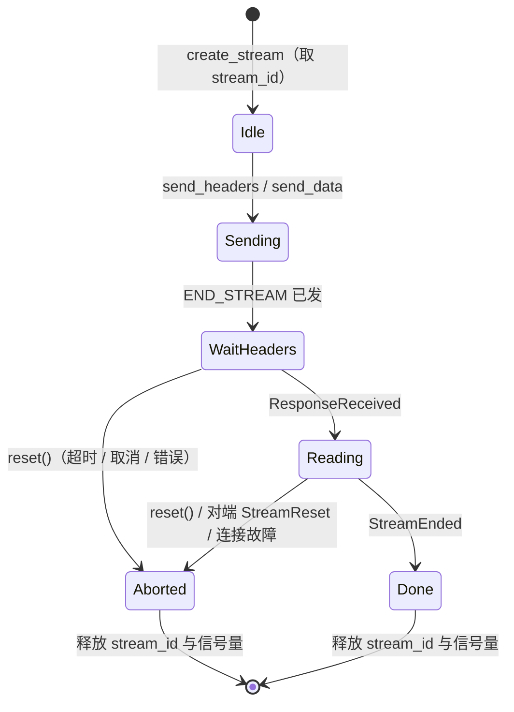
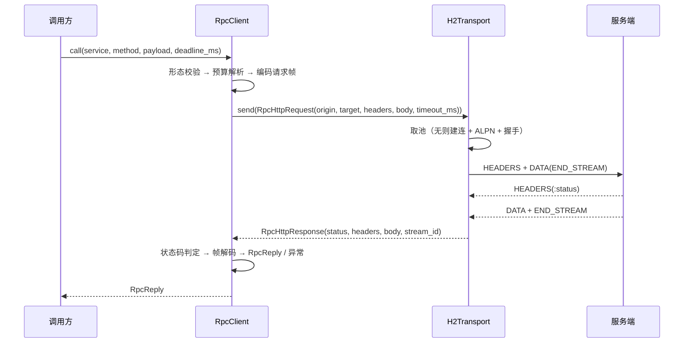

# H2 传输层详细设计

> 自持 HTTP/2 客户端传输层（`client/transport/` 子包）× `RpcTransport` 协议（生产 `H2Transport` / 测试 ASGI + 脚本传输）× 单连接单读取任务 + 每流队列 × 按 origin 分池与并发流上限 × 流中止 `RST_STREAM(CANCEL)` × 异常梯度 → `350004` / transport 层 `RpcCallError` × 删 `timeout_ms` 别名 × 存量注入面迁移

[文档首页](../../../../../../../文档首页.md) › [消息平台规划](../../../../../../../规划/01_规划_消息平台.md) › [阶段计划](../../../../../计划/01_计划_消息平台.md) › [04-7 客户端精确取消](../../04_远程调用_07_客户端精确取消.md) › [04-7-1 H2 传输层](../04_远程调用_07_客户端精确取消_01_H2传输层.md) › 详细设计

---

## 1. 概述 <a id="overview"></a>

### 1.1 目标

把「客户端传输」从 `httpx` 的黑盒里拿出来，变成 msg 自己能演进的一层，顺带解决 04-2 留下的两个硬缺口：**拿不到 stream**（无法精确取消）、**发不出 RST**（取消只能本地放弃）。

1. **自持传输层**：`client/transport/` 子包自管连接、并发流、流生命周期、读写与流控，不再经 `httpx`；`RpcClient` 只依赖一个 `RpcTransport` 协议。
2. **协议收窄**：`RpcTransport.send(request) -> response` 一元收发 + `aclose()` + `stats()`；值对象不暴露 h2 细节，但保留 `stream_id` 供观测与用例断言。
3. **流中止原语**：`H2Stream.reset()` 发 `RST_STREAM(CANCEL)`，**只作用于该 stream**，同连接其它在途流不受影响（本子任务交付原语与用例，取消接线归 04-7-2）。
4. **异常梯度**：传输层抛自有异常（超时 / 连接关闭 / 协议错 / 不支持），`RpcClient` 映射为既有 `RpcCallTimeoutError(350004)` 与 `RpcCallError(layer=transport)`——**对调用方的可见行为不变**。
5. **注入面换血**：测试不再依赖 `httpx.ASGITransport` / `MockTransport`；改由 `tests_support` 提供 `AsgiRpcTransport`（进程内驱动真 app）与 `ScriptedRpcTransport`（造错误帧 / 抛传输异常）。
6. **API 面收口**：删 `timeout_ms` deprecated 别名（04-5 尚未适配，是唯一零成本窗口），客户端只剩 `deadline_ms` 一种预算语义。
7. **TLS 起步就位**：`https` 走 TLS + ALPN（协商结果必须是 `h2`，否则协议错），用静态自签证书夹具覆盖；不做的用显式异常而非静默降级。

### 1.2 边界与承接

| 项 | 本子任务 | 归口 |
| --- | --- | --- |
| 连接 / 读取任务 / 流 / 流控 / 池 / 异常 / 超时 / TLS-ALPN | ✅ 交付 | 04-7-1 |
| `RpcTransport` 协议 + 生产实现 + 两个测试实现 + 存量用例迁移 | ✅ 交付 | 04-7-1 |
| 删 `timeout_ms` 别名、`httpx` 降 dev 依赖、`h2` 提直接依赖 | ✅ 交付 | 04-7-1 |
| 流中止原语 `reset()` 与「RST 只影响本流」用例 | ✅ 交付 | 04-7-1 |
| 取消路径接 `reset()`、`rst_sent` 观测、真机验收（服务端中断时延） | ❌ 不做 | 04-7-2 |
| 流式（多帧响应、流内错误、背压消费） | ❌ 不做（协议留位，不做实现） | 04-3 |
| 重试 / 退避 / 熔断 / 幂等键 | ❌ 不做 | 04-4 |
| 实例选择策略、失败摘除、DNS 刷新 | ❌ 不做（池按 origin 分，选择权仍在 `InstanceProvider`） | 04-6 |
| 服务端任何改动 | ❌ 不改 | 04-2 已收口 |
| 压测脚本客户端替换（`scripts/bench/run_bench.py` 仍是 httpx） | ❌ 不做 | 平台级容量实测 |

### 1.3 口径来源

| 问题 | 定稿 | 出处 |
| --- | --- | --- |
| 传输实现路线 | h2 自持连接（spike 实测三条路线后拍板） | 本设计 §13 决策 1、实施前置实测记录 |
| `httpcore` 为什么不用 | 无公开的流重置出口，`stream_id` 只能从 `_events` 反推，需摸 5 处私有属性 | 本设计 §2（spike 结论 B） |
| 测试注入面 | 自造 `RpcTransport` 协议，生产 / 测试同构 | 本设计 §13 决策 2 |
| 池归属 | `RpcClient` 自持，池内按 origin 分连接 | 本设计 §13 决策 5 |
| 依赖 | `h2` 提直接依赖；`httpx` 降 dev | 本设计 §13 决策 6 / 14 |
| 取消 API 形状 | `task.cancel()` 即取消，不新增句柄；取消后原样 `CancelledError` | 本设计 §13 决策 3 / 4（沿用 04-2 决策 14） |
| TLS | 首期支持 `https` + ALPN `h2` | 本设计 §13 决策 13 |
| 取消中断阈值 | ≤ 一个轮询周期 + 一帧往返（判据取 150ms） | 04-7-2 详细设计（决策 8） |
| 帧与错误码 | 不改帧、不改错误码、不改 `RpcReply` | 需求 04-7 §2.7、04-2 决策 6 |
| `deadline_ms` 语义 | 相对剩余毫秒，写帧头，逐跳扣减 | 04-2 详细设计 §4.1 |

## 2. 现状与差距 <a id="gap"></a>

### 2.1 三条路线的实测结论（实测在前、拍板在后）

裸 asyncio + `h2` 自建服务端（只收帧、打日志），三客户端分别「发一个不等响应的请求 → 取消 → 同连接再发一个」：

| 路线 | 取消时服务端收到 | 同连接后续请求 | 代价 |
| --- | --- | --- | --- |
| `httpx 0.28.1`（现状） | **无 RST**，连接关闭才断 | stream=3 → `200`（连接仍可用） | 无法精确取消，也没有任何钩子可挂 |
| `httpcore 1.0.9` 池 + 手工 reset | `RST_STREAM error_code=8`（CANCEL） | stream=3 → `200` | 需摸 `pool._connections` → `wrapper._connection` → `conn._events`（**反推 stream_id，无公开出口**）→ `_h2_state.reset_stream` → `_write_outgoing_data` |
| `h2 4.4.1` 自持连接 | `RST_STREAM error_code=8`（CANCEL） | stream=3 → `200`，连接复用正常 | 需要自己写连接 / 多路复用 / 流控 / 池 |

结论：**只有自持连接能把「取消 → 发 RST」做成稳定路径**。`httpcore` 那条能跑通，但它是 `httpx` 的传递依赖、无版本承诺，且 stream_id 没有公开出口——升一次版就可能静默失效，而失效表现恰好是「取消又变回本地放弃」，最难发现。

### 2.2 代码现状（`client/rpc.py`）

| 现状 | 差距 |
| --- | --- |
| `httpx.AsyncClient(http2=True, transport=transport)` 一包到底 | 连接 / 流生命周期都在黑盒里；`transport` 参数把测试与生产绑在同一实现的两种装配上 |
| 本地超时靠 `httpx` 的 `timeout=` | 超时点不可控（连接 / 读头 / 读体共用一组参数），也无法在超时时精确中止某个流 |
| 错误映射只认 `httpx.TimeoutException` / `httpx.HTTPError` | 换传输后无对应物，需自有异常梯度 |
| `timeout_ms` 别名仍在 | 两个名字两个语义，04-5 会照着别名写 |
| 用例注入 `ASGITransport` / `MockTransport` | 生产与测试不同构——04-2 正是「测试全绿、真机不发 RST」的原因 |

## 3. 交付物清单 <a id="deliverables"></a>

| 文件 | 类型 | 职责 |
| --- | --- | --- |
| `client/transport/__init__.py` | 新增 | 出口（只导出协议、值对象、异常、`H2Transport`） |
| `client/transport/base.py` | 新增 | `RpcTransport` 协议、`RpcHttpRequest` / `RpcHttpResponse` / `TransportStats`、异常梯度 |
| `client/transport/connection.py` | 新增 | 单连接：握手、读取任务、事件分派、写锁、SETTINGS / 窗口 / GOAWAY、`reset_stream()` |
| `client/transport/stream.py` | 新增 | 单流：等响应头、读体、`reset()`、关闭与状态 |
| `client/transport/pool.py` | 新增 | `H2Transport`：按 origin 分池、并发流上限、空闲回收、TLS-ALPN、异常映射 |
| `client/rpc.py` | 改造 | 走 `RpcTransport`；删 `timeout_ms`；异常映射改自有梯度；`aclose()` 收口传输 |
| `tests_support/rpc_transport.py` | 新增 | `AsgiRpcTransport`（进程内真 app）、`ScriptedRpcTransport`（造帧 / 抛错） |
| `tests_support/h2_server.py` | 新增 | 裸 h2 服务端夹具（多路由：正常 / 慢 / 大 / 主动 reset / GOAWAY / 断连 / TLS） |
| `tests_support/certs/h2-test.{crt,key}` | 新增 | 静态自签证书（`CN=127.0.0.1` + `IP:127.0.0.1` SAN，长有效期），TLS 用例夹具 |
| `tests/client/transport/test_transport_pool.py` | 新增 | 池 / 复用 / 并发流上限 / 空闲回收 / 关池 |
| `tests/client/transport/test_transport_stream.py` | 新增 | 流中止（RST）、GOAWAY、对端 reset、大响应流控 |
| `tests/client/transport/test_transport_errors.py` | 新增 | 异常梯度：超时 / 连接关闭 / 协议错 / 不支持 scheme / ALPN 不符 |
| `tests/client/test_rpc_client.py`、`tests/client/test_rpc_client_deadline.py` | 改造 | 注入面迁到 `AsgiRpcTransport` / `ScriptedRpcTransport`；删 4 条别名用例 |
| `pyproject.toml`（`services/msg`） | 改造 | `h2>=4.1` 提直接依赖；`httpx[http2]` 降 dev 组 |

## 4. `RpcTransport` 协议与契约 <a id="contract"></a>

### 4.1 值对象

```python
@dataclass(frozen=True, slots=True)
class RpcRequestTrace:
    request_id: str
    service: str
    method: str

@dataclass(frozen=True, slots=True)
class RpcHttpRequest:
    origin: str                          # "http://msg:8000"，池键（不含尾斜线）
    target: str                          # "/rpc/demo/echo"
    headers: tuple[tuple[str, str], ...]  # 已含 content-type / 租户头
    body: bytes
    timeout_ms: int                      # 本地超时（预算 + 余量，由 RpcClient 算）
    trace: RpcRequestTrace | None = None  # 只用于日志关联（传输层不解释语义）

@dataclass(frozen=True, slots=True)
class RpcHttpResponse:
    status: int
    headers: tuple[tuple[str, str], ...]
    body: bytes
    stream_id: int                       # 观测与用例断言（测试传输给 0）

@dataclass(frozen=True, slots=True)
class TransportStats:
    connections: int                     # 当前存活连接数
    open_streams: int                    # 当前在途流数
```

| 决策 | 理由 |
| --- | --- |
| 值对象放 `base.py`、不放 `rpc.py` | `rpc.py` 只该有「怎么调用」，不该有「怎么发字节」；协议放传输包，测试传输实现同一份值对象 |
| `headers` 用元组而非 dict | 帧头与 HTTP 头都是有序多值；dict 会让「同名头覆盖」变成隐式行为，且不可冻结 |
| `stream_id` 进响应 | 观测要能回答「哪条流被 reset」；用例要断言「取消的是 stream=1、后续是 stream=3」 |
| `stats()` 进协议 | 「同连接不受影响」这条验收必须有可断言的事实（连接数没涨、在途流归零），否则只能看日志 |
| `trace` 进请求值对象 | 取消 / 超时的日志要能关联到 `request_id` / `service` / `method`，而这些只有 `RpcClient` 知道；传输层只把它当不透明字段转发给日志（回指 04-7-2 §5.3） |

### 4.2 异常梯度

| 异常 | 何时 | `RpcClient` 映射 |
| --- | --- | --- |
| `RpcTransportTimeoutError` | 连接 / 等响应头 / 读体超时（`timeout_ms` 到期） | `RpcCallTimeoutError`（`350004` / business / 不重试） |
| `RpcTransportClosedError` | 连接被关闭、GOAWAY、池满、对端 reset 本流 | `RpcCallError(code=0, layer="transport")` |
| `RpcTransportProtocolError` | 帧不可解析、状态码缺失、ALPN 未协商到 `h2` | `RpcCallError(code=0, layer="protocol")` |
| `RpcTransportUnsupportedError` | scheme 不是 `http` / `https` | `RpcCallError(code=0, layer="transport")`（本地先拦，不发网络） |

**取消不走异常梯度**：`asyncio.CancelledError` 原样穿透传输层与 `RpcClient`，不包装、不吞（04-7-2 §5）。

### 4.3 `send()` 的语义

| 情形 | 行为 |
| --- | --- |
| 成功 | 返回 `RpcHttpResponse`，流已关闭（`END_STREAM` 收齐） |
| 非 2xx | 仍返回 `RpcHttpResponse`（状态码与体由 `RpcClient` 判，传输层不解释业务） |
| 超时 | 中止本流（`RST_STREAM(CANCEL)`）后抛 `RpcTransportTimeoutError` |
| 调用方取消 | 中止本流后原样抛出 `CancelledError`（接线归 04-7-2） |
| 连接层故障 | 标记连接不可用、唤醒该连接全部在途流，抛 `RpcTransportClosedError` |

**非 2xx 不当异常**：状态码语义属调用方（429 / 413 的映射在 `RpcClient._error_of`）；传输层一旦开始解释状态码，两处判定就会漂移。

## 5. 传输层实现 <a id="impl"></a>

### 5.1 模块与依赖方向

```text
client/rpc.py            ← 只 import base（协议 + 值对象 + 异常）
        │
client/transport/__init__.py
        ├── base.py       ← 无依赖（标准库）
        ├── stream.py     ← base
        ├── connection.py ← base + stream + h2
        └── pool.py       ← base + connection (+ ssl)
```

单向无环：`rpc.py` 不知道 `h2` 存在；`connection.py` 不知道「远程调用」存在（只管 HTTP/2）。

### 5.2 连接建立

| 步骤 | 做法 | 失败分支 |
| --- | --- | --- |
| 1 解析 origin | `urlsplit`；scheme ∈ {`http`,`https`}，否则 `RpcTransportUnsupportedError` | 不支持 scheme |
| 2 TCP / TLS | `asyncio.open_connection(host, port)`；`https` 时传 `ssl=ctx, server_hostname=host` | `OSError` → `RpcTransportClosedError` |
| 3 ALPN 校验 | `writer.get_extra_info("ssl_object").selected_alpn_protocol() == "h2"`，否则关连接并抛 `RpcTransportProtocolError` | 协商失败 |
| 4 握手 | `H2Connection.initiate_connection()` + `increment_flow_control_window(2**24)`（本端接收窗口一次提到 16 MiB） | 写失败 → 关闭 |
| 5 起读取任务 | `asyncio.create_task(conn._reader_loop())`，异常自吞并标记连接不可用 | — |

**为什么本端接收窗口一次提到 16 MiB**：一元响应上限 1 MiB（`MAX_FRAME_PAYLOAD_BYTES`），默认 64 KiB 窗口会让每个大响应都卡在 `WINDOW_UPDATE` 往返上；提前放大比逐帧调窗省一串往返，且内存上界仍由「每流最多 1 MiB」兜住。

### 5.3 读取任务与事件分派

> **实施回写（2026-11-06）**：分派只**显式枚举**四类流事件（`ResponseReceived` / `DataReceived` / `StreamEnded` / `StreamReset`），其余事件（`SettingsAcknowledged` / `PingAcknowledged`）不处理。实测踩过：这两类事件**不带 `stream_id`**，若用 `else` 兜底去取 `stream_id` 会 `AttributeError`，把整条连接判成异常（表现为所有用例同时红）。

单连接**只有一条读取任务**（不是每流一条）：`reader.read()` → `receive_data()` → 按事件分派到各流的队列。这样 h2 状态机永远在同一个协程里被推进，不需要为状态机加锁，也不会出现「两条流各自读半帧」。

| h2 事件 | 动作 |
| --- | --- |
| `ResponseReceived` | 记 `status` / 头，唤醒该流的「等响应头」等待者 |
| `DataReceived` | 追加到该流缓冲 + `acknowledge_received_data()` + 触发写 `WINDOW_UPDATE` |
| `StreamEnded` | 标记该流结束，唤醒「读体」等待者 |
| `StreamReset` | 该流以 `RpcTransportClosedError(error_code)` 结束（对端中止） |
| `WindowUpdated` | 唤醒等待发送窗口的流（请求体 > 64 KiB 时要用） |
| `RemoteSettingsChanged` | 更新并发流上限（实现用「在途数 + 事件」而非信号量，见 §5.4） |
| `ConnectionTerminated`（GOAWAY） | 记 drain；stream_id > `last_stream_id` 的流立刻以 `ClosedError` 结束，其余允许跑完 |
| `PingReceived` / `SettingsAcknowledged` | 不处理：`h2` 已自动回 PING 的 ACK，`SettingsAcknowledged` 无需记账（且这两类事件不带 `stream_id`） |

读取任务自身的异常（`OSError` / `IncompleteRead` / `ProtocolError`）只做一件事：把**该连接全部在途流**以 `RpcTransportClosedError` 唤醒，并把连接标记为不可用，之后由池重建。

### 5.4 写路径与流控

> **实施回写（2026-11-06）**：**不用写锁**，改用「同步段原子性」——每次都是「同步 mutate h2 状态机 + 同步 `writer.write()`」，两者之间不 `await`，因此其它协程不可能插进来写出半帧；`drain()` 单独 await（只做背压）。原先设计的「统一写锁」有个死锁：发送方持锁等窗口更新，而窗口更新在读取路径上，读取任务拿不到锁就停止读取 → 发送方永远等不到窗口。

| 项 | 做法 | 理由 |
| --- | --- | --- |
| 写路径 | 同步段原子（mutate + write 之间不 `await`），并发安全由单线程事件循环 + 无 await 保证 | h2 状态机不是协程安全的；但只要有 `await` 夹在中间，其它协程就能插进来把帧写交错 |
| 并发流上限 | 「在途数 + 事件」循环（`在途数 >= 上限` 就等事件，事件由流收口 / 设置变更置位） | 远端可在连接中途调小上限；信号量只能加不能减，硬减得在读取任务里 await 抢锁，会把读取自己卡住 |
| 帧攒批 | 每次状态机操作后统一 `data_to_send()` 一次写出 | 减少系统调用；也避免「半帧写出」的中间态 |
| 请求体分片 | 按 `min(可用窗口, max_outbound_frame_size)` 切片；窗口为 0 时等 `WindowUpdated` | 对端初始窗口 64 KiB，1 MiB 参数必须等窗口；不分片就等于给请求体设了 64 KiB 上限 |
| `END_STREAM` | 体发完显式 `end_stream()` | 帧形态请求必带体（`content-length`），不置结束位对端会一直等 |
| 背压 | 写前 `await writer.drain()` | 不 drain 会在高并发下把内存堆在 transport 缓冲里 |

### 5.5 单流生命周期



| 规则 | 说明 |
| --- | --- |
| 一个 stream 一次请求 | 不做流式复用；`stream_id` 单调递增不复用（h2 规定） |
| 任何非正常结束都要「中止」 | `reset()` 发 `RST_STREAM`，否则服务端会算到预算耗尽——这正是 04-2 的病根 |
| 释放即还名额 | `_response_closed()` 归还并发流信号量，连接空转时置空闲并起回收计时 |
| 已经 `Done` 的流再 `reset()` | 直接返回，不发帧（h2 对已关闭流发 RST 会触发协议错） |

### 5.6 流中止原语（`reset`）

```python
def reset(self, error_code: ErrorCode = ErrorCodes.CANCEL) -> None:
    if not self.is_open:
        return
    self._connection.reset_stream(self.stream_id, error_code)
```

| 决策 | 理由 |
| --- | --- |
| 默认 `CANCEL(0x8)` | 语义就是「我不等了」；`NO_ERROR` 会被对端理解为「正常提前结束」 |
| 同步写、异步 flush | `writer.write()` 是同步的，取消路径上先把 RST 塞进缓冲（即使协程随后被取消也发得出去），`drain()` 用 `asyncio.shield` 兜一次 |
| 只 reset 自己的 stream | 同连接其它流继续跑；关闭整条连接是 04-2 之前的粗粒度手段，会误伤同连接请求 |

### 5.7 连接池

| 项 | 做法 | 理由 |
| --- | --- | --- |
| 键 | `origin`（`scheme://host:port`） | 一个实例一条连接；04-6 换实例等于换 origin，天然分池 |
| 每 origin 连接数 | 首期 1 条（多流靠 h2 并发） | h2 单连接多流是常态；多连接归 04-6 的「最少在途」策略 |
| 并发流上限 | 对端 `SETTINGS_MAX_CONCURRENT_STREAMS`（缺省 100），信号量控制 | 超限硬发会被对端以 `REFUSED_STREAM` 打回，等于请求白跑 |
| 连接建立并发 | 每 origin 一把锁 + 「建立中」future | 冷启动时 10 个并发调用不该建 10 条连接 |
| 不可用判定 | `state == CLOSED` / GOAWAY 后无可用流 / 读写异常 | 不可用即从池里摘掉，下次 `send()` 重建 |
| 空闲回收 | 无在途流时记录 `idle_since`，`send()` 与 `aclose()` 时清掉超时空闲连接 | 避免长跑进程攒一堆半死连接（对端 30s 空闲即断，我们这边要能自愈） |
| `aclose()` | 关全部连接 + 取消读取任务（`suppress(CancelledError)`） | 用例终结时不留后台任务（04-2 §5.6 的可测断言之一） |

### 5.8 超时的落点（实施回写）

> **实施回写（2026-11-06）**：超时**只在 `H2Transport.send()` 一处判**（`asyncio.timeout(request.timeout_ms)` 包住「取连接 → 发请求 → 读满响应」整段），`H2Stream.wait_response()` 不再自带超时。原因：同一份预算写两处会同时到点，排障时分不清是谁先放弃；一处判还能顺带覆盖建连耗时。

### 5.9 错误映射

| 传输层事件 | 抛 | `RpcClient` 得到 |
| --- | --- | --- |
| `timeout_ms` 到期（连接 / 头 / 体） | `RpcTransportTimeoutError` | `RpcCallTimeoutError(350004, budget_ms=…)` |
| 对端 `RST_STREAM` | `RpcTransportClosedError` | `RpcCallError(0, layer="transport")` |
| GOAWAY 且本流未开始 | `RpcTransportClosedError` | 同上 |
| 读写出 `OSError` / EOF | `RpcTransportClosedError` | 同上 |
| 帧解析失败 / 缺 `:status` | `RpcTransportProtocolError` | `RpcCallError(0, layer="protocol")` |
| ALPN 未协商到 `h2` | `RpcTransportProtocolError` | 同上 |
| scheme 不支持 | `RpcTransportUnsupportedError` | `RpcCallError(0, layer="transport")` |

## 6. `RpcClient` 改造 <a id="client"></a>

### 6.1 签名（对外只少一个参数）

```python
class RpcClient:
    def __init__(self, instances, *, tenant=None, deadline_ms=None,
                 transport: RpcTransport | None = None) -> None: ...   # 删 timeout_ms
    async def call(self, service, method, payload=b"", headers=None, *,
                   trace_id=None, caller=None, deadline_ms=None,
                   tenant=None) -> RpcReply: ...                        # 删 timeout_ms
```

| 变化 | 影响面 |
| --- | --- |
| 删 `timeout_ms`（构造与调用两处） | 04-5 尚未适配，仓外无调用方；用例删 4 条别名断言；回写 04-2 设计 §8.1 / 决策 13 |
| `transport` 类型由 `httpx.AsyncBaseTransport` 改为 `RpcTransport` | 用例全部迁移（本子任务内完成） |
| `transport=None` 时自建 `H2Transport()` | 生产路径；`aclose()` 一并关池 |
| 其余签名、异常、错误码 | **不变**（04-5 适配零改动） |

### 6.2 调用时序



### 6.3 异常映射（`_error_of` / `_reply_of` 不变）

`_error_of`（429 → `350005`、413 → `350006`、其它 → `code=0 layer=transport`）与 `_reply_of`（解码帧、错误帧、`350004` → `RpcCallTimeoutError`）两段**原样保留**——它们判的是业务语义，与传输实现无关。新增的只有「传输异常 → 上面两个异常」的一层 `except`。

## 7. 测试设计 <a id="tests"></a>

### 7.1 注入面

| 实现 | 用途 | 位置 |
| --- | --- | --- |
| `AsgiRpcTransport(app)` | 进程内驱动真 app（原 `ASGITransport` 的位置），覆盖「真路由 → 真 handler → 真帧」闭环 | `tests_support/rpc_transport.py`（不在覆盖率包内） |
| `ScriptedRpcTransport(...)` | 按脚本返回响应或抛传输异常（原 `MockTransport` 的位置），覆盖错误 / 超时分支 | 同上 |
| `H2Transport` | 生产实现，由 `h2_server` 夹具覆盖（真 TCP / TLS + 真 h2 帧） | `client/transport/pool.py` |

**为什么测试传输自己写而不是继续挂 httpx**：生产与测试走同一份 `RpcTransport` 契约，`RpcClient` 里不再有「测试时才走的分支」；否则「测试全绿、真机不发 RST」会重演。

### 7.2 用例文件与覆盖点

| 文件 | 覆盖点 | 对应判据 |
| --- | --- | --- |
| `test_transport_pool.py` | 建连与复用（两次调用 = 1 条连接）、并发流上限（超限排队而非报错）、冷启动并发只建一条、空闲回收、`aclose()` 后无残留任务、`stats()` 计数 | 池与并发 |
| `test_transport_stream.py` | 正常一元往返、`reset()` 发 `RST_STREAM(CANCEL)` 且**同连接第二条流照常 200**、对端 reset 本流、GOAWAY（未开始流立刻失败 / 已开始流跑完）、> 64 KiB 请求体走窗口、> 64 KiB 响应体 | 流生命周期 |
| `test_transport_errors.py` | 连接超时 / 等头超时 / 读体超时、连接被关、帧不可解析、scheme 不支持、TLS ALPN 协商失败、`h2` 服务端断连 | 异常梯度 |
| `test_rpc_client.py`（改造） | 原「闭环 / 错误映射 / 实例轮询 / 上下文管理」全部迁到 `AsgiRpcTransport`；`MockTransport` 分支改 `ScriptedRpcTransport` | 客户端行为不变 |
| `test_rpc_client_deadline.py`（改造） | 预算进帧头、构造期缺省、越界 `10001`、本地超时 `350004`、服务端 `350004` 映射、`timeout_ms` 传参即 `TypeError`（已删） | 预算与超时 |

### 7.3 验收映射

| 完成标准 | 用例 |
| --- | --- |
| 生产路径真 h2 往返（不依赖 httpx） | `test_transport_stream.test_unary_roundtrip` + `test_rpc_client.test_call_echo_roundtrip`（ASGI 面） |
| 「RST 只影响本流」 | `test_transport_stream.test_reset_only_affects_own_stream` |
| 客户端对外签名与错误码不变 | `test_rpc_client*` 全量（Kiwi 2433 / 2434 的断言不改语义） |
| 删 `timeout_ms` 后旧调用形态明确失败 | `test_rpc_client_deadline.test_timeout_ms_removed` |
| `h2` 直接依赖、`httpx` 不在生产 import | 依赖清单评审 + `grep -r "import httpx" services/msg/src` 为空 |

### 7.4 Kiwi

拟定 **2435**（实施前回读平台最大号 +1 并回读核对；`summary` ≤ 90 字）。`text` 写覆盖范围与本子任务用例文件路径。

## 8. 覆盖率与门禁 <a id="coverage"></a>

| 项 | 口径 |
| --- | --- |
| 覆盖率 | `client/transport/*`、`client/rpc.py` **行 + 分支 100%**（推送环模块级）；提交环判改动行 |
| 采集 | `MSG_COVERAGE_DATA` 给绝对路径，目标用例**一次 pytest 会话跑完**；判前清 `.cache/coverage/.coverage.*` |
| 静态 | ruff / pyright 改动文件全绿（`h2` 需 `reportMissingTypeStubs=false` 已覆盖） |
| 文档 | links / docs-scope / eol 三项 |
| 装配 | 本子任务不新增 `BasePluggable` 端口，装配冒烟按常规跑 |

## 9. 实施步骤 <a id="steps"></a>

1. 依赖与骨架：`h2` 提直接依赖、`httpx` 降 dev；建 `client/transport/` 空壳与 `base.py`。
2. `h2_server` 夹具（裸 h2 + 路由：`/ok` `/slow` `/big` `/boom` `/goaway` `/close` `/tls`）。
3. `connection.py` + `stream.py`：握手、读取任务、事件分派、写锁与流控。
4. `pool.py`：按 origin 分池、并发上限、空闲回收、TLS-ALPN、异常映射。
5. `reset()` 原语 + 「RST 只影响本流」用例（对应 spike C 的结论固化）。
6. `RpcClient` 改造 + 删 `timeout_ms`。
7. 测试传输两件（`AsgiRpcTransport` / `ScriptedRpcTransport`）+ 存量用例迁移。
8. 覆盖率补口（一次会话跑满）+ 静态 + Kiwi 登记回填。

## 10. 风险与开放项 <a id="risk"></a>

| # | 风险 / 开放项 | 处置 |
| --- | --- | --- |
| 1 | 自持 h2 的**流控与背压**比 httpx 更容易写错（窗口为 0 时死等） | 用 `/big` 双向大体积用例覆盖；`WindowUpdated` 必须唤醒等待者，写成等待即有超时兜底 |
| 2 | 读取任务异常会「一条流坏、整条连接废」 | 连接级故障唤醒全部在途流并以 `ClosedError` 结束，池下次重建；不做「半连接复用」 |
| 3 | TLS 用例依赖静态自签证书 | 证书入 `tests_support/certs/`（长有效期），生成命令记在测试记录；客户端 `ssl_context` 可注入以便信任该证书 |
| 4 | 对端 GOAWAY 边界（`last_stream_id` 之前的流是否允许完成） | 按 RFC 9113 §6.8：≤ `last_stream_id` 的流跑完，> 的立刻失败；用例两条 |
| 5 | 压测脚本仍用 httpx 客户端 | 归平台级容量实测（客户端替换后重跑基准才有可比性） |
| 6 | `RPC_CANCEL_POLL_MS=50` 的探测开销未压测 | 沿用 04-2 遗留 #6，归平台级容量实测 |

## 11. 决策确认与对齐记录 <a id="align"></a>

### 11.1 决策（2026-11-06 逐项确认）

| # | 事项 | 结论 |
| --- | --- | --- |
| 1 | 实现路线 | **h2 自持连接**（spike 实测三条后定；`httpcore` 无公开流重置出口） |
| 2 | 测试注入面 | 自造 `RpcTransport` 协议：生产 `H2Transport`、测试 `AsgiRpcTransport` / `ScriptedRpcTransport` |
| 3 | 取消 API 形状 | `task.cancel()` 即取消，不新增句柄 |
| 4 | 取消后异常 | 原样 `CancelledError`（不新增异常类） |
| 5 | 连接池 | `RpcClient` 自持，池内按 origin 分连接 |
| 6 | 依赖 | `h2` 提为直接依赖（`h2>=4.1`） |
| 7 | `timeout_ms` 别名 | 本任务删除（04-5 未适配，唯一零成本窗口） |
| 8 | 验收阈值 | ≤ 一个轮询周期（50ms）+ 一帧往返，判据取 150ms（100ms 降为观测；归 04-7-2 落用例） |
| 9 | 子任务拆分 | 04-7-1 传输层 / 04-7-2 取消，两段设计、两段验收、两段提交 |
| 10 | 观测 | 04-7-2 补客户端事件 `rst_sent`（本子任务只提供 `stream_id` 与 `stats()`） |
| 11 | 模块落点 | `client/transport/` 子包（`base` / `connection` / `stream` / `pool`） |
| 12 | Kiwi | 每个子任务各一条（本子任务拟定 2435） |
| 13 | TLS | 首期支持 `https` + ALPN `h2`（协商非 `h2` 即协议错） |
| 14 | `httpx` 依赖 | **回写（2026-11-06）**：`httpx` 仍随 `bms-core` 进运行环境（基座自身依赖它），所以做不到「彻底移出运行时」；实际做法是**本服务不再声明 `httpx[http2]`**（不再借用它的 h2 传输），改直接声明 `h2>=4.1`。生产代码零 `import httpx` 由「`services/msg/src` 下无该导入」保证 |

### 11.2 与既有设计的对齐

| 既有文档 | 原文 | 本次处置 |
| --- | --- | --- |
| 04-2 详细设计 §8.1 / 决策 13 | `timeout_ms` 为 deprecated 别名，保留一个版本后删 | 本子任务删除，§8.1 已加回写行 |
| 04-2 详细设计 §5.4 / §13.2 | 「客户端栈不发 RST，发送端能力立项 04-7」 | 本子任务交付发送端底座（`reset()` 原语），04-7-2 接取消路径 |
| 04-1 详细设计 §10 | 客户端 `transport` 参数为 `httpx.AsyncBaseTransport` | 改为 `RpcTransport`；用例注入面同步迁移 |
| 架构 05 §8 客户端形态 | 远程调用客户端「deadline 传播、错误分类、熔断」 | 补「取消（RST_STREAM）」与「传输层自持」 |
| 需求 04-7 §2.2 | 「或复用 `httpcore` 的流对象并显式关闭」 | 实测 `httpcore` 无公开关闭 / 重置出口 → 回写为「h2 自持连接」 |

---

> 依《[文档生成规范](../../../../../../../../bms文档/规范/文档生成规范.md)》编写 · 任务文档见 [04-7-1 H2 传输层](../04_远程调用_07_客户端精确取消_01_H2传输层.md)
