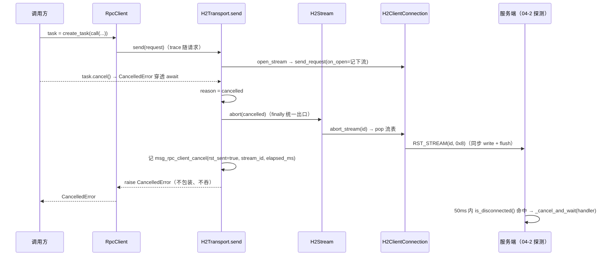

# 04-7-2 取消发重置帧 实施记录

> 取消 / 超时 / 异常三路中止归一为「`stream.abort(reason)` → `RST_STREAM(CANCEL)`」× `close_reason` 六态与 `rst_sent` 累积 × 客户端事件 `msg_rpc_client_cancel` × 真机 h2c 验收（服务端中断实测 51.8~55.2ms）× 服务端零改动

[文档首页](../../../../../../../文档首页.md) › [消息平台规划](../../../../../../../规划/01_规划_消息平台.md) › [阶段计划](../../../../../计划/01_计划_消息平台.md) › [04-7 客户端精确取消](../../04_远程调用_07_客户端精确取消.md) › [04-7-2 取消发重置帧](../04_远程调用_07_客户端精确取消_02_取消发重置帧.md) › 实施记录

---

## 1. 任务信息 

| 项 | 值 |
| --- | --- |
| 任务 | [04-7-2 取消发重置帧](../04_远程调用_07_客户端精确取消_02_取消发重置帧.md) |
| 详细设计 | [详细设计](../设计/01_详细设计_04_远程调用_07_客户端精确取消_02_取消发重置帧.md) |
| 测试记录 | [测试记录](../测试/01_测试记录_04_远程调用_07_客户端精确取消_02_取消发重置帧.md) |
| Kiwi 用例 | **2436**（回读最大号 2435，取 +1；两个用例文件统一 `@pytest.mark.kiwi_id(2436)`） |
| 实施日期 | 2026-11-06 |

## 2. 交付物 

| 文件 | 变化 | 要点 |
| --- | --- | --- |
| `client/transport/stream.py` | 改造 | `close_reason`（`done` / `peer_reset` / `connection_error` / `cancelled` / `timeout` / `error`）、`rst_sent` 累积、`abort(reason) -> bool`、`abort_reason_of()` |
| `client/transport/connection.py` | 改造 | `abort_stream() -> bool`（是否真发出帧）；`send_request(..., on_open=)` 必需回调（流一注册就交给调用方） |
| `client/transport/pool.py` | 改造 | `send()` 三路出口归一（取消 / 超时 / 其它）、`finally` 统一 `abort` + `msg_rpc_client_cancel`、`_log_cancel()` |
| `client/transport/base.py` | 改造 | 模块与协议说明口径（取消已接线，不再是「待 04-7-2」） |
| `client/rpc.py` | 改造 | 仅调用说明（`CancelledError` 之后传输层发 RST 并记事件）；**未加第二层计时**（见 §3） |
| `tests/client/transport/test_transport_cancel.py` | 新增 | 9 条：取消发重置帧 + 日志字段、无 trace 时字段为 None、超时同路、连接故障 `rst_sent=false`、`close_reason` 六态、`abort` 幂等、异常映射 |
| `tests/client/test_rpc_client_cancel_h2c.py` | 新增 | 真 hypercorn h2c + **生产 `RpcClient`**：取消后 handler 中断时延、同连接后续调用、连接数不涨、收尾在途流归零 |
| `tests/client/transport/test_transport_errors.py` | 改造 | 1 处调用适配 `on_open`（护栏用例本身断言语义未变） |
| `tests/api/test_rpc_cancel_h2c.py` | 改造 | **只加范围声明注释**（「本用例只覆盖连接关闭路径」）与并存说明，断言口径未动 |

服务端（`msg_rpc` 四态、`rpc/cancel.py`、`RPC_CANCEL_POLL_MS`）**零改动**。

## 3. 关键决策落地 

| 拍板事项 | 结论 | 落地 |
| --- | --- | --- |
| 观测事件形状 | 单事件 + `reason` | `msg_rpc_client_cancel`，`reason` ∈ `cancelled` / `timeout` / `error`；`abort_reason_of()` 是唯一判定处 |
| 日志落点 | 只在传输层一条 | `pool._log_cancel()`；`request_id` / `service` / `method` 取 `RpcHttpRequest.trace`，`stream_id` / `rst_sent` / `elapsed_ms` 传输层自取 |
| 04-2 真机用例 | 新增并存 + 补范围注释 | 两个文件并存，各自验一条失效路径（见交付物表末两行） |
| 本地超时口径 | 维持传输层单点 | `H2Transport.send()` 的 `asyncio.timeout` 仍是唯一计时点；`reason=timeout` 由传输层产生；**未在 `RpcClient` 加第二层**（设计 §5.2 已回写） |
| 中止原语命名与冲刷 | 沿用 `abort()`、不 drain | `abort(reason) -> bool`；`_flush()` 同步 write 即可（理由见 §6.2） |
| `close_reason` | 落地六态 | 与日志 `reason` 同源，`abort()` 幂等时不覆盖已定原因 |
| 服务端边界 | 零改动 | 服务端日志仍为四态；客户端取消是另一条事件，靠 `request_id` 对账 |
| Kiwi | 新号 2436 + 含断言摘要 | 登记前回读最大号 2435，取 2436；summary 60 字（限 90） |

### 3.1 取消链路（实施后的真实形态）

## 4. 过程与命令 

| 步骤 | 命令 / 要点 |
| --- | --- |
| 1 登记用例 | `ssh minjian@192.168.0.107 "docker exec -i bms-kiwi /Kiwi/manage.py shell" < register_04_7_2_case.py` → 2436，回读核对一致 |
| 2 开发期用例 | `pytest backend/services/msg/tests/client/transport/test_transport_cancel.py`、`.../test_rpc_client_cancel_h2c.py -s`（单文件，秒级） |
| 3 一次会话跑满 | 19 个目标（`tests/client`、`tests/rpc`、`test_registry_consistency`、`test_tenant_guard`、`api/test_rpc_*` 5 个、`api/test_frame_*` 7 个、`api/test_tenant_*` 3 个）共 **260 条** |
| 4 覆盖率采集 | 同上会话加 `MSG_COVERAGE_DATA=<绝对路径>` 与 `MSG_COVERAGE_SOURCE="bms_msg,services,ops"`；判前已清 `.cache/coverage/.coverage*` |
| 5 判定 | `python -m engkit coverage --data-file .cache/coverage/.coverage --out .cache/coverage/report-04-7-2.json --module bms_msg.client.rpc --module bms_msg.client.transport --fail-under 100`（**仓根执行**） |
| 6 静态 | `ruff check` / `ruff format --check` / `pyright --pythonpath .venv/Scripts/python.exe`（改动 7 个文件） |
| 7 文档 | `engkit eol`（393 文件、违规 0）、`check_links.py`、`check_docs_scope.py` |

**`engkit coverage` 现在必须给 `--out`**：与 04-7-1 记录里的命令模板相比，本版本 CLI 把 JSON 报告落点改成必填参数，缺了直接 `error: the following arguments are required: --out`（见 §6.5）。

## 5. 验证结果 

| 项 | 结果 |
| --- | --- |
| 一次会话用例 | **260 条通过**（含真机 h2c 取消用例与 04-2 连接关闭用例） |
| 服务端中断实测 | **51.8 / 54.1 / 54.4 ms**（三次复跑，另有一次 55.2 ms）；判据 ≤150ms，观测口径 ≤100ms 亦满足 |
| 模块级覆盖率 | `files=6 missing_lines=0 partial_branches=0 percent=100.00`（`bms_msg.client.rpc` + `client.transport` 5 个模块） |
| `ruff check` / `format --check` | 通过（1 处 `with` 合并、1 处格式化） |
| `pyright`（strict） | 0 error / 0 warning |
| 文档三项 | links / docs-scope / eol 全绿 |

## 6. 问题与处置 

### 6.1 「请求体发送中被取消」拿不到流，观测会漏

`send()` 原来靠 `stream = await connection.send_request(...)` 的返回值持有流。但请求体发送期间被取消时
`send_request` **会抛**（它自己 `abort_stream` 后 `raise`），返回值拿不到 → `finally` 里没有流可报
`rst_sent`，`msg_rpc_client_cancel` 直接漏掉这一子类（超时同样会漏：1 MiB 参数在窗口上等的时候到点）。

**处置**：`send_request` 增**必需**关键字参数 `on_open`，流一注册就回调给调用方（`pool` 用
`list.append` 收下）。不是「可选钩子」而是必需参数——可选就意味着有一条路径没人持有流，而那条路径正是
本任务要观测的。代价是 04-7-1 的护栏用例 `test_unstarted_connection_can_be_closed` 直接调
`send_request` 需补一个空回调（§6.4）。

### 6.2 `rst_sent` 不能取「本次 `abort()` 的返回值」

两条中止路径会各自调一次 `abort`：`send_request` 内部（请求体发送失败）与 `send()` 的 `finally`。
第二次调用时流已不在连接表里 → 返回 `False`，若把「本次返回值」当 `rst_sent` 记，就会把**已经发过的
RST 记成没发**——这恰好是本任务要回答的问题，报错的代价最高。

**处置**：`rst_sent` 记在**流上**（`abort()` 只在真发帧时置真、永不清零），日志读 `stream.rst_sent`；
`abort()` 的返回值仍表示「这一次发没发」，供用例断言幂等。

### 6.3 不做 shield drain（设计 §5.1 的写法实测无效）

设计原写「reset 用同步 write + shield drain」。实测结论：任务已被取消时，`await` 任何东西都**立刻**
抛 `CancelledError`；`asyncio.shield` 只保护内层任务不被取消，挡不住外层那次 await 抛异常，所以 drain
要么执行不到、要么得改成「造个任务不 await」（留下 pending task 警告）。而 `writer.write()` 已经把 RST
字节写进传输缓冲，事件循环随即冲刷——真机用例实测 RST 全部到达（三次中断时延 51.8~55.2ms 即证）。

**处置**：只做同步 write（沿用 04-7-1 的 `_flush()`），设计 §5.1 已回写。

### 6.4 首轮 1 条存量用例红：`send_request` 签名变化

`tests/client/transport/test_transport_errors.py::test_unstarted_connection_can_be_closed` 直接调
`connection.send_request(_request(...))` → `TypeError: missing 1 required keyword-only argument: 'on_open'`。

**处置**：该调用补 `on_open=lambda _stream: None` 并注明原因；断言语义（连接不可用时明确拒绝）未变，
Kiwi 2435 未改派。全仓只有这一处直接调用（其余都走 `H2Transport.send`）。

### 6.5 三个工具口径坑

| 现象 | 根因 | 处置 |
| --- | --- | --- |
| 日志断言无法用 `assert_logged(capsys)` | 测试环境 `[log].format = "console"`，`bms_core.testing.logs` 只解析 JSON 行 | 改用 `structlog.testing.capture_logs()`：在处理器层截获事件字典，与渲染格式无关 |
| `engkit coverage` 报 `--out` 必填 | 本版本 CLI 新增必填参数（04-7-1 记录的命令模板没有） | 命令补 `--out .cache/coverage/report-04-7-2.json` |
| `ls .cache/coverage/` 看不到采集文件 | 采集落盘为 `.coverage.<pid>`（点开头），`ls` 不显示 | 用 `ls -a` / `find` 确认，别误判「没采到」 |

### 6.6 pyright 必须带 `--pythonpath`

不带解释器时 pyright 解析不到 venv 依赖，把 `import pytest` / `structlog` 全报成 `reportMissingImports`
（224 条噪音）。正确形态：`.venv/Scripts/pyright.exe --pythonpath .venv/Scripts/python.exe <文件…>`。

## 7. 偏差与遗留 

### 7.1 偏差

| # | 偏差 | 说明 |
| --- | --- | --- |
| 1 | 超时仍只在传输层判，`RpcClient` 未加 `asyncio.timeout` | 与设计 §5.2 字面不同；两处同阈值必然同时到点，正是 04-7-1 偏差 #2 否掉的形态。设计 §5.2 已回写 |
| 2 | 中止不做 drain | 见 §6.3；设计 §5.1 已回写 |
| 3 | 中止原语沿用 `abort()`，未改名 `reset()` | 04-7-1 已交付并有 2 条用例；改名只是术语一致，收益低于改动面。设计 §4 / §5.1 已回写命名 |
| 4 | `send_request` 增必需参数 `on_open` | 传输层内部签名变动（对外 `RpcTransport` 契约不变）；理由见 §6.1。设计 §5.1 已补 |
| 5 | `elapsed_ms` 起点取 `send()` 进入时刻 | 不是「RST 发出时刻」；覆盖建连 + 等头 + 读体全过程，正好回答「取消发生在哪一阶段」 |

### 7.2 遗留

| # | 遗留 | 归口 |
| --- | --- | --- |
| 1 | 取消密集场景（大量在途流同时取消）未压测 | 8B_12（与 `RPC_CANCEL_POLL_MS` 探测开销同批） |
| 2 | `close_reason` / `rst_sent` 只在流对象上，无对外快照出口 | 06-3（指标出口统一设计时再定是否进快照） |
| 3 | handler 用 `suppress(CancelledError)` 照跑时，客户端侧只能看到 RST 已发 | 服务端 04-2 的 `ensure_not_cancelled()` 兜「不写响应」；属 handler 违约，不在本任务范围 |
| 4 | 取消后自动重试 / 幂等补偿 | 04-4（取消不替代幂等） |

---

> 依《[文档生成规范](../../../../../../../../bms文档/规范/文档生成规范.md)》编写 · 任务文档见 [04-7-2 取消发重置帧](../04_远程调用_07_客户端精确取消_02_取消发重置帧.md)
