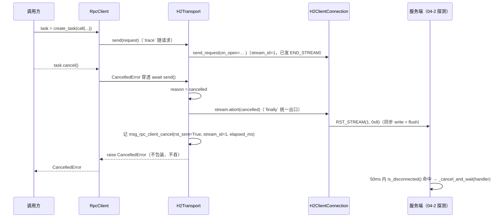

# 取消发重置帧 详细设计

> `task.cancel()` / 本地超时 → 传输层中止本流（`RST_STREAM(CANCEL)`）× 取消不吞、不写响应 × 同连接其它流不受影响 × 服务端 ≤ 150ms 中断（一个轮询周期 + 一帧往返）× `msg_rpc_client_cancel` 观测（`rst_sent` / `stream_id`）× 真机验收沿用 `serve_service` 体例

[文档首页](../../../../../../../文档首页.md) › [消息平台规划](../../../../../../../规划/01_规划_消息平台.md) › [阶段计划](../../../../../计划/01_计划_消息平台.md) › [04-7 客户端精确取消](../../04_远程调用_07_客户端精确取消.md) › [04-7-2 取消发重置帧](../04_远程调用_07_客户端精确取消_02_取消发重置帧.md) › 详细设计

---

## 1. 概述 

### 1.1 目标

把 04-7-1 交付的「能发 RST」接成「取消就发 RST」，并证明服务端真的因此停下：

1. **取消 = 中止本流**：调用方 `task.cancel()` → 传输层在取消路径上发 `RST_STREAM(CANCEL)` → 服务端 04-2 的断开探测（`RPC_CANCEL_POLL_MS = 50`）命中并取消 handler。**服务端零改动**。
2. **超时同路**：本地兜底超时（预算 + 200ms）本质也是「我不等了」，同样中止本流——否则客户端走了、服务端还在算，正是 04-2 的病根。
3. **取消不吞、不写响应**：`CancelledError` 原样穿透（04-2 决策 14 / §5.4 的客户端侧对偶），不新增句柄、不新增异常类。
4. **可区分**：客户端日志能回答「RST 到底发了没有」（`rst_sent`），服务端日志 `outcome=cancelled` 与 `deadline_exceeded` 分工不变。
5. **可验收**：真机 h2c 用例断言「取消后服务端 ≤ 150ms 内停止处理」且「同连接后续调用正常返回」——把需求 04-7 的「100ms」实现为可测口径（详见 §3）。

### 1.2 边界与承接

| 项 | 本子任务 | 归口 |
| --- | --- | --- |
| 取消 / 超时 → `RST_STREAM(CANCEL)`；取消日志与 `rst_sent` | ✅ 交付 | 04-7-2 |
| 真机用例（服务端中断时延、同连接不受影响、连接数不涨） | ✅ 交付 | 04-7-2 |
| 传输层连接 / 流 / 池 / 异常梯度 | ❌ 已由 04-7-1 交付 | 04-7-1 |
| 服务端断开探测与 `ensure_not_cancelled()` | ❌ 不改（已就位） | 04-2 |
| 流式响应的流内取消（取消一个长驻流） | ❌ 不做 | 04-3 |
| 取消后的重试 / 幂等补偿 | ❌ 不做（取消不替代幂等） | 04-4 |
| 指标出口（Prometheus / 快照段） | ❌ 只留日志采集点 | 06-3 |

### 1.3 口径来源

| 问题 | 定稿 | 出处 |
| --- | --- | --- |
| 取消信号 | `RST_STREAM` 且 `error_code = CANCEL(0x8)` | RFC 9113 §8.1、知识 09 §5 |
| 取消判据（服务端） | 50ms `is_disconnected()` 轮询 + `CancelledError` 快路径 | 04-2 详细设计 §5.4（实测 hypercorn 不取消任务） |
| 中断时延验收 | ≤ 一个轮询周期（50ms）+ 一帧往返，判据取 **150ms**；100ms 降为观测值 | 决策 8、§3 |
| 取消 API 形状 | `task.cancel()` 即取消，不新增句柄 | 决策 3（沿用 04-2 决策 14） |
| 取消后异常 | 原样 `CancelledError` | 决策 4 |
| 观测 | 客户端事件 `msg_rpc_client_cancel`（`rst_sent` / `stream_id` / `reason`） | 决策 10 |
| 契约 | 不改帧、不改错误码、不改 `RpcClient` 签名 | 需求 04-7 §2.7、决策 12 |

## 2. 现状与差距 

| 现状（04-2 收口时） | 差距 |
| --- | --- |
| 客户端 `task.cancel()` → 本地放弃，服务端继续跑到预算耗尽 | 取消对服务端**不可见**（实测 httpx 不发 RST），预算成了唯一止损手段 |
| 服务端已有 `invoke_rpc(disconnected=...)` + 50ms 轮询 | 接收侧就位，缺发送侧信号 |
| 客户端无任何取消相关日志 | 「RST 发没发」只能抓包或读代码——04-2 卡了两天正是卡在这里 |
| 04-2 真机用例验「连接关闭 → 断开兜底」 | 缺「单 stream 取消 → 服务端中断、同连接其它调用不受影响」 |

04-7-1 交付后：传输层已有 `H2Stream.reset()`（spike C 证明 RST 只作用于本流、同连接第二条流照常 `200`），但 `send()` 的取消路径还是「抛出去就完事」。本子任务把这一步接上并验收。

## 3. 验收口径：为什么不是「100ms」 

服务端感知链路：客户端发 `RST_STREAM` → hypercorn 收到 `StreamReset` → `app_put({"type": "http.disconnect"})` → 服务端 50ms 轮询命中 → 取消 handler 并等它收尾。**最短时延下界就是一个轮询周期（50ms）**，再叠加一帧往返与事件循环调度。

| 判据 | 取值 | 说明 |
| --- | --- | --- |
| 主断言 | `≤ 150ms`（= 50ms 轮询 + 一帧往返 + 调度余量） | 用例硬断言；Windows / CI 抖动下仍稳定 |
| 观测值 | `≤ 100ms` | 用例打印实测值并断言不超 150ms；需求 04-7 §8 的「100ms」按观测口径保留 |
| 反证 | handler **未跑到 10s 结束**（`finished` 不出现） | 防「恰好在预算耗尽时取消」的假绿 |

**不写死 100ms 的理由**：50ms 轮询是既定常量，两个周期就是 100ms；再叠一帧往返与调度，100ms 硬阈值在非实时 OS 上必然偶发失败（04-2 已踩过「断言时灵时不灵」，处置是加 `_cancel_and_wait`）。阈值写死成 flaky 断言后，团队只会给它加 `sleep`，反而失去约束力。

## 4. 交付物清单 

> **实施回写（2026-11-06）**：下表按交付时的真实形态记录。三处与初稿不同——中止原语沿用 04-7-1 已交付的
> `abort()`（不是 `reset()`）、`connection.py` 需增「流一注册就交给调用方」的回调、`rpc.py` 最终**没有代码
> 改动**（超时仍在传输层判，见 §5.2）。

| 文件 | 类型 | 变化 |
| --- | --- | --- |
| `client/transport/pool.py` | 改造 | `send()` 三个中止出口归一（取消 / 超时 / 其它）→ `finally` 统一 `stream.abort(reason)`；取消日志 `msg_rpc_client_cancel`（`_log_cancel()`） |
| `client/transport/stream.py` | 改造 | `abort(reason) -> bool`（幂等：已收口不发帧）；`close_reason` 六态；`rst_sent` 累积；`abort_reason_of()` 异常 → `reason` 唯一映射 |
| `client/transport/connection.py` | 改造 | `abort_stream() -> bool`（是否真发出帧）；`send_request(..., on_open=)` 必需回调 |
| `client/transport/base.py` | 改造 | 模块说明与 `RpcTransport.send` 口径（取消已接线） |
| `client/rpc.py` | 改造（仅说明） | `CancelledError` 的调用说明补「传输层随后发 RST 并记事件」；**未加第二层计时**、`trace` 原本已传入 |
| `tests/client/test_rpc_client_cancel_h2c.py` | 新增 | 真机 h2c：单 stream 取消 → 服务端 ≤150ms 中断、同连接后续调用 200、连接数不涨 |
| `tests/client/transport/test_transport_cancel.py` | 新增 | 单测 9 条：取消时发 RST、已完成流再取消不发帧、超时也发 RST、日志字段、`close_reason` 六态、异常映射 |
| `tests/client/transport/test_transport_errors.py` | 改造 | 1 处调用适配 `on_open`（护栏用例断言语义未变） |
| `tests/api/test_rpc_cancel_h2c.py` | 保留 | 04-2 的「连接关闭 → 断开兜底」路径仍然有效，断言不改；只加「本用例只覆盖连接关闭路径」的范围注释 |

## 5. 实现 

### 5.1 取消链路

| 决策 | 理由 |
| --- | --- |
| 在 `send()` 的 `except` 里定 `reason`、在 `finally` 里统一 abort | 取消发生在哪一个 `await` 不可预判（建连 / 等头 / 读体 / 发请求体），只有包住整段的 `send()` 能兜全；出口收敛到一个 `finally` 才能保证「三条路都发 RST、都记一条日志」 |
| abort 用**同步 write + flush**（不 drain） | 见下方「实施回写」：取消上下文里任何 `await`（含 `shield`）都会立刻抛 `CancelledError`，drain 拿不到执行机会；而 `writer.write()` 已把 RST 字节写进缓冲，事件循环随即冲刷（真机实测 RST 均到达） |
| 不做「已完成的流也 reset」 | h2 对已关闭流发 RST 属协议违规（对端可能直接 `GOAWAY`）；`abort()` 内部按流表短路，并把「这一次没发」如实返回 |
| `rst_sent` 记在**流上**而不是取 `abort()` 的返回值 | 请求体发送中被取消时，`send_request` 内部先 abort 一次、`send()` 的 `finally` 再 abort 一次（第二次必然返回 False）；以「本次返回值」为 `rst_sent` 会把已发过的 RST 报成没发 |
| 取消不写响应 | 没有响应可写——流已经 reset；服务端 04-2 的 `ensure_not_cancelled()` 负责它那一侧 |

> **实施回写（2026-11-06）**：初稿写「reset 用同步 write + shield drain」。实测 `asyncio.shield` 只保护内层
> 任务不被取消，**挡不住外层那次 await 抛 `CancelledError`**，drain 要么执行不到、要么得造个不 await 的
> 任务（留下 pending task 告警）。故只保留同步 write；`_flush()` 沿用 04-7-1 实现，不新增 drain 路径。
>
> **命名对齐**：初稿写 `stream.reset(CANCEL)`，04-7-1 实际交付的是 `H2Stream.abort()` /
> `H2ClientConnection.abort_stream()`。为避免「同一动作两个名字」，本任务沿用 `abort()`（另加 `reason`
> 参数与返回值），不改名——改名要动 3 个源文件与 2 条存量用例，收益只是术语一致。

### 5.2 超时同路

> **实施回写（2026-11-06，权衡后按 04-7-1 交付口径实施）**：初稿是「`RpcClient` 用 `asyncio.timeout()`
> 包住 `send()`，超时的出口只有一处（`RpcClient`）」。但 04-7-1 实施时已把超时收进
> `H2Transport.send()`（其设计 §5.8 实施回写、偏差 #2），且 04-7-1 的传输层用例已按此验收。
> 两处阈值都是「预算 + 余量」，**同时到点**，正是 04-7-1 明确否掉的形态（排障时分不清谁先放弃）。
> 故本任务**维持传输层单点**，`RpcClient` 不加第二层计时；`reason=timeout` 由传输层产生。

| 决策 | 理由 |
| --- | --- |
| 超时只在 `H2Transport.send()` 一处判 | 04-7-1 已交付并有用例（等头超时 / 连接被拒等）；一处判还能顺带覆盖建连耗时。再加一层会两个计时器同时到点，日志上无法区分「谁先放弃」 |
| 超时与取消走**同一条**中止路径 | `asyncio.timeout` 到点抛 `TimeoutError` → `H2Transport.send()` 折成 `reason=timeout` → 同一个 `finally` 里 `abort()`；这样「客户端不等了」与「人取消」在传输层动作一致，只在 `reason` 上区分 |
| `timeout_ms` 仍传给传输层 | 传输层管「整次调用别超预算」（当前唯一计时点），`RpcClient` 只管「预算怎么算」（`budget + RPC_CLIENT_TIMEOUT_SLACK_MS`）；两者分工见 04-7-1 设计 §5.8 |
| 超时后抛 `RpcCallTimeoutError` | 与 04-2 决策 15 一致：谁是「到点」的判定者，对调用方都是「结果未知」 |

### 5.3 观测：`msg_rpc_client_cancel`

| 字段 | 取值 | 用途 |
| --- | --- | --- |
| `event` | `msg_rpc_client_cancel` | 客户端取消唯一出口 |
| `request_id` / `service` / `method` | 来自 `RpcHttpRequest.trace` | 与 `msg_rpc` 服务端四态对账 |
| `stream_id` | 被中止的 h2 流 | 与抓包 / 服务端日志对齐 |
| `reason` | `cancelled`（调用方取消）/ `timeout`（本地兜底）/ `error`（其他异常中止） | 区分「人不等了」与「等超了」 |
| `rst_sent` | `true` / `false` | **直接回答「RST 发了没有」**；取**流上的累计值**（`H2Stream.rst_sent`），不是「本次 `abort()` 的返回值」——同名两条中止路径会调用两次，取返回值会把已发报成没发。`false` 只在流已收口（无可中止）时出现 |
| `elapsed_ms` | 从 `send()` 进入到中止 | 起点是 `send()` 进入时刻（不是 RST 发出时刻）：覆盖建连 + 等头 + 读体全过程，正好回答「取消发生在哪一阶段」 |
| `close_reason`（不单独记日志） | 与 `reason` 同源（`H2Stream.close_reason`） | 日志里的 `reason` 与流对象上的 `close_reason` 由同一个值写入，保证「日志说超时、流说取消」这种自相矛盾不会出现 |

**`trace` 可空**：健康探测一类调用方不要求关联（`RpcHttpRequest.trace is None`）。此时事件照记，
`request_id` / `service` / `method` 给 `None`，**不编造**——空值本身就是「这次调用没有关联标识」的事实。

**不改 `msg_rpc`**：服务端四态（`ok` / `business_error` / `deadline_exceeded` / `cancelled`）已经定义完整，取消的客户端一侧是**另一条事件**，混进同一条会让「一行日志一个视角」失效。指标出口统一归 06-3。

### 5.4 真机用例设计

| 步骤 | 断言 |
| --- | --- |
| 起 `serve_service`（真 hypercorn，h2c），注册一个 `sleep(10)` 的慢 handler | 服务就绪 |
| 用生产 `RpcClient`（真 `H2Transport`）发起调用，等 handler 进入 | `started` 事件 |
| `task.cancel()`，记录 `t0` | 任务以 `CancelledError` 结束 |
| 轮询 handler 状态 | `cancelled` 出现且 `(t_cancelled - t0) ≤ 150ms`；打印实测值；`finished` 不出现 |
| 同客户端再调一次 `demo.echo` | 返回 `200` + 正确字节；`transport.stats().connections == 1`（复用同连接） |
| 收尾 `aclose()` | `stats().open_streams == 0`、连接数归零 |

**为什么用生产 `RpcClient` 而不是手搓 h2 客户端**：验收的是「客户端取消」，不是「h2 库能不能发帧」；手搓客户端证明的是 spike 已经证明过的事，反而绕过了 `RpcClient` → `H2Transport` 这段真正要交付的接线。

## 6. 测试设计 

| 文件 | 覆盖点 |
| --- | --- |
| `tests/client/transport/test_transport_cancel.py` | ① 取消 → 服务端（`h2_server`）收到 `RST_STREAM(0x8)` 且同连接后续调用 200；② 已完成流再取消 → `rst_sent=false` 且不发帧、不改写 `done`；③ 本地超时 → 同样发 RST 且抛 `RpcTransportTimeoutError`；④ 日志字段齐全（`request_id` / `service` / `method` / `stream_id` / `reason` / `rst_sent` / `elapsed_ms`）与「无 trace 时关联字段为 None」；⑤ `close_reason` 六态；⑥ 异常 → `reason` 三档映射 |
| `tests/client/test_rpc_client_cancel_h2c.py` | 真机：① 取消后 handler ≤150ms 中断且未跑完（实测值打印）；② 同连接后续调用 `200`、连接数不变；③ `aclose()` 后在途流归零 |

### 6.1 验收映射

| 完成标准（任务 §3） | 用例 |
| --- | --- |
| 取消后服务端停止处理（≤150ms），未跑完 | `test_rpc_client_cancel_h2c.test_cancel_interrupts_server_handler` |
| 同连接其它调用正常返回 | 同上（第二段 `demo.echo`）+ `test_transport_cancel` 的单测 |
| `RpcClient` 签名与错误码不变 | `test_rpc_client*` 全量（04-7-1 已迁移）+ 本子任务不新增对外异常 |
| 客户端可观测 `rst_sent` | `test_transport_cancel.test_cancel_logs_rst_sent` |

### 6.2 Kiwi

拟定 **2436**（实施前回读平台最大号 +1 并回读核对；`summary` ≤ 90 字）。04-2 的 2434 与 04-7-1 的 2435 均不改派。

## 7. 覆盖率与门禁 

| 项 | 口径 |
| --- | --- |
| 覆盖率 | 变更模块（`client/transport/pool.py`、`stream.py`、`client/rpc.py`）行 + 分支 **100%**；判前清 `.cache/coverage/.coverage.*`，`MSG_COVERAGE_DATA` 给绝对路径，一次会话跑满 |
| 同会话范围 | 必须带上 `tests/client/*`、`tests/api/test_rpc_*`、`test_registry` / `test_frame_*` / `test_tenant_*`（手挑文件会漏未改动模块的既有分支） |
| 静态 | ruff / pyright 改动文件全绿 |
| 文档 | links / docs-scope / eol 三项全绿（进度类字段只落计划表） |

## 8. 实施步骤 

1. `stream.reset()` 幂等化 + `close_reason`；补单测。
2. `H2Transport.send()` 取消 / 超时路径接 `reset()`；日志事件 `msg_rpc_client_cancel`。
3. `RpcClient` 改为 `asyncio.timeout()` 包裹 `send()`；`trace` 传入请求；超时映射不变。
4. 单测（`test_transport_cancel.py`）全绿。
5. 真机用例（`test_rpc_client_cancel_h2c.py`）：`serve_service` + 生产 `RpcClient`，实测中断时延。
6. 覆盖率补口（一次会话）+ 静态 + Kiwi 登记回填。

## 9. 风险与开放项 

| # | 风险 / 开放项 | 处置 |
| --- | --- | --- |
| 1 | 取消发生在「响应头已收到、体未读完」时，`reset()` 是否仍发 RST | 用例覆盖该时序（`/big` 路由 + 读到一半取消）；`reset()` 只看 `is_open`，与阶段无关 |
| 2 | hypercorn 收到 RST 后是否可能整条连接关闭（误伤其它流） | 04-2 §6.1 已定位为「只关该 stream」；用例断言同连接第二次调用 `200` 且连接数不变 |
| 3 | 服务端 handler 若 `suppress(CancelledError)` 继续跑，取消对它无效 | 服务端 04-2 的 `ensure_not_cancelled()` 兜「不写响应」；「照跑」属 handler 违约，不在本任务范围 |
| 4 | 本地超时与取消在日志上都表现为 `rst_sent=true` | `reason` 字段区分；服务端侧 `outcome` 仍是权威判据 |
| 5 | 取消密集场景（大量在途流同时取消）未压测 | 归 8B_12（与 `RPC_CANCEL_POLL_MS` 探测开销同批） |

## 10. 决策确认与对齐记录 

### 10.1 决策（2026-11-06 逐项确认，与 04-7-1 同一轮拍板）

| # | 事项 | 结论 |
| --- | --- | --- |
| 3 | 取消 API 形状 | `task.cancel()` 即取消，不新增句柄 |
| 4 | 取消后异常 | 原样 `CancelledError` |
| 8 | 验收阈值 | ≤ 一个轮询周期（50ms）+ 一帧往返，判据取 150ms；100ms 降为观测值 |
| 10 | 观测 | 补客户端事件 `msg_rpc_client_cancel`（含 `rst_sent` / `stream_id` / `reason`） |
| 12 | Kiwi | 本子任务单独一条（拟定 2436） |
| 9 | 提交切分 | 与 04-7-1 分开提交、分开验收 |

### 10.2 与既有设计的对齐

| 既有文档 | 原文 | 本次处置 |
| --- | --- | --- |
| 需求 04-7 §2.6 / 完成标准 | 「服务端 100ms 内停止处理」 | 落为「≤ 150ms 硬断言 + 100ms 观测值」，需求 §8 已回写 |
| 需求 04-7 完成标准 | 「04-2 的真 h2c 用例**升级为**单 stream 取消」 | 改为「**新增**单 stream 取消用例；04-2 的连接关闭用例**保留**」——两条失效路径各有回归网，需求 §8 已回写 |
| 04-2 详细设计 §5.4 / §13.2 | 「客户端取消 = 不再等待；服务端由预算到点停止」 | 升级为「客户端取消 = 发 RST；服务端 50ms 内中断」 |
| 04-2 实施记录 §7.1 偏差 2 | 「unary 的取消中断收口为预算兜底 + 断开兜底」 | 补上发送端后，取消本身即可中断（兜底仍保留作后排） |
| 04-2 实施记录 §7.2 遗留 1 / 计划表 04-2 行「遗留」 | 精确 `RST_STREAM` → 04-7 | 本子任务闭环，记录里回填 |
| 架构 05 §8 客户端形态 | 远程调用客户端 职责未提取消 | 已补「取消（`RST_STREAM`）」与传输层归属 |
| bms 知识 09 §5 取消 | 「监听取消信号，中断处理协程」 | 客户端侧手段补「发 `RST_STREAM`」，服务端侧「50ms 轮询」为实测口径 |
| **04-7-1 设计 §5.8（实施回写）** | 超时只在 `H2Transport.send()` 一处判 | **本设计 §5.2 服从它**：`RpcClient` 不加第二层计时（两处同阈值必然同时到点） |
| **04-7-1 设计 §4 / §5.1** | 中止原语名叫 `reset()` | 实际交付是 `abort()`；本设计 §4 / §5.1 已按 `abort()` 回写，不反向要求改名 |

### 10.3 实施期拍板（2026-11-06，八项逐项确认）

| # | 事项 | 结论 |
| --- | --- | --- |
| 1 | 观测事件形状 | **单事件** `msg_rpc_client_cancel` + `reason`（`cancelled` / `timeout` / `error`）；不拆多事件名，将来加 `reason` 不改事件名 |
| 2 | 日志落点 | **只在传输层一条**：`trace` 已带 `request_id` / `service` / `method`，`stream_id` / `rst_sent` / `elapsed_ms` 只有这层有；不走「两层各一条」（同义日志、计数翻倍） |
| 3 | 04-2 真机用例处置 | **新增并存** + 给 04-2 文件补「只覆盖连接关闭路径」范围注释；断言口径不动 |
| 4 | 本地超时口径 | **维持传输层单点**（见 §5.2 实施回写） |
| 5 | 中止原语命名与冲刷 | **沿用 `abort()`、不 drain**（见 §5.1 实施回写） |
| 6 | `close_reason` | **落地六态**，与日志 `reason` 同源 |
| 7 | 服务端边界 | **零改动**：`msg_rpc` 四态与 04-2 的 50ms 探测不动；服务端拿不到「RST vs 连接断开」的可区分信号（hypercorn 两种情形都只投 `http.disconnect`），故不硬加字段 |
| 8 | Kiwi | 新号 **2436**（回读最大 2435 + 1），summary 含关键断言摘要（60 字，限 90） |

---

> 依《[文档生成规范](../../../../../../../../bms文档/规范/文档生成规范.md)》编写 · 任务文档见 [04-7-2 取消发重置帧](../04_远程调用_07_客户端精确取消_02_取消发重置帧.md)
