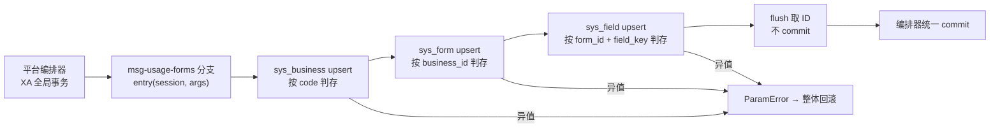
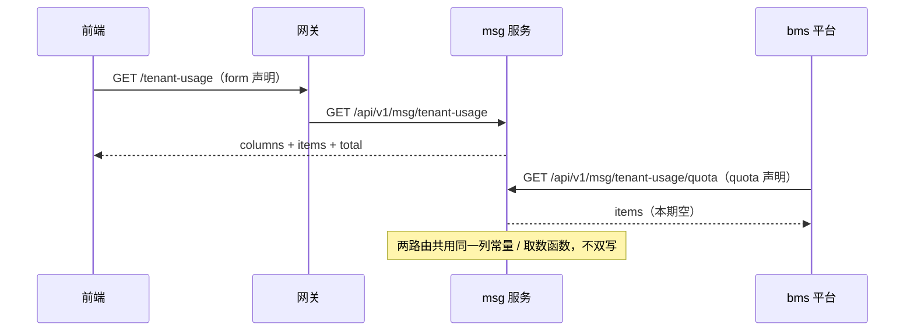
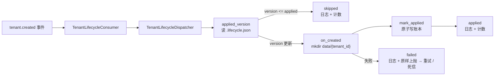

# 05-1 租户用量板块与表单登记 · 详细设计

> 08B · 05 多租户与安全 · 子任务 01（需求 `05-7`；第 7 条归口 `05-6`）

[文档首页](../../../../../../文档首页.md) › [消息平台规划](../../../../../../规划/01_规划_消息平台.md) › [阶段计划](../../../../计划/01_计划_消息平台.md) › [05 多租户与安全](../../05_多租户与安全.md) › [05-1](../05_多租户与安全_01_租户用量板块与表单登记.md) › 详细设计

---

## 0. 分章导航 <a id="toc"></a>

| 章 | 内容 |
| --- | --- |
| 1 | 任务级边界与输入基线（含 12 项已确认口径） |
| 2 | 交付物清单 |
| 3 | 现状核对结论与事实偏差 |
| 4 | 数据源声明与列口径 |
| 5 | 表单与字段种子（`sys_business` / `sys_form` / `sys_field`） |
| 6 | `form_key` 登记与跨服务可见性 |
| 7 | 取数端点（usage / quota 两条通路） |
| 8 | `tenant.created` 消费（目录 + 幂等账本） |
| 9 | 失败分支与边界 |
| 10 | 测试设计与验收映射 |
| 11 | 登记落点与文档同步 |
| 12 | 边界与开放项 |
| 13 | 对齐记录 |

## 1. 任务级边界与输入基线 <a id="scope"></a>

**本任务做什么**：在 msg 仓闭环 05-1——补数据源 `allowlist`、写三表种子、登记 `form_key`、提供取数端点、消费 `tenant.created` 做租户目录预创建；全部为 msg 产品自持，bms 侧不立项。

**不做什么**：不做前端页面；不做真实用量统计；不建 `msg_quota` / 命名空间表；不做数据范围过滤；不改 bms / engkit 代码；不双写；不建 `sys_menu_form` / 按钮；不推送远程。

**权威依据**：

- [需求 05-7 租户用量板块与表单登记](../../../../需求/05_需求_多租户与安全.md#r05-7)、[需求 05-6 租户生命周期](../../../../需求/05_需求_多租户与安全.md#r05-6)
- [架构设计 · 多租户与安全](../../../../../../设计/架构设计/07_架构设计_多租户与安全.md) 第 4、5、6 节
- bms 07D `02-3`（配额只读回显）、07D `03`（`kind=quota` 声明与 msg 接入）；纯文本路径：`bms/bms文档/项目/07D_产品租户与安全接入/任务/03_产品接入改造/设计/01_详细设计_03_产品接入改造.md`
- bms 07B `02_03` 种子统一编排、`02_11` 系统字段 `form_key`；纯文本路径：`bms/bms文档/项目/07B_后端基座`
- mdm 先例：`mdm/backend/services/form_registry.py`、`mdm/backend/services/mdm/src/mdm/seeds/permissions.py`

**依赖方向**：msg → bms 单向；msg 只消费基座契约，不把产品实现回写 bms。

**已确认口径（2026-11-07，用户逐项拍板）**：

| # | 事项 | 结论 |
| --- | --- | --- |
| 1 | 前端范围 | 本期只交付后端数据与元数据；msg 管理台页面与 bms 内嵌板块另立任务 |
| 2 | 端点列口径 | 固定四列：`topic_count` / `partition_count` / `storage_bytes` / `delivered_today`；限额/状态归 05-2 |
| 3 | 两条数据源通路 | 拆两条物理端点、共用一个取数函数；平台读 `kind=quota`，前端读 `kind=form`；不双写、不重复取数 |
| 4 | `tenant.created` 语义 | 只预创建租户目录 + 幂等账本；不建命名空间、不建配额行；命名空间仍按首次发布懒创建 |
| 5 | 消费实现形态 | 基座 `BaseTenantResourceHandler` + `TenantLifecycleDispatcher`；账本落租户目录 `.lifecycle.json` |
| 6 | 数据范围过滤 | 不纳入本期；登记 05-2 / 后续 |
| 7 | 种子模块路径 | `bms_msg.seeds.forms`；种子名 `msg-usage-forms` |
| 8 | `sys_business.form_key` | 保持平台约定 `business`；`msg_usage` 只作 `code` 与 `FormRecord.form_key` |
| 9 | `FormRecord.table` | `msg_usage`（逻辑表单标识；投影表单无实体表） |
| 10 | `form_key` 跨服务可见性 | 按 mdm 先例：msg 覆写 `form_records()` + 应用级视图断言；平台聚合缺口回 bms 登记 |
| 11 | 种子幂等 | 全字段严格比对；存在且异值抛 `ParamError` |
| 12 | 列常量落点 | `bms_msg/usage/columns.py`；端点、种子、form_registry 共用 |

## 2. 交付物清单 <a id="deliverables"></a>

| # | 交付物 | 仓 | 落点 |
| --- | --- | --- | --- |
| D1 | 数据源 `allowlist` + `[[seeds]]` 声明 | msg | `deploy/registry/msg.toml` |
| D2 | 用量列常量（唯一事实源） | msg | `backend/services/msg/src/bms_msg/usage/columns.py`（新增） |
| D3 | 三表种子入口 | msg | `backend/services/msg/src/bms_msg/seeds/{__init__.py,forms.py}`（新增） |
| D4 | `form_key` 自持清单 | msg | `backend/services/form_registry.py`（新增） |
| D5 | 取数端点（usage / quota 双路由） | msg | `backend/services/msg/src/bms_msg/api/admin/quota.py`（改） |
| D6 | `tenant.created` 消费与文件账本 | msg | `backend/services/msg/src/bms_msg/tenant/lifecycle.py`（新增） |
| D7 | 应用工厂覆写 | msg | `backend/services/msg/src/bms_msg/main.py`（改） |
| D8 | 测试用例 | msg | `backend/services/msg/tests/`（新增 / 改） |
| D9 | 公开契约快照 | msg | `deploy/contracts/msg.json`（重导） |
| D10 | 详细设计 / 实施记录 / 测试记录 | msg | 本任务目录 `设计/`、`实施/`、`测试/` |
| D11 | 计划、架构遗留、bms 07D 计划闭环 | msg / bms | 计划 §3、架构 07 §12 #7、bms 07D 计划 §7 #8 |

## 3. 现状核对结论与事实偏差 <a id="current"></a>

| # | 核对项 | 事实 | 本任务处置 |
| --- | --- | --- | --- |
| 1 | 四项零起点 | `[[seeds]]`、`services/form_registry.py`、`form_records()` 覆写、`event_consumer_records()` 覆写在 msg 仓均无 | 按本设计新增 |
| 2 | 配额投影声明 | `msg_quota_projection`（`kind=quota`、`path=/api/v1/msg/tenant-usage`）已存在，端点返回 `{items: []}` | 保留声明，路径改到 `/api/v1/msg/tenant-usage/quota`；端点形状不变 |
| 3 | 用量数据源 | `msg_tenant_usage`（`kind=form`、`path=/tenant-usage`）已存在，无 `allowlist` | 补四键；`path` 不变 |
| 4 | 种子模块路径 | 任务文档写 `msg.seeds.forms`，实际包名是 `bms_msg` | 改 `bms_msg.seeds.forms`，回写任务文档 |
| 5 | 业务码 `form_key` | 平台业务码行（mdm 等）走默认 `business`；任务文档写 `msg_usage` | 保持 `business`；`msg_usage` 只作 `code` 与 `FormRecord.form_key` |
| 6 | `form-keys` 跨服务 | `/api/v1/form-keys` 由 bms platform 服务提供，msg 进程内无此路由；mdm 已登记同样缺口 | msg 侧只做 `form_records()` 注入 + 应用级视图断言；平台聚合缺口回 bms |
| 7 | 第 7 条与懒初始化 | 架构 07 §5.1 规定命名空间 / 默认配额只在首次发布时创建；msg 当前无命名空间表 / `msg_quota` | 本期只预创建租户目录 + 文件账本；命名空间与配额留给首次发布 / 05-2 |
| 8 | 数据范围过滤 | 任务第 5 条写「本期后段」，但 bms 侧未检索到产品数据源标准下推参数契约；你列的本期 6 条也不含它 | 不纳入本期，登记 05-2 / 后续 |
| 9 | 前端 | msg 仓无前端工程（只有原型 HTML） | 本期不交付前端，另立任务 |

## 4. 数据源声明与列口径 <a id="datasource"></a>

### 4.1 `msg_tenant_usage`（`kind=form`）

在现有声明上补：

```toml
allowlist = ["topic_count", "partition_count", "storage_bytes", "delivered_today"]
```

- `path` 保持 `/tenant-usage`（前端经网关直取）。
- `allowlist` 四键与 `sys_field.field_key`、端点 `columns[].key` **同名闭合**，三处都由 D2 常量派生。
- 本期不追加 `strategies = ["match"]`：任务只要求补 `allowlist`；数据权限 match 策略是否启用登记为开放项（§12）。

### 4.2 `msg_quota_projection`（`kind=quota`）

- `path` 由 `/api/v1/msg/tenant-usage` 改为 `/api/v1/msg/tenant-usage/quota`。
- 其余字段（`quota_dimensions` / `quota_unit` / `quota_period` / `origin` / `product_key`）不变。
- 平台 `QuotaProjectionReader` 按声明路径读取；本期返回 `{"items": []}`，四维判 `default`，不写 0。

### 4.3 列常量（D2）

`bms_msg/usage/columns.py` 定义唯一事实源：

```python
@dataclass(frozen=True)
class UsageColumn:
    key: str
    label: str
    field_type: str = "number"
    sort: int = 0

USAGE_COLUMNS: tuple[UsageColumn, ...] = (
    UsageColumn("topic_count", "主题数", "number", 1),
    UsageColumn("partition_count", "分区数", "number", 2),
    UsageColumn("storage_bytes", "消息存储", "number", 3),
    UsageColumn("delivered_today", "今日投递量", "number", 4),
)
```

- 端点用 `columns[].key/label`；种子用 `field_key/name/type/sort`；`form_registry` 不复制列，只引用同一模块的 `form_key` / `data_source_key` 常量（可选）。
- 不把常量放在 `backend/services/` 顶层：种子模块在平台进程导入时只依赖 `bms_msg`，避免与 bms 的顶层 `services` 包撞名。

## 5. 表单与字段种子 <a id="seeds"></a>

### 5.1 声明

```toml
[[seeds]]
name = "msg-usage-forms"
service = "msg"
db_key = "platform_platform"
module = "bms_msg.seeds.forms"
entry = "seed_usage_forms"
after = []
description = "消息平台用量表单与字段（业务码 msg_usage + 表单 + 四字段）"
status = "enabled"

[seeds.tables]
sys_business = "code"
sys_form = "business_id"
sys_field = "form_id,field_key"
```

- `service=msg`：种子在 msg 执行服务内参与 XA 分支；`db_key=platform_platform`：写平台服务库。
- `name` 以 `msg-` 开头，满足 bms 装载期「产品种子名须以产品键开头」校验。
- `after=[]`：不依赖其它种子；三张平台表由平台建表先行落地。

### 5.2 写入内容

| 表 | 行 | 关键字段 |
| --- | --- | --- |
| `sys_business` | 业务码 `msg_usage` | `code=msg_usage`、`name=消息平台用量`、`form_key=business`、`status=enabled` |
| `sys_form` | 与业务码 1:1 | `business_id=<上一步 id>`、`component=NULL`、`status=enabled` |
| `sys_field` | 四个字段 | `form_id=<上一步 id>`、`field_key=topic_count/partition_count/storage_bytes/delivered_today`、`name=主题数/分区数/消息存储/今日投递量`、`type=number`、`sort=1..4`、`status=enabled` |

- **不建** `sys_menu_form`、`sys_button`、`sys_permission`：本表单是只读投影，无菜单入口与按钮。
- **不建** `msg_usage` 物理表：`FormRecord.table` 只是逻辑标识，数据由端点按 `data_source_key` 提供。

### 5.3 幂等与冲突口径

1. 业务码按 `(code, deleted_at IS NULL)` 判存；存在则比对 `name` / `form_key` / `status`，全部同值跳过，任一异值抛 `ParamError`。
2. 表单按 `(business_id, deleted_at IS NULL)` 判存；存在则比对 `component` / `status`，异值抛 `ParamError`。
3. 字段按 `(form_id, field_key, deleted_at IS NULL)` 判存；存在则比对 `name` / `type` / `sort` / `status`，异值抛 `ParamError`。
4. 已存在但多余的字段不删除（不碰用户数据）；重复执行不新增行。
5. `expected_rows()` 为纯函数，返回 `sys_business` 一条期望行（`key={"code": "msg_usage"}`，`values={"name": ..., "form_key": "business", "status": "enabled"}`）；`sys_form` / `sys_field` 依赖自增 ID，不列入期望行，靠唯一约束 + 入口内比对兜底。

### 5.4 XA 语义

- 入口签名 `async def seed_usage_forms(session: DbSession, args: ConcurrentStableDict[str, object]) -> None`。
- 会话由平台种子编排传入并已绑定 XA 分支连接；入口只 `flush()` 取 ID，**不 `commit` / 不 `rollback`**。
- 任一步抛错原样上抛，由编排器整体回滚；不吞异常、不自行开启第二事务。



## 6. `form_key` 登记与跨服务可见性 <a id="forms"></a>

### 6.1 自持清单（D4）

`backend/services/form_registry.py`：

```python
MSG_FORM_RECORDS = (
    FormRecord(
        form_key="msg_usage",
        table="msg_usage",
        name="消息平台用量",
        kind=FormKind.FORM.value,
        status=FormStatus.ENABLED.value,
        data_source_key="msg_tenant_usage",
    ),
)
```

- `form_key` / `table` 同名 `msg_usage`；`data_source_key` 与 `msg_tenant_usage` 声明闭合。
- 提供 `form_records()` / `form_record(table)` / `form_keys()`，与 mdm 同构。

### 6.2 应用工厂覆写（D7）

`bms_msg/main.py` 的 `ApplicationFactory` 增加：

```python
def form_records(self) -> ConcurrentStableList[FormRecord]:
    return msg_form_records()

def event_consumer_records(self) -> ConcurrentStableList[EventConsumerRecord]:
    return tenant_lifecycle_records()
```

基座装配期把 `form_records()` 与 `FORM_CATALOG` 合并为 `app.state.form_registry`。

### 6.3 跨服务可见性口径

- 本期验收口径调整为：**msg 应用级视图** `app.state.form_registry` 含 `msg_usage`，`data_source_key=msg_tenant_usage`。
- bms platform 服务的 `GET /api/v1/form-keys` 要看到产品表单，需要 bms 侧「产品清单下发 / 聚合」通道；mdm 已登记同项遗留。本任务在 bms 07D 计划 §7 登记该缺口，不在 msg 挂平台路由、不跨仓造基座。
- 平台侧对表单 / 字段的可见性已由种子写 `sys_form` / `sys_field` 满足（权限配置页读平台库），与 `form-keys` 代码清单是两条路。

## 7. 取数端点 <a id="api"></a>

### 7.1 路由与形状

| 路由 | 消费者 | 响应 |
| --- | --- | --- |
| `GET /api/v1/msg/tenant-usage` | 前端（`kind=form`，网关 `/tenant-usage`） | `{"columns": [{"key", "label"}...], "items": [], "total": 0}` |
| `GET /api/v1/msg/tenant-usage/quota` | 平台 `QuotaProjectionReader`（`kind=quota`） | `{"items": []}`（本期空；真实条目随 05-2） |

- 两个路由都经基座认证，不新增权限码。
- `columns` 由 `bms_msg.usage.columns.column_payloads()` 派生；`items` 本期空清单，`total=0`，不写 0 冒充用量。
- `quota` 路由沿用既有 `quota_projection()` 函数与 `x-error-codes` 声明。

### 7.2 不双写、不重复取数

- 数据源声明两条，各司其职：`msg_tenant_usage`（form）与 `msg_quota_projection`（quota）。
- 两条物理端点共用同一个取数模块（本期 `usage/columns.py`；05-2 接入真实统计时，两路由调同一 `usage_snapshot()`，不各自查一遍）。
- 平台只读 quota 路由，前端只读 form 路由；两边都不落库、不缓存、不双写。



## 8. `tenant.created` 消费 <a id="consumer"></a>

### 8.1 语义（已确认）

- `tenant.created` 到达时：创建 `data/{tenant_id}/`（`mkdir(parents=True, exist_ok=True)`），并写幂等账本 `.lifecycle.json`。
- **不建**命名空间目录、不建 `msg_quota` 行：命名空间按架构 07 §5.1 在首次发布时懒创建；配额归 05-2。
- 失败原样上抛，由基座消费组退避重试 / 死信；租户开通事务已由基座提交，事件消费不阻塞开通。

### 8.2 实现形态

`bms_msg/tenant/lifecycle.py`：

1. `MsgTenantResourceHandler(BaseTenantResourceHandler)`：
   - `plugin_name = "msg.file"`；`root` 可注入（测试用），缺省 `data_root()`。
   - `applied_version(tenant_id, action)`：读 `data/{tenant_id}/.lifecycle.json`，取 `payload[action]`；文件不存在 / 损坏 / 非整数 → `-1`。
   - `mark_applied(tenant_id, action, version)`：读旧账本（损坏按空）、合并、写临时文件后 `os.replace` 原子替换。
   - `on_created(context)`：创建租户目录，记日志 `msg_tenant_created_initialized`；不写配额、不建命名空间。
2. `TenantLifecycleConsumer(EventConsumer)`：
   - `event_type = tenant.created`；`consume(event)` 调 `TenantLifecycleDispatcher(handler).dispatch(event)`。
   - 失败计数 + `msg_tenant_lifecycle_failed` 日志后原样上抛；成功按 `applied` / `skipped` 计数。
3. `TenantLifecycleMetrics`：进程内 `applied` / `skipped` / `failed` 计数 + `snapshot()`；测试可重置。
4. `event_consumer_records()`：返回一条 `EventConsumerRecord`，组名 `msg-tenant-lifecycle`（装载时补 `bms-` 前缀），`event_type=tenant.created`，`handler_factory=tenant_lifecycle_consumer`。



### 8.3 幂等与可观测

- 业务级幂等键 `(tenant_id, created, version)`；同版本重复投递 `skipped`，新版本重跑（`mkdir` 天然幂等）。
- 投递级幂等沿用基座 `sys_event_consumed` 账本，不另建表。
- 账本损坏、缺失均按「未初始化」重跑，不静默放行。
- 日志事件：`msg_tenant_created_initialized`、`msg_tenant_lifecycle_failed`；基座 dispatcher 另记 `tenant_lifecycle_applied` / `tenant_lifecycle_skipped`。
- 指标：进程内三计数；外部指标出口归 06-3（登记开放项）。

## 9. 失败分支与边界 <a id="failures"></a>

| 场景 | 行为 |
| --- | --- |
| 种子业务码已存在且名称 / `form_key` / 状态不同 | `ParamError`，编排器整体回滚，不静默覆盖 |
| 表单已存在且 `component` / 状态不同 | 同上 |
| 字段已存在且名称 / 类型 / 排序 / 状态不同 | 同上 |
| 种子入口自行 commit | 禁止；入口契约只 `flush`，测试用记录型会话断言 `commit` 次数为 0 |
| 端点无数据 | `items=[]`、`total=0`；不写 0 冒充用量 |
| quota 端点不可达 / 超时 / 非 2xx | 平台读取器整源 `unavailable`，不用旧值、不重试、不缓存 |
| `tenant.created` 处理失败 | 原样上抛 → 消费组退避重试 / 死信；不阻塞基座开通 |
| 账本文件损坏 | 按未初始化重跑；`on_created` 幂等 |
| 租户目录已存在 | `exist_ok=True` 跳过；不删不改既有主题目录 |
| 平台 `/api/v1/form-keys` 不含 msg_usage | 本期不修；回 bms 登记「产品清单下发 / 聚合」缺口 |

## 10. 测试设计与验收映射 <a id="testing"></a>

| # | 用例 | 验收映射 |
| --- | --- | --- |
| T1 | 四列常量键 / 标签 / 类型 / 排序固定，且 `msg.toml` `allowlist` 与之一致 | 列与声明同源 |
| T2 | `expected_rows()` 纯函数、连续两次一致 | 种子冲突预检 |
| T3 | 空库执行种子：`sys_business` / `sys_form` / `sys_field` 三表落库，四字段键 / 标签 / 类型 / 排序正确 | 三表落库 |
| T4 | 重复执行种子：三表行数不变 | 幂等 |
| T5 | 业务码名 / `form_key` / 状态异值 → `ParamError` | 异值报错 |
| T6 | 表单 `component` / 状态异值 → `ParamError` | 异值报错 |
| T7 | 字段名称 / 类型 / 排序 / 状态异值 → `ParamError` | 异值报错 |
| T8 | 记录型会话执行种子后 `commit` 次数为 0，数据仅在显式 commit 后可见 | XA 语义 |
| T9 | `msg.toml` 种子声明字段完整（name / service / db_key / module / entry / tables）且入口可导入 | 装载期校验 |
| T10 | `form_records()` 含 `msg_usage`，`data_source_key=msg_tenant_usage` | form_key 清单 |
| T11 | 应用装配后 `app.state.form_registry` 含 `msg_usage` | 应用级视图 |
| T12 | usage 端点返回四列 + `items=[]` + `total=0` | 端点契约 |
| T13 | usage 端点列与种子写入的 `sys_field` 完全一致（key / label / sort / type） | 列与表单元数据同源 |
| T14 | quota 端点返回 `{"items": []}`；`msg_quota_projection.path` 为 `/api/v1/msg/tenant-usage/quota` | 两条通路 |
| T15 | 应用 OpenAPI 同时含两条路由 | 路由登记 / 契约快照 |
| T16 | `event_consumer_records()` 声明 `tenant.created`，工厂可调用 | 消费组声明 |
| T17 | 同租户同版本重复消费只建一次目录、账本 `created=version` | 消费幂等 |
| T18 | 新版本重跑；旧版本 `skipped` | 版本幂等 |
| T19 | 处理失败原样上抛（供重试 / 死信），计数 `failed+1` | 失败不阻塞开通 |
| T20 | 账本损坏按未初始化重跑并修复 | 可观测 / 健壮性 |

- 覆盖率：变更模块（`bms_msg.usage.columns`、`bms_msg.seeds.forms`、`services.form_registry`、`bms_msg.api.admin.quota`、`bms_msg.tenant.lifecycle`、`bms_msg.main` 变更行）行 + 分支 100%。
- 提交环判改动行，推送环判模块级；本地只跑单文件 / 单节点，全量由 CI。
- 契约：`python -m ops.contract_snapshot export` 重导，`check` 零漂移。
- 文档：`engkit links` / `docs-scope` / `eol --fix`。

## 11. 登记落点与文档同步 <a id="registry"></a>

| 落点 | 内容 |
| --- | --- |
| 本任务文档 | 回写已确认口径：四列、双端点、种子路径、`sys_business.form_key=business`、`tenant.created` 只建目录、数据范围 / 前端另立 |
| msg 计划 §3 | 05-1 计划行（进度按计划表口径回写）；偏差与遗留列登记前端、数据范围、平台 form-keys 聚合缺口 |
| msg 架构 07 §12 #7 | 05-1 后端链路已落地；前端消费方仍另立 |
| bms 07D 计划 §7 #8 | 「05-1 未实施」闭环；注明 quota 路径调整为 `/api/v1/msg/tenant-usage/quota` |
| bms 07D 计划（新增遗留） | 平台 `/api/v1/form-keys` 聚合产品表单（与 mdm 同项） |
| Kiwi | 本任务新登记 1 条用例，代码标注 `@pytest.mark.kiwi_id(<编号>)`；不复用 2451 |

## 12. 边界与开放项 <a id="open"></a>

| # | 开放项 | 归口 |
| --- | --- | --- |
| 1 | 前端页面（msg 管理台租户用量页、bms 内嵌板块） | 另立任务 |
| 2 | 数据范围过滤参数契约与实现 | 05-2 / bms 契约 |
| 3 | 平台 `/api/v1/form-keys` 聚合产品表单 | bms 后续通道（mdm 同项） |
| 4 | `msg_quota_projection` 真实 `items` 形状与 05-2 配额实现 | 05-2 |
| 5 | `allowlist` 是否需要 `strategies = ["match"]` 才可用于数据权限 | 05-2 / bms |
| 6 | 生命周期指标外部出口 | 06-3 |
| 7 | 命名空间 / 默认配额的真实创建 | 05-2 / 05-5（首次发布懒创建） |

## 13. 对齐记录 <a id="alignment"></a>

| 日期 | 事项 | 结论 |
| --- | --- | --- |
| 2026-11-07 | 05-1 12 项待确认 | 全部按推荐项确认（见 §1 表） |
| 2026-11-07 | 任务文档 `module=msg.seeds.forms` | 改为 `bms_msg.seeds.forms`；种子名 `msg-usage-forms` |
| 2026-11-07 | 任务文档 `sys_business.form_key=msg_usage` | 改为平台约定 `business`；`msg_usage` 只作 `code` / `FormRecord.form_key` |
| 2026-11-07 | 任务文档「用量 / 限额 / 状态三列」 | 以固定四列为准；限额 / 状态归 05-2 |
| 2026-11-07 | 任务文档第 5 条数据范围过滤 | 不纳入本期 |
| 2026-11-07 | 任务文档第 6 条前端 | 不纳入本期 |
| 2026-11-07 | 第 7 条与架构 07 §5.1 冲突 | 只预创建租户目录 + 文件账本，不建命名空间 / 配额 |
| 2026-11-07 | 两处开工前文档修正 | 05-3 依赖行改 `02-5 / 02-4`；05-4 `log_id` → `record_ref` 并回写剩余范围 |
