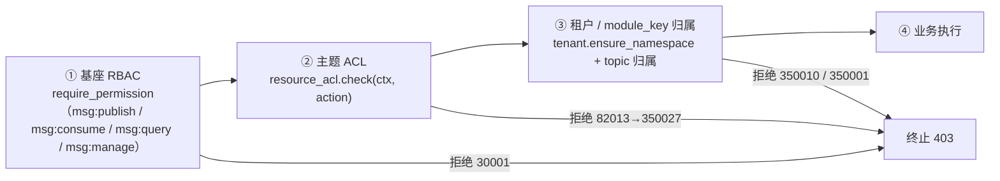

# 05-3 主题 ACL · 详细设计

> 08B · 05 多租户与安全 · 子任务 03（需求 `05-4`）

[文档首页](../../../../../../文档首页.md) › [消息平台规划](../../../../../../规划/01_规划_消息平台.md) › [阶段计划](../../../../计划/01_计划_消息平台.md) › [05 多租户与安全](../../05_多租户与安全.md) › [05-3](../05_多租户与安全_03_主题ACL.md) › 详细设计

---

## 0. 分章导航 <a id="toc"></a>

| 章 | 内容 |
| --- | --- |
| 1 | 任务边界与已确认口径 |
| 2 | 交付物清单 |
| 3 | 现状核对与偏差 |
| 4 | 数据模型（`msg_topic_acl` / `msg_topic_acl_scope`） |
| 5 | ACL 判定引擎（端口 + 异步守卫 + 版本戳快照） |
| 6 | 真实 RBAC 接入与权限码种子 |
| 7 | 执行点与判定顺序 |
| 8 | ACL 管理端点 |
| 9 | 留痕（05-4 契约复用） |
| 10 | 租户生命周期清理 |
| 11 | bms 协同改造（`AclContext.roles`） |
| 12 | 测试设计与验收映射 |
| 13 | 登记落点与文档同步 |
| 14 | 边界与开放项 |
| 15 | 对齐记录 |

## 1. 任务边界与已确认口径 <a id="scope"></a>

**本任务做什么**

1. **ACL 模型**：新建 `msg_topic_acl`（规则）与 `msg_topic_acl_scope`（作用域版本戳）；规则按 `tenant_id / namespace / topic / principal_type / principal_key / action` 唯一，含 `effect`（allow / deny）与 `status`（enabled / disabled）。
2. **判定收敛**：接基座 `resource_acl` 端口；msg 侧异步守卫负责按版本戳装载规则快照，端口实现 `MsgTopicAcl(BaseResourceAcl)` 只做同步判定；判定顺序固定为 **RBAC → ACL → 租户 / `module_key` 归属**。
3. **四类动作**：`publish` / `subscribe` / `describe` / `manage`，数据面、管理面、帧入口、重放同口径。
4. **三处易漏点**：跨租户订阅、管理接口只校验登录、重放任意主题，各有拒绝用例。
5. **生效范围**：ACL 只在同一 `module_key`（即 `namespace`）内生效；跨租户、跨模块一律拒绝，且不因 ACL 放行。
6. **缓存与失效**：以 `(tenant_id, namespace)` 版本戳失效；变更即时生效；单实例与多 worker 判定一致。
7. **留痕**：授予 / 收回 / 变更调用 05-4 的 `emit_acl_change`，写基座 `sys.operation.logged` 强审计。
8. **真实 RBAC**：msg 接入基座 `rbac` 校验器（远程权限数据源），并登记 `msg:*` 权限码种子，使普通角色可授权。
9. **bms 协同**：`AclContext.roles` 由 bms 权限快照的角色主键填充，msg 支持角色主体。
10. **测试与记录**：Kiwi 先登记后编码；变更模块行 + 分支 100%；实施 / 测试记录、计划与架构回写。

**不做什么**：不做前端 ACL 管理页面；不做通用 ACL 引擎 / 不复制 RBAC 权限码体系；不写 bms `sys_*` 业务表（`msg-permissions` 种子只写平台权限字典，属产品种子声明范围内）；不做数据范围过滤；不做 ACL 历史表（历史在审计链）；不做通配符主题规则；不做预授权（授予时主题必须已存在）。

**已确认口径（2026-11-08，用户逐项拍板）**

| # | 事项 | 结论 |
| --- | --- | --- |
| 1 | 接入路线 | 接基座 `resource_acl` 端口 + msg 异步守卫；不用 `require_resource_access` |
| 2 | 资源类型 | 声明 `[[resource_types]] msg.topic`，`name_pattern` 允许点号；ACL 用原样 `topic` |
| 3 | RBAC | 本期接入真实 RBAC（远程权限数据源） |
| 4 | 默认判定 | 无匹配默认允许；显式 deny 优先 |
| 5 | 主体 | user / role；角色主键（雪花十进制字符串） |
| 6 | bms roles | `PermissionSnapshot.role_ids` + `current_roles()`；随本任务交付 |
| 7 | ACL 表 | `msg_topic_acl` + `msg_topic_acl_scope` |
| 8 | 缓存 | 版本戳 + 进程内快照，每次判定读版本 |
| 9 | 拒绝码 | `350027` + `maps_from=[82013]` |
| 10 | 管理端点 | `GET` 列表 + `PUT` 批量授予/更新 + `DELETE` 收回 |
| 11 | 收回 | 置 `status=disabled` |
| 12 | 管理面动作 | create=manage；list/get=describe；groups/delayed=describe；replay=manage |
| 13 | 数据面动作 | publish→publish；join/consume/ack/nack/subscribe→subscribe；heartbeat/leave 只 RBAC |
| 14 | 授前校验 | 主题必须存在且归属当前租户 / 命名空间 |
| 15 | manage 语义 | 不隐含其他动作 |
| 16 | 读取失败 | 503 / 10007 fail-closed |
| 17 | 服务身份 | 本期不受 ACL 限制 |
| 18 | 前端 | 只做后端 API |
| 19 | 权限码 | `msg-permissions` 种子写 `sys_business` / `sys_action` / `sys_permission` |
| 20 | 重放进度 | `GET /admin/replay/{id}` 用 `describe`（读语义） |
| 21 | ACL 列表 RBAC | `GET /admin/acls` 用 `msg:manage`（敏感配置） |
| 22 | ACL 写权限 | `PUT` / `DELETE` 需 `msg:manage` + 目标主题 `manage` |

## 2. 交付物清单 <a id="deliverables"></a>

```text
msg/
├── msg文档/
│   ├── 设计/数据库设计/
│   │   ├── 数据表设计/msg_topic_acl.md                  # D1 新建
│   │   ├── 数据表设计/msg_topic_acl_scope.md            # D1 新建
│   │   └── 01_数据库设计_总览.md                        # D1 表集规划 + 登记
│   └── 项目/08B_消息平台/任务/05_多租户与安全/05_多租户与安全_03_主题ACL/
│       ├── 设计/01_详细设计_05_多租户与安全_03_主题ACL.md  # 本文档
│       ├── 实施/01_实施记录_05-3_主题ACL.md             # D17 新建
│       └── 测试/01_测试记录_05-3_主题ACL.md             # D17 新建
├── backend/
│   ├── config.toml                                     # D11 [permission] / [resource_acl]
│   ├── services/
│   │   ├── table_registry.py                           # D12 两表归属
│   │   └── msg/
│   │       ├── src/bms_msg/
│   │       │   ├── models/topic_acl.py                 # D2 规则 + 版本表模型
│   │       │   ├── models/__init__.py                  # D2 模型清单
│   │       │   ├── repositories/topic_acl.py           # D2 仓储
│   │       │   ├── acl/__init__.py                     # D3 导出
│   │       │   ├── acl/keys.py                         # D3 动作 / 效果 / 状态常量
│   │       │   ├── acl/cache.py                        # D4 版本戳快照缓存
│   │       │   ├── acl/engine.py                       # D4 纯判定函数
│   │       │   ├── acl/port.py                         # D5 MsgTopicAcl 端口实现 + 工厂
│   │       │   ├── acl/service.py                      # D5 异步守卫 + 管理服务
│   │       │   ├── permission/__init__.py              # D6 真实 RBAC 注册
│   │       │   ├── permission/source.py                # D6 远程权限数据源
│   │       │   ├── permission/schemas.py               # D6 平台内部契约镜像
│   │       │   ├── seeds/permissions.py                # D7 权限码种子
│   │       │   ├── api/admin/acls.py                   # D8 ACL 管理端点
│   │       │   ├── api/deps.py                         # D9 ACL 服务依赖
│   │       │   ├── api/router.py                       # D8 路由登记
│   │       │   ├── api/data/messages.py                # D10 数据面动作
│   │       │   ├── api/data/groups.py                  # D10 join
│   │       │   ├── api/frame/routes.py                 # D10 长驻流
│   │       │   ├── api/frame/gate.py                   # D10 帧闸门透传
│   │       │   ├── api/admin/topics.py                 # D10 主题管理
│   │       │   ├── api/admin/groups.py                 # D10 组管理
│   │       │   ├── api/admin/delayed.py                # D10 延迟视图
│   │       │   ├── api/admin/replay.py                 # D10 重放
│   │       │   ├── tenant/purge.py                     # D13 到期清理
│   │       │   ├── errors.py                           # D14 350027
│   │       │   └── main.py                             # D9/D11 装配
│   │       ├── deploy/registry/msg.toml                # D7/D14 资源类型 / 种子 / 错误码
│   │       └── tests/
│   │           ├── conftest.py                         # D15 两表建表
│   │           ├── acl/                                # D15 新增用例
│   │           ├── permission/                         # D15 RBAC 用例
│   │           ├── seeds/test_permissions_seed.py      # D15 种子用例
│   │           └── ...                                 # D15 受影响用例
└── bms/
    ├── backend/libs/bms_core/src/bms_core/
    │   ├── permission/snapshot.py                      # D16 role_ids
    │   ├── permission/engine.py                        # D16 快照写入
    │   ├── resource_scope/acl.py                       # D16 current_roles + AclContext
    │   └── resource_scope/__init__.py                  # D16 导出
    ├── backend/libs/bms_core/tests/                    # D16 对应用例
    └── bms文档/项目/07D_产品租户与安全接入/任务/02_标准扩展点/
        ├── 设计/01_详细设计_02_标准扩展点.md            # D16 回写
        ├── 实施/01_实施记录_02_标准扩展点.md            # D16 回写
        └── 测试/01_测试记录_02_标准扩展点.md            # D16 回写
```

| # | 交付物 | 仓 | 落点 |
| --- | --- | --- | --- |
| D1 | 两张表文件 + 总览登记 | msg | 上表路径 |
| D2 | 模型 / 仓储 | msg | `models/topic_acl.py`、`repositories/topic_acl.py` |
| D3 | 常量与导出 | msg | `acl/keys.py`、`acl/__init__.py` |
| D4 | 纯判定 + 版本戳快照缓存 | msg | `acl/engine.py`、`acl/cache.py` |
| D5 | 端口实现 + 异步守卫 + 管理服务 | msg | `acl/port.py`、`acl/service.py` |
| D6 | 真实 RBAC 数据源 | msg | `permission/` |
| D7 | 权限码种子 + 清单声明 | msg | `seeds/permissions.py`、`msg.toml` |
| D8 | ACL 管理端点 | msg | `api/admin/acls.py`、`api/router.py` |
| D9 | 依赖与装配 | msg | `api/deps.py`、`main.py` |
| D10 | 执行点接线 | msg | 数据面 / 管理面 / 帧入口 |
| D11 | 配置 | msg | `config.toml` |
| D12 | 表归属 | msg | `services/table_registry.py` |
| D13 | 生命周期清理 | msg | `tenant/purge.py` |
| D14 | 错误码 | msg | `errors.py`、`msg.toml`、`tests/test_error_codes.py` |
| D15 | 后端测试 | msg | `tests/acl/`、`tests/permission/`、`tests/seeds/`、受影响用例 |
| D16 | bms roles 上下文 | bms | `permission/snapshot.py`、`permission/engine.py`、`resource_scope/acl.py` |
| D17 | 记录与回写 | msg / bms | 实施 / 测试记录、计划、架构 07、07D `02-5` |

## 3. 现状核对与偏差 <a id="current"></a>

| # | 核对项 | 事实 | 处置 |
| --- | --- | --- | --- |
| 1 | ACL 表 / 模型 / 端点 | 均不存在；`msg_acl` 只是数据库总览规划行 | 新建两表，总览登记改名并补列语义 |
| 2 | 资源类型登记 | `msg.toml` 未声明 `[[resource_types]]`；`msg.topic` 未注册 | 本任务声明 `msg.topic`（点号规则） |
| 3 | `require_resource_access` | 只从 path/query 取资源标识；`ResourceScopeKey` 只接受 snake_case | 不用组合依赖；用端口 + msg 异步守卫，ACL 用原样 topic |
| 4 | `BaseResourceAcl.check` | 同步方法；ACL 规则在 DB，取数异步 | 异步守卫先装载快照；`check` 只读进程内快照 |
| 5 | `AclContext.roles` | 文档写明「本期恒为空」；权限快照也不带角色 | bms 快照新增 `role_ids` + `current_roles()`，填 `AclContext.roles` |
| 6 | msg RBAC | `[permission]` 未配置，provider 为空 → Null 校验器恒放行 | 本任务接入真实 RBAC（远程数据源） |
| 7 | `msg:*` 权限码 | 平台权限字典没有 `msg` 业务码，普通角色无法勾选 | 新增 `msg-permissions` 种子 |
| 8 | 05-4 ACL 留痕契约 | `msg:acl.grant/revoke/update`、`emit_acl_change`、强审计已交付 | 直接复用，不改契约；revoke 的 `effect` 记 `deny`（规则已停用） |
| 9 | 数据面装配第二条路径 | 帧闸门直接调用 `publish/consume/ack/nack` | ACL 参数同步透传，避免帧路径绕过 |
| 10 | 管理面只校验登录 | topics/groups/delayed/replay 只有 RBAC 依赖，无资源级校验 | 按 §7 矩阵补 ACL |
| 11 | 审计中间件 | `/api/v1/msg/admin/acls` 未在排除清单 | 加入 `exclude_paths`，只保留显式 ACL 强审计 |
| 12 | 数据库总览规划表名 | 规划为 `msg_acl`（`principal / resource_type / resource_key / operations`） | 改为 `msg_topic_acl` + `msg_topic_acl_scope`，回写总览 |
| 13 | Kiwi | 05-4 已用 2455；本期不复用 | 设计定稿后先登记新用例并回读 |

## 4. 数据模型 <a id="model"></a>

表结构以两份表文件为**唯一事实源**（设计定稿后按 D1 先建表文件，再写 ORM）：

- `msg文档/设计/数据库设计/数据表设计/msg_topic_acl.md`
- `msg文档/设计/数据库设计/数据表设计/msg_topic_acl_scope.md`

本节只写模型语义与查询口径，不复制字段类型。

### 4.1 `msg_topic_acl`（规则）

- 归属：msg 平台库（`platform`）、业务域 `msg`、服务 `msg`；不软删除（`status` 表达），`deleted_at` 恒 NULL。
- 唯一键 `uq_msg_topic_acl_rule = (tenant_id, namespace, topic, principal_type, principal_key, action)`，**不带 `deleted_at`**：同一主体对同一主题的同一动作只有一行，重复授予幂等。
- `tenant_id`：雪花内部身份，取自解析链；不接受请求体自报。
- `namespace`：对齐 `msg_topic.namespace` / bms `module_key`；ACL 只在同一 `namespace` 内生效。
- `topic`：原样主题名（允许点号），对齐 `msg_topic.name`；作为 `resource_key`。
- `principal_type`：`user` / `role`；`principal_key`：用户主键或角色主键的十进制字符串（雪花），长度 ≤64，仅数字。
- `action`：`publish` / `subscribe` / `describe` / `manage`。
- `effect`：`allow` / `deny`；同一匹配集合内 **deny 优先**。
- `status`：`enabled` / `disabled`；收回置 `disabled`，重复授予恢复 `enabled`。
- 索引：`idx_msg_topic_acl_scope (tenant_id, namespace, topic)` 供快照装载；`idx_msg_topic_acl_principal (tenant_id, namespace, principal_type, principal_key)` 供管理面过滤。
- 审计字段 / 乐观锁版本沿用 `BaseModel`。

### 4.2 `msg_topic_acl_scope`（版本戳）

- 归属同一平台库 / 业务域；不软删除。
- 唯一键 `uq_msg_topic_acl_scope = (tenant_id, namespace)`，**不带 `deleted_at`**。
- `scope_version`：BIGINT，缺省 0；任一规则在同一事务内新增 / 改 effect / 停用 / 恢复，`scope_version = scope_version + 1`（每个 `(tenant, namespace)` 每次写事务只加一次）。
- 无行 = 版本 0、规则为空（默认允许）。
- 为什么要独立表：删除 / 停用最后一条规则后 `MAX(updated_at)` 会回退或为空，无法可靠失效；显式版本戳才能保证删除也即时生效。
- 并发首次建行：`SELECT ... FOR UPDATE`；无行则插入；唯一冲突时重试一次（见 §5.4）。

### 4.3 仓储

`TopicAclRepository`（`BaseDbRepository[MsgTopicAcl]`，`tenant_scoped=True`，`soft_delete_enabled=False`）：

| 方法 | 语义 |
| --- | --- |
| `get_by_key(...)` | 按唯一键取规则（当前租户） |
| `get_by_id(acl_id)` | 按主键取规则（当前租户） |
| `list_rules(...)` | 管理面分页 / 过滤（namespace / topic / principal / action / status） |
| `list_enabled(tenant_id, namespace)` | 快照装载：某作用域全部 `status=enabled` 规则 |
| `create(...)` / `update(...)` | 规则写（不 commit） |
| `get_scope_version(tenant_id, namespace)` | 取版本；无行返回 0 |
| `bump_scope_version(tenant_id, namespace)` | 版本 +1；无行插入 1；并发冲突重试 |
| `delete_for_tenant(tenant_id)` | 生命周期到期物理清理（两表） |

版本表仓储 `TopicAclScopeRepository`（或并入同一模块）提供 `get_or_create` / `bump` / `delete_for_tenant`。

## 5. ACL 判定引擎 <a id="engine"></a>

### 5.1 判定顺序（不可绕过）



- **ACL 不得前置**：RBAC 依赖在路由层先执行；ACL 守卫只在端点函数内调用。RBAC 拒绝时 ACL 零调用（用例断言）。
- **ACL 先于归属**：数据面 ACL 在 `ensure_namespace` / 主题解析之前执行；跨租户 / 不存在主题的 deny 规则同样返回 403，不泄露主题存在性。
- **归属兜底**：即使 ACL 默认允许，跨租户 / 跨 `module_key` 仍由 `③` 拒绝——「不因 ACL 放行」由顺序保证。
- **例外（管理面按 ID 读取）**：`GET /admin/topics/{topic_id}` 必须先按 ID 取行才能得到 topic 名；该读取是**租户作用域**查询，不跨租户；取到后立即 ACL `describe`，拒绝即 403。设计登记该例外，测试覆盖。

### 5.2 端口与守卫

**端口实现** `MsgTopicAcl(BaseResourceAcl)`（`bms_core/resource_scope/acl.py` 契约）：

- `plugin_name = "msg.topic"`；`key = plugin_key = "resource_acl"`；契约版本取基座缺省。
- `check(ctx: AclContext, *, action: str) -> None`：**同步、纯判定**，只读进程内快照；允许返回，拒绝抛 `ResourceAccessDeniedError`（82013）。
- `ctx.module_key` = `namespace`；`ctx.resource_key` = `topic`；`ctx.resource_type` 期望 `msg.topic`；`ctx.user_id` / `ctx.roles` 来自 bms 上下文。
- 快照缺失（未经守卫装载）→ 抛 `ResourceAccessDeniedError`（fail-closed）。
- 端口实现内**不查库、不写库、不缓存判定结果**；快照缓存属于数据装载层，不属于 ACL 实现。

**异步守卫** `TopicAclService`（`bms_msg/acl/service.py`）：

```text
authorize(tenant_id, namespace, topic, action)
  ├─ 未声明 resource_acl 扩展点 → 直接返回（产品无 ACL 模型）
  ├─ 取 ACL 实现（get_resource_acl(request)）；解析失败 → 503
  ├─ snapshot = await _snapshot(tenant_id, namespace)
  │    ├─ version = repo.get_scope_version(...)
  │    ├─ 缓存命中且版本相同 → 用缓存
  │    └─ 否则 repo.list_enabled(...) → 写缓存
  ├─ ctx = AclContext(tenant_id, module_key=namespace, resource_type="msg.topic",
  │                   resource_key=topic, user_id=get_current_user_id(),
  │                   roles=current_roles())
  └─ acl.check(ctx, action=action)
```

- 装饰器 / 依赖 `TopicAclServiceDep` 由 `get_platform_uow` + `app.state.topic_acl_cache` 构造。
- 守卫只做「装载 + 调端口」，不实现判定；判定唯一实现在 `MsgTopicAcl` / `acl/engine.py`。
- `filter_allowed(...)` 供列表接口：同一 namespace 装载一次快照，对每个 topic 构造 `AclContext` 调端口 `check`，捕获 `ResourceAccessDeniedError` 过滤。

### 5.3 纯判定函数

`acl/engine.py::decide(snapshot, ctx, action) -> bool`：

```text
matched = 快照中满足：
  topic == ctx.resource_key
  action == action
  status == enabled
  principal_type == user 且 principal_key == str(ctx.user_id)（user_id 非空）
  或 principal_type == role 且 principal_key ∈ ctx.roles
若 matched 中存在 effect=deny → 拒绝
若 matched 中存在 effect=allow → 允许
否则 → 默认允许
```

- `effect` 冲突：同一主体同一动作唯一键只有一行，不会出现同主体 allow/deny 并存；冲突只可能来自「用户规则 + 角色规则」，按 deny 优先。
- 用户主体：`ctx.user_id` 为空（服务身份）不匹配任何 user 规则。
- 角色主体：`ctx.roles` 为角色主键十进制字符串；角色主键集合来自 bms 快照（§11）。
- `manage` 不隐含其他动作：`action` 精确匹配。
- 默认允许：无匹配规则 = 不额外限制；RBAC 仍是功能级前置。

### 5.4 版本戳与缓存

`TopicAclCache`（进程级，`app.state.topic_acl_cache`）：

- 键 `(tenant_id, namespace)`；值 `AclSnapshot(version, rules)`，`rules` 为不可变元组。
- 条目上限 `TOPIC_ACL_CACHE_MAX_ENTRIES = 4096`；超限整体清空（与访问异常节流表同口径，防随机租户打爆内存）。
- `get` / `put` / `invalidate(tenant_id, namespace)` / `clear()`。
- **不做 TTL**：正确性由版本戳保证，不引入「TTL 内旧规则」窗口。

写路径：

1. 同一 `uow.begin()` 内写规则行 + `bump_scope_version`。
2. 每个 `(tenant, namespace)` 每事务只 bump 一次。
3. 提交成功 → `cache.invalidate(tenant, namespace)`（本进程立即失效；其他 worker 靠版本戳）。
4. 审计（§9）。
5. 并发首次建版本行：`SELECT ... FOR UPDATE`；无行 → 插入；唯一冲突 → 回滚后重试一次（`IntegrityError` 只在该分支捕获）。

**多 worker 一致性**：每次判定都读 `msg_topic_acl_scope.scope_version`（单行主键查询）；版本变化即重载。两个 worker 各持缓存，但读同一版本源，结论一致。直改库（绕过服务）也会在下一请求因版本未变而**不会**自动发现——这是运维红线：ACL 变更必须经管理端点；登记开放项。

### 5.5 失败语义

| 场景 | 行为 |
| --- | --- |
| 未声明 `resource_acl` 扩展点（最小测试 app / 无 ACL 模型产品） | 守卫跳过，RBAC 与归属照常（不是放行，是「无该扩展点」） |
| 声明了但实现未注册 / provider 配错 | 装配期 `verify_extension_requirements` 拒启；运行期 `ConfigError` 不静默放行 |
| ACL 版本 / 规则读取失败（DB 不可达、查询异常） | `ServiceUnavailableError` 10007 / 503，fail-closed |
| 快照缺失（端口被直接调用，未经守卫） | `ResourceAccessDeniedError` 82013 / 403 |
| 规则匹配 deny | `ResourceAccessDeniedError` 82013 → 映射 350027 / 403 |
| 规则匹配 allow | 放行，继续归属校验 |
| 无匹配规则 | 默认允许，继续归属校验 |

## 6. 真实 RBAC 接入与权限码种子 <a id="rbac"></a>

### 6.1 为什么必须做

现状 `msg` 未配置 `[permission]`，`require_permission` 解析到基座 `NullPermissionChecker`（恒放行）；若不接真实 RBAC，「RBAC → ACL」只剩 ACL 一层，管理接口在无 ACL 规则时仍可能只校验登录，验收不成立。

### 6.2 msg 侧实现

- `bms_msg/permission/schemas.py`：镜像 platform 内部权限契约（`role_ids` / `role_types` / `grants` / `data_scope_rules` / `field_perms`）。
- `bms_msg/permission/source.py`：`PlatformContractPermissionDataSource` 同款实现——`load_subject` 调 `POST /api/v1/platform/internal/permissions/subject`，`load_metadata` 调 `GET /api/v1/platform/internal/permissions/metadata`；服务间客户端取 `app.state.service_client`；非 2xx / 契约非法 → `ServiceUnavailableError` 10007（不降级为「无权限」）。
- `bms_msg/permission/__init__.py`：`register_msg_permission(settings)`——登记数据来源工厂 + `register_rbac_permission(settings)`；按插件注册表实例幂等（对齐 identity 口径）。
- `main.py::prepare_settings`：
  - `if not settings.permission.provider: settings.permission.provider = RBAC_PROVIDER_NAME`（显式配置尊重）。
  - `register_msg_permission(settings)`。
- `config.toml` 显式写 `[permission] provider = "rbac"`，避免隐式默认。
- 影响：所有已挂 `require_permission` 的端点从恒放行转为真实判定；`msg:publish` / `msg:consume` / `msg:query` / `msg:manage` / `msg:rpc` 均需在权限字典存在并授予。内置系统管理员 / 平台超管按基座 `tier` 豁免。

### 6.3 权限码种子 `msg-permissions`

- 新增 `bms_msg/seeds/permissions.py`，入口 `seed_permissions(session, args)`（XA 分支内只 flush，不 commit）。
- 写入：
  - `sys_business`：`code="msg"`、`name="消息平台"`、`status="enabled"`。
  - `sys_action`：`query` / `manage` / `publish` / `consume` / `rpc`（已存在同值跳过；异值 `ParamError`）。
  - `sys_permission`：上述业务码 × 动作码组合（`business_id + action_id` 判存）。
- `msg.toml` 新增 `[[seeds]]`：

```toml
[[seeds]]
name = "msg-permissions"
service = "msg"
db_key = "platform_platform"
module = "bms_msg.seeds.permissions"
entry = "seed_permissions"
after = []
description = "消息平台权限码（业务码 msg × query/manage/publish/consume/rpc）"
status = "enabled"

[seeds.tables]
sys_business = "code"
sys_action = "code"
sys_permission = "business_id,action_id"
```

- `expected_rows()` 供冲突预检：列 `sys_business` 与 `sys_action` 的期望行；`sys_permission` 依赖自增 ID，靠唯一约束与入口内比对兜底。
- 与 05-1 `msg-usage-forms` 并存，不互相取代。

## 7. 执行点与判定顺序 <a id="enforce"></a>

### 7.1 数据面

| 端点 / 函数 | RBAC | ACL 动作 | ACL 位置 |
| --- | --- | --- | --- |
| `POST /msg/publish`（JSON / 帧 / 延迟） | `msg:publish` | `publish` | `publish()` 第一行；在配额懒初始化 / 限流 / 存储配额 / 延迟 / 主题解析之前 |
| `POST /msg/consume` | `msg:consume` | `subscribe` | `consume()` 第一行；在 `apply_retention` 之前 |
| `POST /msg/ack` | `msg:consume` | `subscribe` | `ack()` 第一行；在 `ensure_member` 之前 |
| `POST /msg/nack` | `msg:consume` | `subscribe` | `nack()` 第一行；在 `ensure_member` 之前 |
| `POST /msg/join` | `msg:consume` | `subscribe` | `join()` 第一行；在 `coordinator.join` 之前 |
| `GET /msg/subscribe`（SSE） | `msg:consume` | `subscribe` | `subscribe()` 第一行；在 `_preflight` 之前 |
| `POST /msg/subscribe`（帧流） | `msg:consume` | `subscribe` | `subscribe_frames()` 第一行；在 `_preflight` 之前 |
| `POST /msg/heartbeat` | `msg:consume` | 无 | 只 RBAC；撤销订阅后仍可心跳收尾 |
| `POST /msg/leave` | `msg:consume` | 无 | 只 RBAC；撤销订阅后仍可退出，不困住成员 |

**帧闸门透传**：`build_frame_gate` 增 `topic_acl: TopicAclServiceDep`；`_handle_frame` / `_invoke` 增 `topic_acl` 参数并传给 `publish/consume/ack/nack`。这是 01-7 已记录的「第二条装配路径」，不补会形成帧路径绕过口。

### 7.2 管理面

| 端点 | RBAC | ACL 动作 | 行为 |
| --- | --- | --- | --- |
| `POST /admin/topics` | `msg:manage` | `manage`（新主题名） | 创建前判；deny 即 403，不创建 |
| `GET /admin/topics` | `msg:query` | `describe` | 列表按 describe 过滤（无权限主题不返回，不报 403） |
| `GET /admin/topics/{id}` | `msg:query` | `describe` | 取行后判；deny 403（不泄露是否存在） |
| `GET /admin/groups` | `msg:query` | `describe` | 列表过滤 |
| `GET /admin/groups/{ns}/{topic}/{group}` | `msg:query` | `describe` | 查询前判；deny 403 |
| `GET /admin/delayed` | `msg:query` | `describe` | 列表过滤 |
| `POST /admin/replay` | `msg:manage` | `manage`（目标主题） | 建任务前判；deny 403（三处易漏点 ③） |
| `GET /admin/replay/{task_id}` | `msg:query` | `describe`（任务主题） | 取任务后判；deny 403 |
| `POST /admin/replay/{task_id}/pause|resume|cancel` | `msg:manage` | `manage`（任务主题） | 取任务后、状态变更前判 |
| `GET/PUT /admin/quotas` | `msg:query` / `msg:manage` | 无（租户级） | 只 RBAC |
| `GET /tenant-usage*` | `msg:query` | 无（租户级） | 只 RBAC |
| `GET/PUT/DELETE /admin/acls` | `msg:manage` | 写操作另判目标主题 `manage` | 见 §8 |

- 列表接口过滤而非 403：避免「列表泄露无权主题元数据」，同时不因个别主题无权让整页失败。
- 详情 / 写接口 403：明确拒绝，不返回资源内容。
- 重放进度查询用 `describe`（读语义），建任务与控制用 `manage`；与「重放=manage」的标签差异见对齐记录。

### 7.3 三处易漏点

| # | 漏点 | 修复 | 用例 |
| --- | --- | --- | --- |
| 1 | 跨租户订阅 | 数据面先 ACL（按当前租户查规则），再由 `TopicRouter.resolve` 按 `tenant_id` 归属拒绝；ACL 不因跨租户放行 | 租户 B 订阅租户 A 的主题 → `350001`，且无消息返回 |
| 2 | 管理接口只校验登录 | 管理面按 §7.2 补 `describe` / `manage`；列表过滤、详情 403 | `msg:query` 用户被 deny `describe` → 403 / 列表不返回 |
| 3 | 重放任意主题 | `POST /admin/replay` 在 `ReplayService.create` 前判 `manage`；控制端点同样判 | deny `manage` → 403，不落任务 |

## 8. ACL 管理端点 <a id="api"></a>

### 8.1 形状

| 路由 | 权限 | 形状 |
| --- | --- | --- |
| `GET /api/v1/msg/admin/acls` | `msg:manage` | `ApiResponse[AclPage]`；过滤 `namespace` / `topic` / `principal_type` / `principal_key` / `action` / `status`；分页 `page` / `size` |
| `PUT /api/v1/msg/admin/acls` | `msg:manage` + 目标主题 `manage` | 请求 `{items:[{namespace, topic, principal_type, principal_key, action, effect}]}`；整批校验、整批成功 / 失败；返回 `{items:[AclItem], changed:[...]}` |
| `DELETE /api/v1/msg/admin/acls/{acl_id}` | `msg:manage` + 目标主题 `manage` | 置 `status=disabled`；幂等；返回 `{acl_id, changed}` |

### 8.2 请求校验

**顺序**：RBAC（`msg:manage`）→ ACL（目标主题 `manage`）→ `namespace` 归属 → `topic` 存在 / 归属 → 参数形态 → 写入。ACL 先于资源存在性校验，避免用「主题不存在」反推授权状态。

- `namespace`：`CurrentTenant.ensure_namespace`（350010）。
- `topic`：`TopicRepository.get_by_identity(namespace, topic)`（当前租户）；不存在 / 不属于当前租户 → `350001`（不泄露存在性）。
- `principal_type`：`user` / `role`；`principal_key`：十进制字符串，≤64。
- `action`：四类之一；`effect`：`allow` / `deny`；非法 → `ParamError` 10001。
- 请求体不接收 `tenant_id`；当前租户只来自解析链。
- 整批：先全部校验，再在单事务内写入；任一失败整批回滚（对齐 05-2 批量口径）。

### 8.3 写语义

| 场景 | 行为 | 审计动作 |
| --- | --- | --- |
| 唯一键无行 | 新建 `status=enabled`、`effect=请求值` | `msg:acl.grant` |
| 行存在且 `status=disabled` | 恢复 `enabled`、更新 effect | `msg:acl.grant` |
| 行存在且 `enabled`，effect 变化 | 更新 effect | `msg:acl.update` |
| 行存在且 `enabled`，effect 相同 | 幂等无变更 | 不写（避免重复留痕） |
| `DELETE` 行存在且 `enabled` | `status=disabled` | `msg:acl.revoke` |
| `DELETE` 行不存在 / 已停用 | 幂等无变更 | 不写 |

- 每个 `(tenant, namespace)` 每写事务只 bump 版本一次；提交后失效本进程缓存。
- 审计在提交成功后写（05-4 契约）；强审计失败 → `InternalError` 10000 / 500（变更已提交，登记「强审计提交后残留」遗留，与 05-4 同口径）。

### 8.4 响应条目

`AclItem`：`acl_id` / `namespace` / `topic` / `principal_type` / `principal_key` / `action` / `effect` / `status` / `updated_at`。

### 8.5 审计路径与中间件排除

- 显式审计路径固定 `/api/v1/msg/admin/acls`；`msg.toml` 的 `[audit_log].exclude_paths` 追加该前缀，避免基座中间件与显式强审计重复。
- ACL 拒绝（403）由 05-4 的访问异常中间件记 `msg:access.denied`（数据面与管理面路径均在覆盖范围）。

## 9. 留痕（05-4 契约复用） <a id="audit"></a>

- 调用 `audit/trail.py::emit_acl_change`：
  - `action`：`ACL_GRANT_ACTION` / `ACL_REVOKE_ACTION` / `ACL_UPDATE_ACTION`。
  - `tenant_id`：当前租户。
  - `principal`：`f"{principal_type}:{principal_key}"`（如 `user:7001`、`role:11`）。
  - `permission`：ACL 动作（`publish` / `subscribe` / `describe` / `manage`）。
  - `effect`：操作后的生效效果；`revoke` 固定 `deny`（规则已停用，不再放行）。
  - `module_key`：`namespace`；`resource_key`：`topic`。
  - `method` / `path`：`PUT` / `DELETE` + `/api/v1/msg/admin/acls`。
  - `user_id` / `ip` / `trace_id`：缺省取请求上下文。
- 强审计：`ACTION_CLASSES` 已把三条动作标为 `sensitive` + `strong=True`；失败抛 `InternalError`（10000）。
- 不新增审计表、不删除审计记录；ACL 变更历史由审计链承载，ACL 表只存当前生效状态。

## 10. 租户生命周期清理 <a id="lifecycle"></a>

- `TenantPurgeService` 增加可选依赖 `acl_session_scope` / `acl_cache`（与 05-2 的 `quota_session_scope` / `quota_cache` 同构）。
- `_finalize()` 在标记 `purged_at` 前：
  1. 短会话内 `TopicAclRepository.delete_for_tenant(tenant_id)`（两表物理删除）并 commit。
  2. `topic_acl_cache.invalidate_tenant(tenant_id)`（按租户清全部 namespace 条目）。
- 失败上抛，由 `TenantPurgeService` 的失败重试机制记录，不标记已清理。
- 停用 / 恢复不清理 ACL：恢复后规则继续生效；用户可在停用期经管理面调整。

## 11. bms 协同改造（`AclContext.roles`） <a id="bms"></a>

### 11.1 目标

`AclContext.roles` 不再恒为空；由 bms 权限快照的角色主键填充，msg 的 ACL 端口与 `require_resource_access` 都能读到。

### 11.2 改动

| 文件 | 改动 |
| --- | --- |
| `bms_core/permission/snapshot.py` | `PermissionSnapshot` 增 `role_ids: ConcurrentStableSet[int]`；`to_payload` / `from_payload` 增字段（旧载荷缺字段回落空集，向后兼容） |
| `bms_core/permission/engine.py` | `_build` 写 `role_ids=ConcurrentStableSet(data.role_ids)` |
| `bms_core/resource_scope/acl.py` | 新增 `current_roles()`：读 `get_current_permission_snapshot()`，返回角色主键十进制字符串的冻结列表（无快照 → 空）；`require_resource_access` 构造 `AclContext` 时填 `roles=current_roles()`；更新 `AclContext.roles` 文档 |
| `bms_core/resource_scope/__init__.py` | 导出 `current_roles` |
| bms 测试 | `tests/permission/test_permission_snapshot_payload.py`（role_ids 往返）、`tests/permission/test_engine.py`（快照带角色）、`tests/resource_scope/test_resource_acl.py`（`current_roles()` / `AclContext.roles` 填充 / RBAC 拒绝时零调用） |
| bms 文档 | 07D `02-5` 详细设计「roles 本期恒为空」改为「由 `PermissionSnapshot.role_ids` 填充」；实施 / 测试记录补本次协同 |

### 11.3 msg 侧使用

- `TopicAclService.authorize` 构造 `AclContext(roles=current_roles())`。
- 角色主体匹配：`principal_key ∈ ctx.roles`；`ctx.roles` 为空（服务身份 / 无快照）时角色规则不匹配。
- 角色主键是雪花十进制字符串；ACL 管理端点接受 `principal_type=role` + `principal_key`（角色主键）。

### 11.4 与 bms 端口的关系

- msg 声明 `ExtensionRequirement(plugin_key=RESOURCE_ACL_KEY, plugin_name="msg.topic", required=True)`。
- `[resource_acl].provider = "msg.topic"`；`configure_plugins()` 导入 `bms_msg.acl.port`（`BasePluggable` 导入期自动成为候选）并显式登记工厂（工厂需 `app` 惰性读快照缓存）。
- 后续上收：基座实现通用 ACL 时，产品只把 `[resource_acl].provider` 换成基座实现名；msg 的 `TopicAclService.authorize` 调用点与 `AclContext` 不变。

## 12. 测试设计与验收映射 <a id="testing"></a>

### 12.1 用例清单

| # | 用例 | 验收映射 |
| --- | --- | --- |
| T1 | `msg.topic` 资源类型声明可装载；`name_pattern` 接受 `audit.operation`、拒绝空串 | 资源类型登记 |
| T2 | 两表唯一键 / 索引 / 软删除口径；重复授予幂等 | 数据模型 |
| T3 | 版本表：首次写建行 version=1；再写 +1；删除 / 停用也 bump | 版本戳 |
| T4 | 默认允许；显式 deny 拒绝；用户 allow 与角色 deny 冲突 → deny 优先 | 判定语义 |
| T5 | 用户主体 / 角色主体命中；服务身份（无 user_id）不匹配 user 规则 | 主体 |
| T6 | 跨租户：规则不跨租户匹配，归属兜底 350001；ACL 放行也不跨租户 | 生效范围 |
| T7 | 跨 module_key：同 topic 不同 namespace 规则不匹配；归属 350010 / 350001 | 生效范围 |
| T8 | RBAC 拒绝时 ACL 零调用（桩计数 0，返回 30001） | 顺序不可绕过 |
| T9 | ACL deny 且主题不存在 / 跨租户 → 403（350027），不是 350001 | ACL 先于归属 |
| T10 | 数据面 publish / consume / ack / nack / join / subscribe 的 ACL 拒绝 | 数据面覆盖 |
| T11 | heartbeat / leave 在 deny subscribe 下仍可用 | 不困住成员 |
| T12 | 跨租户订阅被拒（三处易漏点 ①） | 安全 |
| T13 | 管理接口 deny describe / manage（三处易漏点 ②） | 安全 |
| T14 | 重放任意主题被拒（三处易漏点 ③），不落任务 | 安全 |
| T15 | 管理面列表按 describe 过滤；详情 403 | 管理面 |
| T16 | 帧路径（publish / consume / ack / nack / subscribe）ACL 同结论 | 第二条装配路径 |
| T17 | 变更即时生效：改 effect / 停用 / 恢复后下一次请求即变 | 缓存与失效 |
| T18 | 两个缓存实例（模拟多 worker）共享版本源，变更后结论一致 | 多 worker |
| T19 | ACL 版本 / 规则读取异常 → 10007 / 503，不放行 | 失败语义 |
| T20 | 授予 / 更新 / 收回各写一条 `msg:acl.*` 强审计；载荷 principal / permission / effect / 作用域正确 | 留痕 |
| T21 | 强审计失败 → 10000 / 500（变更已提交，登记遗留） | 留痕 |
| T22 | ACL 拒绝产生访问异常审计 `msg:access.denied` | 05-4 联动 |
| T23 | 管理端点：批量授予 / 更新 / 收回、整批回滚、参数非法 10001、主题不存在 350001、跨租户不可见 | API 契约 |
| T24 | 租户到期 purge 删除两表并清缓存 | 生命周期 |
| T25 | 真实 RBAC：`prepare_settings` 置 provider；数据源映射；下游不可达 10007 | RBAC 接入 |
| T26 | `msg-permissions` 种子：三表落库、幂等、异值拒绝、不自行 commit、清单声明 | 权限码 |
| T27 | bms：`PermissionSnapshot.role_ids` 往返；`current_roles()`；`AclContext.roles` 填充；RBAC 拒绝时 ACL 零调用 | bms 协同 |
| T28 | 覆盖率：变更模块行 + 分支 100% | 门禁 |

### 12.2 测试落点

- msg：`tests/acl/`（模型 / 仓储 / 引擎 / 服务 / API / 执行点 / 审计）、`tests/permission/`（RBAC 数据源 / 注册）、`tests/seeds/test_permissions_seed.py`、根 `conftest.py`（两张新表）。
- bms：`libs/bms_core/tests/permission/`、`libs/bms_core/tests/resource_scope/`。
- 受影响存量用例：`tests/test_usage_forms_seed.py`（seeds 数量 1→2）、`tests/test_registry_consistency.py`（表 / 种子清单）、`tests/test_error_codes.py`（350027）、`tests/test_audit_config_paths.py`（ACL 路径）、`tests/test_skeleton.py`（表数量）、`tests/test_entrypoints.py`（路由 / 契约快照）。
- Kiwi：设计定稿后先登记**一条**新用例，回读编号，所有新增用例统一 `@pytest.mark.kiwi_id(<编号>)`；不复用 2455。

### 12.3 覆盖率与门禁

- msg 变更模块行 + 分支 100%：按 `msg/engkit.toml` 的 `[coverage]` 口径，经定向选测 / 提交前预检采集后，用 `python -m engkit coverage --module <点分模块>` 查缺口（本仓无 `coverage_report.py` 包装；门禁只认 `[coverage].data_file`，禁止手工 `pytest --cov`）。
- bms 变更模块：`bms/backend/.venv/Scripts/python.exe scripts/tools/preflight/coverage_report.py --module bms_core.permission.snapshot --module bms_core.resource_scope.acl`（bms 仓口径）。
- 静态：msg 单文件 `ruff` / `pyright`；bms 单文件 `ruff` / `pyright`。
- 契约：`python -m ops.contract_snapshot export` + `check`（msg）。
- 文档：`engkit links` / `docs-scope` / `eol --fix`（msg / bms）。
- 装配冒烟：`pytest services/msg/tests -k "plugin_assembly or plugin_registration or storage or shape"`（新增端口 / 装配改动必跑）。

## 13. 登记落点与文档同步 <a id="registry"></a>

| 落点 | 内容 |
| --- | --- |
| 数据库表文件 | `msg_topic_acl` / `msg_topic_acl_scope`（字段 / 索引 / 变更记录） |
| 数据库总览 | §3 表集规划改名、§4 登记、§5 关系图补 ACL、§9 状态 |
| `msg.toml` | `[[resource_types]] msg.topic`、`[[seeds]] msg-permissions`、`[[errcodes]] 350027` |
| `services/table_registry.py` | 两表归属记录 |
| `models/__init__.py` | 两模型模块 |
| `config.toml` | `[permission] provider=rbac`、`[resource_acl] provider=msg.topic`、`[audit_log].exclude_paths` 追加 ACL 路径 |
| 架构 07 | §7 授权（ACL 落地、默认语义、四动作）、§10 对齐（真实 RBAC、角色主体）、§12 开放项 |
| 计划 | §1/§3：按计划表回写状态、投入、偏差与遗留 |
| 任务文档 | 无需改状态（进度只在计划表）；必要时补「前置契约」注块 |
| bms 07D `02-5` | 设计 / 实施 / 测试记录：roles 填充、`current_roles()`、角色主键口径 |
| bms 后端基类清单 | 如涉及 `AclContext` 契约语义变更，补引用（若清单已有该条） |
| Kiwi | 本任务新登记 1 条用例，回读编号 |

## 14. 边界与开放项 <a id="open"></a>

| # | 开放项 | 归口 |
| --- | --- | --- |
| 1 | 角色主键在管理端展示角色名需另查平台角色；本期只存 / 显示主键 | 后续 msg 管理模块 / bms 角色查询接口 |
| 2 | ACL 规则直改库（绕过管理端点）不会触发版本戳，下一请求仍用旧快照 | 运维红线；后续可加 DB 触发器 / 定时版本对账 |
| 3 | 强审计在业务提交后写，失败返回 500 但变更已生效（与 05-4 同口径） | 05-4 遗留；bms 审计事务化上收后闭环 |
| 4 | `msg:*` 权限码种子写入平台权限字典；已有租户需重跑种子编排 | 部署 / 运维；bms 种子编排 |
| 5 | `msg-permissions` 种子未写 `sys_business_i18n` / `sys_action_i18n`，多语言名称为默认文案 | 06 域 / 后续 |
| 6 | 列表过滤为逐主题端口判定，主题数很大时请求内开销线性增长 | 06 域 / 8B_12（可改批量判定） |
| 7 | ACL 缓存多实例一致性靠每请求读版本；版本查询本身是 DB 往返 | 8B_12 / 8B_05（如需进一步优化） |
| 8 | 服务身份不受 ACL 限制（只对 user/role 生效） | 后续需要时补 service 主体 + bms `AclContext.service_identity` |
| 9 | 通配符主题 / 命名空间级规则未做 | 后续按真实需求 |
| 10 | 前端 ACL 管理页面未做 | 后续界面任务（需先补可交互原型） |
| 11 | 段位 `35` 仍为暂定 | 07C 段位登记（既有遗留） |

## 15. 对齐记录 <a id="alignment"></a>

| 日期 | 事项 | 结论 |
| --- | --- | --- |
| 2026-11-08 | 19+2 项待确认 | 按用户逐项拍板落定（见 §1） |
| 2026-11-08 | `require_resource_access` 不能直接用于 msg | 主题名带点 + 资源标识在 body + `check` 同步；改「端口 + 异步守卫」 |
| 2026-11-08 | `AclContext.roles` 恒空 | 用户拍板改 bms：`PermissionSnapshot.role_ids` + `current_roles()`；角色主键口径 |
| 2026-11-08 | RBAC provider 为空 | 用户拍板本期接真实 RBAC；新增远程权限数据源 + `msg-permissions` 种子 |
| 2026-11-08 | 收回语义 | 软停用 `status=disabled`；审计 revoke 的 `effect` 记 `deny` |
| 2026-11-08 | 重放进度查询 | 读语义用 `describe`；建任务 / 控制用 `manage` |
| 2026-11-08 | ACL 列表权限 | `GET /admin/acls` 用 `msg:manage`（含主体标识，属敏感配置） |
| 2026-11-08 | ACL 写权限 | `PUT` / `DELETE` 需 `msg:manage` + 目标主题 `manage`，防权限提升 |
| 2026-11-08 | 资源类型登记 | 声明 `msg.topic`，`name_pattern` 允许点号；不构造 `ResourceScopeKey` |

---

> 依《[文档生成规范](../../../../../../../bms文档/规范/文档生成规范.md)》编写 · 上游需求见 [需求 05-4](../../../../需求/05_需求_多租户与安全.md#r05-4)
