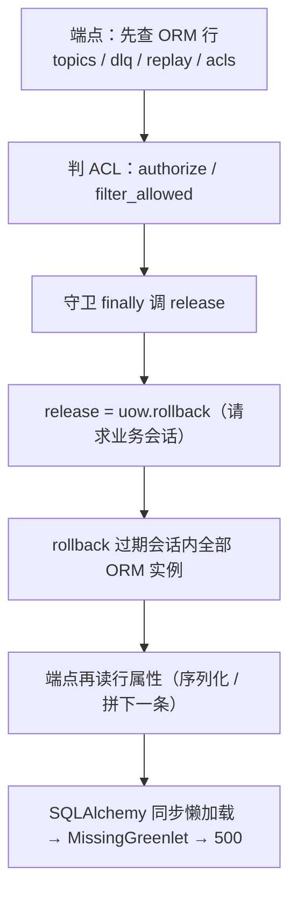
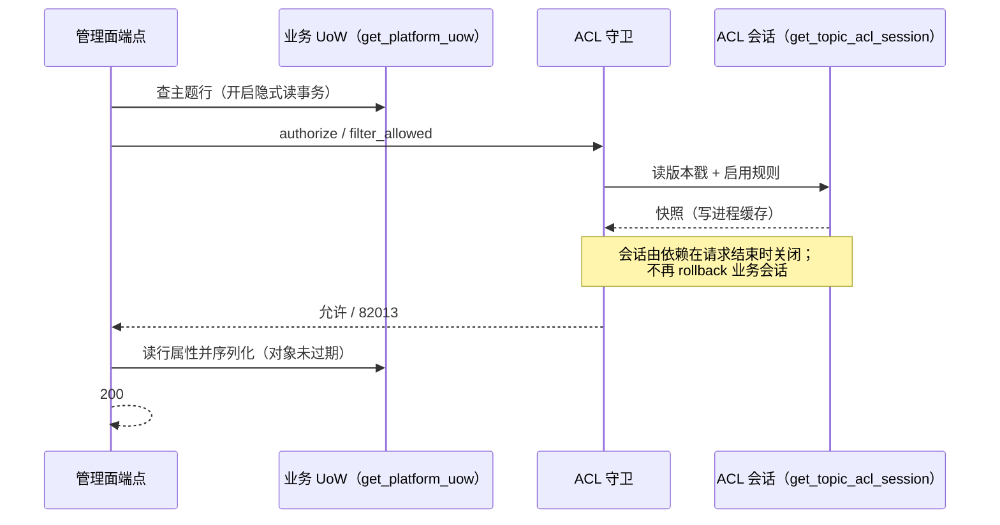

# ACL 守卫会话隔离详细设计

> 判权不再过期业务 ORM 行 × 同源端点一次收敛 × 真容器复跑取证

[文档首页](../../../../../../../文档首页.md) › [消息平台规划](../../../../../../../规划/01_规划_消息平台.md) › [阶段计划](../../../../../计划/01_计划_消息平台.md) › [05 多租户与安全](../../../05_多租户与安全.md) › [05-3 主题授权](../../05_多租户与安全_03_主题授权.md) › [05-3-1 ACL 守卫会话隔离](../05_多租户与安全_03_主题授权_01_ACL守卫会话隔离.md) › 详细设计

---

## 1. 概述 <a id="overview"></a>

### 1.1 目标

让**判权与业务会话解耦**：ACL 守卫读规则时不再触碰请求业务会话，从根上消除「判权后读 ORM 行 → 同步懒加载 → `MissingGreenlet`」这一类 500。

1. 主题列表 / 详情在有数据时恢复 200（本次报告的现场）。
2. 同一根因的死信、重放、位点重置、主题删 / 扩、ACL 收回一并恢复。
3. 未声明 `resource_acl` 的产品 / 最小测试应用零变化（不建第二会话、守卫短路）。
4. 判定能力、缓存、版本戳、错误码与契约全部零改动。

### 1.2 边界与承接

| 项 | 本任务 | 归口 |
| --- | --- | --- |
| ACL 守卫会话装配（独立会话、`release` 降级为单测直连口） | ✅ 交付 | 05-3-1 |
| ACL 判定引擎 `decide()`、快照缓存、版本戳、`350027` / `10007` 语义 | ✅ 复用（零改动） | 05-3（已交付） |
| 端点侧「先查行 → 后判权」的代码顺序 | ❌ 不改（会话隔离后已安全） | — |
| 列表 `total` 口径（ACL 过滤前命中数） | ✅ 保持现状并写明 | 05-3 遗留 #7 / 06-6-1 |
| 演练脚本 `ops/cluster_drill/chain.py` 直读库绕过 | ❌ 不回切（记录「接口已可用、可回切」） | 02-8 归档口径 |
| 新建主题在挂载轮次前查分区详情报 `PartitionNotBoundError`（500） | ❌ 范围外，登记遗留 | 02-10 挂载 / 06-1-1 错误映射 |

### 1.3 口径来源与确认结果

| # | 事项 | 定稿 | 出处 |
| --- | --- | --- | --- |
| 1 | 归属 | **05-3 嵌套子任务 05-3-1**，需求仍为 05-4，需求总数不变（55 条） | 2026-11-13 确认 |
| 2 | 修复层次 | 根治在 ACL 守卫（独立会话）；不做端点层逐处投影 | 2026-11-13 确认 |
| 3 | 修复范围 | 同模式端点全部随根治恢复，并补代表性回归用例 | 2026-11-13 确认 |
| 4 | `total` | 保持「ACL 过滤前命中数」，只在记录里写明口径 | 2026-11-13 确认 |
| 5 | 真容器 | 做：主题列表 / 详情 + 同源 smoke | 2026-11-13 确认 |
| 6 | 演练脚本 | 不回切直读库，只登记「可回切」 | 2026-11-13 确认 |
| 7 | 用例登记 | Kiwi 新登记一条（平台自增；实得 2490，回读核对一致） | 2026-11-13 确认 |
| 8 | 文档回写 | 全量：05-3 设计 / 实施记录、计划 §6.1（#15 闭环 + #24）、02-8 §5 第 8 条闭环 | 2026-11-13 确认 |

## 2. 现状与差距 <a id="gap"></a>

### 2.1 根因链（代码事实）



- 触发条件有二：**库里有行**（循环 / 序列化才会读属性）与**声明了 `resource_acl` 扩展点**（守卫才真正读规则并释放）。
- 空集时列表返回 200：循环不进入、无对象可序列化——这也是「接口看着正常、有数据才炸」的原因。
- 为什么既有用例没抓住：API 用例用替身守卫（替身不释放会话），最小应用不声明扩展点（守卫星短路），两条路都不经过 `release`。

### 2.2 破面清单

| 位置 | 判权后的 ORM 读 | 修复前 |
| --- | --- | --- |
| `api/admin/topics.py` 列表 / 详情 / 删 / 扩 | `_filter_topics` 逐条读 `namespace` / `name`；`_item` / `_detail` 序列化；删 / 扩读 `id` / `partition_count` | 500 |
| `api/admin/offsets.py` 位点重置 | 判权后读 `topic.id` / `partition_count` | 500 |
| `api/admin/dlq.py` 列表 / 详情 / 重放 / 忽略 / 归档 | 列表逐条读 `namespace` / `topic` 后序列化；详情 / 处置读 `row.*` | 500（计划 §6.1 #15 只是其中列表一条） |
| `api/admin/replay.py` 列表 / 详情 | 列表逐条读、详情序列化 | 500 |
| `acl/service.py` 收回（`revoke`） | 判权后读 `row.status` / `namespace` / `topic` | 500 |
| 组 / 延迟 / 消息 / 分区 / 概览 / 用量 | 值对象或「ACL 在前、取数在后」 | 正常（对照） |

### 2.3 与设计文档的偏差

05-3 详细设计 §5.2 只写「装饰器 / 依赖由 `get_platform_uow` + 缓存构造」，没有约定守卫与业务会话的边界；实施记录 §5 问题 1 记录「守卫读取后 `uow.begin()` 撞事务已开启」，用 `release=uow.rollback` 解，但没意识到 `rollback` 会过期调用方对象。本任务**回写 05-3 设计 §5.2 与实施记录**，把「会话隔离」定为强制口径。

## 3. 交付物清单 <a id="deliverables"></a>

```text
backend/services/msg/src/bms_msg/
├── api/deps.py          # 改：新增 get_topic_acl_session（独立平台库会话，未声明扩展点即 None）
│                        #     get_topic_acl_service 改为绑定该会话、不再传 release
└── acl/service.py       # 改：仓储可为空（未声明扩展点）；snapshot() 补 ConfigError 装配守卫
                         #     release 保留为单测直连口并在文档串注明
backend/services/msg/tests/
└── api/test_admin_acl_session.py   # 新增：真实守卫 + 真实 msg.topic 端口 + 业务 / ACL 两会话
deploy/…                            # 零改动（无新配置键、无新端点、无契约变更）
```

## 4. 修复模型 <a id="model"></a>

### 4.1 会话职责



| 会话 | 用途 | 何时结束 |
| --- | --- | --- |
| 业务 UoW（`get_platform_uow`） | 主题 / 死信 / 重放 / ACL 规则的管理面读写 | 请求结束；写路径仍用 `begin()` 显式事务 |
| ACL 会话（`get_topic_acl_session`） | 守卫读版本戳与启用规则 | 请求结束（`aclosing` 关闭基座依赖）；**永不 rollback 业务会话** |

### 4.2 装配分支

| 条件 | 行为 |
| --- | --- |
| 未声明 `resource_acl` 扩展点 | 依赖产 `None`（**不建会话**），守卫 `acl_provider` 为 None 恒短路；仓储为 None |
| 声明了扩展点 | 依赖开平台库主库会话（`get_platform_write_db`，与平台库读写口径同源），守卫绑定该会话 |
| 守卫缺仓储却走到 `snapshot()` | `ConfigError`（装配缺陷，不静默放行、也不冒充 503） |

### 4.3 为什么不选另外两条路

| 方案 | 不选的理由 |
| --- | --- |
| 端点层「先投影成响应模型、再判权」 | 要改 9~11 处、跨 05-3 / 06-2 / 06-5 / 06-6 四个任务，且新端点容易再犯；只治症不治因 |
| `release` 改 `commit`（借助 `expire_on_commit=False`） | 一行见效，但会把 authorize 之前 flush 的写一并提交，靠隐式约定维持，最脆 |
| 关掉 `expire_on_commit` / 手动 refresh | 前者本就 False（问题在 rollback），后者要在每个端点追一次 `refresh`，等价于端点层方案 |

### 4.4 事务口径

- 业务侧 `begin()` 前的防御性 `rollback`（`expand_partitions` / `update_retention` / `begin_delete` / `upsert` / `revoke`）**保留**：它们仍防「调用方已读、事务未结束」，且不再承担「释放 ACL 读事务」的职责。
- 守卫侧 `release` 保留参数但生产装配不传：直连仓储的单测仍可用它控制事务边界，行为与 05-3 一致。

## 5. 失败与装配 <a id="failure"></a>

| 场景 | 行为 | 影响 |
| --- | --- | --- |
| 版本戳 / 规则读取失败（库不可达、查询异常） | `ServiceUnavailableError` 10007 / 503（fail-closed） | 与 05-3 相同 |
| 端口拒绝（显式 deny） | `82013` → `350027` / 403 | 与 05-3 相同 |
| 未声明扩展点 | 守卫短路，角色权限与归属照常 | 与 05-3 相同 |
| 守卫缺仓储（装配缺陷） | `ConfigError` 上抛 | 新增；不静默放行、不伪装成 503 |
| 请求结束关闭 ACL 会话 | `aclosing` 关闭基座会话依赖；会话内只有读事务 | 无副作用 |

## 6. 契约与登记影响 <a id="contract"></a>

| 项 | 结论 |
| --- | --- |
| 公开 HTTP 契约 | 零变更（字段 / 路径 / 错误码全不动）→ `deploy/contracts/msg.json` 与 `@msg/api-types` **不需重导** |
| 错误码 / 权限码 | 零新增 |
| 配置 / 数据库 / 事件 | 零变更 |
| 存储端口 / 服务目录 | 零改动 |
| 计划台账 | §6.1 #15 闭环；新增 #24（同一根因的完整破面与「新端点须补真实守卫用例」） |

## 7. 测试设计与验收映射 <a id="testing"></a>

### 7.1 用例分组（Kiwi 2490）

| 组 | 用例 | 断言 | 验收映射 |
| --- | --- | --- | --- |
| G1 | 有数据的主题列表 / 详情 | 200、字段完整、分区升序（修复前 500） | 完成标准 1 |
| G2 | 空集列表 | 200、`items=[]`、`total=0` | 完成标准 4 |
| G3 | 权限与资源授权 | 无 `msg:query` → 30001；describe 被拒 → 列表过滤 + 详情 350027 | 完成标准 3 |
| G4 | 分页 | `page` / `size` 切片；`total` 为过滤前命中数 | 完成标准 3 / 4 |
| G5 | 死信列表 / 详情（同源） | 有死信时 200、字段与 `detail` 完整 | 完成标准 2 |
| G6 | 装配两分支 | 未声明扩展点 → 不建会话 + `ConfigError` 守卫；声明 → 独立会话且能读出快照 | 完成标准 4 |

### 7.2 负向对照（必做）

临时把守卫恢复成 05-3 旧接线（业务会话 + `release=rollback`），G1 / G4 / G3（过滤）/ G5 必须复现 `MissingGreenlet`；恢复修复后全绿。这条对照是本任务「用例真能抓住缺陷」的证据，结论登记测试记录。

### 7.3 覆盖率与门禁

变更模块行 + 分支口径见《[AI开发规范](../../../../../../../../bms文档/规范/AI开发规范.md)》「覆盖率要求」节；提交环判改动行、推送环判模块级。本任务实际以提交环 `diff-coverage` 通过为准，并在测试记录登记模块级残留缺口的归属。

### 7.4 真容器

在开发服务器隔离演练集群（三实例 + MySQL）用新镜像复跑：列表 / 详情 + 死信 / 重放 / ACL / 概览 smoke，记录归档到 `测试/记录/`。

## 8. 登记落点与文档同步 <a id="registry"></a>

| 落点 | 动作 |
| --- | --- |
| [05-3 任务文档](../../05_多租户与安全_03_主题授权.md) §2 | 补「嵌套子任务」行（05-3-1） |
| [05-3 详细设计](../../设计/01_详细设计_05_多租户与安全_03_主题授权.md) §5.2 / §15 | 补会话隔离口径与对齐记录 |
| [05-3 实施记录](../../实施/01_实施记录_05-3_主题授权.md) §4 / §5 / §7 | 事务口径改写；问题 1 补复盘；遗留追加闭环 |
| [阶段计划](../../../../../计划/01_计划_消息平台.md) §1 / §2 / §3 / §6.1 | 追加立项段；05-3 行回填子任务交付说明；台账 #15 闭环 + #24 |
| [02-8 实施记录 §5 第 8 条](../../../../02_存储与复制/02_存储与复制_08_多实例部署与故障切换验收/实施/01_实施记录_02-8_多实例部署与故障切换验收.md) | 标注已闭环（接口恢复可用，演练脚本保持直读库） |
| 本任务目录 | 任务书、详细设计、实施记录、测试记录、真容器记录各一份 |

## 9. 边界与开放项 <a id="open"></a>

| # | 开放项 | 原因 | 归口 |
| --- | --- | --- | --- |
| 1 | 每请求多一条平台库连接（仅声明扩展点时） | 会话隔离的代价；管理面低并发 | 可接受；容量观测归 8B_12 |
| 2 | 新建主题在首个挂载轮次前查分区详情 → `PartitionNotBoundError` / 500 | 02-10 挂载是周期驱动的，且该异常未映射业务码 | 02-10 挂载 / 06-1-1 错误映射（登记遗留） |
| 3 | 列表 `total` 为过滤前命中数 | 既有口径（05-3 遗留 #7、06-6-1） | 保持；如需改语义另立 |
| 4 | 「ACL 后读 ORM」这类写法没有静态护栏 | 靠会话隔离从根上消除；新端点不再受影响 | 结构性已消除，不另设护栏 |
| 5 | ACL 会话与业务会话在 SQLite 测试装置共用一条连接 | `StaticPool` 限制；生产由 `get_platform_write_db` 提供独立连接 | 测试装置说明，不影响结论 |

## 10. 对齐记录 <a id="alignment"></a>

| # | 事项 | 结论 | 依据 |
| --- | --- | --- | --- |
| 1 | 缺陷定性 | 05-3 ACL 守卫接线回归，不是 06-1 完成度缺口 | 回归提交 `001f6c8`（05-3）；`/admin/topics` 属 01-1 |
| 2 | 归属 | 05-3 嵌套子任务 05-3-1，需求总数不变 | 2026-11-13 确认 |
| 3 | 修复层次 | 守卫独立会话（根治） | 同上 |
| 4 | `total` 语义 | 保持过滤前口径 | 同上 |
| 5 | 真容器 | 做，覆盖列表 / 详情 + 同源 smoke | 同上 |
| 6 | 演练脚本 | 不回切，只登记可回切 | 同上 |
| 7 | Kiwi | 平台自增实得 2490（回读一致）；02-8-3 补登时改用其实际号 | 2026-11-13 确认 |

> 依《[文档生成规范](../../../../../../../../bms文档/规范/文档生成规范.md)》编写 · 进度以阶段计划为唯一落点
