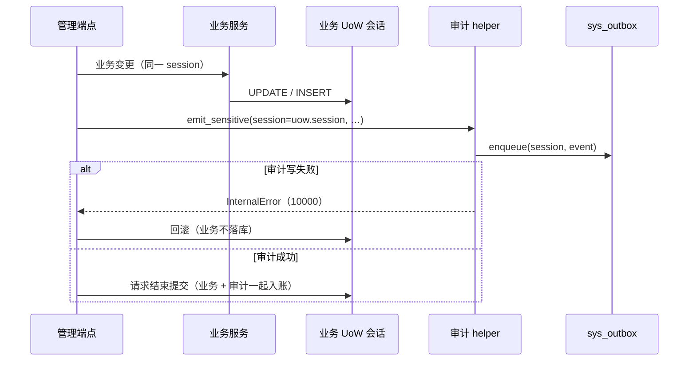

# 审计事务与写操作空头补齐详细设计

> 消息平台 · 05 多租户与安全 · 04 审计留痕与记录级定位 · 01 审计事务与写操作空头补齐 · 详细设计

[文档首页](../../../../../../../文档首页.md) › 消息平台任务 › [05 多租户与安全](../../../05_多租户与安全.md) › [05-4 审计留痕与记录级定位](../../05_多租户与安全_04_审计留痕与记录级定位.md) › [05-4-1 审计事务与写操作空头补齐](../05_多租户与安全_04_审计留痕与记录级定位_01_审计事务与写操作空头补齐.md) › 详细设计

## 1. 概述 <a id="overview"></a>

- **目标**：把「强审计成功但业务失败 / 业务成功但审计失败」的口子彻底堵上，并补齐四个空头——删消息、敏感查询留痕、主题停用 / 启用、延迟丢弃；同时修掉死信重放孤儿任务、并发建主题 500、死信处置无 CAS、`cleanup_policy` 假生效、清理台账虚报完成五处语义缺陷。
- **口径**：审计**进业务同一事务**（失败回滚 + 通用 `10000`）；删消息用**墓碑标记**（读路径过滤，磁盘到保留期回收）；停用**只停数据面**；查询留痕**只记消息检索 / 死信详情 / 重放详情**且为普通审计；留痕**沿用基座审计链路**。
- **依据**：任务 [05-4-1](../05_多租户与安全_04_审计留痕与记录级定位_01_审计事务与写操作空头补齐.md)；质量盘点 `tmp/msg-质量盘点-20261113.md` B4 / B7~B11；已确认口径 `tmp/msg-05-4-1-口径.md`。

## 2. 现状与差距 <a id="gap"></a>

| 项 | 现状（实测） | 差距 |
| --- | --- | --- |
| 审计事务 | `AuditEventEmitter.emit()` 自开平台库短事务并立即提交（`bms_core/audit/emit.py:86`）；端点「先业务后审计」 | 审计成功而业务回滚会留无效审计；业务成功而审计失败才回滚（半对） |
| 删消息 | 只有 `MESSAGE_DELETE_ACTION` 常量与契约，无端点、无存储语义 | 05-5 要求「删除带 `log_id` 留痕」，实际不可用 |
| 记录级删除标记 | 消息日志无 tombstone（仅 `.delay` 段有 `kind=put/clear`） | 需要新增记录级标记与读路径过滤 |
| 查询留痕 | 管理面查询完全不落审计 | 台账 #7 一直无主 |
| 停用 / 启用 | `STATUS_DISABLED` 常量存在，数据面 350028 判据存在，无任何端点与状态迁移 | 状态机预留但不可达 |
| 死信重放 | 先建任务、再 `mark_replaying`（`api/admin/dlq.py:331-351`） | 后者失败留孤儿任务 |
| 并发建主题 | 先查重再插入（`services/topic.py:131-142`） | 唯一约束 `IntegrityError` 未兜底 → 500 |
| 死信忽略 / 归档 | 读行 → 改状态 → flush（`services/dead_letter.py:192-201 / 219-228`） | 并发互相覆盖，审计与状态矛盾 |
| `cleanup_policy` | 任意字符串都接受（`schemas/topic.py:34`） | 非 `delete` 值看似生效、实际无实现 |
| 清理完成 | 各步骤跑完即台账置 `completed`（`services/topic_cleanup.py:390`） | 主题行可能仍在 `deleting` → 删不掉也建不了 |
| 延迟丢弃 | `DelayDisposalService` 已装配（`main.py:466-471`），无端点 | 能力声明不可达 |

## 3. 交付物清单 <a id="deliver"></a>

| # | 交付物 | 落点 |
| --- | --- | --- |
| 1 | 审计同事务能力 | bms `bms_core/audit/emit.py`（新增 `emit_in_session`） |
| 2 | 审计出口协议扩展 | `audit/trail.py`（`AuditEmitter.emit_in_session` + helper 透传 `session`） |
| 3 | 记录头删除标记 | `broker/record.py`（`delete_target: str | None`） |
| 4 | 存储删除端口 | `broker/log.py`（`delete`）、`broker/file_store.py`、内存实现、`broker/replication.py` 透传 |
| 5 | 删消息端点 | `api/admin/messages.py`、`schemas/message.py` |
| 6 | 查询留痕 | `api/admin/{messages,dlq,replay}.py`、`audit/trail.py` 新动作 |
| 7 | 停用 / 启用 | `api/admin/topics.py`、`services/topic.py`、`repositories/topic.py` |
| 8 | 语义修复 | `api/admin/dlq.py`、`services/dead_letter.py`、`repositories/dead_letter.py`、`schemas/topic.py`、`services/topic_cleanup.py` |
| 9 | 延迟丢弃端点 | `api/admin/delayed.py`、`schemas/delay.py` |
| 10 | 前端接线 | `views/TopicDetailPage.vue`、`views/MessagesPage.vue`、`views/DlqPage.vue`、`components/ReplayTaskDetailDrawer.vue`、`services/admin-service.ts` |

## 4. 审计事务设计 <a id="audit-tx"></a>



### 4.1 基座能力（bms，additive） <a id="audit-core"></a>

```python
async def emit_in_session(
    self, session: AsyncSession, event: EventEnvelope, *, required: bool = False
) -> bool:
    """把审计写进调用方事务（不自开事务、不提交）。"""
```

- 失败语义与 `emit()` 一致：`required=True` 抛 `InternalError`，否则记告警 + 指标并返回 False。
- **不改** `emit()` 的既有行为（其他服务仍在用短事务语义）。

### 4.2 msg 侧 helper <a id="audit-helper"></a>

- `AuditEmitter` 协议加 `emit_in_session(session, event, *, required=False)`；`emit_sensitive` / `emit_record_operation` / `emit_acl_change` 增加可选 `session: AsyncSession | None`：
  - 给了 `session` → 优先 `emit_in_session`（同事务）；
  - 没给 → 回落 `emit`（兼容清理 / 后台任务等无请求事务的调用）。
- 测试替身没有 `emit_in_session` 时，helper 用 `getattr(sink, "emit_in_session", None)` 探测并回落，不强制改所有替身。
- 强审计端点（建 / 删 / 扩 / 改保留期 / 配额 / ACL / 位点重置 / 死信处置 / 删消息 / 停用启用 / 延迟丢弃）**全部传 `session=uow.session`**。
- 删主题：`try: … audit … finally: cleanup.kick(topic_id)`。

### 4.3 失败返回 <a id="audit-fail"></a>

- 审计写失败 → `InternalError` → 基座错误映射为 `10000`（500），业务随请求回滚；**不新增产品码**。
- 普通审计（查询留痕、访问异常）失败只 `warning`，不影响响应。

## 5. 删消息设计 <a id="delete"></a>

### 5.1 记录格式（additive） <a id="record"></a>

`RecordHeader` 增可选字段：

```python
delete_target: str | None = None
"""删除标记的目标 `log_id`；None 表示普通记录（不写该键，旧记录字节不变）。"""
```

- 删除 = 在目标分区**追加一条墓碑记录**：新 `log_id`（`tombstone-<uuid>`）、`delete_target=<原 log_id>`、空 payload、`content_type=none`。
- 普通记录与旧版本记录不含该键，`decode` 缺省为 `None` → 旧数据零影响、无需升 `format_version`。
- 墓碑记录本身不进入可读结果（`delete_target` 非空即跳过）。

### 5.2 存储端口 <a id="store-port"></a>

```python
async def delete(self, *, topic_id: int, partition_no: int, log_id: str) -> bool:
    """追加墓碑标记；目标不存在返回 False（幂等：已删过也返回 False）。"""
```

- `FileMessageStore.delete`：分区锁内定位 `log_id`（`_locate` + 段扫描），不存在返回 False；存在则走正常 `append` 路径写墓碑（同一 fsync 档位），并把 `log_id` 加入进程内删除集合。
- 内存实现：直接把该 `log_id` 从可读列表移除，并保留 `delete_target` 语义（用例断言同一端口行为）。
- `fetch` / `scan_headers` / `read_bytes` / `find_by_log_id` / `locate_by_log_id` / 管理面检索：命中删除集合或记录本身是墓碑即跳过。
- `start_offset`、既有记录的 `offset` 与已提交位点**不变**；文件实现因追加墓碑记录，`LEO` +1（墓碑不返回给消费者）；内存实现不追加墓碑，`LEO` 不变。
- `ReplicatedMessageStore.delete` 只允许 leader 执行；follower 在拉取落盘时看到 `delete_target` 即更新本地删除集合，不重复追加墓碑。

### 5.3 删除集合重建 <a id="rebuild"></a>

- 分区首次打开（或启动恢复）时扫描该分区所有段的头，收集 `delete_target` 到 `ConcurrentStableSet[str]`；与 `.delay` 重建同形态，幂等可重做；损坏段（恢复阶段已隔离 / 取证）按段容错跳过，不阻断启动。
- 扫描只读头（`header_len`），不读 payload；单分区一次，常驻内存。
- 段被保留期整段删除后，集合中对应条目可保留（惰性清理，不影响正确性）。

### 5.4 端点 <a id="delete-api"></a>

```text
POST /api/v1/msg/admin/messages/{log_id}/delete?confirm=true
POST /api/v1/msg/admin/messages/delete   body: {log_ids: [...], confirm: true}
权限：msg:manage + 主题级 manage；单条返回 {log_id, deleted}；
批量返回 {items: [{log_id, result}], deleted, not_found}，result ∈ deleted / not_found
```

- `confirm` 缺失 → 10001；批量 > 100 → 10001。
- 先经 `find_by_log_id` 定位主题 / 分区（跨租户不可见 → 350029）；再按主题 ACL `manage` 判权。
- 每个成功删除写一条强审计（`record_ref = msg.message/log_id`）；批量逐条写，最多 100 条。
- 已删除 / 不存在不写「成功」审计，只在响应里给结果（避免审计与实际不符）。

### 5.5 前端 <a id="delete-ui"></a>

- 消息查询页：行操作「删除」→ 二次确认（`MsgConfirmDialog`）→ 调单条端点 → 提示 + 刷新。
- 死信详情 / 重放详情：带 `log_id` 时提供「删除消息」入口，复用同一确认组件。

## 6. 敏感查询留痕 <a id="query-audit"></a>

| 动作 | 触发点 | 类别 | 载荷 |
| --- | --- | --- | --- |
| `msg:message.search` | `GET /admin/messages` | 敏感，**非强审计** | 命名空间 / 主题 / 过滤条件摘要 / 命中数 |
| `msg:dlq.detail` | `GET /admin/dlq/{id}` | 敏感，非强审计 | 死信 ID / `log_id` |
| `msg:replay.detail` | `GET /admin/replay/{id}` | 敏感，非强审计 | 任务 ID / 主题 |

- 均传 `session=uow.session`，但 `strong=False`：审计失败只告警，不影响查询。
- 列表类（主题 / 组 / 分区 / 延迟 / 配额 / 概览）不记，避免审计膨胀。

## 7. 主题停用 / 启用 <a id="disable"></a>

```text
POST /api/v1/msg/admin/topics/{id}/disable?confirm=true   → TopicItem
POST /api/v1/msg/admin/topics/{id}/enable                  → TopicItem
权限：msg:manage；强审计（msg:topic.disable / msg:topic.enable）
```

- 状态迁移：`active → disabled`、`disabled → active`；**幂等**（同态直接返回 200）；`deleting` → 350028；不存在 → 350001。
- 数据面：`TopicRouter.resolve` 对 `disabled` 返回 350028（既有判据）；管理面写操作**不**按状态拦截（设计口径）。
- 审计：`record_ref` 不设（主题级配置变更），`params` 带前后状态。
- 前端：主题详情操作区加「停用 / 启用」按钮（`msg:manage`、二次确认、成功提示），按当前状态二选一。

## 8. 语义修复 <a id="fixes"></a>

### 8.1 B4 死信重放补偿 <a id="b4"></a>

- 保留「先建任务、后置 `replaying`」，但 `mark_replaying` 失败时：
  1. best-effort 调 `cancelReplayTask(task.id)`（任务尚未启动，取消无副作用）；
  2. 再抛 350030。
- 取消也失败只记 `error` 日志并保留任务（可人工清理），不掩盖原始错误。

### 8.2 B7 并发建主题 <a id="b7"></a>

- `TopicService.create_topic` 捕获 `IntegrityError`（唯一约束名匹配 `uq_msg_topic_*`）→ 抛 `MsgTopicExistsError`（350008）。
- 事务随异常回滚；不做「先查后插」的重复查询优化（保留现有预检，作为友好路径）。

### 8.3 B8 死信处置 CAS <a id="b8"></a>

- `MsgDeadLetterRepository` 新增：
  - `update_status(item_id, tenant_id, from_statuses, to_status, reason, actor_id, disposed_at) -> bool`
- `ignore`：`from=(pending,)`；`archive`：`from=ARCHIVABLE`；返回 False → 350030「已被其他请求处置，请刷新后重试」。
- 成功后重新读行返回（避免返回过期对象）。

### 8.4 B9 `cleanup_policy` 白名单 <a id="b9"></a>

- `TopicCreateRequest.cleanup_policy: Literal["delete"] = "delete"`；非法值由契约层拒绝（10001）。
- `TopicService` 删除 `request.cleanup_policy or CLEANUP_DELETE` 的兜底分支，直接传 `CLEANUP_DELETE`（唯一支持值），避免「看似可配」。

### 8.5 B10 清理完成核对 <a id="b10"></a>

- `TopicCleanupService._complete` 先 `await self._topics.get(topic_id)`：
  - 行已不存在 → 置 `completed`；
  - 行仍存在（`deleting`）→ `error` 日志 + 台账保持 `running`、`last_error = topic_row_still_present`，下一轮重试（不虚报完成）。
- 需要把 `TopicRepository` 注入 `TopicCleanupService`（构造函数新增可选参数，装配点同步）。

### 8.6 B11 延迟丢弃端点 <a id="b11"></a>

```text
POST /api/v1/msg/admin/delayed/{log_id}/discard?confirm=true
body: {reason: str(1~256)}
权限：msg:manage；强审计（msg:delay.discard + record_ref）
返回：{log_id, discarded}
```

- 不存在 / 已转投 / 非本租户 → 350029（死信同款语义，新增文案「延迟记录不存在或已转投」）。
- 丢弃成功后 `DelayDisposalService.discard` 当前实现已含审计，改为同事务（端点传 session）。

## 9. 失败分支 <a id="fail"></a>

| 场景 | 语义 |
| --- | --- |
| 审计写失败（强） | 业务回滚，响应 10000 |
| 审计写失败（查询） | 查询照常 200，日志告警 |
| 删消息目标不存在 / 已删 | `not_found` / `already_deleted`，不写成功审计，不报 500 |
| 批量 > 100 | 10001 |
| 停用 `deleting` 主题 | 350028 |
| 并发停用 / 启用 | 幂等 200（同态） |
| 死信并发处置 | 一个成功，另一个 350030 |
| 清理时主题行仍在 | 台账不置 completed，下一轮重试 |
| 延迟记录已转投 | 350029 |

## 10. 测试设计 <a id="test"></a>

| # | 用例 | 断言 |
| --- | --- | --- |
| 1 | 审计同事务：审计失败 | 业务行未落库、响应 10000、无审计记录 |
| 2 | 审计同事务：业务提交 | 审计与业务同一会话提交（替身断言 `emit_in_session` 被调用） |
| 3 | 删主题 `kick` | 审计失败时 `kick` 仍执行（finally） |
| 4 | 单条删消息 | `fetch` / 检索 / `find_by_log_id` 均不可见，LEO 不变 |
| 5 | 重启后仍不可见 | 重新构造 store，删除集合重建命中 |
| 6 | 副本可见性 | follower 拉取墓碑后同样不可见 |
| 7 | 批量删消息 | ≤100 成功、>100 返回 10001、逐条结果正确 |
| 8 | 删消息审计 | 每次成功删除一条 `msg:message.delete`，`record_ref` 为 `log_id` |
| 9 | 查询留痕 | 三类查询各一条审计；审计失败查询仍 200 |
| 10 | 停用 / 启用 | 数据面 350028、管理面写仍可用、重复调用幂等 |
| 11 | B4 重放补偿 | `mark_replaying` 失败时任务被取消，无孤儿 |
| 12 | B7 并发建主题 | 唯一约束冲突返回 350008 |
| 13 | B8 死信 CAS | 并发忽略 / 归档只有一个成功，另一个 350030 |
| 14 | B9 `cleanup_policy` | 非 `delete` 返回 10001 |
| 15 | B10 清理核对 | 主题行仍在时台账不置 completed |
| 16 | B11 延迟丢弃 | 端点可用、审计 `msg:delay.discard`、已转投 350029 |

覆盖口径见《AI开发规范》「覆盖率要求」节；用例先登记 Kiwi 再编码。

## 11. 实施步骤 <a id="steps"></a>

1. bms：`AuditEventEmitter.emit_in_session`（additive）→ bms 单测。
2. msg：`AuditEmitter` 协议扩展 + helper `session` 透传；所有强审计端点改同事务；删主题 `finally`。
3. `RecordHeader.delete_target` + 编解码；`MessageStore.delete`；文件 / 内存 / 复制实现；读路径过滤与重建。
4. 删消息端点 + 契约 + 前端入口。
5. 查询留痕三个动作。
6. 停用 / 启用端点 + 服务 + 前端按钮。
7. B4 / B7 / B8 / B9 / B10 / B11 修复。
8. 契约重导、前端类型、用例、门禁、记录、计划回写。

## 12. 边界与开放项 <a id="open"></a>

| # | 项 | 归口 |
| --- | --- | --- |
| 1 | 删除集合启动扫描在超大分区上的耗时 | 平台级容量实测 |
| 2 | 墓碑记录的磁盘占用（到保留期回收） | 可接受；容量实测观测 |
| 3 | 跨实例删除集合同步 | 依赖复制拉取；跨实例聚合视图归 02-8-4 |
| 4 | 批量删除的逐条审计条数上限 | 现为 100，与批量上限一致 |
| 5 | 停用主题的客户端缓存过期 | 02-8-4（主题缓存 TTL） |
| 6 | 删除消息是否影响死信 / 重放中的引用 | 引用保留 `log_id`；重放时按「已删」返回 350031 |
