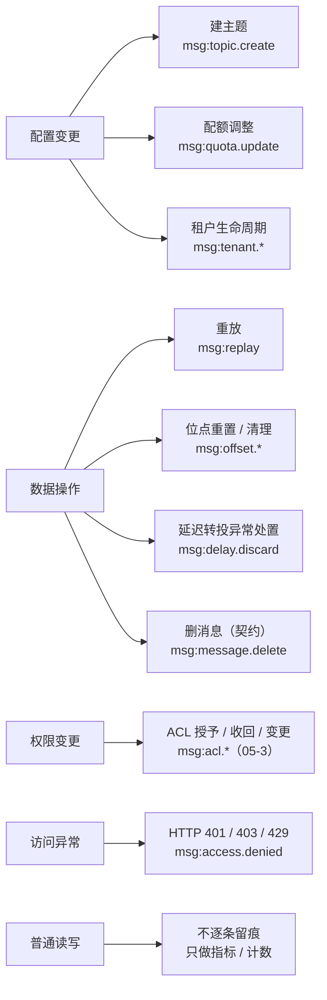
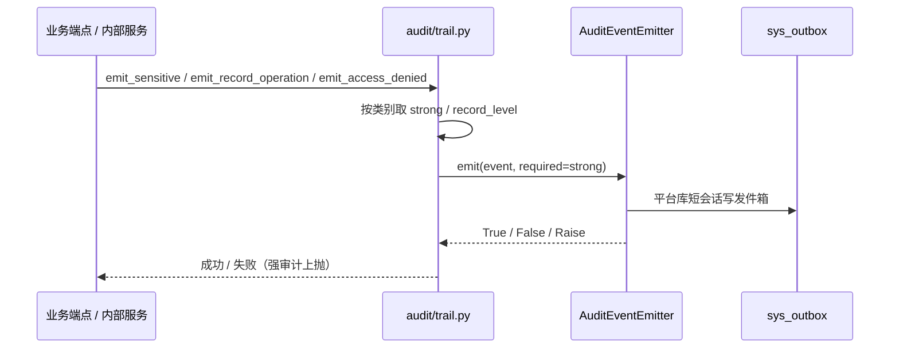
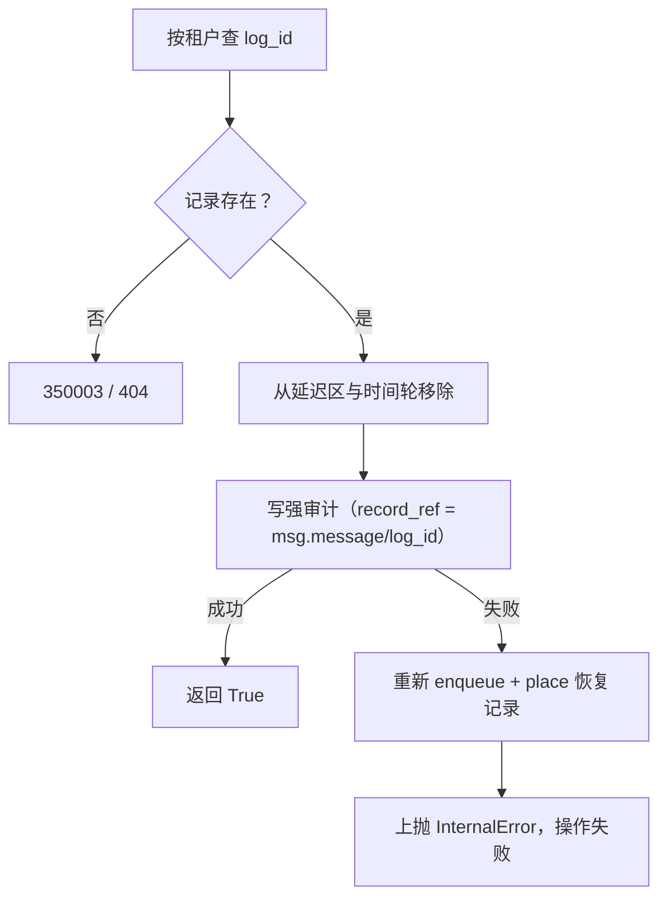

# 05-4 审计留痕与记录级定位 · 详细设计

> 08B · 05 多租户与安全 · 子任务 04（需求 05-5）

[文档首页](../../../../../../文档首页.md) › [消息平台规划](../../../../../../规划/01_规划_消息平台.md) › [阶段计划](../../../../计划/01_计划_消息平台.md) › [05 多租户与安全](../../05_多租户与安全.md) › [05-4](../05_多租户与安全_04_审计留痕与记录级定位.md) › 详细设计

---

## 0. 分章导航 <a id="toc"></a>

| 章 | 内容 |
| --- | --- |
| 1 | 任务级边界与已确认口径 |
| 2 | 交付物清单 |
| 3 | 现状核对结论与事实偏差 |
| 4 | 四类留痕与触发点矩阵 |
| 5 | 字段契约与写入路径 |
| 6 | 显式审计：配置变更 / 权限变更 / 记录级操作 |
| 7 | 访问异常审计中间件 |
| 8 | 延迟转投异常处置服务原语 |
| 9 | 删消息：契约先行，不建端点 |
| 10 | 审计失败处置 |
| 11 | 普通读写不洪泛与排除清单 |
| 12 | 接口、配置与契约影响 |
| 13 | 测试设计与验收映射 |
| 14 | 登记落点与文档同步 |
| 15 | 边界与开放项 |
| 16 | 对齐记录 |

## 1. 任务级边界与已确认口径 <a id="scope"></a>

**本任务做什么**：

1. 按需求 05-5 固定「配置变更 / 数据操作 / 权限变更 / 访问异常」四类留痕，逐类列触发点，保证不漏记、不重复记。
2. 全部写基座审计链 `sys.operation.logged`：复用 `build_operation_event()` + `AuditEventEmitter` / `AuditSink`，**不自建审计表、不建第二套事件总线、不删除审计记录**。
3. 核对重放、位点重置两类已由 bms 07D 任务 03 交付的 `record_ref` 与强审计口径，不重写既有写入。
4. 补齐两个新动作的契约与可执行原语：
   - **延迟转投异常处置**：落「丢弃一条延迟记录」的服务原语，强审计 + `record_ref{msg.message, log_id}`，HTTP 端点留给 06-2。
   - **删消息**：只出动作、`record_ref`、强审计与 helper 契约，不建删除端点、不改追加日志存储语义，实际触发归 06-2。
5. 补「权限变更」的 ACL 留痕契约（动作、类别、作用域字段、强审计），实际 ACL 变更归 05-3。
6. 新增访问异常审计：覆盖基座中间件未记录的数据面、GET 与停用租户拒绝；按窗口节流，避免重试刷量。
7. 配置变更统一改为显式动作审计并排除对应路径，消除配额调整的重复审计；补齐 `exclude_paths` 的普通读写缺口。
8. 新增 msg 的 `audit_classes()` 声明，把「是否强审计 / 是否记录级」从业务分支收敛到类别表。

**不做什么**：

- 不改 bms 审计链构造、哈希链算法与归档口径；不改 `build_operation_event()` / `AuditEventEmitter` 的基座实现。
- 不建删消息端点，不改 `FileMessageStore` / `MessageStore` 的单条删除语义（追加日志只支持按位点截断，不支持单条墓碑删除）。
- 不做 05-3 的主题 ACL 表、判定、缓存与端点，只出留痕契约。
- 不做 06-2 的延迟区改期 / 取消 / 清空 HTTP 端点，只落服务原语。
- 不把审计当业务日志用；不新增逐条发布 / 消费审计。
- 不跨仓改 bms / engkit；bms 侧审计表列缺口登记在本文 §15。

**权威依据**：

- [需求 05-5 审计留痕](../../../../需求/05_需求_多租户与安全.md#r05-5)
- [架构设计 · 多租户与安全](../../../../../../设计/架构设计/07_架构设计_多租户与安全.md)「授权」「审计」「与 bms 租户体系对齐」节
- bms 07D `02-4` 审计字段扩展契约（纯文本路径：`bms/bms文档/项目/07D_产品租户与安全接入/任务/02_标准扩展点/设计/01_详细设计_02_标准扩展点.md` §5）
- bms 07D `03` 产品接入改造附录 D（纯文本路径：`bms/bms文档/项目/07D_产品租户与安全接入/任务/03_产品接入改造/设计/01_详细设计_03_产品接入改造.md` §4.4）
- [01-6 消息保留与重放](../../../01_消息模型与投递/01_消息模型与投递_06_消息保留与重放/01_消息模型与投递_06_消息保留与重放.md)（既有审计接入）
- 《[审计哈希链](../../../../../../../bms文档/设计/架构设计/19_架构设计_子系统_审计哈希链.md)》

**已确认口径（本次会话逐项拍板）**：

| # | 事项 | 结论 |
| --- | --- | --- |
| 1 | 删消息 | 只出契约（动作、`record_ref`、强审计与 helper），不建删除端点；实际触发与存储删除语义归 06-2 |
| 2 | 延迟转投异常处置 | 落「丢弃一条延迟记录」服务原语 + 强审计 + `record_ref`；HTTP 端点归 06-2 |
| 3 | 权限变更 | 只出 ACL 留痕契约，实际 ACL 变更归 05-3 |
| 4 | 配置变更写入 | 显式动作审计 + 对应路径排除，避免中间件再记一条；配额重复随之消除 |
| 5 | 访问异常 | 新增 msg 专用拒绝审计中间件，覆盖数据面 / GET / 停用租户；窗口节流 |
| 6 | 强审计范围 | 配置变更、权限变更、记录级操作强审计；访问异常普通审计 |
| 7 | 重放 / 位点定位 | 保持 07D 03 现状并写明口径：重放定位任务、位点定位位点、消息类操作定位 `log_id`；不改既有写入 |
| 8 | 洪泛排除 | 补齐 `/api/v1/msg/subscribe`、`/api/v1/msg/connection/heartbeat`、`/rpc`，并加配置断言 |
| 9 | 测试口径 | 组件级断言审计事件载荷（FakeAuditSink），不直接查 `sys_outbox` |
| 10 | 命名 | 动作 `msg:message.delete` / `msg:delay.discard` / `msg:access.denied` / `msg:acl.grant|revoke|update`；消息类 `record_ref.type = msg.message` |

## 2. 交付物清单 <a id="deliverables"></a>

| # | 交付物 | 落点 |
| --- | --- | --- |
| D1 | 审计动作、类别、`record_ref` 与发射 helper | `backend/services/msg/src/bms_msg/audit/trail.py`（新增） |
| D2 | 延迟转投异常处置服务原语 | `backend/services/msg/src/bms_msg/broker/delay_disposal.py`（新增） |
| D3 | 访问异常拒绝审计中间件 | `backend/services/msg/src/bms_msg/api/access_audit.py`（新增） |
| D4 | 时间轮按 `log_id` 移除 | `backend/services/msg/src/bms_msg/broker/scheduler.py`（改） |
| D5 | 配置变更显式审计（建主题 / 配额） | `backend/services/msg/src/bms_msg/api/admin/topics.py`、`api/admin/quota.py`（改） |
| D6 | `audit_classes()` 声明与中间件装配 | `backend/services/msg/src/bms_msg/main.py`（改） |
| D7 | 排除清单补齐 | `backend/config.toml`（改） |
| D8 | 用例 | `backend/services/msg/tests/test_audit_trail.py`、`tests/broker/test_delay_disposal.py`、`tests/api/test_access_audit.py`、`tests/api/test_audit_config_changes.py`、`tests/test_audit_config_paths.py`（新增 / 改） |
| D9 | 实施记录 / 测试记录 / 任务与计划回写 | 本任务目录 `实施/`、`测试/`；任务文档 §2 / §3；阶段计划 §2 / §3 |

> 本期**不新增 HTTP 端点**，`deploy/contracts/msg.json` 不需要重导；若实施中出现端点变更，按硬约束执行 `python -m ops.contract_snapshot export`。

## 3. 现状核对结论与事实偏差 <a id="current"></a>

| # | 核对项 | 事实 | 本任务处置 |
| --- | --- | --- | --- |
| 1 | 基座中间件 | `OperationAuditMiddleware` 对 `record_methods` 内且不在 `exclude_paths` 的请求逐条写 `sys.operation.logged`；403 也记；GET 默认不记 | 保留；配置变更改为显式审计后排除对应路径，避免重复 |
| 2 | 重放审计 | `ReplayAuditor` 建任务 / 取消 / 终态三条，强审计，`record_ref{msg.replay, task_id}`，载荷带 `log_id_first` / `log_id_last` | 只核对与回归，不改写 |
| 3 | 位点审计 | `FileOffsetStore.reset` 强审计，`record_ref{msg.offset, topic_id:partition_no}`；`/admin/offsets/reset` 端点归 06-2，尚未挂载 | 只核对与回归，不改写 |
| 4 | 配额审计 | 端点显式写 `msg:quota.update`，普通审计；路径未排除，中间件再记一条 | 改为强审计 + 排除路径，消除重复 |
| 5 | 建主题审计 | 只有中间件一条，`action` 为 `msg:manage`，无主题级动作 | 改显式 `msg:topic.create` 强审计 + 排除路径 |
| 6 | 租户生命周期审计 | `msg:tenant.suspend` / `activate` / `delete` / `purge` 已显式写；删除 / 清理强审计 | 本期只核对，不改既有 05-5 行为 |
| 7 | 删消息 | 无端点、无服务、无存储原语；追加日志只有 `truncate_before(offset)` | 只出契约，实际触发归 06-2（§9） |
| 8 | 延迟转投异常处置 | `DelayScheduler._defer()` 只 `attempts + 1`、按窗口记日志、下轮重试，永不丢弃；无处置端点 | 新增服务原语（§8），端点归 06-2 |
| 9 | 权限变更 | 05-3 ACL 未开始，无 ACL 表 / 端点 / 审计 | 只出契约，实际变更归 05-3（§6.3） |
| 10 | 访问异常 | 数据面路径整体排除，拒绝不留痕；GET 默认不记；auth 路径由 bms 登录审计承担 | 新增拒绝审计中间件（§7） |
| 11 | 洪泛排除 | 未排除 `/api/v1/msg/subscribe`、`/api/v1/msg/connection/heartbeat`、`/rpc` | 补齐并加断言（§11） |
| 12 | 留痕类别声明 | msg 未覆写 `audit_classes()`，全部走基座缺省 | 新增动作到类别的声明（§5.3） |
| 13 | 记录级定位口径 | 重放是任务级、位点是位点级，不是消息级；架构 07 §9 仍写 `log_id` | 保持实现，修订文档用词并写明三类定位对象（§5.2、§14） |

## 4. 四类留痕与触发点矩阵 <a id="matrix"></a>



| 类别 | 触发点 | 本期状态 | 动作 | 类别 / 强审计 | `record_ref` | 测试 |
| --- | --- | --- | --- | --- | --- | --- |
| 配置变更 | `POST /api/v1/msg/admin/topics` | **新增显式** | `msg:topic.create` | `sensitive` / 强 | 无 | 建主题成功落一条；审计失败接口失败 |
| 配置变更 | `PUT /api/v1/msg/admin/quotas` | **改为显式强审计** | `msg:quota.update` | `sensitive` / 强 | 无 | 调整成功落一条；不再出现第二条 |
| 配置变更 / 生命周期 | `tenant.suspended` / `activated` / `deleted` / 到期清理 | 既有，不改 | `msg:tenant.*` | 删除 / 清理强；停用 / 启用普通 | 无 | 既有 05-5 用例回归 |
| 配置变更 | 删主题 / 改分区 / 改保留期 | 未实现，归 06-2 | 待定 | 待定 | 无 | 本期不覆盖，登记 §15 |
| 数据操作 | 重放建任务 / 取消 / 终态 | 既有，核对 | `msg:replay` | `record_operation` / 强 | `msg.replay` + `task_id` | 既有 `test_audit_record_ref.py` 回归 |
| 数据操作 | 位点重置 | 既有，核对 | `msg:offset.reset` | `record_operation` / 强 | `msg.offset` + `topic_id:partition_no` | 既有位点用例回归 |
| 数据操作 | 位点清理 | 既有，核对 | `msg:offset.purge` | `record_operation` / 强 | 无（按组 / 主题清理） | 既有位点用例回归 |
| 数据操作 | 延迟转投异常处置 | **新增服务原语** | `msg:delay.discard` | `record_operation` / 强 | `msg.message` + `log_id` | §8 用例 |
| 数据操作 | 删消息 | **只出契约** | `msg:message.delete` | `record_operation` / 强 | `msg.message` + `log_id` | helper 契约用例 |
| 权限变更 | ACL 授予 / 收回 / 变更 | **只出契约**，05-3 实现 | `msg:acl.grant` / `revoke` / `update` | `sensitive` / 强 | 无 | helper 契约用例 |
| 访问异常 | 基座已记录路径的 401 / 403 / 429 | 既有 | 权限码 / 请求动作 | `write` / 普通 | 无 | 既有中间件行为回归 |
| 访问异常 | 数据面、GET、排除路径的 401 / 403 / 429 | **新增中间件** | `msg:access.denied` | 普通 | 无 | §7 用例 |
| 访问异常 | `/api/v1/auth/*` 认证失败 | 归 bms 登录审计 | — | — | — | 本期不覆盖，登记 §15 |
| 普通读写 | publish / consume / ack / join / heartbeat / leave / subscribe / connection heartbeat / rpc | 不逐条留痕 | — | `read` | 无 | §11 配置断言 |

**「不漏、不重」判定**：

- 同一操作只保留一条审计：配置变更路径排除后，中间件不再记；重放路径继续排除；数据面与普通读写路径排除。
- 同一操作只记一次结果：重放终态按「谁迁移谁记」；延迟处置只在真正移除成功时记；访问异常只在基座未记录时记。
- 不把「普通读写」升级成审计：发布 / 消费 / 心跳 / 订阅 / RPC 只保留指标与日志。

## 5. 字段契约与写入路径 <a id="fields"></a>

### 5.1 标准字段 <a id="standard-fields"></a>

所有事件经 `build_operation_event()` 构造，事件类型固定 `sys.operation.logged`：

| 字段 | 取值 |
| --- | --- |
| `tenant_id` | 当前租户雪花 ID 的十进制字符串；拒绝且无租户上下文时为空 |
| `user_id` / `username` | 操作人主键；系统触发的记录级操作取任务创建人或为空；`username` 暂不补 |
| `module` | 固定 `msg` |
| `action` | §4 矩阵中的动作 |
| `method` / `path` | HTTP 方法与管理端点模板；内部动作使用规划路径（如 `/api/v1/msg/admin/delayed/{log_id}/discard`，不新增真实路由） |
| `query` / `params` | 查询串 / 载荷 JSON；不写敏感值；雪花 ID 以字符串落 JSON |
| `ip` / `user_agent` | 来源 IP / UA；系统触发为空 |
| `cost_time` | 请求耗时（毫秒）；内部动作可为空 |
| `status` / `error_msg` | 结果状态；成功为 `200`，异常处置失败不落事件（强审计失败即操作失败） |
| `trace_id` | 链路标识 |
| `module_key` / `resource_key` | 作用域字段：`module_key` 取命名空间（对齐 `module_key`），`resource_key` 取主题名；无作用域时为空 |

### 5.2 `record_ref` 与定位对象 <a id="record-ref"></a>

`RecordRef` 是基座 07D `02-4` 的值对象：`type` 匹配 `^[a-z][a-z0-9_]*(\.[a-z][a-z0-9_]*)?$`、≤64；`id` 非空、≤64、仅字母数字与 `_:-`。

| 操作 | `record_ref.type` | `record_ref.id` | 定位对象 | 说明 |
| --- | --- | --- | --- | --- |
| 重放 | `msg.replay` | `task_id` | 重放任务 | 消息级定位靠载荷 `log_id_first` / `log_id_last`；不改成消息级，避免丢失任务定位与改写 07D 03 |
| 位点重置 | `msg.offset` | `"{topic_id}:{partition_no}"` | 位点 | 位点没有单条消息；按主题 + 分区一次定位 |
| 延迟转投异常处置 | `msg.message` | `log_id` | 延迟消息记录 | 一次定位到尚未转投的物理记录 |
| 删消息（契约） | `msg.message` | `log_id` | 消息记录 | 实际触发归 06-2；本任务只保证字段与 helper 可用 |
| 配置 / 权限 / 访问异常 | 无 | 无 | 操作对象由作用域字段与载荷表达 | 不强行给非记录级操作加 `record_ref` |

> 需求文档写「涉及具体记录时另带 `log_id`」，落地字段是 `record_ref`；`log_id` 作为 `record_ref.id` 或载荷字段出现。架构 07 §9 的用词按本节修订（§14）。

### 5.3 留痕类别 <a id="classes"></a>

新增 `bms_msg/audit/trail.py`，集中声明动作、类别与 helper：

- `ACTION_CLASSES`：动作 → `AuditClass` 的**唯一映射**（本模块常量）；
- `ApplicationFactory.audit_classes()` 直接返回 `ACTION_CLASSES`，装配期由基座合并进 `app.state.audit_classes`；
- helper 用 `audit_class_for(action, ACTION_CLASSES)` 取 `strong`，不依赖请求期 `app.state`，也不在业务分支硬编码。

| 动作 | 类别 key | `strong` | `record_level` | 说明 |
| --- | --- | --- | --- | --- |
| `msg:topic.create` | `sensitive` | 是 | 否 | 建主题属敏感配置 |
| `msg:quota.update` | `sensitive` | 是 | 否 | 配额属敏感配置 |
| `msg:acl.grant` / `msg:acl.revoke` / `msg:acl.update` | `sensitive` | 是 | 否 | 授权 / 收回 / 变更 |
| `msg:replay` | `record_operation` | 是 | 是 | 既有动作，映射用于查询与对账 |
| `msg:offset.reset` / `msg:offset.purge` | `record_operation` | 是 | 是 | 既有动作 |
| `msg:delay.discard` | `record_operation` | 是 | 是 | 新增 |
| `msg:message.delete` | `record_operation` | 是 | 是 | 契约 |
| `msg:access.denied` | `access` | 否 | 否 | 新增自定义类别；普通审计，失败只告警 |

`audit_class_for(action, ACTION_CLASSES)` 的返回值是「应该怎么记」的唯一判据；业务分支不硬编码 `required=True/False`，helper 按类别取值。`app.state.audit_classes` 只用于运营视图与查询，运行期 helper 与它同源（同一份 `ACTION_CLASSES`），不会出现「声明强、实际弱」。

### 5.4 写入路径 <a id="writer"></a>



- 新增 helper 统一走 `AuditSink` 协议（`emit(event, *, required=False)`），生产装配为基座 `AuditEventEmitter`，用例注入替身。
- 强审计失败：`emit()` 抛 `InternalError`（`10000` / 500）；若替身返回 `False`，helper 同样抛 `InternalError`，不允许「返回 False 但业务继续」。
- 普通审计失败：捕获异常 / `False`，记 `WARNING`，返回 `False`，不影响业务响应。
- 不新增事件类型、不新增发件箱表、不改哈希链；新字段只进 `payload`。

## 6. 显式审计：配置变更 / 权限变更 / 记录级操作 <a id="explicit"></a>

### 6.1 建主题（配置变更） <a id="topic-create"></a>

- 端点：`POST /api/v1/msg/admin/topics`，权限 `msg:manage`。
- 时机：`TopicService.create_topic()` 成功提交并失效缓存之后。
- 动作：`msg:topic.create`；类别 `sensitive`；强审计。
- 作用域：`module_key = request.namespace`、`resource_key = request.name`。
- 载荷：

```json
{
  "topic_id": "雪花 ID 十进制字符串",
  "namespace": "msg",
  "topic": "operation.created",
  "partition_count": 3,
  "retention_ms": 604800000,
  "retention_bytes": 0,
  "cleanup_policy": "delete"
}
```

- 排除：`/api/v1/msg/admin/topics` 加入 `exclude_paths`，由显式审计独占；未来删主题 / 改分区 / 改保留期也走同前缀，必须显式接审计。
- 失败：强审计失败返回 `10000` / 500。**残留**：主题已在事务中提交，失败后重试会得到 `350008`；这是既有「提交后审计」模式的共同边界，登记 §15。

### 6.2 配额调整（配置变更） <a id="quota-update"></a>

- 端点：`PUT /api/v1/msg/admin/quotas`，权限 `msg:manage`。
- 时机：`quota.update()` 提交并失效缓存之后。
- 动作：`msg:quota.update`；类别 `sensitive`；强审计。
- 载荷：沿用现有 `{"items": [{quota_key, namespace, limit, soft_limit}]}`，不新增字段。
- 排除：`/api/v1/msg/admin/quotas` 加入 `exclude_paths`，删除重复的中间件记录。
- 行为变更：从「审计失败只告警」改为「审计失败接口失败」；修改既有 `test_put_quotas_survives_audit_failure` 的预期，新增强审计用例。

### 6.3 ACL 权限变更契约（05-3 实现） <a id="acl-contract"></a>

本期只提供 helper 与类别，不建表、不建端点、不写判定。05-3 在 ACL 授予 / 收回 / 变更成功提交后调用同一 helper。

| 项 | 契约 |
| --- | --- |
| 动作 | `msg:acl.grant` / `msg:acl.revoke` / `msg:acl.update` |
| 类别 | `sensitive`，强审计 |
| 作用域 | `module_key` = 命名空间；`resource_key` = 主题名 |
| 载荷 | `principal`（用户 / 角色标识）、`permission`（`publish` / `subscribe` / `describe` / `manage`）、`effect`（`allow` / `deny`）、`result` |
| `record_ref` | 无（ACL 条目不是消息记录；如需定位 ACL 行，05-3 可另行评估） |
| 失败 | 强审计失败即授权变更失败；不静默放行 |

### 6.4 记录级操作 helper <a id="record-helper"></a>

`emit_record_operation()` 接收 `action`、`tenant_id`、`log_id`、`params`、`path`、`method` 与操作人上下文，内部：

1. 构造 `RecordRef(type="msg.message", id=log_id)`；
2. 按 `audit_class_for(action)` 取 `strong`（本期新增动作均为 `True`）；
3. 调 `sink.emit(event, required=True)`；
4. 失败抛 `InternalError`，由调用方保证「没留痕就不生效」。

调用方：

- 延迟转投异常处置（本期，§8）；
- 删消息（06-2，本期只测 helper）；
- 重放 / 位点重置继续用各自既有 emitter，不迁移到本 helper（避免重写 07D 03）。

## 7. 访问异常审计中间件 <a id="access-audit"></a>

### 7.1 目标与覆盖 <a id="access-scope"></a>

基座中间件只记「`record_methods` 内且未排除」的请求；数据面 publish / consume / subscribe / 心跳 / RPC 与 GET 拒绝都不留痕。新增 `AccessAnomalyAuditMiddleware`，只补「基座不会记录、但结果是访问异常」的请求：

| 场景 | 是否记录 | 说明 |
| --- | --- | --- |
| 数据面 `/msg/publish` / `/msg/consume` / `/msg/subscribe` 返回 401 / 403 / 429 | 记录 | 停用租户、越权、认证失败、限流 |
| `/rpc/*` 返回 401 / 403 / 429 | 记录 | RPC 数据面拒绝 |
| GET 管理端点返回 401 / 403 / 429 | 记录 | 基座默认不记 GET |
| 配置变更路径（已排除）返回 401 / 403 / 429 | 记录 | 成功由显式审计，拒绝由本中间件 |
| 基座已记录路径的 403 | 跳过 | 避免同一拒绝两条 |
| `/api/v1/auth/*` | 跳过 | bms 登录 / 刷新审计承担；msg 不重复 |
| `/healthz` / `/readyz` / `/metrics` / 文档 | 跳过 | 探针与文档不记 |
| 2xx / 3xx / 4xx 非 401/403/429 / 5xx | 不记 | 5xx 是故障不是访问异常；由日志与指标承担 |

### 7.2 事件字段 <a id="access-event"></a>

| 字段 | 取值 |
| --- | --- |
| `action` | `msg:access.denied` |
| `module` | `msg` |
| `tenant_id` | 从 `scope["state"]["tenant"]` / `tenant_id` 取；租户解析失败时为空 |
| `user_id` | 当前用户上下文；无登录态时为空 |
| `method` / `path` | 实际方法 / 路由模板（无匹配用原始路径） |
| `params` | `{"status": 403, "attempted_action": "msg:manage", "reason": "forbidden"}`；`reason` 按 401 / 403 / 429 映射 |
| `ip` / `trace_id` / `module_key` / `resource_key` | 同基座中间件口径 |
| `status` / `error_msg` | 实际状态 / `HTTP 403` |
| `record_ref` | 无 |

`attempted_action` 取 `scope["state"]["audit_action"]`（`require_permission` 在拒绝前已写入）；租户中间件提前拒绝时为空。

### 7.3 节流 <a id="access-throttle"></a>

- 节流键：`(tenant_id or "-", 路由模板或原始路径, status)`。
- 窗口：`ACCESS_ANOMALY_WINDOW_MS = 60_000`（进程内常量，不新增配置段）。
- 窗口内重复拒绝只保留首条；被抑制次数记结构化日志 `msg_access_audit_suppressed`（每个窗口最多一条，避免日志刷屏）。
- 键数量上限 `ACCESS_ANOMALY_MAX_KEYS = 1024`；超过时清空表，防止随机路径打爆内存。
- 多实例各自节流：跨实例可能各记一条，登记 §15（8B_05 统一后再评估共享窗口）。

### 7.4 写入与失败 <a id="access-writer"></a>

- 优先取 `app.state.audit_sink`（`configure_service()` 已装配）；缺失时记 `WARNING` 并跳过——访问异常审计不得影响拒绝响应。
- `emit(required=False)`；异常与 `False` 都只记日志，不改变原响应。
- 中间件在 `configure_service()` 里用 `app.add_middleware()` 注册，注册晚于基座中间件，因此位于最外层，能看到租户中间件提前拒绝的响应。

## 8. 延迟转投异常处置服务原语 <a id="delay-disposal"></a>

### 8.1 语义 <a id="delay-semantics"></a>

「异常处置」指运维 / 管理员对一条**长期无法转投**的延迟记录做人工移除（丢弃），而不是把自动重试改成丢弃。自动重试行为不变：`_defer()` 继续 `attempts + 1`、下一轮重试、永不自动丢弃。

新增 `DelayDisposalService`（`bms_msg/broker/delay_disposal.py`）：

| 项 | 契约 |
| --- | --- |
| 方法 | `async def discard(*, tenant_id: int, log_id: str, reason: str, actor_id: int | None, ip: str | None, trace_id: str | None) -> bool` |
| 查找 | `DelayStore.list_for_tenant(tenant_id)` 中找 `log_id`；找不到 → `MsgMessageNotFoundError`（`350003` / 404） |
| 原因 | `reason` 去空白后不得为空；为空 → `ParamError`（`10001`） |
| 移除 | `DelayStore.remove(log_id)` + `DelayWheel.forget(log_id)` |
| 审计 | `msg:delay.discard`，`record_operation`，强审计，`record_ref{msg.message, log_id}` |
| 载荷 | `log_id` / `reason` / `attempts` / `namespace` / `topic` / `partition` / `delay_level` / `deliver_at` |
| 结果 | 成功 `True`；审计失败恢复记录并上抛；记录不存在 `350003` |

### 8.2 执行顺序与失败回滚 <a id="delay-order"></a>



- **先移除、后审计、失败恢复**：避免「审计已记丢弃、实际没丢」的假审计；审计失败时记录回到延迟区与时间轮，下一轮仍可转投。
- 恢复失败（`enqueue` 再次抛错）记 `CRITICAL` 日志并上抛原审计异常；这是存储不可用的极端路径，登记 §15。
- `DelayWheel.forget(log_id)` 新增：遍历 L0 / L1 / L2 桶与 `_overdue`，移除同 `log_id` 引用，返回移除数；记录已转投（不在轮中）返回 0，不报错。

### 8.3 装配与端点 <a id="delay-wiring"></a>

- `main.py::configure_service()` 构造 `app.state.delay_disposal = DelayDisposalService(store=delay_store, wheel=delay_scheduler.wheel, sink=sink)`。
- 本期**不挂 HTTP 端点**；06-2 的「延迟区取消」端点组装同一服务，路径规划为 `POST /api/v1/msg/admin/delayed/{log_id}/discard`（只用于审计路径，不建真实路由）。
- 不新增错误码；复用 `350003` 与 `10001`。

## 9. 删消息：契约先行，不建端点 <a id="message-delete"></a>

本期只交付「删消息」的审计契约，不交付删除能力：

| 项 | 契约 |
| --- | --- |
| 动作 | `msg:message.delete` |
| 类别 | `record_operation`，强审计 |
| `record_ref` | `{"type": "msg.message", "id": "<log_id>"}` |
| 载荷 | `log_id` / `namespace` / `topic` / `partition` / `offset` / `reason` / `result`（具体字段由 06-2 端点定，helper 接受任意 JSON 可序列化映射） |
| 路径 | 06-2 端点实际路径；本期 helper 用例使用规划路径 |
| 失败 | 强审计失败即删除失败，不静默删除 |

- helper：`emit_record_operation(action=MESSAGE_DELETE_ACTION, log_id=..., ...)`；本期用该 helper 写一条契约用例，证明「动作 + 类别 + `record_ref` + 强审计」可用。
- 不修改 `MessageStore` / `FileMessageStore`；不实现墓碑、索引删除或读路径过滤。
- 06-2 实现删除时，必须在删除生效前调用本 helper（或同语义 helper），保证「没留痕就不删」。

## 10. 审计失败处置 <a id="failure"></a>

| 类别 | 失败行为 | 接口表现 | 备注 |
| --- | --- | --- | --- |
| 配置变更（建主题 / 配额） | 强审计失败即失败 | `10000` / 500 | 审计在业务提交后；数据可能已落库，登记 §15 |
| 权限变更（ACL） | 强审计失败即失败 | `10000` / 500 | 05-3 实现时遵守 |
| 记录级（重放 / 位点） | 强审计失败即失败 | 既有口径 | 不改写 |
| 记录级（延迟处置） | 强审计失败恢复记录并失败 | `10000` / 500 | §8.2 |
| 记录级（删消息） | 强审计失败即删除失败 | 06-2 定义 | 本期只出契约 |
| 访问异常 | 普通审计失败只告警 | 原拒绝响应不变 | 不静默丢弃：至少保留结构化日志 |
| 普通读写 | 不写审计 | 正常响应 | 只有指标 / 计数 |

- 指标：基座 `AuditEventEmitter` 失败时已写 `bms_audit_emit_failed_total`；msg 不重复建指标。
- 访问异常节流抑制：`msg_access_audit_suppressed` 结构化日志；被抑制不等于丢失，首条已入审计链。
- 不静默丢弃：强审计失败必须让调用方感知；普通审计失败必须有日志。

## 11. 普通读写不洪泛与排除清单 <a id="no-flood"></a>

### 11.1 排除清单 <a id="exclude-list"></a>

`backend/config.toml` 的 `[audit_log].exclude_paths` 改为下列全量清单（前缀匹配）：

| 路径 | 原因 |
| --- | --- |
| `/api/v1/auth/login` / `refresh` / `logout` / `introspect` | 基座默认认证路径；bms 登录审计承担 |
| `/api/v1/msg/publish` / `consume` / `ack` / `join` / `heartbeat` / `leave` | 普通读写，逐条写会洪泛 |
| `/api/v1/msg/subscribe` | 帧订阅流，长期驻留；不逐条留痕 |
| `/api/v1/msg/connection/heartbeat` | 连接心跳，高频 |
| `/rpc` | RPC 数据面，高频；拒绝由访问异常中间件补 |
| `/api/v1/msg/admin/replay` | 重放已有显式审计，避免重复 |
| `/api/v1/msg/admin/topics` | 建主题显式审计；未来写操作同前缀 |
| `/api/v1/msg/admin/quotas` | 配额显式审计 |
| `/api/v1/msg/admin/delayed` | 延迟处置显式审计（06-2 端点落地后生效） |
| `/api/v1/msg/admin/offsets` | 位点重置 / 清理显式审计（06-2 端点落地后生效） |

> `exclude_paths` 是整表覆盖，默认 4 条 auth 路径必须写回；新增排除项只影响「成功也记」的自动审计，不影响访问异常中间件（它只对 401/403/429 补记）。

### 11.2 断言 <a id="no-flood-test"></a>

- 配置断言：上述路径全部存在；`/api/v1/msg/admin/topics` / `quotas` 不得再被中间件重复记录。
- 行为断言：成功的 publish（200）不产生审计事件；被排除路径的 403 只由访问异常中间件记一条；基座已记录路径的 403 不重复。
- 数据面拒绝：`/msg/publish` 停用租户 403 → 一条 `msg:access.denied`，带租户标识与 `attempted_action`。

## 12. 接口、配置与契约影响 <a id="impact"></a>

| 类别 | 对象 | 变更 |
| --- | --- | --- |
| 新增 | `bms_msg/audit/trail.py` | 动作 / 类别 / `record_ref` / helper |
| 新增 | `bms_msg/broker/delay_disposal.py` | 延迟处置服务原语 |
| 新增 | `bms_msg/api/access_audit.py` | 访问异常中间件 |
| 修改 | `bms_msg/broker/scheduler.py` | `DelayWheel.forget(log_id)` |
| 修改 | `bms_msg/api/admin/topics.py` | 建主题显式强审计 |
| 修改 | `bms_msg/api/admin/quota.py` | 配额改强审计，去重复 |
| 修改 | `bms_msg/main.py` | `audit_classes()`、`delay_disposal` 装配、访问异常中间件注册 |
| 修改 | `backend/config.toml` | `exclude_paths` 补齐 |
| 不改 | 数据库表 / ORM / 迁移 | 无表结构变更 |
| 不改 | `deploy/contracts/msg.json` | 无新增 HTTP 端点 |
| 不改 | bms `bms_core.audit.*` | 只消费基座契约 |

**错误码**：不新增产品码；延迟记录不存在复用 `350003`，原因为空 / 参数非法复用 `10001`。`deploy/registry/msg.toml` 与 `test_error_codes.py` 零改动。

**配置**：不新增配置段；`ACCESS_ANOMALY_WINDOW_MS` / `ACCESS_ANOMALY_MAX_KEYS` 为 `bms_msg/core/config.py` 进程内常量，便于用例注入与后续调整。

## 13. 测试设计与验收映射 <a id="testing"></a>

**用例登记**：设计定稿后、编码前，在 Kiwi TCMS 登记**一条**新用例（Category「平台骨架」、Priority `P2`、状态 `CONFIRMED`、Tag「自动化」），取得自增编号后，本期新增 / 改造用例统一用 `@pytest.mark.kiwi_id(<新号>)` 标注；不复用 2451~2454，不改派既有编号。`text` 写覆盖范围与自动化文件路径。

| 组 | 用例 | 断言 | 落点 |
| --- | --- | --- | --- |
| 类别与 helper | 动作 → 类别 | `audit_class_for` 对 topic / quota / ACL / delay / delete / access 返回预期 `strong` / `record_level`；未声明回落 `write` | `tests/test_audit_trail.py` |
| 类别与 helper | 敏感审计成功 | 事件 `action` / `module` / 作用域字段正确；`required=True` | 同上 |
| 类别与 helper | 敏感审计失败 | 替身返回 `False` / 抛异常 → `InternalError`（10000） | 同上 |
| 类别与 helper | 记录级 `record_ref` | `msg.message` + `log_id`；`msg:message.delete` 契约用例 | 同上 |
| 类别与 helper | ACL 契约 | `msg:acl.grant` 事件带 principal / permission / effect / `module_key` / `resource_key`，强审计 | 同上 |
| 类别与 helper | 访问异常 helper | 失败只告警、返回 `False`，不抛 | 同上 |
| 配置变更 | 建主题 | 成功写一条 `msg:topic.create`；载荷含 topic_id / namespace / topic / partition_count；强审计 | `tests/api/test_audit_config_changes.py` |
| 配置变更 | 配额调整 | 成功只写一条 `msg:quota.update`；强审计；失败返回 10000 | 同上 |
| 配置变更 | 重复消除 | 配置断言 + 端点只产生一条事件 | 同上 |
| 延迟处置 | 成功丢弃 | 延迟区与时间轮都移除；事件 `msg:delay.discard`、`record_ref{msg.message, log_id}`、`required=True` | `tests/broker/test_delay_disposal.py` |
| 延迟处置 | 审计失败回滚 | 记录仍在延迟区 / 时间轮，异常上抛 | 同上 |
| 延迟处置 | 不存在 / 原因空 / 跨租户 | `350003` / `10001` / `350003` | 同上 |
| 延迟处置 | 丢弃后不转投 | `run_once()` 不再投递该记录 | 同上 |
| 访问异常 | 排除路径 403 | 数据面 403 → 一条 `msg:access.denied`，带 tenant / attempted_action / ip / trace | `tests/api/test_access_audit.py` |
| 访问异常 | GET 403 | 基座不记的 GET 403 → 记一条 | 同上 |
| 访问异常 | 基座已记路径 | 403 不重复 | 同上 |
| 访问异常 | 节流 | 同键窗口内第二条不记；窗口推进后重新记 | 同上 |
| 访问异常 | 非异常状态 | 200 / 400 / 500 不记 | 同上 |
| 访问异常 | 写入失败 | sink 抛异常 / 返回 False → 原响应不变 | 同上 |
| 普通读写 | 配置断言 | 排除清单包含 subscribe / connection heartbeat / rpc / 配置路径；auth 4 条仍在 | `tests/test_audit_config_paths.py` |
| 回归 | 重放 / 位点 | `test_audit_record_ref.py`、位点审计用例全绿 | 既有文件 |
| 回归 | 租户生命周期 | 05-5 审计用例全绿 | 既有文件 |

**验收映射**：

| 需求 05-5 完成标准 | 验证方式 |
| --- | --- |
| 四类操作逐类有触发点与落库用例，无漏记 | §4 矩阵 + 配置 / 数据 / 权限 / 访问异常五组用例 |
| 审计条目含作用域字段与 `trace_id`，记录级操作含 `record_ref` | helper 用例 + 延迟处置 / 删消息契约用例 + 重放 / 位点回归 |
| 写基座审计链，未自建审计表、未绕过写入 | 代码评审 + `sys.operation.logged` 事件断言 + 无新表 |
| 普通读写不产生逐条审计（有断言） | §11 配置断言 + 200 不记用例 |
| 审计失败处置符合 07D `02-4`，不静默丢弃 | 强审计失败用例 + 普通审计失败用例 |
| 从 `record_ref` 可一次定位到具体消息 | 延迟处置 `msg.message` + `log_id`；删消息契约；重放 / 位点按 §5.2 口径 |
| 重放 / 位点沿用 07D 03 并回归通过 | 既有 `test_audit_record_ref.py` 与位点用例 |
| 变更模块行 + 分支覆盖率 100%，静态全绿 | 覆盖率口径见《[AI 开发规范](../../../../../../../bms文档/规范/AI开发规范.md)「覆盖率要求」节 |

**覆盖率范围**：`bms_msg.audit.trail`、`bms_msg.api.access_audit`、`bms_msg.broker.delay_disposal`、`bms_msg.api.admin.topics`、`bms_msg.api.admin.quota`、`bms_msg.broker.scheduler`（仅 `forget` 新增行）、`bms_msg.main`（新增装配行）；配置 `config.toml` 不在覆盖率统计内。

## 14. 登记落点与文档同步 <a id="registry"></a>

| 落点 | 动作 |
| --- | --- |
| 任务文档 §2 / §3 | 把「删消息」改为「契约 + 触发归 06-2」；把「权限变更」改为「契约 + 实现归 05-3」；补「已确认口径」引用本设计 §1 |
| 架构 07 §9 | 「另带 `log_id`」改为「另带 `record_ref`；消息类操作 `type=msg.message`、`id=log_id`；重放定位任务、位点定位位点」 |
| 架构 07 §12 | 新增开放项：删消息实际端点 / 存储语义（06-2）、ACL 实际留痕（05-3）、访问异常跨实例节流（8B_05）、审计表列（bms 阶段六） |
| 计划 §2 | 回写 05-4 状态、完成日期、偏差与遗留 |
| 计划 §3.1 / 偏差表 | 登记：删消息归 06-2；ACL 归 05-3；强审计后提交残留；访问异常跨实例节流 |
| 需求 05-5 | 不改需求正文；完成标准按「契约先行」在任务 / 计划注记 |
| 本任务 `实施/` | 实施记录（过程 / 问题 / 偏差 / 验证 / 覆盖率 / 遗留） |
| 本任务 `测试/` | 测试记录（用例映射 / 覆盖率 / 偏差） |
| Kiwi TCMS | 新登记一条用例，编号回填代码与记录 |

## 15. 边界与开放项 <a id="open"></a>

| # | 事项 | 归口 |
| --- | --- | --- |
| 1 | 删消息的实际端点与存储删除语义（追加日志不支持单条删除） | 06-2 消息平台管理模块写操作 |
| 2 | ACL 实际授予 / 收回 / 变更与留痕调用 | 05-3 主题 ACL |
| 3 | 配置变更强审计在业务提交后，失败时数据可能已落库 | 既有提交后审计模式的共同边界；06-2 评估是否改为同事务发件箱 |
| 4 | 延迟处置「移除 → 审计 → 失败恢复」的崩溃窗口（移除后、审计前进程退出），以及并发转投与丢弃同一 `log_id` 的窄窗口 | 8B_05 / 后续持久化评估 |
| 5 | 访问异常只记状态与 attempted_action，不解析响应体错误码 | 需要时再扩；当前足以区分 401 / 403 / 429 |
| 6 | 访问异常节流是进程内，跨实例可能各记一条 | 8B_05 多实例一致性 |
| 7 | `/api/v1/auth/*` 认证失败归 bms 登录审计，msg 不重复 | bms 认证链路 |
| 8 | `sys_operation_log` 的 `module_key` / `resource_key` / `record_ref` 列未落，当前只进载荷 | bms 阶段六审计写入落地 |
| 9 | 重放 / 位点 `record_ref` 不是消息级，消息级靠载荷首末 `log_id` | 已确认保持 07D 03；文档写明 |
| 10 | 删主题 / 改分区 / 改保留期尚未实现，未来必须显式接审计 | 06-2 |

## 16. 对齐记录 <a id="alignment"></a>

| 项 | 来源 | 本设计对齐方式 |
| --- | --- | --- |
| `RecordRef{type,id}` 与扩展位校验 | bms 07D `02-4` §5.3.1 | 直接复用 `bms_core.audit.base.RecordRef`，不自造字段 |
| `AuditClass` / `DEFAULT_AUDIT_CLASSES` / `audit_class_for` | bms 07D `02-4` §5.3.3 | 通过 `audit_classes()` 声明动作映射，不硬编码业务分支 |
| 强审计失败 `emit(required=True)` | bms 07D `02-4` §5.3.4 | 配置 / 权限 / 记录级强审计；访问异常普通审计 |
| 重放 / 位点 `record_ref` + 强审计 | bms 07D `03` 附录 D | 保持现状，只核对与回归，不重写 |
| 普通读写排除 | 01-6 详细设计 §7.3 | 保留既有排除，补齐 subscribe / connection heartbeat / rpc |
| 租户生命周期审计 | 05-5 详细设计 §11 | 保持既有 `msg:tenant.*` 行为，不纳入本期改写 |
| 架构 07 §9 留痕类别 | [架构设计 · 多租户与安全](../../../../../../设计/架构设计/07_架构设计_多租户与安全.md)「审计」节 | 四类矩阵与 `record_ref` 定位对象按本节落地；修订 `log_id` 用词 |

---

> 依《[文档生成规范](../../../../../../../bms文档/规范/文档生成规范.md)》编写 · 与《[AI 开发规范](../../../../../../../bms文档/规范/AI开发规范.md)》配套
