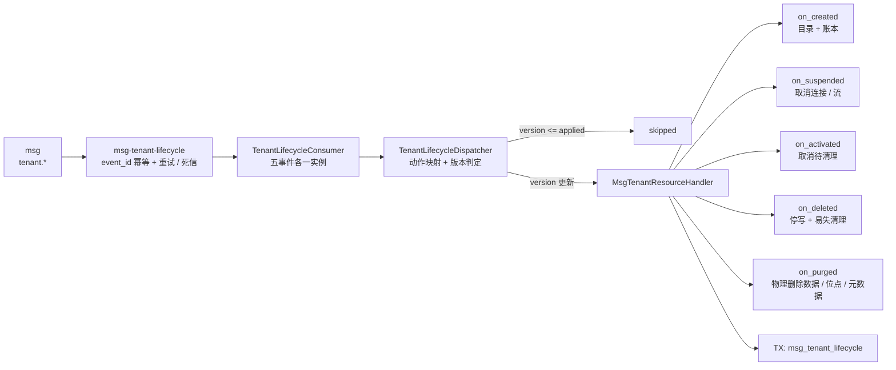
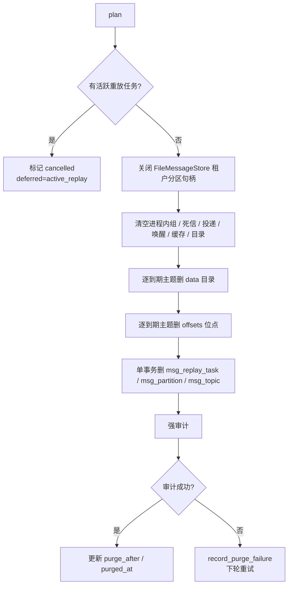
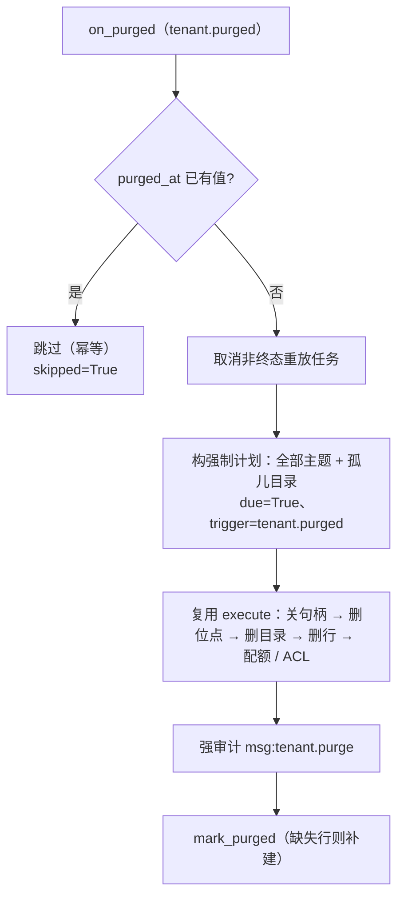

# 05-5 租户生命周期资源清理 · 详细设计

> 08B · 05 多租户与安全 · 子任务 05（需求 05-6）

[文档首页](../../../../../../文档首页.md) › [消息平台规划](../../../../../../规划/01_规划_消息平台.md) › [阶段计划](../../../../计划/01_计划_消息平台.md) › [05 多租户与安全](../../05_多租户与安全.md) › [05-5](../05_多租户与安全_05_租户生命周期资源清理.md) › 详细设计

---

## 0. 分章导航 <a id="toc"></a>

| 章 | 内容 |
| --- | --- |
| 1 | 任务级边界与输入基线（含 12 项已确认口径） |
| 2 | 交付物清单 |
| 3 | 现状核对结论与事实偏差 |
| 4 | 事件契约与消费声明 |
| 5 | 幂等账本（`msg_tenant_lifecycle`） |
| 6 | 动作矩阵与状态语义 |
| 7 | 资源清单与清理顺序 |
| 8 | 清理计划、dry-run 与执行 |
| 9 | 到期清扫与后台任务 |
| 10 | 失败、重试与死信 |
| 11 | 审计 |
| 12 | 接口与契约影响 |
| 13 | 测试设计与验收映射 |
| 14 | 登记落点与文档同步 |
| 15 | 边界与开放项 |
| 16 | 对齐记录 |

## 1. 任务级边界与输入基线 <a id="scope"></a>

**本任务做什么**：在 msg 仓闭环 05-5——消费 `tenant.created` / `tenant.suspended` / `tenant.activated` / `tenant.deleted` / `tenant.purged` 五类事件；用 `msg_tenant_lifecycle` 表做业务级幂等与删除清理进度；停用/启用复用基座租户守卫并断开已建立连接与长驻流；`tenant.deleted` **只停写并清易失资源**（不排定数据清理），收到 `tenant.purged` 才物理删除消息数据、位点与元数据；失败可重试/可观测，审计接现有基座审计链。

**不做什么**：

- 不建租户状态表 / 状态机、不轮询基座租户表、不在删除处理器里反向调用基座改租户状态。
- 不重做 05-1 的 `tenant.created` 目录初始化、usage/quota 双端点、三表种子、`form_key`。
- 不做 05-2 配额、05-4 全量审计范围、前端页面。
- 不新增公网 / 管理面 HTTP 端点；清理 dry-run 与执行是进程内服务能力，入口由后台清扫与测试驱动。
- 不跨仓改 bms / engkit；bms 侧缺口登记在本文 §15，不写 bms 代码。

**权威依据**：

- [需求 05-6 租户生命周期（消息资源）](../../../../需求/05_需求_多租户与安全.md#r05-6)
- [架构设计 · 多租户与安全](../../../../../../设计/架构设计/07_架构设计_多租户与安全.md) 第 4 / 5 / 9 节
- bms 07D `01-4` 五类事件契约与 `BaseTenantResourceHandler`（纯文本路径：`bms/bms文档/项目/07D_产品租户与安全接入/任务/01_通用三级作用域/设计/01_详细设计_01_通用三级作用域.md` §4）
- bms《[数据库开发规范](../../../../../../../bms文档/规范/数据库开发规范.md)》、bms《[数据库设计 · 数据规范](../../../../../../../bms文档/设计/数据库设计/02_数据库设计_数据规范.md)》
- 05-1 [详细设计](../../05_多租户与安全_01_租户用量板块与表单登记/设计/01_详细设计_05_多租户与安全_01_租户用量板块与表单登记.md) 与[实施记录](../../05_多租户与安全_01_租户用量板块与表单登记/实施/01_实施记录_05-1_租户用量板块与表单登记.md)

**已确认口径（2026-11-07，用户逐项拍板）**：

| # | 事项 | 结论 |
| --- | --- | --- |
| 1 | 事件名 | 以 bms 契约为准：`tenant.created` / `tenant.suspended` / `tenant.activated` / `tenant.deleted` / `tenant.purged`；任务文档的 `disabled` / `enabled` 只作历史别名，不新增同义事件 |
| 2 | `tenant.deleted` 语义 | **两步（2026-11-08 与 bms `04_03` 同批定案）**：`tenant.deleted` = 停写 + 清易失资源 + 写账本，**不排定数据清理**；`tenant.purged` = 授权物理删除消息数据 / 位点 / 元数据。保留期与到期时点归平台（`purge_at`），msg 不再自算 |
| 3 | 清理范围 | `msg_topic.tenant_id` 列主题为权威清单，映射 `data/{tenant_id}/`、`offsets/{tenant_id}/`、延迟区、连接、组 / 死信；目录扫描兜底孤儿；不依赖 `module_key` |
| 4 | 保留期来源 | 逐主题 `retention_ms` / `retention_bytes`，无主题行时用 `DEFAULT_RETENTION_MS`（30 天）；不新增配置段 / 表 |
| 5 | 保留期内只读 | 数据面生产 / 消费拒绝；管理面主题列表 / 详情、用量、延迟视图只读可见；`purged` 后管理面也不可见。放行口由基座提供（`[tenant_guard].readonly_routes`，bms `04_03-01`），msg 只登记管理面只读前缀（`msg:/api/v1/msg/admin/`、`msg:/api/v1/msg/tenant-usage`），不硬绕守卫 |
| 6 | 物理清理触发 | **平台 `tenant.purged` 事件直接触发**一次性全量清理（`trigger=tenant.purged`）；`purge_after` 降为存量行兼容位，仅由周期清扫收敛旧数据；不轮询基座租户表，不做一次性脚本 |
| 7 | 幂等账本 | 新增 `msg_tenant_lifecycle` 表；05-1 的 `.lifecycle.json` 只保留兼容读，不再作为生产写路径 |
| 8 | 连接断开 | `ConnectionRecord` 补 `tenant_id` + 标记 stale / 关长驻流 / 拒绝后续请求；TCP/h2 强关登记为 bms / 部署缺口 |
| 9 | 停用 / 启用动作 | 依赖基座租户守卫，msg 不建本地停用状态；`on_suspended` / `on_activated` 只做账本、审计、指标与已建立连接的取消 |
| 10 | 审计 | 接现有 `AuditSink`；删除 / 清理强审计（失败即失败并重试），停用 / 启用普通审计；05-4 后续只补类别与 `record_ref` 口径 |
| 11 | 破坏性清理确认 | 设计阶段逐项清单 + 实现 dry-run / 审计；运行时不再人工二次确认 |
| 12 | 删除后恢复 | `tenant.activated` 在清理到期前到达时取消待清理、恢复受理；已到期并已物理删除的主题不可恢复 |

**关键事实**：

- bms 事件载荷只有 `tenant_id` / `db_key` / `status` / `version`（`version` 可选），**没有 `module_key`**；租户事件族在 bms `04_03-01` 内由 `2.1.0` 升 `2.2.0`（`tenant.deleted` 只增可选 `purge_at` / `reason`），`tenant.purged` 独立 `1.0.0`。
- bms `04_03-01` 提供 `tenant.deleted` 真实触发点与 `tenant.purged` 登记；本仓按两步口径消费，端到端联调随 bms `04_03` 交付窗口，本仓先用合成事件 + 契约测试覆盖。
- bms 基座租户守卫已按 `RemoteTenantSource` 版本戳即时拒绝停用租户；msg 不再建本地停用状态。
- msg 数据落点：`data/{tenant_id}/{namespace}/{topic}.{topic_id}/{partition}`；位点在 `offsets/{tenant_id}/...`（不在 `data/` 下）；延迟区 `.delay` 在分区目录 + 内存；DB 行在 `msg_topic` / `msg_partition` / `msg_replay_task`；连接 / 流 / 组 / 死信 / 投递状态为进程内态。
- 当前没有删除主题的端点 / 服务方法；`FileOffsetStore` 有 `purge_topic` 但没有 `purge_tenant`；`FileDelayStore` 没有按租户清理方法；`ConnectionRegistry` 只记录 tenant 编码、不记录 `tenant_id`；`StreamSession` 没有 `tenant_id`，且已建立流不会因入口拒绝而自动停止。

## 2. 交付物清单 <a id="deliverables"></a>

| # | 交付物 | 落点 |
| --- | --- | --- |
| D1 | 表文件 + 总览登记 | `msg文档/设计/数据库设计/数据表设计/msg_tenant_lifecycle.md`、`01_数据库设计_总览.md` §3 / §4 / §9 |
| D2 | ORM 模型与模型清单 | `backend/services/msg/src/bms_msg/models/tenant_lifecycle.py`（新增）、`models/__init__.py`（改） |
| D3 | 账本仓储 / 清理查询 | `backend/services/msg/src/bms_msg/repositories/tenant_lifecycle.py`（新增） |
| D4 | 账本抽象与文件兼容 | `backend/services/msg/src/bms_msg/tenant/ledger.py`（新增） |
| D5 | 生命周期运行时依赖 | `backend/services/msg/src/bms_msg/tenant/runtime.py`（新增） |
| D6 | 五动作处理器与消费声明 | `backend/services/msg/src/bms_msg/tenant/lifecycle.py`（改） |
| D7 | 清理计划 / 执行 / 清扫服务 | `backend/services/msg/src/bms_msg/tenant/purge.py`（新增） |
| D8 | 连接 / 流身份与按租户取消 | `broker/connection.py`、`broker/transport.py`（改） |
| D9 | 内存态与文件态清理原语 | `broker/group.py`、`broker/deadletter.py`、`broker/delivery.py`、`broker/waiter.py`、`broker/delay_file.py`、`broker/file_store.py`、`broker/offset.py`、`broker/scheduler.py`（改；含 `DelayWheel.forget_tenant` 与延迟转投租户可用性检查） |
| D10 | 装配与启动钩子 | `bms_msg/main.py`、`broker/lifecycle.py`、`core/config.py`（改） |
| D11 | 表归属登记 | `backend/services/table_registry.py`（改） |
| D12 | 测试 | `backend/services/msg/tests/tenant/`（新增）、`tests/broker/` 与 `tests/api/`（改 / 新增） |
| D13 | 实施记录 / 测试记录 / 计划回写 | 本任务目录 `实施/`、`测试/`、阶段计划 §2 / §3 |

> 本期**无新增 HTTP 端点**，`deploy/contracts/msg.json` 不需要重导；若实施中出现端点变更，按硬约束执行 `python -m ops.contract_snapshot export`。

## 3. 现状核对结论与事实偏差 <a id="current"></a>

| # | 核对项 | 事实 | 本任务处置 |
| --- | --- | --- | --- |
| 1 | 事件声明 | 05-1 只声明 `tenant.created`；`TenantLifecycleConsumer.event_type` 固定返回 `tenant.created` | 改为五事件各一条声明，工厂带 `event_type`；保留 `tenant_lifecycle_consumer()` 作为 created 兼容入口 |
| 2 | 账本 | 05-1 把 `.lifecycle.json` 放在租户目录内 | 新增 DB 账本；文件账本仅作兼容读与测试替身 |
| 3 | 停用即时拒绝 | 基座租户守卫已实现；msg 无本地状态 | `on_suspended` 不复制状态，只取消已建立连接 / 流并记账、审计、指标 |
| 4 | 延迟转投 | `DelayScheduler` 直接 `append`，不检查租户状态；停用后仍会转投 | 增加租户可用性检查（基座 `BaseTenantGuard`），停用期间保留记录、不转投 |
| 5 | 连接身份 | `ConnectionRecord` 只有 tenant 编码；事件只有 `tenant_id` | 补 `tenant_id`；按 `tenant_id` 取消 |
| 6 | 长驻流 | `StreamSession` 无 `tenant_id`；入口拒绝不会停止已建立流 | 补 `tenant_id` + `cancelled` 标记；流循环每轮检查 |
| 7 | 删除主题 / 位点 | 无删除主题端点；位点只有 `purge_topic`；延迟区无按租户清理 | 新增内部清理原语，不新增 HTTP 端点 |
| 8 | 打开的文件句柄 | `FileMessageStore` / `FileDelayStore` 持有段写句柄；Windows 下直接删目录会失败 | 删除前先按租户 / 主题关闭句柄；再删目录 |
| 9 | 重放任务 | `msg_replay_task` 属租户；运行中的任务会继续写 | 删除时先取消非终态任务；有活跃任务则本轮清扫延后 |
| 10 | 保留期 | `msg_topic.retention_ms` 是逐主题配置；缺省 30 天 | 按主题计算到期点；`purge_after` 取最早到期点 |
| 11 | 审计 | `AuditSink` / `AuditEventEmitter` 已装配；05-4 未交付 | 接现有通道；删除 / 清理强审计，停用 / 启用普通审计 |
| 12 | 表文件 | `msg_tenant_lifecycle` 不存在 | 新建表文件并在总览登记 |

## 4. 事件契约与消费声明 <a id="events"></a>

### 4.1 事件与载荷

| 事件 | 动作 | 载荷 | 本任务用途 |
| --- | --- | --- | --- |
| `tenant.created` | `created` | `tenant_id` / `db_key` / `status` / 可选 `version` | 对齐回归；只建租户目录 + 账本，不建命名空间 / 配额 |
| `tenant.suspended` | `suspended` | 同上 | 拒绝新请求（基座守卫）+ 取消已建立连接 / 流；保留数据 |
| `tenant.activated` | `activated` | 同上 | 恢复受理；若删除清理待执行则取消 |
| `tenant.deleted` | `deleted` | 同上（另带可选 `purge_at` / `reason`） | 停写 + 立即清易失资源 + 写账本；**不排定数据清理**（等 `tenant.purged`） |
| `tenant.purged` | `purged` | `tenant_id` / `db_key` / `status` / 可选 `dropped_services` / `failed_services` | 授权清理：物理删除该租户消息数据 / 位点 / 元数据，写 `purged_at` |

- 业务级幂等键：`(tenant_id, action, version)`；`version` 缺省按 `0` 处理。
- 同租户事件由基座 `aggregate_key = audit_aggregate_key(tenant_id)` 保证分区内有序；消费组声明 `ordered=True`，同租户五类事件串行。
- 事件类型不在五类内 / 载荷缺 `tenant_id` / `db_key` / `status`：基座 `TenantLifecycleDispatcher` 抛 `EventContractError`（10010），消费组直接转死信，不做无限重试。

### 4.2 消费组声明

`event_consumer_records()` 返回五条 `EventConsumerRecord`：

| consumer | event_type | ordered | 说明 |
| --- | --- | --- | --- |
| `msg-tenant-lifecycle` | `tenant.created` | True | 租户目录 + 账本（05-1 回归） |
| `msg-tenant-lifecycle` | `tenant.suspended` | True | 停用：取消连接 / 流 |
| `msg-tenant-lifecycle` | `tenant.activated` | True | 启用：取消待清理 |
| `msg-tenant-lifecycle` | `tenant.deleted` | True | 删除：停写 + 易失资源清理（不排定数据清理） |
| `msg-tenant-lifecycle` | `tenant.purged` | True | 授权清理：物理删除数据 / 位点 / 元数据 |

- 五条记录同一组名，基座按 `(consumer, event_type)` 合并；同组 `ordered` 一致（全 True）。
- 工厂 `_factory(event_type)` 每次返回独立 `TenantLifecycleConsumer(event_type=...)`；`tenant_lifecycle_consumer()` 保留为 `tenant.created` 的零参兼容工厂。
- `TenantLifecycleConsumer.event_type` 返回构造时的事件类型；`consume(event)` 调 `TenantLifecycleDispatcher(handler).dispatch(event)`。



## 5. 幂等账本（`msg_tenant_lifecycle`） <a id="ledger"></a>

**表结构唯一事实源**：[msg_tenant_lifecycle](../../../../../../设计/数据库设计/数据表设计/msg_tenant_lifecycle.md)。本节只写读写语义，不复制字段清单。

### 5.1 行模型

- 一条 `(tenant_id, action)` 一行；`action` 为 `created` / `suspended` / `activated` / `deleted` / `purged` 五值之一。
- `applied_version` 是该动作已成功处理到的版本；无行等价于 `-1`。
- `deleted` 行额外持有 `deleted_event_at` / `purged_at` / `failure_count` / `last_error`；`purge_after` 仅兼容 05-5 交付前的存量行——两步口径下清理时点由平台给（`tenant.purged`），本仓不再自算。
- 表**不是租户状态表**：数据面不读它做状态判定；状态判定仍以基座租户源为准。

### 5.2 读写口径

| 方法 | 语义 | 事务 |
| --- | --- | --- |
| `applied_version(tenant_id, action)` | 读 `applied_version`；无行返回 `-1`；DB 无行时回退读 05-1 `.lifecycle.json` | 只读 |
| `mark_applied(tenant_id, action, version, event_id)` | upsert 行并推进 `applied_version` / `last_event_id`；不覆盖 `deleted` 行的清理进度 | 短事务 |
| `mark_deleted(tenant_id, version, deleted_event_at)` | 写 `deleted` 行的 `deleted_event_at`（新流程**不写 `purge_after`**）；同版本重跑不改变已记时刻；新版本重设 | 与取消重放任务同事务 |
| `cancel_purge(tenant_id, version, event_id)` | `purge_after = NULL`，保留 `deleted_event_at` 供审计；不删已清理主题 | 短事务 |
| `mark_purged(tenant_id, at)` | `purged_at = at`、`failure_count = 0`、`last_error = NULL` | 短事务 |
| `record_purge_failure(tenant_id, error)` | `failure_count += 1`、`last_error = 截断(error, 512)` | 短事务 |
| `list_due_purges(now, limit)` | `action=deleted`、`purged_at IS NULL`、`purge_after <= now`，按 `purge_after` 升序；**仅兼容存量行**（两步口径下新行 `purge_after` 恒空，不进此查询） | 只读 |

### 5.3 幂等与兼容

- 版本判定：`version <= applied_version` 即 `skipped`，不调动作、不记账。
- 动作失败**不记账**，异常原样上抛，由消费组退避重试 / 死信。
- `deleted` 同版本重试：保持既有 `deleted_event_at`，不改清理状态（清理只由 `tenant.purged` 推进）。
- `deleted` 新版本：重设 `deleted_event_at`（以最新删除事件为准）。
- `purged` 幂等：`purged_at` 已有值即 `skipped`；删除实现本身按 `tenant_id` 定位、可重入（重复删不报错）。
- 05-1 兼容：DB 无行时读 `.lifecycle.json` 的 `{action: version}`；**不再写回文件**。已有文件的租户在首次新事件后自然迁移到 DB 账本。
- 账本行永久保留，不随租户资源删除；它是「已处理版本 + 清理完成」的幂等证据。

## 6. 动作矩阵与状态语义 <a id="actions"></a>

| 动作 | 触发 | 立即做 | 延后做 | 失败影响 | 幂等 |
| --- | --- | --- | --- | --- | --- |
| `on_created` | `tenant.created` | 建 `data/{tenant_id}/`；写账本 | 命名空间 / 配额仍按首次发布 / 05-2 | 事件重试；不阻塞开通 | 目录 `exist_ok`；同版本 skipped |
| `on_suspended` | `tenant.suspended` | 取消该租户已建立连接 / 长驻流；写账本；审计 | 无 | 事件重试；期间基座入口拦截兜底 | 重复停用无副作用 |
| `on_activated` | `tenant.activated` | 取消 `deleted` 行的待清理（`purge_after=NULL`）；写账本；审计 | 已物理删除的主题不恢复 | 事件重试 | 重复启用无副作用 |
| `on_deleted` | `tenant.deleted` | 取消连接 / 流；清延迟区；清组 / 死信 / 投递状态 / 缓存；取消重放任务；写账本 `deleted_event_at`；强审计 | 物理删除数据 / 位点 / 元数据（等 `tenant.purged`，本仓不自行排定） | 事件重试；耗尽进基座死信；不阻塞基座删除 | 同版本不改时刻；易失清理可重入 |
| `on_purged` | `tenant.purged` | 按 `tenant_id` 删主题数据目录 / 位点 / `msg_topic` 等 DB 行；清组 / 死信 / 投递残留；写 `purged_at`；强审计 | 无（清理即终态） | 事件重试；耗尽进死信并告警；重复消费幂等 | 重复执行不报错；`purged_at` 已存在即 skipped |

**状态语义（关键）**：

1. **停用 / 删除的「只读」由基座租户状态守卫承担**，msg **不修改 `msg_topic.status`**。理由：避免把「租户级停用」与「运营期手动停用主题」混在一个状态列里，启用时也无需记录 / 还原原状态；数据面请求在解析链就被拒绝，管理面只读查询仍可看。
2. **停用即拒绝**：新请求由基座守卫拒绝；已建立的连接 / 长驻流由本任务主动取消；延迟转投由 `DelayScheduler` 的租户可用性检查跳过（记录保留，启用后继续）。
3. **删除即停写（两步）**：`tenant.deleted` 到达即同停用；延迟区立即清空（避免重启后重建再投）；消息数据 / 位点 / 元数据**保持到 `tenant.purged`**（保留期与清理时点由平台算，本仓不自算），收到后一次性物理删除。
4. **恢复**：`tenant.activated` 在 `tenant.purged` 之前到达 → 取消待清理（存量行清 `purge_after`），消息数据未删故无需迁移；`purged` 之后不可恢复。删除时已清空的延迟区不恢复。
5. **平台租户**按普通租户处理，不引入全局 topic 特例。

## 7. 资源清单与清理顺序 <a id="resources"></a>

### 7.1 资源清单

```text
msg 租户资源
├── 文件态
│   ├── data/{tenant_id}/{namespace}/{topic}.{topic_id}/{partition}/*.log
│   ├── data/{tenant_id}/{namespace}/{topic}.{topic_id}/{partition}/*.delay
│   ├── data/{tenant_id}/{namespace}/{topic}.{topic_id}/{partition}/recovery-point.json
│   └── offsets/{tenant_id}/{group_dir}/{topic_id}-{partition}.offset
├── 数据库态
│   ├── msg_topic（tenant_id）
│   ├── msg_partition（topic_id）
│   ├── msg_replay_task（tenant_id / topic_id）
│   └── msg_tenant_lifecycle（账本；不随资源删除）
├── 进程内态
│   ├── ConnectionRegistry（连接）
│   ├── StreamRegistry（长驻流）
│   ├── FileMessageStore._partitions（分区日志句柄 / log_id LRU）
│   ├── FileDelayStore._entries / _logs（延迟记录 / 段句柄）
│   ├── FileOffsetStore._entries（位点缓存）
│   ├── GroupStore（消费组）
│   ├── DeadLetterQueue（死信）
│   ├── DeliveryState（在途 / 已确认暂存）
│   ├── DeliveryWaiter（分区唤醒版本 / 事件）
│   ├── TopicCache / RetentionThrottle / PartitionDirectory
│   └── BackpressureMetrics（有界指标，保留）
└── 不删除
    ├── bms 审计链（sys.operation.logged）
    ├── bms sys_event_consumed / sys_event_dead_letter
    └── msg_tenant_lifecycle 账本行
```

### 7.2 清理时机

| 资源 | `on_suspended` | `on_deleted` | `on_purged` | 存量清扫（旧 `purge_after` 行） |
| --- | --- | --- | --- | --- |
| 连接 / 长驻流 | 取消 | 取消（幂等） | —（已取消） | — |
| 延迟区 `.delay` + 内存条目 + 时间轮 | 保留（转投暂停） | **立即清空**（含 `DelayWheel.forget_tenant`） | —（已清空） | — |
| 组 / 死信 / 投递状态 / 唤醒器 / 主题缓存 / 保留节流 | 保留 | 立即清空 | 残留再清一次（幂等） | — |
| `PartitionDirectory` | 保留 | **保留**（供关闭句柄 / 定位） | 逐主题移除，全部清完删租户登记 | 同左 |
| `FileMessageStore._partitions` / `_log_ids` | 保留 | 保留 | 关闭该租户分区句柄并移除缓存 | 同左 |
| `FileOffsetStore._entries` | 保留 | 保留 | 删位点文件时同步移除 | 同左 |
| 重放任务 | 保留 | 非终态置 `cancelled` | 先取消非终态、随后随主题行删除 | 有活跃则延后一轮 |
| `data/{tenant_id}/.../*.log` | 保留 | **保留**（等平台授权） | 按租户全量删除（含孤儿目录） | 按主题到期删 |
| `offsets/{tenant_id}/...` | 保留 | **保留** | 按租户全量删除 | 按主题到期删 |
| `msg_topic` / `msg_partition` | 保留 | 保留（不置 disabled） | 按租户全量删行 | 按主题到期删行 |
| 配额 / ACL 行 | 保留 | 保留 | 删除并失效缓存 | 同左 |
| `msg_tenant_lifecycle` | 更新账本 | 写 `deleted_event_at`（`purge_after` 不再写） | 写 `purged_at` | 更新 `purge_after` / `purged_at` |
| 审计 | 写普通审计 | 写强审计 | 写强审计（`trigger=tenant.purged`） | 写强审计（`trigger=sweeper`） |

### 7.3 为什么延迟区立即清、数据等平台授权

- 延迟区是「尚未投递的生产」；租户注销后继续投递会违反停写语义，且重启重建会重新装填。立即清空 `.delay` 并移除内存条目，才能保证「注销后不投」。
- 消息日志是「已投递的历史」；保留期与到期时点由平台算并落 `tenant.deleted.purge_at`，届时平台发 `tenant.purged` 授权删除，本仓才物理删。两步分离的理由：**平台不掌握产品侧的存储布局，产品不自算平台的保留策略**——`tenant.deleted` 只表达「停写」，`tenant.purged` 才表达「已清理、可删数据」。
- 位点跟随主题：主题删除时一并删该主题在所有组下的位点；不与日志保留期分离。

## 8. 清理计划、dry-run 与执行 <a id="purge"></a>

### 8.1 值对象

| 类型 | 字段 / 语义 |
| --- | --- |
| `TenantPurgeTopic` | `topic_id` / `namespace` / `name` / `partition_count` / `retention_ms` / `deadline` / `due` / `data_path` / `orphan` |
| `TenantPurgePlan` | `tenant_id` / `as_of` / `topics` / `due_topic_ids` / `next_purge_after` / `connections` / `streams` / `delay_records` / `group_records` / `dead_letters` / `replay_tasks` / `data_root_exists` / `offsets_root_exists` / `deferred_reason` / `trigger` |
| `TenantPurgeResult` | `tenant_id` / `deleted_topics` / `deleted_data_dirs` / `deleted_offset_files` / `deleted_db_rows` / `deferred` / `purged` / `skipped` / `errors` |
| `PurgeOutcome` | `tenant_id` / `purged` / `deleted_topics` / `deleted_data_dirs` / `deleted_offset_files` / `deleted_db_rows` / `skipped`（跨模块结果，放 `runtime.py` 避免清扫服务与运行时循环依赖） |

`trigger` 取 `tenant.purged` / `sweeper`，写进强审计载荷，便于区分「平台授权清理」与「存量行周期收敛」。

### 8.2 计划（dry-run，存量路径）

`plan(tenant_id, now=None)`：

1. 读 `deleted` 账本行；无行 / 已 `purged_at` → 空计划。
2. 用 `tenant_id` 显式查 `msg_topic`（不依赖请求租户上下文），得到主题清单与保留期。
3. 逐主题算 `deadline = deleted_event_at + retention_ms`；`due = deadline <= now`。
4. 扫描 `data/{tenant_id}/` 的 `*.{topic_id}` 目录：DB 无对应行的孤儿目录标 `orphan=True`、`due=True`（仅当 DB 查询成功后才判孤儿）。
5. 统计连接 / 流 / 延迟记录 / 组 / 死信 / 重放任务；不读取消息内容、不做全量字节统计（避免清扫热路径扫描大目录）。
6. `next_purge_after = min(未到期主题 deadline)`；无未到期主题则为 `None`。
7. 若存在到期主题的活跃重放任务，`deferred_reason="active_replay"`。

`plan` 是纯读：不删文件、不改 DB、不取消任务。dry-run 结果写结构化日志 `msg_tenant_purge_plan` 并可被测试断言。

### 8.3 执行（存量路径，两入口共用）

`execute(plan)`：



**执行顺序与理由**：

1. **活跃重放任务先取消**：非终态任务置 `cancelled` + `finished_at`；存量路径本轮先不删数据，返回 `deferred`，下一轮确认无活跃任务再删（强制路径见 §8.4，同轮删完）。避免在重放批次写盘时删目录。
2. **先关句柄、再删目录**：`FileMessageStore.close_tenant(tenant_id)` 按租户关闭 `_partitions` 的分区日志（`_PartitionLog.close()`）并移除 `_log_ids` 中该租户主题的条目。`FileDelayStore` 已在 `on_deleted` 清空；此处再调一次按幂等处理。否则 Windows 下删目录会因打开句柄失败。
3. **清进程内态（到期主题维度）**：组 / 死信 / 投递状态 / 唤醒器 / 主题缓存 / 保留节流已在 `on_deleted` 清空；此处移除到期主题的 `PartitionDirectory` 登记、`TopicCache` 精确键与 `RetentionThrottle` 分区键。`PartitionDirectory` 必须留到「关闭句柄 + 删位点」之后，因为 `FileMessageStore.close_tenant` 与 `FileOffsetStore.purge_topic` 都要靠它定位 `tenant_id`。
4. **删文件**：对每个到期主题删 `data/{tenant_id}/{namespace}/{topic}.{topic_id}`；`shutil.rmtree` 前做路径安全校验（`tenant_id` 必须是十进制数字、目标必须在 `data_root` 下）。目录不存在按成功处理。
5. **删位点**：对每个到期主题调 `FileOffsetStore.purge_topic(topic_id)`（已有方法，含 `msg:offset.purge` 审计）；按主题删除，避免误删未到期主题。
6. **删 DB 行**：单事务内按到期主题删 `msg_replay_task` / `msg_partition` / `msg_topic`。顺序为先子后父；只删 `tenant_id` 匹配且 `topic_id` 在到期集合内的行。
7. **移除目录登记**：DB 行删除后逐到期主题 `PartitionDirectory.forget(topic_id)`；租户全部清完后再删 `data/{tenant_id}` / `offsets/{tenant_id}` 空目录。
8. **强审计**：写 `msg:tenant.purge`，载荷带主题数 / 数据目录数 / 位点文件数 / DB 行数 / `next_purge_after` / `trigger` / 结果。审计失败不标记 `purged_at`，下一轮重试；重试时数据已删，计划为空，仍会补审计。
9. **更新账本**：`next_purge_after = min(剩余未到期主题 deadline)`；无剩余主题 → `purged_at=now`、`failure_count=0`、`last_error=NULL`；有失败 → `record_purge_failure`。

**回滚边界**：

- `on_deleted` 只做易失清理与记账，不做任何不可逆删除；`tenant.activated` 在 `tenant.purged` 之前到达仍可取消存量待清理记录并恢复受理。
- 物理清理一旦删除文件 / DB 行即不可回滚；dry-run 计划、强审计、`trigger` 标记与 `purged_at` 是唯一可核对证据。
- `purged` 之后到达的 `activated` 不恢复数据、不抹 `purged_at`；晚到的 `deleted`（事件时刻早于 `purged_at`）同样不抹 `purged_at`，只有更晚的删除事件才视为新周期。

### 8.4 平台授权清理（`tenant.purged`）

入口：`TenantPurgeService.purge_tenant(tenant_id, at=None)`，由 `MsgTenantResourceHandler.on_purged` 经运行时挂载的清理入口调用。



要点：

1. **强制全量**：平台已物理清理并授权（契约 `tenant.purged` 1.0.0），忽略逐主题 `retention_ms`，当轮删全部主题 + 孤儿目录；不依赖 `deleted` 事件先到。
2. **活跃重放先取消再同轮删**：事件动作一旦返回，扫尾无人驱动，若沿用存量路径的 `deferred` 会留下永久残留。
3. **补建账本行**：`tenant.purged` 先于 `deleted` 到达（事件丢序 / 重装后重投）时，`mark_purged` 补建 `deleted` 行（`applied_version=-1`、`deleted_event_at=NULL`）留 `purged_at` 证据。
4. **幂等双层**：业务级版本（`purged` 事件无 `version`，按 0）+ `purged_at` 判定；删除本身按 `tenant_id` 定位，重复执行不报错。
5. **审计**：复用 `msg:tenant.purge`（强），载荷 `trigger=tenant.purged`，与存量清扫（`trigger=sweeper`）区分。

## 9. 存量行清扫与后台任务 <a id="sweeper"></a>

- 本节只服务 **05-5 存量行**（`purge_after` 非空的旧数据）；两步口径下新数据不再写入 `purge_after`，物理删除由 §8.4 直接触发。
- `TenantPurgeService`：`plan` / `execute` / `purge_tenant` / `run_once` / `ensure_started` / `stop`；进程级单例，随 `startup_hooks` 启动、随 `ResourceManager` 停止。
- 周期：`TENANT_PURGE_SCAN_INTERVAL_MS = 60_000`（1 分钟）；查询只走 `idx_msg_tenant_lifecycle_purge`。
- 单轮：`list_due_purges(now, limit=100)` → 逐租户 `plan` → `execute`；单个租户失败不影响其它租户；单轮异常只记日志，下一轮继续。
- 启动钩子顺序：`.delay` 重建 → 延迟推进器 / 重放执行器 → 位点刷盘 → 存量清扫。清扫不依赖消息存储重建，但放在最后避免启动期与重建抢句柄。
- 多实例：进程内 `asyncio.Lock` 防同实例重入；跨实例靠清理幂等（重复删同一目录 / 行按成功处理）+ 目录 / 行不存在即跳过。分布式租约归 8B_05（开放项）。
- 不轮询基座租户表：只扫本地 `msg_tenant_lifecycle` 账本。

## 10. 失败、重试与死信 <a id="failures"></a>

| 场景 | 行为 |
| --- | --- |
| 事件动作抛错（目录 / 连接 / 延迟 / 账本 / 审计） | 不记账、异常上抛 → 基座消费组退避重试 → 耗尽进 `sys_event_dead_letter`；不阻塞基座删除事务 |
| 事件类型未知 / 载荷非法 | `EventContractError`（10010）→ 直接死信，不做无限重试 |
| 同一事件重复投递 | 业务级版本 `skipped`；投递级 `sys_event_consumed` 兜底；`purged` 另有 `purged_at` 幂等判定 |
| `tenant.purged` 到达但物理清理入口未挂载 | `ConfigError` 上抛（装配缺漏 fail-closed，不静默跳过清理） |
| `tenant.purged` 先于 `tenant.deleted` 到达 | 照常全量清理，`mark_purged` 补建 `deleted` 行留证 |
| 存量清扫单租户失败 | 记录 `failure_count` / `last_error`，不标记 `purged_at`；下一轮重试；日志 `msg_tenant_purge_failed` + 指标 |
| 物理清理审计失败 | 不标记 `purged_at`；事件重投后补审计（数据已删则计划为空，仍写审计） |
| 活跃重放任务（存量路径） | 标记 `cancelled` + `finished_at`，本轮 `deferred`；下一轮再删 |
| 活跃重放任务（`tenant.purged`） | 先取消、同轮删完（不 deferred，避免事件已 applied 而数据滞留） |
| 死信处置 | 基座 `sys_event_dead_letter` + `GET /api/v1/outbox/dead-letters` 既有看板；本期不新增 msg 端点 |
| 清扫「死信」出口 | 账本行 `failure_count` / `last_error` + 结构化日志 + 进程内指标；运维可按 `purged_at IS NULL AND failure_count > 0` 查询 |

**指标 / 日志**：

- 生命周期：沿用 `TenantLifecycleMetrics`（`applied` / `skipped` / `failed`）；结构化日志 `msg_tenant_created_initialized` / `msg_tenant_suspended` / `msg_tenant_activated` / `msg_tenant_deleted` / `msg_tenant_purged`。
- 清扫：`TenantPurgeMetrics`（`scanned` / `purged` / `deferred` / `failed`）；日志 `msg_tenant_purge_skipped` / `msg_tenant_purge_replay_cancelled` / `msg_tenant_purge_completed` / `msg_tenant_purge_deferred` / `msg_tenant_purge_failed`。
- 外部指标出口归 06-3（开放项）。

## 11. 审计 <a id="audit"></a>

接现有 `AuditSink`（装配期为基座 `AuditEventEmitter`），复用 `build_operation_event` 写 `sys.operation.logged`；**不自建审计表、不删除审计记录**。

| 动作 | 审计 action | 强弱 | 载荷 |
| --- | --- | --- | --- |
| 停用 | `msg:tenant.suspend` | 普通（失败记指标，不阻断） | `tenant_id` / `version` / `connections` / `streams` |
| 启用 | `msg:tenant.activate` | 普通 | `tenant_id` / `version` / `cancel_purge` |
| 注销（`tenant.deleted`） | `msg:tenant.delete` | **强**（失败即上抛、事件重试） | `tenant_id` / `version` / `topics` / `deleted_event_at` / `delay_records` / `connections` / `streams` / `group_records` / `dead_letters` / `replay_tasks_cancelled` |
| 物理清理（`tenant.purged` 与存量清扫共用） | `msg:tenant.purge` | **强** | `tenant_id` / `topics` / `data_dirs` / `offset_files` / `db_rows` / `next_purge_after` / `trigger` / `result` |

- `module="msg"`；`method="POST"`；`path` 用内部审计路径（如 `/api/v1/msg/admin/tenants/{tenant_id}/delete`），不新增真实路由。
- 不写 `record_ref`：租户生命周期不是「某一条日志记录」的定位操作；05-4 若定义租户级 `record_ref` 口径再补。
- 审计失败处置按 05-4 / 07D `02-4`：强审计失败即失败并重试；普通审计失败只记指标与告警。
- 审计记录归基座审计链；`on_deleted` / 到期清扫不得删除审计。

## 12. 接口与契约影响 <a id="contract"></a>

- **无新增 / 修改 HTTP 端点**；`deploy/contracts/msg.json` 不变，无需 `contract_snapshot export`。
- 新增内部端口 / 方法：`ConnectionRegistry.purge_tenant`、`StreamRegistry.cancel_tenant`、`GroupStore.purge_tenant`、`DeadLetterQueue.purge_topics`、`DeliveryState.drop_topic`、`DeliveryWaiter.forget_topic`、`FileMessageStore.close_tenant`、`FileDelayStore.drop_tenant`、`FileOffsetStore.purge_tenant`、`PartitionDirectory.forget`、`DelayWheel.forget_tenant`、`DelayScheduler` 的租户可用性检查、`TenantPurgeService.plan/execute/purge_tenant/run_once`、`TenantLifecycleRuntime.attach_purge/purge`。
- 事件消费声明从 1 条变 5 条：影响基座事件订阅覆盖校验与启动日志，不影响 HTTP 契约。
- 新表进 `msg:platform` 表集；影响建表 / 迁移清单与表归属核对，不影响 API。

## 13. 测试设计与验收映射 <a id="testing"></a>

Kiwi 用例号在平台登记后回填（本任务**一条**用例，`@pytest.mark.kiwi_id(<编号>)`；不复用 2451 / 2452）。

| # | 用例 | 断言 | 验收映射 |
| --- | --- | --- | --- |
| T1 | 五事件声明 | `event_consumer_records()` 五条；同组 `ordered=True`；契约校验通过；工厂可调用 | 五类事件可消费 |
| T2 | `tenant.created` 回归 | 建租户目录 + 账本行；不建命名空间 / 配额；同版本 skipped | 05-1 不回归 |
| T3 | `tenant.suspended` | 账本推进；连接按 `tenant_id` 取消；长驻流取消；数据目录 / DB 行 / 位点不动 | 停用即时拒绝、数据保留 |
| T4 | `tenant.activated` | 账本推进；`purge_after=NULL`；未删主题恢复受理 | 启用恢复 |
| T5 | `tenant.deleted` 只停写 | 写 `deleted_event_at` 且 `purge_after` 保持 NULL；延迟区 / 组 / 死信 / 投递 / 缓存清空；重放任务取消；数据目录 / 位点 / DB 行**保留** | 两步删除第一步 |
| T6 | 重复投递幂等 | 同版本重复 `skipped`，动作只执行一次；`deleted` 同版本不延长 `purge_after` | 幂等键可断言 |
| T7 | 乱序旧版本 | 旧版本 skipped，不回退动作 | 版本幂等 |
| T8 | 动作失败不记账 | 抛错上抛；`applied_version` 未推进；重试可成功 | 失败重试 / 死信 |
| T9 | 账本兼容 | DB 无行时读 05-1 `.lifecycle.json`；新事件后写 DB，不再写文件 | 兼容迁移 |
| T10 | 保留期边界 | 未到期主题不删；到期主题删目录 / 位点 / DB 行；`purge_after` 推进到下一最早到期点 | 保留期边界 |
| T11 | dry-run | `plan` 不改文件 / DB / 任务；返回到期主题、路径、计数、`next_purge_after` | 破坏性清理先确认 |
| T12 | 执行可重入 | 重复 `execute` 按成功处理；已删目录 / 行不存在不报错 | 清理可重入 |
| T13 | 活跃重放延后 | 有非终态任务时 `deferred=active_replay`，任务置 cancelled；下一轮无活跃任务再删 | 失败不阻塞、可重试 |
| T14 | 审计失败 | 删除强审计失败 → 上抛 / 不记账；清扫审计失败 → 不标记 `purged_at`，下轮补 | 审计可追溯 |
| T15 | 停用转投暂停 | `DelayScheduler` 对停用租户不转投、记录保留；启用后恢复 | 停用拒绝生产 |
| T16 | 连接 / 流身份 | `ConnectionRecord` / `StreamSession` 带 `tenant_id`；`purge_tenant` / `cancel_tenant` 只影响目标租户 | 断连可核对 |
| T17 | 孤儿目录 | DB 无对应主题行的 `*.{topic_id}` 目录在删除时清理；DB 查询失败时不误判孤儿 | 目录兜底 |
| T18 | 路径安全 | 非数字 `tenant_id` / 越界路径拒绝删除 | 破坏性操作边界 |
| T19 | 装配 | 新表进 `msg:platform`；`startup_hooks` 启动清扫；`/readyz` 不受影响 | 装配冒烟 |
| T20 | 表归属 | `table_names()` 含 `msg_tenant_lifecycle`；总览登记与表文件一致 | 登记回写 |
| T21 | `tenant.purged` 物理清理 | 收到 `deleted` 后数据仍在；收到 `purged` 后数据目录 / 位点 / DB 行全清并写 `purged_at`，强审计 `trigger=tenant.purged` | 两步删除第二步 |
| T22 | `purged` 重复幂等 | 同事件重复投递：分发器 `skipped`；直接重入 `purge_tenant` 按 `purged_at` 返回 `skipped`，不重复删 / 不重复审计 | 幂等可断言 |
| T23 | 激活与 `purged` 竞态 | `activated` 先到（清存量待清理记录）不阻止后续 `purged` 清理；`purged` 之后 `activated` 不抹 `purged_at`、不重建数据 | 恢复边界 |
| T24 | 存量行仍按旧路径收敛 | `purge_after` 非空的旧行仍由 `run_once` 逐主题到期清理；新行不写 `purge_after`、不进 `list_due_purges` | 存量兼容 |
| T25 | 跨仓契约快照 | 读 bms `deploy/events/contracts.json`：`tenant.purged` 为独立 `1.0.0`，五字段与必填 / 类型一致；msg 五条声明与快照 `tenant.*` 集合一一对应 | 跨仓口径一致 |

**覆盖率**：变更模块（`bms_msg.tenant.lifecycle`、`bms_msg.tenant.ledger`、`bms_msg.tenant.runtime`、`bms_msg.tenant.purge`、`bms_msg.models.tenant_lifecycle`、`bms_msg.repositories.tenant_lifecycle`、`bms_msg.broker.connection`、`bms_msg.broker.transport`、`bms_msg.broker.group`、`bms_msg.broker.deadletter`、`bms_msg.broker.delivery`、`bms_msg.broker.waiter`、`bms_msg.broker.delay_file`、`bms_msg.broker.file_store`、`bms_msg.broker.offset`、`bms_msg.broker.scheduler`、`bms_msg.main`、`services.table_registry`）行 + 分支 100%。

**测试落点**：

- `tests/tenant/test_tenant_lifecycle_ledger.py`（新增）
- `tests/tenant/test_tenant_lifecycle_actions.py`（新增）
- `tests/tenant/test_tenant_purge.py`（新增）
- `tests/tenant/test_tenant_purged.py`（新增：两步删除接线 / 幂等 / 竞态 / 跨仓契约快照）
- `tests/broker/test_connection.py`、`test_transport.py`、`test_group_store.py`、`test_deadletter.py`、`test_delivery.py`、`test_waiter.py`、`test_delay_file_store.py`、`test_file_store.py`、`test_offset_file_store.py`、`test_delay_scheduler.py`（改 / 新增用例）
- `tests/api/test_tenant_status.py`（回归停用即时拒绝）
- `tests/test_tenant_lifecycle_consumer.py`（05-1 声明断言改为五事件；Kiwi 2452 保留）

**执行口径**：本地只跑单文件 / 单节点；提交前预检与推送预检按门禁；全量测试只由 CI。装配冒烟按 AI开发规范 §8：`pytest services/msg/tests -k "plugin_assembly or plugin_registration or storage or shape"`。

## 14. 登记落点与文档同步 <a id="registry"></a>

| 落点 | 内容 |
| --- | --- |
| 表文件 | `msg文档/设计/数据库设计/数据表设计/msg_tenant_lifecycle.md`（新建，字段唯一事实源） |
| 数据库设计总览 | §3 表集、§4 已设计数据表登记、§9 后续表文件规划；落库后状态改「已落库」 |
| 表归属 | `backend/services/table_registry.py::MSG_TABLE_RECORDS` 增 `msg_tenant_lifecycle` |
| 模型清单 | `backend/services/msg/src/bms_msg/models/__init__.py::MODEL_MODULES` 增 `bms_msg.models.tenant_lifecycle` |
| 任务文档 | 事件名 `disabled` / `enabled` 改 `suspended` / `activated`；删除 `module_key` 字面；补「账本表 + 到期清扫」口径 |
| 架构 07 | §5.2 由「不做自动清理」改为「`tenant.deleted` 按保留期清理，保留期内只读；bms 触发点未落」；§12 开放项登记 `tenant.purged` / 触发点 |
| msg 计划 | 完成后迁入 §2「已完成任务」，§3 移除 / 状态回写；实际投入只在阶段计划回写 |
| Kiwi | 登记 1 条新用例，代码标注；不复用 2451 / 2452 |
| bms 缺口 | 本文 §15 登记；不跨仓改 bms，后续由 bms 任务承接 |

## 15. 边界与开放项 <a id="open"></a>

| # | 事项 | 归口 |
| --- | --- | --- |
| 1 | bms `tenant.deleted` 触发点未落（无租户删除流程发事件） | **已闭环（2026-11-09）**：bms `04_03-01` 已交付注销端点与 `tenant.deleted`（`2.2.0`）；本仓已按两步口径消费 |
| 2 | bms `tenant.purged` 未登记；msg 需把 `tenant.deleted` 改为只停写、`tenant.purged` 触发立即清理 | **已闭环（2026-11-09）**：`purged` 由 bms `04_03-01` 登记为独立 `1.0.0`；本仓代码已接线（`on_purged` + `TenantPurgeService.purge_tenant`），并有跨仓契约快照用例（§13 T25） |
| 3 | 停用 / 删除后管理面只读查询的基座放行能力未确认；本期不硬绕，按现状登记 | **已闭环（2026-11-09）**：基座 `[tenant_guard].readonly_routes` + `require(readonly=True)` 由 bms `04_03-01` 提供；本仓已登记两条前缀——`msg:/api/v1/msg/admin/`（主题 / 组 / 延迟 / 重放 / ACL / 配额读端点）、`msg:/api/v1/msg/tenant-usage`（用量与配额投影），数据面与写方法不登记，未登记即全拒 |
| 4 | TCP / h2 连接强制关闭无应用层入口；本期做到 mark stale + 取消长驻流 + 拒绝后续请求，强关归部署 / 基座 | bms / 部署 |
| 5 | 多实例到期清扫无分布式租约；本期靠幂等，8B_05 补 | 8B_05 |
| 6 | 清扫指标外部出口（`TenantPurgeMetrics`） | 06-3 |
| 7 | 已到期并物理删除的主题不可恢复；恢复只覆盖未到期主题 | 设计边界（本文） |
| 8 | 无管理面手动 purge / dry-run 端点；运维处置靠日志、账本行与后台清扫 | 06 域（如需要） |
| 9 | 05-4 的审计类别与 `record_ref` 口径 | 05-4 |
| 10 | 范围较原估算大（新增表 + 连接 / 流身份 + 多处置清理原语）；详细设计定稿后如确认超范围，先报用户重估 | 本任务 |
| 11 | `msg_tenant_lifecycle` 表无迁移脚本，开发 / 演示库结构不符时删库重建 | 部署 / 8B_07 |

## 16. 对齐记录 <a id="alignment"></a>

| 日期 | 事项 | 结论 |
| --- | --- | --- |
| 2026-11-07 | 12 项待确认 | 全部按推荐项确认（见 §1 表） |
| 2026-11-07 | 删除语义与 bms `04_03` 冲突 | 按已交付 07D `01-4` 的 deleted = 停写 + 按保留期清理；`tenant.purged` 未来只接线 |
| 2026-11-07 | 账本落点 | 新增 `msg_tenant_lifecycle` 表；05-1 `.lifecycle.json` 只兼容读 |
| 2026-11-07 | 主题状态 | 不修改 `msg_topic.status`；只读由基座租户状态守卫承担，避免与运营期手动停用混淆 |
| 2026-11-07 | 延迟区 | `on_deleted` 立即清空；停用期间由 `DelayScheduler` 租户可用性检查暂停转投 |
| 2026-11-07 | 到期清理粒度 | 逐主题按 `retention_ms` 到期；`purge_after` 取最早到期点，清扫逐主题删 |
| 2026-11-08 | 与 bms `04_03` 两步口径对齐 | `tenant.deleted` 只停写 + 清易失资源、**不排定数据清理**；`tenant.purged` 才物理删除。`purge_after` 降为存量兼容位、`list_due_purges` 仅处理存量行；新增第五条消费声明 `tenant.purged` 与 `on_purged` 动作 |
| 2026-11-08 | 只读放行口 | 基座提供 `readonly_routes` 白名单（bms `04_03-01`），本仓只登记管理面只读路径 |
| 2026-11-09 | 两步删除代码接线 | `on_deleted` 去掉保留期计算与到期写入（只写 `deleted_event_at`）；新增 `on_purged` → 运行时挂载入口 → `TenantPurgeService.purge_tenant`（强制全量、活跃重放同轮取消、`purged_at` 幂等、审计 `trigger` 区分来源）；消费声明 4 → 5 条 |
| 2026-11-09 | 孤立 `purged` 处置 | `deleted` 未到也照常清理，`mark_purged` 补建账本行留 `purged_at`；晚到的 `deleted`（事件时刻早于清理时刻）不抹 `purged_at` |
| 2026-11-09 | 管理面只读白名单落地 | `[tenant_guard].readonly_routes` 登记两条粗前缀（管理面 `/api/v1/msg/admin/` + 用量投影 `/api/v1/msg/tenant-usage`），不用逐能力域拆条：前缀匹配叠加「仅 `GET` / `HEAD`」条件，写方法进不了只读通道；未登记即全拒（fail-closed），配置被删表现为「窗口内读不到」而非「写通道打开」 |

> 本文档依《[文档生成规范](../../../../../../../bms文档/规范/文档生成规范.md)》与《[任务文档规范](../../../../../../../bms文档/规范/任务文档规范.md)》编写。
