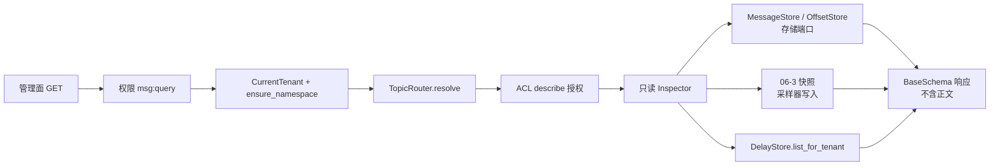

# 06-1-1 只读视图后端接口 · 详细设计

> 08B · 06 管理与运维 · 06-1 管理模块只读视图 · 子任务 01（需求 06-1）

[文档首页](../../../../../../../文档首页.md) › [消息平台规划](../../../../../../../规划/01_规划_消息平台.md) › [阶段计划](../../../../../计划/01_计划_消息平台.md) › [06 管理与运维](../../../06_管理与运维.md) › [06-1 管理模块只读视图](../../06_管理与运维_01_管理模块只读视图.md) › [06-1-1 只读视图后端接口](../06_管理与运维_01_管理模块只读视图_01_只读视图后端接口.md) › 详细设计

## 0. 分章导航 <a id="toc"></a>

| 章 | 内容 |
| --- | --- |
| 1 | 任务级边界与输入基线 |
| 2 | 交付物清单 |
| 3 | 现状核对结论与事实偏差 |
| 4 | 只读端点总览与公共口径 |
| 5 | 分区详情 |
| 6 | 消息检索与存储只读端口 |
| 7 | 概览聚合 |
| 8 | 延迟汇总 |
| 9 | 失败分支与错误码 |
| 10 | 权限、租户隔离与资源授权 |
| 11 | 契约与登记影响 |
| 12 | 02-6 既有缺陷修复 |
| 13 | 测试设计与验收映射 |
| 14 | 登记落点与文档同步 |
| 15 | 边界与开放项 |
| 16 | 对齐记录 |

## 1. 任务级边界与输入基线 <a id="scope"></a>

**做什么**：在既有管理面之下补四条只读 JSON 出口——分区详情、消息检索、概览聚合、延迟汇总，让积压、卡点、单条消息与延迟堆积不登录服务器即可查看。

**不做什么**：

- 不做写操作（建删主题、扩分区、位点重置、延迟改期 / 取消、消息删除归 06-2 / 06-5 / 06-6）；
- 不做跨租户平台视图、不接收请求体自报租户标识；
- 不返回消息正文；不展示趋势图（跳 bms Grafana）；
- 不在请求内全量扫描：积压 / 死信 / 磁盘 / 吞吐一律读 06-3 采集器快照，延迟汇总读延迟区同一份租户快照；
- 不绕过 `MessageStore` / `OffsetStore` 直接读日志文件，不改既有 `/admin/groups` 与 `/admin/delayed` 的字段语义；
- 不新增错误码、不新增权限码、不改 `config.toml` 的只读放行前缀。

**输入基线**：

| 输入 | 事实 |
| --- | --- |
| 路由形态 | `BaseRouter(key, prefix, tags)` 定义在 `api/admin/*.py`，由 `api/router.py::api_router` 聚合，基座挂 `/api/v1` |
| 权限 | 模块级 `_QUERY = Depends(require_permission("msg:query"))`，GET 装饰器 `dependencies=[_QUERY]` |
| 租户 | `CurrentTenantDep` → `get_current_tenant_context()` → `management_tenant(request)`；`ensure_namespace()` 判 `350010` |
| 主题解析 | `TopicRouter.resolve(namespace, name)` 判 `350001`、`partition()` 判 `350009` |
| 资源授权 | `TopicAclServiceDep` + `ACL_ACTION_DESCRIBE`，既有列表端点走 `filter_allowed()`、详情走 `authorize()` |
| 分区运行态 | `MessageStore.leo()` / `OffsetStore.get()` / `GroupInspector.describe()` 已给出 `committed` / `leo` / `lag` 拼装范式 |
| 元数据 | `MsgPartition.leader` 为单机实例标识（`msg-0` 形态）；`checkpoint_leo` 是周期落库检查点，不是实时 LEO |
| 占位 | `RecordHeader.hw` / `replicas` 为 02-4 / 02-5 预留且恒 0；`MsgPartition.checkpoint_hw` / `epoch` / `replicas` 同为占位列；全仓无 ISR 集合实现 |
| 06-3 快照 | `MetricsSnapshotStore.snapshot`（`LagSnapshot`）、`TrafficMetrics.counter_snapshot()`、`StorageMetrics.snapshot()`、`DelayMetrics.snapshot()` 全为进程内，重启归零，无对外 JSON 出口 |
| 契约 | `deploy/contracts/msg.json` 由 `python -m ops.contract_snapshot export` 重导，`check` 判零漂移 |
| 配置 | `[tenant_guard].readonly_routes = ["msg:/api/v1/msg/admin/", "msg:/api/v1/msg/tenant-usage"]` 已覆盖新增前缀 |

## 2. 交付物清单 <a id="deliverables"></a>

| 类别 | 交付物 | 说明 |
| --- | --- | --- |
| 存储端口 | `broker/log.py` | `MessageStore` 新增两个只读方法与 `MessageHeaderView` 值对象 |
| 存储实现 | `broker/log.py`、`broker/file_store.py`、`broker/waiter.py` | 内存 / 文件 / 通知包装三处实现；全仓测试替身同步 |
| 只读投影 | `broker/admin_view.py` | `PartitionInspector` / `MessageInspector` / `OverviewInspector` / `DelaySummaryInspector`（只读、不写状态） |
| 采样器 | `metrics/lag.py`、`metrics/sampler.py` | `LagSnapshot` 增本周期入口消息数与周期秒数；采样器差分写入 |
| 响应结构 | `schemas/admin_view.py` | 四个响应 `BaseSchema` + 值对象 schema |
| 依赖 | `api/deps.py` | 快照 / 水位 / 流量 / 分区表的只读依赖出口 |
| 端点 | `api/admin/partitions.py`、`messages.py`、`overview.py`、`delayed_summary.py` | 四条 GET，挂 `msg:query` + describe 授权 |
| 路由 | `api/router.py` | 追加四个 router |
| 缺陷修复 | `broker/watermark.py` | `_payload()` 返回普通 `dict`，修 `350022` 在 HTTP 路径的序列化退化 |
| 契约 | `deploy/contracts/msg.json` | 重导，四端点 + 新 schema + `x-error-codes` |
| 前端（子任务 06-1-3） | `frontend/packages/api-types/` | 生成器与本任务同批交付，见该子任务详细设计 |
| 用例 | `services/msg/tests/api/test_admin_readonly_views.py` 等 | 端点级、端口、采样器、507 回归 |
| 文档 | 本设计 + 实施记录 + 测试记录 + 上层回写 | §14 |

## 3. 现状核对结论与事实偏差 <a id="current"></a>

| # | 现状 | 与本任务的关系 | 处置 |
| --- | --- | --- | --- |
| 1 | 任务书「前置契约」写 `DelayStore.list_all()` 同源 | `/admin/delayed` 实际走 `list_for_tenant()`；`list_all()` 跨租户，直接聚合会越权 | 汇总一律用 `list_for_tenant(tenant_id=当前租户)`，回写任务文档该行 |
| 2 | `app.state.message_store` 是 `NotifyingMessageStore`，只转发端口 6 方法 | `locate_by_log_id()` / `read_bytes()` / `read_range()` 只在 `FileMessageStore` 上 | 扩端口（§6.1），三个实现联动，不新增具体实现依赖 |
| 3 | `FileMessageStore.locate_by_log_id()` 是进程内 LRU（上限 10 万）+ 已加载分区头扫描 | 不是磁盘稀疏索引；重启后 / 未加载分区冷记录会漏 | 直接复用，不补持久化索引；冷数据边界登记为遗留（§15） |
| 4 | `RecordHeader` 无独立载荷长度键，无摘要函数 | 任务书要「载荷长度 + 摘要、不返回正文」 | 由存储侧算 `len(payload)` 与 SHA-256，只把 `MessageHeaderView` 交给上层，上层拿不到正文 |
| 5 | 06-3 只有累计 `msg_messages_in_total`，无速率值 | 「入口吞吐」数字卡无现成取值 | 采样器按周期间隔差分写入快照，端点只读快照（§7.2） |
| 6 | `MetricsSnapshotStore` / `StorageMetrics` / `DelayMetrics` 的快照是 `ConcurrentStable*` | 直接作 `ApiResponse.data` 会触发 pydantic 序列化退化（02-7 实测） | 一律先转成 `BaseSchema` 字段或普通 `dict`；不把快照对象透出 |
| 7 | `MsgPartition.checkpoint_leo` 是落库检查点 | 不能当实时 LEO 用 | 分区详情实时值只取 `MessageStore.leo()` |
| 8 | `hw` / `isr` 只有占位列，无实时实现 | 任务书要求「存在且为可空占位，不伪造数值」 | 恒返回 `hw=None` / `isr=[]`，注释归口 02-4 / 02-5 |
| 9 | 02-6 `watermark._payload()` 返回 `ConcurrentStableDict` | `350022` 在 HTTP 路径会 500（02-7 记录为未修缺陷） | 本任务顺手修（§12），并入同一次代码提交 |
| 10 | msg 仓无前端契约类型生成器，`domain.ts` 手写 | 新端点契约重导后前端类型无自动同步链 | 新增需求 06-9 / 子任务 06-1-3（同批实施） |
| 11 | `[tenant_guard].readonly_routes` 前缀覆盖 `/api/v1/msg/admin/` | 新端点自动获得停用窗口只读放行 | 不改配置；补一条端点级只读放行回归断言 |

## 4. 只读端点总览与公共口径 <a id="surface"></a>

| 端点 | 权限 | 必填 | 可选 | 响应 |
| --- | --- | --- | --- | --- |
| `GET /api/v1/msg/admin/partitions` | `msg:query` | `namespace`、`topic` | `partition`、`group` | `ApiResponse[PartitionPage]` |
| `GET /api/v1/msg/admin/messages` | `msg:query` | `namespace`、`topic` | `partition`、`offset_from`、`offset_to`、`key`、`time_from`、`time_to`、`log_id`、`page`、`size` | `ApiResponse[MessagePage]` |
| `GET /api/v1/msg/admin/overview` | `msg:query` | — | — | `ApiResponse[Overview]` |
| `GET /api/v1/msg/admin/delayed/summary` | `msg:query` | — | `namespace`、`topic`、`partition` | `ApiResponse[DelaySummary]` |

**公共口径**：

1. 全部 GET、全部 `dependencies=[_QUERY]`、全部 `openapi_extra={"x-error-codes": _QUERY_ERRORS}`；`10001` 属契约层通用码，不进产品码声明。
2. 租户只从 `CurrentTenantDep` 取，任何端点不接收 `tenant_id` / `tenant` 参数。
3. 所有列表 / 详情先经 `TopicAclServiceDep.authorize(..., ACL_ACTION_DESCRIBE)`；无描述授权时返回既有 ACL 拒绝码，不静默返回空页。
4. 分页统一 `page(ge=1, default=1)`、`size(ge=1, le=MAX_LIST_SIZE, default=20)`；`total` 是过滤后总数；`MAX_LIST_SIZE` 复用 `services/topic.py` 的既有上限。
5. 响应集合字段一律 `Annotated[ConcurrentStableList[X], CONTRACT_COLLECTION]` 内联声明；动态字典（档位分布、头字段）落 `BaseSchema` 字段或普通 `dict`，不把并发集合快照塞进 `data`。
6. `time_from` / `time_to` 用 ISO 8601 `datetime`（与 `ReplayRequest` 同构），区间左闭右开；条件跨类相与。
7. `published_at` / `deliver_at` 一律 UTC，序列化走既有 `BaseSchema` 约定。



## 5. 分区详情 <a id="partitions"></a>

### 5.1 取数链

| 字段 | 来源 | 说明 |
| --- | --- | --- |
| `partition` | `range(topic.partition_count)` | 按分区号升序；传 `partition` 时先 `router.partition()` 判越界再只取该分区 |
| `leader` | `PartitionRepository.list_by_topic(topic_id)` → `MsgPartition.leader` | 单机实例标识，非副本选举结果；缺行时返回 `null` |
| `leo` | `MessageStore.leo(topic_id, partition_no)` | 实时下一条待分配 offset |
| `hw` | 恒 `None` | 02-4 交付后接线 |
| `isr` | 恒空集合 | 02-5 交付后接线 |
| `committed` | `OffsetStore.get(group, topic_id, partition_no)` | 未传 `group` 时为 `None` |
| `lag` | `leo - committed` | 未传 `group` 时为 `None` |
| `owner` | `ConsumerGroup.owner_of(partition_no)` | 组存在时取自组记录；未传 `group` 或组不存在时 `null` |

- 传 `group` 但组记录不存在：复用 `MsgGroupNotFoundError`（`350013`），与 `/admin/groups` 详情同判据；`_QUERY_ERRORS` 因此含 `350013`。
- 分区详情不复用 `/admin/delayed` 的过滤，也不写位点；`GroupInspector.describe()` 的「逐分区 `get()` + `leo()`」是同一口径，实现时抽成公共只读投影，避免两处算法漂移。

### 5.2 响应结构

```text
PartitionPage
├── namespace: str
├── topic: str
├── group: str | None
├── partition_count: int
└── items: PartitionItem[]
    ├── partition: int
    ├── leader: str | None
    ├── leo: int
    ├── hw: int | None
    ├── isr: str[]
    ├── committed: int | None
    ├── lag: int | None
    └── owner: str | None
```

`hw` 与 `isr` 的字段名与类型固定，02-4 / 02-5 交付后只换取值、不改契约。

## 6. 消息检索与存储只读端口 <a id="messages"></a>

### 6.1 端口扩展（不绕过端口）

`MessageStore` 在既有 6 方法之外新增两个**只读**方法与一个值对象：

```python
@dataclass(frozen=True)
class MessageHeaderView:
    message_id: str
    log_id: str
    topic_id: int
    partition_no: int
    offset: int
    key: str | None
    headers: ConcurrentStableDict[str, str]
    trace_id: str | None
    published_at: datetime
    content_type: str
    payload_len: int
    payload_sha256: str

# MessageStore 新增（抽象）
async def find_by_log_id(self, *, log_id: str) -> MessageHeaderView | None: ...
async def scan_headers(
    self, *, topic_id: int, partition_no: int, from_offset: int, max_messages: int
) -> ConcurrentStableList[MessageHeaderView]: ...
```

- **`MessageHeaderView` 不含 `payload`**：载荷长度与摘要由存储侧计算后传出，上层（含端点）在类型上就拿不到正文，从结构上保证「不返回消息正文」。
- 三个实现联动：`InMemoryMessageStore` 遍历自身 `_logs`；`FileMessageStore` 复用 `fetch()` 分批读后逐条映射（文件实现可改走 `read_range()` + 解帧，本轮以最小改动为准）；`NotifyingMessageStore` 原样转发 `_inner`。全仓 `MessageStore` 测试替身一并补齐，缺一处会在全仓类型检查暴露。
- **命名避让**：端口方法取名 `find_by_log_id()`，不与 `FileMessageStore.locate_by_log_id()` 撞名——后者已存在且返回 `FileSlice`（坐标），端口方法要返回 `MessageHeaderView`，同名会覆盖掉既有方法并打断 02-7 恢复期去重链路。文件实现内部直接调既有 `locate_by_log_id()` 拿坐标，再按 offset 解码出 `MessageHeaderView`。
- LRU + 已加载分区头扫描的既有行为原样复用；命中后按 offset 解码，未命中返回 `None`，**不回退全量 `fetch`**（第 4 项确认）。
- 端口只增方法、不改既有方法签名；`contract_version` 不变。

### 6.2 过滤与分页

| 条件 | 语义 |
| --- | --- |
| `offset_from` / `offset_to` | 与 `[start_offset, leo)` 取交裁剪（沿用 `ReplayService._scan()` 口径，历史已清理是正常状态，不报错） |
| `key` | 精确相等；`None` 表示不过滤 |
| `time_from` / `time_to` | 按 `published_at` 左闭右开；判据与 `ReplayWindow.matches()` 同口径（时间区间左闭右开、key 精确相等） |
| `log_id` | 精确值；先走端口 `find_by_log_id()` 把候选缩到单条，其余条件**仍逐项相与校验**，不匹配返回空页 |
| `partition` | 可选，缺省扫该主题全部分区，按 `(partition_no, offset)` 升序合并 |

- 扫描上限：单分区单批 `max_messages` 取 `size` 与既有批读上限的较小值；`total` 为过滤后计数，`items` 只返回当前页。
- 跨分区合并按分区号升序、分区内 offset 升序，分页在合并后的有序序列上切，保证 `page` / `size` 语义稳定。
- 载荷摘要：`payload_len = len(payload)`（原始字节数），`payload_sha256 = hashlib.sha256(payload).hexdigest()`（64 位小写十六进制）。压缩与未压缩长度不参与摘要，摘要取落盘字节，便于与审计 / 日志侧互认。
- **实施口径**：过滤在 `MessageInspector._matches()` 内实现，判据与 `ReplayWindow.matches()` 一致但不直接复用——后者入参是 `StoredMessage`（含正文），本任务只有 `MessageHeaderView`；为复用而伪造载荷对象会破坏「上层拿不到正文」的结构约束。

### 6.3 响应结构

```text
MessagePage
├── namespace: str
├── topic: str
├── total: int
├── page: int
├── size: int
└── items: MessageItem[]
    ├── log_id: str
    ├── message_id: str
    ├── partition: int
    ├── offset: int
    ├── published_at: datetime
    ├── headers: dict[str, str]
    ├── payload_len: int
    └── payload_sha256: str
```

`headers` 落普通 `dict`（避免 `ConcurrentStableDict` 序列化退化），不含 `payload` / `key` 明文载荷。

## 7. 概览聚合 <a id="overview"></a>

### 7.1 四张数字卡

| 卡 | 字段 | 取值 |
| --- | --- | --- |
| 入口吞吐 | `messages_in_per_second: float` | `LagSnapshot.messages_in_window / LagSnapshot.window_seconds` |
| 当前积压 | `consumer_lag: int` | `LagSnapshot.lag` 中当前租户键求和 |
| 死信数 | `dlq_total: int` | `LagSnapshot.dlq` 中当前租户键求和 |
| 磁盘使用率 | `disk_used_ratio: float` | `StorageMetrics.snapshot()["msg_disk_used_ratio"]` 多卷取最大值 |

附加 `snapshot_available: bool`：采样器尚未产出快照时为 `false`，四值返回 `0` 并在测试记录登记「进程内、重启归零」限制，前端按此显示占位文案。

### 7.2 速率快照（复用 06-3 采样器，不新增采集器）

- `LagSnapshot` 增 `messages_in_window: int = 0`、`window_seconds: float = 0.0`；`MetricsSnapshotStore.replace()` 增同名参数，`reset()` 一并归零。
- `MetricsSampler.sample_once()` 每轮读 `TrafficMetrics.counter_snapshot()["msg_messages_in_total"]` 的累计和，与上一轮差值除以两轮实际间隔（单调时钟），写入本轮快照；首轮无上一轮读数时写 `0` / `0.0`。
- 失败轮保留上一轮快照（既有容错口径），速率不因此跳变；采样间隔沿用 `METRICS_SAMPLE_INTERVAL_SECONDS`，不新增配置。
- `MsgMetricsCollector` 不消费这两个字段，Prometheus 文本零变更；改动只落在快照与采样器，并回写 06-3 设计与实施记录。

### 7.3 租户过滤

- `LagSnapshot` 的分键为 `topic_key(tenant, topic)`（`\x1f` 分隔）；按当前租户编码前缀过滤再求和，不输出其它租户的分键。
- 快照缺失 / 当前租户无分键时返回 `0`，**不回源**读 `GroupStore` / `OffsetStore` / 死信队列（不在请求内全量扫描）。
- `__other__` 归并键归当前租户时按既有规则计入总量；不展开明细。

### 7.4 响应结构

```text
Overview
├── messages_in_per_second: float
├── consumer_lag: int
├── dlq_total: int
├── disk_used_ratio: float
└── snapshot_available: bool
```

## 8. 延迟汇总 <a id="delay-summary"></a>

### 8.1 独立端点，既有端点零改动

新增 `GET /api/v1/msg/admin/delayed/summary`；`/admin/delayed` 的 `DelayedPage` 字段、分页与错误码一字不改。独立端点的收益是汇总可独立演进，且每次列表分页请求不必重算分布。

### 8.2 取数链（与待投列表同一份快照）

`DelayStore.list_for_tenant(tenant_id=当前租户)` 一次取快照 → 应用层过滤 `namespace` / `topic` / `partition` → 聚合：

| 字段 | 计算 |
| --- | --- |
| `total` | 过滤后记录条数 |
| `levels[]` | 按 `DelayLevel` 九档分组计数，未出现档位也输出 `count=0`，顺序按 `DELAY_LEVEL_MS` 声明序 |
| `levels[].min_remaining_ms` | 该档 `max(0, (deliver_at - now) 毫秒)` 的最小值，复用 `DelayInspector._remaining_ms()` |
| `stale_count` | `remaining_ms == 0` 的条数（已到期未转投） |
| `quota_used_ratio` | `count_for_tenant() / DELAY_QUOTA_PER_TENANT`，夹到 `[0, 1]` |
| `hint` | 结构化枚举 `"normal"` / `"stale"` / `"near_quota"`，不返回中文文案（前端 i18n） |

- `now` 取服务端当前时间（`datetime.now(UTC)`），与 `/admin/delayed` 同源且可注入固定时钟做用例。
- 过滤判据与 `/admin/delayed` 一致：`namespace` 给定即 `ensure_namespace()`；`topic` 与 `namespace` 同时给定时 `router.resolve()` 判 `350001`；`partition` 给定即 `router.partition()` 判 `350009`。
- 不使用 `DelayStore.list_all()`（跨租户），不使用 `DelayMetrics.snapshot()` 的全局计数（不含档位分布且与列表口径不同源）。
- **实施口径**：`DELAY_STUCK_TTL_MS` 是 02-7 恢复台账的兜底判据（七天），拿它当堆积提示会让 `hint` 几乎恒为 `normal`；故 `stale_count` 只按「已到期未转投」计数，TTL 不进入本端点。

### 8.3 响应结构

```text
DelaySummary
├── namespace: str | None
├── topic: str | None
├── total: int
├── levels: LevelBucket[]
│   ├── level: str
│   ├── count: int
│   └── min_remaining_ms: int
├── stale_count: int
├── quota_used_ratio: float
└── hint: str
```

## 9. 失败分支与错误码 <a id="failures"></a>

| 场景 | 行为 | 码 |
| --- | --- | --- |
| 命名空间未登记 / 未启用 | 既有守卫抛出，不回退到全租户 | `350010` |
| 主题不存在 / 未启用 | `TopicRouter.resolve()` 抛出 | `350001` |
| 分区号越界 | `TopicRouter.partition()` 抛出 | `350009` |
| 传 `group` 但组不存在 | 复用组详情判据 | `350013` |
| `page < 1` / `size` 越界 / 区间倒置 / 时间格式非法 | `ParamError` | `10001` |
| 无 `msg:query` | 基座权限拒绝 | `30001` |
| 无主题 describe 授权 | `MsgTopicAclDeniedError` | `350027` |
| 租户停用 / 注销窗口内 GET | 只读放行前缀生效，正常返回；POST 仍拒 | `350011` / `350012` |
| 快照尚未产出 | 四卡返回 0 + `snapshot_available=false`，不抛错 | — |
| `log_id` 未命中 | 返回空页（`total=0`），不扫描全量日志 | — |
| 保留清理导致 offset 区间为空 | 与 `[start_offset, leo)` 取交后返回空页，不报错 | — |
| 磁盘水位拒绝写入 | 修复后 `350022` 的 `data` 为普通 dict，HTTP 路径不再退化 | `350022` |

`_QUERY_ERRORS = [350001, 350009, 350010, 350013, 350011, 350012, 350027]`，四个端点共用同一常量；`10001` 与 `30001` 不进产品码声明。

## 10. 权限、租户隔离与资源授权 <a id="security"></a>

- 权限码沿用 `msg:query`，`seeds/permissions.py` 与 `deploy/registry/msg.toml` 零改动。
- 租户隔离：所有取数入口都带 `tenant_id`（延迟区、位点、组、快照分键），不提供跨租户直读参数；`TopicRouter.resolve()` 本身按当前租户解析主题。
- 资源授权：分区 / 消息 / 延迟汇总三端点接 `TopicAclServiceDep` 做主题级 `ACL_ACTION_DESCRIBE` 判定（延迟汇总是逐记录 `filter_allowed`，与 `/admin/delayed` 同判据）。
- **概览例外（2026-11-09 追加确认）**：概览无 `namespace` / `topic` 查询参数，06-3 快照键只有 `tenant\x1ftopic`、不带命名空间，无法逐主题判定授权；且它只输出租户级汇总、不含任何主题分项。故概览按当前租户编码前缀汇总，授权边界为 `msg:query` + 租户隔离，不挂 `TopicAclServiceDep`，也不在请求内查主题表。
- 只读放行：`config.toml` 前缀已覆盖 `/api/v1/msg/admin/`，新端点保持 GET 即可；补端点级断言防止后续改动把前缀挪走。
- 敏感查询：本轮不新增审计动作，沿用既有只读端点口径（§15 登记开放项）。

## 11. 契约与登记影响 <a id="contract"></a>

| 项 | 结论 |
| --- | --- |
| 公开 HTTP 契约 | 新增 4 条 GET 路径 + 9 个响应结构；既有路径零变更 |
| `x-error-codes` | 四端点各声明 `_QUERY_ERRORS` |
| 契约快照 | `python -m ops.contract_snapshot export` 重导 `deploy/contracts/msg.json`；`check` 零漂移 |
| 服务目录 / 产品路由 | 同一服务下加端点，`services/module_registry.py` 与 `deploy/registry/msg.toml` 服务行零改动 |
| 错误码 / 权限码 | 零新增 |
| 配置 | `config.toml` 零改动（只读放行前缀已覆盖） |
| 事件契约 / 数据库 | 零变更；不建表、不改字段 |
| 存储端口 | 新增 2 个只读方法 + 1 个值对象，兼容扩展，契约版本不变 |
| 前端类型 | 由 06-1-3 生成器消费重导后的快照，`domain.ts` 手写类型不在本任务改动 |

## 12. 02-6 既有缺陷修复 <a id="watermark-fix"></a>

- 现象：`broker/watermark.py::_payload()` 返回 `ConcurrentStableDict`，`350022` 的 `data` 经 `ApiResponse` 走 pydantic 序列化时抛 `PydanticSerializationError`，HTTP 侧退化为 500，客户端连业务码都拿不到（02-7 记录为未修缺陷，计划风险表已登记）。
- 修复：`_payload()` 返回普通 `dict[str, object]`；`_fields()` 仅用于结构化日志、不进 HTTP，保持不变。不改判定顺序、不改错误码、不改阈值。
- 回归：补一条端点级 507 断言，断言响应 `code == 350022` 且 `data` 可反序列化；另补一条类型断言防止回退。
- 回写：02-6 详细设计与实施记录追加闭环说明，计划风险表对应条目标注已闭环；归入本任务同一次代码提交。

## 13. 测试设计与验收映射 <a id="testing"></a>

### 13.1 用例清单（Kiwi 编号见本任务登记）

| # | 用例 | 断言 | 验收映射 |
| --- | --- | --- | --- |
| 1 | 分区字段与空值口径 | `leader` / `leo` 来自端口；`hw is None`、`isr == []`；不传 `group` 时 `committed` / `lag` 为 `None` | 完成标准 1 |
| 2 | 分区已提交位点与积压 | 传 `group` 时 `committed` = `OffsetStore.get()`、`lag = leo - committed`；组不存在 `350013` | 完成标准 1 |
| 3 | 消息组合过滤 | `offset` / `key` / 时间 / `log_id` 跨类相与；分区合并顺序与分页稳定 | 完成标准 2 |
| 4 | `log_id` 精确命中走索引 | 命中时只调用 `find_by_log_id()`，不触发 `scan_headers()`；未命中返回空页且不全量扫 | 完成标准 2 |
| 5 | 摘要不含正文 | 响应无 `payload` 键；`payload_len` / `payload_sha256` 与落盘字节一致；`headers` 为普通 dict | 完成标准 2 |
| 6 | 端口三实现联动 | 内存 / 文件 / 通知包装三处 `find_by_log_id()` / `scan_headers()` 行为一致 | 架构铁律 |
| 7 | 概览与采集器一致 | 四卡数值等于快照与水位读数；速率 = 窗口条数 / 周期秒数 | 完成标准 3 |
| 8 | 概览租户过滤与冷启动 | 只汇总当前租户分键；快照缺失时四值 0 + `snapshot_available=false` | 完成标准 3、5 |
| 9 | 延迟档位分布与列表同源 | 各档计数等于同一 `list_for_tenant()` 快照分组；剩余时间按服务端时钟 | 完成标准 4 |
| 10 | 堆积提示 | `stale_count` / `quota_used_ratio` / `hint` 三态边界（正常 / 滞留 / 近上限） | 完成标准 4 |
| 11 | 权限与资源授权 | 无 `msg:query` 返回 `30001`；无 describe 授权返回 `350027`；停用租户 GET 放行、POST 拒 | 完成标准 5 |
| 12 | 非法参数与错误码 | `350010` / `350001` / `350009` / `10001` 逐条断言；`x-error-codes` 声明与实际一致 | 完成标准 5 |
| 13 | 契约零漂移 | `contract_snapshot check` 通过；新端点 `x-error-codes` 出现在快照 | 完成标准 5 |
| 14 | 02-6 缺陷回归 | `350022` 的 `data` 为普通 dict，HTTP 路径不再 500 | 缺陷闭环 |
| 15 | 前端类型生成（06-1-3） | 生成物与契约快照一致，`--check` 在无漂移时通过、有漂移时失败 | 06-9 完成标准 |

### 13.2 覆盖率

变更模块行 + 分支 100%（口径见《[AI开发规范](../../../../../../../../bms文档/规范/AI开发规范.md)》「覆盖率要求」节）；变更模块含新增端点 / 投影 / schema / 存储三实现 / 采样器 / 快照 / `broker/watermark.py`。

### 13.3 验证命令

```text
# msg 仓（单文件 / 单节点，按改动范围）
backend/.venv/Scripts/python.exe -m pytest services/msg/tests/api/test_admin_readonly_views.py -q
backend/.venv/Scripts/ruff.exe check <改动文件>
backend/.venv/Scripts/pyright.exe <改动文件>
cd backend && python -m ops.contract_snapshot check
python -m ops.contract_snapshot export    # 契约变更后重导，再 check
```

## 14. 登记落点与文档同步 <a id="registry"></a>

| 落点 | 动作 |
| --- | --- |
| [06-1-1 任务文档](../06_管理与运维_01_管理模块只读视图_01_只读视图后端接口.md) §5 | 前置契约的 `DelayStore.list_all()` 改为 `list_for_tenant()`，补「冷记录边界」约束 |
| [06-1 父任务文档](../../06_管理与运维_01_管理模块只读视图.md) §2 | 子任务清单追加 06-1-3 |
| [需求 06 域文档](../../../../../需求/06_需求_管理与运维.md) | 顺延新增需求 06-9（背景与动机、内容、完成标准） |
| [需求总览](../../../../../需求/00_需求_消息平台.md) | 总清单加 06-9，计数同步 |
| [阶段计划](../../../../../计划/01_计划_消息平台.md) | 06-1 行状态 / 合计 / 备注、§1 域口径、已完成任务表、风险表闭环 |
| [概要设计 · 总览](../../../../../../../设计/概要设计/01_概要设计_总览.md) §3.3 | 控制面接口清单补 `/admin/overview` 与 `/admin/delayed/summary` |
| [架构设计 · 控制面](../../../../../../../设计/架构设计/06_架构设计_控制面_元数据与运维.md) §4.1 | 只读视图表补「平台概览」行；不改架构语义 |
| 06-3-1 详细设计 / 实施记录 | 回写采样器速率快照与「入口吞吐」取值口径 |
| 02-6 详细设计 / 实施记录 | 回写 `_payload()` 缺陷闭环 |
| 06-1-2 任务文档 | 补「前置契约（已交付）」：四端点 schema、类型生成器、06-1-1 交接项 |
| 实施 / 测试记录 | 本任务目录各一份；06-1-3 目录各一份 |

## 15. 边界与开放项 <a id="open"></a>

| # | 开放项 | 原因 | 归口 |
| --- | --- | --- | --- |
| 1 | `log_id` 冷记录漏查 | 索引是进程内 LRU + 已加载分区头扫描，重启 / 未加载分区不覆盖 | 02-1 持久化索引 / 8B_05 |
| 2 | `hw` / `isr` 恒空 | 02-4 / 02-5 未交付 | 02-4 / 02-5 |
| 3 | 概览快照进程内、重启归零 | 06-3 采集器口径 | 8B_05 |
| 4 | 速率为采样周期均值，非瞬时速率 | 不新增采集点 | 8B_12 容量复核 |
| 5 | 多实例快照与速率去重 | 进程内 | 8B_05 |
| 6 | 消息检索跨分区全扫上限 | 无 key / 时间 / `message_id` 索引 | 8B_12 容量实测 |
| 7 | 敏感查询留痕 | 本轮沿用既有只读口径 | 06-2 / 审计域 |
| 8 | 分区 `leader` 为单机实例标识 | 无副本与选举 | 02-4 / 02-5 |
| 9 | 延迟 `hint` 阈值固定 | 无容量模型 | 8B_12 |
| 10 | 只读端点分页 / 趋势图下钻 | 任务书不做趋势图 | 06-1-2 / 后续 |
| 11 | 前端类型链覆盖 `domain.ts` 存量手写类型 | 生成器只覆盖新契约 | 06-1-2 |

## 16. 对齐记录 <a id="alignment"></a>

| # | 事项 | 结论 | 依据 |
| --- | --- | --- | --- |
| 1 | 延迟汇总形态 | 独立 `GET /admin/delayed/summary`，既有端点零改动 | 用户拍板（2026-11-09） |
| 2 | 汇总数据源 | `list_for_tenant()` 按当前租户聚合，回写任务文档前置契约 | 同上 |
| 3 | `log_id` 接线 | 扩 `MessageStore` 只读端口，三实现与替身联动 | 同上 |
| 4 | 索引未命中 | 复用现有 `FileMessageStore.locate_by_log_id()`，冷数据边界登记遗留，不补落盘索引 | 同上 |
| 5 | 入口吞吐 | 复用 06-3 采样器增周期速率快照并回写 06-3 | 同上 |
| 6 | 概览租户过滤 | 按当前租户快照键求和，缺失返回 0，不回源 | 同上 |
| 7 | 载荷摘要 | `payload_len` + `payload_sha256`，不含正文 | 同上 |
| 8 | 消息检索范围 | `namespace` + `topic` 必填，`partition` 可选 | 同上 |
| 9 | 组合语义 | 一律跨类相与，`log_id` 不短路 | 同上 |
| 10 | 资源级权限 | 分区 / 消息 / 延迟汇总三端点逐项 describe 过滤；概览为租户级汇总不输出主题分项，按租户隔离兜底 | 同上 + 2026-11-09 追加确认 |
| 11 | 前端类型链 | 新建生成器（需求 06-9 / 子任务 06-1-3，同批实施） | 同上 |
| 12 | 02-6 缺陷 | 顺手修并回写闭环，并入同一次代码提交 | 同上 |
| 13 | 立项归属 | 补充需求与嵌套子任务按规范顺延登记 | 同上 |
| 14 | 进度类字段 | 按历史惯例在计划表回写，后续窗口不动 | 同上 |

> 依《[文档生成规范](../../../../../../../../bms文档/规范/文档生成规范.md)》编写 · 进度以阶段计划为唯一落点
