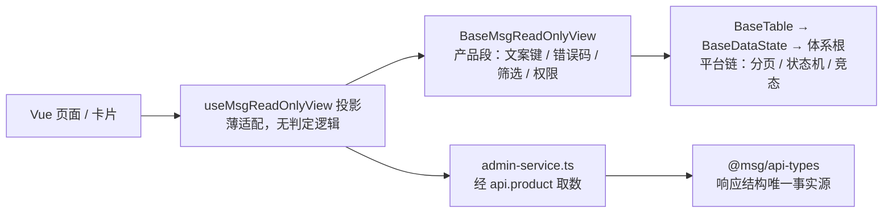

# 06-1-2 前端管理模块骨架与只读页面 · 详细设计

> 08B · 06 管理与运维 · 06-1 管理模块只读视图 · 子任务 02（需求 06-1）

[文档首页](../../../../../../../文档首页.md) › [消息平台规划](../../../../../../../规划/01_规划_消息平台.md) › [阶段计划](../../../../../计划/01_计划_消息平台.md) › [06 管理与运维](../../../06_管理与运维.md) › [06-1 管理模块只读视图](../../06_管理与运维_01_管理模块只读视图.md) › [06-1-2 前端管理模块骨架与只读页面](../06_管理与运维_01_管理模块只读视图_02_前端管理模块骨架与只读页面.md) › 详细设计

## 0. 分章导航 <a id="toc"></a>

| 章 | 内容 |
| --- | --- |
| 1 | 任务级边界与输入基线 |
| 2 | 交付物清单 |
| 3 | 现状核对结论与事实偏差 |
| 4 | 产品基类、投影与继承链 |
| 5 | 模块注册、路由与工作台卡片 |
| 6 | 取数层、契约类型迁移与错误码文案 |
| 7 | 页面分层与逐页实现口径 |
| 8 | 概览卡片取数与轮询 |
| 9 | 国际化键表与四态文案 |
| 10 | 失败分支与权限边界 |
| 11 | 测试设计与验收映射 |
| 12 | 原型逐页对照与门禁 |
| 13 | 登记落点与文档同步 |
| 14 | 体积预算与构建门禁 |
| 15 | 边界与开放项 |
| 16 | 对齐记录 |

## 1. 任务级边界与输入基线 <a id="scope"></a>

**做什么**：在既有 msg 运行时模块上补管理模块骨架——产品段前端基类 + 投影、九条路由（七项菜单 + 两条详情深链）、一张工作台概览卡片、七类只读页面、模块 i18n 文案包；契约类型统一改用 06-1-3 交付的生成物；六页可交互原型逐页对照验收。

**不做什么**：

- 不做写操作（新建主题 / 位点重置 / 死信处置 / 重放任务控制 / 延迟改期取消归 06-2 / 06-5 / 06-6）；
- 不展示消息正文、不自绘趋势图（跳 Grafana）；
- 不改 bms 宿主前端源码、不改平台基类、不改生成器产物 `src/`；
- 不引入第二套路由 / 状态 / 请求框架，不自建 HTTP 客户端、不自拼 `/api` 前缀、不持久化凭据；
- 不替 06-7 / 06-8 预注册路由，只在 `meta.order` 留位；
- 不改后端四条只读端点与契约快照。

**输入基线**：

| 输入 | 事实 |
| --- | --- |
| 模块现状 | `frontend/modules/msg/src/index.ts` 只注册 `regions`（`msg:tenant-quota`）与两个 i18n 包；无 `routes` / `cards` |
| 宿主注册契约 | `defineModule` 返回 `routes? / cards? / regions? / i18nPacks?`；`cards` 元素须是 `WorkbenchCardProvider`（`assemble.ts` 直接当 provider 注册，不二次包装）；路由 `meta.title` 存在且 `meta.menu !== false` 才登记菜单项 |
| 宿主菜单 | 按 `meta.group` 归组、`meta.icon` 取图标、`meta.devOnly` 生产隐藏；`meta.perm` 由宿主路由守卫按已持有权限码判定 |
| 请求能力 | `ModuleApiScope = api.product('msg','msg')`，路径相对（`/admin/...`），凭据 / 解包 / 401 刷新由宿主负责 |
| 契约生成物 | `@msg/api-types` 导出 `type * as msg`，可用 `msg.components['schemas'][...]` 取响应结构；`QuotaItem` / `QuotaView` / `ApiResponse_*` 均已生成 |
| 后端只读端点 | `/admin/topics`、`/admin/topics/{topic_id}`、`/admin/groups`、`/admin/groups/{namespace}/{topic}/{group}`、`/admin/partitions`、`/admin/messages`、`/admin/overview`、`/admin/delayed`、`/admin/delayed/summary` |
| 原型 | `设计/原型设计/03~08` 六页（文件序号顺延）已于本任务前置补齐并定稿；只读口径推广到六页 |
| 基类清单 | `msg文档/前端基类清单.md` 登记 `BaseMsgReadOnlyView → BaseTable`（状态「待交付」）；实现契约 §7 含体系根清单与本仓链 |
| 机器护栏 | `engkit base frontend-base`（`profile = "product"`）已接入 msg 提交环 / 推送环，当前只报「基类源码不存在」这一中间态 |
| 用例编号 | Kiwi **2464**（分类「平台骨架」/ P2 / CONFIRMED / 标签「自动化」，登记后回读一致） |

## 2. 交付物清单 <a id="deliverables"></a>

| 类别 | 交付物 | 说明 |
| --- | --- | --- |
| 基类 | `src/base/BaseMsgReadOnlyView.ts` | 产品段组件基类，继承平台 `BaseTable` |
| 投影 | `src/composables/useMsgReadOnlyView.ts` | 核心实例 ↔ Vue 响应式薄适配（不入清单） |
| 取数 | `src/services/admin-service.ts` | 九条只读端点的请求函数，与 `quota-service.ts` 同源 |
| 轮询 | `src/composables/useOverviewSnapshot.ts` | 概览卡片与概览页共用的挂载取数 + 30s 轮询 |
| 页面 | `src/views/*.vue` | 概览、主题列表 / 详情、消费组列表 / 详情、分区查询、消息查询、延迟、死信与重放（九路由） |
| 共用件 | `src/components/ReadOnlyList.vue`、`src/components/OverviewMetrics.vue` | 列表骨架（筛选 / 分页 / 四态 / 返回深链）与四值数字卡 |
| 卡片 | `src/components/OverviewCard.vue` | 工作台「消息平台概览」卡片 |
| 契约 | `src/domain.ts` 删除；`QuotaPanel.vue` / `quota-service.ts` 改引用 | 手写契约类型全量迁移到 `@msg/api-types` |
| 注册 | `src/index.ts`、`src/runtime.ts` | `routes` / `cards` / i18n 包；宿主上下文读取扩展 |
| 文案 | `src/i18n/messages.ts` | 中英两包，页面键 / 错误码键 / 四态键 / hint 三态 |
| 常量 | `src/constants.ts` | Grafana 看板地址（缺配置不渲染）、轮询间隔、权限码 |
| 用例 | `tests/*.spec.ts` | 基类 / 投影 / 注册 / 取数 / 页面 / 卡片六组，Kiwi 2464 |
| 预算 | `budget.json` | 按实测重定阈值、`minAsyncChunks`、`pageChunkHints` 与 `note` |
| 依赖 | `package.json` / `pnpm-lock.yaml` | 增 `@msg/api-types` 包引用 |
| 文档 | 本设计 + 实施记录 + 测试记录 + 上层回写 | §13 |

## 3. 现状核对结论与事实偏差 <a id="current"></a>

| # | 现状 | 与本任务的关系 | 处置 |
| --- | --- | --- | --- |
| 1 | `tests/module.spec.ts` 断言「`routes` 为空」 | 新增九条路由必然破坏既有用例 | 同步改为「九条路由 + 一张卡片 + 权限码 + 分组」断言；编号 2454 不改派 |
| 2 | `budget.json` 按单页签签定（`minAsyncChunks=1`、`pageChunkHints=["QuotaPanel"]`、入口 24 KB） | 九路由独立异步块必然改变产物结构 | 构建后按实测重定，入口阈值按实测取整，`note` 写明增量来自页面分包 |
| 3 | `domain.ts` 手写 `QuotaItem` / `QuotaView` / `ApiEnvelope<T>` | 与生成物重复、可漂移 | 删除文件；`QuotaPanel.vue` / `quota-service.ts` 直接 `import type { msg } from '@msg/api-types'` |
| 4 | `cards` 类型声明为 `unknown[]`，装配器按 `WorkbenchCardProvider` 直接注册 | 传普通对象会在宿主装配期被当 provider 使用而缺 `key` 字段 | 用 `new WorkbenchCardProvider('msg:overview-card', loader, '消息平台概览')` |
| 5 | 装配器对 `meta.menu === false` 的路由「跳过登记」 | 详情页仍要能被宿主路由访问 | 详情页仅声明 `menu: false`，不写 `title`；同时保留 `component` 异步加载器供宿主路由装配 |
| 6 | 死信列表与重放任务列表**无只读端点**（契约快照只有 `POST /admin/replay` 与 `GET /admin/replay/{task_id}`） | 原型 06 页画了两张带示例行的只读表，实现无法取到真实数据 | 页面按「只读入口 + 后续任务占位」呈现：两张表空态 + 明确引导文案，不造端点、不伪造数据；逐页对照表登记为数据源偏差，06-5 / 06-6 补端点后接线（§15） |
| 7 | `/admin/partitions` 必填 `namespace` + `topic`，无全平台分区列表端点 | 导航要求有「分区」项 | 分区页做「先选主题」查询页：未选主题显示选择态（非空态 / 错误态），选定后取数；详情走 `menu:false` 深链参数 |
| 8 | `meta.perm` 由宿主路由守卫按已持有权限码判定，权限未装载时宿主放行 | 模块侧不得自建第二套权限判定 | 页面与卡片按宿主注入 `user` 的权限集合做展示层判定；菜单 / 路由拦截交宿主守卫，模块只声明 `meta.perm` |
| 9 | `hw` / `isr` 后端恒 `None` / 空集合，消息响应不含正文 | 原型要求「—」占位与只展示头与摘要 | 前端按可空字段显示 `—`；消息页不渲染正文列、不提供正文入口 |
| 10 | 概览 `snapshot_available=false` 时四值返回 0 | 不能把 0 当真实值展示 | 显示 i18n 冷启动占位「指标采集中」，不伪造数值、不报错 |
| 11 | `@bms/core` 的 `BaseTable` 是抽象类，抽象成员已由上链提供 | 产品基类可直接派生 | `class BaseMsgReadOnlyView extends BaseTable`，无额外抽象实现；不新建中间体系根 |
| 12 | 六页原型已定稿，均在 `meta.group`「消息平台」下，含 06-7 / 06-8 两个占位 | 实现须与验收基准一致 | §12 逐页对照表 + 截图；偏差只登记第 6 项 |

## 4. 产品基类、投影与继承链 <a id="base"></a>

### 4.1 继承轨归属

主体开发一律沿继承链派生、零例外（条文见 bms/bms文档/规范/前端开发规范.md §3.1 与 bms/bms文档/规范/后端开发规范.md 架构铁律）。本任务六类页面共用分页 / 筛选 / 四态 / 权限，故新增一个**产品段组件基类**；`defineModule` 只是宿主接入机制，不改变继承链归属。

```text
BaseObject → … → BaseComponent → BasePlaceholderState → BaseDataState → BaseTable
                                                                      └→ BaseMsgReadOnlyView（本仓，产品段）
```

链按「子类 → 父类」写，登记在 `msg文档/前端基类清单.md` §2 与 `设计/基类体系/前端基类实现契约.md` §7；体系根清单小节保留，父类经 `[rules.frontend_base].base_source_dirs` 指向 bms 前端 core 源码面解析。

### 4.2 `BaseMsgReadOnlyView` 逐项语义

| 能力 | 来源 | 本类补充 |
| --- | --- | --- |
| 分页 / 页长 / 列配置 / 选中集合 / 排序 | `BaseTable` | 不重写；只经 `setRows` / `setPage` / `setPageSize` 透传 |
| `loading → ready / empty / error` 状态机与竞态令牌 | `BaseDataState` | 不重写；`begin()` / `settle()` 直接复用 |
| 四态文案键 | 产品段 | `stateKey()` 把 `ready / empty / error / loading` 映到模块 i18n 键；另给 `denied` 展示层态 |
| 错误码 → 文案键 | 产品段 | `errorKey(code)`：`error.<码>`，未命中回落 `error.fallback` |
| 权限码 | 产品段 | 常量 `MSG_QUERY_PERMISSION = 'msg:query'`；`allows(codes)` 只做「集合是否含该码」的纯判定 |
| 筛选条件 | 产品段 | `filters` 为只读查询参数容器，`setFilter(key, value)` / `queryParams()` 与端点参数同名，不拼租户参数 |
| 只读约束 | 产品段 | 不提供写入 / 提交 / 删除入口；不缓存响应到持久化存储 |

**失败态结算**：`settleError(token, code)` 只记 `code` 并把状态结算为 `error`；文案在渲染层按 `errorKey(code)` 取，保证「错误码文案键按后端错误码映射、不硬编码中文」。竞态：`settle` 返回 `false` 时丢弃过期结果，不覆盖新一次加载。

### 4.3 `useMsgReadOnlyView()` 投影

- 薄适配：创建基类实例 → 用 `shallowRef` / `ref` 投影 `rows` / `total` / `page` / `pageSize` / `state` / `errorCode` / `filters`；订阅 `onStateChange` 同步状态；`onScopeDispose` 取消订阅。
- **不含判定逻辑**：四态、错误码、筛选合法性、竞态都由基类与取数层决定；投影只做加载编排（`begin()` → `await loader(query)` → `setRows()` + `settle()` → `catch` 走 `settleError()`）。
- 页面不直接 `new` 基类；投影是清单 §3 所说的「不入清单的两类」之一，也是「注册必有消费」的接线点。
- 返回 `refresh()` / `setPage()` / `setFilter()` / `reset()` / `dispose()`；`dispose()` 幂等。



## 5. 模块注册、路由与工作台卡片 <a id="registration"></a>

### 5.1 路由表（九条）

统一 `/msg/...` 前缀，`meta.group = '消息平台'`，`meta.perm = 'msg:query'`，`meta.order` 为 06-7「主题授权」/ 06-8「租户用量」留 80 / 90 空位。

| 路径 | 菜单 | `meta.title` | 组件（独立异步块） | `order` |
| --- | --- | --- | --- | --- |
| `/msg/overview` | 是 | 平台概览 | `views/OverviewPage.vue` | 10 |
| `/msg/topics` | 是 | 主题管理 | `views/TopicsPage.vue` | 20 |
| `/msg/topics/:namespace/:topic` | 否（`menu:false`） | — | `views/TopicDetailPage.vue` | — |
| `/msg/groups` | 是 | 消费组与积压 | `views/GroupsPage.vue` | 30 |
| `/msg/groups/:namespace/:topic/:group` | 否（`menu:false`） | — | `views/GroupDetailPage.vue` | — |
| `/msg/partitions` | 是 | 分区 | `views/PartitionsPage.vue` | 40 |
| `/msg/messages` | 是 | 消息查询 | `views/MessagesPage.vue` | 50 |
| `/msg/delayed` | 是 | 延迟消息 | `views/DelayedPage.vue` | 60 |
| `/msg/dlq` | 是 | 死信与重放 | `views/DlqPage.vue` | 70 |

- 详情页 `menu:false` 且不带 `title`，按装配器口径不进菜单；深链带足定位参数，页面提供「返回」按钮回列表。
- 分区页从主题详情 / 导航进入时带 `namespace` / `topic` 查询参数；不带时显示「先选主题」选择态。
- 路由键（`name`）以路径为缺省值，不覆盖宿主既有路由；`meta.icon` 只填宿主已登记图标键，未登记时宿主不渲染图标。
- 不预注册 06-7 / 06-8 路由；预留只在 `order` 空位与 i18n 占位键。

### 5.2 卡片与注册声明

```ts
cards: [new WorkbenchCardProvider('msg:overview-card', () => import('./components/OverviewCard.vue'), '消息平台概览')]
```

- 键以 `msg:` 为命名空间前缀，符合装配器同键拒重校验；`component` 为异步加载器，卡片独立分包。
- `regions` 既有一项 `msg:tenant-quota` 保持不变；`i18nPacks` 仍为 `msg:zh-cn` / `msg:en` 两包（内容扩充，不新增第三包）。
- `setup(context)` 先 `applyHostContext(context)` 再返回注册项；不直接读写宿主 `router` / `store` 实例。

## 6. 取数层、契约类型迁移与错误码文案 <a id="service"></a>

### 6.1 请求通道

`src/services/admin-service.ts` 与既有 `quota-service.ts` 同构：`requiredHostApi().product('msg','msg')` → `scope.get<ApiResponse_X>(相对路径, 查询参数)`。九条函数一一对应 §1 端点表，参数名与契约快照查询参数**逐字一致**（`namespace` / `topic` / `partition` / `page` / `size` / `offset_from` / `offset_to` / `key` / `time_from` / `time_to` / `log_id` / `level` / `group`）。

- 不接收 / 不拼装 `tenant_id`，租户上下文由宿主注入能力携带；
- 不自建 HTTP、不自拼 `/api` 前缀、不缓存到 `localStorage`；
- 响应按 `code !== 0` 抛 `MsgQueryError(code)`，由投影捕获并转 `errorKey(code)`；`data` 为空按空页处理（不抛错）。

### 6.2 类型迁移（第 3 项确认：全量迁移）

- 删除 `src/domain.ts`；不在模块内保留手写契约类型或 re-export 兼容层。
- 每个消费文件直接：

```ts
import type { msg } from '@msg/api-types'
type Schema = msg.components['schemas']
type Overview = Schema['Overview']
type QuotaEnvelope = Schema['ApiResponse_QuotaView_']
```

- `QuotaPanel.vue` 的 `QuotaItem[]` 改为 `Schema['QuotaItem'][]`；`quota-service.ts` 的 `ApiEnvelope<QuotaView>` 改为 `Schema['ApiResponse_QuotaView_']`，取 `response.data ?? { items: [] }` 兼容生成物 `data?` 可空。
- `frontend/modules/msg/package.json` 增 `@msg/api-types` 引用（`file:../../packages/api-types`），锁文件同步；生成物是纯类型，不进运行时包。
- 契约变更后顺序固定：先 `pnpm run api-types:gen` 再 `api-types:check`；本任务不手改 `packages/api-types/src/`。

### 6.3 错误码文案映射

| 类别 | 键 | 来源 |
| --- | --- | --- |
| 产品码 | `error.350001` / `350009` / `350010` / `350011` / `350012` / `350013` / `350027` | 06-1-1 `_QUERY_ERRORS` |
| 通用码 | `error.10001`（参数非法）、`error.30001`（无权限） | 契约层 / 基座 |
| 兜底 | `error.fallback` | 未命中或未带码 |
| 四态 | `state.loading` / `state.empty` / `state.error` / `state.denied` | 列表与卡片共用 |
| 冷启动 | `state.collecting`（指标采集中） | `snapshot_available=false` |
| 延迟提示 | `hint.normal` / `hint.stale` / `hint.near_quota` | `DelaySummary.hint` 三态枚举 |

中英两包键集合必须一致（用例断言），未命中键走 `message()` 原样返回，不硬编码中文到模板。

## 7. 页面分层与逐页实现口径 <a id="pages"></a>

### 7.1 分层

| 层 | 落点 | 规则 |
| --- | --- | --- |
| 注册 | `index.ts` | 只声明，不写注册表 |
| 页面 | `views/*.vue` | `<script setup lang="ts">`，每页 `() => import()` 独立异步块 |
| 共用骨架 | `components/ReadOnlyList.vue` | 筛选条 + 分页 + 四态 + 返回深链；消费投影状态，不自行实现状态机 |
| 通用件 | `@bms/ui_ep` | `DataTable` / `QueryFilter` / `MetricCard` / `DescriptionList` / `StatusTag` / `EmptyState` / `ErrorPage` / `LoadingMask` / `StatusContainer`，按可用形态组合 |
| 状态与判定 | `base/` + `composables/` | 基类 + 投影，页面只消费 |
| 取数 | `services/` | 宿主产品域通道 |
| 文案 | `i18n/messages.ts` | 键化，无中文字面量硬编码 |

样式一律 `<style scoped>` 且只消费 `--bms-*` 令牌；不写 `:global`、全局选择器、色值字面量（隔离护栏 S2 / S3 / S5）。

### 7.2 逐页口径

| 页面 | 取数 | 展示要点 | 四态与特殊分支 |
| --- | --- | --- | --- |
| 概览 | `/admin/overview` | 四张数字卡（入口吞吐 / 当前积压 / 死信数 / 磁盘使用率）+「查看 Grafana」 | 冷启动 `snapshot_available=false` 显示 `state.collecting`；失败按码映射 + 手动刷新；无权限不渲染跳转按钮 |
| 主题列表 | `/admin/topics` | 主题 / 分区数 / 消息量 / 保留期 / 状态；操作列只有「查看详情」 | 分页 + `namespace` / `keyword` 筛选；空态；详情深链 |
| 主题详情 | `/admin/topics/{id}` + `/admin/partitions` | 元数据 + 分区明细（分区 / Leader / LEO / HW / ISR / 已提交位点 / 积压 / Owner）；HW / ISR 空值显示 `—`；新建主题标 06-2 占位 | 返回列表；分区取数失败只降级该区块 |
| 消费组列表 | `/admin/groups` | 消费组 / 主题 / 成员数 / 积压 / 最后提交时间 / 状态 | 分页 + `namespace` / `topic` 筛选；位点重置标 06-2 占位 |
| 消费组详情 | `/admin/groups/{namespace}/{topic}/{group}` | 状态 / 世代 / 成员 / 分配 / 各分区 LEO、已提交位点、积压、最后提交时间 | 返回列表；`350013` 组不存在按码映射 |
| 分区查询 | `/admin/partitions` | 先选 `namespace` + `topic` 再显示分区列表；分区详情走深链 | 未选主题为「选择态」（非空态 / 非错误态）；缺参不发起请求 |
| 消息查询 | `/admin/messages` | `offset` / `key` / 时间 / `log_id` 组合筛选；列表列 `log_id` / 分区 / offset / 发布时间 / 载荷长度 / SHA-256 摘要；详情只展示头 | **不渲染正文、不提供正文入口**；`namespace` + `topic` 必填才查询；空页正常 |
| 延迟消息 | `/admin/delayed` + `/admin/delayed/summary` | 待投列表 + 九档分布 + 堆积提示 | `hint` 三态按 i18n 映射；只读，不改期 / 取消 |
| 死信与重放 | 无只读端点（§3 第 6 项） | 两张只读表的空态 + 后续任务占位说明；处置 / 重放交互标 06-5 / 06-6 | 空态文案键化；不伪造示例数据、不发请求 |

所有列表页：加载态不显示旧值、错误态只影响本页、无权限时整页入口不渲染（宿主菜单由 `meta.perm` 拦截）。

## 8. 概览卡片取数与轮询 <a id="card"></a>

- `useOverviewSnapshot()` 基于 `useMsgReadOnlyView()` 的同一基类实例做状态机，卡片与概览页共用，不另造取数层（第 7 项确认）。
- 挂载即取一次 `/admin/overview`，随后每 30s 轮询；**轮询刷新不清空已有数值**（原型加载态口径：骨架只在首次加载出现）。
- `onScopeDispose` 清定时器；请求竞态由基类 `BaseDataState` 令牌保证过期结果不覆盖；失败保留上一次成功值并显示按码映射的错误提示。
- Grafana 地址集中放 `src/constants.ts` 的 `GRAFANA_OVERVIEW_URL`（UID `msg-overview`）；为空 / 未配置时不渲染按钮，不硬编码部署域名到页面。
- 冷启动占位与错误态文案全部键化；卡片不注册提交器、不持久化、不自建宿主级实例。

## 9. 国际化键表与四态文案 <a id="i18n"></a>

中英两包键集合一致，命名分段：`msg.admin.nav.*`（导航）、`msg.admin.common.*`（通用列与动作）、`msg.admin.<page>.*`（页面字段）、`error.*`、`state.*`、`hint.*`。至少覆盖：

- 七个菜单标题 + 分组名「消息平台」；
- 四张卡标题、四态文案、冷启动文案、手动刷新；
- 各页表头、筛选标签、空态、返回、查看详情、后续任务占位；
- 九个错误码键 + 兜底键、`hint` 三态；
- 既有 `msg.quota.*` 键原样保留，不改动 05-2 已交付文案。

`message(key, locale)` 既有行为不变（未命中原样返回）；用例断言两包键集合相等且所有 `error.*` / `state.*` / `hint.*` 键齐备。

## 10. 失败分支与权限边界 <a id="failures"></a>

| 场景 | 行为 | 文案键 |
| --- | --- | --- |
| 请求抛出业务码 | 投影结算 `error`，按码取文案 | `error.<码>` |
| 未登记码 / 异常无码 | 统一兜底 | `error.fallback` |
| 宿主请求能力缺失 | 哨兵 `MODULE_API_ABSENT` → 不渲染数据区 | `state.error` |
| 列表为空 | 空态 | `state.empty` |
| 加载中 | 首次骨架 | `state.loading` |
| 无 `msg:query` | 菜单 / 按钮不渲染（不是置灰） | `state.denied` |
| 概览冷启动 | 四值 0 不展示，改占位 | `state.collecting` |
| 分区未选主题 | 选择态，不发起请求 | `msg.admin.partitions.choose` |
| 轮询期间失败 | 保留上次成功值 + 错误提示 | `error.<码>` |
| 消息正文 | 结构上不取、不渲染 | — |

权限：路由与菜单由宿主守卫按 `meta.perm` 与已持有权限码判定；模块内展示层只做纯集合判定，不自建权限存储、不自行拼装租户参数。

## 11. 测试设计与验收映射 <a id="testing"></a>

### 11.1 用例清单（Kiwi 2464）

| # | 用例文件 | 断言 | 验收映射 |
| --- | --- | --- | --- |
| 1 | `tests/base-readonly-view.spec.ts` | 继承 `BaseTable` 且能追到体系根；分页 / 状态机来自链上基类；`errorKey` 九码 + 兜底；`stateKey` 四态；竞态过期 `settle` 不覆盖；`allows` 权限判定 | 架构铁律、完成标准 2 |
| 2 | `tests/use-readonly-view.spec.ts` | 投影加载 / 空 / 错误 / 竞态 / `dispose()` 幂等；不直接实例化基类 | 完成标准 3、基类消费接线 |
| 3 | `tests/admin-routes.spec.ts` | 九路由路径 / 菜单项 7 / 两条 `menu:false` / `meta.group` / `meta.perm` / order 预留；一张卡片键、异步加载器；regions 与两个 i18n 包不变；中英键集合相等 | 完成标准 2、任务书 2/3 |
| 4 | `tests/admin-service.spec.ts` | 九条请求路径与参数名；产品域通道；`code !== 0` 抛错；`data` 空按空页；不拼租户参数 | 完成标准 2、类型迁移 |
| 5 | `tests/admin-pages.spec.ts` | 六类页面列表 / 详情 / 空 / 错误 / 无权限；消息页无正文列；HW / ISR 空值 `—`；分区未选主题选择态；hint 三态；死信页占位不取数 | 完成标准 3、4、5 |
| 6 | `tests/overview-card.spec.ts` | 挂载取一次 + 假定时器 30s 轮询；卸载清定时器；竞态不覆盖；冷启动占位；Grafana 缺配置不渲染 | 完成标准 2、任务书 7 |
| 7 | `tests/module.spec.ts`（既有 2454，更新断言） | 原「routes 为空」改为九路由 + 一卡片；其余不变 | 回归 |
| 8 | `tests/quota-panel.spec.ts`（既有 2454） | 类型迁移后行为不变 | 回归 |

### 11.2 覆盖率与门禁

- 变更模块行 + 分支 100%：`base/` / `composables/` / `services/` / `views/` / `components/` / `i18n/` / `index.ts` / `runtime.ts` / `constants.ts` 全部纳入；纯模板 / 纯声明文件用「可挂载 / 可解析」护栏用例覆盖，**不用** `pragma: no cover` 或 `omit`。
- 命令：`pnpm run typecheck`、`pnpm run lint`、`vitest run --coverage --coverage.include=<变更文件> --coverage.thresholds.lines=100 --coverage.thresholds.branches=100`、`pnpm run build && pnpm run budget`、`pnpm run guard:isolation`、`pnpm run api-types:check`、`engkit base frontend-base`、`engkit links` / `docs-scope` / `eol`。
- 变更集含 `.vue` 源码会触发 `check_prototype_review.py`，须有原型依据引用且文件存在 + 逐页表 + 结论 + 截图（§12）。

## 12. 原型逐页对照与门禁 <a id="prototype"></a>

六页原型（文件序号 03~08）逐页截图与实现侧渲染结果对照，形成「页面 / 原型依据 / 逐项对照 / 结论 / 截图路径」表写入测试记录。原型依据统一引用 `msg文档/设计/原型设计/*.html`（§3 页面规划已登记链接），截图落 `msg文档/项目/.../06-1-2.../测试/截图/`。

| 页面 | 原型 | 关键对照项 |
| --- | --- | --- |
| 02 平台概览 | `03_原型设计_平台概览.html` | 四卡字段、冷启动占位、Grafana 按钮、轮询说明、四态 |
| 03 主题管理 | `04_原型设计_主题管理.html` | 筛选 / 分页 / 列表列 / 详情深链 / 分区 LEO / HW / ISR 占位 / 返回 |
| 04 消费组与积压 | `05_原型设计_消费组与积压.html` | 列表列 / 详情成员 / 分配 / 分区积压 / 最后提交时间 / 位点重置占位 |
| 05 消息查询 | `06_原型设计_消息查询.html` | 组合筛选 / 头与摘要列 / 无正文入口 / 消息头详情 |
| 06 死信与重放 | `07_原型设计_死信与重放.html` | 两张只读表 / 后续任务占位 / 无写控件 / 权限态（示例数据登记为数据源偏差） |
| 08 延迟消息 | `08_原型设计_延迟消息.html` | 待投列表 / 九档分布 / hint 三态 / 只读不改期取消 |

对照结论分「一致 / 已登记偏差」两档；第 6 项偏差按 §3 第 6 条登记，不写成「一致」。

## 13. 登记落点与文档同步 <a id="registry"></a>

| 落点 | 动作 |
| --- | --- |
| `msg文档/前端基类清单.md` §2 | `BaseMsgReadOnlyView` 状态由「待交付」改「已交付」 |
| `msg文档/设计/基类体系/前端基类实现契约.md` §4 / §6 | 补投影落地与页面消费接线结论，链不变 |
| [06-1-2 任务文档](../06_管理与运维_01_管理模块只读视图_02_前端管理模块骨架与只读页面.md) | §5 前置契约状态回写；§2 第 1 项原型已交付 |
| [06-1 父任务文档](../../06_管理与运维_01_管理模块只读视图.md) | 子任务状态与交付物清单 |
| [阶段计划](../../../../../计划/01_计划_消息平台.md) | 06-1 行状态 / 已完成任务表 / 合计；进度类字段只在此回写 |
| [需求 06 域文档](../../../../../需求/06_需求_管理与运维.md) | 06-1 完成标准核对，不新增需求 |
| [原型设计总览](../../../../../../../设计/原型设计/01_原型设计_总览.html) | 页面规划表原型列状态由「已补（待定稿）」改「已定稿」 |
| `msg文档/文档首页.md` | 基类行已登记，无需再改 |
| 实施记录 / 测试记录 | 本任务目录各一份，含逐页对照表与截图路径 |
| bms / engkit 仓 | 各自独立提交；本任务不改基座规范条文 |

## 14. 体积预算与构建门禁 <a id="budget"></a>

- 九路由 + 卡片 + 既有配额页签各为独立异步块；`pageChunkHints` 扩充为页面 / 卡片文件名提示，`minAsyncChunks` 按实测异步块数设定。
- `entryGzipKb` / `largestGzipKb` / `maxEntryFiles` 按构建实测取整；`note` 写实测日期、入口闭包变化与「增量来自页面分包，入口闭包未膨胀」结论。
- 新增基类与投影若进入口闭包，阈值一并实测计入；不放宽判据、不删 `pageChunkHints`。
- `pnpm run budget` 与 `pnpm run guard:isolation`（源码面 + 产物面）须全绿；`api-types:check` 零漂移。

## 15. 边界与开放项 <a id="open"></a>

| # | 开放项 | 原因 | 归口 |
| --- | --- | --- | --- |
| 1 | 死信列表 / 重放任务列表无只读端点 | 06-1-1 只交付四条新端点，列表归后续任务 | 06-5 / 06-6 补端点后在本页接线 |
| 2 | 分区页「先选主题」 | 分区接口必填 `namespace` + `topic`，无全平台列表端点 | 06-7 或容量专项 |
| 3 | `hw` / `isr` 恒空 | 02-4 / 02-5 未交付 | 02-4 / 02-5 |
| 4 | 概览指标进程内、重启归零 | 06-3 采集器口径 | 8B_05 |
| 5 | 消息正文不展示 | 任务边界 + 06-1-1 结构约束 | 06-2 / 审计域 |
| 6 | 趋势图不自绘 | 跳 Grafana | 06-3-2 看板 |
| 7 | 06-7 主题授权 / 06-8 租户用量页面 | 各任务在骨架上追加 | 06-7 / 06-8 |
| 8 | 页面列与分页的容量实测 | 无大数据量压测 | 平台级容量实测 |

## 16. 对齐记录 <a id="alignment"></a>

| # | 事项 | 结论 | 依据 |
| --- | --- | --- | --- |
| 1 | 原型范围 | 本任务内先补六页并更新总览，定稿后才进设计与实现 | 用户确认（2026-11-09） |
| 2 | 06 页深度 | 原型按只读形态，处置 / 重放标后续；只读口径推广到六页 | 同上 |
| 3 | 类型迁移 | 删除 `domain.ts`，全量引用 `@msg/api-types` | 同上 |
| 4 | 架构分轨 | 主体开发一律继承、零例外；产品自持清单 + 契约 §7，链接平台体系根；新增 1 基类 + 投影 | 规范原文 + 用户纠正 |
| 5 | 路由导航 | `/msg/...` + `meta.group` 消息平台 + 七菜单项；分区查询页；详情 `menu:false`；给 06-7 / 06-8 留 order 空位 | 用户确认 |
| 6 | 原型命名 | 文件序号顺延 03~08，既有 `02_配额管理.html` 不动 | 同上 |
| 7 | 概览卡片 | 挂载取一次 + 30s 轮询；冷启动 i18n 占位；Grafana 地址集中常量；卡片复用同一基类投影 | 同上 |
| 8 | 体积预算 | 按实测重定 `budget.json`，`note` 写日期与依据 | 同上 |
| 9 | i18n 映射 | 7 产品码 + `10001`/`30001` + `hint` 三态 + 四态，未命中兜底 | 同上 |
| 10 | Kiwi 登记 | 1 条（2464），既有 2454 / 2462 / 2463 不动 | 同上 + 平台回读 |
| 11 | 覆盖率 | 严格 100% 行 + 分支，纯模板用护栏用例，禁 `pragma` / `omit` | 同上 |
| 12 | 原型对照 | 六页全量截图比对，逐页表写测试记录 | 同上 |
| 13 | 口径回写 | 三份基座规范恢复原文，仅《AI开发规范》铁律块加一行条文引用 | 用户最终拍板 |
| 14 | 清单结构 | 与后端对称：`前端基类清单.md` + `前端基类实现契约.md`（§7 体系根清单 + 本仓链） | 用户确认 |
| 15 | 基类落地 | `BaseMsgReadOnlyView → BaseTable` + `useMsgReadOnlyView()`，落 `base/` 与 `composables/`，先登记后写代码 | 同上 |
| 16 | 前端护栏 | engkit 新增 `base frontend-base`（product 形态），msg `engkit.toml` 接进提交环 / 推送环 | 同上 |
| 17 | 卡片注册形态 | `new WorkbenchCardProvider(...)`，非普通对象 | 装配器源码核对 |
| 18 | 原型定稿 | 用户「继续」视为六页原型定稿确认 | 本轮指令 |
| 19 | 进度类字段 | 按历史惯例在计划表回写，后续窗口不动 | 同上 |

> 依《文档生成规范》编写（跨仓引用写纯文本路径）· 进度以阶段计划为唯一落点
