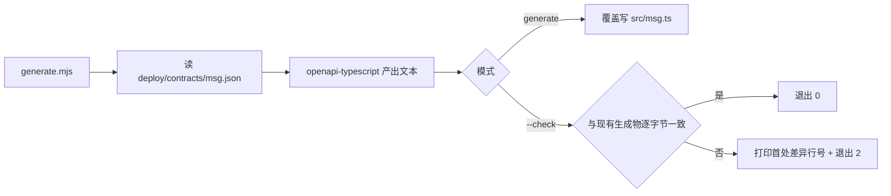

# 06-1-3 前端契约类型自动生成 · 详细设计

> 08B · 06 管理与运维 · 06-1 管理模块只读视图 · 子任务 03（需求 06-9）

[文档首页](../../../../../../../文档首页.md) › [消息平台规划](../../../../../../../规划/01_规划_消息平台.md) › [阶段计划](../../../../../计划/01_计划_消息平台.md) › [06 管理与运维](../../../06_管理与运维.md) › [06-1 管理模块只读视图](../../06_管理与运维_01_管理模块只读视图.md) › [06-1-3 前端契约类型自动生成](../06_管理与运维_01_管理模块只读视图_03_前端契约类型自动生成.md) › 详细设计

## 0. 分章导航 <a id="toc"></a>

| 章 | 内容 |
| --- | --- |
| 1 | 任务级边界与输入基线 |
| 2 | 交付物清单 |
| 3 | 现状核对结论 |
| 4 | 生成器契约 |
| 5 | 门禁与工作区接线 |
| 6 | 失败分支 |
| 7 | 测试设计与验收映射 |
| 8 | 登记落点与文档同步 |
| 9 | 边界与开放项 |
| 10 | 对齐记录 |

## 1. 任务级边界与输入基线 <a id="scope"></a>

**做什么**：把 `deploy/contracts/msg.json` 变成前端可直接消费的 TypeScript 类型，并让「契约变了类型没跟着变」在提交前被机器判出。

**不做什么**：

- 不改后端契约快照的生成与校验脚本，不新增第二份契约来源；
- 不改 `frontend/modules/msg/src/domain.ts` 存量手写类型，不做旧类型迁移；
- 不引入前端运行时依赖、不引入 TS 编译链、不做代码生成之外的转换（不裁剪路径、不改字段名）；
- 不把生成物放进忽略清单，也不把生成器输出写到仓外临时目录。

**输入基线**：

| 输入 | 事实 |
| --- | --- |
| 契约快照 | `deploy/contracts/msg.json`，由 `python -m ops.contract_snapshot export` 产出，`check` 判零漂移 |
| 前端工程 | `frontend/` 为 pnpm 工作区，`frontend/modules/msg/` 是产品模块；`pnpm-lock.yaml` 中 `openapi-typescript` 目前只是 bms 工作区包的传递依赖 |
| 同款实现 | bms `frontend/packages/api_types/scripts/generate.mjs`、mdm `frontend/packages/api-types/scripts/generate.mjs` 均为 `openapi-typescript` + `--check` 形态 |
| 门禁步骤表 | `engkit.toml` 的 `[[preflight.steps]]`，已有 `contract_snapshot check` 步骤（cwd = `backend`） |
| 行尾 | 仓根 `.gitattributes` 规定 `*.sh eol=lf`、`* text=auto eol=lf`；生成物由 clean 过滤器归一 |

## 2. 交付物清单 <a id="deliverables"></a>

| 类别 | 交付物 | 说明 |
| --- | --- | --- |
| 新包 | `frontend/packages/api-types/package.json` | 包元信息与 `generate` / `check` 两个脚本入口 |
| 生成器 | `frontend/packages/api-types/scripts/generate.mjs` | 读快照 → 生成类型；`--check` 判零漂移（**2026-11-14 起为薄壳**，实现下沉 bms `frontend/scripts/api-types/generate.mjs`，见 bms 需求 01-9） |
| 生成物 | `frontend/packages/api-types/src/msg.ts` | 随代码入库，头注标明来源与「请勿手工修改」 |
| 工作区 | `frontend/package.json` | 顶层脚本入口；`pnpm-workspace.yaml` 已声明 `packages/*`，新包自动纳入，无需改动 |
| 依赖 | `frontend/package.json` / `pnpm-lock.yaml` | `openapi-typescript` 提为开发依赖，版本与仓内既有解析一致 |
| 门禁 | `engkit.toml` | 新增 `[[preflight.steps]]` 零漂移步骤 |
| 用例 | `frontend/modules/msg/tests/api-types-generation.spec.ts` | 生成物可解析、零漂移、路径解析、契约版本读取（**2026-11-13 对齐**：原后端 pytest 用例迁入前端 vitest，前端测试只放前端、后端 job 不再依赖 node） |
| 文档 | 本设计 + 实施记录 + 测试记录 + 上层回写 | §8 |

## 3. 现状核对结论 <a id="current"></a>

| # | 现状 | 处置 |
| --- | --- | --- |
| 1 | msg 仓无独立前端契约类型包，`domain.ts` 手写 `ApiEnvelope<T>` 等类型 | 新建包，不删旧文件；06-1-2 决定何时切换 |
| 2 | `openapi-typescript` 只在 lock 中作为传递依赖出现 | 提为新包的开发依赖，锁文件同步 |
| 3 | 契约快照路径在 `deploy/contracts/`，生成器在 `frontend/packages/api-types/scripts/` | 用相对路径从脚本位置解析到仓根，不写绝对路径、不依赖当前工作目录 |
| 4 | 预检步骤表的 `cwd` 决定脚本执行目录 | 新步骤显式写 `cwd`，命令用仓内相对路径 |
| 5 | Windows 与 Linux 的路径分隔符、行尾处理不同 | 脚本统一用 `fileURLToPath` + `path.resolve()`，写盘前归一为 `\n` |

## 4. 生成器契约 <a id="contract"></a>

### 4.1 输入与输出

| 项 | 约定 |
| --- | --- |
| 唯一输入 | `<仓根>/deploy/contracts/msg.json`，路径由脚本自身位置解析 |
| 输出 | `<仓根>/frontend/packages/api-types/src/msg.ts` 与 `src/index.ts`（按域名空间导出），UTF-8、LF、末尾单个换行 |
| 生成参数 | `openapi-typescript` 只传输入路径与 `--export-type` 等仓内同款参数；不启用会引入运行时代码的选项 |
| 头注 | 固定两行：来源文件名 + 「由生成器产出，请勿手工修改」；头注参与零漂移比对 |
| 契约版本 | 生成物中不写死版本号（避免契约版本变更引起无意义漂移）；用例单独断言脚本读到的 `info.version` 与快照一致 |

### 4.2 两种模式



- 两种模式共用同一段生成逻辑，不写两套解析；`--check` 不写盘。
- 差异输出只给「首处不一致行号 + 两侧片段」，不整份打印，避免门禁日志噪声。
- 生成物缺失时 `--check` 直接失败，提示先跑 `generate`；不自动补写。

### 4.3 生成物边界

- 只生成类型声明，不含运行时代码、不含 `fetch` 封装、不含权限与 i18n 逻辑。
- 06-1-2 通过包导出的类型约束请求与响应；本任务不改产品模块源码。
- 契约快照里新增的四条只读端点路径与响应结构，必须能在生成物 `paths` 中检索到（用例断言）。

## 5. 门禁与工作区接线 <a id="gate"></a>

### 5.1 步骤登记

`engkit.toml` 在既有 `contract_snapshot check` 之后新增一条 `[[preflight.steps]]`：

```toml
[[preflight.steps]]
name = "前端类型：api-types --check（契约零漂移）"
cmd = ["node", "packages/api-types/scripts/generate.mjs", "--check"]
cwd = "frontend"
```

- 命令与路径均为仓内相对写法；`node` 由工作区环境提供，不写本机绝对路径。
- 步骤与 `contract_snapshot check` 分工：前者判「快照与运行时契约是否一致」，本步骤判「快照与前端类型是否一致」。
- 该步骤须同时纳入提交环与推送环的步骤表（步骤表同源，新增步骤按 fail-closed 口径登记进增量清单）。

### 5.2 工作区脚本入口

- `frontend/package.json` 增 `api-types:gen` / `api-types:check` 两个脚本，转调新包脚本；命名与 bms / mdm 同款，便于跨仓对照。
- `frontend/pnpm-workspace.yaml` 已声明 `packages/*`（实施时核对结论），新包自动纳入，无需改动。
- `pnpm-lock.yaml` 由 `pnpm install --offline` 刷新；提交前核对锁文件与新包 `package.json` 的依赖声明一致。

### 5.3 装配顺序

```text
契约变更 → python -m ops.contract_snapshot export → node generate.mjs generate
        → node generate.mjs --check → 提交前门禁（两条零漂移步骤） → 提交
```

生成物与契约快照必须同一次提交，避免门禁在中间态被绕过。

## 6. 失败分支 <a id="failures"></a>

| 场景 | 行为 |
| --- | --- |
| 契约快照不存在 / 非法 JSON | 报错退出 2，不写生成物 |
| 生成物缺失 | `--check` 失败并提示先跑 `generate` |
| 契约变更但生成物未更新 | `--check` 打印首处差异行号并退出 2 |
| 生成器脚本自身改动导致输出变化 | 同上，同步刷新生成物后重新检查 |
| `node` 不可用 / 依赖未安装 | 命令失败，门禁步骤失败（不静默跳过） |
| Windows 路径分隔符 | 用 `path.resolve()` 统一，输出文本固定 LF |
| 生成物被手工改坏 | `--check` 判漂移；头注提示勿手工修改 |

## 7. 测试设计与验收映射 <a id="testing"></a>

### 7.1 用例清单（Kiwi 编号见本任务登记）

| # | 用例 | 断言 | 验收映射 |
| --- | --- | --- | --- |
| 1 | 生成物可解析 | `src/msg.ts` 可被 TypeScript 解析，含 `paths` 导出 | 完成标准 1 |
| 2 | 四端点在生成物中 | `/api/v1/msg/admin/partitions` / `messages` / `overview` / `delayed/summary` 可检索 | 完成标准 1 |
| 3 | `--check` 无漂移通过 | 对当前生成物返回 0 且不写盘 | 完成标准 2 |
| 4 | `--check` 有漂移失败 | 人为改动生成物后返回 2，输出含差异行号 | 完成标准 2 |
| 5 | 生成物缺失 | `--check` 失败且提示先跑 `generate` | 失败分支 |
| 6 | 路径解析 | 从仓外工作目录调用脚本仍能定位快照与输出 | 完成标准 3 |
| 7 | 行尾与字节一致 | 生成物为 LF、末尾单换行，`generate` 幂等（两次结果逐字节相同） | 完成标准 3 |
| 8 | 门禁登记 | `engkit.toml` 中零漂移步骤存在且命令为 `--check` | 完成标准 2 |
| 9 | 契约版本读取 | 脚本读到的 `info.version` 与快照一致 | 契约一致性 |

### 7.2 覆盖率

变更模块行 + 分支 100%（口径见《[AI开发规范](../../../../../../../../bms文档/规范/AI开发规范.md)》「覆盖率要求」节）；生成器脚本的分支由 Node 侧用例覆盖，Python 侧用例覆盖门禁登记与端点结构断言。

### 7.3 验证命令

```text
# msg 仓（单文件 / 单节点）
cd frontend && node packages/api-types/scripts/generate.mjs
cd frontend && node packages/api-types/scripts/generate.mjs --check
cd frontend/modules/msg && pnpm exec vitest run tests/api-types-generation.spec.ts
```

## 8. 登记落点与文档同步 <a id="registry"></a>

| 落点 | 动作 |
| --- | --- |
| [06-1 父任务文档](../../06_管理与运维_01_管理模块只读视图.md) §2 | 子任务清单追加 06-1-3 |
| [需求 06 域文档](../../../../../需求/06_需求_管理与运维.md) | 顺延新增需求 06-9 及交付注块 |
| [需求总览](../../../../../需求/00_需求_消息平台.md) | 总清单加 06-9，计数同步 |
| [阶段计划](../../../../../计划/01_计划_消息平台.md) | 06-1 行合计与备注、§1 域口径、已完成任务表 |
| [06-1-2 任务文档](../../06_管理与运维_01_管理模块只读视图_02_前端管理模块骨架与只读页面/06_管理与运维_01_管理模块只读视图_02_前端管理模块骨架与只读页面.md) | 补「前置契约（已交付）」：类型包导出与 `api-types:gen` 入口 |
| `frontend/README.md`（若存在） | 补新包与脚本入口说明 |
| 实施 / 测试记录 | 本任务目录各一份 |

## 9. 边界与开放项 <a id="open"></a>

| # | 开放项 | 原因 | 归口 |
| --- | --- | --- | --- |
| 1 | `domain.ts` 存量手写类型迁移 | 涉及 06-1-2 页面改造 | 06-1-2 |
| 2 | 生成物按服务拆分多文件 | 当前只有 msg 一份快照 | 出现第二个服务契约时 |
| 3 | 生成器跨仓统一到基座 | bms / mdm 各有同款脚本 | 工程化专项 |
| 4 | 生成物进入构建体积预算 | 纯类型声明，不进运行时包 | 06-1-2 构建门禁 |
| 5 | 契约版本变更触发的类型 breaking 判定 | 类型生成器不判语义兼容 | 契约评审 |

## 10. 对齐记录 <a id="alignment"></a>

| # | 事项 | 结论 | 依据 |
| --- | --- | --- | --- |
| 1 | 前端类型链 | 新建生成器，不手写类型 | 用户拍板（2026-11-09） |
| 2 | 立项归属 | 按规范补需求 06-9 与嵌套子任务 06-1-3，与 06-1-1 同批实施 | 同上 |
| 3 | 形态 | 新包 + `generate.mjs --check` + 门禁步骤登记 | 同上 |
| 4 | 存量类型 | 不改 `domain.ts`，迁移归 06-1-2 | 同上 |
| 5 | 生成物 | 随代码入库，不忽略 | 同上 |
| 6 | 进度类字段 | 按历史惯例在计划表回写，后续窗口不动 | 同上 |

> 依《[文档生成规范](../../../../../../../../bms文档/规范/文档生成规范.md)》编写 · 进度以阶段计划为唯一落点
