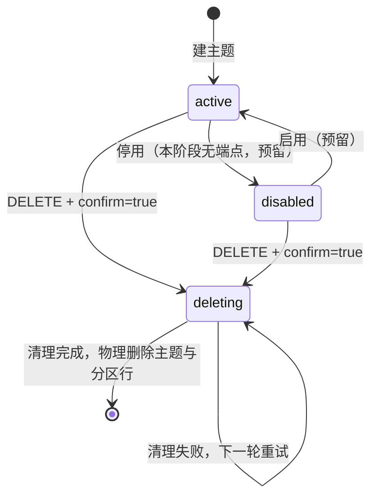
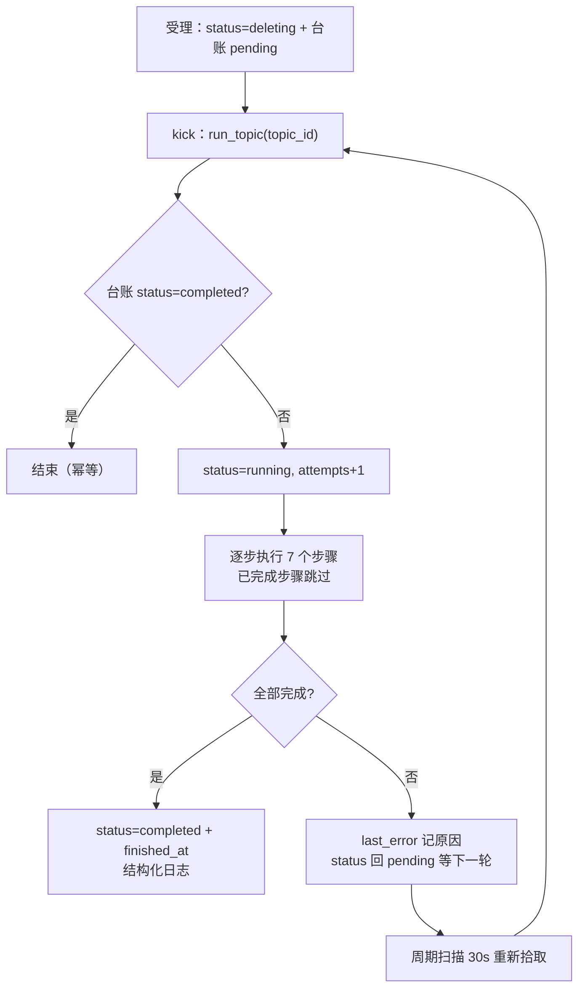

# 06-2-1 写操作后端与资源清理 · 详细设计

> 08B · 06 管理与运维 · 06-2 管理模块写操作 · 子任务 01（需求 06-2）

[文档首页](../../../../../../../文档首页.md) › [消息平台规划](../../../../../../../规划/01_规划_消息平台.md) › [阶段计划](../../../../../计划/01_计划_消息平台.md) › [06 管理与运维](../../../06_管理与运维.md) › [06-2 管理模块写操作](../../06_管理与运维_02_管理模块写操作.md) › [06-2-1 写操作后端与资源清理](../06_管理与运维_02_管理模块写操作_01_写操作后端与资源清理.md) › 详细设计

## 0. 分章导航 

| 章 | 内容 |
| --- | --- |
| 1 | 任务级边界与输入基线 |
| 2 | 交付物清单 |
| 3 | 现状核对结论 |
| 4 | 数据模型与状态机 |
| 5 | 端口扩展与装配 |
| 6 | 接口契约与失败分支 |
| 7 | 删主题清理编排与幂等 |
| 8 | 审计与留痕 |
| 9 | 测试设计与验收映射 |
| 10 | 登记落点与文档同步 |
| 11 | 边界与开放项 |
| 12 | 对齐记录 |

## 1. 任务级边界与输入基线 

**做什么**：补齐管理面写操作后端——删主题（`deleting` 状态机 + 异步幂等清理 + 台账 + 影响预检）、扩分区端点、改保留期端点、位点重置端点；扩 `msg_topic` 状态机与新增清理台账表；给重放创建补显式确认参数；全部写操作挂 `msg:manage` 并留痕。

**不做什么**：

- 不做前端页面与二次确认弹窗（06-2-2）；
- 不做死信处置端点（06-5）、重放任务控制（06-6）、主题授权（05-3 已交付 / 06-7 界面）；
- 不实现真实副本清理与跨实例清理租约（02-4 / 02-5 / 8B_05）；
- 不改数据面帧入口语义、不改 `OffsetStore` / `OffsetResetter` 既有签名；
- 不为「删主题」引入新的 `record_ref` 类型（沿用作用域三级 + 台账）。

**输入基线**：

| 输入 | 事实 |
| --- | --- |
| 既有写操作 | `POST /admin/topics`（建主题，`msg:manage`，强审计 `msg:topic.create`）已交付；管理面共 13 条只读端点 |
| 既有服务方法 | `TopicService.expand_partitions()`（只增不减判据齐全，无端点）；`OffsetResetter.reset()` / `OffsetPurger.purge_topic()` 已就位（`OFFSET_RESET_PATH` 已登记） |
| 清理端口 | `DeliveryState.drop_topic()`、`DeliveryWaiter.forget_topic()`、`RetentionThrottle.forget()`、`PartitionDirectory.forget()`、`TopicCache.invalidate()`、`DeadLetterQueue.purge_topics()` 均已有 |
| 清理缺口 | `MessageStore` 无「按主题删段」、`GroupStore` 无「按主题清理」、`PartitionRepository` 无删除方法 |
| 数据面阻断 | `broker/router.py` 取主题快照要求 `status == active`，`deleting` 天然停读写；生效前提是提交后失效 `TopicCache` |
| 主题表口径 | `msg_topic` 业务不软删（`deleted_at` 恒 NULL），唯一键 `(tenant_id, namespace, name)` 不含 `deleted_at` |
| 后台任务形态 | `MetricsSampler` / `ReplayRunner` 均为「`ensure_started()` + `stop()` + `run_once()`」，由 `start_background_tasks()` 启动、`BackgroundLoops` 回收 |
| 错误码段位 | `35` 段已用到 `350027`，`deploy/registry/msg.toml` 的 `[[errcodes]]` 与 `MsgErrorCode` 逐条对账（`test_error_codes.py`） |
| 用例编号 | Kiwi 于实施前登记取得（本任务一条，编号以平台自增主键为准） |

## 2. 交付物清单 

| 类别 | 交付物 | 说明 |
| --- | --- | --- |
| 表文件 | `msg文档/设计/数据库设计/数据表设计/msg_topic_cleanup.md` 新增；`msg_topic.md` 追加变更记录 | 先改表文件再改模型（《AI开发规范》§3.2） |
| 模型 | `models/topic.py`（`STATUS_DELETING`）、`models/topic_cleanup.py`（新） | 清理台账 |
| 仓储 | `repositories/topic.py`（列表 / 计数排除 `deleting`、`delete_by_topic`、物理删除）、`repositories/topic_cleanup.py`（新） | 台账读写 |
| 服务 | `services/topic.py`（状态守卫、`update_retention`、删除受理）、`services/topic_cleanup.py`（新，清理编排 + 周期扫描） | 业务口径 |
| 端口 | `broker/log.py`（`MessageStore.drop_topic`）、`broker/group.py`（`GroupStore.purge_topic`）及三处实现 | 清理能力 |
| 端点 | `api/admin/topics.py`（`DELETE` / `PATCH` / `POST partitions` / `GET delete-impact`）、`api/admin/offsets.py`（新，`POST /admin/offsets/reset`） | 写操作入口 |
| 契约 | `schemas/topic.py`（4 个新 schema + `TopicDetail.cleanup`）、`schemas/offset.py`（新）、`schemas/replay.py`（`confirm`） | 只增不改 |
| 错误码 | `errors.py` 增 `350028` + `MsgTopicStateInvalidError`；`deploy/registry/msg.toml` 增一条 | 逐条对账 |
| 审计 | `audit/trail.py` 增 `msg:topic.delete` / `msg:topic.update` / `msg:topic.expand` | 动作单一映射 |
| 装配 | `main.py`（`configure_service` 注入 `topic_cleanup_service`）、`broker/lifecycle.py`（启动与回收） | 后台循环 |
| 契约产物 | `deploy/contracts/msg.json` 重导、`frontend/packages/api-types` 再生成 | 零漂移门禁 |
| 用例 | `tests/api/test_admin_write_ops.py`、`tests/services/test_topic_cleanup.py`、`tests/services/test_topic_write.py` | Kiwi 标注 |
| 文档 | 本设计 + 实施记录 + 测试记录；任务 / 需求 / 计划 / 数据库总览回写 | §10 |

## 3. 现状核对结论 

| # | 事实 | 与本任务的关系 | 处置 |
| --- | --- | --- | --- |
| 1 | `MessageStore` 只有 `truncate_before`（保留最后一段），无「整主题删除」 | 删主题必须删干净段目录，且 Windows 下要先关句柄 | 新增抽象方法 `drop_topic(*, topic_id)`：关句柄 → 删目录 → 清 `log_id` LRU；`InMemory` 删桶、`Notifying` 委托 |
| 2 | `GroupStore` 只有 `purge_tenant` | 删主题要清该主题的所有组 | 新增抽象方法 `purge_topic(*, topic_id)`；`InMemoryGroupStore` 实现 |
| 3 | `PartitionRepository` 无删除 | 分区行要随主题一起删 | 新增 `delete_by_topic(topic_id) -> int`（硬删，不经软删白名单） |
| 4 | 主题仓储 `soft_delete_enabled = False` | 物理删除须走 `session.delete` 而非仓储 `update` | `TopicRepository.delete(topic_id)` 用基类 `delete` 的硬删路径；`deleted_at` 不参与 |
| 5 | 列表与计数不区分状态 | `deleting` 主题若仍出现在列表 / 配额计数里，用户会看到「删了还在」「删了建不了新的」 | 仓储 `_filters` 统一排除 `deleting`；`count_topics` 同口径 |
| 6 | 数据面读主题要求 `status == active` | `deleting` 天然停读写 | 无需改数据面；提交事务后 `TopicCache.invalidate` 让阻断即时生效（用例断言） |
| 7 | `ReplayRequest` 无 `confirm` | 任务书要求批量重放二次确认后端生效 | 增可选 `confirm`，缺省 false 即 `10001` 拒绝 + 结构化日志 |
| 8 | `TopicDetail` 无清理进度 | 任务书要求「详情可查清理进度」 | `TopicDetail` 增可选 `cleanup`（只增不改，非 deleting 时为 null） |
| 9 | `msg_topic.status` 注释与表文件只写 `active / disabled` | 扩 `deleting` 属表结构语义变更 | 先改表文件（含变更记录 v3）→ 再改模型与校验 |
| 10 | 位点重置 `OffsetResetter.reset()` 已做「负值 `10001`、超 LEO `350002`」 | 本任务只补端点与「早于 `start_offset` 报 `350003`」的判定 | 端点先解析主题与分区，再判起点，最后调端口 |

## 4. 数据模型与状态机 

### 4.1 `msg_topic.status` 扩值

新增 `STATUS_DELETING = "deleting"`：**已受理删除、正在清理**。语义与写权限：

| 状态 | 读（管理面详情） | 读（数据面 fetch） | 写（发布 / 扩分区 / 改保留期 / 重放） | 列表展示 |
| --- | --- | --- | --- | --- |
| `active` | 允许 | 允许 | 允许 | 展示 |
| `disabled` | 允许 | 拒绝（`350001`） | 拒绝（`350028`） | 展示 |
| `deleting` | 允许（含清理进度） | 拒绝（`350001`） | 拒绝（`350028`）；重复删除幂等受理 | 不展示 |

### 4.2 新表 `msg_topic_cleanup`（平台库）

台账行**不随主题删除**：主题与分区行物理删除后，本行保留（`status=completed`），用于「谁在什么时候删了什么、清了多少」的追溯。

| 字段 | 类型 | 可空 | 约束 / 默认 | 说明 |
| --- | --- | --- | --- | --- |
| `id` | DECIMAL(38,0) | 否 | 主键，雪花 | 台账 ID |
| `tenant_id` | DECIMAL(38,0) | 否 | 与 `topic_id` 联合索引 | 租户内部身份 |
| `topic_id` | DECIMAL(38,0) | 否 | **唯一** | 主题主键（一主题一行；重复删除复用同行） |
| `namespace` | VARCHAR(64) | 否 | — | 命名空间快照 |
| `topic` | VARCHAR(200) | 否 | — | 主题名快照（主题行删除后仍可追溯） |
| `status` | VARCHAR(16) | 否 | 默认 `pending` | `pending` / `running` / `completed` |
| `done_steps` | JSON | 否 | 默认 `[]` | 已完成步骤键（幂等跳过依据） |
| `attempts` | INT | 否 | 默认 0 | 已执行轮次（失败累加） |
| `last_error` | VARCHAR(512) | 是 | — | 最后一轮失败原因（截断 512） |
| `started_at` | DATETIME | 是 | — | 首轮开始时刻（UTC） |
| `finished_at` | DATETIME | 是 | — | 完成时刻（UTC） |

索引：`uq_msg_topic_cleanup_topic`（唯一 `topic_id`）、`idx_msg_topic_cleanup_status`（`status`）。

**为什么用表而不是进程内登记**：清理跨请求、跨重启、跨实例；只有落库才能做到「重启续跑 + 进度可查 + 多实例不重复执行（同 `topic_id` 唯一 + 步骤幂等）」。

## 5. 端口扩展与装配 

### 5.1 端口新增

| 端口 | 新方法 | 语义 | 幂等性 |
| --- | --- | --- | --- |
| `MessageStore` | `drop_topic(*, topic_id) -> int` | 关闭该主题全部分区句柄 → 删除其段目录与索引 → 清 `log_id` LRU，返回删除的分区数 | 幂等（目录不存在视为 0） |
| `GroupStore` | `purge_topic(*, topic_id) -> int` | 删除该主题的全部组记录，返回删除组数 | 幂等（无组返回 0） |
| `PartitionRepository` | `delete_by_topic(topic_id) -> int` | 硬删该主题的分区行 | 幂等（无行返回 0） |
| `TopicRepository` | `delete(topic_id) -> bool` | 物理删除主题行（不走软删） | 幂等（不存在返回 false） |

`MessageStore` 与 `GroupStore` 是抽象基类，新增抽象方法会要求全部实现同步（`InMemoryMessageStore` / `FileMessageStore` / `NotifyingMessageStore`；`InMemoryGroupStore`），用例替身若继承内存实现则自动继承，不需逐个改。

### 5.2 装配

`TopicCleanupService` 与既有后台服务同构：

| 环节 | 落点 | 说明 |
| --- | --- | --- |
| 构造 | `main.py::configure_service` | 注入 `uow_factory`、`message_store`、`offset_purger`、`group_store`、`dead_letters`、`delay_store`、`delay_scheduler`、`delivery_state`、`waiter`、`retention_throttle`、`partition_directory`、`topic_cache`、`watermark`、`audit_sink` |
| 启动 | `broker/lifecycle.py::start_background_tasks` | `ensure_started()`；同时挂到 `BackgroundLoops` 的 `stop()` 链 |
| 请求内触发 | `DELETE` 端点提交事务后 | `service.kick(topic_id)`：`asyncio.create_task(run_topic(topic_id))`，不等待完成 |
| 周期兜底 | 服务自身 `_loop()` | 周期 30s 扫 `status in (pending, running)` 的台账行 |

**为什么「请求内 kick + 周期扫描」两者都要**：只有 kick 时进程退出会留半步（重启后无人续跑）；只有扫描时用户点完删除要干等一个周期。两者并存后收敛为「受理即执行、失败自愈、重启续跑」。

## 6. 接口契约与失败分支 

### 6.1 端点表

| 方法 | 路径 | 权限 | 请求 | 响应 | 声明的错误码 |
| --- | --- | --- | --- | --- | --- |
| `GET` | `/api/v1/msg/admin/topics/{topic_id}/delete-impact` | `msg:manage` | — | `ApiResponse[DeleteImpact]` | 350001 / 350012 / 350011 |
| `DELETE` | `/api/v1/msg/admin/topics/{topic_id}?confirm=true` | `msg:manage` | 查询参数 `confirm` | `ApiResponse[TopicCleanupView]` | 350001 / **350028** / 10001 / 350012 / 350011 |
| `PATCH` | `/api/v1/msg/admin/topics/{topic_id}` | `msg:manage` | `TopicRetentionUpdate` | `ApiResponse[TopicItem]` | 350001 / **350028** / 350009 / 10001 / 350012 / 350011 |
| `POST` | `/api/v1/msg/admin/topics/{topic_id}/partitions` | `msg:manage` | `TopicPartitionExpandRequest` | `ApiResponse[TopicDetail]` | 350001 / **350028** / 350009 / 350012 / 350011 |
| `POST` | `/api/v1/msg/admin/offsets/reset` | `msg:manage` | `OffsetResetRequest` | `ApiResponse[OffsetResetResult]` | 350001 / 350003 / 350002 / 350013 / 10001 / 350012 / 350011 |
| `GET` | `/api/v1/msg/admin/topics/{topic_id}`（既有，扩展） | `msg:query` | — | `TopicDetail`（`deleting` 时含 `cleanup`） | 不变 |
| `POST` | `/api/v1/msg/admin/replay`（既有，扩展） | `msg:manage` | `ReplayRequest`（+`confirm`） | 不变 | 不变（`confirm` 缺失走 `10001`） |

### 6.2 新增 schema

| schema | 字段 | 约束 |
| --- | --- | --- |
| `DeleteImpact` | `partition_count` / `message_total` / `group_count` / `delayed_total` / `dlq_total` | 五值均非负；`message_total` = Σ(LEO − 起点) |
| `TopicRetentionUpdate` | `retention_ms?` / `retention_bytes?` | 至少一项（`model_validator` 抛 `PydanticCustomError`，转 `10001`）；范围校验在服务层（`350009`） |
| `TopicPartitionExpandRequest` | `partition_count` | `ge=1`；业务判据（≥ 现状、≤ 上限）在服务层（`350009`） |
| `CleanupProgress` | `status` / `done_steps` / `attempts` / `started_at` / `finished_at` / `last_error` | 只读投影 |
| `TopicCleanupView` | `topic_id` / `namespace` / `topic` / `status` / `cleanup` | 受理结果 |
| `OffsetResetRequest` | `namespace` / `topic` / `group` / `partition` / `offset` / `confirm` | `offset ≥ 0`；`confirm` 必填且为 true |
| `OffsetResetResult` | `namespace` / `topic` / `group` / `partition` / `previous_offset` / `offset` | `previous_offset` 为重置前值（无位点时为 0） |

`TopicDetail` 仅追加可选字段 `cleanup: CleanupProgress | None = None`（`active` / `disabled` 时 null）。

### 6.3 失败分支

| 场景 | 行为 | 码 |
| --- | --- | --- |
| `confirm` 缺失 / 非 true（删主题、位点重置、重放） | 拒绝并写结构化日志 `msg_write_confirm_missing`，不做任何状态变更 | `10001` |
| 主题不存在或不属于当前租户 | 拒绝 | `350001` |
| 主题 `disabled` / `deleting` 且执行扩分区 / 改保留期 | 拒绝 | `350028` |
| 重复删同一主题 | **幂等受理**：返回 200 + 已有台账（不重复创建、不重复触发首轮） | 200 |
| 目标分区数 < 现状 | 拒绝（既有服务判据） | `350009` |
| 目标分区数 > 上限 | 拒绝 | `350009` |
| 保留期 / 容量越界 | 拒绝 | `350009` |
| PATCH 未给任何字段 | 拒绝 | `10001` |
| 位点 `offset` 早于分区起点 | 拒绝（提示已被保留期清理） | `350003` |
| 位点 `offset` 大于 LEO / 为负 | 拒绝（端口内既有判据） | `350002` / `10001` |
| 组不存在 | 拒绝（先判组，再判位点） | `350013` |
| 影响预检时某维度取数失败 | 该项返回 0 并写 warning 日志（不阻断预检）；删主题受理不受影响 | 200 |

**判定顺序**（删主题）：`confirm` → 租户 → 主题存在 → 状态（`deleting` 走幂等分支，`active` / `disabled` 正常受理）→ 落 `deleting` + 台账 → 提交 → 失效缓存 → 强审计 → 返回受理 → 后台 kick。
**判定顺序**（位点重置）：`confirm` → 租户 → 命名空间 / 主题（`350001` / `350010`）→ 组存在（`350013`）→ 分区号（`350009`）→ 起点（`350003`）→ 端口（`350002`）→ 审计（`record_ref=msg.offset`）。

## 7. 删主题清理编排与幂等 

### 7.1 步骤表

| 序 | 步骤键 | 动作 | 幂等依据 | 失败后果 |
| --- | --- | --- | --- | --- |
| 1 | `messages` | `MessageStore.drop_topic()` | 目录不存在返回 0 | 段残留；下轮重试 |
| 2 | `delay` | `DelayStore.list_for_tenant()` 过滤本主题 → `remove(log_id)` + `DelayScheduler.forget(log_id)` | 记录已删即 0 | 延迟记录残留；下轮重试 |
| 3 | `offsets` | `OffsetPurger.purge_topic()` | 无文件返回 0 | 位点残留；下轮重试 |
| 4 | `groups` | `GroupStore.purge_topic()` | 无组返回 0 | 组残留；下轮重试 |
| 5 | `dlq` | `DeadLetterQueue.purge_topics([topic_id])` | 端口自带幂等 | 死信残留；下轮重试 |
| 6 | `runtime` | `DeliveryState.drop_topic()`、`RetentionThrottle.forget()`（逐分区）、`DeliveryWaiter.forget_topic()`、`PartitionDirectory.forget()` | 各自幂等 | 内存态残留；下轮重试 |
| 7 | `metadata` | `PartitionRepository.delete_by_topic()` → `TopicRepository.delete()` → `TopicCache.invalidate()` → `StorageWatermark.force_refresh()` | 行不存在即 0 | 主题仍 `deleting`；下轮重试 |

**顺序不可交换**：先断存储（步骤 1）再删元数据（步骤 7），否则主题行先消失会导致数据面按 `350001` 拒绝、但段目录成孤儿无人认领；`offsets` 早于 `groups`，保证「组还在但位点已空」不会产生「组复活」语义。

### 7.2 每步完成后立即落库

每完成一步就把该键追加进 `done_steps` 并提交，而不是等 7 步全完再写一次——否则「第 6 步失败 → 重试重跑 1~5 步」在文件存储上会重复删目录（幂等但白耗 IO），且失败点无法从台账看出。

### 7.3 连续失败告警

`attempts ≥ 3` 且仍未完成时，每轮输出 `msg_topic_cleanup_failed`（`level=warning`，带 `attempts` / `last_error` / `topic_id`）。不设终态：磁盘满、句柄占用等可自愈故障恢复后应自动收口；不可自愈的情形由告警暴露，人工介入后再由下一轮收口。

## 8. 审计与留痕 

| 操作 | 动作 | 类别 | 强度 | 参数（`params`） | 作用域 |
| --- | --- | --- | --- | --- | --- |
| 删主题（受理） | `msg:topic.delete` | 敏感（配置变更） | **强审计**（失败即请求失败，事务回滚、主题未置 `deleting`） | `topic_id` / `topic` / `partition_count` / `message_total` / `group_count` / `delayed_total` / `dlq_total` | `module_key=namespace`、`resource_key=topic` |
| 扩分区 | `msg:topic.expand` | 敏感 | 强审计 | `topic_id` / `topic` / `from_partitions` / `to_partitions` | 同上 |
| 改保留期 | `msg:topic.update` | 敏感 | 强审计 | `topic_id` / `topic` / `retention_ms` / `retention_bytes`（旧值与新值） | 同上 |
| 位点重置 | `msg:offset.reset`（既有） | 记录级 | 强审计 + `record_ref` | 端口内既有口径（`group` / `topic_id` / `partition` / `offset`） | — |
| 配额调整 | `msg:quota.update`（既有，05-2） | 敏感 | 强审计 | 不变 | — |
| 清理完成 | 不进审计 | — | — | 结构化日志 `msg_topic_cleanup_completed`（含各步骤删除计数） | 台账为唯一执行台账 |

**为什么清理完成不再写第二条审计**：删主题的「谁在什么时候要删、影响多大」已由请求侧强审计固定；执行结果随时间变化且可能重试多次，写进审计会产出同动作多条记录，反而破坏「动作 ↔ 留痕」的单一映射（05-4 口径）。执行结果由台账（可查）+ 结构化日志（可检索）承担。

## 9. 测试设计与验收映射 

| # | 用例文件 | 关键断言 | 验收映射 |
| --- | --- | --- | --- |
| 1 | `tests/api/test_admin_write_ops.py` | 四个写端点的权限（无 `msg:manage` 走 `30001`）、`confirm` 缺失走 `10001`、成功路径响应结构、错误码声明与 `x-error-codes` 一致 | 完成标准 1、5、6 |
| 2 | `tests/api/test_admin_write_ops.py` | 删主题：受理返回 `deleting` + 台账；详情含 `cleanup`；列表不再出现；`deleting` 下扩分区 / 改保留期 `350028`；重复删除幂等 | 完成标准 1、2 |
| 3 | `tests/services/test_topic_cleanup.py` | 七个步骤全部生效（段目录消失、延迟记录清空、位点文件消失、组清空、死信清空、内存态清空、主题与分区行消失）；重复执行返回 0 且无副作用 | 完成标准 1 |
| 4 | `tests/services/test_topic_cleanup.py` | 某步骤抛错 → 台账 `last_error` + status 回 `pending` + `attempts` 累加；下一轮从失败步骤续跑（前置步骤不重跑） | 完成标准 2 |
| 5 | `tests/services/test_topic_cleanup.py` | `attempts ≥ 3` 输出告警日志；`completed` 后 `run_topic` 直接返回 | 完成标准 2 |
| 6 | `tests/services/test_topic_write.py` | 扩分区只增：等于现状幂等、小于现状 `350009`、上限外 `350009`；成功后缓存失效（数据面按新分区数路由） | 完成标准 3 |
| 7 | `tests/services/test_topic_write.py` | 改保留期：部分更新两项独立生效、越界 `350009`、`deleting` 下 `350028`、不回溯删除已保留记录 | 完成标准 4 |
| 8 | `tests/api/test_admin_write_ops.py` | 位点重置：倒退 / 前跳成功且 `record_ref` 可查；早于起点 `350003`；组不存在 `350013`；不改成员分配 | 完成标准 5 |
| 9 | `tests/api/test_admin_write_ops.py` | 重放创建缺 `confirm` 拒绝（`10001`）且不落任务行；带 `confirm` 正常建任务 | 完成标准 6 |
| 10 | `tests/api/test_admin_write_ops.py` | 影响预检五项数值口径（消息总量 = Σ(LEO − 起点)、组数、延迟待投、死信）；某维度取数失败记 warning 且返回 0 | 完成标准 1 |
| 11 | `tests/test_error_codes.py`（既有，扩断言） | 新增 `350028` 与 `[[errcodes]]` 逐条一致 | 登记一致性 |

**覆盖率**：变更模块行 + 分支 100%（`bms_msg.api.admin.topics` / `api.admin.offsets` / `services.topic` / `services.topic_cleanup` / `repositories.topic` / `repositories.topic_cleanup` / `models.topic_cleanup` / `broker.log` / `broker.group` / `audit.trail` / `schemas.topic` / `schemas.offset`）；不用 `pragma: no cover`、不设 `omit`；纯声明位移（`__all__`、常量）由可导入护栏用例覆盖。

## 10. 登记落点与文档同步 

| 落点 | 动作 |
| --- | --- |
| `设计/数据库设计/数据表设计/msg_topic_cleanup.md` | 新增表文件（字段 / 索引 / 分片 / 变更记录） |
| `设计/数据库设计/数据表设计/msg_topic.md` | 变更记录追加 v3（`status` 扩 `deleting`） |
| `设计/数据库设计/01_数据库设计_总览.md` | 「已设计数据表登记」加一行，状态「已落库」 |
| `deploy/registry/msg.toml` | `[[errcodes]]` 追加 `350028` |
| `deploy/contracts/msg.json` | `python -m ops.contract_snapshot export` 重导 |
| `frontend/packages/api-types` | `pnpm run api-types:gen` 再生成（06-2-2 直接消费） |
| [06-2-1 任务文档](../06_管理与运维_02_管理模块写操作_01_写操作后端与资源清理.md) | §5 前置契约状态回写；交付物与偏差 |
| [06-2 父任务文档](../../06_管理与运维_02_管理模块写操作.md) | 子任务状态 |
| [阶段计划](../../../../../计划/01_计划_消息平台.md) | 06-2 行的进度类字段与偏差记录（唯一落点） |
| [需求 06 域](../../../../../需求/06_需求_管理与运维.md) | 06-2 交付注块 |
| `msg文档/后端基类清单.md` | 无新增可继承类（服务为普通类，不构成基类体系） |

## 11. 边界与开放项 

| # | 开放项 | 原因 | 归口 |
| --- | --- | --- | --- |
| 1 | 清理台账多实例争锁 | 首期单实例；`topic_id` 唯一键 + 步骤幂等可容忍重复执行 | 8B_05 |
| 2 | `disabled → active` 与「停用」端点 | 本阶段无需求，状态机预留 | 后续需求 |
| 3 | 真实副本 / HW 随主题删除 | 02-4 / 02-5 未交付 | 02-4 / 02-5 |
| 4 | 删主题对活跃长连接的影响 | 连接登记为进程内态，删除只断读写不踢连接 | 8B_05 |
| 5 | 影响预检的耗时 | 逐分区求和 + 全量组 / 死信遍历，主题极大时是 O(分区数) | 平台级容量实测 |
| 6 | 清理进度只到步骤粒度 | 未细化到「已删 N 条段」 | 平台级容量实测（如需） |

## 12. 对齐记录 

| # | 事项 | 结论 | 依据 |
| --- | --- | --- | --- |
| 1 | 实施范围 | 06-2-1 + 06-2-2 同批交付 | 用户确认（2026-11-09） |
| 2 | 清理台账 | 新增 `msg_topic_cleanup` 表 | 同上 |
| 3 | 执行形态 | 请求内 kick + 30s 周期扫描兜底 | 同上 |
| 4 | 元数据终态 | 物理删除主题与分区行，台账行保留 | 同上 |
| 5 | 状态拒绝码 | 新增 `350028` | 同上 |
| 6 | 扩分区响应 | 完整 `TopicDetail` | 同上 |
| 7 | 保留期 PATCH | 部分更新，至少一项 | 同上 |
| 8 | 位点重置入参 | 命名空间 + 主题名，服务端解析 `topic_id` | 同上 |
| 13 | 影响范围 | 新增 `delete-impact` 端点 | 同上 |
| 14 | 重试策略 | 持续重试 + 连续失败告警 | 同上 |
| 15 | 审计动作 | 新增 `msg:topic.delete` / `update` / `expand` | 同上 |
| 16 | 重放 `confirm` | 本任务补可选字段，缺省 false 拒绝 | 同上 |

> 依《文档生成规范》编写（跨仓引用写纯文本路径）· 进度以阶段计划为唯一落点
