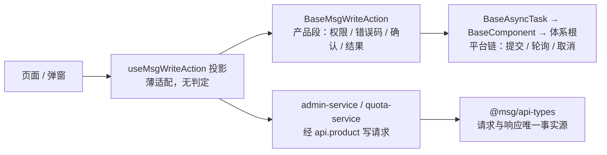

# 06-2-2 写操作页面与二次确认 · 详细设计

> 08B · 06 管理与运维 · 06-2 管理模块写操作 · 子任务 02（需求 06-2）

[文档首页](../../../../../../../文档首页.md) › [消息平台规划](../../../../../../../规划/01_规划_消息平台.md) › [阶段计划](../../../../../计划/01_计划_消息平台.md) › [06 管理与运维](../../../06_管理与运维.md) › [06-2 管理模块写操作](../../06_管理与运维_02_管理模块写操作.md) › [06-2-2 写操作页面与二次确认](../06_管理与运维_02_管理模块写操作_02_写操作页面与二次确认.md) › 详细设计

## 0. 分章导航 <a id="toc"></a>

| 章 | 内容 |
| --- | --- |
| 1 | 任务级边界与输入基线 |
| 2 | 交付物清单 |
| 3 | 现状核对结论 |
| 4 | 产品基类、投影与继承链 |
| 5 | 写操作清单与页面接线 |
| 6 | 二次确认与影响范围 |
| 7 | 路由、权限与配额管理页 |
| 8 | 取数层与错误码文案 |
| 9 | 国际化键表 |
| 10 | 失败分支与交互细则 |
| 11 | 测试设计与验收映射 |
| 12 | 原型补页与逐页对照计划 |
| 13 | 登记落点 |
| 14 | 边界与开放项 |
| 15 | 对齐记录 |

## 1. 任务级边界与输入基线 <a id="scope"></a>

**做什么**：在 06-1-2 已交付的管理模块骨架上补写操作——新建主题、删主题（影响范围确认 + `deleting` 与清理进度展示）、扩分区、改保留期、位点重置（二次确认）、配额调整（新增 `/msg/quotas` 管理页）；新增产品段写操作基类与投影、共享二次确认组件；补 04 / 05 两页原型的写操作场景并逐页截图对照。

**不做什么**：

- 不改后端端点、契约与错误码（06-2-1 交付面）；
- 不做死信处置（06-5）、重放任务控制（06-6）、主题授权（06-7）、租户用量（06-8）页面；
- 不在前端伪造成败、不补齐 `confirm` 默认值、不自行拼装租户参数；
- 不展示消息正文、不自绘趋势图；
- 不改 bms 宿主源码与平台基类。

**输入基线**：

| 输入 | 事实 |
| --- | --- |
| 后端端点（06-2-1） | `GET /admin/topics/{id}/delete-impact`、`DELETE /admin/topics/{id}?confirm=true`、`PATCH /admin/topics/{id}`、`POST /admin/topics/{id}/partitions`、`POST /admin/offsets/reset`、`GET|PUT /admin/quotas`（05-2）、`GET /admin/topics/{id}`（含 `cleanup`） |
| 既有前端 | 九条路由（七菜单 + 两深链）、`BaseMsgReadOnlyView → BaseTable` + `useMsgReadOnlyView()`、`ReadOnlyList.vue`、`admin-service.ts`、中英 i18n 两包 |
| 请求能力 | `ModuleApiScope` 具备 `post` / `patch` / `del`，写请求自动带幂等键；不新增 HTTP 客户端 |
| 宿主权限 | `applyHostContext()` 已缓存权限码集合；写操作需 `msg:manage`，读仍 `msg:query` |
| 平台基类 | `BaseAsyncTask`（提交 / 轮询 / 取消 / 结果 / `pollInterval`）与 `BaseComponent` 链可用于写操作横切 |
| 原型 | 04 页（列表 / 详情，写操作处标注「归 06-2」）、05 页（消费组详情，位点重置标注「归 06-2」）、02 页（含「配额管理」调整页） |
| 契约生成物 | `@msg/api-types` 已随 06-2-1 重导，写操作请求 / 响应 schema 直接引用 |
| 用例编号 | Kiwi 于实施前登记取得（本任务一条，编号以平台自增主键为准） |

## 2. 交付物清单 <a id="deliverables"></a>

| 类别 | 交付物 | 说明 |
| --- | --- | --- |
| 基类 | `src/base/BaseMsgWriteAction.ts` | 产品段写操作基类，继承 `BaseAsyncTask` |
| 投影 | `src/composables/useMsgWriteAction.ts` | 核心实例 ↔ 响应式薄适配 |
| 共享件 | `src/components/MsgConfirmDialog.vue` | 二次确认弹窗（影响范围表 + 危险提示 + 提交中禁用） |
| 页面 | `src/views/TopicsPage.vue`（新建主题）、`TopicDetailPage.vue`（扩分区 / 改保留期 / 删主题 + `deleting` 与进度）、`GroupDetailPage.vue`（位点重置）、`src/views/QuotasPage.vue`（新，配额调整） | 四页改动 |
| 取数 | `src/services/admin-service.ts`（五个写请求 + 影响预检）、`src/services/quota-service.ts`（`updateQuotas`） | 产品域通道 |
| 路由 | `src/index.ts` 增 `/msg/quotas`（第 10 条路由） | 菜单 order 65 |
| 文案 | `src/i18n/messages.ts` | 写操作、确认弹窗、新错误码、清理进度 |
| 常量 | `src/constants.ts` | `MSG_MANAGE_PERMISSION`、清理进度轮询间隔 |
| 原型 | `设计/原型设计/04_原型设计_主题管理.html`、`05_原型设计_消费组与积压.html` | 补写操作场景，保持 Vue3 + EP 真组件与 `?scene=` 深链 |
| 用例 | `tests/base-write-action.spec.ts`、`tests/use-write-action.spec.ts`、`tests/confirm-dialog.spec.ts`、`tests/write-pages.spec.ts`、`tests/quotas-page.spec.ts`、`tests/prototype-snapshots.spec.ts`（扩） | Kiwi 标注 |
| 文档 | 本设计 + 实施记录 + 测试记录 + 逐页截图；基类清单与实现契约 §7 回写 | §13 |

## 3. 现状核对结论 <a id="current"></a>

| # | 事实 | 与本任务的关系 | 处置 |
| --- | --- | --- | --- |
| 1 | `BaseMsgReadOnlyView` 只覆盖只读横切（无提交 / 确认 / 结果态） | 六个写操作需要同一套提交与错误语义 | 新增 `BaseMsgWriteAction`（继承 `BaseAsyncTask`），只读基类不动 |
| 2 | 列表页无「新建」入口，详情页无写按钮，文案写「归 06-2」 | 写操作要接上 | 三页接入按钮 + 对话框；文案键改指向真实入口 |
| 3 | `RecordsPage` 类测试断言「九路由」 | 新增 `/msg/quotas` 必然破坏既有断言 | `admin-routes.spec.ts` / `module.spec.ts` 断言改十条；既有 Kiwi 编号不改派 |
| 4 | `QuotaPanel.vue` 是 bms 租户记录页只读页签 | 配额调整需可编辑页，但不能改只读页签语义 | 新增 `QuotasPage.vue` + `/msg/quotas`；`QuotaPanel` 保持只读 |
| 5 | 原型 04 / 05 页写操作处只留提示文案 | 界面先原型：写操作无原型依据不得实现 | 先补两页原型（新增 `scene=new` / `scene=delete` / `scene=expand` / `scene=retention` / `scene=reset`），定稿后再实现 |
| 6 | `MsgConfirmDialog` 此前不存在；06-6-2 待建 | 06-2-2 任务书把确认组件前置到 06-6-2 | 本任务自建并登记为共享件，06-6-2 直接复用（已确认） |
| 7 | 详情页 `deleting` 主题仍可取到（含 `cleanup`） | 需要展示「正在清理」而非「已删除」 | 详情页对 `status === 'deleting'` 渲染进度区块并禁用全部写按钮 |
| 8 | `admin-service.ts` 的 `request()` 只做 GET 解包 | 写请求需要同一套 `code !== 0` 抛错 | 抽出 `requestWrite()`（`post` / `patch` / `del` 通用），复用 `MsgQueryError` |
| 9 | 配额六维含 `limit` / `soft_limit` 可空 | 可编辑表格需区分「不限」与「未设置」 | `limit = 0` 表示不限；`soft_limit` 空串表示按硬限派生，提交时转 `null` |
| 10 | 变更集含 `.vue` 会触发原型对照要求 | 必须有逐页对照表 + 截图 | 测试记录落「原型对照结论」节（§12） |

## 4. 产品基类、投影与继承链 <a id="base"></a>

### 4.1 继承轨归属

主体开发一律沿继承链派生、零例外（条文见 bms/bms文档/规范/前端开发规范.md §3.1 与架构铁律）。六个写操作共用「提交态 + 错误码映射 + 权限判定 + 二次确认 + 结果态」，属横切能力，收敛为**产品段写操作基类**。

```text
BaseObject → … → BaseComponent → BaseAsyncTask → BaseMsgWriteAction（本仓，产品段）
```

链按「子类 → 父类」写，登记在 `msg文档/前端基类清单.md` §2 与 `设计/基类体系/前端基类实现契约.md` §7；父类经 `[rules.frontend_base].base_source_dirs` 指向 bms 前端 core 源码面解析。

### 4.2 `BaseMsgWriteAction` 逐项语义

| 能力 | 来源 | 本类补充 |
| --- | --- | --- |
| 提交 / 状态机 / 进度 / 取消 / 退避轮询 | `BaseAsyncTask` | 不重写；`run()` 编排后调用链上 `submit()` |
| 权限码 | 产品段 | 常量 `MSG_MANAGE_PERMISSION = 'msg:manage'`；`allows(codes)` 纯集合判定（未装载即放行，与宿主守卫同口径） |
| 错误码 → 文案键 | 产品段 | 复用 `errorKeyOf()`；写操作错误码集合 `WRITE_ERROR_CODES`（含 `350028` / `350003` / `350002` / `350013` / `30001` 等） |
| 二次确认 | 产品段 | `requiresConfirm`（删主题 / 位点重置 / 重放恒 true）、`impactRows`（`label` + `value` + `tone`）、`acknowledge()` / `acknowledged` |
| 结果态 | 产品段 | `result`（链上）、`errorCode`（提交失败时捕获）、`reset()` 清空本轮状态 |
| 拒绝执行 | 产品段 | 无 `msg:manage` 时 `run()` 直接置 `blocked` 并给 `30001` 文案，不发请求 |

**不做的事**：不实现页面级表单校验、不拼装请求参数、不缓存结果到持久化存储、不复制宿主权限存储。

**错误码捕获方式**：构造时把外部 `runner` 包进链上 `executor`，在 `catch` 里先记 `errorCode` 再抛出——链上 `submit()` 的 `status='error'` 语义保持不变，页面据 `status` + `errorCode` 渲染。

### 4.3 `useMsgWriteAction()` 投影

- 薄适配：`shallowRef` 投影 `status` / `errorCode` / `errorKey` / `progress` / `result` / `blocked`；`run()` / `acknowledge()` / `reset()` / `dispose()`。
- 不含判定逻辑：权限、错误码映射、确认要求由基类决定；投影只做「调用 + 同步」。
- `dispose()` 幂等；组件卸载自动调用，并取消在途轮询（调链上 `cancel()`）。



## 5. 写操作清单与页面接线 <a id="ops"></a>

| # | 操作 | 页面 / 入口 | 端点 | 二次确认 | 权限 | 成功反馈 |
| --- | --- | --- | --- | --- | --- | --- |
| 1 | 新建主题 | 列表页页头「新建主题」 | `POST /admin/topics` | 不需要 | `msg:manage` | 关闭弹窗、刷新列表、提示已创建 |
| 2 | 删主题 | 详情页页头「删除主题」 | `DELETE /admin/topics/{id}?confirm=true` | **需要**（五项影响范围 + 不可恢复提示） | `msg:manage` | 就地转「清理中」并轮询进度，不假装已删除 |
| 3 | 扩分区 | 详情页页头「扩分区」 | `POST /admin/topics/{id}/partitions` | 不需要（前端先校验只增） | `msg:manage` | 刷新元数据与分区表 |
| 4 | 改保留期 | 详情页页头「改保留期」 | `PATCH /admin/topics/{id}` | 不需要 | `msg:manage` | 刷新元数据 |
| 5 | 位点重置 | 消费组详情页分区行「重置位点」 | `POST /admin/offsets/reset` | **需要**（组 / 主题 / 分区 / 当前 / 目标 / 影响） | `msg:manage` | 刷新分区行与成员表 |
| 6 | 配额调整 | `/msg/quotas` 页「保存调整」 | `PUT /admin/quotas` | 不需要 | `msg:manage` | 刷新六维并提示已生效 |

**表单字段与校验分工**：

| 操作 | 前端校验（先拦，减少无效请求） | 后端判据（权威） |
| --- | --- | --- |
| 新建主题 | 命名空间 / 名称非空、分区数 ≥ 1、保留期 > 0 | `350008` / `350009` / `350010` / `350025` |
| 扩分区 | 目标值 > 当前值（等于当前值时按钮禁用并说明） | `350009` |
| 改保留期 | 至少改一项；数值 > 0 | `350009` |
| 位点重置 | `offset ≥ 0` | `350003` / `350002` / `350013` |
| 配额调整 | 整数、软限 ≤ 硬限、非负 | `10001` |

**`deleting` 态页面行为**：详情页读到 `status === 'deleting'` 时——顶部渲染「正在清理」告警条 + 清理进度表（已完成步骤 / 尝试次数 / 起始时间 / 最后错误），全部写按钮不渲染；进度按 `CLEANUP_POLL_INTERVAL_MS`（3s）轮询详情端点，`status === 'completed'` 或详情返回 `350001`（主题行已物理删除）时停止轮询并提示已删除。

## 6. 二次确认与影响范围 <a id="confirm"></a>

`MsgConfirmDialog.vue` 契约：

| 项 | 类型 | 说明 |
| --- | --- | --- |
| `modelValue` | `boolean` | 显隐（双向） |
| `title` | `string` | 标题文案键已解析后的文本 |
| `rows` | `ImpactRow[]` | 影响范围行（`label` / `value` / `tone?: 'danger'`） |
| `warning` | `string` | 风险提示（如「删除后不可恢复」「已写入记录不回滚」） |
| `danger` | `boolean` | 确认按钮是否危险色 |
| `loading` | `boolean` | 提交中：确认按钮 loading、两个按钮均禁用（防重复点击） |
| `confirmText` / `cancelText` | `string` | 按钮文案 |

事件：`update:modelValue`、`confirm`、`cancel`。弹窗只渲染与收集意图，**不发请求**——请求由页面经投影发起，弹窗只吃 `loading`。

**删主题影响范围取值**：来自 `GET /admin/topics/{id}/delete-impact`，五项按固定顺序渲染（分区数 / 消息总量 / 消费组数 / 延迟待投 / 死信数）；预检失败时弹窗仍可打开，五项显示 `—` 并在提示区写明「影响估算不可用」，不阻拦用户在二次确认后继续（后端仍有租户与状态判定）。

**位点重置确认内容**：组 / 主题 / 分区 / 当前位点（`committed`）/ 目标位点 / 影响说明（「目标位点小于当前将重复消费，大于当前将跳过消息」）。

## 7. 路由、权限与配额管理页 <a id="routes"></a>

| 路径 | 菜单 | `meta.title` | 组件 | `order` |
| --- | --- | --- | --- | --- |
| `/msg/overview` | 是 | 平台概览 | `OverviewPage.vue` | 10 |
| `/msg/topics` | 是 | 主题管理 | `TopicsPage.vue` | 20 |
| `/msg/topics/:topicId` | 否 | —（`menu:false`） | `TopicDetailPage.vue` | — |
| `/msg/groups` | 是 | 消费组与积压 | `GroupsPage.vue` | 30 |
| `/msg/groups/:namespace/:topic/:group` | 否 | —（`menu:false`） | `GroupDetailPage.vue` | — |
| `/msg/partitions` | 是 | 分区 | `PartitionsPage.vue` | 40 |
| `/msg/messages` | 是 | 消息查询 | `MessagesPage.vue` | 50 |
| `/msg/delayed` | 是 | 延迟消息 | `DelayedPage.vue` | 60 |
| **`/msg/quotas`** | **是** | **配额管理** | **`QuotasPage.vue`** | **65** |
| `/msg/dlq` | 是 | 死信与重放 | `DlqPage.vue` | 70 |

- 十条路由的 `meta.perm` 仍为 `msg:query`（页面可读）；写按钮另按 `msg:manage` 渲染，不把菜单权限抬成 `msg:manage`，否则只有写权限的用户读不了页面。
- 06-7 / 06-8 的 `order` 空位（80 / 90）保持不变。
- 配额页作用域选择（租户级 / 命名空间）复用原型 02 页面 2 的形态：切换即重新取数，保存提交整批 `items`。

## 8. 取数层与错误码文案 <a id="service"></a>

新增请求函数（全部走 `api.product('msg','msg')`，参数名与契约逐字一致）：

| 函数 | 方法 / 路径 | 入参 |
| --- | --- | --- |
| `fetchDeleteImpact(topicId)` | `GET /admin/topics/{id}/delete-impact` | — |
| `deleteTopic(topicId)` | `DELETE /admin/topics/{id}` | `confirm: true`（查询参数） |
| `expandPartitions(topicId, count)` | `POST /admin/topics/{id}/partitions` | `{partition_count}` |
| `updateRetention(topicId, patch)` | `PATCH /admin/topics/{id}` | `{retention_ms?, retention_bytes?}` |
| `resetOffset(body)` | `POST /admin/offsets/reset` | `{namespace, topic, group, partition, offset, confirm: true}` |
| `updateQuotas(items)` | `PUT /admin/quotas` | `{items: [...]}` |

`confirm` 一律由页面显式传 `true`（只在高危确认弹窗回调里传），**不设默认值**——与「后端不接受前端补默认值防脚本绕过」同口径。

**错误码文案**：写操作相关键集合为 `error.350001` / `350002` / `350003` / `350008` / `350009` / `350010` / `350013` / `350025` / `350028` / `10001` / `30001` / `error.fallback`；`350028` 文案为「主题正在删除或已停用」，与 `350001`（「主题不存在或未启用」）区分。中英两包键集合必须一致（用例断言）。

## 9. 国际化键表 <a id="i18n"></a>

新增分段：`msg.admin.write.*`（通用动作与状态）、`msg.admin.confirm.*`（弹窗骨架）、`msg.admin.topics.create.*` / `expand.*` / `retention.*` / `delete.*`、`msg.admin.groups.reset.*`、`msg.admin.quotas.*`、`msg.admin.topics.cleanup.*`。至少覆盖：

- 六个动作按钮（新建主题 / 删除主题 / 扩分区 / 改保留期 / 重置位点 / 保存调整）与取消 / 确认；
- 五张表单的全部字段标签与校验提示；
- 五类影响范围行标签（分区数 / 消息总量 / 消费组数 / 延迟待投 / 死信数）；
- 清理进度的状态与步骤名（七个步骤）；
- 危险提示（不可恢复 / 可能重复消费 / 可能跳过消息）；
- 新增错误码键 `error.350028`，其余复用既有键；
- 既有键（含 `msg.quota.*` 与 `msg.admin.common.later.*`）保留不改字，其中三个 `later.*` 键在对应入口接上后从「不提供」改为真实动作名（键名不变，文案更新）。

## 10. 失败分支与交互细则 <a id="failures"></a>

| 场景 | 行为 | 文案键 |
| --- | --- | --- |
| 无 `msg:manage` | 六个写按钮与对应菜单入口不渲染（不是置灰） | `state.denied` |
| 提交中 | 按钮 loading + 弹窗按钮全禁用；重复点击不产生第二次请求 | `msg.admin.write.submitting` |
| 提交失败（业务码） | 弹窗保持打开、表单值保留、错误按码映射显示；不关闭不跳转 | `error.<码>` |
| 提交失败（无码） | 兜底文案 + 可重试 | `error.fallback` |
| 扩分区目标 ≤ 当前 | 前端禁用确认并就地说明「分区数只能增加」 | `msg.admin.topics.expand.notIncrease` |
| 保留期两项都没改 | 保存按钮禁用 | `msg.admin.topics.retention.empty` |
| 删除受理成功 | 详情页转「清理中」并开始轮询，不提示「已删除」 | `msg.admin.topics.delete.accepted` |
| 清理完成 / 主题行消失 | 停止轮询，提示「已删除」并给返回列表入口 | `msg.admin.topics.delete.completed` |
| 影响预检失败 | 弹窗五项显示 `—` + 提示不可用，不阻拦确认 | `msg.admin.topics.delete.impactUnavailable` |
| 位点重置早于起点 | 后端 `350003` → 提示「该位点之前的消息已被清理」 | `error.350003` |
| 配额软限 > 硬限 | 前端拦截并定位到该行，不发请求 | `msg.admin.quotas.softExceedsHard` |
| 宿主请求能力缺失 | 写区不渲染，只显示错误提示 | `state.error` |

## 11. 测试设计与验收映射 <a id="testing"></a>

| # | 用例文件 | 关键断言 | 验收映射 |
| --- | --- | --- | --- |
| 1 | `tests/base-write-action.spec.ts` | 继承链 `BaseMsgWriteAction → BaseAsyncTask → BaseComponent`；权限判定；错误码集合与文案键（含 `350028`）；确认要求与 `acknowledged`；`reset()` 清态；无权限不发请求 | 架构铁律、完成标准 4 |
| 2 | `tests/use-write-action.spec.ts` | 投影 `run()` 成功 / 失败 / 无权限 / 竞态；`dispose()` 幂等且取消轮询；不直接实例化基类 | 完成标准 1、5 |
| 3 | `tests/confirm-dialog.spec.ts` | 影响范围行渲染、危险色、`loading` 禁用双按钮、`confirm` / `cancel` 事件、显隐双向绑定 | 完成标准 2 |
| 4 | `tests/write-pages.spec.ts` | 新建主题表单校验与提交参数；扩分区只增拦截；改保留期至少一项；删主题影响预检 + `confirm=true` + `deleting` 进度轮询与停止条件；位点重置确认内容与 `confirm=true`；无权限不渲染；失败保留表单 | 完成标准 1~5 |
| 5 | `tests/quotas-page.spec.ts` | 六维渲染、可编辑硬限 / 软限、软限 > 硬限拦截、保存提交整批 `items`、成功后刷新、失败提示 | 完成标准 1 |
| 6 | `tests/admin-service.spec.ts`（扩） | 六个写请求路径 / 方法 / 参数名；`confirm` 未被自动补齐；`code !== 0` 抛错 | 完成标准 2 |
| 7 | `tests/admin-routes.spec.ts` / `tests/module.spec.ts`（改） | 十条路由、八菜单项、两条深链、`meta.perm` 仍为 `msg:query`、`order` 空位不变 | 回归 |
| 8 | `tests/prototype-snapshots.spec.ts`（扩） | 导出写操作态 DOM 快照（新建 / 删除确认 / 扩分区 / 改保留期 / 位点重置 / 配额页）供逐页截图 | 原型对照证据 |

**覆盖率**：变更模块行 + 分支 100%（`base/BaseMsgWriteAction.ts` / `composables/useMsgWriteAction.ts` / `components/MsgConfirmDialog.vue` / 四个页面 / 两个 service / `i18n` / `constants` / `index.ts`）；纯模板用「可挂载」护栏用例覆盖，不用 `pragma` / `omit`。

## 12. 原型补页与逐页对照计划 <a id="prototype"></a>

**原型依据**（文档根相对路径）：`设计/原型设计/04_原型设计_主题管理.html`、`设计/原型设计/05_原型设计_消费组与积压.html`、`设计/原型设计/02_原型设计_配额管理.html`，页面规划见 `设计/原型设计/01_原型设计_总览.html` 第 3 节。

**补页口径**（保持既有形态，不改成手写 HTML + CSS）：

| 页面 | 新增 `?scene=` | 内容 |
| --- | --- | --- |
| 04 主题管理 | `new` | 新建主题对话框（命名空间 / 名称 / 分区数 / 保留期 / 容量上限 + 校验提示） |
| 04 主题管理 | `detail`（扩） | 页头三个写入口（扩分区 / 改保留期 / 删除主题）；扩分区与改保留期表单对话框 |
| 04 主题管理 | `delete` | 删除确认弹窗（五项影响范围 + 不可恢复提示 + 危险确认按钮） |
| 04 主题管理 | `deleting` | 详情页「正在清理」告警条 + 清理进度表，写入口全部不渲染 |
| 05 消费组与积压 | `reset` | 位点重置弹窗（组 / 主题 / 分区 / 当前位点 / 目标位点 / 影响说明） |
| 02 配额管理 | 既有 `admin` | 已含可编辑硬限 / 软限与保存，本任务只核验与新页一致，不改结构 |

**对照与截图**：原型页由本机无头 Chrome 按 `?scene=` 深链逐态截图；实现侧由 `prototype-snapshots.spec.ts` 导出真实 DOM 后同法渲染。两组图片落 `测试/资源/01_测试记录_06-2-2/`，逐页对照表写进测试记录「原型对照结论」节（页面 / 原型依据 / 逐项对照 / 结论 / 截图路径），结论分「一致 / 已登记偏差」两档。

## 13. 登记落点 <a id="registry"></a>

| 落点 | 动作 |
| --- | --- |
| `msg文档/前端基类清单.md` §2 | 新增 `BaseMsgWriteAction`（父类 `BaseAsyncTask`，状态「已交付」） |
| `msg文档/设计/基类体系/前端基类实现契约.md` §4 / §7 | 补投影落地与链条目 |
| [06-2-2 任务文档](../06_管理与运维_02_管理模块写操作_02_写操作页面与二次确认.md) | §5 前置契约状态回写（06-6-2 改为「本任务先行交付、06-6-2 复用」） |
| [06-2 父任务文档](../../06_管理与运维_02_管理模块写操作.md) | 子任务状态 |
| [阶段计划](../../../../../计划/01_计划_消息平台.md) | 06-2 行的进度类字段与偏差记录（唯一落点） |
| [需求 06 域](../../../../../需求/06_需求_管理与运维.md) | 06-2 交付注块 |
| `设计/原型设计/01_原型设计_总览.html` | 页面规划表补「配额管理页」与两页写操作场景说明 |
| 实施记录 / 测试记录 | 各一份，测试记录含逐页对照表与截图路径 |

## 14. 边界与开放项 <a id="open"></a>

| # | 开放项 | 原因 | 归口 |
| --- | --- | --- | --- |
| 1 | 批量重放二次确认 | 重放页面归 06-6-2，本任务只交付共享组件 | 06-6-2 复用 |
| 2 | 死信处置确认 | 06-5-2 未交付 | 06-5-2 复用 |
| 3 | 主题停用 / 启用入口 | 需求未定义，后端也无端点 | 后续需求 |
| 4 | 清理进度细化到条数 | 后端只到步骤粒度 | 8B_12（如需） |
| 5 | 配额页的数据范围过滤 | 05-2 未做数据范围 | 05-2 / bms 契约 |
| 6 | 表单无草稿保存 | 一次填完即提交，量小 | — |

## 15. 对齐记录 <a id="alignment"></a>

| # | 事项 | 结论 | 依据 |
| --- | --- | --- | --- |
| 1 | 实施范围 | 与 06-2-1 同批交付 | 用户确认（2026-11-09） |
| 9 | 配额调整页 | 新增 `/msg/quotas` 管理页，复用 05-2 端点 | 同上 |
| 10 | 前端写操作落点 | 产品段基类 + 投影 + 共享确认组件 | 同上 |
| 11 | 原型补页 | 补 04 / 05 两页写操作场景，02 页核验不改 | 同上 |
| 12 | 重放 `confirm` | 后端在 06-2-1 补，前端组件本任务交付 | 同上 |
| 13 | 影响范围 | 新增预检端点，弹窗五项取真实值 | 同上 |
| 16 | 用例编号 | 前后端各一条 Kiwi | 同上 |
| 17 | 权限分层 | 页面 `msg:query`、写按钮 `msg:manage` | 需求 06-2 + 原型第 4 节设计约束 |

> 依《文档生成规范》编写（跨仓引用写纯文本路径）· 进度以阶段计划为唯一落点
