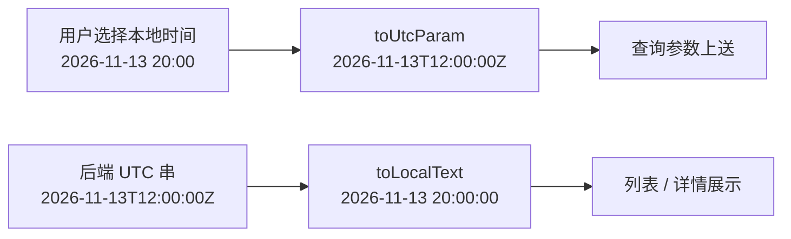
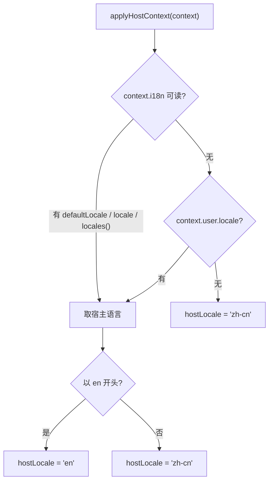

# 管理台前端缺陷收口详细设计

> 消息平台 · 06 管理与运维 · 02 管理模块写操作 · 03 管理台前端缺陷收口 · 详细设计

[文档首页](../../../../../../../文档首页.md) › 消息平台任务 › [06 管理与运维](../../../06_管理与运维.md) › [06-2 管理模块写操作](../../06_管理与运维_02_管理模块写操作.md) › [06-2-3 管理台前端缺陷收口](../06_管理与运维_02_管理模块写操作_03_管理台前端缺陷收口.md) › 详细设计

## 1. 概述 <a id="overview"></a>

- **目标**：把管理台 22 条前端缺陷一次收口——数据正确性（保留期默认值、时区口径）、轮询与请求（清值、重复请求、轮询叠加）、写操作（静默失败、无成功反馈、无变更仍提交、校验缺失）、只读展示（清理进度缺字段、筛选缺失、时间与状态未本地化）、国际化（英文包未生效），并补连接列表页。
- **口径**：**不改后端契约与判据**（除 06-1-4 已交付的连接列表端点）；前端只做「正确取值 / 正确上送 / 正确展示 / 正确反馈」。时间一律「选择本地时间 → 转 UTC 带 `Z` 上送 → 展示转本地」。停用 / 启用入口等 05-4-1 端点交付后再接线，本任务只留路由与菜单位。
- **依据**：任务 [06-2-3](../06_管理与运维_02_管理模块写操作_03_管理台前端缺陷收口.md)；06-1-4 连接列表端点；质量盘点 `tmp/msg-质量盘点-20261113.md` §3~§5；《[文档生成规范](../../../../../../../../bms文档/规范/文档生成规范.md)》。

## 2. 现状与差距 <a id="gap"></a>

### 2.1 数据正确性 <a id="gap-data"></a>

| 项 | 现状（实测） | 差距 |
| --- | --- | --- |
| 保留期默认值 | `TopicsPage.vue:28` 表单 `retentionMs: 86_400_000`（1 天）；原型 04 为 `604800000`（7 天） | 后端契约缺省 30 天；三处口径互不相同，用户不填即落 1 天 |
| 时区 | `DlqPage.vue:352` 等用 `value-format="YYYY-MM-DDTHH:mm:ss"`，本地时间按无时区串上送 | 后端按 UTC 解释，窗口整体偏 8 小时 |
| 展示时间 | `replay-format.ts:66` 只把 `T` 换空格，未转本地 | 列表与摘要显示 UTC，与选择的时间不一致 |
| 重置顺序 | `MessagesPage.vue` 重置时逐项清空再查询 | 中间态触发一次注定 422 的请求 |

### 2.2 轮询与请求 <a id="gap-poll"></a>

| 项 | 现状 | 差距 |
| --- | --- | --- |
| 概览轮询 | `useOverviewSnapshot` 每 30s 调 `view.refresh()`，基类 `beginLoad()` 先清行 | 刷新瞬间数字闪空；失败后整块变错误态，丢失上次成功值 |
| 筛选请求 | 多个页面逐项调 `view.setFilter(...)`（`TopicDetailPage.vue:147-148` 两连、`MessagesPage` 多达 9 连） | 每次 `setFilter` 都 `refresh()`，一次查询发 2~9 个请求 |
| 清理进度轮询 | `TopicDetailPage.vue` 用 `setInterval` 固定节拍 | 慢响应时请求叠加 |
| 重放详情 | `ReplayTaskDetailDrawer.vue` 切页签 / 关闭后定时器仍在 | 后台空转轮询 |

### 2.3 写操作 <a id="gap-write"></a>

| 项 | 现状 | 差距 |
| --- | --- | --- |
| 删主题预检 | `TopicDetailPage.vue:205-207` `catch { impact.value = null }` | 预检失败静默，弹窗仍显示「无影响」 |
| 弹窗内错误 | 删除 / 位点重置失败提示渲染在弹窗父级 | 被遮罩挡住，用户看不到失败原因 |
| 成功反馈 | 新建主题 / 配额保存 / 扩分区 / 改保留期 / 死信重放无成功提示 | 用户不确定是否生效 |
| 无变更提交 | 改保留期两项未变仍可保存 | 产生无意义审计与请求 |
| 校验 | 配额表单无整数 / 非负 / 软限 ≤ 硬限校验；新建主题无命名空间 / 名称 / 分区校验，命名空间自由填 | 直接 422 或建出错主题 |
| 加载态 | 「下一步」「重新加载」无 loading / disabled | 重复点击 |

### 2.4 只读展示 <a id="gap-view"></a>

| 项 | 现状 | 差距 |
| --- | --- | --- |
| 清理进度 | 只渲染 `done_steps` 两步状态 | 后端已给 `attempts` / `started_at` / `last_error`，页面未展示 |
| 延迟页 | 只有分页，无主题 / 分区 / 档位筛选 | 无法定位 |
| 保留期展示 | 直接显示毫秒数 | 不可读 |
| 状态枚举 | 部分页面直接显示英文枚举 | 未本地化 |
| 页面标题 | 部分页重复渲染标题（宿主 + 页内） | 视觉重复 |
| 消息深链 | 无 `/msg/messages/:log_id` 路由 | 死信 / 重放无法跳转定位 |
| ACL 主题候选 | 仅按主题名做候选键 | 同名主题跨命名空间会错授权 |

### 2.5 国际化与新增页 <a id="gap-i18n"></a>

| 项 | 现状 | 差距 |
| --- | --- | --- |
| 语言解析 | `message(key, locale='zh-cn')`，页面一律不传 locale | `MSG_MESSAGES_EN` 永不生效 |
| 路由标题 | `index.ts` 里菜单标题硬编码中文 | 英文 locale 下菜单仍中文 |
| 连接列表页 | 无页面 | 06-1-4 端点已交付但无入口 |

## 3. 交付物清单 <a id="deliver"></a>

| # | 交付物 | 落点 |
| --- | --- | --- |
| 1 | 时间工具（本地 ↔ UTC） | `src/services/time-format.ts`（新增） |
| 2 | 保留期默认值 | `views/TopicsPage.vue`、`设计/原型设计/04_原型设计_主题管理.html` |
| 3 | 用户语言解析 | `src/runtime.ts`、`src/i18n/messages.ts`、`src/index.ts` |
| 4 | 概览轮询保留旧值 | `composables/useOverviewSnapshot.ts`、`base/BaseMsgReadOnlyView.ts`（如需保行） |
| 5 | 批量筛选 | `views/{Topics,Partitions,Messages,Delayed,Dlq,Groups}.vue`、`views/TopicDetailPage.vue` |
| 6 | 自递归轮询 | `views/TopicDetailPage.vue`、`components/ReplayTaskDetailDrawer.vue` |
| 7 | 写操作反馈与校验 | `views/{Topics,TopicDetail,Quotas,Dlq}.vue`、`components/{QuotaPanel,MsgConfirmDialog,ReplayTaskCreateDialog}.vue` |
| 8 | 只读展示修正 | `views/{Delayed,TopicDetail,Messages,Groups,Dlq}.vue`、`components/AclTopicSelect.vue`、`services/replay-format.ts` |
| 9 | 连接列表页 | `views/ConnectionsPage.vue`（新增）、`services/admin-service.ts`、`src/index.ts` |
| 10 | 用例 | `tests/*.spec.ts`（按缺陷分组补） |

## 4. 设计 <a id="design"></a>

### 4.1 时间口径 <a id="time"></a>

统一在 `services/time-format.ts` 提供三个纯函数，页面只用它们，不再各自 `replace('T',' ')`：

| 函数 | 输入 | 输出 | 用途 |
| --- | --- | --- | --- |
| `toUtcParam(local: string \| null)` | 选择器给出的本地时间（`YYYY-MM-DDTHH:mm:ss`） | 带 `Z` 的 UTC ISO 串；空值 `null` | 查询 / 重放上送 |
| `toLocalText(utc: string \| null)` | 后端 UTC ISO 串 | `YYYY-MM-DD HH:mm:ss`（本地） | 列表 / 详情 / 摘要 |
| `durationText(ms: number)` | 毫秒 | `30 天` / `12 小时` / `45 分钟`（按最大可读单位） | 保留期展示 |



- **解析规则**：`toUtcParam` 用 `new Date(local)`（无时区串按本地解释）再 `.toISOString()`；已带 `Z` / 偏移的串原样规范化，不二次偏移。
- **展示规则**：`toLocalText` 用 `new Date(utc)` + `Intl.DateTimeFormat`（`sv-SE` 变体可得 `YYYY-MM-DD HH:mm:ss`），不手写补零。
- **偏移可验证**：单测固定 `TZ=Asia/Shanghai`，断言 `toUtcParam('2026-11-13T20:00:00') === '2026-11-13T12:00:00.000Z'`。

### 4.2 保留期默认值 <a id="retention"></a>

- `constants.ts` 新增 `DEFAULT_RETENTION_MS = 2_592_000_000`（30 天），作为前端唯一来源。
- `TopicsPage.vue` 表单初值与「重置」都取该常量；保留期输入改为「数值 + 单位（天）」组合，提交前换算成毫秒（避免用户填 30 以为是 30 毫秒）。
- 原型 `04_原型设计_主题管理.html` 的默认值同步改为 `2592000000`，并补一行「缺省 30 天，与 API 缺省一致」。
- 后端契约不动（缺省即 30 天），前端预填只是让「不填」与「填 30 天」等价。

### 4.3 用户语言解析与英文包生效 <a id="i18n"></a>



- `runtime.ts` 增 `normalizeLocale()` / `hostLocale()`，`applyHostContext` 一次解析并缓存；`i18n` 是 `unknown`，只按 `defaultLocale` / `locale` 字符串与 `locales()` 函数两种形态取，取不到再回落 `user.locale`，最后 `'zh-cn'`。
- **不以浏览器语言兜底**：产品语言由宿主注入决定（`navigator.language` 与产品语言不是一回事），同时避免模块读 `document` 根节点触发产物面隔离护栏。
- `message(key, locale?)`：`locale` 缺省改为 `hostLocale()`；显式传参仍优先（测试与纯函数可用）。
- `index.ts` 的菜单标题与卡片 / 页签 `title` 改 `message('…')`，不再硬编码中文；文案包仍在 `setup()` 内动态导入（避免进入容器入口块撑破体积预算）。
- 清理页面内残留硬编码中文与全角标点：只保留「—」等符号，其余按键取值；新增键统一放 `CATALOG` 并同时给中英。

### 4.4 概览轮询不清值 <a id="overview"></a>

- 问题根因：`useMsgReadOnlyView.refresh()` 调 `core.beginLoad()`，基类进入 `loading` 并清空 `rows`。
- 方案：`BaseMsgReadOnlyView` 增加 `beginRefresh()`（保留 `rows` / `total`，只置 `refreshing`），投影增加 `refreshQuiet()`；`useOverviewSnapshot` 的定时器与手动刷新改走 `refreshQuiet()`。
- 失败语义：失败时**不清空**上次成功值，状态置 `error` 且 `textKey` 用错误码；页面顶部提示条显示「刷新失败，展示的是上次成功数据（时间）」，页面数据区继续渲染旧值。
- 首次加载仍走 `refresh()`（骨架屏）；`firstLoad` 只在成功后置 false。

### 4.5 批量筛选与重置顺序 <a id="filters"></a>

- 所有「查询」按钮改一次 `view.setFilters({...})`，把当前表单值整体提交；`setFilter` 只保留给「单控件即时生效」场景（若有）。
- 重置改为：先把本地表单清空为默认值，再 `view.setFilters(defaults)`；**不再** `reset()` + 逐项 `setFilter()`。
- 消息查询的分页 / 排序等非筛选参数一次性并入同一个 `setFilters` 载荷。
- 断言方式：用例用 fake loader 计数，点一次「查询」只允许 1 次调用。

### 4.6 轮询改为自递归 <a id="poll"></a>

- 清理进度与重放详情都由 `setInterval` 改为「请求完成后再排下一次」：

```ts
async function tick(): Promise<void> {
  if (stopped) return
  try { await pollOnce() } finally { if (!stopped) timer = setTimeout(tick, intervalMs) }
}
```

- 终止条件：主题离开 `deleting`、重放任务进入终态、抽屉关闭 / 切页签、组件卸载、连续失败 3 次（置「进度刷新已暂停」并给手动重试）。
- 抽屉用 `watch(active)` + `onScopeDispose` 双保险，切页签即 `stop()`。

### 4.7 写操作反馈与校验 <a id="write"></a>

| 场景 | 设计 |
| --- | --- |
| 删主题预检 | `catch` 置 `impactError = true`，弹窗内显示「影响估算不可用，删除仍将继续但无法预估影响」，并提供「重新估算」按钮 |
| 弹窗内错误 | `MsgConfirmDialog` 增 `error` 插槽，删除 / 位点重置的失败文案渲染在弹窗底部 |
| 成功反馈 | 统一 `ElMessage.success(message('msg.admin.common.done'))`，按操作细分文案键（建主题 / 扩分区 / 改保留期 / 配额保存 / 死信重放） |
| 无变更 | 改保留期用 `dirty` 计算（两项与详情逐字段比较），未变更时保存按钮 `disabled` 并给「未做修改」提示 |
| 配额校验 | 整数、`>= 0`、软限 `<=` 硬限（未配置时按不限处理）；错误就地展示，不提交 |
| 新建主题 | 命名空间下拉（`msg` 与租户可用命名空间）、名称正则（小写字母 / 数字 / `.` / `-` / `_`）、分区数 1~1024、保留期 ≥ 1 天 |
| 加载态 | 「下一步」「重新加载」`loading` + `disabled`；提交中禁用取消以外的所有按钮 |

### 4.8 只读展示 <a id="view"></a>

| 项 | 设计 |
| --- | --- |
| 清理进度 | 表格上方补三行：已尝试轮次（`attempts`）、起始时间（`started_at` 本地化）、最后错误（`last_error`，无则「—」，有则红字） |
| 延迟页筛选 | 补主题（下拉，取主题列表）、分区（数字）、档位（延迟档位枚举）三个筛选项，查询走一次 `setFilters` |
| 保留期 | `durationText()` 展示，悬停 `title` 给原始毫秒 |
| 时间列 | 一律 `toLocalText()`；空值显示「—」 |
| 状态枚举 | 统一 `msg.admin.state.<枚举>` 文案键，未知枚举原样显示 |
| 重复标题 | 页面不再渲染 `<h2>`，标题交给宿主面包屑；卡片 / 页签保留自身标题 |
| 消息深链 | 新增 `/msg/messages/:logId` 路由（`menu: false`），`MessagesPage` 读 `route.params.logId` 预填 `log_id` 并自动查询；死信 / 重放列表的 `log_id` 可点 |
| 延迟比例 | 档位分布按 `count / total` 百分比展示（保留一位），时长用 `durationText()` |
| ACL 候选 | `AclTopicSelect` 的 `value` 改 `${namespace}/${topic}`，展示仍为 `topic`；授权提交时拆回两字段 |

### 4.9 连接列表页 <a id="connections"></a>

```text
路由：/msg/connections（menu: 平台连接，order 35，perm=msg:query）
取数：GET /api/v1/msg/admin/connections?page=&size=
```

| 区块 | 内容 |
| --- | --- |
| 筛选 | 无（端点只按当前租户）；页头注明「单实例视图，跨实例聚合待 02-8-4」 |
| 表格列 | 连接 ID（短哈希）、脱敏地址、HTTP 版本、协议、开启时间、最后请求、最后心跳、长驻流、请求数、状态 |
| 状态渲染 | `active` 绿 / `idle` 灰 / `draining` 橙 / `stale` 红，用文案键而非英文枚举 |
| 四态 | 加载骨架 / 空页「当前无连接」/ 错误（含 350027 提示）/ 无权限（`msg:query` 缺失） |
| 分页 | `page` / `size`，`total` 取响应值；刷新按钮有 loading |
| 自动刷新 | 不轮询（连接变化快，轮询价值低）；页面提供「重新加载」 |

`services/admin-service.ts` 增 `fetchConnections(params)`，类型从 `@msg/api-types` 取（06-1-4 已重导契约）。

### 4.10 停用 / 启用入口预留 <a id="disable"></a>

- 05-4-1 交付 `POST /msg/admin/topics/{id}/disable` / `enable` 后，在主题详情页操作区加两个按钮（`msg:manage`、二次确认、成功反馈）。
- **本任务不写死代码**：只在 `constants.ts` 留路由 / 菜单位说明与 `文案键`，实施记录登记「待 05-4-1 端点交付后接线」。

## 5. 失败分支 <a id="fail"></a>

| 场景 | 语义 |
| --- | --- |
| 时间串非法 | 前端就地提示「时间格式不正确」，不发请求 |
| 概览刷新失败 | 保留上次成功值 + 顶部提示，不清空 |
| 筛选请求失败 | 保留上次结果，提示错误码；不自动重试 |
| 清理进度连续失败 3 次 | 停止轮询，显示「进度刷新已暂停」+ 手动重试 |
| 预检失败 | 弹窗内提示「影响估算不可用」，允许继续（仍需 `confirm`） |
| 无权限 | 写按钮不渲染；连接页显示无权限态，不发请求 |
| 连接列表为空 | 空页，不报错 |
| 英文包缺键 | `message()` 原样返回键名（与现状一致），不抛错 |

## 6. 测试设计 <a id="test"></a>

| # | 用例 | 断言 |
| --- | --- | --- |
| 1 | 保留期默认 30 天 | 打开新建弹窗，`retention` 为 2592000000；不修改直接提交，请求体为 30 天 |
| 2 | 时间转 UTC | 选 `2026-11-13 20:00`，请求参数为 `2026-11-13T12:00:00.000Z` |
| 3 | 时间展示本地化 | 后端 `...T12:00:00Z` 渲染为 `2026-11-13 20:00:00` |
| 4 | 概览轮询不清值 | 第二次刷新返回前，旧数字仍在；刷新失败仍保留旧值且有提示 |
| 5 | 一次查询一个请求 | 设 5 个筛选项后点查询，loader 只被调用 1 次 |
| 6 | 重置无中间态 | 点重置，只发 1 次请求且参数为默认值 |
| 7 | 清理进度字段 | `attempts` / `started_at` / `last_error` 均渲染 |
| 8 | 预检失败提示 | 预检抛错时弹窗出现「影响估算不可用」 |
| 9 | 弹窗内错误可见 | 删除失败文案在弹窗 DOM 内，不是父级 |
| 10 | 无变更禁用保存 | 保留期两项未改，保存按钮 `disabled` |
| 11 | 配额校验 | 负数 / 小数 / 软限 > 硬限均就地报错且不提交 |
| 12 | 新建主题校验 | 空命名空间 / 非法名称 / 分区越界均拦截 |
| 13 | 重放抽屉停轮询 | 切页签后不再发请求，关闭后定时器清空 |
| 14 | ACL 复合键 | 同名主题不同命名空间，候选 key 不同且提交字段正确 |
| 15 | 英文包生效 | `hostLocale='en'` 时菜单与页面文案为英文 |
| 16 | 连接列表四态 | 加载 / 空 / 错误 / 无权限；地址脱敏、分页正确 |
| 17 | 消息深链 | 访问 `/msg/messages/<log_id>` 自动带 `log_id` 查询 |
| 18 | 延迟页筛选 | 三个筛选一次提交，参数齐全 |

覆盖口径见《AI开发规范》「覆盖率要求」节；用例先登记 Kiwi 再编码。

## 7. 实施步骤 <a id="steps"></a>

1. 新增 `time-format.ts` 与 `DEFAULT_RETENTION_MS`，改 `TopicsPage` 与原型 04。
2. 改 `runtime.ts` / `messages.ts` / `index.ts` 的语言解析与文案键，清硬编码。
3. 改 `BaseMsgReadOnlyView` + `useMsgReadOnlyView` 增 `refreshQuiet`，改 `useOverviewSnapshot`。
4. 逐页把「查询 / 重置」改为 `setFilters`（含 `TopicDetailPage` 两连、`MessagesPage` 多连）。
5. 清理进度与重放抽屉改自递归轮询。
6. 写操作页补预检提示、弹窗内错误、成功反馈、无变更禁用、校验与加载态。
7. 只读展示修正（清理进度、延迟筛选、保留期、时间、状态、重复标题、深链、比例、ACL 复合键）。
8. 新增连接列表页与路由、服务函数、文案键。
9. 补用例；跑 `msg:lint` / `msg:typecheck` / `msg:test` / `msg:build` / `msg:budget` / `msg:guard` / `api-types:check`。
10. 写实施 / 测试记录，回写计划与 `06-2` 父任务。

## 8. 边界与开放项 <a id="open"></a>

| # | 项 | 归口 |
| --- | --- | --- |
| 1 | 主题停用 / 启用按钮接线 | 05-4-1（端点交付后） |
| 2 | 连接列表跨实例聚合 | 02-8-4 |
| 3 | `total` 为过滤前导致页内条数变少的解释文案 | 本任务补提示，语义不改 |
| 4 | 命名空间下拉数据源（当前只有 `msg`） | 复用主题列表聚合；多命名空间后再接目录 |
| 5 | 时区展示依赖浏览器本地时区 | 不做「按租户时区展示」；如需另立需求 |
| 6 | 英文包文案质量（非直译） | 后续可由产品统一校对，不影响生效 |
