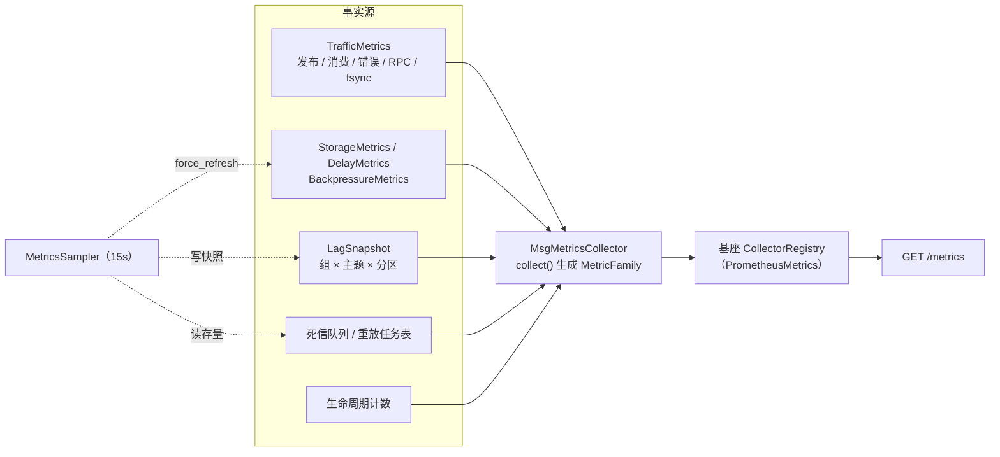
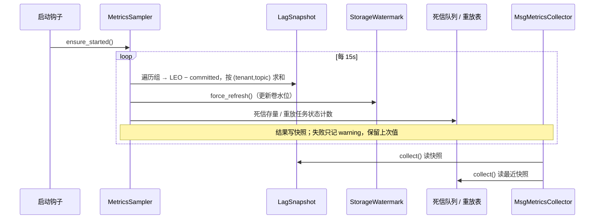
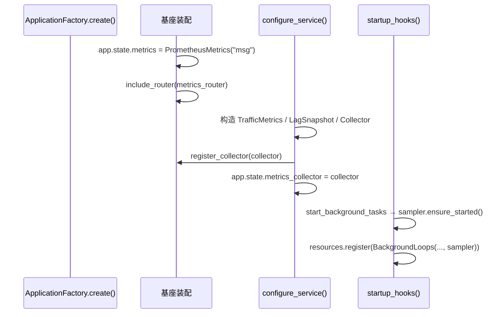

# 06-3-1 指标采集与 Prometheus 出口 · 详细设计

> 08B · 06 管理与运维 · 06-3 指标与告警 · 子任务 01（需求 06-3）

[文档首页](../../../../../../../文档首页.md) › [消息平台规划](../../../../../../../规划/01_规划_消息平台.md) › [阶段计划](../../../../../计划/01_计划_消息平台.md) › [06 管理与运维](../../../06_管理与运维.md) › [06-3 指标与告警](../../06_管理与运维_03_指标与告警.md) › 06-3-1 · 详细设计

## 0. 分章导航 <a id="toc"></a>

| 章 | 内容 |
| --- | --- |
| 1 | 任务级边界与输入基线 |
| 2 | 交付物清单 |
| 3 | 现状核对结论与事实偏差 |
| 4 | 指标面总览（名称 / 类型 / 标签 / 数据源） |
| 5 | 采集架构（自定义 Collector + 采集器 + 采样器） |
| 6 | 基座扩展（跨仓 bms） |
| 7 | 埋点与数据来源 |
| 8 | 标签与基数治理 |
| 9 | 失败与降级 |
| 10 | 配置与装配 |
| 11 | 接口与契约影响 |
| 12 | 测试设计与验收映射 |
| 13 | 登记落点与文档同步 |
| 14 | 边界与开放项 |
| 15 | 对齐记录 |

## 1. 任务级边界与输入基线 <a id="scope"></a>

**做什么**：把 msg 既有采集器快照与新增的流量 / 错误 / RPC 采集点，统一经基座指标能力域暴露为 Prometheus 文本，落在根路径 `/metrics`。

**不做什么**：

- 不自建 HTTP 端点、不使用第二套 `prometheus_client` 注册表（基座 `/metrics` 已挂载）；
- 不在 `/metrics` 请求内做全量扫描（积压 / 死信 / 重放存量由后台采样器写入）；
- 不做链路追踪（06-4）、不做死信处置（06-5）、不做重放能力本身（01-6）；
- 不改任何业务端点的请求 / 响应契约；
- 不把 `/metrics` 纳入公开契约快照、不挂网关。

**输入基线**：

| 输入 | 事实 |
| --- | --- |
| 基座 | `bms_core.metrics.BaseMetrics`（契约）+ `PrometheusMetrics`（provider `prometheus`）+ 根路径 `/metrics`（应用工厂自动挂载，`include_in_schema=False`，豁免统一响应 / 租户 / 鉴权 / 访问日志） |
| msg 装配 | `ApplicationFactory.configure_service()` 在基座装配 `app.state.metrics` 之后执行；`startup_hooks()` 在装配完成后执行 |
| 既有采集器 | `broker/watermark.py::StorageMetrics`、`broker/delay.py::DelayMetrics`、`broker/metrics.py::BackpressureMetrics`（均为同步 `snapshot()`） |
| 生命周期计数 | `tenant/runtime.py::TenantLifecycleMetrics.snapshot()`、`tenant/purge.py::TenantPurgeMetrics.snapshot()` |
| 积压事实源 | `GroupInspector.describe()`（异步、按请求）；组存储 `list_for_tenant()` + `MessageStore.leo()` + `OffsetStore.get()` |
| 死信事实源 | `InMemoryDeadLetterQueue.list_all()`（当前存量）；转入点 `DeadLetter` 生成处 |
| 配置 | `config.toml` 当前**未配** `[metrics]`，基座 `PluginSelection.provider` 缺省空串 → `/metrics` 返回 404 |

## 2. 交付物清单 <a id="deliverables"></a>

| 类别 | 交付物 | 说明 |
| --- | --- | --- |
| 基座（bms 仓） | `bms_core/metrics/base.py` 新增 `register_collector()` 默认实现 | 非抽象、默认返回 `False`，不破坏既有实现与契约版本 |
| 基座（bms 仓） | `bms_core/metrics/prometheus.py` 实现 `register_collector()` | 注册进进程内 `CollectorRegistry`；重复注册早失败 |
| 基座（bms 仓） | `bms_core/tests/metrics/test_metrics.py` 补用例 | 自定义 Collector 出现在 `render()` 文本；默认实现返回 `False` |
| msg | `bms_msg/metrics/__init__.py` | 指标域出口 |
| msg | `bms_msg/metrics/collector.py` | `MsgMetricsCollector`：快照 → `MetricFamily` |
| msg | `bms_msg/metrics/traffic.py` | `TrafficMetrics`：流量 / 延迟 / 错误 / RPC / fsync / 重放 / 死信累计 |
| msg | `bms_msg/metrics/lag.py` | `LagSnapshot`：按 `(tenant, topic)` 聚合积压 |
| msg | `bms_msg/metrics/sampler.py` | `MetricsSampler`：15s 周期采样 + 停机回收 |
| msg | `bms_msg/metrics/names.py` | 指标名 / 类型 / HELP / 标签常量（单一事实源） |
| msg | `api/data/messages.py` | publish / consume 埋点（延迟、条数、字节、错误 reason） |
| msg | `broker/delivery.py` | 延迟转投失败 / 死信转入埋点（或由调用方埋点，见 §7） |
| msg | `broker/delay.py` / `broker/scheduler.py` | 转投失败埋点 |
| msg | `broker/segment.py` / `broker/delay_segment.py` | fsync 耗时埋点 |
| msg | `api/rpc/gate.py` 或调用入口 | RPC 调用计数 / 耗时埋点 |
| msg | `bms_msg/main.py` | 注册 Collector、装配采样器、挂启动钩子与停机句柄 |
| msg | `bms_msg/core/config.py` | 采样周期常量（15s） |
| msg | `config.toml` | `[metrics] provider = "prometheus"` |
| msg | `services/msg/tests/metrics/` | 指标面 / Collector / 采样器 / 端点用例 |
| 文档 | 本设计 + 实施记录 + 测试记录 + 计划回写 | §13 |

## 3. 现状核对结论与事实偏差 <a id="current"></a>

| # | 现状 | 与本任务的关系 | 处置 |
| --- | --- | --- | --- |
| 1 | 基座 `/metrics` 已挂载，但 `[metrics].provider` 缺省为空 → 404 | 不配置就没有出口 | `config.toml` 显式配 `prometheus` |
| 2 | 基座 `BaseMetrics` 只有写入式入口，无「注册自定义 Collector」通道 | 快照式数据源无法接入 | 扩基座非抽象方法（§6） |
| 3 | 基座直方图桶固定为**秒**（0.005~10s） | 与 `_ms` 指标命名不符 | 自定义 Collector 维护毫秒桶（§5.3） |
| 4 | 三套既有采集器 `snapshot()` 的分键是拼接字符串（`tenant|topic`、`scope=x:tenant|topic`、卷路径） | 不能直接当 Prometheus 标签 | Collector 负责解析 / 归并（§5.3） |
| 5 | `msg_consumer_lag` / 死信存量 / 重放状态无采集点 | 任务书要求但现状缺失 | 后台采样器（§5.4） |
| 6 | 发布 / 消费无流量与错误计数 | 任务书要求但现状缺失 | 新增 `TrafficMetrics` 埋点（§7） |
| 7 | RPC 只有结构化日志事件 `msg_rpc` / `msg_rpc_client_cancel` | 04 域多处遗留「指标出口 → 06-3」 | 纳入本轮（已确认），`method` 取注册表固定集合 |
| 8 | 架构 06 §5.1 写 `msg_consumer_lag{group,topic,partition}` | 与需求 06-3 第 3 条冲突 | 按需求执行，回写架构（§13） |
| 9 | 02-5（副本与 ISR）未交付 | `msg_isr_shrink_total` 无事实源 | 暴露常量 0，注释「02-5 交付后接线」 |
| 10 | 02-6 `StorageWatermark.force_refresh()` 存在但未接线 | 采样周期内需要最新水位 | 采样器调用（不改变现有惰性采样语义） |

## 4. 指标面总览 <a id="surface"></a>

> 所有指标由基座 `PrometheusMetrics` 统一注入 `service="msg"` 标签；下表不再重复。

| 指标 | 类型 | 业务标签 | 数据源 | 采集方式 |
| --- | --- | --- | --- | --- |
| `msg_messages_in_total` | Counter | `tenant,topic` | `TrafficMetrics` | 发布成功时 +1（含延迟发布） |
| `msg_bytes_in_total` | Counter | `tenant,topic` | `TrafficMetrics` | 发布成功时 +payload 字节 |
| `msg_messages_out_total` | Counter | `tenant,topic` | `TrafficMetrics` | 消费返回条数（超时为 0） |
| `msg_publish_latency_ms` | Histogram | `tenant,topic` | `TrafficMetrics` | 发布处理到 `append` 成功 |
| `msg_consume_latency_ms` | Histogram | `tenant,topic` | `TrafficMetrics` | 进入 consume 到批读取完成（不含长轮询等待） |
| `msg_publish_errors_total` | Counter | `reason` | `TrafficMetrics` | 发布失败，按七类 reason |
| `msg_consume_errors_total` | Counter | `reason` | `TrafficMetrics` | 消费失败，按七类 reason |
| `msg_delay_deliver_failed_total` | Counter | `reason` | `TrafficMetrics` | 延迟到期转投失败 |
| `msg_rpc_calls_total` | Counter | `method,outcome` | `TrafficMetrics` | RPC 一元 / 流式入口结果 |
| `msg_rpc_duration_ms` | Histogram | `method` | `TrafficMetrics` | RPC 处理耗时（不含客户端等待） |
| `msg_fsync_duration_ms` | Histogram | `scope` | `TrafficMetrics` | `log` / `delay` 两类 fsync |
| `msg_consumer_lag` | Gauge | `tenant,topic` | `LagSnapshot` | 采样器按 `(tenant,topic)` 求和 |
| `msg_inflight_messages` | Gauge | `tenant,topic` | `BackpressureMetrics` | 既有快照投影 |
| `msg_inflight_bytes` | Gauge | `tenant,topic` | `BackpressureMetrics` | 既有快照投影 |
| `msg_long_poll_waiters` | Gauge | — | `BackpressureMetrics` | 即时读等待器 |
| `msg_long_poll_changed_total` | Counter | — | `BackpressureMetrics` | 既有快照投影 |
| `msg_long_poll_timeout_total` | Counter | — | `BackpressureMetrics` | 既有快照投影 |
| `msg_long_poll_rejected_total` | Counter | — | `BackpressureMetrics` | 既有快照投影 |
| `msg_window_stall_total` | Counter | `tenant,topic` | `BackpressureMetrics` | 既有快照投影 |
| `msg_rate_limit_rejected_total` | Counter | `scope,tenant,topic` | `BackpressureMetrics` | 解析既有拼接键 |
| `msg_dlq_total` | Gauge | `tenant,topic` | `TrafficMetrics` + 队列 | 采样器读存量 |
| `msg_dlq_growth_total` | Counter | `tenant,topic` | `TrafficMetrics` | 死信转入时 +1 |
| `msg_isr_shrink_total` | Counter | — | 无 | 恒 0（02-5 交付后接线） |
| `msg_disk_used_ratio` | Gauge | — | `StorageMetrics` | 多卷取最大值（已确认） |
| `msg_storage_rejected_total` | Counter | `reason` | `StorageMetrics` | 既有快照投影 |
| `msg_delay_pending` | Gauge | `tenant` | `DelayMetrics` | 既有快照投影 |
| `msg_delay_segments` | Gauge | — | `DelayMetrics` | 既有快照投影 |
| `msg_delay_rejected_total` | Counter | `scope` | `DelayMetrics` | 既有快照投影 |
| `msg_replay_tasks` | Gauge | `status` | 任务表 | 采样器按状态计数 |
| `msg_replay_replayed_total` | Counter | — | `TrafficMetrics` | 执行器写入成功条数累计 |
| `msg_replay_failed_total` | Counter | `reason` | `TrafficMetrics` | 任务失败时 +1 |
| `msg_tenant_lifecycle_events_total` | Counter | `result` | `TenantLifecycleMetrics` | 快照投影（applied / skipped / failed） |
| `msg_tenant_purge_total` | Counter | `result` | `TenantPurgeMetrics` | 快照投影（scanned / purged / deferred / failed） |

**补充说明**：

- `msg_tenant_lifecycle_events_total` / `msg_tenant_purge_total` 是任务书「05-1 生命周期指标快照，指标出口统一」的落地；05-5 记录中的「指标出口 → 06-3」遗留由本任务闭环。
- `msg_bytes_out_total` 不在任务书清单内，本轮不出（避免清单膨胀）；需要时按同一采集器追加。
- `msg_dlq_total` 语义已拍板为「当前存量 gauge」，`msg_dlq_growth_total` 为「累计转入 counter」。

## 5. 采集架构 <a id="architecture"></a>

### 5.1 总体形态



**三个原则**：

1. **快照即真相**：Collector 只读，不在 `collect()` 里做 I/O 或数据库查询；需要异步计算的指标由采样器先行写入快照。
2. **单出口**：只注册进基座注册表，不自建端点、不第二次调用 `generate_latest`。
3. **单计数器**：同一事实只保留一份累计值（既有采集器或 `TrafficMetrics`），Collector 只做格式转换。

### 5.2 模块职责

| 模块 | 职责 | 关键约束 |
| --- | --- | --- |
| `metrics/names.py` | 指标名、类型、HELP、标签名、桶边界常量 | 06-3-2 规则与 06-1 看板只引用这里登记的名字 |
| `metrics/traffic.py` | 事件点累计：流量、延迟直方图、错误、RPC、fsync、重放、死信增长 | 只增计数；分键有界（复用 `METRICS_TOPIC_KEY_LIMIT`） |
| `metrics/lag.py` | 采样结果容器：`(tenant, topic) → lag` | 值对象；采样器写入、Collector 读取 |
| `metrics/sampler.py` | 15s 周期采样：lag / 死信存量 / 重放状态 / 存储水位 | 异常吞掉并告警日志，不中断循环 |
| `metrics/collector.py` | `collect()`：既有快照 + 新采集器 → `MetricFamily` | 纯内存、不阻塞；空数据输出空 family 集合 |

### 5.3 Collector 实现要点

- 实现 `prometheus_client.core.Collector` 协议（`collect()` 返回 `Iterable[Metric]`），并**提供 `describe()`**（返回与 `collect()` 同名的家族集合）——注册表据此在启动期检测同名冲突，避免抓取期才暴露。
- 计数类用 `CounterMetricFamily`，瞬时类用 `GaugeMetricFamily`，延迟类用 `HistogramMetricFamily`。
- **毫秒桶**（已拍板）：`5 / 10 / 25 / 50 / 100 / 250 / 500 / 1000 / 2500 / 5000 / 10000`；直方图内部维护累计桶计数与 `_sum` / `_count`，由 `TrafficMetrics` 提供原始桶数组。
- **拼接键解析**：
  - `tenant|topic` → `tenant` + `topic`；`__total__` 不输出（Prometheus 用 `sum()` 聚合），`__other__` 输出为 `topic="__other__"`。
  - `scope=tenant:tenant|topic` → `scope` + `tenant` + `topic`。
  - `volume` 路径 → 不输出卷标签，多卷取最大值（已拍板）。
- **空数据**：不输出对应 family（Prometheus 允许指标暂时缺失）；不用 NaN 占位（会污染聚合）。
- **热路径**：`collect()` 只做字典遍历与少量字符串拼接；单次目标 < 5ms（1 万主题键量级），测试记录留基准。

### 5.4 采样器



- **周期**：`METRICS_SAMPLE_INTERVAL_SECONDS = 15.0`（模块常量，不新增业务配置项）。
- **启动**：`MetricsSampler.ensure_started()` 在 `start_background_tasks()` 内调用；与延迟推进器 / 重放执行器并列。
- **停止**：`BackgroundLoops.aclose()` 增加 `sampler.stop()`，随 `ResourceManager` 逆序释放。
- **失败**：单轮失败（DB 不可用 / 主题被删 / 组记录损坏）只记 `msg_metrics_sample_failed` 结构化日志 + 保留上一轮快照；连续失败不改变 `/metrics` 可用性（抓取仍 200）。
- **成本**：一次采样遍历当前租户全部组与分区；数量级与 06-1 管理面一致。多实例各自采样，跨实例一致性归 8B_05（登记开放项）。

**06-1-1 补充（兼容扩展）**：`LagSnapshot` 增 `messages_in_window` / `window_seconds`，`sample_once()` 增一个独立容错维度——读 `TrafficMetrics` 累计 Counter `msg_messages_in_total`，与上一轮按单调时钟差分，供管理面「入口吞吐」数字卡使用。首轮写 `0 / 0.0`；`MsgMetricsCollector` 不消费这两个字段，Prometheus 文本、告警规则与看板零变更。端点只读快照、不在请求内扫描，口径见[06-1-1 详细设计](../../../06_管理与运维_01_管理模块只读视图/06_管理与运维_01_管理模块只读视图_01_只读视图后端接口/设计/01_详细设计_06-1-1_只读视图后端接口.md)。

## 6. 基座扩展（跨仓 bms） <a id="base"></a>

### 6.1 契约

`BaseMetrics` 新增**非抽象**方法：

```python
def register_collector(self, collector: CollectorLike) -> bool:
    """注册自定义 Collector（快照式实现用；默认不支持）。"""
    return False
```

- `CollectorLike` 用最小 `Protocol`（只要求 `collect() -> Iterable[object]`），不把 `prometheus_client` 类型引入 `base.py`，避免契约层绑定第三方库。
- **不升 `contract_version`**：新增非抽象方法属兼容扩展；`NullMetrics` 与测试替身零改动。
- `PrometheusMetrics.register_collector()`：`self._registry.register(collector)` 后返回 `True`。注册表开启 `auto_describe` 时会在注册期检测同名冲突并抛 `ValueError`；默认注册表不开启，因此**实现方应提供 `describe()`**（本任务 `MsgMetricsCollector` 提供），让冲突在启动期暴露而不是抓取期。

### 6.2 msg 侧使用

```python
metrics = app.state.metrics
registered = metrics.register_collector(collector)
if not registered:
    _LOGGER.warning("msg_metrics_collector_unsupported", provider=type(metrics).__name__)
```

- **时机**：`configure_service()` 末尾（`app.state.metrics` 已由基座装配）。
- **降级**：基座返回 `False` 时 `/metrics` 仍可抓（只有基座 HTTP / 依赖指标），领域指标缺失并留 warning；测试用 `NullMetrics` 覆盖该分支。

### 6.3 基座测试

- 注册自定义 Collector 后，`render()` 文本包含其指标；
- 默认实现返回 `False`；
- 重复注册抛 `ValueError`（断言异常类型，不吞）。

## 7. 埋点与数据来源 <a id="instrumentation"></a>

### 7.1 发布路径（`api/data/messages.py::publish`）

| 时点 | 记录 |
| --- | --- |
| 进入端点 | 计时起点（单调时钟） |
| 延迟发布成功（`delay_service.publish` 返回） | `messages_in_total +1`、`bytes_in_total +payload`、`publish_latency_ms` |
| 立即发布成功（`delivery_service.publish` 返回） | 同上 |
| 任一步抛 `BizError` | `publish_errors_total{reason}`，按 §7.4 映射 |

**计时口径**：从进入端点（鉴权之后）到 `append` / 延迟入区成功；不含 HTTP 解析与响应回写（已拍板）。

### 7.2 消费路径（`api/data/messages.py::consume`）

| 时点 | 记录 |
| --- | --- |
| 进入端点 | 计时起点 |
| `delivery_service.consume` 返回 | `consume_latency_ms`（仅本次读取耗时，长轮询等待在循环外） |
| 返回非空批 | `messages_out_total += len(delivered)` |
| 返回空批 | `messages_out_total` 不增（超时为 0） |
| 抛 `BizError` | `consume_errors_total{reason}` |

### 7.3 其它路径

| 路径 | 指标 |
| --- | --- |
| 延迟到期转投失败（`DelayScheduler` / `DelayDisposalService`） | `delay_deliver_failed_total{reason}`，reason ∈ `tenant_unavailable` / `storage` / `unknown` |
| 死信转入（`InMemoryDeadLetterQueue.put` 或调用点） | `dlq_growth_total{tenant,topic} +1` |
| 重放执行器写入成功 | `replay_replayed_total += written` |
| 重放任务转 `failed` | `replay_failed_total{reason} +1` |
| 日志 fsync（`segment.py`） | `fsync_duration_ms{scope="log"}` |
| 延迟区 fsync（`delay_segment.py`） | `fsync_duration_ms{scope="delay"}` |
| RPC 一元 / 流式完成 | `rpc_calls_total{method,outcome}`、`rpc_duration_ms{method}` |

**RPC 的 `method`**：取 `rpc_registry` 注册的固定方法名（`service.method` 或 `method`，以注册表键为准），禁止把用户输入拼进标签；未注册方法直接拒绝，不进指标。

### 7.4 错误 reason 映射（已拍板：固定七类）

| reason | 触发 |
| --- | --- |
| `watermark` | 存储水位 / `350022`（`reason=watermark`） |
| `quota` | 租户 / 未确认配额（`350022` 的 `tenant_quota`、`350025` / `350026`） |
| `rate_limit` | 生产限流（`350005`） |
| `acl` | 主题 ACL 拒绝（`350027` 及权限类） |
| `param` | 参数 / 载荷 / 档位非法（`10001`、`350009` 等） |
| `unavailable` | 存储闸门 / 依赖不可用（`507`、`350022` 的 `sampling_failed`） |
| `internal` | 未归类异常（兜底，禁止把异常文本作标签） |

映射实现放在 `metrics/traffic.py` 的 `reason_of(exc)`，**按错误码 / 异常类型判定**，不按字符串匹配文案。

## 8. 标签与基数治理 <a id="labels"></a>

- 业务标签只允许 `tenant` / `topic`；`reason` / `scope` / `result` / `status` / `method` 为**闭集枚举**，取值在 `names.py` 集中定义。
- `(tenant, topic)` 分键上限复用 `METRICS_TOPIC_KEY_LIMIT`（现由背压采集器使用），超出归 `__other__`；空主题 / 空租户不产生时间线。
- `msg_consumer_lag` 按 `(tenant,topic)` 求和（已拍板）；分区 / 组明细只在 06-1 管理面展示。
- `msg_disk_used_ratio` 不带 `volume`（已拍板），多卷取最大值。
- `msg_dlq_total` / `msg_dlq_growth_total` 带 `tenant,topic`（已拍板）。
- 指标名、标签名、HELP 全部集中在 `names.py`；06-3-2 的规则与 06-1 的看板只引用该清单，不自行造名。

## 9. 失败与降级 <a id="failures"></a>

| 场景 | 行为 |
| --- | --- |
| 基座未提供 `register_collector`（旧版本） | warning + 领域指标缺失，`/metrics` 仍 200 |
| 基座 provider 为 `null` | `/metrics` 404（基座行为），启动时 warning 提示配置缺失 |
| 采样单轮失败 | 保留上次快照 + warning；不抛出到事件循环 |
| 某主题 / 组在采样期间被删除 | 跳过该条记录，不中断整轮 |
| 直方图桶溢出（> 10s） | 落 `+Inf` 桶，正常统计 |
| 指标键超限 | 归 `__other__`，内存有界 |
| 进程重启 | 进程内计数归零（与既有采集器一致；持久化归 8B_05） |
| 多实例 | 各自采样与计数，抓取按实例聚合；一致性归 8B_05 |

## 10. 配置与装配 <a id="assembly"></a>

### 10.1 配置

```toml
[metrics]
provider = "prometheus"
```

- 加在 `config.toml` 基线，`config.dev.toml` / `config.test.toml` / `config.prod.toml` 无差异则不重复。
- 不新增采样周期 / 桶边界等业务配置项（任务书约束）。

### 10.2 装配顺序



**关闭偏序**：采样器只读快照，不参与日志 / 位点刷盘偏序；`BackgroundLoops.aclose()` 先停采样器即可（先断上游，再停存储）。

## 11. 接口与契约影响 <a id="contract"></a>

| 项 | 结论 |
| --- | --- |
| 公开 HTTP 契约 | **零变更**：`/metrics` 为基座隐藏端点（`include_in_schema=False`），不进 `deploy/contracts/msg.json` |
| 事件契约 | 零变更 |
| 数据库 | 零变更（重放 / 死信 / 组读取均为只读查询） |
| 基座契约 | `BaseMetrics` 新增非抽象方法，兼容；`contract_version` 不变 |
| 错误码 | 零新增（指标不引入业务错误码） |

## 12. 测试设计与验收映射 <a id="testing"></a>

### 12.1 用例清单（Kiwi 编号见 06-3-1 登记）

| # | 用例 | 断言 | 验收映射 |
| --- | --- | --- | --- |
| 1 | Collector 指标名 / 类型 / 标签 | 清单中每个指标出现在 `collect()` 输出，类型与标签名一致 | 完成标准 1、2 |
| 2 | 值一致性 | 既有采集器快照 → Collector 输出值与快照一致（inflight / 延迟 / 水位） | 完成标准 3 |
| 3 | 拼接键解析 | `__total__` 不输出、`__other__` 保留、`scope` 拆分正确 | 标签纪律 |
| 4 | 高基数归并 | 超过 `METRICS_TOPIC_KEY_LIMIT` 后归 `__other__`，键数不增长 | 完成标准 4 |
| 5 | 空 / 异常快照 | 空数据不输出 family；异常快照跳过该条，其余正常 | 失败分支 |
| 6 | `/metrics` 可解析 | 装配后 `GET /metrics` 200，`text_string_to_metric_families()` 可解析 | 完成标准 1 |
| 7 | 基座不支持时降级 | `NullMetrics` / 旧实现 → 注册返回 False，端点仍可抓，启动 warning | 失败分支 |
| 8 | 采样器 | 周期写入、异常保留上次值、`stop()` 幂等 | 完成标准 1、4 |
| 9 | 埋点计数 | 发布 / 消费 / 错误 / 重放 / 死信 / fsync 各路径计数与直方图桶正确 | 完成标准 3 |
| 10 | RPC 指标 | 一元 / 流式结果与耗时；未注册方法不入指标 | 04 域遗留闭环 |
| 11 | 采集开销基准 | 快照 + 渲染 1000 次耗时留痕（本机基准，不作性能门禁） | 完成标准 5 |

### 12.2 覆盖率

变更模块行 + 分支 100%（口径见《AI开发规范》「覆盖率要求」节）；基座侧新增方法随 bms 变更集判。

### 12.3 验证命令

```text
# msg 仓（单文件 / 单节点，按改动范围）
uv run pytest services/msg/tests/metrics -q
uv run ruff check services/msg/src/bms_msg/metrics
uv run pyright
python -m ops.contract_snapshot check   # 确认零漂移

# bms 仓（单文件）
backend/.venv/Scripts/python.exe -m pytest backend/libs/bms_core/tests/metrics
```

## 13. 登记落点与文档同步 <a id="registry"></a>

| 落点 | 动作 |
| --- | --- |
| 计划表 `01_计划_消息平台.md` 06-3 行 | 完成后回写该行（父行合并两子任务） |
| 需求 06-3 | 加交付注块（指标面与验收证据） |
| 架构 06 §5.1 | 指标表与标签口径按本设计回写（`lag` 去 `group/partition`、补新增指标） |
| 后端基类清单 / 基类实现契约 | 若 `MetricsSampler` 等新增框架对象，按产品自持清单登记 |
| bms 基座文档 | `BaseMetrics` 新方法写入《后端基类清单》对应条目（bms 仓随提交） |
| 遗留台账 | 02-5 ISR、8B_05 多实例、8B_12 容量模型、06-1 看板引用 |

## 14. 边界与开放项 <a id="open"></a>

| # | 开放项 | 原因 | 归口 |
| --- | --- | --- | --- |
| 1 | 多实例指标聚合与采样去重 | 进程内快照 | 8B_05 |
| 2 | `msg_isr_shrink_total` 恒 0 | 02-5 未交付 | 02-5 |
| 3 | 阈值 / 桶边界按真实容量复核 | 无容量模型 | 8B_12 |
| 4 | 指标名登记进基座候选清单 | 已拍板本轮不改基座清单 | 后续基座能力项 |
| 5 | 采样周期可配 | 任务书要求不新增配置 | 出现真实调优需求时 |
| 6 | 指标持久化（重启不丢计数） | 进程内 | 8B_05 |
| 7 | `msg_bytes_out_total` 等扩展指标 | 任务书未列 | 按需追加 |
| 8 | 采样对 DB 的压力实测 | 组 / 分区规模未定 | 8B_12 |

## 15. 对齐记录 <a id="alignment"></a>

| # | 事项 | 结论 | 依据 |
| --- | --- | --- | --- |
| 1 | 指标落地方式 | 扩基座 `register_collector`，自定义 Collector 直读快照 | 用户拍板（2026-11-09） |
| 2 | 积压采集 | 后台 15s 周期采样 | 同上 |
| 3 | 标签口径 | 只到 `service/tenant/topic` | 同上；回写架构 06 §5.1 |
| 4 | 缺失指标 | 新增 `TrafficMetrics` | 同上 |
| 5 | 死信语义 | `msg_dlq_total` 存量 gauge、`msg_dlq_growth_total` 累计 counter | 同上 |
| 6 | RPC 指标 | 纳入 `msg_rpc_calls_total` / `msg_rpc_duration_ms` | 同上 |
| 7 | 直方图桶 | 毫秒 10 桶 | 同上 |
| 8 | 错误 reason | 固定七类，仅 `reason` 标签 | 同上 |
| 9 | 磁盘标签 | 不带卷标签，多卷取最大值 | 同上 |
| 10 | 基座指标清单 | 本轮不改 | 同上 |
| 11 | `/metrics` 契约 | 不进公开契约 | 同上 |

> 本文档依《[文档生成规范](../../../../../../../../bms文档/规范/文档生成规范.md)》编写 · 进度以阶段计划为唯一落点
