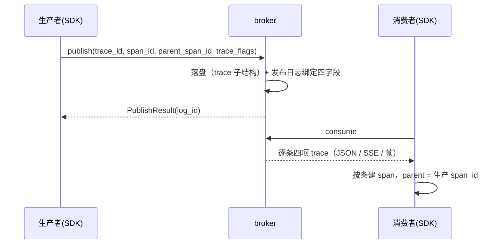

# 06-4 链路追踪 · 详细设计

> 08B · 06 管理与运维 · 子任务 04（需求 06-4）

[文档首页](../../../../../../文档首页.md) › [消息平台规划](../../../../../../规划/01_规划_消息平台.md) › [阶段计划](../../../../计划/01_计划_消息平台.md) › [06 管理与运维](../../06_管理与运维.md) › [06-4 链路追踪](../06_管理与运维_04_链路追踪.md) › 详细设计

## 0. 分章导航 <a id="toc"></a>

| 章 | 内容 |
| --- | --- |
| 1 | 任务级边界与输入基线 |
| 2 | 交付物清单 |
| 3 | 现状核对结论 |
| 4 | 契约设计（字段 / 三出口 / 采样 / 管理面） |
| 5 | 内部承载与落盘（值对象 / 记录头 / 端口签名 / 透传路径） |
| 6 | 失败分支 |
| 7 | 测试设计与验收映射 |
| 8 | 登记落点与文档同步 |
| 9 | 边界与开放项 |
| 10 | 对齐记录 |

## 1. 任务级边界与输入基线 <a id="scope"></a>

**做什么**：让消息头可携带 `trace_id` / `span_id` / `parent_span_id` / `trace_flags` 四项，并在**发布 → 存储 → 投递 → 延迟转投 → 重放**全链路上原样透传；消费响应（JSON / SSE / 帧）**逐条**返回四项；消息检索视图可凭 trace 定位。

**不做什么**（任务 §2.8 的客户端边界，越界即返工）：

- 不做 span 创建 / 结束 / 导出：`bms_core/msgclient` 与 SDK 的 OTel 接入归 bms 仓另立任务，本任务**不造假 span**、不宣称端到端已通；
- 不新增端点、不改投递语义 / 位点语义 / 重试与死信判定，不改 `max_messages` 与背压口径；
- 不解析 payload：采样、路由、透传一律只看头，载荷始终是原始字节；
- 不给死信表 / 重放任务表加列（管理面扩展到消息检索即止，见 §4.4）；
- 不引入 OTel 运行时依赖，不在 broker 内做采样决策。

**输入基线**：

| 输入 | 事实 |
| --- | --- |
| 记录头 | `broker/record.py::RecordHeader` 顶层已有 `trace_id`，`RECORD_FORMAT_VERSION = 1`，解码按键取缺省（只增不删） |
| 存储端口 | `broker/log.py::MessageStore.append` 现以 `trace_id: str \| None` 参数收链路标识；`FileMessageStore` 同参透传 |
| 已有先例 | 延迟元数据已做成 `delay` **子结构**（`DelayStamp`），普通记录不写该键、零体积开销——本任务的 `trace` 子结构与之同法 |
| 三出口 | JSON `MessageItem` / SSE 事件 / 帧 `message` 头，装配点分别在 `api/data/messages.py::message_item`、帧流装配、`api/frame/responses.py::_message_meta` |
| 帧字段白名单 | `api/frame/gate.py::build_frame_gate` 由 `request_model.model_fields` 自动派生——加字段到 `PublishRequest` 即自动放行，无需另维护字段表 |
| 契约快照 | `deploy/contracts/msg.json`（`python -m ops.contract_snapshot export`），顶层注入 `x-msg-frame`；前端类型由 `frontend/packages/api-types/scripts/generate.mjs` 生成 |
| 基座同类物 | `bms_core/tracing/base.py::SpanContext`（`name` 必填、无采样位）**不复用**：报文头没有 span 名，硬用会逼出假值 |

## 2. 交付物清单 <a id="deliverables"></a>

| 类别 | 交付物 | 说明 |
| --- | --- | --- |
| 值对象 | `services/msg/src/bms_msg/core/trace.py` | `TraceContext`（四字段）/ `EMPTY_TRACE` / `TRACE_FIELD_MAX_LENGTH` / `trace_of()` 便捷构造 |
| 记录层 | `broker/record.py` | `RecordHeader.trace`；`trace` 子 map 编解码（只增不删、不升版本）；`trace_id` 属性读兼容 |
| 端口 | `broker/log.py` | `MessageStore.append` 收 `trace`；`StoredMessage` / `MessageHeaderView` 收 `trace`（含读兼容属性） |
| 透传 | `broker/file_store.py`、`broker/delay.py`、`broker/delay_file.py`、`broker/delivery.py`、`broker/replay.py`、`broker/scheduler.py`、`broker/waiter.py` | 八条路径逐一确认不丢字段（§5.4 表） |
| 契约 | `schemas/fields.py`、`schemas/message.py` | 四个字段的共享定义；`PublishRequest` 三新字段可空；`MessageItem` 四字段回显 |
| 出口 | `api/frame/responses.py`、`api/data/messages.py` | 帧 `message` 头与 consume meta 逐条四项；SSE / JSON 同源 |
| 管理面 | `api/admin/messages.py` + `schemas/admin_view.py` | 消息检索响应 additive 返回三项 span 字段 |
| 契约快照 | `deploy/contracts/msg.json`、`frontend/packages/api-types/src/msg.ts` | 重导，与代码同一次提交 |
| 帧契约 | `protocol/contract.py` | `endpoint_fields.publish.optional`、`stream.message_header_fields` 追加；新增 `tracing` 段说明字段口径 |
| 测试 | `tests/api/test_tracing.py` 等（§7.1） | 往返 / 延迟 / 重放 / 批量逐条 / 载荷字节 / 采样透传 / 快照 |
| 文档 | 本设计、实施记录、测试记录、任务与需求与计划回写 | §8 |

## 3. 现状核对结论 <a id="current"></a>

| # | 现状 | 处置 |
| --- | --- | --- |
| 1 | `trace_id` 以显式参数在 32 处签名里逐层手传 | 收成 `TraceContext` 单参；一处承载，漏传即类型错，不靠人工记忆 |
| 2 | `RecordHeader` 只有顶层 `trace_id`，头部无 span 位 | 加 `trace` 子 map；顶层 `trace_id` 继续写（旧读兼容），不升版本 |
| 3 | `MessageItem` 只有 `trace_id`，帧 meta 只有单字段 | 四字段同源回显；帧 meta 与 consume meta 共用一套构造 |
| 4 | 管理面 `MessageHeaderView` 只带 `trace_id` | additive 加三项；检索响应同步（§4.4） |
| 5 | `x-msg-frame` 的 publish 可选字段与 message 头字段清单未含 span | 追加，并新增 `tracing` 段写明「broker 不解释、不采样」 |
| 6 | 现有 `bms_core` `SpanContext` 有 `name` 必填、无 flags | 不复用，msg 侧定义报文头口径的 `TraceContext` |
| 7 | 日志器只自动注入 `trace_id`（上下文变量），不带 span | 只在发布路径把三项绑进该次日志；消费批内多 trace，不逐条打 |
| 8 | 延迟记录 `DelayRecord` 与延迟区记录头各自带 `trace_id` | 同步改 `trace`，到期转投原样带入日志记录，不重新生成 |

## 4. 契约设计 <a id="contract"></a>

### 4.1 字段表

| 字段 | 类型 | 可空 | 上限 | 语义 |
| --- | --- | --- | --- | --- |
| `trace_id` | string | 是 | 128 | 链路标识（既有字段，语义不变） |
| `span_id` | string | 是 | 128 | 生产者本次 span 标识；消费端据此建子 span |
| `parent_span_id` | string | 是 | 128 | 生产 span 的父 span；链路起点可为空 |
| `trace_flags` | string | 是 | 128 | 采样标记（约定 W3C 8 位十六进制，如 `01`）；**broker 不解释** |

- 四个字段一律 `additive`：旧客户端不传即 `null`，不伪造、不生成服务端 span（任务 §2.4）。
- **形态不校验**：契约层只判「字符串 + 不超上限」，不判 hex 长度——`trace_flags` 的位含义归 SDK / OTel，broker 一旦解释就锁死了标志位演进（与 `trace_id` 现状同尺同口径）。
- 上限常量 `TRACE_FIELD_MAX_LENGTH = 128` 定义在 `core/trace.py`，四个字段共用；超限在契约层 `10001`，JSON 与帧两条入口同码。

### 4.2 三个出口（字段名与语义完全一致）

| 出口 | 落点 | 形态 |
| --- | --- | --- |
| JSON | `MessageItem`（拉取响应 `messages[]`） | 四个平铺字段 |
| SSE | 订阅流 `message` 事件（复用 `MessageItem`） | 同上，逐条 |
| 帧 | `CONSUME` 响应头 `messages[]` 元数据 + `message` 帧头 | 同上，逐条 |

**批量逐条**：`ConsumeResult.messages` 每条各带四项，**不设批级 trace 字段**——批内可能来自多个 trace，批级单一 span 会串链（需求 06-4 第 4 条）。帧侧 `header.messages` 与 payload 按序一一对应，装配点仍是 `_consume_meta()` 一处。

### 4.3 采样

broker 只做三件事：**存、搬、回显**。

| 关注点 | 口径 |
| --- | --- |
| 决策点 | 链路根部（SDK / OTel），broker 不参与 |
| 不透传的后果 | 消费端拿不到生产端采样决定，链路会被「补采」成半截 |
| broker 的边界 | 不读 flags 含义、不因 flags 丢弃消息、不改写 flags；`trace_flags` 与 `trace_id` 同等待遇 |
| 批内一致性 | 同 trace 的消息 flags 由生产端写死，broker 逐条原样回显，故同一 trace 天然同一决定 |

### 4.4 管理面（消息检索）

`MessageHeaderView` 与 `GET /api/v1/msg/admin/messages` 响应项 additive 增加 `span_id` / `parent_span_id` / `trace_flags`（`trace_id` 已有）：

- 检索仍只回头信息与载荷长度 / SHA-256，**拿不到正文**的空气密性不变；
- 只读，不新增端点、不改分页与过滤参数；`msg:query` 权限口径不变；
- 死信 / 重放 / 延迟视图**本期不扩**（要加表列与快照落盘，超本任务边界，登记 §9）。

### 4.5 契约快照与帧契约

| 落点 | 动作 |
| --- | --- |
| `protocol/contract.py` → `endpoint_fields.publish.optional` | 追加 `span_id` / `parent_span_id` / `trace_flags` |
| `protocol/contract.py` → `stream.message_header_fields` | 追加同三项 |
| `protocol/contract.py` → 新增 `tracing` 段 | 四字段上限、「broker 不解释采样」「逐条回显不设批级字段」三条口径 |
| `deploy/contracts/msg.json` | `python -m ops.contract_snapshot export` 重导，与代码同提交 |
| `frontend/packages/api-types/src/msg.ts` | `node scripts/generate.mjs` 重导，与快照同提交 |

### 4.6 兼容

| 场景 | 行为 |
| --- | --- |
| 旧客户端不传三新字段 | 落 `null`，响应回显 `null` |
| 旧记录（无 `trace` 子 map） | 解出 `TraceContext` 只含 `trace_id`，其余为 `None`；**不批量改写存量记录** |
| 旧读程序（不认识 `trace` 键） | 未升级的读者忽略未知键照常工作（MessagePack map 只增不删） |
| `RECORD_FORMAT_VERSION` | **不升**（仍 `1`）：升版本会让旧二进制拒读新记录，不可回滚 |

## 5. 内部承载与落盘 <a id="internal"></a>

### 5.1 `TraceContext` 值对象

```python
@dataclass(frozen=True)
class TraceContext(BaseValueObject):
    trace_id: str | None = None
    span_id: str | None = None
    parent_span_id: str | None = None
    trace_flags: str | None = None

    @property
    def is_empty(self) -> bool: ...      # 四项全 None
    def with_ids(self, *, trace_id, span_id, parent_span_id, trace_flags) -> TraceContext: ...
```

不变量（三条，写进 docstring 与用例）：

1. **不可变**：任何一层都不许就地改 trace 字段；要变就换新值（重放也**不重新生成**）。
2. **四字段各自可空**：允许「只有 `trace_id`」的老数据形态，不允许为凑齐而填假值。
3. **空即 `EMPTY_TRACE`**：端口缺省值用单例，避免 `None` 与「全 None 对象」两种空态并存。

`trace_of(source)` 提供统一构造：从 `PublishRequest` / `RecordHeader` / `DelayRecord` / `StoredMessage` 任一带四项的载体取值，避免各处手写四个关键字。

### 5.2 落盘形态（`trace` 子结构）

```text
header map = {
  format_version, topic_id, partition_no, tenant_id,
  message_id, log_id, key,
  trace_id,                       # 恒写（旧读兼容）
  trace: { span_id, parent_span_id, trace_flags },   # 仅当有 span 信息时写
  published_at, headers, content_type, compression, uncompressed_len,
  epoch, hw, replicas,
  delay: { ... }                  # 仅延迟区记录
}
```

- 写：顶层 `trace_id` 恒写；`trace` 子 map 仅在 ≥1 个 span 字段非空时写——普通消息头部字节与现状一致（与 `delay` 子结构同一取舍）。
- 读：`data.get("trace_id")` 与 `data.get("trace")` 合成 `TraceContext`；子 map 非 map / 键缺失一律退化为 `None`（不判损坏——多一个键不该让整条记录作废）。
- `RecordHeader.trace_id` 保留为**只读属性**（`self.trace.trace_id`），避免既有读取点与用例大面积改签名。

### 5.3 端口与模型签名

| 位置 | 现状 | 收口后 |
| --- | --- | --- |
| `MessageStore.append` / `InMemoryMessageStore` / `FileMessageStore` | `trace_id: str \| None` | `trace: TraceContext` |
| `StoredMessage` | `trace_id: str \| None` 字段 | `trace: TraceContext` 字段 + `trace_id` 只读属性 |
| `DelayRecord` | `trace_id` 字段 | `trace: TraceContext` + `trace_id` 只读属性 |
| `RecordHeader` | `trace_id` 字段 | `trace: TraceContext` + `trace_id` 只读属性 |
| `PublishRequest` / `DelayRecord` 构造 | 由 `request.trace_id` 取值 | `TraceContext.of(request)` 一处构造 |
| `MessageItem` | `trace_id` 字段 | 四个平铺字段（**契约形态不改成对象**：跨语言客户端只认平铺 JSON） |

**为什么端口用对象、契约用平铺**：端口是仓内 Python 边界，对象能一次性约束「四个字段同生共死」；契约是跨语言承诺，平铺才不会被序列化形态绑死。二者在 `message_item()` 与 `trace_of()` 两处显式换算，不做隐式自动映射。

### 5.4 八条透传路径

| # | 路径 | 来源 | 必须成立 |
| --- | --- | --- | --- |
| 1 | 发布（JSON） | 请求体四字段 | 原样落盘，不补不造 |
| 2 | 发布（帧） | 帧头四字段 | 与 JSON 同值同判据（白名单自动派生） |
| 3 | 延迟发布 | 请求四字段 | 存入 `DelayRecord`，`published_at` 与 trace 互不影响 |
| 4 | 到期转投 | `DelayRecord` → `StoredMessage` | 原样带入日志记录，**不重新生成** |
| 5 | 延迟区持久化 / 恢复 | `DelayRecord` ↔ 记录头 | `trace` 子结构随记录落盘，重启后仍在 |
| 6 | 重放 | 原 `StoredMessage` → 新记录 | 新 `log_id`、原 `message_id`、**trace 四字段不变** |
| 7 | 消费投递（JSON / SSE） | `StoredMessage` → `MessageItem` | 逐条四项 |
| 8 | 消费投递（帧） | `StoredMessage` → 帧 meta / `message` 帧 | 与 JSON 字段名一致、逐条 |

> 转死信路径沿用 `DeadLetter.trace_id`（不加列）；死信处置与重放审计里的 `trace_id` 是**请求上下文**的链路标识，与消息 trace 无关，不得混用。

### 5.5 日志关联



- 发布路径：日志 `extra` 带四项，一条消息一个 trace，可按 `trace_id` 直查该次发布；
- 消费路径：批内多 trace，**不逐条打日志**（量级 = 条数），排障按响应里的四项去 OTel 侧查；
- 审计表结构不动，`audit/trail.py` 仍只记请求上下文 `trace_id`。

## 6. 失败分支 <a id="failures"></a>

| 场景 | 行为 |
| --- | --- |
| 字段超 128 字符 | 契约层 `10001`；JSON 与帧两条入口同码（帧走 `ParamError` → 错误帧） |
| 字段非字符串（帧头传 int / map） | `10001`（`optional_text` 判型，不静默忽略） |
| 旧记录无 `trace` 子 map | 解出仅含 `trace_id` 的 `TraceContext`，不报错 |
| `trace` 子 map 非 map / 值类型不符 | 该字段退化为 `None`，**不判记录损坏**（只增不删口径） |
| 记录 `format_version` 高于实现 | 仍按既有 `UnsupportedRecordVersionError` 拒读（本任务不引入新版本） |
| 头部写超 `MAX_RECORD_HEADER_BYTES` | `encode_record` 抛 `ValueError`，写入路径 5xx；不截断字段 |
| 采样 flags 非法形态 | broker 不解释，照常存透传（不在 broker 判采样合法性） |
| 批量消费中断 | 已返回的消息四项完整；未返回的不出现在响应里（不出现半条） |

## 7. 测试设计与验收映射 <a id="testing"></a>

### 7.1 用例清单（Kiwi 编号见本任务登记）

| # | 用例 | 断言 | 验收映射 |
| --- | --- | --- | --- |
| 1 | JSON 发布头字段往返 | 四字段落盘后拉取原值返回；未给的为 `null` | 完成标准 1 |
| 2 | 帧发布头字段往返 | 帧头四项 → 拉取（JSON 与帧两种形态）同值 | 完成标准 1 |
| 3 | 载荷字节原样 | 含随机二进制载荷往返后 SHA-256 一致，头部无改写 | 完成标准 2 |
| 4 | 延迟转投字段保持 | 延迟发布 → 到期投递，四项与发布时逐字相同 | 完成标准 2 |
| 5 | 重放字段保持 | 重放后 `log_id` 变、`message_id` 与四项不变 | 完成标准 2 |
| 6 | 批量消费逐条 | 一批两条不同 trace，各自返回自己的四项，无批级字段 | 完成标准 3 |
| 7 | 采样标记透传 | `trace_flags="00"` 的消息照常投递（broker 不丢弃、不改写） | 完成标准 4 |
| 8 | 延迟区重启恢复 | 延迟记录落盘后重建，`trace` 四项仍在 | 完成标准 2 |
| 9 | 检索视图 additive | 消息检索响应含三项 span 字段且不含正文 | 完成标准 5 |
| 10 | 契约快照与帧契约 | 快照含四字段；`x-msg-frame` 清单与 `tracing` 段齐备；前端类型零漂移 | 完成标准 1 / 6 |
| 11 | 记录格式兼容 | 无 `trace` 键的旧字节可读；不升 `RECORD_FORMAT_VERSION` | 兼容口径 |
| 12 | 发布日志绑定 | 发布路径日志记录含四项（用例捕获日志 `extra`） | 完成标准 5 |

### 7.2 覆盖率

变更模块行 + 分支 100%（口径见《[AI开发规范](../../../../../../../bms文档/规范/AI开发规范.md)》「覆盖率要求」节）；落盘编解码的「有 span / 无 span」两支、`trace` 子 map 非法的退化分支都须有用例覆盖，不用 `pragma: no cover` 掩盖。

### 7.3 验证命令

```text
# 单文件 / 单节点（不做重命令整轮重跑）
cd backend
uv run python -m pytest services/msg/tests/api/test_tracing.py -q
uv run python -m pytest services/msg/tests/broker/test_message_store.py -q
uv run python -m ops.contract_snapshot check
cd ../frontend && node packages/api-types/scripts/generate.mjs --check
```

## 8. 登记落点与文档同步 <a id="registry"></a>

| 落点 | 动作 |
| --- | --- |
| [06-4 任务文档](../06_管理与运维_04_链路追踪.md) §2 / §3 | 补交付注块（字段 / 出口 / 兼容口径），不改任务内容本身 |
| [需求 06-4](../../../../需求/06_需求_管理与运维.md#r06-4) | 交付注块：四条字段、八条透传路径、管理面 additive、SDK 归 bms |
| [阶段计划](../../../../计划/01_计划_消息平台.md) | 06-4 行状态 / 完成日期回写（进度唯一落点）；「偏差与遗留」列记开放项去向 |
| [需求总览](../../../../需求/00_需求_消息平台.md) | 无新增需求（06-4 已在册），计数不变 |
| 实施 / 测试记录 | 本任务目录各一份 |

## 9. 边界与开放项 <a id="open"></a>

| # | 开放项 | 原因 | 归口 |
| --- | --- | --- | --- |
| 1 | SDK 侧 span 创建、OTel 导出、采样器配置 | 任务 §2.8 明确归 bms | bms `msgclient` 另立任务 |
| 2 | 死信 / 重放 / 延迟视图展示 span | 需给 `msg_dead_letter` 等表加列并回填 | 06 域后续（表结构变更先改表文件） |
| 3 | 端到端联调（生产者注入 → 消费者串链） | 依赖 SDK 落地，本仓无法自证 | SDK 任务验收后一次性联调 |
| 4 | 存量记录 span 回填 | 旧记录本就没有 span，回填等于造数据 | 不做 |
| 5 | 采样率与标志位口径 | broker 不解释，归 OTel / SDK 配置 | bms 可观测性 |
| 6 | 帧契约 `tracing` 段进入跨仓校验 | 需 bms 侧 `check_modules` 认得该段 | 契约评审（不影响本任务验收） |

## 10. 对齐记录 <a id="alignment"></a>

| # | 事项 | 结论 | 依据 |
| --- | --- | --- | --- |
| 1 | 内部承载 | 统一 `TraceContext` 值对象，替换逐层 `trace_id` 参数 | 用户拍板（2026-11-09） |
| 2 | 落盘形态 | `trace` 子结构，不升 `RECORD_FORMAT_VERSION` | 同上 |
| 3 | 采样标记 | `trace_flags` 字符串（W3C 8 位 hex），broker 只透传 | 同上 |
| 4 | 字段上限 | 三项与 `trace_id` 同尺 128，形态不校验 | 同上 |
| 5 | 管理面 | 数据面 + 消息检索视图同步暴露三项 | 同上 |
| 6 | 日志关联 | 仅发布路径绑定，消费不逐条打 | 同上 |
| 7 | 任务拆分 | 不拆嵌套子任务，父任务目录内直做 | 同上 |

> 依《[文档生成规范](../../../../../../../bms文档/规范/文档生成规范.md)》编写 · 进度以阶段计划为唯一落点
