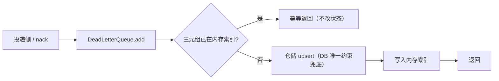
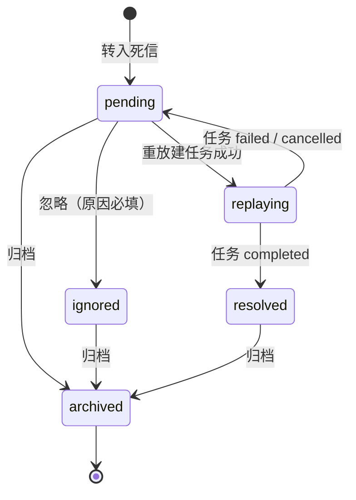

# 06-5-1 死信持久化与状态模型 · 详细设计

> 08B · 06 管理与运维 · 06-5 死信处置 · 子任务 01（需求 06-5）

[文档首页](../../../../../../../文档首页.md) › [消息平台规划](../../../../../../../规划/01_规划_消息平台.md) › [阶段计划](../../../../../计划/01_计划_消息平台.md) › [06 管理与运维](../../../06_管理与运维.md) › [06-5 死信处置](../../06_管理与运维_05_死信处置.md) › 详细设计

---

## 0. 分章导航 <a id="toc"></a>

| 章 | 内容 |
| --- | --- |
| 1 | 边界与已确认口径 |
| 2 | 交付物清单 |
| 3 | 现状与差距 |
| 4 | 表结构与模型 |
| 5 | 持久化实现 |
| 6 | 启动恢复与内存索引 |
| 7 | 状态机与迁移 |
| 8 | 查询与惰性回写 |
| 9 | 主题删除与租户清理 |
| 10 | 代码落点 |
| 11 | 测试设计 |
| 12 | 登记落点 |
| 13 | 边界与开放项 |
| 14 | 对齐记录 |

## 1. 边界与已确认口径 <a id="scope"></a>

**本任务做什么**：

1. 新建 `msg_dead_letter` 表（表文件先行、总览登记、模型与幂等建表落地）。
2. 扩展 `DeadLetter` 值对象，补 `tenant_id` / `namespace` / `topic` / `log_id` / `trace_id` / `status` 六个可选字段；**端口签名不变**。
3. 新增 `DatabaseDeadLetterQueue`（实现 `DeadLetterQueue`），替换 `InMemoryDeadLetterQueue`；`add` 同三元组幂等，`list_all` 全量返回，`contains` 走内存索引，`purge_topics` 物理删除。
4. 新增死信仓储与状态迁移服务：五态迁移、非法迁移拒绝、终态写处置人 / 时间 / 原因、`replaying` 关联 `replay_task_id`。
5. 启动恢复：`startup_hooks()` 在建表之后加载全部死信定位三元组到内存索引。
6. 主题删除 / 租户清理时按 `topic_id` 物理删除；清理幂等。
7. 指标采样口径调整：`msg_dlq_total` 只统计 `pending + replaying`。

**不做什么**：

- 不做查询 / 处置 HTTP 端点（06-5-2）；不做前端页面与原型（06-5-2）。
- 不改 `nack` 上报契约与投递侧「转死信 + 位点前移」语义（01-2 / 03-3）。
- 不做自动保留期清理与冷归档（后续归档阶段另议）。
- 不新增领域事件（处置结果由 06-5-2 的审计链承担）。
- 不改 `msg_topic_cleanup` 台账结构；只把 `done_steps.dlq` 的计数来源换为持久化实现。

**已确认口径（2026-11-09 会话逐项拍板）**：

| # | 事项 | 结论 |
| --- | --- | --- |
| 1 | 表名 | `msg_dead_letter`（任务书原字面 `msg_dlq` 随本设计回写） |
| 2 | 持久化实现 | 独立 `DatabaseDeadLetterQueue` 自持平台库 `uow_factory`，端口签名不变 |
| 3 | 启动恢复 | `startup_hooks()` 全量加载三元组（含 `archived`）到内存索引，写时同步 |
| 4 | `list_all` | 全量返回；查询接口默认排除 `archived`，指标只算 `pending + replaying` |
| 5 | 状态迁移 | `pending → replaying → resolved`；`replaying → pending`；`pending → ignored`；`pending / ignored / resolved → archived` |
| 6 | 幂等唯一 | `(topic_id, partition_no, msg_offset)` 唯一 |
| 7 | 清理 | 主题删除 / 租户清理物理删除，不做自动保留期 |
| 8 | 指标 | `msg_dlq_total` 只算 `pending + replaying`，`msg_dlq_growth_total` 口径不变 |
| 9 | 值对象 | 新增六个可选字段，旧调用点零改动 |

## 2. 交付物清单 <a id="deliverables"></a>

| # | 交付物 | 落点 |
| --- | --- | --- |
| D1 | 表文件与总览登记 | `msg文档/设计/数据库设计/数据表设计/msg_dead_letter.md`、`01_数据库设计_总览.md` §3 / §4 |
| D2 | 模型 | `backend/services/msg/src/bms_msg/models/dead_letter.py`（新增） |
| D3 | 仓储 | `backend/services/msg/src/bms_msg/repositories/dead_letter.py`（新增） |
| D4 | 端口扩展 + 持久化实现 | `backend/services/msg/src/bms_msg/broker/deadletter.py`（改） |
| D5 | 状态迁移服务 | `backend/services/msg/src/bms_msg/services/dead_letter.py`（新增） |
| D6 | 投递侧补传字段 | `backend/services/msg/src/bms_msg/broker/delivery.py`（改） |
| D7 | 装配与启动加载 | `backend/services/msg/src/bms_msg/main.py`（改） |
| D8 | 指标口径 | `backend/services/msg/src/bms_msg/metrics/sampler.py`（改） |
| D9 | 用例 | `backend/services/msg/tests/broker/test_dead_letter_store.py`、`tests/services/test_dead_letter_service.py`（新增） |
| D10 | 任务与计划回写 | 任务文档 §2 / §3、阶段计划 §2 / §3 |

## 3. 现状与差距 <a id="current"></a>

| # | 关注点 | 代码现状 | 本任务处置 |
| --- | --- | --- | --- |
| 1 | 存储 | `InMemoryDeadLetterQueue`：进程内列表 + 集合 | 换 `DatabaseDeadLetterQueue`；内存实现保留为测试替身 |
| 2 | 字段 | `DeadLetter` 只有 message_id / topic_id / partition_no / offset / attempts / failed_at / reason / detail | 补 tenant_id / namespace / topic / log_id / trace_id / status（可选） |
| 3 | 状态 | 无状态；`add` 即转入即终态 | 新增五态与迁移服务 |
| 4 | 租户 | 投递侧 `_dead_letter` 未带租户 / 主题名 / 记录 ID | 从 `consume` / `nack` 的 `tenant` 与 `StoredMessage` 补传 |
| 5 | 重启 | 进程重启即清空 | 启动加载表内三元组到内存索引 |
| 6 | 清理 | `purge_topics` 清内存列表 | 物理删除表行并返回删除数 |
| 7 | 指标 | `MetricsSampler._sample_dlq` 直接按 `list_all` 全量 | 过滤 `status` 只算 `pending + replaying` |

## 4. 表结构与模型 <a id="schema"></a>

字段唯一事实源为 [msg_dead_letter 表文件](../../../../../../../设计/数据库设计/数据表设计/msg_dead_letter.md)，本节不复制字段清单，只写模型口径：

- 继承 `bms_core.models.base.BaseModel`；`__tablename__ = "msg_dead_letter"`。
- `__table_args__` 声明唯一约束 `uq_msg_dead_letter_key`、索引 `idx_msg_dead_letter_tenant_status` / `idx_msg_dead_letter_replay_task` / `idx_msg_dead_letter_topic`。
- 状态、原因常量放模型模块，供服务层与查询层共用，禁止散落字符串。
- `detail` 用 `JSON` 列；写入前确保是普通可序列化映射（`dict` / `ConcurrentStableDict` 均可，SQLAlchemy JSON 按可序列化对象处理）。
- `failed_at` 为 UTC naive（与 `msg_replay_task` 同口径）；`created_at` / `updated_at` 由基类审计列维护。

## 5. 持久化实现 <a id="store"></a>



- **构造**：`DatabaseDeadLetterQueue(repository_factory=...)`，`repository_factory` 为「开平台库短事务并返回仓储」的零参可等待工厂；不在队列内持有长会话。
- **`add`**：先查内存索引，命中直接返回；未命中写库（`INSERT`，唯一键冲突按已存在处理），成功后把三元组加入索引。写库失败不吞异常——由投递侧决定重试，避免「以为进了死信其实没落库」。
- **`contains`**：只查内存索引，O(1)；启动加载保证冷启动后仍准确。
- **`list_all`**：查库全量，按 `failed_at` 升序（端口「插入序」语义），并把结果中的三元组回填索引；状态字段随行返回。
- **`purge_topics`**：按 `topic_id IN (...)` 物理删除，返回删除行数；同步从内存索引移除对应三元组。空集合直接返回 0。
- **失败语义**：`add` 写库失败上抛（投递侧不推进位点）；`purge_topics` 失败上抛（06-2 清理台账保留该步骤待下轮重试）。

## 6. 启动恢复与内存索引 <a id="boot"></a>

- 启动钩子 `load_dead_letter_index` 登记在 `startup_hooks()`，排在 `start_background_tasks` 之前；此时基座已完成自动建表与接库校验。
- 钩子只加载 `(topic_id, partition_no, msg_offset)` 三元组，不驻留整行；`archived` 也加载（保证 `contains` 对已归档死信仍命中，避免同一 offset 被重新投递）。
- 加载失败（表不可读 / 库不可达）按 fail-closed 拒启：死信判定是投递正确性的一环，空索引会导致已死信消息被重复投递。
- 多实例一致性归 8B_05：本期索引为进程内，`add` 只更新本进程；其他实例要等重启或下次 `list_all` 回填。已登记开放项。

## 7. 状态机与迁移 <a id="state"></a>



- **合法迁移**只允许上图箭头；其余一律抛 `MsgDeadLetterInvalidStateError`（`350030`）。
- **`replaying` 不可直接归档**：必须先由重放终态回写回到 `pending`，或任务取消后回 `pending`；避免「正在写的任务」被页面隐藏。
- **`archived` 为终态**：不再接受任何处置；`contains` 仍命中。
- **`replaying` 只允许一个关联任务**：迁移到 `replaying` 时写 `replay_task_id`；回写终态时清空或保留由实现定（本期保留，便于追溯最后一次重放任务）。
- **处置人 / 时间 / 原因**：进入 `resolved` / `ignored` / `archived` 时写 `disposed_by` / `disposed_at` / `disposition_reason`；`resolved` 由惰性回写写入，操作人取任务 `created_by`（若为空则留空）。

## 8. 查询与惰性回写 <a id="query"></a>

- **列表**：按 `tenant_id` 强制过滤；支持状态 / 原因 / 主题 / 分区 / 时间范围 / 关键字（`log_id` 或 `message_id` 模糊）；默认排除 `archived`，传 `status=archived` 时只查归档；按 `failed_at` 倒序、`id` 倒序稳定排序。
- **详情**：按 `id + tenant_id` 取行；未命中抛 `MsgDeadLetterNotFoundError`（`350029`）。
- **惰性回写**：列表与详情查询前，先对当页 / 当前行中的 `replaying` 行批量查 `msg_replay_task` 状态：
  - `completed` → `resolved`；
  - `failed` / `cancelled` → `pending`；
  - 其余（`pending` / `running` / `paused`）保持 `replaying`。
  回写与查询同一事务；回写失败只告警、不阻塞查询（返回当前状态，下次查询再试）。
- **分页**：`page` / `size`，默认 20，上限 `MAX_LIST_SIZE = 100`；`total` 为过滤后总数。

## 9. 主题删除与租户清理 <a id="cleanup"></a>

- 06-2 `TopicCleanupService` 已调用 `dead_letters.purge_topics(topic_ids=...)`；持久化实现按 `topic_id` 物理删除，返回删除行数，`done_steps.dlq` 计数自动变为真实值。
- 05-5 租户删除 / 物理清理路径同样经 `purge_topics`；不新增入口。
- 清理幂等：重复调用返回 0；不影响其他主题行。
- 审计：主题删除动作由 06-2 写；死信行本身不逐条写审计（避免清理时审计洪泛）。

## 10. 代码落点 <a id="code"></a>

```
msg/backend/services/msg/src/bms_msg/
├── models/dead_letter.py                  # 新增：MsgDeadLetter + 状态 / 原因常量
├── repositories/dead_letter.py            # 新增：死信仓储
├── broker/deadletter.py                   # 改：DeadLetter 补字段 + DatabaseDeadLetterQueue
├── broker/delivery.py                     # 改：_dead_letter 补传租户 / 主题 / log_id / trace_id
├── services/dead_letter.py                # 新增：状态迁移 + 查询 + 惰性回写
├── metrics/sampler.py                     # 改：存量只算 pending + replaying
└── main.py                                # 改：装配持久化队列 + 启动加载索引
msg/backend/services/msg/tests/
├── broker/test_dead_letter_store.py       # 新增
└── services/test_dead_letter_service.py   # 新增
```

- 仓储只做行级读写与过滤，不做状态判定；状态判定集中在服务层，避免「两个地方都能改状态」。
- `DatabaseDeadLetterQueue` 与仓储同域；队列只管端口语义（转入 / 列表 / 判定 / 清理），不暴露状态迁移方法。

## 11. 测试设计 <a id="test"></a>

| 用例 | 断言 |
| --- | --- |
| 表文件 ↔ 总览 ↔ 目录 | 表文件存在、总览 §4 有登记、模型 `__tablename__` 与表名一致 |
| 转入落库 | `add` 后表内一行；字段与 `DeadLetter` 一致（含 tenant / namespace / topic / log_id / trace_id） |
| 同三元组幂等 | 连续 `add` 两次只有一行；第二次不改状态 |
| 重启恢复 | 新建队列实例 + 启动加载后 `contains` 命中；`list_all` 返回全部 |
| 五态迁移矩阵 | 合法箭头全部通过；非法迁移抛 `350030` |
| 惰性回写 | `replaying` + 任务 `completed` → `resolved`；`failed` / `cancelled` → `pending`；`running` 不变 |
| 主题清理 | `purge_topics` 返回删除数并同步清索引；重复调用返回 0 |
| 指标口径 | `_sample_dlq` 只统计 `pending + replaying`；`archived` / `resolved` / `ignored` 不计 |
| 租户隔离 | 不同 `tenant_id` 的行互不可见 |

Kiwi：整个 06-5 登记一条用例，本子任务与 06-5-2 的用例同标该编号。

## 12. 登记落点 <a id="registry"></a>

- 数据库设计总览 §3 表集列与 §4 已设计数据表登记；
- 表文件变更记录；
- 任务文档 §2 / §3 状态与偏差；
- 阶段计划 §2 已完成 / §3 剩余行（06-5 收口时回写）。

## 13. 边界与开放项 <a id="out"></a>

| 事项 | 归口 |
| --- | --- |
| 多实例内存索引不一致（`add` / 状态迁移只更新本进程） | 8B_05 复制与多实例 |
| `archived` 行自动清理 / 冷归档 | 后续归档阶段另议 |
| 死信处置 HTTP 端点与页面 | 06-5-2 |
| 告警阈值与持续时间 | 06-3 规则文件（本任务只改指标口径） |
| 真 MySQL / PostgreSQL / DM8 方言验证 | 部署窗口 |

## 14. 对齐记录 <a id="align"></a>

| 日期 | 事项 | 处理 |
| --- | --- | --- |
| 2026-11-09 | 任务书表名 `msg_dlq` 与总览规划 `msg_dead_letter` 不一致 | 按总览统一为 `msg_dead_letter`，任务书随本设计回写 |
| 2026-11-09 | 任务书要求「启动时从表恢复，或按需查询」 | 取「启动加载三元组 + 写时同步」，`contains` 不查库 |
| 2026-11-09 | 指标存量口径未明确 | 定为 `pending + replaying`，`resolved` / `ignored` / `archived` 不计 |
