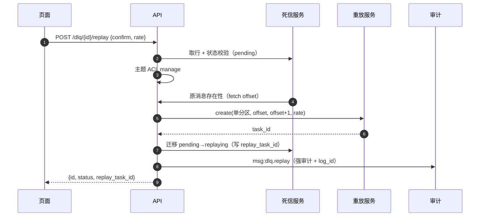

# 06-5-2 死信查询处置接口与页面 · 详细设计

> 08B · 06 管理与运维 · 06-5 死信处置 · 子任务 02（需求 06-5）

[文档首页](../../../../../../../文档首页.md) › [消息平台规划](../../../../../../../规划/01_规划_消息平台.md) › [阶段计划](../../../../../计划/01_计划_消息平台.md) › [06 管理与运维](../../../06_管理与运维.md) › [06-5 死信处置](../../06_管理与运维_05_死信处置.md) › 详细设计

---

## 0. 分章导航 <a id="toc"></a>

| 章 | 内容 |
| --- | --- |
| 1 | 边界与已确认口径 |
| 2 | 交付物清单 |
| 3 | 接口契约 |
| 4 | 处置语义 |
| 5 | 权限、审计与租户隔离 |
| 6 | 页面与交互 |
| 7 | 原型依据 |
| 8 | 代码落点 |
| 9 | 契约与类型生成 |
| 10 | 测试设计 |
| 11 | 登记落点 |
| 12 | 边界与开放项 |
| 13 | 对齐记录 |

## 1. 边界与已确认口径 <a id="scope"></a>

**本任务做什么**：

1. 新增死信查询 / 详情 / 重放 / 忽略 / 归档五个管理面端点。
2. 重放复用 01-6 任务化重放，建单条任务；忽略必须填原因；归档只改状态。
3. 全部处置写基座审计链（记录级强审计，`record_ref = msg.message/log_id`）。
4. 改造 msg 前端 `DlqPage.vue`：真实列表、筛选、详情抽屉、三种处置与二次确认；无 `msg:manage` 不渲染操作列。
5. 重导 `deploy/contracts/msg.json` 与 `@msg/api-types`，保持零漂移。

**不做什么**：

- 不做重放任务的创建 / 暂停 / 恢复 / 取消与进度联动页面（06-6）；本页只展示任务 ID。
- 不做死信批量处置（本期只单条；批量归 06-6 / 后续）。
- 不做冷归档、原始日志删除、绕过 01-6 直接写日志。
- 不改 `nack` 契约与投递侧转死信逻辑。

**已确认口径（2026-11-09 会话逐项拍板）**：

| # | 事项 | 结论 |
| --- | --- | --- |
| 1 | 路径 | `/api/v1/msg/admin/dlq` |
| 2 | 重放请求 | `{confirm: true, rate_per_second?: int}`，缺省 100，范围 1~1000 |
| 3 | 忽略原因 | 必填、去空白非空、长度 1~256；形态问题走 `10001` |
| 4 | 前置状态 | 重放 / 忽略仅 `pending`；归档允许 `pending / ignored / resolved`；`replaying` / `archived` 拒绝 |
| 5 | 二次确认 | 三者都要求 `confirm=true` |
| 6 | 错误码 | `350029` 死信不存在、`350030` 状态非法、`350031` 原消息不可重放 |
| 7 | 详情 | 只读死信表字段与 `detail`，不读原消息 |
| 8 | 原型 | 改 `07_原型设计_死信与重放.html` 补处置交互 |
| 9 | 页面 | 复用 `MsgConfirmDialog` / `ReadOnlyList`，改造 `DlqPage.vue` |
| 10 | 审计 | `msg:dlq.replay` / `.ignore` / `.archive`，记录级强审计 |
| 11 | 事件 | 不新增领域事件 |
| 12 | 告警 | 只改指标口径，不改 06-3 规则文件 |

## 2. 交付物清单 <a id="deliverables"></a>

| # | 交付物 | 落点 |
| --- | --- | --- |
| D1 | 契约 schema | `backend/services/msg/src/bms_msg/schemas/dead_letter.py`（新增） |
| D2 | 管理面端点 | `backend/services/msg/src/bms_msg/api/admin/dlq.py`（新增） |
| D3 | 审计动作与类别 | `backend/services/msg/src/bms_msg/audit/trail.py`（改） |
| D4 | 错误码与异常 | `backend/services/msg/src/bms_msg/errors.py`、`deploy/registry/msg.toml`（改） |
| D5 | 前端页面 | `frontend/modules/msg/src/views/DlqPage.vue`（改） |
| D6 | 前端服务 | `frontend/modules/msg/src/services/admin-service.ts`（改） |
| D7 | 前端文案 | `frontend/modules/msg/src/i18n/messages.ts`（改） |
| D8 | 原型 | `msg文档/设计/原型设计/07_原型设计_死信与重放.html`（改） |
| D9 | 用例 | `backend/services/msg/tests/api/test_dlq.py`、`tests/api/test_dlq_permissions.py`、`frontend/modules/msg/tests/dlq-page.spec.ts`（新增） |
| D10 | 契约与类型 | `deploy/contracts/msg.json`、`frontend/packages/api-types/src/msg.ts`（重生成） |

## 3. 接口契约 <a id="api"></a>

### 3.1 端点 <a id="api-list"></a>

| 方法 | 路径 | 权限 | 说明 |
| --- | --- | --- | --- |
| GET | `/api/v1/msg/admin/dlq` | `msg:query` | 分页列表（默认排除 `archived`） |
| GET | `/api/v1/msg/admin/dlq/{id}` | `msg:query` | 详情（含失败上下文） |
| POST | `/api/v1/msg/admin/dlq/{id}/replay` | `msg:manage` | 重放（单条任务） |
| POST | `/api/v1/msg/admin/dlq/{id}/ignore` | `msg:manage` | 忽略（原因必填） |
| POST | `/api/v1/msg/admin/dlq/{id}/archive` | `msg:manage` | 归档 |

### 3.2 列表请求 <a id="api-query"></a>

| 参数 | 类型 | 必填 | 默认 | 说明 |
| --- | --- | --- | --- | --- |
| `status` | string | 否 | — | `pending` / `replaying` / `resolved` / `ignored` / `archived`；缺省排除 `archived` |
| `reason` | string | 否 | — | `delivery_exhausted` / `schema_invalid` / `processing_failed` |
| `topic` | string | 否 | — | 主题名精确匹配 |
| `partition` | int | 否 | — | 分区号 |
| `failed_from` | datetime | 否 | — | 失败时间下限（含，UTC） |
| `failed_to` | datetime | 否 | — | 失败时间上限（不含，UTC） |
| `keyword` | string | 否 | — | `log_id` 或 `message_id` 模糊匹配 |
| `page` | int | 否 | 1 | 页码（从 1 起） |
| `size` | int | 否 | 20 | 每页条数（1~100） |

### 3.3 响应 <a id="api-response"></a>

`DlqItem`：

| 字段 | 类型 | 说明 |
| --- | --- | --- |
| `id` | string | 死信 ID（雪花，JSON 字符串） |
| `namespace` | string | 命名空间 |
| `topic` | string | 主题名 |
| `partition_no` | int | 分区号 |
| `offset` | int | 原 offset |
| `log_id` | string | 原记录 ID |
| `message_id` | string | 原消息 ID |
| `trace_id` | string \| null | 链路标识 |
| `reason` | string | 转入原因 |
| `attempts` | int | 重试次数 |
| `status` | string | 五态 |
| `failed_at` | datetime | 失败时间（UTC） |
| `replay_task_id` | string \| null | 重放任务 ID |
| `disposition_reason` | string \| null | 处置原因 |
| `disposed_at` | datetime \| null | 处置时间 |
| `created_at` | datetime | 落库时间 |

`DlqDetail` = `DlqItem` + `detail`（`dict[str, str]` 失败上下文）。

列表响应：`{items: [DlqItem], total, page, size}`。

处置响应：`{id, status, replay_task_id?}`（重放额外返回任务 ID）。

### 3.4 错误码 <a id="api-errors"></a>

| 码 | 场景 | HTTP |
| --- | --- | --- |
| `350029` | 死信不存在（不属于当前租户，或已被清理） | 404 |
| `350030` | 死信状态不允许该操作（非法迁移 / 重复处置） | 409 |
| `350031` | 原消息不可重放（超出保留期或记录不存在） | 409 |
| `10001` | 参数形态非法（`size` 越界、忽略原因为空 / 超长、`confirm` 缺失、重放速率越界） | 400 |

## 4. 处置语义 <a id="dispose"></a>



- **重放**：先经 ACL `manage`，再校验状态 `pending`，再校验原记录存在（`MessageStore.fetch(topic_id, partition_no, from_offset=offset, max_messages=1)` 且首条 offset 相等）；不存在 → `350031`。然后调 `ReplayService.create`（`ReplayRequest` 以该死信的分区 / offset 为范围，`confirm=True`），成功后迁移 `pending → replaying` 并写 `replay_task_id`。
- **忽略**：状态 `pending`；`reason` 去空白后长度 1~256；迁移 `pending → ignored`，写 `disposition_reason` / `disposed_by` / `disposed_at`。
- **归档**：状态 `pending / ignored / resolved`；迁移 `→ archived`；`disposition_reason` 可选；写处置人 / 时间。
- **终态回写**：列表 / 详情查询时对 `replaying` 行批量查 `msg_replay_task`：`completed → resolved`；`failed / cancelled → pending`；`pending / running / paused` 保持。回写失败只告警，不阻塞查询。

## 5. 权限、审计与租户隔离 <a id="perm"></a>

- 查询 `msg:query`，处置 `msg:manage`；端点声明 `x-error-codes`。
- 主题 ACL：查询按 `describe`，处置按 `manage`（与 06-1 / 06-2 / 01-6 同口径）。
- 租户隔离：所有查询与处置强制 `tenant_id = 当前租户`；跨租户按 `350029` 处理，不泄露存在性。
- 审计动作：`msg:dlq.replay` / `msg:dlq.ignore` / `msg:dlq.archive`，加入 `ACTION_CLASSES`，类别 `record_operation`、`strong=True`、`record_level=True`；载荷含 `reason`（忽略）、`rate_per_second`（重放）、`replay_task_id`；`record_ref = RecordRef(type="msg.message", id=log_id)`。
- 审计失败：强审计写入失败抛 `InternalError`（10000），处置不生效（与 05-4 口径一致）。
- 重放任务自身的建任务审计仍由 01-6 写（`msg:replay`），与本任务的 `msg:dlq.replay` 两条并存：前者记“重放任务”，后者记“死信处置”，可互相定位。

## 6. 页面与交互 <a id="page"></a>

- **列表**：主题 / 状态 / 原因 / 关键字筛选；列：`log_id`（可点开详情）、主题 / 分区、原 offset、原因、重试次数、状态、失败时间、`trace_id`、操作。
- **操作列**（仅 `msg:manage` 渲染）：
  - `pending`：重放 / 忽略 / 归档 / 详情；
  - `ignored` / `resolved`：归档 / 详情；
  - `replaying` / `archived`：详情（不显示处置按钮）。
- **详情抽屉**：死信字段 + 失败上下文 `detail`；`replay_task_id` 只显示文本，不跳转（06-6 补任务详情页）。
- **处置对话框**：
  - 重放：显示影响范围（主题 / 分区 / offset / log_id），速率输入 1~1000，默认 100；
  - 忽略：原因必填 1~256，前端先校验，后端仍兜底；
  - 归档：提示“从活跃列表隐藏，原始消息仍在保留期内可查”；
  - 三者均二次确认，成功后刷新列表。
- **状态**：加载骨架、空态、错误态（按错误码文案）、无权限（整页 / 操作列不渲染）。
- **无权限**：无 `msg:query` 整页不渲染；无 `msg:manage` 只读可见、操作列隐藏。

## 7. 原型依据 <a id="prototype"></a>

- 原型文件：[`07_原型设计_死信与重放.html`](../../../../../../../设计/原型设计/07_原型设计_死信与重放.html)（2026-11-09 补处置交互，场景 `list` / `detail` / `dispose` / `loading` / `empty` / `error` / `denied`）。
- 原型即验收基准：页面按原型逐页截图对照，结论登记测试记录。
- 原型与《布局设计》冲突以布局设计为准（《原型审查规范》）。

## 8. 代码落点 <a id="code"></a>

```
msg/backend/services/msg/src/bms_msg/
├── schemas/dead_letter.py                 # 新增：列表 / 详情 / 重放 / 忽略 / 归档契约
├── api/admin/dlq.py                       # 新增：五个端点
├── audit/trail.py                         # 改：三个动作 + ACTION_CLASSES
├── errors.py                              # 改：350029~350031 + 异常类
└── main.py                                # 改：路由已由 admin 聚合挂载
msg/backend/services/msg/deploy/registry/msg.toml   # 改：三条 errcodes
msg/frontend/modules/msg/src/
├── views/DlqPage.vue                      # 改：真实列表 + 详情 + 处置
├── services/admin-service.ts              # 改：五个请求方法
└── i18n/messages.ts                       # 改：死信处置文案与错误码文案
msg/frontend/packages/api-types/src/msg.ts # 重生成
```

- 路由聚合：`api/admin/__init__.py` 已按模块登记，新增 `dlq` 后挂到 `/api/v1`。
- 前端请求统一走 `api.product('msg','msg')` 通道，不直连地址。

## 9. 契约与类型生成 <a id="contract"></a>

- 端点变更后重导 `python -m ops.contract_snapshot export`（msg 仓 `backend` 下），确认 `deploy/contracts/msg.json` 包含五个端点与错误码。
- 前端 `@msg/api-types` 重新生成（`pnpm --filter @msg/api-types generate` 或仓内既有脚本），零漂移门禁通过。
- 契约类型只增不改：`DlqItem` / `DlqDetail` / `DlqList` / `DlqDisposeResult` 为新增 schema。

## 10. 测试设计 <a id="test"></a>

| 用例 | 断言 |
| --- | --- |
| 列表 | 默认排除 `archived`；筛选 / 分页 / 排序；跨租户不可见 |
| 详情 | 命中返回 `detail`；不存在 / 跨租户 `350029` |
| 重放 | `confirm` 缺失 `10001`；状态非 `pending` `350030`；原记录不存在 `350031`；成功建单条任务并置 `replaying` |
| 忽略 | 原因空 / 超长 `10001`；成功置 `ignored` 并写原因 / 处置人 |
| 归档 | `pending / ignored / resolved` 可归档；`replaying / archived` `350030` |
| 惰性回写 | 列表与详情均把 `replaying` 收口为 `resolved` / `pending` |
| 权限 | 无 `msg:query` 403；无 `msg:manage` 处置 403；无 ACL `manage` 403 |
| 审计 | 三个动作各写一条强审计，`record_ref` 为 `msg.message/log_id` |
| 前端 | 列表 / 筛选 / 详情抽屉 / 三种对话框 / 无权限隐藏操作列；`vitest` 覆盖 |
| 原型对照 | `list` / `detail` / `dispose` / `denied` 场景截图与实现页一致 |

Kiwi：整个 06-5 一条用例，与 06-5-1 同标一个编号。

## 11. 登记落点 <a id="registry"></a>

- `deploy/registry/msg.toml` 新增三条 `[[errcodes]]`；
- 前端 `messages.ts` 新增 `error.350029/350030/350031` 与页面文案；
- 任务文档 §2 / §3、阶段计划 §2 / §3；
- 测试记录登记原型逐页对照结论。

## 12. 边界与开放项 <a id="out"></a>

| 事项 | 归口 |
| --- | --- |
| 重放任务页面与进度联动 | 06-6 |
| 批量处置（多选重放 / 忽略 / 归档） | 06-6 / 后续 |
| 归档行冷存储与保留期 | 后续归档阶段 |
| 多实例死信索引一致性 | 8B_05 |
| 真库与真实重放联调 | 部署窗口 |

## 13. 对齐记录 <a id="align"></a>

| 日期 | 事项 | 处理 |
| --- | --- | --- |
| 2026-11-09 | 原型 07 原为只读入口，处置交互未画 | 本设计前已补 `detail` / `dispose` 场景与操作列 |
| 2026-11-09 | 任务书要求“高危与批量操作二次确认” | 本期只单条处置，三者均二次确认；批量归 06-6 |
| 2026-11-09 | 任务书接口未提主题 ACL | 按 06-1 / 01-6 同口径接入 `describe` / `manage` |
