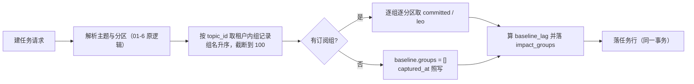
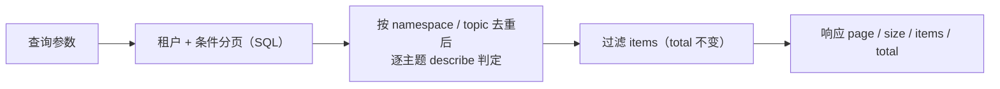

# 06-6-1 重放任务补齐与影响可见 · 详细设计

> 08B · 06 管理与运维 · 06-6 重放任务 · 子任务 01（需求 06-6）

[文档首页](../../../../../../../文档首页.md) › [消息平台规划](../../../../../../../规划/01_规划_消息平台.md) › [阶段计划](../../../../../计划/01_计划_消息平台.md) › [06 管理与运维](../../../06_管理与运维.md) › [06-6 重放任务](../../06_管理与运维_06_重放任务.md) › 详细设计

---

## 0. 分章导航 <a id="toc"></a>

| 章 | 内容 |
| --- | --- |
| 1 | 边界与已确认口径 |
| 2 | 交付物清单 |
| 3 | 现状与差距 |
| 4 | 表结构与模型 |
| 5 | 影响基线采集与终态快照 |
| 6 | 列表端点 |
| 7 | 详情端点 additive 契约 |
| 8 | 死信终态联动 |
| 9 | 权限 / 租户 / 错误码 |
| 10 | 代码落点 |
| 11 | 测试设计 |
| 12 | 登记落点 |
| 13 | 边界与开放项 |
| 14 | 对齐记录 |

## 1. 边界与已确认口径 <a id="scope"></a>

**本任务做什么**：

1. 新增任务列表端点 `GET /api/v1/msg/admin/replay`：状态 / 命名空间 / 主题 / 创建时间过滤 + 分页，按主题 `describe` 过滤可见性。
2. `msg_replay_task` additive 扩两列：`impact_groups`（创建时影响基线）与 `impact_snapshot`（终态影响快照）；先改表文件与变更记录，再改模型。
3. 建任务时解析受影响消费组并采集分区级积压基线（组来源 = 01-4 的组订阅关系）。
4. 详情端点 additive 返回 `affected_groups`（组 / 基线 / 当前 / 变化 / 采集时刻）；终态后返回并保留最后快照。
5. 死信重放任务终态联动：沿用 06-5 的查询惰性回写，本任务只补用例断言与归口登记。
6. 契约快照与前端类型生成物一并更新。

**不做什么**：

- 不改 01-6 的限速、暂停 / 恢复 / 取消、`log_id` 分配与游标推进语义；不动 `ReplayRunner` 的推进循环与状态机。
- 不做跨租户重放、不做「一键全放」、不在影响视图里做任何写操作（纯只读投影）。
- 不新建影响快照表、不做多轮快照留存（只留「最后一次」）。
- 不做前端页面与交互（06-6-2）。

**已确认口径（2026-11-09 会话逐项拍板）**：

| # | 事项 | 结论 |
| --- | --- | --- |
| 1 | 基线存储粒度 | `impact_groups` 存**分区级明细**：`captured_at` + 每组 `baseline_lag` + 各分区 `committed` / `leo` |
| 2 | 终态快照写入时机 | **详情查询惰性落库一次**（终态且无快照才写），不改执行器装配与状态机 |
| 3 | 受影响组来源 | `GroupStore.list_for_tenant` 按 `topic_id` 过滤（与 01-4 组订阅关系统一端口） |
| 4 | 列表 ACL 与 `total` | **先分页再按 describe 过滤 items，`total` 保持过滤前**（与 06-1 组列表同口径） |
| 5 | 列表影响段 | 列表**不返回** `affected_groups`（固定 null；详情才计算 / 取快照） |
| 6 | 列表项类型 | **复用 `ReplayTaskItem`**，另加 `ReplayTaskPage`（items / total / page / size） |
| 7 | 过滤与分页 | `status` / `namespace` / `topic` / `created_from` / `created_to`；`created_at` 倒序 + `id` 倒序；`page` 从 1、`size` 默认 20 上限 100 |
| 8 | 死信终态回写 | **沿用 06-5 惰性回写**，不新增端点 |
| 9 | 影响逻辑落点 | 新建 `services/replay_impact.py`（值对象 + `ReplayImpactInspector`），注入 `ReplayService` |
| 10 | additive 扩列 | **两列**：`impact_groups`（基线）+ `impact_snapshot`（终态快照） |
| 11 | 索引 | **不新增索引**（沿用 `idx_msg_replay_task_tenant`） |
| 12 | 契约产物 | 一并导出 `deploy/contracts/msg.json` 并重生成 `frontend/packages/api-types` |
| 13 | 组数量上限 | 基线最多采集 **100 个组**（组名升序），超出记 `truncated` 并回 `affected_truncated=true` + warning 日志 |
| 14 | 负积压 | **不夹取**：`lag = leo - committed` 原值，与 01-4 组详情 / 影响预检完全同口径 |

## 2. 交付物清单 <a id="deliverables"></a>

| # | 交付物 | 落点 |
| --- | --- | --- |
| D1 | 表文件 additive 两列 + 变更记录 | `msg文档/设计/数据库设计/数据表设计/msg_replay_task.md` |
| D2 | 模型扩列 | `backend/services/msg/src/bms_msg/models/replay.py`（改） |
| D3 | 影响投影（值对象 + 采集 / 度量 / 编解码） | `backend/services/msg/src/bms_msg/services/replay_impact.py`（新增） |
| D4 | 任务仓储分页 | `backend/services/msg/src/bms_msg/repositories/replay.py`（改） |
| D5 | 服务层：列表 / 详情视图 / 建任务采集基线 | `backend/services/msg/src/bms_msg/broker/replay.py`（改） |
| D6 | 契约模型 | `backend/services/msg/src/bms_msg/schemas/replay.py`（改） |
| D7 | 端点：列表 + 详情补影响段 | `backend/services/msg/src/bms_msg/api/admin/replay.py`（改） |
| D8 | 常量 | `backend/services/msg/src/bms_msg/core/config.py`（改：`REPLAY_IMPACT_MAX_GROUPS`） |
| D9 | 契约快照与前端类型 | `deploy/contracts/msg.json`、`frontend/packages/api-types/**`（生成物） |
| D10 | 用例 | `backend/services/msg/tests/api/test_admin_replay_list.py`、`tests/services/test_replay_impact.py`（新增）、`tests/api/test_admin_replay.py`（改：详情断言影响段） |
| D11 | 实施 / 测试记录 | 任务目录 `实施/`、`测试/` |
| D12 | 任务 / 计划 / 需求回写 | 任务文档 §2 / §3、阶段计划 §2 / §3 / §10、06-6-2 前置契约 |

## 3. 现状与差距 <a id="current"></a>

| # | 关注点 | 代码现状 | 本任务处置 |
| --- | --- | --- | --- |
| 1 | 列表 | 无 `GET /admin/replay`；`ReplayTaskRepository` 只有 `list_active`（执行器专用，跨租户） | 新增 `page_for_tenant` + 服务 `list` + 端点 |
| 2 | 影响字段 | 表与模型无影响列 | additive 两列 + 表文件先改 |
| 3 | 组订阅关系 | `GroupStore.list_for_tenant` 已可列租户内组（含 `topic_id`） | 直接复用，不另建查询 |
| 4 | 积压口径 | `GroupInspector.describe` 逐分区 `committed` / `leo`，`lag = leo - committed` | 抽到影响投影，同一算式；**不复制第二套积压定义** |
| 5 | 死信联动 | 06-5 已在死信列表 / 详情查询时按任务终态收口 | 沿用；本任务补断言 |
| 6 | 契约产物 | 端点变更后需重导快照与 api-types | 一并生成 |

## 4. 表结构与模型 <a id="schema"></a>

字段唯一事实源为 [msg_replay_task 表文件](../../../../../../../设计/数据库设计/数据表设计/msg_replay_task.md)，本节只写模型口径，不复制字段清单。

- `impact_groups`：`StableJson`，非空，默认 `{}`（写入 `{"captured_at": ..., "truncated": false, "groups": []}`）。**创建时写一次，此后不再改**。
- `impact_snapshot`：`StableJson`，可空。仅在任务已终态且首次查询详情时写一次。
- 两列都声明为 `Mapped[ConcurrentStableDict[str, object]]`（值对象字段用插入序集合类，禁裸 `dict`）。
- 不改既有列语义、不加索引、不加物理外键（`topic_id` 仍为逻辑外键）。


- **基线不被覆盖**：`impact_groups` 是「任务创建那一刻的影响起点」，任何后续操作都不重写它。
- **快照只写一次**：一旦 `impact_snapshot` 有值，详情直接解码返回，不再度量、不再写库（幂等）。

## 5. 影响基线采集与终态快照 <a id="impact"></a>

### 5.1 值对象与算式

- `ImpactPartition`（`partition_no` / `committed` / `leo`）、`ImpactGroupBaseline`（`group` / `baseline_lag` / `partitions`）、`ImpactBaseline`（`captured_at` / `truncated` / `groups`）、`AffectedGroup`（`group` / `baseline_lag` / `current_lag` / `delta` / `captured_at`）。
- 算式与 01-4 完全一致：分区 `lag = leo - committed`，组级 `lag = Σ 分区 lag`；**不夹取负值**（位点被重置到 LEO 之后会出现负值，夹取会与组详情页显示不一致）。
- `delta = current_lag - baseline_lag`（可负：组消费追上重放写入时 delta 下降属正常）。

### 5.2 采集（建任务时）



- **组范围**：`GroupStore.list_for_tenant(tenant_id)` 过滤 `topic_id == 任务主题`，按组名升序；超过 `REPLAY_IMPACT_MAX_GROUPS = 100` 时只保留前 100 个并置 `truncated = true`，同时记 `warning` 日志（`msg_replay_impact_truncated`）。
- **分区范围**：**主题创建时刻的全部分区**（`TopicSnapshot.partition_count`），与任务 `partitions` 无关——影响视图回答的是「该组整体积压如何变化」，任务只重放部分分区时 delta 体现在被重放的分区上。
- **基线时刻**：`captured_at` = 建任务时的 UTC naive 时刻，与任务行同一事务落库。
- **无组**：`groups = []`、`captured_at` 仍有值，接口不报错（任务书「无订阅组时影响为空」）。
- **失败语义**：组存储 / 位点 / 存储读取失败即上抛，建任务失败（不落「没有基线」的任务）——影响基线是任务的必备信息，缺了它就是事后不可追溯的操作。

### 5.3 度量（查询时）

- **当前值**：对基线里的**同一分区集合**重取 `committed` / `leo` 算 `current_lag`。基线后主题扩分区不影响该组的 current（新分区不计入），保证 baseline 与 current 同口径可比。
- **组已删 / 新建**：不回填新组、不剔除老组（老组的位点可能仍在，仍按基线分区算）。组新建的信息缺失登记为开放项（组落库归 8B_02）。
- **主题已删**：`leo` 取到 0 → current 可能小于 baseline，delta 为负，照实返回。

### 5.4 快照（终态保留）

- 触发：**详情查询**且任务状态 ∈ 终态集合且 `impact_snapshot` 为空。
- 动作：度量当前值 → 组装 `{"captured_at": 查询时刻, "truncated": ..., "groups": [{group, baseline_lag, current_lag, delta}]}` → `update` 落库（与查询同一事务）。
- 之后：详情恒返回该快照（`captured_at` 为快照时刻），不再随积压变化。
- 快照写失败：整个详情请求失败（不返回「半份」影响视图）；不影响任务本身与其终态。

## 6. 列表端点 <a id="list"></a>

### 6.1 契约

`GET /api/v1/msg/admin/replay` → `ApiResponse[ReplayTaskPage]`，权限 `msg:query`。

| 参数 | 类型 | 缺省 | 口径 |
| --- | --- | --- | --- |
| `status` | 字符串（≤16） | 空 | 精确匹配；取值不在六态白名单 → `10001`（服务层校验，与 06-5 死信列表同口径） |
| `namespace` | 字符串（≤64） | 空 | 精确匹配；非法 / 未启用 `350010` |
| `topic` | 字符串（≤200） | 空 | 精确匹配（主题名快照列，主题停用后仍可查） |
| `created_from` | datetime | 空 | 创建时间下限（含） |
| `created_to` | datetime | 空 | 创建时间上限（不含） |
| `page` | int ≥1 | 1 | 页码 |
| `size` | int 1~100 | 20 | 每页条数（上限复用 `MAX_LIST_SIZE`） |

- 排序固定 `created_at` 倒序、`id` 倒序（稳定分页）。
- `created_from >= created_to` → `10001`（契约层校验，与建任务区间同风格）。
- 列表项复用 `ReplayTaskItem`：`affected_groups = null`、`affected_truncated = false`。

### 6.2 过滤与可见性



- **租户**：仓储 `tenant_scoped = True` 天然过滤，服务层再显式传 `tenant_id`（与 01-6 详情同口径，跨租户不可见）。
- **ACL**：按当页行的 `(namespace, topic)` 去重后逐主题调 `TopicAclService.filter_allowed(action=describe)`，与 06-1 组列表一致；`total` 为**过滤前**的 SQL 计数（已确认口径 4）。
- 去重调用而非逐行调用：一页 20 行通常只落 1~3 个主题，ACL 判定次数从 20 降到主题数。

## 7. 详情端点 additive 契约 <a id="detail"></a>

`GET /api/v1/msg/admin/replay/{task_id}` 响应主体新增两个可选字段，**其余字段与语义零变化**（01-6 契约不破坏）：

| 字段 | 类型 | 说明 |
| --- | --- | --- |
| `affected_groups` | 数组 \| null | 受影响组：`group` / `baseline_lag` / `current_lag` / `delta` / `captured_at`；列表端点为 null |
| `affected_truncated` | bool | 基线采集是否因组数上限截断（缺省 false） |

- 元素顺序 = 基线组名升序。
- `captured_at`：未终结任务为基线时刻；已终结任务为快照时刻（逐个元素同值）。
- 无基线（历史任务，列默认 `{}`）时返回 `[]` + `affected_truncated = false`，不报错。
- 详情仍先 `msg:query` + 主题 `describe` 鉴权，顺序不变（先取任务 → 判 ACL → 出影响）。

## 8. 死信终态联动 <a id="dlq"></a>

- 06-5 `DeadLetterService._sync_replaying_ids` 已在死信列表 / 详情查询时按任务终态回写：`completed → resolved`、`failed / cancelled → pending`、其余保持 `replaying`。
- 本任务**不新增回写端点、不新增同步器**：重放侧提供「可查询的终态」（`GET /admin/replay/{task_id}`）即满足任务书第 4 条；回写入口即死信查询路径。
- 本任务补两条断言：死信 `replaying` + 任务终态 → 查询后状态收口；任务非终态 → 保持 `replaying`。
- 事件驱动联动（终态事件即时推送）登记在阶段计划遗留表，归 8B 域后续阶段（见 §13）。

## 9. 权限 / 租户 / 错误码 <a id="auth"></a>

- 列表 / 详情：`msg:query`；创建 / 暂停 / 恢复 / 取消沿用 `msg:manage`（不变）。
- 错误码沿用，不新增：`350016`（任务不存在 / 跨租户）、`350017`（状态非法）、`350010`（命名空间非法）、`10001`（分页 / 区间 / 枚举非法）。
- 列表端点 `x-error-codes` 声明 `350010` / `350012` / `350011`（租户）与 `10001`（框架级，不入声明表，与既有只读端点一致）。

## 10. 代码落点 <a id="code"></a>

```
msg/backend/services/msg/src/bms_msg/
├── core/config.py                    # 改：REPLAY_IMPACT_MAX_GROUPS = 100
├── models/replay.py                  # 改：impact_groups / impact_snapshot 两列
├── services/replay_impact.py         # 新增：值对象 + ReplayImpactInspector（采集 / 度量 / 编解码）
├── repositories/replay.py            # 改：page_for_tenant（租户 + 条件分页）
├── broker/replay.py                  # 改：ReplayService 注入 impact，create 采基线，get_detail 出影响
├── schemas/replay.py                 # 改：AffectedGroupItem / ReplayTaskPage / 两个 additive 字段
└── api/admin/replay.py               # 改：GET "" 列表；详情改出 get_detail
msg/backend/services/msg/tests/
├── api/test_admin_replay.py          # 改：详情断言影响段（含惰性快照）
├── api/test_admin_replay_list.py     # 新增：列表过滤 / 分页 / ACL / 租户
└── services/test_replay_impact.py    # 新增：采集 / 度量 / 截断 / 无组 / 编解码
```

- 影响投影**不认识任务状态机**：它只吃「基线 + 存储端口」，返回度量结果；状态判断留在 `ReplayService`。
- `ReplayImpactInspector` 依赖三个端口（`GroupStore` / `OffsetStore` / `MessageStore`），无数据库会话——可脱离 DB 单测。
- 列表 `total` 与 items 来自同一 SQL 事务，不做二次统计。

## 11. 测试设计 <a id="test"></a>

| 用例 | 断言 |
| --- | --- |
| 列表空态 | 无任务时 `items = []`、`total = 0`、`page/size` 回显 |
| 列表过滤 | 按 `status` / `topic` / `namespace` / 创建时间区间各命中预期；组合条件相与 |
| 列表分页 | 3 条任务、`size=2` → 第一页 2 条 / 第二页 1 条；`total = 3`；`page=0` / `size=101` → `10001` |
| 列表非法枚举 | `status=unknown` → `10001` |
| 列表租户隔离 | 他租户任务不出现在列表 |
| 列表 ACL 过滤 | 无 `describe` 的主题任务不出现在 items；`total` 仍为过滤前 |
| 基线采集 | 建任务后 `impact_groups` 含组名 / `baseline_lag` / 分区明细；`captured_at` 非空 |
| 基线无组 | 主题无订阅组 → `groups = []`、接口 200、详情 `affected_groups = []` |
| 基线截断 | 组数 > 100 → 只留 100、`truncated = true`、响应 `affected_truncated = true` |
| 当前值与 delta | 推进 LEO 后详情 `current_lag` 变大、`delta = current - baseline` |
| 负积压 | 位点重置到 LEO 之后 → `current_lag` 为负、不夹取 |
| 终态快照 | 任务终态后首次详情写 `impact_snapshot`；再次详情 `captured_at` 不变（不重算） |
| 无快照历史任务 | `impact_groups = {}` → `affected_groups = []`、不报错 |
| 死信联动 | 死信 `replaying` + 任务 `completed` → 死信查询后 `resolved`；任务 `running` → 保持 `replaying` |
| 权限 | 无 `msg:query` → 403；跨租户详情仍 `350016` |
| 既有 01-6 回归 | 建 / 查 / 暂停 / 恢复 / 取消 8 例全绿（含审计与 `350017`） |

Kiwi：整个 06-6 登记一条用例，本子任务与 06-6-2 同标该编号（编号以平台自增主键为准，登记后回填）。

## 12. 登记落点 <a id="registry"></a>

- 表文件变更记录 + 状态行（§1 状态 / §5 变更记录）；
- 数据库设计总览 §3 表集（表已登记，不新增行；若变更记录列存在则补一行）；
- 任务文档 §2 / §3（内容与完成标准随实施回写）；
- 阶段计划 §2 已完成（06-6-1 行）、§3 / §10 偏差与遗留（重放列表占位→闭环、事件驱动联动归口）；
- 06-6-2 任务文档 §5「前置契约」状态由「本域前置」改「已交付」并补契约摘要。

## 13. 边界与开放项 <a id="out"></a>

| 事项 | 归口 |
| --- | --- |
| 组记录进程内存、重启即丢 → 基线与当前值可能取不到组 | 8B_02（组落 `msg_group` 表；端口签名不变，本设计无需回改） |
| 基线后新建的组不进影响视图 | 8B_02 组落库后按「基线时刻已有组」口径自然解决 |
| 死信状态事件驱动即时联动（现为查询惰性回写） | 8B 域后续阶段（阶段计划 §10 遗留第 12 条） |
| 多实例下影响视图只反映本进程积压口径 | 8B_05 复制与多实例 |
| 重放页面与交互（详情影响表 / 二次确认） | 06-6-2 |
| 真库方言验证（JSON 列在两库的读写差异） | 部署窗口 |

## 14. 对齐记录 <a id="align"></a>

| 日期 | 事项 | 处理 |
| --- | --- | --- |
| 2026-11-09 | 任务书「基线存 `impact_groups`」未定结构 | 定为 `{captured_at, truncated, groups:[{group, baseline_lag, partitions:[{partition, committed, leo}]}]}`，分区级明细 |
| 2026-11-09 | 任务书「终态后保留最后快照」未定写入方 | 定为详情查询惰性落库一次，不改执行器 |
| 2026-11-09 | 任务书「回写入口」是否要新端点 | 沿用 06-5 惰性回写，不新增端点；补断言 |
| 2026-11-09 | 列表 `affected_groups` 与「字段与详情一致」的关系 | 列表返回 null（字段名一致、值不采集），避免逐行实时积压计算 |
| 2026-11-09 | `status` 过滤的校验落点 | 落**服务层**（六态白名单 → `10001`），与 06-5 死信列表同口径；接口参数用 `str` + `max_length`，不引入 `Literal` |
| 2026-11-09 | `page` / `size` 的边界分支可达性 | 契约层 `Query(ge=1, le=100)` 先拦，服务层分支在 HTTP 路径不可达 → 单开 `tests/broker/test_replay_list.py` 直调覆盖，不用 `pragma: no cover` |
| 2026-11-09 | 影响时刻的时区口径 | 采集 / 快照 / 度量三处统一 `_utc_naive()`：注入 aware 时钟时也不会写出带时区的时间串（与任务行 `finished_at` 同口径） |
| 2026-11-09 | 影响投影的装配点 | 重放端点与死信重放端点共用 `build_impact_inspector()`，避免两套装配口径 |
