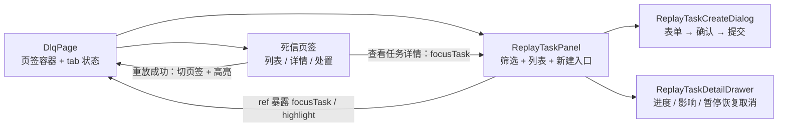
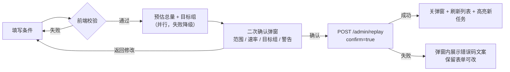
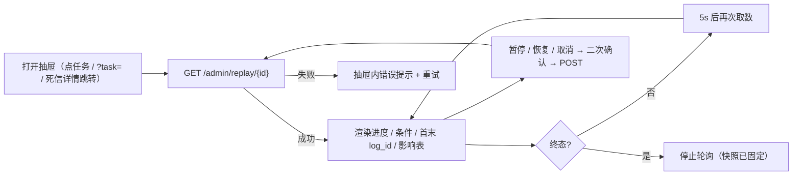

# 06-6-2 重放任务页面与联动 · 详细设计

> 08B · 06 管理与运维 · 06-6 重放任务 · 子任务 02（需求 06-6）

[文档首页](../../../../../../../文档首页.md) › [消息平台规划](../../../../../../../规划/01_规划_消息平台.md) › [阶段计划](../../../../../计划/01_计划_消息平台.md) › [06 管理与运维](../../../06_管理与运维.md) › [06-6 重放任务](../../06_管理与运维_06_重放任务.md) › [06-6-2 重放任务页面与联动](../06_管理与运维_06_重放任务_02_重放任务页面与联动.md) › 详细设计

## 0. 分章导航 <a id="toc"></a>

| 章 | 内容 |
| --- | --- |
| 1 | 任务级边界与已确认口径 |
| 2 | 交付物清单 |
| 3 | 现状核对结论 |
| 4 | 页面结构与组件划分 |
| 5 | 取数层与契约类型 |
| 6 | 创建表单与二次确认 |
| 7 | 任务列表 |
| 8 | 任务详情与轮询 |
| 9 | 死信联动 |
| 10 | 权限、错误码与文案 |
| 11 | 国际化键表 |
| 12 | 失败分支与交互细则 |
| 13 | 测试设计与验收映射 |
| 14 | 原型补页与逐页对照计划 |
| 15 | 登记落点 |
| 16 | 边界与开放项 |
| 17 | 对齐记录 |

## 1. 任务级边界与已确认口径 <a id="scope"></a>

**做什么**：在 06-5 已交付的死信页上补「重放任务」页签，交付创建（条件 / 分区 / 速率 / 二次确认）、任务列表（筛选 / 分页）、任务详情（进度 / 影响消费组表 / 暂停 / 恢复 / 取消）、死信重放与任务的联动；页面全部消费 06-6-1 已交付的端点，不改后端。

**不做什么**：

- 不改后端端点、契约、错误码与表结构（06-6-1 交付面）；不重写 `ReplayRunner` 与限速 / 状态机语义；
- 不在前端计算进度真值或积压真值（进度取 `replayed` / `total`，积压取 `affected_groups`）；
- 不做「一键全放」、不做跨租户重放、不展示消息正文；
- 不新建第二套重放页面、不新增路由、不改 bms 宿主与平台基类；
- 不做主题授权（06-7）与租户用量（06-8）。

**已确认口径（2026-11-09 会话逐项拍板）**：

| # | 事项 | 结论 |
| --- | --- | --- |
| 1 | 页面组织 | 单路由 `/msg/dlq` 内 `el-tabs`：「死信」「重放任务」两页签，共用页面骨架 |
| 2 | 任务详情形态 | 抽屉承载；`?task=<id>` 深链可直达（只读不写查询串），不新增路由 |
| 3 | 预计总量 | 复用 `GET /admin/messages?size=1` 的 `total`：全部分区 / 单一分区精确；多分区显示「以创建时计数为准」 |
| 4 | 目标消费组 | 确认前 `GET /admin/groups?namespace&topic&size=100` 列组名与数量，标注「以创建时解析为准」 |
| 5 | 进度刷新 | 详情非终态 **5s 自动轮询**，转终态或关闭抽屉即停 |
| 6 | 死信联动 | 重放成功自动切「重放任务」页签并高亮新任务；死信详情嵌关联任务状态 / 进度并可点开任务详情 |
| 7 | 分区输入 | 逗号分隔文本（空 = 全部分区），解析去重升序后回显；越界由后端 `350009` 拦 |
| 8 | 列表列与筛选 | 列：任务 / 目标主题（含命名空间）/ 条件 / 速率 / 进度 / 状态 / 创建时间；筛选：状态 / 命名空间 / 主题 / 创建时间区间 |

## 2. 交付物清单 <a id="deliverables"></a>

| # | 交付物 | 落点 |
| --- | --- | --- |
| D1 | 原型页签化 + 重放任务五场景（列表 / 新建 / 确认 / 详情 / 暂停确认） | `msg文档/设计/原型设计/07_原型设计_死信与重放.html`（改） |
| D2 | 原型总览 06 行描述与状态 | `msg文档/设计/原型设计/01_原型设计_总览.html`（改） |
| D3 | 取数层：列表 / 详情 / 创建 / 暂停 / 恢复 / 取消 + 预估总量 + 目标组 | `frontend/modules/msg/src/services/admin-service.ts`（改） |
| D3b | 展示侧纯函数：分区文本解析 / 条件摘要 / 表单校验 / 请求体归一 | `frontend/modules/msg/src/services/replay-format.ts`（新增） |
| D4 | 重放任务页签（筛选 / 列表 / 新建入口 / 联动方法） | `frontend/modules/msg/src/components/ReplayTaskPanel.vue`（新增） |
| D5 | 创建表单 + 二次确认 | `frontend/modules/msg/src/components/ReplayTaskCreateDialog.vue`（新增） |
| D6 | 任务详情抽屉（进度 / 影响表 / 操作 / 轮询） | `frontend/modules/msg/src/components/ReplayTaskDetailDrawer.vue`（新增） |
| D7 | 死信页改页签容器 + 死信详情关联任务块 + 重放成功后联动 | `frontend/modules/msg/src/views/DlqPage.vue`（改） |
| D8 | 轮询间隔常量 | `frontend/modules/msg/src/constants.ts`（改） |
| D9 | 文案与错误码键（`350016` / `350017` + 重放任务全套键） | `frontend/modules/msg/src/i18n/messages.ts`（改） |
| D10 | 用例：重放页新增 + 死信页 / 服务层 / 管理页回归 | `tests/replay-page.spec.ts`（新增）、`tests/dlq-page.spec.ts`、`tests/admin-service.spec.ts`、`tests/admin-pages.spec.ts`、`tests/replay-snapshots.spec.ts`（新增） |
| D11 | 实施 / 测试记录 + 原型与实现截图 | 任务目录 `实施/`、`测试/`、`测试/资源/` |
| D13 | 体积预算阈值（文案增长导致入口块超限） | `frontend/modules/msg/budget.json`（改：19 / 10.5） |
| D14 | 交互补充用例 + 实现快照导出 | `tests/replay-interactions.spec.ts`、`tests/replay-snapshots.spec.ts`（新增） |
| D12 | 计划 / 任务 / 需求回写 | 阶段计划 §2 / §3 / §10、任务文档 §2 / §3 |

## 3. 现状核对结论 <a id="current"></a>

| # | 事实 | 与本任务的关系 | 处置 |
| --- | --- | --- | --- |
| 1 | `DlqPage.vue` 单页两区块（死信表 + 重放任务占位空表） | 占位表由 06-6 交付的任务列表替代 | 改页签容器，删占位表（`msg.admin.dlq.replayLater` 等键随之退役） |
| 2 | 06-6-1 已交付 `GET /admin/replay`（列表）、`GET /admin/replay/{id}`（详情含 `affected_groups`） | 页面字段与接口同源，不自行算积压 | 列表项 `affected_groups = null` 按「—」不渲染；详情按契约取 |
| 3 | `POST /admin/replay` 带 `confirm`，pause / resume / cancel 契约不变 | 创建与三个状态操作均可直接接线 | 创建请求体内置 `confirm: true`（确认回调后才发） |
| 4 | `MessageItem` 检索端点支持 `partition` / `offset` / 时间 / `key` | 预估总量可复用，无需后端预估端点 | 见 §6.3；多分区不预估 |
| 5 | `GET /admin/groups` 支持 `namespace` + `topic` 过滤 | 目标组预览可复用 | 取 `items[].group`，失败降级 |
| 6 | `QUERY_ERROR_CODES` / `WRITE_ERROR_CODES` 未登记 `350016` / `350017` | 任务不存在 / 状态非法会落到 `error.fallback` | 两个集合补码并补 `error.<code>` 文案 |
| 7 | 既有 `ReadOnlyList` / `useMsgReadOnlyView` / `MsgConfirmDialog` / `BaseMsgWriteAction` 齐备 | 重放页签是同类只读 + 写操作组合 | 一律复用，不新增基类 |
| 8 | 原型 07 只有「死信区 + 重放任务只读区」两块，无页签、无创建 / 详情 / 确认 | 界面先原型：无原型不得实施 | 已先补原型（D1）并逐场景截图核对（§14） |
| 9 | `module.spec.ts` / `admin-routes.spec.ts` 断言 10 条路由 | 本任务不新增路由 | 断言不动 |
| 10 | `DlqPage.vue` 现状一次性挂两个 `read-only-list` | 页签化后两页签各自独立取数 | 死信视图保留；重放视图独立一套 |

## 4. 页面结构与组件划分 <a id="layout"></a>

```text
frontend/modules/msg/src/
├── views/DlqPage.vue                        # 改：页签容器 + 死信页签 + 死信详情关联任务块
├── components/
│   ├── ReplayTaskPanel.vue                  # 新增：重放任务页签（筛选 / 列表 / 新建入口 / 暴露 focusTask）
│   ├── ReplayTaskCreateDialog.vue           # 新增：创建表单 + 二次确认（两段式）
│   └── ReplayTaskDetailDrawer.vue           # 新增：详情抽屉（进度 / 影响表 / 暂停 / 恢复 / 取消 / 轮询）
├── services/admin-service.ts                # 改：六个重放请求 + 预估总量 + 目标组
├── constants.ts                             # 改：REPLAY_POLL_INTERVAL_MS = 5_000
└── i18n/messages.ts                         # 改：重放任务文案与两个错误码
```



- **组件归属**：三个新文件都是**页面具体件**（消费 props / 暴露方法，不构成可继承层），按《[前端基类清单](../../../../../../../前端基类清单.md)》§3 不登记；横切仍由 `BaseMsgReadOnlyView` / `BaseMsgWriteAction` 及两个投影承担。
- **状态归属**：`tab`、`highlightTask`、`replayPanelRef` 只在 `DlqPage` 持有；页签内部状态（选中任务、轮询句柄）留在各自组件，用 `dispose` / `onScopeDispose` 收口。
- **取数归属**：三个组件只经 `admin-service.ts` 的函数取数，不直接碰 `requiredHostApi()`。
- **不新造基类**：轮询与写操作分别复用 `useMsgReadOnlyView()`、`useMsgWriteAction()`；轮询以组件内 `setInterval` + 卸载清理实现（平台 `BaseAsyncTask` 是**提交型**任务的链，进度查询不是提交）。

## 5. 取数层与契约类型 <a id="service"></a>

全部类型取自 `@msg/api-types` 生成物，不手写：

| 导出 | 来源 |
| --- | --- |
| `ReplayTaskItem` / `ReplayTaskPage` / `AffectedGroupItem` | `Schema['ReplayTaskItem']` / `Schema['ReplayTaskPage']` / `Schema['AffectedGroupItem']` |
| `ReplayCreateBody` | `Schema['ReplayRequest']` |
| `ReplayQuery` | `Ops['list_replay_api_v1_msg_admin_replay_get']['parameters']['query']` |

| 函数 | 路径与口径 |
| --- | --- |
| `fetchReplayTasks(params)` | `GET /admin/replay`；空 `data` 回落空页 |
| `loadReplayTasks` | `ReadOnlyLoader<ReplayTaskItem>`，供 `useMsgReadOnlyView({ loader })` |
| `fetchReplayTask(taskId)` | `GET /admin/replay/{id}`；`data` 为空返回 `null` |
| `createReplayTask(body)` | `POST /admin/replay`，请求体固定并入 `confirm: true`（页面只在确认回调后调用） |
| `pauseReplayTask(taskId)` / `resumeReplayTask(taskId)` / `cancelReplayTask(taskId)` | `POST .../pause`、`/resume`、`/cancel`；无请求体 |
| `estimateReplayTotal(params)` | `GET /admin/messages`（`size=1`）取 `total`；失败返回 `null`（降级不阻断） |
| `fetchTopicGroups(namespace, topic)` | `GET /admin/groups`（`size=100`）取 `items[].group`；失败返回 `[]` |

- 写请求走既有 `requestWrite()`，业务码非 0 抛 `MsgQueryError`，由写操作基类捕获成 `errorCode`。
- 预估与目标组**不进写操作链**：它们是确认前的辅助信息，失败一律降级，不影响提交按钮可用性。

## 6. 创建表单与二次确认 <a id="create"></a>

### 6.1 表单字段

| 字段 | 控件 | 校验（前端） | 提交映射 |
| --- | --- | --- | --- |
| 命名空间 | 输入框（占位 `msg`） | 必填、≤64 | `namespace` |
| 主题 | 输入框（占位 `order.created`） | 必填、≤200 | `topic` |
| offset 起 / 止 | 两个数字输入（`controls=false`） | 均 ≥0；两者都填时起 < 止 | `offset_from` / `offset_to`（空 → `null`） |
| 时间起 / 止 | 两个 `datetime` 选择器（`value-format="YYYY-MM-DDTHH:mm:ss"`） | 两者都填时起 < 止 | `time_from` / `time_to`（空 → `null`） |
| 分区键 | 输入框 | ≤256 | `key`（空 → `null`） |
| 分区 | 输入框（逗号分隔，空 = 全部分区） | 仅允许数字与 `,` / 空格分隔；解析后去重升序 | `partitions`（空 → `null`） |
| 速率上限 | `el-input-number` 1~1000 | 范围由控件限制 | `rate_per_second` |

- **范围摘要**：表单底部实时渲染「条件：全部分区 · offset 100~200 · 时间 … · key=…」，与确认弹窗同一格式化函数（`describeReplayScope`），前端只做展示拼接。
- **不预填业务默认值**：命名空间 / 主题留空由用户填，避免误重放他人主题；速率缺省 100（与后端缺省一致）。

### 6.2 两段式提交



- 确认弹窗复用 `MsgConfirmDialog`：`rows` = 目标主题 / 范围条件 / 速率上限 / 预计总量 / 目标消费组数；`warning` =「重放会向目标分区追加写入新记录（分配新 `log_id`），消费端需按 `message_id` 幂等」；`danger` 为 `false`（重放非删除类不可逆操作）。
- 目标组以 chip 形式追加在弹窗 slot 内（复用原型 `.group-chip` 观感），并注明「以创建时解析为准」；无组时显示「该主题当前无订阅组」。
- 提交中双按钮禁用（`MsgConfirmDialog` 的 `loading` 由 `useMsgWriteAction().status` 驱动）。

### 6.3 预计总量口径

| 分区选择 | 取值方式 | 展示 |
| --- | --- | --- |
| 未填（全部分区） | `GET /admin/messages?namespace&topic&size=1`（不传 `partition`） | `total` 精确值 |
| 恰好 1 个分区 | 同上并传 `partition` | `total` 精确值 |
| ≥2 个分区 | **不请求**（单次检索只能按单分区过滤） | 「以创建时计数为准」 |
| 请求失败 | — | 「预计总量暂不可用」+ 不阻断提交 |

- 预估与创建**计数口径可能不一致**（预估按检索可见范围，创建按任务范围精确计数），文案固定写「预计 / 以创建时计数为准」，不承诺等值。
- 不逐分区循环累加：请求数随分区数放大，且属前端聚合计数，违反「不在前端算真值」的边界。

## 7. 任务列表 <a id="list"></a>

- 骨架复用 `ReadOnlyList`（标题 / 五态 / 分页 / 重试），数据由 `useMsgReadOnlyView({ loader: loadReplayTasks })` 提供。
- 筛选两行布局（与原型一致）：第一行状态 / 命名空间 / 主题；第二行创建时间起止 + 查询 / 重置 / 新建重放任务。

| 列 | 取值 | 说明 |
| --- | --- | --- |
| 任务 | `task_id`（`el-button link`） | 点击打开详情抽屉 |
| 目标主题 | `namespace` / `topic` | 主题停用后仍可展示（快照列） |
| 条件 | `describeReplayScope(task)` | 分区 / offset / 时间 / key 摘要 |
| 速率 | `rate_per_second` 条/秒 | 右对齐 |
| 进度 | `replayed` / `total` | 只展示数值，不画进度条（列表密集） |
| 状态 | 六态文案 + 标签色 | `pending` info / `running` success / `paused` warning / `completed` success / `failed` danger / `cancelled` info |
| 创建时间 | `created_at` | 等宽字体 |

- **行高亮**：`highlightTask` 命中的行加 `data-test="replay-row-active"` 与浅绿底（与原型一致），进入页签后 1 次生效、再次刷新保留。
- **空态 / 错误态**：交由 `ReadOnlyList` 渲染，错误文案按 `error.<code>`（含 `350016`）。
- **权限**：读 `msg:query`（`useMsgReadOnlyView` 内建 denied 态）；`新建重放任务` 按钮按 `msg:manage` 渲染。

## 8. 任务详情与轮询 <a id="detail"></a>



- **进度**：`el-progress` 百分比 = `round(replayed / total * 100)`（`total = 0` 记 0）；`completed` → `success`、`failed` → `exception`。
- **字段**：任务 ID、目标主题、条件摘要、速率、状态、首条 / 末条 `log_id`、创建时间、终结时间；`error_msg` 非空时以 error alert 展示「失败原因」。
- **影响消费组表**：列 = 消费组 / 基线积压 / 当前积压 / 变化 / 采集时刻；`delta > 0` 用警示色并加 `+`；`affected_groups === null` 或 `[]` → 「该主题无订阅组」空表文案；`affected_truncated` → 顶部 warning「仅展示前 100 个组（基线采集已截断）」。
- **操作按钮**（`msg:manage` 才渲染，终态一律不渲染）：
  - 暂停：`pending` / `running` 可点；
  - 恢复：`paused` 可点；
  - 取消任务：非终态可点，危险色。
- **操作确认**：三个动作都经 `MsgConfirmDialog`（`requiresConfirm` 恒真），取消弹窗带 error alert「已写入的记录不回滚：取消只是停止后续写入，消费端仍按 `message_id` 幂等」；成功后刷新详情与列表（`emit('changed')` → 面板 `refresh()`）。
- **轮询**：`setTimeout` 自递归（避免 `setInterval` 在慢响应下堆叠），间隔 `REPLAY_POLL_INTERVAL_MS = 5000`；任务转终态、抽屉关闭、组件卸载、**任意一次取数失败**即停止，失败提示自带「重新加载」按钮（实施时按此简化，见 §17 对齐记录）。
- **深链**：`DlqPage` 挂载时读 `route.query.task`，命中即 `tab='replay'` 并让面板打开该任务；关闭抽屉**不回写**查询串（保持地址稳定，刷新仍可复现最近一次深链）。

## 9. 死信联动 <a id="dlq"></a>

| 场景 | 行为 |
| --- | --- |
| 死信页签「重放」成功 | 关闭处置弹窗 → 刷新死信列表 → `tab='replay'` → `highlightTask = task_id` → 面板 `refresh()` → 成功提示 |
| 死信详情（已关联任务） | 展示「关联重放任务」区块：任务 ID、任务状态、进度（`fetchReplayTask` 实时取，失败显示「—」）、「查看任务详情」按钮 |
| 点「查看任务详情」 | 关闭死信抽屉 → `tab='replay'` → 面板 `focusTask(task_id)` 打开任务详情 |
| 未关联任务 | 区块显示「未关联重放任务」 |
| 终态与死信状态 | 页面**不**自行回写死信状态：死信列表 / 详情再次查询时由 06-5 惰性收口（沿用既定口径） |

- 父子联动用两个 prop 令牌：`refreshToken`（父页自增即触发一次重新取数）与 `focusTaskId`（父页写入即打开该任务详情）；不通过 `ref` + `defineExpose` 暴露方法（避免可选链引入不可达分支，见 §17）。

## 10. 权限、错误码与文案 <a id="auth"></a>

- 读：`msg:query`（列表 / 详情 / 预估总量 / 目标组取数）；写：`msg:manage`（创建 / 暂停 / 恢复 / 取消）。无写权限**不渲染**入口与按钮，不置灰。
- 错误码登记：`QUERY_ERROR_CODES` 补 `350016`；`WRITE_ERROR_CODES` 补 `350016`、`350017`。

| 码 | 文案（中 / 英） | 出现场景 |
| --- | --- | --- |
| `350016` | 重放任务不存在或不属于当前租户 / Replay task not found | 详情、暂停、恢复、取消 |
| `350017` | 任务当前状态不允许该操作，请刷新后重试 / Task state does not allow this action | 暂停 / 恢复 / 取消 |
| `350010` | 命名空间未登记或未启用（既有） | 创建 |
| `350001` | 主题不存在或未启用（既有） | 创建 |
| `350009` | 分区数 / 分区号 / 保留期非法（既有） | 创建（分区越界） |
| `10001` | 查询参数非法（既有） | 创建（区间颠倒）/ 列表分页 |
| `30001` | 无权限执行该操作（既有） | 写操作被展示层拦下 |

## 11. 国际化键表 <a id="i18n"></a>

| 键 | 中文 |
| --- | --- |
| `msg.admin.replay.tab` | 重放任务 |
| `msg.admin.replay.create` | 新建重放任务 |
| `msg.admin.replay.namespace` / `.topic` / `.offsetFrom` / `.offsetTo` / `.timeFrom` / `.timeTo` / `.key` / `.partitions` / `.rate` | 命名空间 / 主题 / offset 起 / offset 止 / 时间起 / 时间止 / 分区键 / 分区 / 速率上限 |
| `msg.admin.replay.partitionsHint` | 逗号分隔，如 0,1,2；留空 = 全部分区 |
| `msg.admin.replay.scope` | 范围摘要 |
| `msg.admin.replay.estimate` / `.estimateMulti` / `.estimateUnavailable` | 预计总量 / 多分区以创建时计数为准 / 预计总量暂不可用 |
| `msg.admin.replay.targetGroups` / `.targetGroupsNote` / `.targetGroupsEmpty` / `.targetGroupsUnavailable` | 目标消费组 / 以创建时解析为准 / 该主题当前无订阅组 / 目标组暂不可用 |
| `msg.admin.replay.confirmTitle` / `.confirmWarning` | 确认创建重放任务 / 重放会向目标分区追加写入新记录（分配新 log_id），消费端需按 message_id 幂等 |
| `msg.admin.replay.task` / `.condition` / `.progress` / `.createdAt` | 任务 / 条件 / 进度 / 创建时间 |
| `msg.admin.replay.status.pending` / `.running` / `.paused` / `.completed` / `.failed` / `.cancelled` | 待启动 / 运行中 / 已暂停 / 已完成 / 已失败 / 已取消 |
| `msg.admin.replay.detailTitle` / `.detailFailed` / `.logIdFirst` / `.logIdLast` / `.finishedAt` / `.errorMsg` | 重放任务详情 / 详情加载失败，请稍后重试 / 首条 log_id / 末条 log_id / 终结时间 / 失败原因 |
| `msg.admin.replay.affected` / `.baseline` / `.current` / `.delta` / `.capturedAt` / `.affectedEmpty` / `.truncated` | 影响消费组 / 基线积压 / 当前积压 / 变化 / 采集时刻 / 该主题无订阅组 / 仅展示前 100 个组（基线采集已截断） |
| `msg.admin.replay.pause` / `.resume` / `.cancel` / `.pauseTitle` / `.resumeTitle` / `.cancelTitle` | 暂停 / 恢复 / 取消任务 / 暂停重放任务 / 恢复重放任务 / 取消重放任务 |
| `msg.admin.replay.pauseHint` / `.resumeHint` / `.cancelWarning` | 暂停在批边界生效：当前批写完才停 / 恢复后从上次游标继续，速率上限不变 / 已写入的记录不回滚：取消只是停止后续写入，消费端仍按 message_id 幂等 |
| `msg.admin.replay.terminal` / `.pollPaused` | 终态任务只读，不提供暂停 / 恢复 / 取消 / 进度刷新已暂停，请手动重试 |
| `msg.admin.replay.validation` / `.invalidRange` / `.invalidPartitions` | 命名空间与主题必填 / 区间非法：起始须小于结束 / 分区只能填数字并以逗号分隔 |
| `msg.admin.dlq.relatedTask` / `.relatedTaskNone` / `.viewTask` | 关联重放任务 / 未关联重放任务 / 查看任务详情 |
| `error.350016` / `error.350017` | 见 §10 |

- 退役键（随占位表删除）：`msg.admin.dlq.replayLater`、`msg.admin.dlq.task`、`msg.admin.dlq.progress`、`msg.admin.common.later.replay`。
- 中英两包由同一份 `CATALOG` 派生，键集合天然一致；页面不出现硬编码中文。

## 12. 失败分支与交互细则 <a id="failures"></a>

| # | 分支 | 表现 |
| --- | --- | --- |
| 1 | 列表取数失败 | `ReadOnlyList` 错误态 + `error.<code>` 文案，`重新加载` 可重试；不渲染空白表 |
| 2 | 详情取数失败 | 抽屉内 error 提示 + 关闭；不渲染半份数据 |
| 3 | 轮询失败 | 首次失败提示；后续失败静默重试，连续 3 次停止轮询并提示 `pollPaused` |
| 4 | 创建前置校验失败 | 弹窗内红字提示，不发请求 |
| 5 | 创建被后端拒 | 弹窗内展示 `error.<code>`；表单值保留，可直接改后重试 |
| 6 | 暂停 / 恢复 / 取消失败 | 操作弹窗内展示 `error.<code>`（`350016` / `350017` 居多）；详情保持上一次数据 |
| 7 | 预估 / 目标组失败 | 降级文案，不阻断提交 |
| 8 | 无 `msg:query` | 整页/页签 denied 态（既有投影），不发请求 |
| 9 | 无 `msg:manage` | 新建入口、暂停 / 恢复 / 取消按钮不渲染 |
| 10 | 关闭抽屉 / 切页签 | 停止轮询与在途写操作（`dispose()`），不留定时器 |

## 13. 测试设计与验收映射 <a id="testing"></a>

| # | 用例 | 断言 | 验收 |
| --- | --- | --- | --- |
| 1 | 页签结构 | 渲染「死信」「重放任务」两页签；`?task=` 深链直接落重放页签并打开抽屉 | 完成标准 1 / 4 |
| 2 | 列表渲染 | 七列表头、状态文案、进度 `replayed / total`、条件摘要 | 完成标准 1 |
| 3 | 列表筛选 | 状态 / 命名空间 / 主题 / 创建时间各触发一次带参请求；重置清空 | 完成标准 1 |
| 4 | 创建校验 | 命名空间 / 主题为空、区间颠倒、分区非法 → 不发请求并提示 | 完成标准 2 |
| 5 | 预估与目标组 | 全部分区 / 单分区取 `total`；多分区不发请求；组名渲染为 chip | 完成标准 2 |
| 6 | 创建提交 | 确认后 `POST /admin/replay` 载荷含 `confirm: true` 与解析后的 `partitions`；成功后高亮新任务 | 完成标准 2 |
| 7 | 详情进度 | 进度百分比、首末 `log_id`、`error_msg` 展示 | 完成标准 1 |
| 8 | 影响表 | 基线 / 当前 / 变化 / 采集时刻渲染；`delta > 0` 加号；`affected_truncated` 提示；`null` → 空表文案 | 完成标准 1 |
| 9 | 暂停 / 恢复 / 取消 | 三个动作各自 `POST` 到对应路径；取消带危险提示；终态不渲染按钮 | 完成标准 1 / 2 |
| 10 | 权限态 | 无 `msg:manage` 隐藏新建与三个操作；无 `msg:query` 页签 denied | 完成标准 4 |
| 11 | 错误码展示 | 创建 / 操作失败分别渲染 `error.350010`、`error.350017` 文案 | 完成标准 2 |
| 12 | 死信联动 | 重放成功切页签 + 高亮；死信详情关联任务区块展示状态 / 进度，点按钮打开任务详情 | 完成标准 3 |
| 13 | 轮询 | 非终态 5s 后再取；转终态停止；卸载清理定时器 | 完成标准 1 |
| 14 | 既有回归 | `dlq-page.spec.ts` / `admin-pages.spec.ts` / `admin-service.spec.ts` / `module.spec.ts` / `admin-routes.spec.ts` 全绿 | 回归 |

- Kiwi：整个 06-6 一条用例（**2468**，06-6-1 已登记），本子任务与 06-6-1 同标该编号，不重复登记；前端新用例文件首行标注 `// kiwi_id: 2468`。
- 覆盖率：本任务 6 个变更源文件（`admin-service.ts` / `DlqPage.vue` / 三个新组件 / `messages.ts`）行 + 分支 100%，口径见 bms《AI开发规范》「覆盖率要求」节。
- 原型对照：按 §14 逐页核对，结论落测试记录「原型对照结论」节并附截图。

## 14. 原型补页与逐页对照计划 <a id="prototype"></a>

**原型依据**：[07 死信与重放](../../../../../../../设计/原型设计/07_原型设计_死信与重放.html)（06-6-2 补页签与重放任务五场景后定稿）。

| # | 场景 / 深链 | 核对要点 |
| --- | --- | --- |
| 1 | `?scene=list` | 两页签；死信筛选 / 列 / 操作列；重放任务改为页签入口 |
| 2 | `?scene=detail` | 死信详情含「关联重放任务」区块（任务 ID / 状态 / 进度 / 查看任务详情） |
| 3 | `?scene=dispose` | 重放速率 1~1000，确认后切页签的提示 |
| 4 | `?scene=replay-list` | 两行筛选、七列、状态徽标、高亮行提示、边界说明 |
| 5 | `?scene=replay-create` | 七个字段、范围摘要两行（条件 + 预计总量）、下一步按钮 |
| 6 | `?scene=replay-confirm` | 风险提示、五项影响行、目标组 chip、返回修改 / 确认创建 |
| 7 | `?scene=replay-detail` | 进度条与数字、九项描述、影响表五列、截断提示、暂停 / 取消 |
| 8 | `?scene=replay-pause` | 批边界说明、任务三项、取消 / 确认暂停 |

截图落 `测试/资源/01_测试记录_06-6-2/`（原型 `原型_NN_*.png`、实现 `实现_NN_*.png`），实现侧另用组件测试导出的静态 HTML（`实现快照/`）作为可复现证据。

## 15. 登记落点 <a id="registry"></a>

- 任务文档 §2 / §3（内容与完成标准随实施回写「已交付」口径）；
- 阶段计划 §2 已完成（06-6-2 行）、§3 与 §10 偏差与遗留（重放页面 / 死信联动闭环）；
- 需求 06-6 交付注块（与 06-6-1 合并一行，补前端面）；
- 06-6 父任务状态改「已完成」并迁入计划 §2；
- 原型总览 06 行（D2）；
- **不涉及**：后端基类清单 / 契约 / 表结构 / 路由数量。

## 16. 边界与开放项 <a id="out"></a>

| 事项 | 归口 |
| --- | --- |
| 组记录在进程内存，重启后基线 / 当前值可能取不到组 | 8B_02（组落表） |
| 预估总量与创建计数可能不一致（单次检索按单分区过滤） | 本任务文案已声明「以创建时计数为准」；精确预估端点待后续需求评估 |
| 死信状态事件驱动即时联动（现为查询惰性回写） | 8B 域后续（阶段计划 §10 遗留第 12 条） |
| 多实例下影响视图只反映本进程积压口径 | 8B_05 |
| 任务列表无「按创建人」过滤（契约未提供） | 后续需求（审计侧可查） |
| 深链只支持详情（`?task=`），不支持列表筛选入参 | 本任务口径；后续若需分享筛选态再扩 |

## 17. 对齐记录 <a id="align"></a>

| 日期 | 事项 | 处理 |
| --- | --- | --- |
| 2026-11-09 | 任务书「重放任务页签」与原型「两块区块」不一致 | 原型先改页签（含五场景）再实施，页签为唯一形态 |
| 2026-11-09 | 任务详情是否新开路由 | 抽屉 + `?task=` 深链，不新增路由（routes 断言不动） |
| 2026-11-09 | 「预计总量」无预估端点 | 复用消息检索 `size=1`；多分区不预估，文案声明以创建时计数为准 |
| 2026-11-09 | 「目标消费组」确认时如何得知 | 复用组列表按 `namespace + topic` 取，标注以创建时解析为准 |
| 2026-11-09 | 进度刷新方式 | 5s 自递归 `setTimeout`，终态 / 关闭 / 卸载 / 连续 3 次失败停止 |
| 2026-11-09 | 重放成功后是否停在死信页签 | 自动切重放页签并高亮新任务（连续处置多条的诉求由「留在死信页」建议改为默认切页） |
| 2026-11-09 | 分区输入形态 | 逗号分隔文本，前端只做解析去重，越界交后端 `350009` |
| 2026-11-09 | 列表列范围 | 原型六列 + 创建时间；筛选用满端点四个参数 |
| 2026-11-09 | 原型 `el-` 组件自闭合写法在 file:// 下断链 | 原型统一改显式闭合标签（HTML 解析器不支持自闭合自定义元素），并在样式里关闭抽屉 / 弹窗动效以便截图 |
| 2026-11-09 | 条件摘要 / 分区解析 / 表单校验 / 请求体归一落在哪 | 抽到 `services/replay-format.ts` 纯函数（列表与表单共用一份格式化，可单测），组件只做接线 |
| 2026-11-09 | 父子页签联动方式 | 由 `ref` + `defineExpose` 改为 `refreshToken` / `focusTaskId` 两个 prop 令牌，删除可选链与不可达分支 |
| 2026-11-09 | 轮询失败处理 | 由「连续 3 次失败停止」简化为「失败即停 + 重新加载按钮」，去掉只可能落在不可达分支上的计数 |
| 2026-11-09 | 死信详情打开时的取数顺序 | 详情主体先落库并结束 loading，再取关联任务（关联块自带加载态），避免整抽屉被二次取数拖住 |
| 2026-11-09 | 体积预算 | 新增文案使 module 入口块 7.2 → 9.8 KB；按确认口径上调 16/8 → 19/10.5 并登记「i18n 文案包分片」待办 |
