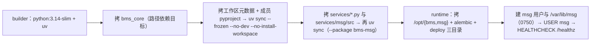

# 07-1-1 容器编排与持久化卷 · 实施记录

> 08B · 07 部署迁移与验收 · 07-1 部署形态与产品声明 · 子任务 01

[文档首页](../../../../../../../文档首页.md) › [消息平台规划](../../../../../../../规划/01_规划_消息平台.md) › [阶段计划](../../../../../计划/01_计划_消息平台.md) › [07 部署迁移与验收](../../../07_部署迁移与验收.md) › [07-1 部署形态与产品声明](../../07_部署迁移与验收_01_部署形态与产品声明.md) › [07-1-1 容器编排与持久化卷](../07_部署迁移与验收_01_部署形态与产品声明_01_容器编排与持久化卷.md) › 实施记录　|　[测试记录 →](../测试/01_测试记录_07-1-1_容器编排与持久化卷.md)

## 1. 信息 <a id="info"></a>

| 项 | 值 |
| --- | --- |
| 任务 | `07-1-1` 容器编排与持久化卷；对应需求 [07-1](../../../../../需求/07_需求_部署迁移与验收.md#r07-1) |
| 详细设计 | [01_详细设计_07-1-1_容器编排与持久化卷](../设计/01_详细设计_07-1-1_容器编排与持久化卷.md) |
| 测试记录 | [01_测试记录_07-1-1_容器编排与持久化卷](../测试/01_测试记录_07-1-1_容器编排与持久化卷.md) |
| Kiwi 用例 | **2472**（2026-11-10 登记，先登记后编码） |
| 实施日期 | 2026-11-10 |
| 实施人 | minjian |
| 环境 | 本地（Windows，无 Docker）+ 开发服务器 `mjbk`（Ubuntu 24.04，Docker 29.8.1）；构建上下文在服务器 `~/build/{msg,bms}`（`msg` 与 `bms` 平级），基座取 bms `49a9872f6` |

## 2. 交付物与落点 <a id="deliverables"></a>

| 类别 | 落点 | 内容 |
| --- | --- | --- |
| 镜像 | `deploy/Dockerfile` | 多阶段（builder / runtime）；上下文=工作区根；`uv sync --frozen --no-dev`；非 root（`msg`，uid/gid 10001）；`HEALTHCHECK /healthz`；`CMD python -m bms_msg` |
| 构建排除 | `deploy/Dockerfile.dockerignore` | 排除 `.git` / 本地产物 / 其他产品仓（`biz` `cws` `mdm` `engkit` `test`）/ 前端 / 文档 / `**/deploy/.env` |
| 编排 | `deploy/compose/msg.yml` | 服务名与容器名 `msg`、`expose 8000` 不映射宿主端口、平台外部网络、两个绑定卷、`stop_grace_period: 45s`、`restart: unless-stopped`、镜像 `…/msg:${MSG_TAG:?}` |
| 凭据模板 | `deploy/.env.example` | 新增 `MSG_DATA_HOST_DIR` / `MSG_OFFSETS_HOST_DIR`（含宿主目录准备命令注释）；镜像前缀写法补成「Registry + 项目路径」 |
| 本机规格 | `deploy/local_stack.toml` | 只补注释：开发态数据根 `backend/var/lib/msg` 与容器内 `/var/lib/msg` 的对照，数据目录不迁移 |
| 部署说明 | `deploy/compose/README.md` | 前置 / 宿主目录 / 构建 / 起停 / 日志 / 卷检查 / 重启自检 / 排障八节，命令全部变量占位 |
| 依赖 | `backend/pyproject.toml`、`backend/uv.lock` | dev 组新增 `pyyaml>=6.0`（解析编排文件，bms 已有同款先例）；`uv lock` 刷新为 `pyyaml 6.0.3` |
| 门禁 | `engkit.toml` | 新增 always 预检步骤「部署：编排与镜像资产断言」，`cwd = backend`，跑 `services/msg/tests/deploy` |
| 用例 | `backend/services/msg/tests/deploy/test_compose_assets.py` | 7 例静态断言（编排 / 端口网络 / 双卷 / 停机 / 镜像契约 / 凭据模板 / 构建排除），`kiwi_id(2472)` |

## 3. 实施过程与关键取舍 <a id="process"></a>

### 3.1 镜像（多阶段） <a id="image"></a>



- **工作区成员名是 `bms-msg`**（包名 `bms_msg`），故 `--package bms-msg`；`--no-dev` 同时挡掉 dev 组里的跨仓路径依赖 `engkit`（镜像内无该源码）。
- `services/*.py`（`module_registry` / `table_registry` / `form_registry`）必须进镜像：启动期表归属注入与平台装载校验都读它。
- 镜像内 `ops/` 不进（msg 无 `init_schema` / `migrate`，运行期不需要）；`alembic/` 保留（当前无脚本，按新基线重建时用）。
- `BMS_BACKEND_ROOT` 显式声明：基座按「上溯 `alembic.ini`」定位工程根，基座源码落在 `/opt/bms` 时会错位。

### 3.2 编排与卷 <a id="compose"></a>

- 镜像引用按拍板取 `${MSG_REGISTRY_IMAGE_PREFIX:?}/msg:${MSG_TAG:?}`（与 mdm / bms 同构），`MSG_TAG` / `MSG_REGISTRY_IMAGE_PREFIX` / 两个宿主目录变量全部 `:?` 必填，无 `latest` 兜底（真机负例见测试记录 S2/S3）。
- 两个绑定卷：`${MSG_DATA_HOST_DIR:?}` → `/var/lib/msg/data`、`${MSG_OFFSETS_HOST_DIR:?}` → `/var/lib/msg/offsets`；容器内 `MSG_DATA_DIR=/var/lib/msg` 固定，位点仍与 `data/` 平级（代码与目录布局零改动）。
- 健康检查只在镜像层（与 bms / mdm 同构），编排不重复声明；`stop_grace_period: 45s` 覆盖基座 30s 在途等待 + drain 协商与刷盘。
- 网关键 `networks.platform.name: ${PLATFORM_NETWORK:-deploy_default}`，仓内零环境事实（`mjbk` 实际值 `compose_default` 只落 `.env`）。

### 3.3 门禁与依赖 <a id="gate"></a>

- 只改编排 / 镜像文件时选测选不到用例（选测按 import 关系），故新增一条 **always 预检步骤**；实测该步骤 0.06s 出结果，未设 `MSG_COVERAGE_DATA` 时覆盖率插件静默不采，不污染后续覆盖率步骤。
- `pyyaml` 进 dev 组后 `uv lock` 仅新增一个包（95 packages），未动既有解析。

### 3.4 真机冒烟落地方式 <a id="smoke"></a>

服务器无 `~/msg`，且 `~/bms` 工作树有部署态改动，故不碰既有检出：

```text
① 本地打包 msg/backend + msg/deploy（排除 .venv / 缓存 / tmp）→ 服务器 ~/build/msg
② 服务器 ~/bms fetch 后 `git archive 49a9872f6 | tar -x -C ~/build/bms`（不动工作树）
③ 数据盘建绑定目录：install -d -o 10001 -g 10001 -m 0750 /…/msg/{data,offsets}
④ cd ~/build && docker build --provenance=false -f msg/deploy/Dockerfile .
⑤ 以 ~/build/msg/deploy/.env 起容器（冒烟关声明上报、库用容器内 SQLite）
```

## 4. 实施中遇到的问题与处置 <a id="issues"></a>

| # | 现象 | 根因 | 处置 |
| --- | --- | --- | --- |
| 1 | 容器起即退：`security.keys / service_token.keys Input should be a valid dictionary [input_value='']` | 编排把两个密钥键以 `${…:-}` 注入空串，pydantic 按字典类型解析空串即失败（「未配置」被表达成空字符串而非缺省） | 冒烟 `.env` 改 `{}`；`compose/README.md` 排障表补一条（缺键报 `dict_type` 时须给 JSON 字典或真实密钥）。**编排保持与 mdm 同构、不改成兜底**，真部署本就该注入真实密钥 |
| 2 | 加 `BMS_REGISTRY__REGISTER_ON_STARTUP=false` 到 `.env` 后仍走上报，报「服务令牌未配置签名私钥」 | `.env` 只用于**插值**，未被 `environment` 列出的键不会进容器 | 编排 `x-service-env` 显式列出该键（缺省 `true`，部署态保持真实行为，离线冒烟可置 false）；已回写设计 §5 |
| 3 | 冒烟写入脚本 `assert directory.bind(...)` 失败 | `PartitionDirectory.bind()` 返回「是否发生值冲突」，**首次绑定返回 False** | 冒烟脚本改为断言 `locate(1) is not None`；非代码缺陷，如实记录避免后人误判 |
| 4 | 第一次 `docker compose restart` 报变量缺失、容器未重启 | 命令漏了 `--env-file .env`（`:?` 必填变量插值失败即中止） | 补 `--env-file` 重跑，以 `docker inspect .State.StartedAt` 变化确认真的重启（不靠命令回显） |
| 5 | 容器日志被 `aiosqlite` debug 行刷屏（`BMS_ENV=dev` 的 debug=true） | 冒烟沿用 dev 环境 | 只影响冒烟噪声，不改配置；正式部署按 `prod` 配置（`docs_enabled=false`、JSON 日志） |

## 5. 验证 <a id="verify"></a>

| 面 | 证据 | 结论 |
| --- | --- | --- |
| 用例 | `uv run pytest services/msg/tests/deploy -q` | **7 passed**（0.06s） |
| 静态 | `ruff check` / `ruff format --check` / `pyright`（新用例 + 改动文件） | 全绿（ruff「All checks passed」；pyright `0 errors, 0 warnings`） |
| 构建 | `docker build --provenance=false -f msg/deploy/Dockerfile .`（上下文 `~/build`） | 成功，约 21s；多阶段生效（builder / runtime） |
| 镜像元数据 | `docker image inspect` | `User=msg`、`Cmd=[python -m bms_msg]`、`ExposedPorts=8000/tcp`、`Healthcheck` 命中 `/healthz`、`WorkDir=/opt/msg/backend` |
| 镜像布局 | 容器内 `ls` | `/opt/msg/deploy/{registry,boundaries,contracts}` 齐备；`/opt/bms/backend/libs/bms_core` 就位；无 `.env`、无 `frontend` |
| 探针 | 容器内请求 | `/healthz` 200；`/readyz` 200（`msg_storage` / `msg_recovery` / `database` 三项 ok） |
| 运行用户与卷权限 | `id` / `ls -ld` / 宿主 `stat` | 容器内 `uid=10001(msg)`；`/var/lib/msg{,/data,/offsets}` 0750 `msg:msg`；宿主目录 10001:10001 0750（`minjian` 无读权限，实证「仅服务账号可读写」） |
| 重启持久化 | 重启前后 `md5sum` + `StartedAt` | `StartedAt` 05:14:17 → 05:16:09；`…/0.log` 与 `1-0.offset` 哈希一致；重启后按真实存储接口回读命中 `offset 0 / log_id smoke-log-1`，`msg_partition_recovered … recovery_point=ok` |
| 停机 | `docker stop` 计时 + `ExitCode` + 日志 | 1s 退出、`ExitCode=0`、未 SIGKILL；日志序 `service_shutdown_started → background_loops_stopped → offset_flush_loop_stopped → msg_store_closed → msg_delay_store_closed → msg_offset_store_closed`（刷日志 → 刷 `.delay` → 刷位点，与 02-3 偏序一致） |
| 编排负例 | 缺 `MSG_TAG` / 缺 `MSG_DATA_HOST_DIR` | 均 `exit=1` 且报 `required variable … is missing a value` |

> 覆盖率：本任务无运行期源码改动（仅部署资产、dev 依赖与用例），变更行覆盖率门禁由提交前预检给出；用例文件本身被全量执行。

## 6. 偏差与遗留 <a id="deviation"></a>

| # | 事项 | 归口 |
| --- | --- | --- |
| 1 | 冒烟容器内 SQLite 库文件落在 `data/` 卷内（冒烟便利），真实部署库随平台库 | 07-2（配置分层）/ 07-1-2（声明装载） |
| 2 | 声明上报在冒烟中被关闭，未验证「平台装载后产品 / 服务行 / 路由可识别」 | 07-1-2 |
| 3 | 未构造真实在途长驻流（需租户令牌），停机只验「有活跃连接时仍优雅退出、无 SIGKILL」；drain 语义已在 03-4 覆盖 | 07-1-2 / 03 域 |
| 4 | msg 仓仍无 CI 流水线（镜像构建为手工命令） | 部署阶段专设任务 |
| 5 | `prod` 的 `auto_create=false` 与「无 `ops.init_schema` / `migrate`」并存，生产建表入口缺位 | 07-2 / 部署阶段 |
| 6 | 服务器 `~/build/{msg,bms}` 为本次冒烟的临时构建上下文（未清理，供复跑） | 部署阶段按需清理 |
| 7 | 容器内 TLS 终止未启用 | 架构 08 §11 待定项 |
