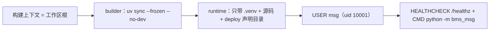

# 07-1-1 容器编排与持久化卷 · 详细设计

> 08B · 07 部署迁移与验收 · 07-1 部署形态与产品声明 · 子任务 01（需求 07-1）

[文档首页](../../../../../../../文档首页.md) › [消息平台规划](../../../../../../../规划/01_规划_消息平台.md) › [阶段计划](../../../../../计划/01_计划_消息平台.md) › [07 部署迁移与验收](../../../07_部署迁移与验收.md) › [07-1 部署形态与产品声明](../../07_部署迁移与验收_01_部署形态与产品声明.md) › [07-1-1 容器编排与持久化卷](../07_部署迁移与验收_01_部署形态与产品声明_01_容器编排与持久化卷.md) › 详细设计

## 0. 分章导航 <a id="toc"></a>

| 章 | 内容 |
| --- | --- |
| 1 | 任务级边界与输入基线 |
| 2 | 交付物清单 |
| 3 | 现状核对结论 |
| 4 | 镜像构建契约 |
| 5 | 容器编排契约 |
| 6 | 持久化卷与目录权限 |
| 7 | 启动、健康检查与停机 |
| 8 | 本机规格与部署说明 |
| 9 | 测试设计与验收映射 |
| 10 | 失败分支 |
| 11 | 登记落点与文档同步 |
| 12 | 边界与开放项 |
| 13 | 对齐记录 |

## 1. 任务级边界与输入基线 <a id="scope"></a>

**做什么**：把 msg 变成「从工作区根可稳定构建、可单容器启动、消息日志与位点文件落在独立持久卷、停机能等在途完成」的部署形态，并把这份形态用机器可判的用例钉住。

**不做什么**：

- 不改基座网关 / 认证 / Redis / MySQL / 可观测后端，不在 msg 仓部署基座基础设施；
- 不做多实例编排、分区迁移、容器内 TLS 终止（架构 08 §11 待定项，另行定稿）；
- 不在本任务做产品声明装载校验与就绪语义校验（归 07-1-2）；不在本任务做备份恢复（归 07-3）；
- 不补 msg 仓 CI 流水线（镜像构建流水线随部署阶段专设任务，本任务只给可复现的手工命令）；
- 不把 `.env` 或任何真实凭据写入仓库 / 镜像 / 文档。

**输入基线**：

| 输入 | 事实 |
| --- | --- |
| 数据根口径 | `bms_msg.core.config`：`MSG_DATA_DIR` 优先，缺省 `var/lib/msg`；`data/` 与 `offsets/` 均为其子目录（`DATA_ROOT_SUBDIR` / `OFFSETS_SUBDIR`） |
| 探针口径 | 基座共享应用挂载 `/healthz`（存活）与 `/readyz`（就绪）；`[health_check_registry].provider = "msg"`，就绪检查含 `msg_storage`（目录可写 + 水位）、`msg_recovery`、`database` |
| 停机口径 | 基座 `[server].graceful_timeout_seconds` 缺省 30s；信号接管见 `bms_core.core.run.serve_service`（首次 SIGTERM 摘流 + 等在途，第二次强退） |
| 同款实现 | `mdm/deploy/Dockerfile`（上下文=工作区根、`uv sync --frozen --no-dev`、`--no-install-workspace` 分层）、`mdm/deploy/Dockerfile.dockerignore`、`mdm/deploy/compose/mdm.yml`（服务名=服务标识、`expose 8000`、外部网络、镜像 tag `:?`） |
| 平台口径 | bms `deploy/compose/services.yml`：`restart: unless-stopped`、`expose 8000`、不映射宿主端口、健康检查写在镜像层 |
| 服务器事实 | `mjbk` 已装 Docker（29.8.1），平台网络实际名经 `PLATFORM_NETWORK` 注入（当前值 `compose_default`），已有 `~/bms` 与 `~/mdm`，**尚无 `~/msg`** |
| 门禁 | `engkit.toml` 的 `[[preflight.steps]]`（声明序即执行序）；`[guard] dir_test_threshold = 20`（单文件 / 窄目录 pytest 放行）；覆盖率插件仅在 `MSG_COVERAGE_DATA` 存在时采集 |

## 2. 交付物清单 <a id="deliverables"></a>

| 类别 | 交付物 | 说明 |
| --- | --- | --- |
| 镜像 | `deploy/Dockerfile` | 多阶段（builder / runtime）；上下文=工作区根；`uv sync --frozen --no-dev`；非 root 运行 |
| 构建排除 | `deploy/Dockerfile.dockerignore` | 随仓的 Dockerfile 专用 ignore（BuildKit 优先级高于上下文根 `.dockerignore`） |
| 编排 | `deploy/compose/msg.yml` | 服务名 `msg`、`expose 8000`、平台外部网络、两个绑定卷、`stop_grace_period: 45s` |
| 凭据模板 | `deploy/.env.example` | 新增 `MSG_DATA_HOST_DIR` / `MSG_OFFSETS_HOST_DIR` 两个必填键（含注释） |
| 本机规格 | `deploy/local_stack.toml` | 只补注释：开发态数据根与容器内挂载点的对应关系（不迁移开发数据） |
| 部署说明 | `deploy/compose/README.md` | 构建 / 起停 / 日志 / 卷检查 / 宿主目录准备命令（不含服务器地址、IP、账号） |
| 门禁 | `engkit.toml` | 新增一条 always 预检步骤：跑本任务的编排与镜像断言用例 |
| 依赖 | `backend/pyproject.toml` / `backend/uv.lock` | dev 组新增 `pyyaml`（解析编排文件；bms 已有同款先例） |
| 用例 | `backend/services/msg/tests/deploy/test_compose_assets.py` | 编排 / 卷 / 镜像 / 模板的断言，标 Kiwi 编号 |
| 文档 | 本设计 + 实施记录 + 测试记录 + 上层回写 | §11 |

## 3. 现状核对结论 <a id="current"></a>

| # | 现状 | 处置 |
| --- | --- | --- |
| 1 | `deploy/compose/` 只有一张 8B_00 占位 README，无 `msg.yml` | 新建编排；README 改为可复现的部署说明 |
| 2 | msg 仓无 `deploy/Dockerfile`，`backend/` 为 uv 工作区（成员 `services/*`，`bms-core` 与 `engkit` 为跨仓路径依赖） | 上下文上移到工作区根，只拷 `bms/backend/libs/bms_core` 与本仓后端；`engkit` 只在 dev 组，`--no-dev` 即可不带 |
| 3 | `backend/ops/` 只有 `contract_snapshot.py`，**无 `init_schema` / `migrate`** | 镜像不带 `ops/`；建表走启动期自动建表（`dev` 的 `auto_create = true`）；`prod` 的显式建表入口登记为遗留（§12） |
| 4 | 服务工程名是 `bms-msg`（包名 `bms_msg`） | `uv sync --package bms-msg`；入口 `python -m bms_msg` |
| 5 | 启动期会向平台上报名并拉权威快照（`registry.register_on_startup`） | 编排默认保持真值（真实部署必经）；冒烟用环境变量关闭，声明装载校验归 07-1-2 |
| 6 | `.env.example` 已有 `PLATFORM_NETWORK` / `MSG_REGISTRY_IMAGE_PREFIX` / `MSG_TAG` 与库、密钥键 | 只增量补两个卷路径键，既有键不动（`engkit` 的 `[rules.env_example]` 必填键清单保持命中） |
| 7 | 本地无 Docker；`mjbk` 有 Docker 但无 `~/msg` | 真机冒烟前把 msg 仓同步到 `~/msg`（与 `~/bms` 平级），上下文取两者父目录 |
| 8 | `mdm/deploy/Dockerfile` 为单阶段 | msg 按任务字面做多阶段；若实测 venv 跨阶段不可用，回退单阶段并回写本节（§12 开放项） |

## 4. 镜像构建契约 <a id="image"></a>

### 4.1 阶段与上下文



| 项 | 约定 |
| --- | --- |
| 构建命令 | `docker build --provenance=false -t <registry>/<path>/msg:<tag> -f msg/deploy/Dockerfile .`（`--provenance=false`：attestation 清单会被 Registry 拒绝） |
| 基础镜像 | `python:3.14-slim`（与 bms / mdm 同源，venv 跨阶段可直接复用） |
| builder | 换清华源做系统包安全更新 → 装 `uv` → 拷 `bms/backend/libs/bms_core` → 按层拷本仓工作区元数据与成员 pyproject → `uv sync --frozen --no-dev --no-install-workspace --package bms-msg` → 拷成员源码后再 `uv sync --frozen --no-dev --package bms-msg` |
| runtime | 从 builder 拷 `/opt/bms` 与 `/opt/msg`；再拷 `msg/deploy/{registry,boundaries,contracts}`；建数据目录与运行用户；`USER msg` |
| 依赖锁定 | `uv.lock` `--frozen`；`--no-dev` 排除 dev 组（含跨仓路径依赖 `engkit`，镜像内无该源码） |
| 工程根 | `BMS_BACKEND_ROOT=/opt/msg/backend` 显式声明（基座按上溯 `alembic.ini` 定位，基座源码在 `/opt/bms` 时会错位） |
| 入口 | `CMD ["python", "-m", "bms_msg"]`；`EXPOSE 8000` |
| 健康检查 | `HEALTHCHECK --interval=15s --timeout=3s --start-period=15s --retries=3`，打 `http://127.0.0.1:8000/healthz`（urllib，不引入 curl） |
| 凭据 | 镜像内零凭据：密钥 / 连接串一律运行时经 `BMS_` 环境变量注入；`deploy/.env` 不进上下文（`Dockerfile.dockerignore` 排除） |

### 4.2 镜像内布局

```text
/opt/msg/backend/                 # WORKDIR = BMS_BACKEND_ROOT
├── .venv/                        # uv 建的运行环境（跨阶段从 builder 拷贝）
├── alembic.ini                   # 基座按它上溯工程根
├── config.toml / config.{dev,test,prod}.toml
├── pyproject.toml / uv.lock
├── alembic/                      # 迁移机制保留（当前无脚本）
├── services/
│   ├── module_registry.py        # 产品自持清单（服务目录 / 表归属 / 表单标识）
│   ├── table_registry.py
│   ├── form_registry.py
│   └── msg/{pyproject.toml,src/bms_msg/…}
└── ../deploy/
    ├── registry/msg.toml          # 产品声明
    ├── boundaries/                # 域布局 / 护栏基线
    └── contracts/msg.json         # 公开契约快照
/opt/bms/backend/libs/bms_core/    # 共享基座源码（路径依赖就地成立）
/var/lib/msg/{data,offsets}/       # 数据卷挂载点（属主 msg:msg、0750）
```

### 4.3 构建上下文排除

`deploy/Dockerfile.dockerignore`（路径一律相对工作区根）：版本库与工作区配置（`.git/`、`*.code-workspace`）、本地产物（`tmp/`、`**/.cache/`、`**/.venv/`、`**/__pycache__/`、`**/node_modules/`、`*.db`、`*.log`）、与本镜像无关的平级仓与文档（`biz/`、`cws/`、`mdm/`、`test/`、`engkit/`、`msg/frontend/`、`msg/msg文档/`、`msg/scripts/`、`msg/deploy/compose/`）、部署态凭据与生成物（`**/deploy/.env`、`bms/deploy/releases/`、`bms/deploy/gateway/`）。

## 5. 容器编排契约 <a id="compose"></a>

| 键 | 值 | 理由 |
| --- | --- | --- |
| 服务名 / 容器名 | `msg` / `msg` | Compose DNS `msg:8000` 与平台网关声明式上游同口径 |
| 镜像 | `${MSG_REGISTRY_IMAGE_PREFIX:?}/msg:${MSG_TAG:?}` | 与 mdm / bms 同构；`:?` 强制必填、无 `latest` 兜底 |
| 端口 | `expose: ["8000"]`，**不写 `ports`** | 仅内部网络，经平台网关统一入口 |
| 重启策略 | `restart: unless-stopped` | 与平台其他服务同构 |
| 停机宽限 | `stop_grace_period: 45s` | 覆盖基座 30s 在途等待 + drain 协商与刷盘余量；Docker 缺省 10s 会 SIGKILL |
| 网络 | `networks: [platform]`；`platform: {external: true, name: ${PLATFORM_NETWORK:-deploy_default}}` | 仓内零环境事实，实际值经 `.env` 覆盖 |
| 卷 | 两个宿主绑定挂载（§6） | 消息日志与位点各一独立卷，不放容器可写层 |
| 环境 | `x-service-env` 锚点（`BMS_ENV`、库模板与密码、Redis、OTLP、服务间调用、边缘信任、双类令牌密钥）+ `MSG_DATA_DIR=/var/lib/msg` | 与 mdm 同构；密钥只经 `.env` 注入 |

**不写**：`depends_on`（平台基础设施归 bms 部署，Compose 项目不同、跨项目依赖无意义）、`healthcheck`（镜像层已声明，避免两处漂移）、`ports`、`profiles`。

## 6. 持久化卷与目录权限 <a id="volumes"></a>

| 卷 | 宿主（`.env`） | 容器内 | 内容 |
| --- | --- | --- | --- |
| 消息日志 | `${MSG_DATA_HOST_DIR:?MSG_DATA_HOST_DIR required}` | `/var/lib/msg/data` | `{tenant_id}/{namespace}/{topic}.{topic_id}/{partition}/` 段、索引、恢复点 |
| 位点文件 | `${MSG_OFFSETS_HOST_DIR:?MSG_OFFSETS_HOST_DIR required}` | `/var/lib/msg/offsets` | `{tenant_id}/{group}-{hash8}/{topic_id}-{partition}.offset` |

- 容器内数据根固定 `MSG_DATA_DIR=/var/lib/msg`，位点仍是 `data/` 的**平级子目录**——代码与目录布局零改动，只把两个子目录各挂一卷。
- 两个挂载均**不加 `:ro`**（服务要写）；也不挂元数据库目录（元数据库随平台库，容器内无库文件）。
- 宿主目录准备：`install -d -o 10001 -g 10001 -m 0750 <dir>`；镜像内 `/var/lib/msg/{data,offsets}` 亦为 `msg:msg 0750`，**非 root 运行与目录权限同一条链**——宿主目录属主不匹配时表现为 `/readyz` 503（`msg_storage` 写探测失败），不是启动失败。
- 预留空间：不新增参数，沿用 `MSG_STORAGE_REJECT_RATIO`（缺省 0.85，即预留 15%，落在架构 08 §4 的 10%~15%）。
- 卷与系统盘分离由宿主目录选择保证（部署侧把两个目录放到数据盘）；仓内不出现任何磁盘路径与服务器事实。

## 7. 启动、健康检查与停机 <a id="lifecycle"></a>

| 环节 | 行为 | 判据 |
| --- | --- | --- |
| 启动 | 建数据目录 → 装载配置 / 声明 → 启动期建表（`dev` `auto_create=true`）→ 恢复扫描（恢复点 / 尾部截断取证）→ 挂载路由 | 容器 `healthy`；`/healthz` 200 |
| 存活 | `/healthz`（镜像 `HEALTHCHECK`） | 失败由 Docker 重启容器（`unless-stopped`） |
| 就绪 | `/readyz` 200 才接流量（元数据可达 + 日志目录可写 + 水位未超拒绝阈值） | 不可写 / 水位越阈 → 503（语义细则归 07-1-2） |
| 停机 | SIGTERM → 摘流（GOAWAY / drain 标记）→ 等在途至 `graceful_timeout_seconds` → 逆序释放（刷日志 → 刷 `.delay` → 刷位点） | `docker stop` 在 45s 内正常退出；超时即 SIGKILL，视为配置不符 |

## 8. 本机规格与部署说明 <a id="docs"></a>

- `deploy/local_stack.toml`：**只补注释**——开发态数据根缺省 `backend/var/lib/msg`（相对 `backend/` 启动，已 gitignore），容器内对应 `/var/lib/msg`；不新增 `env`、不迁移已有开发数据。
- `deploy/compose/README.md`：给出「准备宿主目录 → 构建镜像 → 起 → 看日志 → 查卷 → 停 → 排障」命令序列，全部用变量占位（`<registry>`、`<tag>`、`<dir>`），**不写服务器地址 / IP / 端口 / 账号**；并登记禁用项（禁 `latest`、禁 `docker compose down -v`）。

## 9. 测试设计与验收映射 <a id="test"></a>

用例落 `backend/services/msg/tests/deploy/test_compose_assets.py`（`pyyaml` 解析编排，纯静态断言，不需要 Docker），并新增一条 always 预检步骤保证「只改编排 / 镜像文件」时也跑：

| 用例 | 断言 | 映射任务条目 |
| --- | --- | --- |
| T1 编排可解析与镜像必填 | `msg.yml` 可被 YAML 解析；`services.msg` 存在；`image` 同时含 `${MSG_REGISTRY_IMAGE_PREFIX:?` 与 `/msg:${MSG_TAG:?` | §2.2、§3「tag 必填且无 latest 兜底」 |
| T2 端口与网络 | `expose == ["8000"]`；无 `ports`；`networks == ["platform"]`；`platform.external is True`；缺省名 `deploy_default` | §2.2、§3「容器内 8000 可访问、加入平台网络」 |
| T3 卷与数据根 | 两个绑定卷分别指向 `/var/lib/msg/data` 与 `/var/lib/msg/offsets`，均非只读；`environment.MSG_DATA_DIR == "/var/lib/msg"`；两个宿主目录变量均为 `:?` 必填 | §2.3、§3「独立持久卷」 |
| T4 停机与重启策略 | `stop_grace_period == "45s"`；`restart == "unless-stopped"`；`container_name == "msg"` | §2.4、§3「优雅停机配置生效」 |
| T5 镜像契约 | `Dockerfile` ≥ 2 个 `FROM`；含 `--frozen` 与 `--no-dev`；`USER msg`；`EXPOSE 8000`；`HEALTHCHECK` 命中 `/healthz`；`CMD ["python", "-m", "bms_msg"]`；无 `PASSWORD=` / 私钥 / `frontend` 拷贝 | §2.1、§3「镜像不含凭据与前端 / 其他产品源码」 |
| T6 凭据模板 | `.env.example` 含 `PLATFORM_NETWORK`、`MSG_REGISTRY_IMAGE_PREFIX`、`MSG_TAG`、`MSG_DATA_HOST_DIR`、`MSG_OFFSETS_HOST_DIR`；无真实凭据 | §2.5、需求 07-2 前置 |
| T7 构建排除 | `deploy/Dockerfile.dockerignore` 排除 `mdm/`、`biz/`、`cws/`、`test/`、`engkit/`、`frontend`、`**/deploy/.env` | §2.1、§3「非目标产品源码不入镜像」 |

真机冒烟（`mjbk`，结果进测试记录）：

| # | 步骤 | 判据 |
| --- | --- | --- |
| S1 | 同步 msg 仓到 `~/msg`（与 `~/bms` 平级）→ 从父目录构建镜像 | 构建成功；`docker history` 可见两阶段产物，镜像内无凭据文件 |
| S2 | `docker compose config` 正例（`.env` 齐全） | 解析成功，镜像引用为 `…/msg:<tag>` |
| S3 | 缺 `MSG_TAG` / 缺 `MSG_DATA_HOST_DIR` 各跑一次 `docker compose config` | 非零退出并指出缺失变量 |
| S4 | `up -d`（`BMS_REGISTRY__REGISTER_ON_STARTUP=false`、`BMS_ENV=dev`、SQLite 指到 `/var/lib/msg/sqlite`） | 容器 `healthy`；`/healthz` 200；`/readyz` 200 |
| S5 | 数据面写入消息 + 提交位点，记录 `data/` 与 `offsets/` 下的文件 | 两处均有文件；属主为 `10001:10001` |
| S6 | `docker restart` → 再查文件与 `/readyz` | 文件仍在；`/readyz` 200；同批消息可再读 |
| S7 | 发起在途长驻流 → `docker stop`，看日志与退出码 | 观察 drain 日志；`stop` 在 45s 内返回、退出码 0（无 SIGKILL） |

## 10. 失败分支 <a id="failure"></a>

| # | 触发 | 表现 | 处置 |
| --- | --- | --- | --- |
| 1 | 缺 `MSG_TAG` / `MSG_REGISTRY_IMAGE_PREFIX` / 两个宿主目录变量 | `docker compose config` 立即报错（`:?`），容器零创建 | 按 `.env.example` 补齐；这是刻意设计，不做兜底 |
| 2 | 平台网络不存在（`PLATFORM_NETWORK` 写错） | `up` 报 network not found | 先确认 bms 部署已建网络，再改 `.env`（仓内不写网络名真值） |
| 3 | 宿主目录属主不是 10001 或权限不足 | 容器起来但 `/readyz` 503、日志出现存储写探测失败 | 宿主侧 `install -d -o 10001 -g 10001 -m 0750`；已存在数据目录用 `chown -R` |
| 4 | 镜像 tag 不存在 / Registry 不可达 | `pull` 失败、`up` 中止 | 先用 `docker build` 产出该 tag；禁改 `latest` |
| 5 | `uv sync --frozen` 与 `uv.lock` 不一致 | 构建期失败并提示 lock 需刷新 | 本地 `uv lock` 后重提交，不在 Dockerfile 里去 `--frozen` |
| 6 | 停机超 45s 未退出 | `docker stop` 触发 SIGKILL，日志缺收尾行 | 查是否卡在恢复 / 刷盘；按实测把 `stop_grace_period` 与 `graceful_timeout_seconds` 一起调（一次改编排一处） |
| 7 | 启动期声明上报被平台拒绝 | 容器启动失败、日志 `CatalogError` | 本任务范围内用 `BMS_REGISTRY__REGISTER_ON_STARTUP=false` 复跑定位；声明问题归 07-1-2 |

## 11. 登记落点与文档同步 <a id="register"></a>

| 落点 | 内容 |
| --- | --- |
| 计划表（进度唯一落点） | 07-1 行：状态、完成日期、偏差列，按计划表既有列回写（子任务进度并入父任务行） |
| 任务文档 | 不改内容；完成情况只在计划表与本设计 / 实施 / 测试记录体现 |
| 架构 08 | 若「容器内是否非 root / 卷形态」与架构表述有偏差，回写 §2 / §4 |
| 需求 07-1 | 不改（进度不落需求文档） |
| 实施记录 / 测试记录 | `实施/`、`测试/` 各一份（信息 / 过程 / 问题与处置 / 验证 / 覆盖率 / 偏差与遗留） |

## 12. 边界与开放项 <a id="open"></a>

| # | 事项 | 归口 |
| --- | --- | --- |
| 1 | CI 镜像构建流水线（msg 仓无 `.gitlab-ci.yml`） | 部署阶段专设任务（本次登记遗留） |
| 2 | `prod` 的 `[database].auto_create = false` 却无 `ops.init_schema` / `migrate` 入口 | 07-2 配置分层 / 部署阶段；本次冒烟用 `dev` 自动建表 |
| 3 | 容器内 TLS 终止是否启用 | 架构 08 §11 待定项，另行定稿 |
| 4 | 多阶段构建若实测 venv 跨阶段不可用 | 回退单阶段并回写 §4 / §3；本次先实测 |
| 5 | 声明装载与就绪语义（含磁盘满 / 元数据不可达的 503 形态） | 07-1-2 |
| 6 | 位点日快照与恢复顺序 | 07-3 |

## 13. 对齐记录 <a id="align"></a>

2026-11-10 逐项拍板（全部取推荐项）：

| # | 待决项 | 结论 |
| --- | --- | --- |
| 1 | 镜像引用 | `${MSG_REGISTRY_IMAGE_PREFIX:?}/msg:${MSG_TAG:?}`（与 mdm / bms 同构） |
| 2 | Dockerfile 形态 | 多阶段（builder + runtime） |
| 3 | 构建排除落点 | 随仓 `deploy/Dockerfile.dockerignore` |
| 4 | 卷形态 | 宿主绑定挂载 + `.env` 变量（两个必填键） |
| 5 | 运行用户 | 非 root（`msg`，uid 10001） |
| 6 | 健康检查落点 | 镜像 `HEALTHCHECK`，编排不重复 |
| 7 | `stop_grace_period` | 45s |
| 8 | 测试落点 | pytest 用例 + 预检 always 步 |
| 9 | 真机冒烟 | 本次在 `mjbk` 做完整冒烟 |
| 10 | 冒烟口径 | 关闭启动期声明上报；容器内 SQLite（`dev`） |
| 11 | `local_stack.toml` | 只补注释 |
| 12 | 镜像内容 | 后端工程 + `deploy/{registry,boundaries,contracts}` |
| 13 | `PLATFORM_NETWORK` | 缺省 `deploy_default`，`.env` 覆盖 |
| 14 | CI | 不补，登记遗留 |

---

> 依《[文档生成规范](../../../../../../../../bms文档/规范/文档生成规范.md)》编写 · 部署口径见 bms《[部署发布规范](../../../../../../../../bms文档/规范/部署发布规范.md)》
