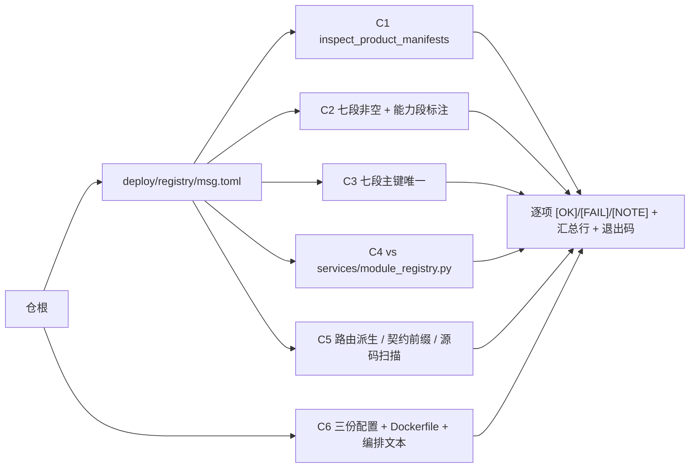

# 07-1-2 产品声明与就绪探针 · 实施记录

> 08B · 07 部署迁移与验收 · 07-1 部署形态与产品声明 · 子任务 02

[文档首页](../../../../../../../文档首页.md) › [消息平台规划](../../../../../../../规划/01_规划_消息平台.md) › [阶段计划](../../../../../计划/01_计划_消息平台.md) › [07 部署迁移与验收](../../../07_部署迁移与验收.md) › [07-1 部署形态与产品声明](../../07_部署迁移与验收_01_部署形态与产品声明.md) › [07-1-2 产品声明与就绪探针](../07_部署迁移与验收_01_部署形态与产品声明_02_产品声明与就绪探针.md) › 实施记录　|　[测试记录 →](../测试/01_测试记录_07-1-2_产品声明与就绪探针.md)

## 1. 信息 

| 项 | 值 |
| --- | --- |
| 任务 | `07-1-2` 产品声明与就绪探针；对应需求 [07-1](../../../../../需求/07_需求_部署迁移与验收.md#r07-1) |
| 详细设计 | [01_详细设计_07-1-2_产品声明与就绪探针](../设计/01_详细设计_07-1-2_产品声明与就绪探针.md) |
| 测试记录 | [01_测试记录_07-1-2_产品声明与就绪探针](../测试/01_测试记录_07-1-2_产品声明与就绪探针.md) |
| Kiwi 用例 | **2473**（2026-11-10 登记，先登记后编码；回读核对一致） |
| 实施日期 | 2026-11-10 |
| 实施人 | minjian |
| 环境 | 本地（Windows，无 Docker）+ 开发服务器 `mjbk`（Ubuntu 24.04，Docker 29.8.1，平台栈在线：`bms-mysql` / `bms-redis` / `bms-apisix` / `bms-gateway-nginx`）；构建上下文 `~/build/{msg,bms}` |

## 2. 交付物与落点 

| 类别 | 落点 | 内容 |
| --- | --- | --- |
| 自检命令 | `backend/ops/check_deployment.py` | 六项判据：C1 结构装载（复用 `inspect_product_manifests`）/ C2 七段齐备 / C3 唯一性 / C4 服务行同值 / C5 路由口径 / C6 探针接线；退出码 0/1 |
| 镜像判据 | `deploy/Dockerfile` | `HEALTHCHECK` 改打 `/readyz`（exec 形式），并补三行判据理由 |
| 部署说明 | `deploy/compose/README.md` | 状态含义改述为「healthy = 就绪」；新增「部署自检」节；排障表按 `checks` 失败项分列 |
| 用例 | `backend/services/msg/tests/deploy/test_deployment_selfcheck.py` | 20 例：自检正例 / 缺段 / 非法服务行 / 重名 / 服务行漂移 / 路由派生与越界 / 探针接线 / 仓根反例 / 入口守卫 |
| 用例 | `backend/services/msg/tests/deploy/test_route_namespace.py` | 4 例：契约内部前缀、装配后 OpenAPI 同口径、对外命名空间派生、源码无自拼前缀 |
| 用例 | `backend/services/msg/tests/deploy/test_probes.py` | 9 例：`/healthz` 身份、`/readyz` 200 与五类 503、恢复受损仍 200、探测不污染拒绝指标 |
| 用例 | `backend/services/msg/tests/deploy/test_shutdown_order.py` | 2 例：资源逆序释放（日志 → `.delay` → 位点）、`start_drain()` 后 `/readyz` 503 |
| 用例修订 | `backend/services/msg/tests/deploy/test_compose_assets.py` | 镜像判据断言由 `/healthz` 改 `/readyz`，并加「不得出现 `/healthz`」反向断言 |
| 门禁 | `engkit.toml` | **未新增步骤**：07-1-1 的 always 步已覆盖 `services/msg/tests/deploy`（目录级） |
| 文档 | 本记录 + 测试记录 + 计划回写 + 07-1-1 设计与记录回写 + 架构 08 §2 回写 | §6 / §7 |

## 3. 实施过程与关键取舍 

### 3.1 自检命令 

- **判据不发明**：结构装载直接复用平台同一实现（`inspect_product_manifests`），自检只补平台不管的四件事——段齐备、段内唯一性、声明↔代码清单同值、部署资产接线。
- **零依赖**：只用标准库 + `bms_core`，**不 import `yaml`**（`pyyaml` 在 dev 组，运行镜像内没有），编排文件按文本断言；配置读 `tomllib`，不经 `Settings`（避免锚定 `_CONFIG_DIR` 的导入序坑）。
- **唯一性比平台严**：基座对错误码「同清单重复声明」已判错，对种子 / 数据源等按「同键同值去重」放行；自检对七段主键**任何重复都算违规**（清单里的重复行是复制粘贴痕迹）。
- **可测**：六项判据都是「入参即数据」的纯函数，`run()` 只负责读文件与拼装，用例可直接喂构造数据（含 `tmp_path` 造的最小仓根）。
- 首个真实拦截：改 Dockerfile 之前跑自检即报 `C6 探针接线 2 项违规`——证明判据有效，不是摆设。

### 3.2 路由口径 

- 内部前缀由基座 `BaseRouter` 统一挂载，契约快照 49 条路径中业务路径一律 `/api/v1/msg/...`；另有 `/`、`/healthz`、`/readyz`（探针出口）与 `/msg/*`、`/rpc/{service}/{method}`（帧与 RPC 长驻流入口）。
- 对外命名空间按清单三元组派生：`product_route_prefix("msg","msg") == "/api/msg/v1/msg"`、`upstream_node("msg") == "msg:8000"`；服务行 `service_group = "product"` 使其**不生成**服务级路由（避免 `/api/msg/v1` 双路径并存）。
- 源码零 `/api/msg` 字面量（扫描 `backend/services/msg/src`）。

### 3.3 探针与健康判据 

- 端点与检查项沿用 02-6（`msg_storage` / `msg_recovery` / `database`），本任务只补端点级正反断言；「恢复未完成」按两层落地——启动期未完成 → `startup_complete=False` → 503；运行期数据有损 → 非必需项失败但保持 200。
- `HEALTHCHECK` 改打 `/readyz`：存活由进程退出表达（Docker 只在进程退出时按 `restart` 重启，**不因 unhealthy 重启**），判据放就绪侧后 `docker ps` 的 `Health.Status` 才与「能不能服务」一致，也与网关摘流同源。
- 真机实证：把拒绝阈值临时调到极低（`MSG_STORAGE_WARN_RATIO=0.0005` / `MSG_STORAGE_REJECT_RATIO=0.001`）后 `/readyz` 503 且 `checks.msg_storage.error = MsgStorageWatermarkExceededError`，容器 `Health=unhealthy`；复原后 `healthy`。

## 4. 实施中遇到的问题与处置 

| # | 现象 | 根因 | 处置 |
| --- | --- | --- | --- |
| 1 | 开启动上报后容器起即退：`CatalogError: 服务目录校验失败：mdm/mdm → mdm：目标服务未登记（mdm）` | **bms 侧缺陷**：`bms_core/application.py::_validate_service_catalog` 把目录行按「平台行 + 本方产品行」收敛，但传给 `ModuleRegistry` 的**产品路由基准**仍是全量视图（快照投影后含 `mdm` 路由）→ 别家路由的目标服务被误判未登记。同一缺陷会让 mdm 在 msg 注册后也无法重启 | 按拍板「记录 + 两阶段取证」处理：不在他仓打临时补丁；登记为遗留（§6 第 1 条），生产过程重启前必须先修 |
| 2 | 改完镜像后容器 `Health=unhealthy`，健康日志 `sh: Syntax error: Unterminated quoted string` | 我改 `HEALTHCHECK` 时漏了 JSON 结尾引号（`timeout=2)]`），Docker 判定 JSON 非法**回落 shell 形式**（`Test` 变成 `CMD-SHELL` 包住整段 JSON） | 补引号并重建；新增经验：判据改动后必须用 `docker image inspect --format '{{json .Config.Healthcheck.Test}}'` 核对是 `CMD`（exec 形式）而非 `CMD-SHELL` |
| 3 | 冒烟写入脚本把消息写到了 `/var/lib/msg/data/data/...` | `PartitionDirectory` 的 `root` 是**数据根**（内部再拼 `data/`），脚本误传了 `ROOT/"data"` | 脚本改传数据根；清理误写目录后重跑 |
| 4 | 位点提交后 `msg_offset_store_closed files=0` | 沿用 07-1-1 的组名 `smoke-group`，盘上已有位点 1，本次提交 1 属「位点相同不前进」→ 不置脏、不落盘 | 换新组 `smoke-0712` 重跑，`msg_offset_flushed files=1`，位点文件生成 |
| 5 | 一次性容器设 `MSG_STORAGE_REJECT_RATIO=0.001` 起不来：`水位阈值须满足 0 < 告警 < 拒绝 < 1` | 告警阈值仍为缺省 0.7 | 同时给 `MSG_STORAGE_WARN_RATIO=0.0005`，阈值序成立后正常启动并 503 |
| 6 | 编排未透传 `MSG_STORAGE_*`，无法用编排直接做水位演练 | `.env` 只做插值，未列入 `environment` 的键不进容器 | 水位演练改用一次性容器（同镜像、同卷、显式 `-e`）完成；配置分层留归 07-2（§6 第 4 条） |
| 7 | 平台已有 `mdm` 产品路由，msg 开上报时 `declaration_reported` 全部 `unchanged` | 首次启动（同一 `.env`）已完成落库，第二次为幂等重放 | 属预期（声明幂等）；登记行时间戳与快照版本已取证 |

## 5. 验证 

| 面 | 证据 | 结论 |
| --- | --- | --- |
| 自检命令 | `python -m ops.check_deployment` | 六项全绿：`检查项 6 项：通过 6，失败 0`；能力段标注正常输出 |
| 用例 | `pytest services/msg/tests/deploy -q` | **42 passed**（1.7s） |
| 静态 | `ruff check` / `ruff format --check` / `pyright`（新模块 + 四个用例文件） | 全绿（`All checks passed`、`0 errors`） |
| 覆盖率 | `engkit coverage --module ops.check_deployment`（采集自 engkit 插件） | **100% 行 + 分支**（`missing_lines=0 partial_branches=0`） |
| 真机·建库 | `msg` / `msg_demo` / `msg_acme` / `msg_archive` + `msg_app` | 库与账号就位（与 mdm 同形） |
| 真机·镜像 | `docker image inspect` | `Healthcheck.Test[0] = CMD`、命中 `/readyz`；`User=msg`、`WorkDir=/opt/msg/backend` |
| 真机·装载 | `declaration_reported` + 平台库 | 产品 1 / 服务行 1 / 产品路由 1 / 数据源 4 / 种子 2 / 错误码 31 / 业务域 1；快照版本 18 |
| 真机·网关 | 平台容器 `ops.gateway_config render --from-registry` → `docker cp` → APISIX 文件轮询热加载 | 生成件含 `msg:8000` 与 `route-msg-msg`（`/api/msg/v1/msg`、`/api/msg/v1/msg/*`、`^/api/msg/v1(.*)$ → /api/v1$1`）；线上 diff 只新增 msg 两段 |
| 真机·路由可达 | `curl /api/msg/v1/msg/admin/topics` | **401**（forward-auth 拦截，证明路由命中且非 404）；`/api/mdm/v1/mdm/health` 同为 401 作对照 |
| 真机·探针 | `docker exec msg python -c urlopen('/healthz' / '/readyz')` | `{"status":"ok","service":"msg","version":"0.1.0"}`；`readyz` 三项 `checks` 全 ok |
| 真机·重启三样 | 重启前后 `md5sum` + `StartedAt` + 库行 | `StartedAt` 06:08:02 → 06:09:15；日志 `00000000000000000000.log` 与位点 `1-0.offset` 哈希一致；`msg.msg_topic` 行仍在；重启后 `Health=healthy`、`/readyz` 200 |
| 真机·水位拒绝 | 一次性容器（`WARN=0.0005` / `REJECT=0.001`，同卷） | `/readyz` **503** 且 `checks.msg_storage.error = MsgStorageWatermarkExceededError`；`Health=unhealthy`（判据同源实证） |
| 真机·停机 | `docker stop` 计时 + `ExitCode` + 日志序 | 1s 退出、`ExitCode=0`、无 SIGKILL；序为 `service_shutdown_started → background_loops_stopped → offset_flush_loop_stopped → msg_store_closed → msg_delay_store_closed → msg_offset_store_closed`（日志 → `.delay` → 位点） |

## 6. 偏差与遗留 

| # | 事项 | 归口 |
| --- | --- | --- |
| 1 | **bms 缺陷**：接库服务目录校验的路由基准未按声明方作用域收敛 → 已有他产品路由的平台上，产品开上报即拒启（msg 实测；mdm 亦会中招）。**生产过程重启产品前必须先修** | bms 平台注册域任务（07B `04_02` 后续修复，需补用例：存在他产品路由时产品进程可启动） |
| 2 | 开上报下「容器 healthy + `/readyz` 200」未取到（被第 1 条阻断）；运行时证据是在关上报下取得的（与 07-1-1 同口径） | 随第 1 条修复后补；本条不改变「声明可装载」的结论（登记行与网关路由已实证） |
| 3 | 路由可达只验到「401（命中路由 + 认证拦截）」，未取到带用户令牌的 200 | 需真实用户态令牌（07-4 迁移联调时补） |
| 4 | 编排未透传 `MSG_STORAGE_WARN_RATIO` / `MSG_STORAGE_REJECT_RATIO` 等水位旋钮，生产只能改镜像或手工 `-e` | **07-2 已闭环**：三个水位旋钮（含 `MSG_STORAGE_SAMPLE_TTL_MS`）经模板 / 编排透传，由注册表与用例钉住 |
| 5 | 元数据行由 SQL 直接写入（数据面写入端点需租户令牌 + 权限码），非业务路径写入 | 07-4 联调 / 07-6 故障演练时改用真实链路 |
| 6 | 服务器 `.env` 现为「开上报=false」的冒烟态，`/mnt/ssd2t/msg/{data,offsets}` 内仍有 07-1-1 冒烟遗留的 SQLite 库文件与段文件 | 部署阶段按需清理；本次未删除任何既有数据 |
| 7 | 开发服务器平台库新增 msg 登记行与库（`msg*`），网关生成件新增 msg 路由 | 保留（幂等、不影响其他产品）；如需回收按登记行逐条退役 |
| 8 | 容器内 TLS 终止未启用 | 架构 08 §11 待定项 |
| 9 | 本任务设计文档与实施 / 测试记录合并为一次 `docs` 提交（代码与文档分开，符合「一个任务最多两次提交」） | 已按此执行 |
