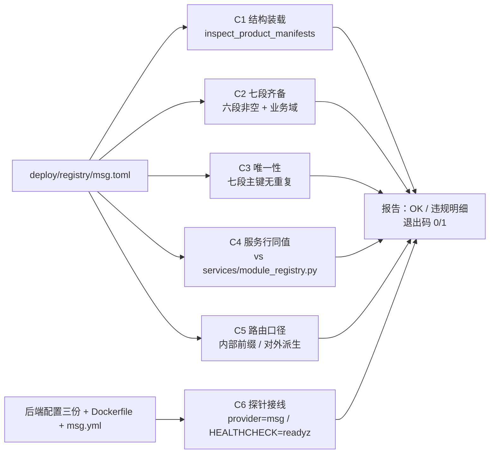

# 07-1-2 产品声明与就绪探针 · 详细设计

> 08B · 07 部署迁移与验收 · 07-1 部署形态与产品声明 · 子任务 02（需求 07-1）

[文档首页](../../../../../../../文档首页.md) › [消息平台规划](../../../../../../../规划/01_规划_消息平台.md) › [阶段计划](../../../../../计划/01_计划_消息平台.md) › [07 部署迁移与验收](../../../07_部署迁移与验收.md) › [07-1 部署形态与产品声明](../../07_部署迁移与验收_01_部署形态与产品声明.md) › [07-1-2 产品声明与就绪探针](../07_部署迁移与验收_01_部署形态与产品声明_02_产品声明与就绪探针.md) › 详细设计

## 0. 分章导航 <a id="toc"></a>

| 章 | 内容 |
| --- | --- |
| 1 | 任务级边界与输入基线 |
| 2 | 交付物清单 |
| 3 | 现状核对结论 |
| 4 | 产品声明自检契约 |
| 5 | 路由口径契约 |
| 6 | 探针接线与就绪语义 |
| 7 | 容器健康检查判据 |
| 8 | 真机验证口径（装载 / 重启 / 停机） |
| 9 | 测试设计与验收映射 |
| 10 | 失败分支 |
| 11 | 登记落点与文档同步 |
| 12 | 边界与开放项 |
| 13 | 对齐记录 |

## 1. 任务级边界与输入基线 <a id="scope"></a>

**做什么**：把「产品声明能被平台装载」「对外 / 内部命名空间同源」「`/healthz` 与 `/readyz` 判的是能写」三件事变成**可机器判的结论**——一条离线自检命令 + 一组端点级正反用例 + 一次真机装载与重启验证。

**不做什么**：

- 不重写 02-6 的检查项与自持注册表（`msg_storage` / `msg_recovery` / `database` 已在位），本任务只做端点级正反断言与接线自检；
- 不改基座探针实现（`bms_core/api/health.py`）、不改网关路由生成器（`bms_core/services/gateway_catalog.py`）；
- 不实现多实例健康聚合、分区迁移（归 8B_05）；不做容器内 TLS 终止（架构 08 §11 待定项）；
- 不重复实现契约零漂移校验（预检 `ops.contract_snapshot check` + 前端 `api-types --check` 已覆盖）；
- 不做备份恢复（归 07-3）；不改平台基础设施编排。

**输入基线**：

| 输入 | 事实 |
| --- | --- |
| 声明源 | `deploy/registry/msg.toml`：产品档案 1 / 服务行 1 / 产品路由 1 / 数据源 4 / 种子 2 / 错误码 22 / 业务域 1 / 资源类型 1；**无 `[[collaborations]]`**（本产品不对外提供能力） |
| 装载实现 | `bms_core.registry.products.inspect_product_manifests()`（装配期与离线门禁共用），跨清单唯一性 / 契约反向对账 / 错误码段位校验均在其内 |
| 代码清单 | `services/module_registry.py`（`MSG_PRODUCT_RECORDS` / `MSG_SERVICE_RECORDS`，装配期与声明「同键同值去重、异值即拒」） |
| 路由派生 | `product_route_prefix(product_key, domain)` → `/api/{product}/v1/{domain}`；`upstream_node(service_key)` → `{service}:8000`；`service_group = "product"` 的服务**不生成**服务级路由（`platform_route_services()` 排除） |
| 内部前缀 | 契约快照 49 条路径，业务路径一律 `/api/v1/msg/...`（另有 `/`、`/healthz`、`/readyz`、`/metrics` 等非业务路径） |
| 探针 | 基座共享应用挂 `/healthz`（存活 + 服务身份）/ `/readyz`（启动完成态 + 摘流 + 注册表聚合）；`[health_check_registry].provider = "msg"` 已写入 `config.toml` / `config.prod.toml` / `config.test.toml` |
| 拒绝指标 | `StorageWatermark.refusal()` **不计数**（供 `/readyz`）；`ensure_writable()` 才 `record_rejection`（供发布闸门） |
| 停机 | `ResourceManager.aclose()` 逆序释放；`configure_service` 登记序 `OffsetFlusher → DelayCloser → StorageCloser`，故关闭序为「刷日志 → 刷 `.delay` → 刷位点」（02-3 偏序） |
| 摘流 | `ServiceRuntime.start_drain()` 幂等：`draining = True` 且 `startup_complete = False` → `/readyz` 立即 503 |
| 真机 | `mjbk` 平台栈在线（`bms-mysql` / `bms-redis` / `bms-apisix` / `bms-gateway-nginx`），`mdm` 已按同一形态装载（网关生成件含 `route-mdm-mdm`）；平台网络 `compose_default` |
| 同款先例 | mdm《组织主数据首次部署》详细设计 §6.1：库名走「前缀 = 服务标识去重」（`mdm` / `mdm_{租户}` / `mdm_archive`），应用账号 `mdm_app`，密钥取 bms `deploy/.env` 同值 |

## 2. 交付物清单 <a id="deliverables"></a>

| 类别 | 交付物 | 说明 |
| --- | --- | --- |
| 自检命令 | `backend/ops/check_deployment.py` | 离线自检：声明装载 + 七段齐备 + 唯一性 + 服务行同值 + 路由口径 + 探针接线；退出码 0/1 |
| 镜像判据 | `deploy/Dockerfile` | `HEALTHCHECK` 由 `/healthz` 改 `/readyz`（与网关摘流同判据，§7） |
| 部署说明 | `deploy/compose/README.md` | 健康判据改述为「就绪」；自检命令改为看 `Health.Status` 与 `/readyz` |
| 用例 | `backend/services/msg/tests/deploy/test_deployment_selfcheck.py` | 自检命令正反（C1~C8，§4/§9） |
| 用例 | `backend/services/msg/tests/deploy/test_route_namespace.py` | 内部前缀 / 对外命名空间 / 禁止自拼（§5） |
| 用例 | `backend/services/msg/tests/deploy/test_probes.py` | `/healthz`、`/readyz` 正反 + 拒绝指标不污染（§6） |
| 用例 | `backend/services/msg/tests/deploy/test_shutdown_order.py` | 关闭偏序 + 摘流后 503（§8） |
| 用例修订 | `backend/services/msg/tests/deploy/test_compose_assets.py` | 镜像判据断言由 `/healthz` 改 `/readyz`（07-1-1 的 2472 用例同批修订） |
| 门禁 | `engkit.toml` | **不新增步骤**：07-1-1 的 always 步已跑 `services/msg/tests/deploy`（目录覆盖新用例） |
| 文档 | 本设计 + 实施记录 + 测试记录 + 计划回写 + 07-1-1 设计与记录回写 + 架构 08 §2 回写 | §11 |

## 3. 现状核对结论 <a id="current"></a>

| # | 现状 | 处置 |
| --- | --- | --- |
| 1 | `/healthz` / `/readyz` 端点、三项检查项、`provider = "msg"` 三份配置均已就位（02-6），但**没有端点级用例**：只有检查项级与「工厂登记顺序」级 | 本任务补端点级正反（T6~T9），不改实现 |
| 2 | 任务字面「恢复未完成时保持 503」与 02-6 的「`msg_recovery` 非必需」并存 | 语义分层落地：**启动期恢复未完成** → `startup_complete = False` → 503（不接流量）；**运行期发现数据有损** → 非必需项失败 → 保留 200 但 `checks.msg_recovery.ok = false`（02-6 已定，摘实例不能修复损失）。两条都在用例里钉住（T8 / T9） |
| 3 | `07-1-1` 把镜像 `HEALTHCHECK` 定在 `/healthz`，与本任务「与网关摘流同一判据」冲突 | 改 `/readyz`（本次拍板），同步改 2472 用例断言、`compose/README.md`、07-1-1 设计与记录、架构 08 §2 |
| 4 | msg 仓无 `ops/check_modules`；声明装载校验一直靠 bms 侧手工跑跨仓 `check_modules` | 新增 `ops/check_deployment.py`（自持、离线、零平台依赖），把「七段齐备 / 唯一性 / 服务行同值 / 路由口径 / 探针接线」一次判完 |
| 5 | `[[collaborations]]`（能力段）为空，`inspect_product_manifests` 对其缺省放行 | 自检判「六段非空 + 业务域非空」，能力段允许空但**必须显式标注**（拍板），避免「少声明」与「不需要」混为一谈 |
| 6 | 契约零漂移已由预检覆盖（`ops.contract_snapshot check` + `api-types --check`） | 本任务只断言「内部前缀一致 + 对外派生正确」，不重复做文件级漂移比对 |
| 7 | 真机平台栈在线、`mdm` 已装载并可经 `/api/mdm/v1/mdm/...` 路由 | msg 复用同一形态：`msg_app` + `msg` / `msg_demo` / `msg_archive` 库、密钥取 bms `deploy/.env` 同值、开启动上报 |
| 8 | `deploy/compose/msg.yml` 已设 `BMS_DATABASE__NAME_PREFIX=msg`、`MSG_DATA_DIR=/var/lib/msg`、`BMS_REGISTRY__REGISTER_ON_STARTUP` 缺省 `true` | 真机只需补齐 `.env`（密钥 / 库地址 / 卷目录），编排零改动 |
| 9 | 平台注册表模式下产品域若无拓扑行，网关渲染会因「域未在部署拓扑登记」被拒 | 真机按需跑平台 `ops.migrate_topology`（缺行补齐），**不在 msg 仓写拓扑** |

## 4. 产品声明自检契约 <a id="manifest"></a>

### 4.1 入口与输出 <a id="cli"></a>

```text
backend/ops/check_deployment.py          # 全项自检；任一违规 → 明细 + 退出码 1
```

- 取数与 `ops/contract_snapshot.py` 同口径：脚本自定位 `backend/`（`parents[1]`）与仓根（`parents[2]`），把 `services/msg/src` 加入 `sys.path`，**不依赖 `PYTHONPATH`**；
- 只做**离线**判定：读本仓声明 / 契约 / 配置 / 镜像 / 编排文本，不连库、不起应用、不读别的产品仓；
- 依赖限定：只用标准库（`tomllib` / `pathlib` / `re`）与 `bms_core.registry.products`；**不引入 `yaml`**（`pyyaml` 在 dev 组，生产镜像内没有），编排文件按文本断言。



### 4.2 检查项 <a id="checks"></a>

| 编号 | 检查项 | 判据 | 违规文案要点 |
| --- | --- | --- | --- |
| C1 | 结构装载 | `inspect_product_manifests([<本仓清单>])` 的 `errors` 为空（解析 + 跨清单唯一性 + 契约反向对账 + 码段校验全在其内） | 原样带出基座错误明细，不二次改写 |
| C2 | 七段齐备 | `products` / `services` / `product_routes` / `data_sources` / `seeds` / `error_codes` / `domains` **均非空**；`collaborations` 允许为空，为空时报告追加一行 `[NOTE] 能力段未声明：本产品不对外提供能力` | 「<段> 段为空（七段须齐备）」 |
| C3 | 唯一性 | 服务行 `service_key`、产品路由 `(product_key, domain)`、数据源 `data_source_key`、种子 `name`、错误码 `code`、业务域 `domain_key`、资源类型 `key` 各自**无重复**（同值重复也算违规） | 「<段> 主键重复：<键>」 |
| C4 | 服务行同值 | 声明服务行与 `MSG_SERVICE_RECORDS[0]` 六键一致：`module_key` / `service_key` / `table_prefix` / `business_code` / `errcode_segment` / `event_domain`（连同 `product_key` / `service_group` / `contract_version`） | 「字段 <名> 声明 = <a>、代码 = <b>」 |
| C5 | 路由口径 | ① 每条产品路由派生前缀 == `/api/msg/v1/msg`；② `upstream_node("msg") == "msg:8000"`；③ 服务行 `service_group == "product"`（不生成服务级路由）；④ 契约快照业务路径全部以 `/api/v1/msg` 开头；⑤ `services/msg/src` 下无 `/api/msg` 字面量（禁自拼产品前缀） | 「外部前缀派生不符」「契约路径不在内部前缀下：<path>」「源码自拼产品前缀：<文件>:<行>」 |
| C6 | 探针接线 | ① `config.toml` / `config.prod.toml` / `config.test.toml` 的 `[health_check_registry].provider == "msg"`；② `deploy/Dockerfile` 的 `HEALTHCHECK` 命中 `/readyz` 且不命中 `/healthz`；③ `deploy/compose/msg.yml` 不声明 `healthcheck`（判据单点） | 「<配置> 未接 msg 自持注册表」「镜像健康检查判据应为 /readyz」「编排重复声明健康检查」 |

**报告形态**：逐项一行 `[OK] C1 结构装载：0 违规` / `[FAIL] C2 七段齐备：<明细>` / `[NOTE] 能力段未声明…`；末行 `检查项 6 项：通过 N，失败 M`；失败即退出码 1。

## 5. 路由口径契约 <a id="routes"></a>

| 面 | 形态 | 事实源 | 断言 |
| --- | --- | --- | --- |
| 内部（服务自身挂载） | `/api/v1/msg/...` | 基座 `BaseRouter` 统一前缀 + msg 路由模块 | 契约快照业务路径全部在 `/api/v1/msg` 下（T4） |
| 对外（平台网关） | `/api/msg/v1/msg/...` | 清单 `[[product_routes]]`（`product_key=msg` / `domain=msg` / `service_key=msg`）+ 网关生成器 | `product_route_prefix("msg","msg") == "/api/msg/v1/msg"`；上游 `msg:8000`（T5） |
| 桥接 | `^/api/msg/v1(.*)$` → `/api/v1$1` | 网关 `proxy-rewrite` | 域段保留为服务内首段，故 `.../v1/msg/ack` ↔ `/api/v1/msg/ack` 一一对应 |
| 禁止 | 模块自拼产品前缀、自建 HTTP 服务 | — | 源码无 `/api/msg` 字面量；不生成 `/api/msg/v1`（服务级）路由——产品分组服务被 `platform_route_services()` 排除，避免双路径并存 |

真机侧判据：经网关 `GET /api/msg/v1/msg/admin/topics` **返回 401**（forward-auth 拦截，证明路由命中且上游可达）；若返回 404 则视为路由未生成。

## 6. 探针接线与就绪语义 <a id="probes"></a>

### 6.1 端点形态 <a id="shape"></a>

| 端点 | 通过 | 不通过 | 判据来源 |
| --- | --- | --- | --- |
| `GET /healthz` | `200 {"status":"ok","service":"msg","version":"<v>"}` | 进程已退出（无响应） | 进程存活 + `app.state.service_identity` |
| `GET /readyz` | `200 {"status":"ok","checks":{"msg_storage":{"ok":true,"error":null},"msg_recovery":{…},"database":{…}},"service":"msg","version":"<v>"}` | `503 {"status":"down","checks":{…}}` | 启动完成态 + 摘流标记 + 注册表聚合（`error` 只放异常类名） |

探针豁免统一响应包裹（基座 `default_responses=False`），HTTP 状态码保留传输语义，不套「业务失败统一 200」。

### 6.2 503 触发矩阵 <a id="matrix"></a>

| 触发 | 失败项 | 语义 | 用例 |
| --- | --- | --- | --- |
| 启动期恢复未完成 | `checks` 为空（`startup_complete = False`） | 不提前接流量 | T8-a |
| 停机摘流中 | `checks` 为空（`draining = True`） | 网关应摘流 | T8-b、T10 |
| 磁盘满 / 超拒绝阈值 | `msg_storage`，`error=MsgStorageWatermarkExceededError` | 能写才 200；507 是发布侧语义，就绪侧统一 503 | T8-c |
| 日志目录不可写 | `msg_storage`，`error=StorageProbeError` | 真实写探测（非 `os.access`） | T8-d |
| 元数据不可达 | `database`，`error` 为驱动异常类名 | 元数据在平台库，不可达则一切发布无意义 | T8-e |
| 运行期发现数据有损 | `msg_recovery`，`error=MsgRecoveryDegradedError`，**整体仍 200** | 02-6 口径：摘实例不能修复损失，降级只做可见（告警联动归 06-3） | T9-b |

### 6.3 探测不污染拒绝指标 <a id="metrics"></a>

`MsgStorageCheck` 只调 `reading()` + `refusal()`；`refusal()` 不计数，计数只发生在 `ensure_writable()`。用例钉住：拒绝态下连续探测 N 次，`StorageMetrics.snapshot()["msg_storage_rejected_total"]` 仍为 0；随后一次 `ensure_writable()` 才变 1。

## 7. 容器健康检查判据 <a id="healthcheck"></a>

| 项 | 结论 |
| --- | --- |
| 镜像 `HEALTHCHECK` | 打 `http://127.0.0.1:8000/readyz`（urllib，不引入 curl），超时 / 间隔 / 起始窗口沿用 07-1-1 的 `15s / 3s / 15s / 3 次` |
| 为什么不是 `/healthz` | 「存活」由进程是否退出表达，Docker 本就只在进程退出时按 `restart` 策略重启，`HEALTHCHECK` 不触发重启；把判据放在就绪侧，`docker ps` 的 `Health.Status` 才与「能不能服务」一致，也才与网关摘流同判据 |
| 盘满时的表现 | 容器 `unhealthy`，但**不重启**（Docker 不会因 unhealthy 重启）；发布侧由 `msg_storage_rejected_total` 与 507 暴露，处置是清理 / 扩容 |
| 编排 | 不重复声明 `healthcheck`（判据单点，C6-③ 断言） |
| 网关摘流 | `/readyz` 503 即应摘流；容器 `draining = True` 时同样 503，两者同一来源（同一份检查项注册表） |

## 8. 真机验证口径（装载 / 重启 / 停机） <a id="smoke"></a>

环境：`mjbk`；构建上下文 `~/build/{msg,bms}`（07-1-1 遗留的临时上下文，本次复用）；平台网络 `compose_default`。

| # | 步骤 | 判据 |
| --- | --- | --- |
| S1 | 建库与账号：`msg` / `msg_demo` / `msg_archive` + `msg_app`（`GRANT ALL ON msg.*` 与 ``msg\_%``.*，与 mdm 同形） | 账号可连、三库存在 |
| S2 | 构建镜像（含 `HEALTHCHECK /readyz`）并核对镜像元数据 | `docker image inspect` 的 `Healthcheck.Test` 命中 `/readyz` |
| S3 | `.env` 就位（镜像前缀 / 标签 / 平台网络 / 库地址与密码 / 服务令牌与安全密钥 / 两个卷目录），`docker compose config` 通过 | 解析成功；缺键即报错 |
| S4 | `up -d`（**开启**启动上报），看日志与健康状态 | 容器 `healthy`；日志出现声明上报成功与权威快照拉取；`declaration_manifest_missing` 不出现 |
| S5 | 查平台库登记行 | 产品档案 / 服务行 / 产品路由 / 业务域 / 错误码段位落在平台库，且与清单同值 |
| S6 | 网关：平台容器内 `ops.gateway_config render`（注册表模式）→ `docker cp` 回宿主 `deploy/gateway/apisix.yaml` → APISIX 文件轮询热加载 | 生成件含 `/api/msg/v1/msg` 且上游 `msg:8000`；经 nginx `GET /api/msg/v1/msg/admin/topics` 返回 **401**（非 404） |
| S7 | 数据面写入：建主题 → 发一批消息 → 提交位点 | `data/` 有段文件、`offsets/` 有位点文件、`msg` 库有 `msg_topic` 行 |
| S8 | `docker restart`（`StartedAt` 必须变化）→ 复查三样 + 探针 | 三样齐全（库行 / 段 / 位点）；`/readyz` 200；已发消息可再读 |
| S9 | 水位拒绝演练：临时把拒绝阈值调到极低（不改盘、不填盘）→ 探测 → 复原 | `docker inspect` 的 `Health.Status` 变 `unhealthy`；`/readyz` 503 且 `checks.msg_storage.error = MsgStorageWatermarkExceededError`；阈值复原后转回 200 / `healthy` |
| S10 | `docker stop` 计时 + 退出码 + 关闭日志 | 45s 内退出、`ExitCode=0`、无 SIGKILL；日志偏序「日志 → `.delay` → 位点」 |

> 装载会向运行中的平台写入 msg 登记行（幂等，不影响其他产品）；网关生成件只**追加**一条产品路由（渲染幂等，未变更项逐字不变）。

## 9. 测试设计与验收映射 <a id="test"></a>

用例落 `backend/services/msg/tests/deploy/`（已被 07-1-1 的 always 预检步骤覆盖，**不新增预检步骤**），全部标同一 Kiwi 编号。

| 用例 | 断言 | 映射任务条目 |
| --- | --- | --- |
| T1 自检正例 | `check_deployment` 全项通过、退出码 0；报告含「能力段未声明」标注 | §2.1 |
| T2 声明装载反例 | 删 `[[products]]` → C2 违规；服务行缺 `table_prefix` / `errcode_segment` 非 2 位 → `CatalogError`；服务键 / 错误码 / 种子名重复 → C3 违规 | §2.1、§2.8 |
| T3 服务行同值 | 声明服务行与代码清单六键 + 版本 / 分组一致；改一字段即 C4 违规 | §2.1 |
| T4 内部前缀 | 契约快照业务路径全部 `/api/v1/msg`；装配后 `app.openapi()` 同断言 | §2.2 |
| T5 对外命名空间 | `/api/msg/v1/msg` 派生、上游 `msg:8000`、`service_group=product`、源码无 `/api/msg` | §2.2 |
| T6 `/healthz` | 200 + `status=ok` + `service` / `version` | §2.3 |
| T7 `/readyz` 正例 | 200，三项 `checks` 皆 `ok` | §2.3、§2.4 |
| T8 `/readyz` 反例 | 磁盘满 / 目录不可写 / 数据库不可达 / 启动未完成 / 摘流中 → 503 且指明失败项 | §2.4、§2.8 |
| T9 指标与降级 | 探测不增 `msg_storage_rejected_total`（`ensure_writable` 才增）；`msg_recovery` 失败仍 200 | §2.4 |
| T10 关闭与摘流 | `ResourceManager` 逆序关闭 = 日志 → `.delay` → 位点；`start_drain()` 后 `draining=True` 且 `/readyz` 503 | §2.5、§2.6 |

覆盖率：新增 `ops/check_deployment.py` 按项目口径 100% 行 + 分支（用例直接调其纯函数与 `main()`）；用例文件本身由 always 步全量执行。

## 10. 失败分支 <a id="failure"></a>

| # | 触发 | 表现 | 处置 |
| --- | --- | --- | --- |
| 1 | 清单某段被删 / 改写 | `check_deployment` 报 C1 / C2 / C3 违规、退出码 1 | 按明细修清单；这是刻意设计，不做兜底 |
| 2 | 声明与代码清单漂移 | C4 违规；装配期亦会 `CatalogError`（异值即拒） | 两侧同步；不得只改一侧 |
| 3 | 平台拒收上报 | 容器启动失败、日志 `CatalogError` | 先看平台返回的错误明细（段位撞码 / 域未登记 / 种子名前缀不符），按 07-1-1 排障表定位 |
| 4 | 平台缺该产品域拓扑行 | 网关 `render` 报「域未在部署拓扑登记」 | 平台侧 `ops.migrate_topology` 补行；不在 msg 仓写拓扑 |
| 5 | 网关生成件未热加载 | 请求仍 404 | 确认文件被替换（宿主 `git`/`cp` 换 inode，APISIX 1s 轮询）；再看 `apisix` 日志的路由加载行 |
| 6 | `msg_app` 权限不足 | 启动期建表 / 查询失败 | 补 `GRANT`；不要改用 root 账号绕过 |
| 7 | 宿主目录属主不匹配（10001） | 容器 `unhealthy`、`/readyz` 503、`msg_storage` 写探测失败 | 宿主侧 `install -d -o 10001 -g 10001 -m 0750` |
| 8 | `HEALTHCHECK` 改 `/readyz` 后编排等待超时 | `docker compose up --wait` 等到 `start-period + retries × interval` 仍未就绪 | 查启动期恢复是否长时间未完成；确认不是把「恢复中」当成「故障」 |

## 11. 登记落点与文档同步 <a id="register"></a>

| 落点 | 内容 |
| --- | --- |
| 计划表（进度唯一落点） | 07-1 行：状态 / 完成日期 / 偏差列（子任务进度并入父任务行） |
| 07-1-1 详细设计 §4.1 / §7 | 健康检查判据由 `/healthz` 改 `/readyz`，补一句判据理由与回写记录 |
| 07-1-1 实施记录 / 测试记录 | 同批回写：判据变更、2472 用例断言修订 |
| 架构 08 §2 | 「健康检查」行改为「镜像层 `HEALTHCHECK` 打 `/readyz`（就绪判据），/healthz 供存活判定」 |
| 需求 07-1 | 不改（进度不落需求文档） |
| 实施记录 / 测试记录 | `实施/`、`测试/` 各一份 |

## 12. 边界与开放项 <a id="open"></a>

| # | 事项 | 归口 |
| --- | --- | --- |
| 1 | 平台在线装载 / 网关热加载只在开发服务器验证，未进 CI | 部署阶段 CI 流水线（07-1-1 遗留同项） |
| 2 | 网关对上游做主动健康检查（按 `/readyz` 摘节点） | 平台网关增强，架构 08 §11 待定项；本期靠容器健康状态与编排 |
| 3 | 多实例健康聚合与分区迁移 | 8B_05 |
| 4 | 位点日快照与恢复顺序演练 | 07-3 |
| 5 | 容器内 TLS 终止 | 架构 08 §11 待定项 |
| 6 | `prod` 建表入口（`auto_create = false` 且无 `ops.init_schema`） | 07-2 / 部署阶段 |

## 13. 对齐记录 <a id="align"></a>

2026-11-10 逐项拍板（全部取推荐项）：

| # | 待决项 | 结论 |
| --- | --- | --- |
| 1 | 容器 `HEALTHCHECK` 判据 | 改打 `/readyz`，与网关摘流同判据；回写 07-1-1 与架构 08 §2 |
| 2 | 「七段齐备」中能力段口径 | 六段 + 业务域非空；能力段允许空但自检显式标注 |
| 3 | 自检命令落点 | 新增 `backend/ops/check_deployment.py`（退出码门禁） |
| 4 | 真机验证范围 | 装载进运行中平台，验登记行 + 网关生成 + 经网关请求 |
| 5 | 元数据库形态 | 平台 MySQL（`msg` / `msg_demo` / `msg_archive` + `msg_app`） |
| 6 | 唯一性口径 | 七段主键任何重复即违规（不适用基座「同值去重」） |
| 7 | Kiwi 用例条数 | 1 条，本任务全部新用例共用同一编号 |

---

> 依《[文档生成规范](../../../../../../../../bms文档/规范/文档生成规范.md)》编写 · 探针与部署口径见《[架构设计 · 部署与运维](../../../../../../../设计/架构设计/08_架构设计_部署与运维.md)》第 2、8、9 节
