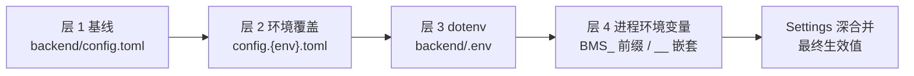
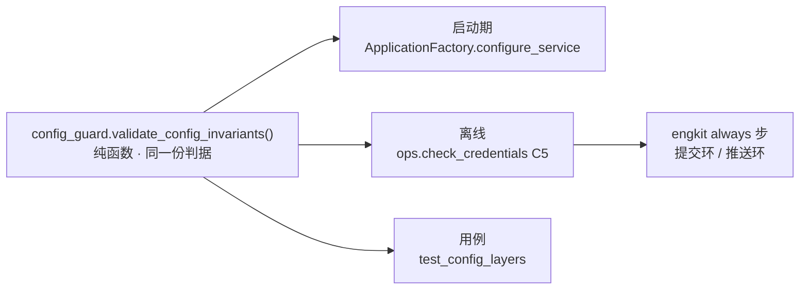

# 07-2 配置分层与凭据管理 · 详细设计

> 08B · 07 部署迁移与验收 · 子任务 02（需求 07-2）

[文档首页](../../../../../../文档首页.md) › [消息平台规划](../../../../../../规划/01_规划_消息平台.md) › [阶段计划](../../../../计划/01_计划_消息平台.md) › [07 部署迁移与验收](../../07_部署迁移与验收.md) › [07-2 配置分层与凭据管理](../07_部署迁移与验收_02_配置分层与凭据管理.md) › 详细设计

## 0. 分章导航 <a id="toc"></a>

| 章 | 内容 |
| --- | --- |
| 1 | 任务级边界与输入基线 |
| 2 | 交付物清单 |
| 3 | 现状核对结论 |
| 4 | 四层配置链契约 |
| 5 | 启动期与离线双落点契约 |
| 6 | 六类敏感项与键位注册表 |
| 7 | 凭据扫描契约 |
| 8 | 生产配置与失效关闭契约 |
| 9 | 测试设计与验收映射 |
| 10 | 失败分支 |
| 11 | 登记落点与文档同步 |
| 12 | 边界与开放项 |
| 13 | 对齐记录 |

## 1. 任务级边界与输入基线 <a id="scope"></a>

**做什么**：把「配置怎么分层、凭据只从哪里来、生产配置不能是什么样」从文档约定变成**启动期断言 + 离线门禁 + 可回归用例**；补齐六类敏感项的模板键位与编排注入，让切换环境只改凭据文件；落一条仓库级凭据扫描，命中即给出文件与行号。

**不做什么**：

- 不改基座 `Settings` 契约、配置源实现与 `validate_startup`（`bms_core/core/config.py`）；不引入第二套配置框架；
- 不新建 CI 流水线、不落任何生产密钥；不新建 `ops.init_schema` / `migrate`（生产建表入口登记遗留，归部署阶段）；
- 不做容器内 TLS 终止（架构 08 待定项，本次只补证书路径键位与空占位）；
- 不改 07-1 的镜像形态、卷布局、网关与产品声明；不改基座 `deploy/` 资产；
- 不在本任务做备份恢复（07-3）、故障演练（07-6）、迁移联调（07-4）。

**输入基线**：

| 输入 | 事实 |
| --- | --- |
| 加载链 | `bms_core.core.config.Settings.settings_customise_sources()`：`TomlConfigSettingsSource(toml_file=[config.toml, config.{env}.toml], deep_merge=True)` 为最低优先级，其上依次为密钥目录源、`backend/.env`、进程 `BMS_` 环境变量、显式入参、`_EnvSelectorSource` 回写 `app.env` |
| 环境选择 | `BMS_ENV`（进程环境 → `backend/.env`）→ `[app].env` → `dev`；非法值即 `ConfigError`；嵌套键分隔符 `__`，前缀 `BMS_`，`extra="forbid"` |
| 失效关闭 | 基座 `validate_startup()` 仅在 `prod` 缺 `security.secret_key` 或开启 `dev_override_tenant` 时拒启；服务 / 用户令牌私钥为空时**允许装配**，签发 / 校验时才抛 `ConfigError` |
| 四份配置 | `backend/config.toml`（基线）、`config.dev.toml`（SQLite + debug）、`config.test.toml`（CI 临时库）、`config.prod.toml`（关 docs / 关自动建表 / JSON 日志 / Redis） |
| 凭据资产 | `deploy/.env.example` 已列平台接入、卷目录、库模板与密码、Redis / OTLP、双类令牌密钥；`deploy/compose/msg.yml` 的 `x-service-env` 锚点显式列注入键（未列入锚点的 `.env` 键不进容器，07-1 已实证） |
| 既有门禁 | `engkit.toml` 的 always 步已跑 `services/msg/tests/deploy`；`[rules.env_example]` 已写模板必填键与私钥头规则，**但未登记预检步骤**（规则空转）；engkit `base env-example` 支持 `--files-from` 增量 |
| 前序遗留 | 07-1 记录归 07-2 的三条：水位旋钮未透传、`prod` 建表入口缺位、冒烟 SQLite 落点与归档库 URL 硬编码 |
| 公开文档红线 | bms《安全开发规范》密钥只走 `BMS_` 环境变量、只提交 `.env.example`；公开文档不得出现服务器地址 / 内网 IP / 端口 / 账号 |

## 2. 交付物清单 <a id="deliverables"></a>

| 类别 | 交付物 | 说明 |
| --- | --- | --- |
| 启动期守卫 | `backend/services/msg/src/bms_msg/config_guard.py` | 纯函数 `validate_config_invariants(effective, env)` + 启动接线取数；判分层结果与生产禁用项，不判密钥存在 |
| 启动接线 | `backend/services/msg/src/bms_msg/main.py` | `ApplicationFactory.configure_service()` 首行调用守卫（§5） |
| 离线自检 | `backend/ops/check_credentials.py` | C1~C6 六项：凭据形态 / 两份 `.env` 纪律 / 四层结构 / 敏感键注册表 / 运行时生效值 / 模板与编排齐备；退出码 0/1 |
| 启动接线用例 | `backend/services/msg/tests/deploy/test_config_layers.py` | 四层优先级、生产最终生效值、失效关闭、启动接线（§9 T1/T3/T6/T7） |
| 扫描用例 | `backend/services/msg/tests/deploy/test_credentials_scan.py` | 扫描正反、`.env` 跟踪、注册表齐备、`run`/`main` 退出码（§9 T2/T4/T5/T8/T9） |
| 凭据模板 | `deploy/.env.example` | 补 TLS 证书 / 私钥路径、归档库 URL 与密码、水位旋钮、Redis / OTLP 端点键位；值全为空或占位 |
| 编排 | `deploy/compose/msg.yml` | 六类键位 + 水位旋钮 + 归档库显式注入；默认端点不再写死在编排内 |
| 忽略纪律 | `.gitignore` | 补 `backend/.env`；`deploy/.env` 既有 |
| 门禁 | `engkit.toml` | 新增 `ops.check_credentials` always 步；登记 `engkit base env-example` always 步；`[rules.env_example].required_keys` 随模板补齐 |
| 文档 | 本设计 + 实施记录 + 测试记录 + 计划回写 + 架构 08 回写 + 07-1 前序文档回写 | §11 |

## 3. 现状核对结论 <a id="current"></a>

| # | 现状 | 处置 |
| --- | --- | --- |
| 1 | 基座加载链与深合并已实现，但**没有任何 msg 侧断言**钉住覆盖顺序；任务字面「四层」与基座六源链不一致 | 按 §4 定义对外四层链，用例逐层断言；不改基座 |
| 2 | 六类敏感项在配置文件中确实没有真实值，但 TLS 证书路径键位未列模板、编排内仍写死 `mysql:3306` / `otel-collector:4318` 等端点 | 补键位并把默认端点改经 `.env` 注入（§6） |
| 3 | `dev` / `test` 覆盖含 SQLite 连接串与 `sqlite_dir`，与「连接串只走环境变量」字面有张力 | 保留：架构 08 第 3 节已把 SQLite 列为 dev / test 覆盖内容，属本地结构占位；扫描器只对远端协议或带密码的连接串判违规，prod 禁任何 SQLite |
| 4 | `prod` 的 `debug=false` / `docs_enabled=false` 只是静态取值，环境变量可把它们改回开发态 | 用 `Settings()` 判**最终生效值**（§8），不只读文件 |
| 5 | `.gitignore` 只忽略 `deploy/.env`，`backend/.env` 未忽略；四层链里的 dotenv 层无入库门禁 | 两份都忽略，`git ls-files` 与扫描都判（§7 C2） |
| 6 | engkit `[rules.env_example]` 规则存在但步骤表未引用 | 登记 always 步，模板键位与私钥头进入提交环 / 推送环；新脚本不重复这部分判据 |
| 7 | 07-1 记录把水位旋钮、归档 URL 硬编码、冒烟 SQLite 落点归 07-2 | 水位旋钮与归档键位本任务收口；冒烟落点只登记说明与清理归口，不改代码 |
| 8 | 07-1 记录的 `prod` 建表入口与 CI 流水线归「07-2 / 部署阶段」 | 均登记遗留归部署阶段，写明前置（§12），本任务不新建入口与 CI 文件 |
| 9 | 缺密钥「可装配、使用时失效关闭」是基座既有行为，msg 无用例钉住 | 补用例断言「守卫不因缺密钥拒装配」+「签发时抛 `ConfigError`」（§9 T3） |
| 10 | 本任务无新增配置键，全部是既有 `Settings` 字段的环境变量键位 | 「新增配置项补基线 / 环境覆盖 / 模板三处」以敏感键注册表机器校验代替（§6.3），配置文本不承载这些键的真实值 |

## 4. 四层配置链契约 <a id="layers"></a>

### 4.1 层定义与优先级 <a id="layer-def"></a>



| 层 | 载体 | 入库 | 内容纪律 |
| --- | --- | --- | --- |
| 1 | `backend/config.toml` | 是 | 只写 msg 特有结构与非敏感默认值；六类敏感项不落真实值 |
| 2 | `backend/config.{dev,test,prod}.toml` | 是 | 环境差异；dev / test 允许本地 SQLite 结构占位；prod 禁 debug / docs / SQLite |
| 3 | `backend/.env` | **否** | 本地裸跑可选；不入库、不入镜像；部署态不用 |
| 4 | 进程 `BMS_` 环境变量 | — | 部署态唯一凭据入口；compose 由 `deploy/.env` 插值后注入锚点 |

- 生效顺序固定为 **层 4 > 层 3 > 层 2 > 层 1**；基座的「生效环境回写」与「显式入参」是装配机制（不承载对外配置层），本任务不判、不改。
- `BMS_ENV` 只决定加载哪一份层 2；它本身也是层 3 / 层 4 的键，非法值由基座拒启。
- 「环境变量 > 环境覆盖 > 基线」是任务书的三段表述，映射到四层链时把层 3 与层 4 同归「环境变量段」，其中层 4 更优先；设计、用例与实施记录统一采用本口径。

### 4.2 断言口径 <a id="layer-assert"></a>

- 用例在临时配置目录写四份同源配置（层 1 / 层 2 各放一个可辨识标量），临时 `.env` 写层 3 值，`monkeypatch.setenv` 写层 4 值，调 `load_settings()` 断言最终值来自层 4；
- 依次撤掉层 4、层 3、层 2，断言生效值分别回落到层 3、层 2、层 1；
- 断言 `app.env` 与 `BMS_ENV` 一致（层 2 文件名随环境切换）。

## 5. 启动期与离线双落点契约 <a id="dual"></a>



| 面 | 入口 | 判断内容 | 失败表现 |
| --- | --- | --- | --- |
| 启动期 | `ApplicationFactory.configure_service()` 首行 | 环境一致性；`prod` 的 debug / docs / 库方言 / 开发态开关 | 抛 `ConfigError`，服务拒启并指出键名（不打印键值） |
| 离线 | `ops.check_credentials` 的 C5 | 用 `load_settings()` 装配当前环境后调**同一纯函数** | 报告 `[FAIL] C5 …`，退出码 1 |
| 用例 | `test_config_layers.py` | 四层覆盖顺序 + 纯函数正反 | pytest 失败 |

- 纯函数签名：`validate_config_invariants(effective: ConcurrentStableDict[str, object], env: str) -> None`；入参为「生效值扁平映射」，键路径用点分（`app.debug`、`app.docs_enabled`、`database.platform.url` 等）。
- 启动侧取数：`Settings.model_dump()` 转扁平映射（`_flatten()` 只下钻映射与列表下标外的结构），再交纯函数；**不把 `Settings` 对象传进纯函数**，让离线脚本与用例可喂构造数据。
- 纯函数**不判密钥是否存在**：缺密钥仍可装配，签发 / 校验时由基座抛 `ConfigError`（任务书「可装配、使用时失效关闭」）。违规只报「键路径 + 期望」，不回显任何值。
- 分层「覆盖顺序」本身无法在启动期从单个生效值反推，故由用例（§4.2）与离线 C3（结构齐备）共同取证；启动期负责钉住**结果与生产禁用项**。此分工在设计里写明，不宣称启动期能重放加载链。

## 6. 六类敏感项与键位注册表 <a id="secrets"></a>

### 6.1 六类与对应键位 <a id="secret-keys"></a>

| 类 | 键位 |
| --- | --- |
| 数据库连接串与密码 | `BMS_DATABASE__PLATFORM__URL_TEMPLATE`、`BMS_DATABASE__PLATFORM__PASSWORD`、`BMS_DATABASE__TENANTS__URL_TEMPLATE`、`BMS_DATABASE__TENANTS__PASSWORD`、`BMS_DATABASE__ARCHIVE__URL`、`BMS_DATABASE__ARCHIVE__PASSWORD` |
| Redis URL | `BMS_REDIS__URL` |
| OTLP 端点 | `BMS_TRACER__OTLP_ENDPOINT` |
| 服务令牌密钥 | `BMS_SERVICE_TOKEN__KEYS`、`BMS_SERVICE_TOKEN__ACTIVE_KID` |
| 用户令牌密钥 | `BMS_SECURITY__KEYS`、`BMS_SECURITY__ACTIVE_KID`、`BMS_SECURITY__SECRET_KEY` |
| TLS 证书路径 | `BMS_SERVER__CERTFILE`、`BMS_SERVER__KEYFILE` |

- TLS 两键**只填空占位**（空值 = 不启用 TLS，与基座 `certfile` / `keyfile` 同给或同空的配对校验一致）；容器内是否终止 TLS 仍按架构 08 待定项。
- 非敏感但需透传的运行旋钮：`MSG_STORAGE_WARN_RATIO`、`MSG_STORAGE_REJECT_RATIO`、`MSG_STORAGE_SAMPLE_TTL_MS`（07-1 遗留；第三个在实施核对时补入，见 §13）；模板列空值，编排经 `.env` 注入，代码缺省不变。
- 归档库 URL 与 Redis / OTLP 端点不再写死在 `msg.yml`，一律 `${键:?}` 或 `${键:-}`，值只来自 `deploy/.env`；模板中保留 Compose DNS 形式的**占位说明**，不写服务器地址。

### 6.2 三处齐备 <a id="three-places"></a>

本任务不新增 `[配置]` 键，全部键位指向基座既有字段，故「基线 / 环境覆盖 / 模板三处」的口径落为**敏感键注册表**机器校验：

1. `.env.example` 列出全部键，且值全为空或 `<...>` / `${...}` 占位；
2. `msg.yml` 的 `x-service-env` 列出全部注册表键，且值均为 `${...}` 插值（不出现字面量端点或凭据）；编排另有的非凭据运行键（`BMS_ENV`、`MSG_DATA_DIR` 等）不参与本对照，C6 判「注册表被两侧覆盖」而非两侧键集合全等；
3. 四份 `config*.toml` 中不出现这些键对应字段的非空真实值（dev / test 的本地 SQLite 结构占位按 §7 白名单豁免）。

注册表是**单一事实源**：模板补键、编排补键、配置文本检查、用例断言都从同一份常量读取，新增键只改一处。

### 6.3 两份 `.env` 的纪律 <a id="env-files"></a>

- `deploy/.env`：部署态唯一凭据落点，只做 compose 插值；`backend/.env`：本地裸跑可选，同为层 3；两份都写进 `.gitignore`。
- `git ls-files` 输出中不得出现 `deploy/.env` 或 `backend/.env`（精确行匹配，`.env.example` 不算命中）；脚本把该输出喂纯函数 `check_tracked()`，用例直接构造文本正反。
- 模板不出现服务器地址、内网 IP、端口与账号；`deploy/compose/README.md` 同步补一句「生产密钥经 CI 变量注入，仓内只留空占位」。

## 7. 凭据扫描契约 <a id="scan"></a>

### 7.1 入口与报告 <a id="scan-cli"></a>

```text
backend/ops/check_credentials.py        # 全项自检；任一违规 → 明细 + 退出码 1
python -m ops.check_credentials --root <仓根>
```

- 离线零连库、零起应用；只依赖标准库与 `bms_core` 的插入序并发集合类；与 `ops/check_deployment.py` 同构（自定位 `backend/` 与仓根，`--root` 可覆盖）。
- 报告逐项 `[OK] C1 …` / `[FAIL] C1 …`，违规明细一律 `相对路径:行号: 规则名`；末行 `检查项 6 项：通过 N，失败 M`。

| 编号 | 检查项 | 判据 |
| --- | --- | --- |
| C1 | 凭据形态扫描 | 扫 `deploy/`、`backend/`、`frontend/`、`msg文档/`：私钥头 / 非空密码 / 真实令牌全目录生效，公开文档红线（内网 IP / 账号 / 主机端口）只在 `msg文档/` 与 `deploy/` 以 strict 模式生效；跳过二进制、`__pycache__`、`.git`、`.venv`、`node_modules`、`.cache` 与图片 |
| C2 | 两份 `.env` 纪律 | `.gitignore` 含两行；`git ls-files` 无两份 `.env`；`.env.example` 键位齐备、值空或占位、无服务器 / 内网 IP / 端口 / 账号 |
| C3 | 四层结构 | 四份配置存在且可 `tomllib` 解析；层 1 / 层 2 无六类敏感项的非空真实值；层 2 的 prod 静态无 debug / docs / SQLite |
| C4 | 敏感键注册表齐备 | 三处齐备（§6.2）；水位旋钮与归档键位同批核对 |
| C5 | 运行时生效值 | `load_settings()` + `validate_config_invariants()`（§5 同一纯函数）；当前环境违规即失败 |
| C6 | 模板与编排键位 | 注册表键集合分别被 `.env.example` 与 `msg.yml` 的 `x-service-env` 覆盖（不要求两者键集合全等：编排另有非凭据运行键），缺一即报键名 |

### 7.2 规则表与白名单 <a id="scan-rules"></a>

| 规则 | 命中形态 | 生效范围 |
| --- | --- | --- |
| `private-key` | PEM 私钥起始标记（BEGIN 与 PRIVATE KEY 成对出现）且行内无占位符 | 全目录 |
| `nonempty-secret` | `password` / `passwd` / `secret_key` / `api_key` / `access_key` / `private_key` 后接 `=` 或 `:`，值为含字母数字的 ASCII 串且非占位 | 全目录 |
| `real-token` | JWT 三段式或云厂商 AK 形态 | 全目录 |
| `internal-ip` | 私网 IPv4（`10.` / `172.16~31.` / `192.168.` / `169.254.`） | 仅 strict |
| `account-or-host` | `user=` / `username=` / `account=` / `login=` 账号赋值，或非白名单主机名 + 端口的 URL | 仅 strict |

**规则分级**：业务代码里 `token` / `secret` 作为局部变量名、私网地址作为测试夹具对端地址、`user:query` 作为权限码都极常见，全目录判红线会把真实告警淹没。故凭据形态（前三条）全目录判，公开文档红线（后两条）只在 `msg文档/` 与 `deploy/` 判；真实令牌由 `real-token` 的形态规则兜住，不靠通用变量名猜。

**显式白名单**（每条都要有反例用例钉住）：`<...>` 与 `${...}` 占位、`...`、空值、`localhost` / `127.0.0.1`、`example.com`、Compose DNS 服务名与单实例编号（`mysql` / `redis` / `otel-collector` / `msg` / `msg-1` / `identity` / `gateway`）、文档表格与目录树中的契约级端口说明、中文或纯标点构成的规则描述文字、`.env.example` 的空值键。白名单按「行 / 值」判定并集中在常量与 `_is_placeholder()`，不散落进各检查函数。

### 7.3 门禁接线 <a id="scan-gate"></a>

- `engkit.toml` 新增 always 步跑 `uv run python -m ops.check_credentials`（`cwd = backend`）；已有部署资产 always 步覆盖新用例文件，不新增测试步骤。
- `engkit base env-example` 登记为 always 步，让既有 `[rules.env_example]` 生效；其 `required_keys` 随模板补齐。
- 提交环判改动行、推送环判模块级；脚本与 `config_guard.py` 均在覆盖率 source 内，行 + 分支按项目口径达标。

## 8. 生产配置与失效关闭契约 <a id="prod"></a>

| 场景 | 判据 | 处置 |
| --- | --- | --- |
| `BMS_ENV=prod` 装配 | `app.debug=false`、`app.docs_enabled=false`、`database.{platform,tenants,archive}.url` 均非 SQLite、`tenant.dev_override_tenant` 为空 | 任一不满足 → `ConfigError` 并指出键路径（启动期拒启、离线 C5 失败） |
| 生产缺关键密钥 | 服务 / 用户令牌密钥、库密码为空 | **允许装配**；签发 / 校验 / 取客户端时才抛 `ConfigError`，不静默降级；守卫不把空密钥当违规 |
| 未知 / 拼错键 | 基座 `extra="forbid"` | 启动即报错指出键名，错误汇总不回显键值 |
| 缺配置定位 | 守卫与 C1~C6 报告 | 一律给「文件:行号」或「键路径」，不打印值 |

- 用例在隔离环境写临时 `config.toml` + `config.prod.toml`，`monkeypatch.setenv("BMS_ENV","prod")`、`monkeypatch.setattr(config, "_config_dir", …)`，只调 `load_settings()`（**不调** `validate_startup`，避免其 `secret_key` 拒启与失效关闭口径纠缠）。

## 9. 测试设计与验收映射 <a id="test"></a>

用例落 `backend/services/msg/tests/deploy/`，全部标同一 Kiwi 编号（先登记后编码，回读核对）。

| 用例 | 断言 | 映射任务条目 |
| --- | --- | --- |
| T1 四层优先级 | 层 4 > 层 3 > 层 2 > 层 1 逐层回落；`app.env` 与 `BMS_ENV` 一致；非法环境被基座拒 | §2.1、完成标准 1 |
| T2 敏感项来源 | 注册表三处齐备；配置文本无六类真实值；模板值空或占位 | §2.2、§2.5、完成标准 2 |
| T3 失效关闭 | 缺密钥时守卫不拒装配；签发 / 校验时抛 `ConfigError`；不静默放行 | §2.4、完成标准 4 |
| T4 `.env` 纪律 | `.gitignore` 两行；`git ls-files` 精确行正反；模板无服务器地址 / 内网 IP / 端口 / 账号 | §2.3、完成标准 3 |
| T5 凭据扫描正反 | 私钥头、非空密码、真实 token、内网 IP、账号名命中并给行号；白名单逐条不命中 | §2.6、完成标准 5 |
| T6 生产最终生效值 | debug / docs / SQLite / 开发态开关四类反例各自被拒，正例通过 | §2.4、§2.8、完成标准 4 |
| T7 启动接线 | `configure_service()` 调用守卫；构造违规生效值时抛 `ConfigError` | §2.1、§2.4 |
| T8 模板与编排键位 | C6 注册表被模板与编排两侧覆盖；TLS / 三个水位旋钮 / 归档键位齐备且经插值注入 | §2.5、§2.7 |
| T9 自检命令 | `run()` / `main()` 正例 0、反例 1；报告含 `文件:行号` | §2.6 |
| T10 编排层复核 | `docker compose config` 解析通过、缺必填键报错（不起容器、不写服务器数据） | §2.3、完成标准 3 |
| T11 公开文档红线 | `msg文档/` 扫描零命中；07-1 的 2472 / 2473 用例同批回归 | §2.6、完成标准 5 |
| T12 覆盖率与门禁 | 新增 `ops/check_credentials.py` 与 `bms_msg/config_guard.py` 行 + 分支达标；静态、文档校验全绿 | 完成标准 6 |

## 10. 失败分支 <a id="failure"></a>

| # | 触发 | 表现 | 处置 |
| --- | --- | --- | --- |
| 1 | 配置文件误贴真实凭据 | C1 报「文件:行号: 规则名」，预检失败 | 删真值改经环境变量注入；不得加白名单绕过 |
| 2 | 模板补了键但编排未列 | C4 / C6 报缺键 | 两处同步；`.env` 未列入 `x-service-env` 的键不进容器 |
| 3 | 环境变量把 prod 改回 `debug=true` | 启动期 `ConfigError`、离线 C5 失败 | 收回覆盖值；这是刻意设计，不做静默回落 |
| 4 | 生产未注入库 URL 模板 | 生效值为 SQLite 兜底 → 守卫拒启 | 补 `.env` 库键；不改 `config.prod.toml` 去兜底 |
| 5 | `backend/.env` 被误提交 | C2 `git ls-files` 命中 | 从索引移除、确认 `.gitignore`；凭据视情况轮换 |
| 6 | 扫描误报（文档示例端口 / Compose DNS） | C1 失败但属白名单情形 | 只补白名单条目并补反例用例；不得整条规则关闭 |
| 7 | 守卫在既有替身 `settings` 上取不到字段 | 启动装配异常 | 守卫仅在 `env == "prod"` 时深判，其余只判环境一致性；扁平化对缺字段取空值 |
| 8 | `docker compose config` 缺必填键报错 | 非零退出并指出变量 | 按 `.env.example` 补齐；无 latest 兜底、不改镜像 |

## 11. 登记落点与文档同步 <a id="register"></a>

| 落点 | 内容 |
| --- | --- |
| 阶段计划（进度唯一落点） | 07-2 行迁入已完成表：状态、完成日期、偏差与遗留；本次收口的前序遗留同批注记 |
| 架构 08 第 3 节 | 四层链口径、六类敏感项键位纪律、`.env` 两份纪律、prod 禁用项；不写脚本名与代码落点 |
| `deploy/compose/README.md` | 补键位使用说明与「生产密钥经 CI 变量注入」口径 |
| 07-1-1 / 07-1-2 设计与实施 / 测试记录 | 水位旋钮、归档 URL、冒烟 SQLite 落点的闭环结论；`prod` 建表入口与 CI 的归口 |
| 需求 07-2 / 任务 07-2 | 不改（进度不落需求与任务文档） |
| 实施记录 / 测试记录 | 任务目录 `实施/`、`测试/` 各一份 |

## 12. 边界与开放项 <a id="open"></a>

| # | 事项 | 归口 |
| --- | --- | --- |
| 1 | `prod` 的 `auto_create=false` 与无 `ops.init_schema` 并存，生产首次起服务前须先建表 | 部署阶段专设任务（与迁移链一并设计）；本任务登记前置与去向 |
| 2 | msg 仓无 CI 流水线；生产密钥只应落在 CI Secret 变量 | 部署阶段与镜像流水线一并设计；本任务不新建 CI 文件 |
| 3 | 容器内 TLS 终止是否启用 | 架构 08 待定项；本次只补证书路径键位与空占位 |
| 4 | 开发服务器冒烟遗留的 SQLite 库与段文件 | 部署阶段按需清理；本任务不删任何既有数据 |
| 5 | bms 平台注册域「开上报即拒启」缺陷 | bms 平台注册域任务；生产重启产品前须先修 |
| 6 | 凭据扫描目前仅 msg 仓自持；其他仓复用需上移 engkit | 工程化后续；规则表与白名单已按可迁移形态组织 |
| 7 | 未取容器内运行时配置快照 | 本任务以本地 `Settings()` 装配与 `docker compose config` 取证；运行时快照归部署阶段联调 |

## 13. 对齐记录 <a id="align"></a>

2026-11-10 逐项拍板（全部取推荐项），汇总回显无异议后执行：

| # | 待决项 | 结论 |
| --- | --- | --- |
| 1 | 四层口径 | 基座真实链：基线 → 环境覆盖 → `backend/.env` → 进程 `BMS_`；设计说明与任务字面三段优先级的映射 |
| 2 | 断言形态 | 启动期 + 离线双落点，共用同一纯函数；只判分层结果与生产禁用项，不判密钥存在 |
| 3 | dev / test SQLite | 保留并设白名单，scan 只拦远端 / 带密码连接串 |
| 4 | 敏感项键位 | 六类补齐（含 TLS 路径空占位），compose 默认端点改经 `.env` 注入 |
| 5 | 扫描落点 | `backend/ops/check_credentials.py` 自持 + always 步，用例落 `tests/deploy/` |
| 6 | 扫描规则 | 规则表 + 显式白名单，输出「文件:行号」 |
| 7 | 生产校验 | 判 `Settings()` 最终生效值，不只读静态文件 |
| 8 | 水位旋钮遗留 | 纳入本任务 |
| 9 | 生产建表入口 | 登记遗留归部署阶段 |
| 10 | 归档 URL / 冒烟落点 | 一并收口；冒烟落点记录归部署阶段清理 |
| 11 | 两份 `.env` | 都忽略，`deploy/.env` 为唯一凭据落点，`git ls-files` 与扫描都判 |
| 12 | 真机范围 | 本地为主，只跑 `docker compose config`，不起容器 |
| 13 | Kiwi 用例 | 1 条编号、全部新用例共用，落 `services/msg/tests/deploy/` |
| 14 | CI 与既有规则 | CI 登记遗留归部署阶段；`engkit base env-example` 登记 always 步 |
| 15 | 第三个水位旋钮 | 实施核对发现 `MSG_STORAGE_SAMPLE_TTL_MS`，拍板一并透传（模板 / 编排 / 注册表 / 用例同批） |
| 16 | 历史公开文档红线存量 | 首跑扫描发现历史文档含内网地址与账号（Kiwi 登记命令、冒烟镜像地址），拍板**本任务一并清理**，不设存量基线；13 份历史文档只替换账号 / 地址字面量为占位，命令结构与上下文保留 |

**实施期对齐补记**（先回写设计再继续实施）：

1. 扫描规则按 §7.2 分级并收敛关键词：通用 `token` / `secret` 变量名、`user:query` 权限码、测试夹具 IP 均不再误报；`check_text()` 增 `strict` 参数，`scan_tree()` 只对 `msg文档/` 与 `deploy/` 传真值。
2. 历史文档的账号 / 地址清理涉及 02 / 03 / 04 / 06 / 07 五个任务域共 13 份文档，与 §11 的「07-1 前序文档回写」同批进 `docs` 提交；真实值仍在不入库的《本地资源》与部署态 `.env`，仓内只留占位。
3. §2 交付物清单的「文档」一行相应扩为「本设计 + 实施 / 测试记录 + 计划 / 架构回写 + 07-1 前序回写 + 历史公开文档红线清理」；§9 的 T11 以「全仓扫描零命中」作为清理验收判据。
4. C6 判「注册表被模板与编排两侧覆盖」而非两侧键集合全等，理由见 §6.2：编排另有非凭据运行键、模板另有宿主插值键。

---

> 依《[文档生成规范](../../../../../../../bms文档/规范/文档生成规范.md)》编写 · 配置与部署口径见《[架构设计 · 部署与运维](../../../../../../设计/架构设计/08_架构设计_部署与运维.md)》第 3 节、bms《[安全开发规范](../../../../../../../bms文档/规范/安全开发规范.md)》
