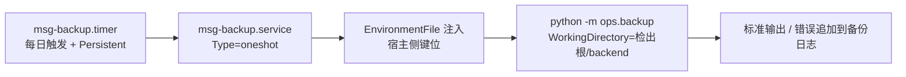
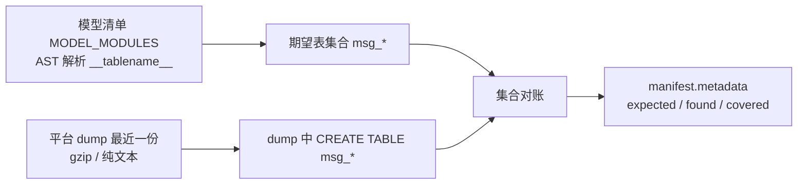
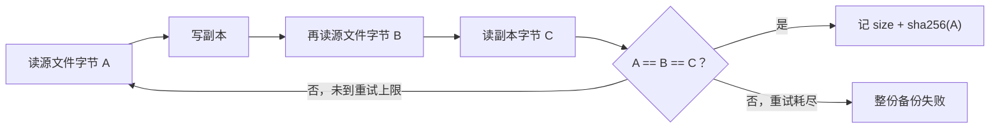
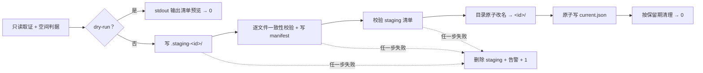

# 07-3-1 备份脚本与调度 · 详细设计

> 08B · 07 部署迁移与验收 · 07-3 备份与恢复 · 子任务 01（需求 07-3）

[文档首页](../../../../../../../文档首页.md) › [消息平台规划](../../../../../../../规划/01_规划_消息平台.md) › [阶段计划](../../../../../计划/01_计划_消息平台.md) › [07 部署迁移与验收](../../../07_部署迁移与验收.md) › [07-3 备份与恢复](../../07_部署迁移与验收_03_备份与恢复.md) › [07-3-1 备份脚本与调度](../07_部署迁移与验收_03_备份与恢复_01_备份脚本与调度.md) › 详细设计

## 0. 分章导航 <a id="toc"></a>

| 章 | 内容 |
| --- | --- |
| 1 | 任务级边界与输入基线 |
| 2 | 交付物清单 |
| 3 | 现状核对结论 |
| 4 | 配置、入口与调度契约 |
| 5 | 备份对象与覆盖校验契约 |
| 6 | 一致性快照与 manifest 契约 |
| 7 | 原子发布、失败保护与保留期清理 |
| 8 | 失败分支与告警 |
| 9 | 测试设计与验收映射 |
| 10 | 登记落点与文档同步 |
| 11 | 边界与开放项 |
| 12 | 对齐记录 |

## 1. 任务级边界与输入基线 <a id="scope"></a>

**做什么**：把「元数据库随平台库备份、位点文件按日快照、消息日志只登记摘要」落成一条可在宿主定时执行的离线命令；每次备份产出可核对的 manifest，失败不破坏上一份可用备份，保留期可配置。

**不做什么**：

- 不复制平台库、不改 bms 仓 `backup_daily.sh`、不新建数据库备份机制；
- 不备份消息日志本体、不实现恢复动作与恢复演练（归 07-3-2）、不实现跨机房复制；
- 不改基座 `Settings`（`extra="forbid"`）、不改镜像 / 编排 / 容器内环境变量、不新增能力域基类与插件（D13）；
- 不接平台告警通道（告警通道归 06-3）、不落任何凭据、不在真机启用定时单元（D11）；
- 不修改需求 / 任务文档正文（进度只在计划表回写）。

**输入基线**：

| 输入 | 事实 |
| --- | --- |
| 平台库备份 | 开发服务器 systemd 用户级 timer 每日 12:00 触发 `backup_daily.sh`，MySQL 产物为 `--all-databases` 的 `all_<时间戳>.sql.gz`，本地保留 7 天；`Persistent=true` 会补跑挂起期任务，cron 不会（见 bms《[数据备份与恢复部署使用说明](../../../../../../../../bms文档/资料/开发服务器/linux/数据备份与恢复部署使用说明.md)》） |
| 位点目录 | `{MSG_DATA_DIR}/offsets/{tenant_id}/{group}-{hash8}/{topic_id}-{partition}.offset`，文件为「双槽 + crc32 + `Path.replace` 原子替换」，文件名恒定（02-3 详细设计「目录布局与命名」节） |
| 分区目录 | `{MSG_DATA_DIR}/data/{tenant_id}/{namespace}/{topic}.{topic_id}/{partition}/`，段名 `^\d{20}\.log$`，每分区有 `recovery-point.json`（含 `leo`、`segments`） |
| 表清单 | `bms_msg.models.MODEL_MODULES` 是服务私有模型模块清单，各模块的 `__tablename__` 即 `msg_*` 表名；它是表集合的单一事实源 |
| 配置分层 | 四层链由 07-2 落地；敏感键注册表只管「必须注入容器」的键，`ops/` 不进镜像、离线命令只在仓内跑 |
| 门禁 | `engkit.toml` 已有「部署资产断言」always 步跑 `services/msg/tests/deploy`；`coverage_packages` 含 `ops`，行 + 分支按 bms《[AI开发规范](../../../../../../../../bms文档/规范/AI开发规范.md)》「覆盖率要求」节判定 |
| 前序交付 | 07-1-1 两个独立卷、07-2 配置与凭据纪律、02-3 位点文件、02-2 恢复点、02-7 延迟恢复均已交付 |

## 2. 交付物清单 <a id="deliverables"></a>

| 类别 | 交付物 | 说明 |
| --- | --- | --- |
| 离线命令 | `backend/ops/backup.py` | 唯一实现；纯函数判据 + 可注入 IO 端口 + `run()` / `main()`；`--dry-run` 与 `--root` |
| 常量 | `backend/services/msg/src/bms_msg/core/config.py` | 追加备份环境变量名与缺省值、目录名 / 文件名常量（§4.2） |
| 用例 | `backend/services/msg/tests/deploy/test_backup.py` | 复用部署资产 always 步；T1~T12 全部用例共用 Kiwi 编号 **2475**（§9） |
| 键位模板 | `deploy/.env.example` | 追加宿主侧备份运行旋钮段，值全为空；不进 07-2 敏感键注册表（D6） |
| 调度模板 | `deploy/backup/msg-backup.service`、`msg-backup.timer` | 用户级 oneshot + 每日触发 + `Persistent=true`；路径全用占位符，仓内不写死 |
| 调度说明 | `deploy/backup/README.md` | 键位表、安装与替换占位、备份目录结构、清理策略、manifest 字段、禁止项 |
| 忽略纪律 | `.gitignore` | 备份产物目录与宿主侧环境变量文件不入库 |
| 文档 | 本设计 + 实施记录 + 测试记录 + 计划 / 架构 / 相邻任务回写 | §10 |

## 3. 现状核对结论 <a id="current"></a>

| # | 现状 | 处置 |
| --- | --- | --- |
| 1 | 仓内没有任何备份脚本，07-3-2 的恢复演练无输入产物 | 本任务落唯一实现与 manifest，恢复脚本只读 manifest（§6） |
| 2 | 基座 `Settings` 的 `extra="forbid"` 使产品无法新增配置段 | 备份参数只走环境变量 + `core/config.py` 常量，不改配置文件结构（§4.1） |
| 3 | 07-1-1 只挂 `data/` 与 `offsets/` 两个容器卷；镜像不含 `ops/` | 脚本在宿主检出仓运行，不加第三个容器卷、不改 Dockerfile 与 `msg.yml`（D1） |
| 4 | 平台备份总控在 bms 仓，且 cron 不补跑挂起任务 | 仓内自持 timer 模板排在平台库备份之后触发；真机不安装，只交模板与文本复核（D2 / D11） |
| 5 | 位点文件是原子替换 + 双槽，理论上不会读到半文件 | 仍按任务要求做「复制前后双读 + 副本复算」并重试，把并发写入边界变成可测事实（D4） |
| 6 | `recovery-point.json` 只在分区有写入时存在 | 缺失时 LEO 退化为段名范围并标 `leo_source`，不静默填 0（§6.3） |
| 7 | 07-2 的 C6 只判「注册表键被模板与编排两侧覆盖」 | 备份键不进注册表（宿主侧运行旋钮），另以用例钉住「常量 ↔ 模板 ↔ 脚本读取」三处一致（D6） |
| 8 | 计划表 07-3 父行含「备份」与「恢复演练」两段内容 | 本任务只交付前者，父行状态改「部分完成」并留在计划表剩余任务区（D12） |

## 4. 配置、入口与调度契约 <a id="config"></a>

### 4.1 环境变量（唯一配置入口）<a id="env"></a>

| 键 | 必填 | 缺省 | 用途 |
| --- | --- | --- | --- |
| `MSG_BACKUP_DIR` | 是 | — | 备份根目录（宿主独立卷 / 数据盘，不与 `MSG_DATA_DIR` 同盘） |
| `MSG_BACKUP_PLATFORM_DUMP_DIR` | 是 | — | 平台库备份产物目录（只读扫描） |
| `MSG_DATA_DIR` | 否 | `var/lib/msg`（既有常量） | 源数据根，`offsets/` 与 `data/` 的父目录 |
| `MSG_BACKUP_KEEP_DAYS` | 否 | `7` | 快照保留天数；与平台备份本地保留口径一致 |
| `MSG_BACKUP_SPACE_FACTOR` | 否 | `1.2` | 空间估算系数（乘位点总字节） |

- 脚本**不读取任何 `.env` 明文**：只消费进程环境变量（由 systemd `EnvironmentFile` 注入）；缺必填键、非正整数保留天数、系数小于 1 均立刻失败并指名键名。
- 命令形态：`python -m ops.backup [--root <仓根>] [--dry-run]`；`--root` 只用于定位仓内声明与配置文本，仓根缺省由脚本自定位。
- 键位与缺省值只登记一处（`core/config.py`），`.env.example` 与调度模板的键位由用例对照，避免三处漂移。

### 4.2 常量与目录名 <a id="constants"></a>

`core/config.py` 追加「07-3-1 备份」段：五个环境变量名、`BACKUP_KEEP_DAYS = 7`、`BACKUP_SPACE_FACTOR = 1.2`、`BACKUP_SPACE_RESERVE_BYTES`（64 MiB）、`BACKUP_SNAPSHOT_RETRIES = 3`，以及 `BACKUP_STAGING_PREFIX = ".staging-"`、`BACKUP_MANIFEST_NAME = "manifest.json"`、`BACKUP_POINTER_NAME = "current.json"`、备份标识时间格式。

```text
<MSG_BACKUP_DIR>/
├── current.json                     # 最新可用备份指针（原子替换）
├── <备份标识>/                      # 已发布快照目录
│   ├── manifest.json                # 清单（与备份同目录）
│   └── offsets/                     # 位点文件相对路径原样保留
│       └── {tenant_id}/{group}-{hash8}/{topic_id}-{partition}.offset
└── .staging-<备份标识>/             # 仅写入期存在，失败即删
```

- 备份标识为 UTC 时间戳（`%Y%m%dT%H%M%SZ`），按字典序即时间序，清理不需要读目录元数据。
- `current.json` 是普通文件、不用符号链接：Windows 开发态不需要额外权限，且能与目录替换分开原子写。

### 4.3 调度单元 <a id="timer"></a>



- timer `OnCalendar=*-*-* 13:00:00`：平台库备份 12:00 起，留一小时余量后再扫当日 dump（§5.1）；`Persistent=true` 让挂起 / 关机期间错过的触发点下次启动后补跑，这条能力是 cron 没有的。
- service 为**用户级** oneshot，模板内路径一律 `<检出根>` / `<备份日志>` / `<仓内解释器>` 占位，仓内不出现真实磁盘路径、服务器地址与账号；`EnvironmentFile` 指向不入库的宿主侧键位文件。
- 本次只落模板与安装说明，不在真机 `enable --now`；模板由用例做文本复核（`Persistent`、`OnCalendar`、单位类型、占位符齐备、无绝对路径）。
- 退出码即调度结果：0 成功，1 失败；失败明细进标准错误，由 service 的 `StandardError` 追加到备份日志。

## 5. 备份对象与覆盖校验契约 <a id="objects"></a>

### 5.1 元数据库：覆盖校验 + 清单登记 <a id="metadata"></a>



- 期望表集合从 `bms_msg/models/__init__.py` 的 `MODEL_MODULES` 静态解析（不导入 ORM、不连库）：按模块名定位模型文件，取类体内 `__tablename__` 字面量；清单缺失、模块文件缺失、取不到表名都算配置不一致，整份备份失败。
- 平台侧取 `MSG_BACKUP_PLATFORM_DUMP_DIR` 中最近一份 `.sql.gz` / `.sql`，按 `CREATE TABLE` 语句扫 `msg_*` 表名；无产物或 `expected - found` 非空即失败并报缺表名，**不复制、不导入、不连库**。
- `found - expected` 只登记不清点失败：平台库里可能有历史遗留表，覆盖校验只保证「该有的都在」。

### 5.2 位点文件：日快照 <a id="offsets"></a>

- 源集合 = `{MSG_DATA_DIR}/offsets/` 下全部 `*.offset`，按相对路径保序；只搬位点，不碰 `data/`。
- 一致性流程（每个文件独立，默认 3 次重试）：



- 位点文件自身是「双槽 + 原子替换」，正常写入不会出现半文件；双读仍保留，用于钉住「写入期间快照校验和稳定」这条验收，而不是把正确性寄托在文件布局上。
- manifest 逐文件记相对路径、`size` 与 `sha256`；恢复侧（07-3-2）按同一份清单复算。

### 5.3 消息日志：只登记范围与 LEO 摘要 <a id="segments"></a>

- 扫 `{MSG_DATA_DIR}/data/{tenant_id}/{namespace}/{topic}.{topic_id}/{partition}/`，只读取段文件名与 `recovery-point.json`，**不复制任何 `.log` / `.index` / `.timeindex` / `.delay` 文件**。
- 每个分区登记：租户 / 命名空间 / 主题 / 主题标识 / 分区号、段首与段尾 base offset、段数、`leo`、`leo_source`。
- `leo_source = "recovery-point"` 表示取恢复点的 `leo`；恢复点缺失或损坏时取段名最大值并标 `"segments_only"`，同时把该分区列入 `needs_alignment`（恢复演练据此做对齐断言），不静默当作 0。
- manifest 顶层固定 `log_segments.backed_up = false`，把「日志不备份」写成机器可读事实。

## 6. 一致性快照与 manifest 契约 <a id="manifest"></a>

### 6.1 字段 <a id="fields"></a>

| 字段 | 来源 | 说明 |
| --- | --- | --- |
| `schema_version` | 常量 `1` | 恢复侧按版本解析，读到更高版本即拒 |
| `backup_id` / `created_at` | 注入的 UTC 时间 | 目录名与清单同值 |
| `service.name` / `version` / `contract_version` | `bms_msg.__version__` + `deploy/registry/msg.toml` | 服务与契约版本 |
| `config_version` | 四份 `config*.toml` 内容拼接后的 sha256 | 不含两份 `.env`；配置漂移可核对 |
| `tenants` | `offsets/` 与 `data/` 一级目录名并集 | 租户标识列表 |
| `metadata` | §5.1 | `source = platform_database_backup`、dump 文件名、`tables_expected` / `tables_in_dump` / `covered` |
| `offsets` | §5.2 | `files`（路径 / size / sha256）、`count`、`bytes` |
| `log_segments` | §5.3 | `backed_up = false`、`partitions`、`needs_alignment` |
| `recovery_order` | 固定清单 | 元数据库 → 位点文件 → 消息日志 → 校验对齐 |
| `files` | 快照目录逐文件 | 清单与快照同目录，供恢复复算 |
| `retention_days` | 生效配置 | 清理判据写入清单，便于事后审计 |

- manifest 写 `manifest.json` 与备份**同目录**；`files` 含清单自身之外的全部快照文件，逐项记 `path` / `size` / `sha256`。
- 取证全部离线：不连库、不起应用、不读 `.env`、不依赖服务在线。LEO 是恢复点快照值而非实时值，恢复演练按「位点不越过日志尾」口径使用该值。

### 6.2 空间前置判据 <a id="space"></a>

- `required_bytes = 位点文件总字节 × MSG_BACKUP_SPACE_FACTOR + BACKUP_SPACE_RESERVE_BYTES`；
- 可用空间取 `shutil.disk_usage(MSG_BACKUP_DIR).free`，`free < required_bytes` 即**提前失败**，标准错误输出结构化告警行与非零退出码，且不创建临时目录；
- dry-run 同样执行只读空间估算（§8），但绝不落盘。

## 7. 原子发布、失败保护与保留期清理 <a id="publish"></a>



- 发布只认「改名成功」：`os.replace(staging, target)` 之前，已发布的目录与 `current.json` 一律不动；失败分支只删以 `.staging-` 开头的目录，绝不误删已发布快照。
- `current.json` 用同目录临时文件 + 原子替换写，内容含 `backup_id`、`manifest`、`created_at`；它永远指向一份含完整 manifest 的目录。
- 清理判据：只遍历符合备份标识形态且含 `manifest.json` 的目录，按目录名（字典序即时间序）判是否超过 `keep_days`；**最新一份与 `current.json` 指向的那份永不删除**，即使全部过期也至少留一份可用快照。
- 清理单份失败只记 `[ALERT] backup.purge …` 并继续，不把已成功发布的备份判成失败；清理失败的目录留到下一轮再试。
- 重复执行：同一时刻的备份标识相同则目标目录已存在，直接失败并保留原目录（不覆盖）；正常按日调度不会撞号。

## 8. 失败分支与告警 <a id="failure"></a>

| # | 触发 | 表现 | 处置 |
| --- | --- | --- | --- |
| 1 | 必填键缺失 / 保留天数非正整数 / 系数小于 1 | `[FAIL] backup.config …` 指名键，退出 1 | 补宿主侧键位；不改代码缺省 |
| 2 | 平台 dump 目录无产物 | `[FAIL] backup.metadata …` 指名目录与原因，退出 1 | 先确认平台库备份已执行；本脚本不代跑 |
| 3 | dump 缺 `msg_*` 表 | 报缺失表名，退出 1 | 检查平台备份是否切库 / 漏表；不放行 |
| 4 | 模型清单解析失败 | 报缺失模块或表名 | 新模型须登记 `MODEL_MODULES` |
| 5 | 可用空间不足 | `[ALERT] backup.space …` + 退出 1，未建 staging | 清备份卷或调保留天数；不压缩校验 |
| 6 | 位点文件双读不一致且重试耗尽 | `[FAIL] backup.snapshot …` 指名相对路径，退出 1 | 保留上一份快照；下轮调度重试 |
| 7 | 写副本 / 写 manifest / 改名失败 | 删 staging + 告警 + 退出 1 | 上一份与指针均不变 |
| 8 | 恢复点缺失或损坏 | 不失败，`leo_source = segments_only` + `needs_alignment` | 07-3-2 恢复时按最近可用段对齐 |
| 9 | 清理单份失败 | `[ALERT] backup.purge …`，本次仍返回 0 | 下一轮重试；登记到备份日志 |
| 10 | dry-run | 只读检查 + stdout 清单预览，退出 0 | 不建目录、不写文件、不发指针 |

- 告警形态统一为 `[ALERT] backup.<类别> …` 单行文本写标准错误，由 service 的 `StandardError` 追加到备份日志；告警通道（规则 / webhook）归 06-3，本任务不接。
- 所有失败原因带「类别 + 对象相对路径或键名」，不打印任何凭据与环境变量值。

## 9. 测试设计与验收映射 <a id="test"></a>

用例落 `backend/services/msg/tests/deploy/test_backup.py`，**先在 Kiwi 平台登记一条新编号再编码**（已登记并回读 **2475**），全部新用例共用 `@pytest.mark.kiwi_id(2475)`；IO 端口可注入，失败分支不靠真机磁盘满。

| 用例 | 断言 | 映射任务条目 |
| --- | --- | --- |
| T1 配置解析 | 五键缺一 / 非法保留天数 / 非法系数 / 正例缺省值；脚本源码无绝对路径字面量、无 `.env` 读取 | §2.5、完成标准 4 |
| T2 覆盖校验 | 模型清单解析出全部 `msg_*` 表；gzip 与纯文本 dump 都能取表；dump 缺表 / 无产物 / 历史多余表分别判 | §2.1、完成标准 2 |
| T3 dry-run | 只读检查后 stdout 出清单预览；IO 替身断言零写、零目录创建 | §2.7、完成标准 1 |
| T4 正常备份 | 快照逐文件生成、manifest 十类字段齐备、`files` 校验和可复算、指针指向本次目录 | §2.2 / §2.3、完成标准 2 |
| T5 一致性快照 | 写入期间源文件变化 → 重试后校验和稳定；持续变化 → 重试耗尽失败且不发布 | §2.2 / §2.7、完成标准 3 |
| T6 日志摘要 | 恢复点存在取 `leo`；缺失标 `segments_only` 并进 `needs_alignment`；`backed_up = false` | §2.1 / §2.3 |
| T7 空间不足 | 估算系数与固定余量生效，提前失败且未建 staging、告警行形态正确 | §2.4、完成标准 3 |
| T8 失败保护 | 写副本 / 写 manifest / 改名三处注入失败，上一份目录与指针内容不变、staging 被删 | §2.4、完成标准 3 |
| T9 保留期清理 | 只删过期且含 manifest 的目录；最新一份与指针所指目录永不删；清理单份失败仍返回 0 并告警 | §2.2 / §2.4 |
| T10 调度模板 | service / timer 的 oneshot、每日触发、`Persistent=true`、占位符齐备、无绝对路径与凭据形态 | §2.4、完成标准 3 |
| T11 键位三处齐备 | `core/config.py` 常量 ↔ `.env.example` 键位 ↔ 脚本读取的键名一致；模板值全空；备份产物与宿主键位文件被忽略 | §2.5 / §2.7、完成标准 4 |
| T12 命令与覆盖率 | `run()` / `main()` / `__main__` 正例 0、反例 1；新增模块行 + 分支按项目口径达标，静态 / 类型 / 链接 / 口径 / 行尾 / 裸集合全绿 | §2.7、完成标准 5 / 6 |

## 10. 登记落点与文档同步 <a id="register"></a>

| 落点 | 内容 |
| --- | --- |
| 阶段计划（进度唯一落点） | 07-3 父行留在计划表剩余任务区、状态「部分完成」；偏差与遗留列登记本子任务已交付与 07-3-2 待做 |
| 《[架构设计 · 部署与运维](../../../../../../../设计/架构设计/08_架构设计_部署与运维.md)》「备份与恢复」节 | 只回写语义：覆盖校验、一致性快照、清单可核对、失败不破坏上一份、保留期可配置；**不写脚本名、命令、配置项与目录细节**（语义与实现分层） |
| [07-3-2 恢复演练与记录](../../07_部署迁移与验收_03_备份与恢复_02_恢复演练与记录/07_部署迁移与验收_03_备份与恢复_02_恢复演练与记录.md) | 补「前置契约（已交付）」：manifest 字段、快照目录形态、指针与校验和口径 |
| `deploy/backup/README.md` | 键位、模板安装、备份目录、清理策略、清单字段、禁止项 |
| `.gitignore` | 备份产物目录与宿主侧环境变量文件 |
| 实施记录 / 测试记录 | 任务目录 `实施/`、`测试/` 各一份 |
| 需求 07-3 / 任务 07-3-1 | 不改（进度不落需求与任务文档） |

## 11. 边界与开放项 <a id="open"></a>

| # | 事项 | 归口 |
| --- | --- | --- |
| 1 | 真机安装 timer 与真实 systemd 补跑实证 | 部署阶段专设动作；本任务只交模板与文本复核（D11） |
| 2 | 告警规则 / webhook 通道 | 06-3 指标告警体系；本任务只产结构化标准错误行 |
| 3 | 平台备份工具换成非 mysqldump 时的表名解析 | 解析器按「最近一份 dump」入口组织，换工具时扩一种读取实现，不改对账判据 |
| 4 | 恢复动作、位点不越尾断言、延迟消息恢复 | 07-3-2；本任务只提供 manifest 与快照 |
| 5 | 位点文件「曾持久化过却整文件消失」的目录级巡检 | 02-3 已登记遗留（06 域），本任务不补 |
| 6 | 多副本位点与分区迁移后的备份范围 | 8B_05；当前按单机目录布局取证 |
| 7 | 备份卷容量模型与保留期实测 | 平台级容量实测；当前系数与余量是可配置 / 常量化的保守估算 |
| 8 | 镜像流水线与生产建表入口 | 部署阶段（07-1 / 07-2 已登记的同一遗留） |
| 9 | 待推提交攒到 07-3 任务域收尾一次推送 | 本任务两次提交后不推送，记录里登记待推提交（D14） |

## 12. 对齐记录 <a id="align"></a>

2026-11-10 逐项拍板（全部取推荐项），汇总回显无异议后执行：

| # | 待决项 | 结论 |
| --- | --- | --- |
| 1 | 脚本落点 | 宿主 `backend/ops/backup.py` 单一实现；镜像不改、不加容器卷 |
| 2 | 调度 | 自持 systemd service + timer 模板（每日 + `Persistent=true`），真机不启用 |
| 3 | 元数据覆盖校验 | 离线扫平台 dump 与模型清单对账，不连库、不复制平台库 |
| 4 | 快照一致性 | 复制前后双读大小 + sha256，不一致重试 3 次，仍失败整份失败 |
| 5 | 原子发布 | `.staging-<id>` → 校验通过才改名 + `current.json` 指针；失败只删 staging |
| 6 | 配置键位 | 宿主侧独立清单（常量 + `.env.example` + 调度模板），不进 07-2 注册表与 `msg.yml`（据第 1 项结论修正推荐口径） |
| 7 | manifest | 全离线取证：版本 / 配置 sha256 / 租户目录并集 / 表集合 / 段范围 + 恢复点 LEO / 文件 sha256 |
| 8 | 空间与告警 | 估算字节 ×1.2 + 固定余量，结构化标准错误告警 + 非零退出，通道归 06-3 |
| 9 | 用例与 Kiwi | 复用 `tests/deploy/` always 步，一条新编号全部用例共用 |
| 10 | dry-run / 注入 | 纯只读不落盘，IO 收成可注入端口，替身覆盖失败与并发写入 |
| 11 | 真机范围 | 本地为主，开发服务器只做文本复核，不装 timer、不动真实产物 |
| 12 | 登记回写 | 07-3 父行「部分完成」留在计划表剩余任务区；架构只写语义；07-3-2 补前置契约；忽略备份产物 |
| 13 | 继承链 | 不纳入，沿用 07-2 离线运维脚本形态（纯函数 + 命令入口） |
| 14 | 推送 | 本任务不推，07-3 模块收尾一次推 |

**实施期对齐补记**（先回写设计再继续实施 / 测试）：

1. **补拍板（原确认范围外）**：`.env.example` 新增四个备份键后，07-2 的 C6「模板键必须被 `msg.yml` 编排覆盖」判红 4 项；逐项补问后拍板「登记宿主例外」——把四键加入 `ops/check_credentials.py` 的 `HOST_ONLY_KEYS`（宿主插值键例外清单），不改 07-2 注册表、不往 `msg.yml` 注入宿主旋钮，并在 T11 补断言「四键在例外清单且不在 `x-service-env`」。结论与 D6 一致。
2. **用例文件合并**：§2 原列两份用例文件，实施时合并为 `test_backup.py` 一份——同目录、同一 Kiwi 编号、共用一套临时仓夹具，跨文件复制夹具只会增加漂移面；覆盖率按单个模块集中判定。
3. **一致性判据收紧**：§5.2 的「A == B == C」在实现里另加「与只读取证阶段的 `size` / `sha256` 对账」，保证 manifest 里的校验和与副本**同源**，而不只是当轮内部一致；并发写入持续变化时会重试耗尽并整份失败。
4. **被测判据函数公开化**：为通过 pyright 严格模式的跨模块私有访问检查，`ops/backup.py` 的纯函数与默认 IO 实现统一用公开名（无下划线前缀），不增加任何抑制注释；这与 07-2 把判据做成可测函数的形态一致。

---

> 依《[文档生成规范](../../../../../../../../bms文档/规范/文档生成规范.md)》编写 · 备份与恢复语义见《[架构设计 · 部署与运维](../../../../../../../设计/架构设计/08_架构设计_部署与运维.md)》「备份与恢复」节 · 覆盖率口径见 bms《[AI开发规范](../../../../../../../../bms文档/规范/AI开发规范.md)》「覆盖率要求」节
