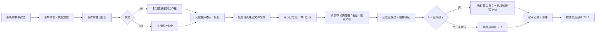
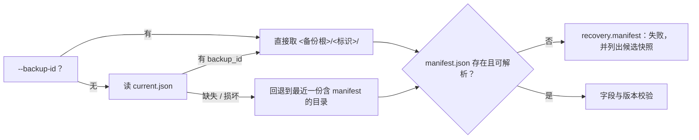
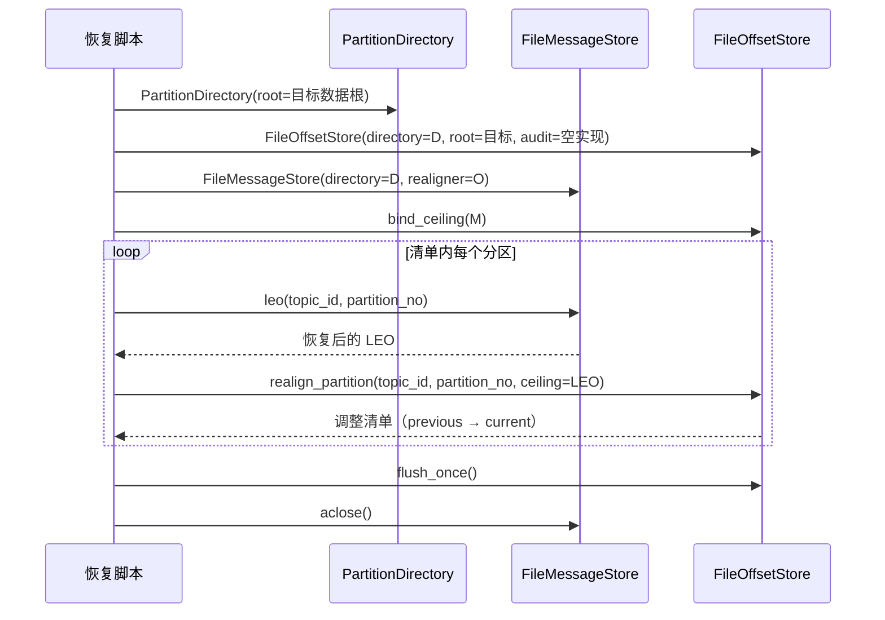

# 07-3-2 恢复演练与记录 · 详细设计

> 08B · 07 部署迁移与验收 · 07-3 备份与恢复 · 子任务 02（需求 07-3）

[文档首页](../../../../../../../文档首页.md) › [消息平台规划](../../../../../../../规划/01_规划_消息平台.md) › [阶段计划](../../../../../计划/01_计划_消息平台.md) › [07 部署迁移与验收](../../../07_部署迁移与验收.md) › [07-3 备份与恢复](../../07_部署迁移与验收_03_备份与恢复.md) › [07-3-2 恢复演练与记录](../07_部署迁移与验收_03_备份与恢复_02_恢复演练与记录.md) › 详细设计

## 0. 分章导航 <a id="toc"></a>

| 章 | 内容 |
| --- | --- |
| 1 | 任务级边界与输入基线 |
| 2 | 交付物清单 |
| 3 | 现状核对结论 |
| 4 | 两种执行模式与步骤编排 |
| 5 | 参数、键位与命令模板 |
| 6 | 清单与快照校验契约 |
| 7 | 位点恢复与一致性校验 |
| 8 | 日志段确认、缺口分诊与对齐 |
| 9 | 延迟消息校验 |
| 10 | 演练记录字段与结论判定 |
| 11 | 失败分支与回退矩阵 |
| 12 | 安全、隔离与清理 |
| 13 | 测试设计与验收映射 |
| 14 | 登记落点与文档同步 |
| 15 | 边界与开放项 |
| 16 | 对齐记录 |

## 1. 任务级边界与输入基线 <a id="scope"></a>

**做什么**：把「元数据库 → 位点文件 → 消息日志 → 校验对齐」的恢复顺序落成一条可在宿主执行的离线命令；它按 07-3-1 的 manifest 恢复位点、确认日志段、驱动真实存储类完成截断对账与位点夹取、重建延迟区、按固定字段产出演练记录，并在任一步失败时给出回退到上一份备份的路径。

**不做什么**：

- 不实现平台库备份与恢复机制本身（归 bms），不复制平台 dump、不建第二套库备份；
- 不复制消息日志全量、不改 02-1 / 02-2 / 02-3 / 02-7 的任何语义与端口签名；
- 不在生产环境执行破坏性恢复（`live` 模式遇到 `prod` / `production` 一律拒绝，无覆盖开关）；
- 不实现定时调度（恢复是按需动作，无 systemd 单元）；
- 不接告警通道（归 06-3），只产结构化标准输出 / 标准错误行；
- 不建 07-6 的故障演练公用框架（本任务独立实现，JSON 作为对接契约）；
- 不修改需求 / 任务文档正文的进度字段（进度只在计划表回写）。

**输入基线**：

| 输入 | 事实 |
| --- | --- |
| 备份产物 | 07-3-1 已交付：`<MSG_BACKUP_DIR>/<备份标识>/manifest.json` + `offsets/`、`current.json` 指针、逐文件 `size` / `sha256`、分区段范围 / LEO / `needs_alignment`、`recovery_order` 四项 |
| 日志卷 | 消息日志不备份，恢复时 `data/` 来自仍存活的数据卷；段名 `^\d{20}\.log$`，每分区有 `recovery-point.json`（含 `leo` / `segments`） |
| 位点格式 | 单文件双槽 + `crc32` + 原子替换，文件头含 `group` / `topic_id` / `partition_no`；`FileOffsetStore` 提供 `get` / `realign_partition` / `flush_once` |
| 崩溃恢复 | `FileMessageStore` 首次访问分区即懒加载：`scan_tail` 截断、恢复点对账、索引修复，并在 `needs_alignment` 时调 `realign_partition` |
| 延迟区 | `FileDelayStore.rebuild()` 全量扫 `.delay`、按 `log_id` 去重、末段截断 / 非末段隔离，返回 `DelayRecoveryReport`（`records` / `expired` / `truncated_bytes` / `isolated_segments` / `lost_records` / `unknown_kind`） |
| 平台恢复口径 | bms《数据备份与恢复部署使用说明》§5：一律「导入到临时对象 / 确认后再切换」，msg 侧不复制该实现，只按外部命令模板执行并记录 |
| 门禁 | `engkit.toml` 已有「部署资产断言」always 步跑 `services/msg/tests/deploy`；`coverage_packages` 含 `ops`，行 + 分支按 bms《AI开发规范》「覆盖率要求」节判定 |
| 前序交付 | 07-3-1 的 manifest / 指针 / 位点校验和契约已写入本任务 §5「前置契约（已交付）」 |

## 2. 交付物清单 <a id="deliverables"></a>

| 类别 | 交付物 | 说明 |
| --- | --- | --- |
| 离线命令 | `backend/ops/recovery.py` | 唯一实现：清单校验、快照复算、位点恢复、段确认与缺口分诊、真实存储类对齐、延迟重建、抽样读回、记录渲染、两种模式编排、`--list-backups` / `--dry-run` / `run()` / `main()` |
| 判据复用 | `backend/ops/backup.py` | 仅把恢复侧要用的 `RECOVERY_ORDER` 改为公开名；快照子目录、清单 / 指针文件名、`sha256_hex` / `render` / `plain` / `fs_list_segments` / `fs_list_offset_files` / `fs_list_backup_dirs` / `fs_read_dump_tables` / `fs_find_dump` / `config_digest` 直接复用 |
| 常量 | `backend/services/msg/src/bms_msg/core/config.py` | 追加「07-3-2 恢复演练」段：六个宿主侧键名、缺省超时 / 抽样阈值、报告目录、探针间隔（§5.2） |
| 用例 | `backend/services/msg/tests/deploy/test_recovery.py` | 新增；R1~R13 全部用例共用一条新 Kiwi 编号（§13） |
| 键位模板 | `deploy/.env.example` | 追加宿主侧恢复运行旋钮段，值全为空；登记 `HOST_ONLY_KEYS`，不进 `msg.yml` |
| 操作说明 | `deploy/recovery/README.md` | 两种模式、键位表、命令模板占位、记录字段、退出码、回退路径、禁止项 |
| 门禁配置 | `engkit.toml`、`backend/ops/check_credentials.py` | `env-example.required_keys` 补新键；`HOST_ONLY_KEYS` 补六个恢复键 |
| 文档 | 本设计 + 实施记录 + 测试记录 + 恢复演练记录 + 计划 / 架构 / 07-6-2 消费方契约回写 | §14 |

**零变更清单**：`FileMessageStore` / `FileOffsetStore` / `FileDelayStore` 的端口与语义、`deploy/compose/msg.yml`、`deploy/Dockerfile`、`Settings` 配置段、契约快照、错误码表、数据库表结构、07-3-1 的备份行为与清单字段。

## 3. 现状核对结论 <a id="current"></a>

| # | 现状 | 处置 |
| --- | --- | --- |
| 1 | 07-3-1 只交备份与清单，恢复侧无任何实现 | 本任务落唯一恢复实现，只读 manifest 与快照（§6） |
| 2 | 消息日志不备份，`data/` 来自存活卷；恢复点 `leo` 可能小于快照位点 | 显式逐分区调 `realign_partition`，不依赖 `needs_alignment` 才触发（§8.3） |
| 3 | 位点文件头含 `group` / `topic_id` / `partition_no`，但目录名带哈希、无法反推组名 | 用 `decode_offset_file` 读文件头身份，再按身份调 `get`（§7.3） |
| 4 | 延迟区重建会写 tombstone 与截断末段，是有副作用的动作 | 只在演练副本上跑；源数据根只做只读扫描（§9） |
| 5 | 本地无 Docker、开发服务器为共享环境 | 默认 `--drill` 全离线可重复；`--live` 供隔离部署环境，用例只验命令编排（§4） |
| 6 | 保留期会合法删除旧 `.log` 段，manifest 里的旧段基址在演练时可能已不存在 | 缺口分三类：保留期裁剪只登记、段间空洞与段尾缺失判降级（§8.2） |
| 7 | 平台库恢复命令含口令与管道，bms 文档已给出模板 | 命令模板由宿主侧键位注入、脚本只用 shell 执行并做口令脱敏后入记录（§5.3、§12） |
| 8 | 07-6-2 的演练判据需要机器可读产物 | 记录 JSON 定为对接契约，本任务不建公用框架（§10） |

## 4. 两种执行模式与步骤编排 <a id="modes"></a>

### 4.1 模式对照 <a id="mode-compare"></a>

| 项 | `--drill`（缺省，离线演练） | `--live`（真实编排） |
| --- | --- | --- |
| 恢复目标 | `<工作根>/target`（源数据根的完整副本） | `MSG_DATA_DIR` 指向的真实数据根 |
| 源数据根 | 只读；复制时保留 mtime | 即目标；停服后原地恢复 |
| 元数据库 | 只核对 dump 表集合并输出待执行命令 | 执行外部命令模板（失败即中止） |
| 停服 / 启动 | 不涉及（隔离副本天然停服） | 注入 runner 依次执行停止 / 启动命令 |
| 就绪判定 | 不涉及 | 轮询 `readyz` URL 直到 2xx 或超时 |
| 演练前备份 | 自动写入临时备份根，结束删除 | 自动写入临时备份根，**保留**为回退点 |
| 对共享数据的影响 | 无（源目录只读） | 就地恢复，需人工确认；`prod` 一律拒绝 |
| 退出码 | 0 通过 / 2 降级通过 / 1 失败 | 同左；降级且未给 `--allow-degraded` 时停在启动前 |



### 4.2 步骤表（声明序即执行序） <a id="steps"></a>

| 步 | 名称 | drill | live | 记录内容 |
| --- | --- | --- | --- | --- |
| 1 | `manifest` | 定位快照、校验清单与指针 | 同左 | 备份标识、`created_at`、schema 版本、服务 / 契约版本、配置摘要 |
| 2 | `pre-backup` | 以源数据根 + 临时备份根跑一次真实备份 | 同左 | 备份标识、退出码、耗时、快照路径 |
| 3 | `prepare` | 复制 `data/` 与 `offsets/` 到工作根，保留 mtime | 无（目标即数据根） | 文件数、字节数、跳过的分区、耗时 |
| 4 | `stop` | 不适用 | 执行停止命令模板 | 脱敏命令、退出码、耗时 |
| 5 | `metadata` | 找 dump、复算 `msg_*` 表集合、与清单对账；输出待执行命令 | 对账后执行导入命令模板 | 期望 / 实际 / 缺失表、命令、退出码 |
| 6 | `offsets` | 清空目标 `offsets/` 后按清单复制并逐文件复算 | 同左（目标为真实数据根） | 文件数、字节数、校验通过数、失败明细 |
| 7 | `segments` | 扫描目标分区的段基址，与清单比对并分诊缺口 | 同左 | 分区数、缺失基址、裁剪区间、空洞区间、可用起点 |
| 8 | `align` | 构造真实存储类，逐分区加载并夹取位点 | 同左（停服状态） | 每分区 LEO / 截断字节 / 位点调整清单 |
| 9 | `verify` | 位点与 LEO 关系、抽样读回、延迟区重建与不提前 / 不丢 | 同左 | 违规数、抽样数、延迟重建报告 |
| 10 | `start` | 不适用 | 执行启动命令模板 | 脱敏命令、退出码、耗时 |
| 11 | `ready` | 不适用 | 轮询 `readyz` | 状态码序列、等待毫秒 |
| 12 | `cleanup` | 删除工作根与临时备份根（`--keep` 保留） | 删除临时工作根，保留演练前备份 | 删除路径、保留路径 |

- **不跳步**：步骤失败即中止后续步骤（`start` / `ready` 不再执行），失败步与后续步分别记 `failed` / `skipped`；
- **每步都有命令**：无外部命令的步记脚本内动作（如 `copy_tree` / `align_partitions`），命令字段仍填可复核的描述；
- **计时**：每步用注入的单调时钟取 `elapsed_ms`；RTO 取第 1 步开始到最后一步通过的墙钟，同时保留各步耗时之和。

## 5. 参数、键位与命令模板 <a id="config"></a>

### 5.1 命令行参数 <a id="cli"></a>

| 参数 | 缺省 | 用途 |
| --- | --- | --- |
| `--mode drill\|live` | `drill` | 执行模式（§4） |
| `--backup-root <目录>` | `MSG_BACKUP_DIR` | 备份根（只读） |
| `--backup-id <标识>` | 取 `current.json` | 指定快照；与 `--list-backups` 配合做回退 |
| `--data-root <目录>` | `MSG_DATA_DIR` | 数据根（`data/` 与 `offsets/` 的父目录） |
| `--dump-dir <目录>` | `MSG_BACKUP_PLATFORM_DUMP_DIR` | 平台库 dump 目录（只读） |
| `--work-dir <目录>` | `MSG_RECOVERY_WORK_DIR` | 演练工作根（目标副本与临时备份根） |
| `--report <路径>` | `<工作区根>/tmp/msg/recovery/<标识>-<模式>-<UTC 时间>.json` | 记录 JSON 落点（同目录同时写 `.md`；时间后缀让重复演练不互相覆盖） |
| `--sample-per-partition <N>` | `20` | 每分区抽样条数 |
| `--sample-limit <N>` | `200` | 抽样总量上限 |
| `--max-partitions <N>` | `0`（全部） | 演练副本最多纳入的分区数（大库演练的缩容开关） |
| `--allow-degraded` | 关 | live 模式在降级结论下仍继续启动（drill 无效） |
| `--keep` | 关 | 保留演练工作根（drill）或临时目录，打印现场路径 |
| `--list-backups` | — | 列出可用快照（含指针与「上一份」标记）后退出 0 |
| `--dry-run` | 关 | 只做只读校验（清单 / 快照 / dump / 段比对），不建目录、不写位点、不跑存储类 |
| `--yes` | 关 | live 模式的显式确认（缺失即拒绝执行） |

### 5.2 宿主侧键位（唯一配置入口） <a id="env"></a>

| 键 | 必填 | 缺省 | 用途 |
| --- | --- | --- | --- |
| `MSG_RECOVERY_WORK_DIR` | drill 是 | — | 演练工作根（与数据根分盘，避免演练把源盘写满） |
| `MSG_RECOVERY_STOP_CMD` | live 是 | — | 停止服务命令模板（如 `docker compose -f <编排> stop msg`） |
| `MSG_RECOVERY_START_CMD` | live 是 | — | 启动服务命令模板 |
| `MSG_RECOVERY_METADATA_CMD` | live 是 | — | 元数据库导入命令模板，可用占位 `{dump}` / `{backup_id}` / `{target_env}` |
| `MSG_RECOVERY_READY_URL` | live 是 | — | 就绪地址（如 `http://127.0.0.1:8000/readyz`） |
| `MSG_RECOVERY_TIMEOUT_SEC` | 否 | `120` | 命令与就绪轮询的总超时（正整数） |

- 键名与缺省值只登记在 `core/config.py` 的「07-3-2 恢复演练」段；`.env.example` 给键位、值全空；
- 六个键进 `HOST_ONLY_KEYS`（宿主侧运行旋钮），**不进** `msg.yml` 的 `x-service-env`；
- 脚本**不读取任何 `.env` 明文**，只消费进程环境变量；缺必填键、非正整数超时立即失败并指名键名；
- `MSG_BACKUP_DIR` / `MSG_DATA_DIR` / `MSG_BACKUP_PLATFORM_DUMP_DIR` 与 07-3-1 复用同一组键，不新增同义键。

### 5.3 命令模板与脱敏 <a id="command"></a>

```text
模板示例（部署态填入宿主侧 env，不入库）：
  MSG_RECOVERY_STOP_CMD=docker compose -f <编排文件> stop msg
  MSG_RECOVERY_METADATA_CMD=gunzip -c {dump} | docker exec -i <库容器> mysql -uroot
  MSG_RECOVERY_START_CMD=docker compose -f <编排文件> up -d msg
  MSG_RECOVERY_READY_URL=http://127.0.0.1:8000/readyz
```

- 模板按平台 shell 语义执行（`shell=True`），因为 bms 恢复口径本身就是管道；**只在 live 模式执行**，drill 只把模板原文（脱敏后）写进记录的 `pending_command`；
- 占位替换只做 `{dump}` / `{backup_id}` / `{target_env}` 三个白名单键，不做其余展开；
- **脱敏先于记录**：`--password=…`、`MYSQL_PWD=…`、`PGPASSWORD=…`、`-p<非空>`、URL 内 `user:pass@` 一律替换为 `***`；命令原文不进记录、不进标准输出；
- 命令与就绪探针的超时统一取 `MSG_RECOVERY_TIMEOUT_SEC`，超时按失败处理（`recovery.command.timeout`），不无限等待。

### 5.4 预检与拒绝 <a id="guards"></a>

| # | 条件 | 处置 |
| --- | --- | --- |
| 1 | `--mode live` 缺 `--yes` | 拒绝执行（退出 1），提示「live 会就地写数据根」 |
| 2 | `--mode live` 且 `BMS_ENV` / `--target-env` 为 `prod` / `production` | **一律拒绝**（退出 1），无覆盖开关；生产恢复走人工流程 |
| 3 | `--mode drill` 缺 `MSG_RECOVERY_WORK_DIR` 或工作根不存在 / 不可写 | 拒绝，指名键名与路径 |
| 4 | 工作根与数据根在同一路径 / 工作根是数据根子目录 | 拒绝（避免清理时误删源数据） |
| 5 | `--backup-id` 不存在或目录缺 `manifest.json` | 拒绝，并用 `--list-backups` 的候选清单提示 |
| 6 | `--sample-per-partition` / `--sample-limit` / `--max-partitions` 非法（负数） | 拒绝，指名参数 |
| 7 | 清理前校验「待删目录 = 本次创建的工作根」 | 不匹配即不删，记 `[ALERT] recovery.cleanup` |

## 6. 清单与快照校验契约 <a id="manifest"></a>

### 6.1 快照定位 <a id="locate"></a>



- 指针损坏只降级为「取最近一份含清单的目录」并记 `[ALERT] recovery.pointer`，不静默改指针；
- `--list-backups` 输出：标识、`created_at`、是否当前指针、是否最近一份、manifest 是否完整；「上一份」定义为**指针所指之前最近的一份完整快照**。

### 6.2 字段校验 <a id="fields"></a>

| 规则 | 判据 | 失败处置 |
| --- | --- | --- |
| 版本 | `schema_version` 为整数且 `<= BACKUP_MANIFEST_SCHEMA_VERSION` | 更高版本拒绝（不按旧格式猜） |
| 必填 | `backup_id` / `created_at` / `service{name,version,contract_version}` / `config_version` / `tenants` / `metadata` / `offsets{files,count,bytes}` / `log_segments{backed_up,partitions,needs_alignment}` / `recovery_order` / `files` / `retention_days` | 缺任一即失败并指名键 |
| 目录一致 | 目录名与 `backup_id` 相同 | 不一致即失败（防拿错目录） |
| 顺序 | `recovery_order` 与 `backup.RECOVERY_ORDER` 逐项相同 | 不一致即失败（口径漂移） |
| 日志口径 | `log_segments.backed_up is False` | 断言失败（清单不再是「只登记不备份」） |
| 元数据 | `metadata.source == platform_database_backup` 且 `metadata.covered is True` | 失败 |
| 路径安全 | `files[].path` / `offsets.files[].path` 为相对路径、无 `..`、无反斜杠逃逸 | 失败（防路径穿越） |
| 交叉一致 | 每个 `offsets.files[]` 在 `files[]` 中有同名（`offsets/<path>`）、同 `size`、同 `sha256` | 失败（清单自相矛盾） |

### 6.3 快照复算 <a id="digest"></a>

- 对 `files[]` 逐项复算：存在性、`size`、`sha256`，任一不符即 `recovery.snapshot` 失败，并列出前 10 条不符明细；
- 复算在**任何写入之前**完成：快照损坏时工作根尚未创建，源数据根零改动；
- 校验和比对只用 `backup.sha256_hex`，不另写实现（单一事实源）。

## 7. 位点恢复与一致性校验 <a id="offsets"></a>

### 7.1 恢复动作 <a id="restore"></a>

```text
1. 目标 offsets/ 先清空（只清 offsets，不碰 data/）
2. 按清单 offsets.files 逐项复制：快照 offsets/<path> → 目标 offsets/<path>
3. 每个目标文件复算 size + sha256，与清单逐项比对
4. 失败即中止：drill 删工作根；live 用演练前备份回退（§11）
```

- **为什么清空目标 `offsets/`**：恢复语义是「位点回到快照时刻」，残留的新位点会与快照混在一起，导致同一组同一分区出现「快照旧值 + 残留新值」矛盾；
- 只清 `offsets/`、不碰 `data/`：日志从未被备份，删了就是数据丢失；
- 目录结构与源目录一致（`{tenant}/{group}-{hash8}/{topic_id}-{partition}.offset`），不重命名、不重建哈希。

### 7.2 位点身份与关系校验 <a id="identity"></a>

对目标 `offsets/` 下每个 `*.offset`：

| 检查 | 判据 | 结论 |
| --- | --- | --- |
| 文件可解析 | `decode_offset_file(raw)` 的 `reason == ok` | 否则 `recovery.offset.corrupt`（硬失败） |
| 身份与路径一致 | 文件头 `group` / `topic_id` / `partition_no` 与目录名、文件名相符 | 不符 → 硬失败（文件被挪错目录） |
| 位点在区间内 | `start_offset <= offset <= leo` | `offset > leo` → 夹取（§8.3）并记降级；`offset < start_offset` → 记降级（该组已越过的数据被保留期删掉） |
| 组可继续消费 | 按身份调 `FileOffsetStore.get`，返回值与文件最新槽一致 | 不一致 → 硬失败（存储类读取与直接解析分歧，属实现缺陷） |

### 7.3 抽样读回（已确认消息可读） <a id="sample"></a>

- 对每个「有已确认消息」的消费组 / 分区：`from = max(start_offset, offset - sample_per_partition)`，`fetch(from_offset=from, max_messages=sample_per_partition)`；
- 断言：返回非空、全部记录 `offset < offset`、`offset` 严格递增、无 `CorruptedRecordError`；
- `offset == start_offset`（尚无已确认消息）不算失败，记 `empty`；
- 总量达到 `sample_limit` 后停止抽样，记 `truncated = true`（不静默少抽）；
- 抽样失败即 `recovery.sample` 硬失败：说明「位点说读了、日志却读不出来」，属于不可接流量的状态。

## 8. 日志段确认、缺口分诊与对齐 <a id="segments"></a>

### 8.1 段确认 <a id="confirm"></a>

- 按清单 `log_segments.partitions[]` 的 `tenant / namespace / topic / topic_id / partition` 定位目标分区目录；
- 用 `backup.fs_list_segments` 取实际段名（只认 `^\d{20}\.log$`），基址 = 文件名前 20 位整数；
- 与清单 `segment_bases` 求差：`missing = 清单 - 实际`、`extra = 实际 - 清单`；
- `extra` 只登记（备份后新写入的段），不判异常。

### 8.2 缺口分诊 <a id="gap"></a>

| 类别 | 判定 | 结论 | 记录字段 |
| --- | --- | --- | --- |
| 保留期裁剪 | 全部 `missing` 都小于实际最小基址（`max(missing) < min(actual)`） | **不降级**（合法的按段删除） | `pruned`：`[min(missing), max(missing)]` |
| 段间空洞 | 存在 `missing` 落在 `[min(actual), max(actual)]` 区间内 | **降级** | `gaps[]`：每段的可用起点与缺失区间 |
| 段尾缺失 | `max(actual) < max(清单基址)` | **降级**（尾部数据不在） | `tail_missing`：`[max(actual)+1, max(清单)]` |
| 分区整目录缺失 | 目标分区目录不存在 | **降级**（该分区日志全丢） | `absent_partitions` |

- 任一降级项都写进结论 `reasons`，并把演练结论置「降级通过」；`live` 模式在启动前停下，需 `--allow-degraded` 才继续（任务边界：不允许部分恢复后直接接流量）；
- 「从最近可用段开始」由对齐步落实：`start_offset` 取实际最小段基址，位点若低于它按 §7.2 记降级。

### 8.3 对齐：真实存储类驱动 <a id="align"></a>



- **为什么显式逐分区 `realign_partition`**：`FileMessageStore` 只在 `needs_alignment`（发生截断 / 恢复点 LEO 超前）时才自动对齐；「快照位点 > 日志尾」但日志未截断的路径不会触发自动对齐，必须显式夹取才能保证「位点不越过日志尾」；
- **夹取是恢复语义**，不走 `commit`（`commit 只前进`这条不变量不被破坏）；
- **`flush_once` 必须在报告前完成**：夹取只改内存并标脏，不刷盘等于「演练结束、位点没变」；
- `aclose` 会重写恢复点与索引，这是「真实启动一次」的等价动作；drill 只作用于副本，live 在停服状态下执行（随后真实启动会再次幂等加载）；
- 记录每个分区的 `leo_before`（清单值）、`leo_after`（恢复后）、`truncated_bytes`（由 `RecoveryLedger` / 分区报告的截断字段得出）、`adjustments`。

## 9. 延迟消息校验 <a id="delay"></a>

### 9.1 不提前 / 不丢的判定 <a id="delay-check"></a>

| 判据 | 做法 |
| --- | --- |
| 不提前 | 恢复前用 `DelaySegment.scan(verify_crc=False)` **只读**扫源数据根的 `.delay` 段，建 `log_id → 最后一条 put 的 deliver_at`；恢复后 `list_all()` 的每条记录 `deliver_at` 必须与之一致（逐条比对，不比较「剩余秒数」，避免时钟漂移误判） |
| 不丢 | `list_all()` 的 `log_id` 集合必须等于源扫描的期望集合（`put` 且未被 `clear` 覆盖）；差异即降级并列出缺失 / 多出的 `log_id` 前 20 条 |
| 已到期 | `deliver_at <= now` 的记录计入 `expired`（重建报告的 `expired`），只登记「启动后由调度器转投」，本脚本**不执行转投**（转投是服务启动后的运行期行为） |
| 损坏 | `truncated_bytes > 0` / `isolated_segments > 0` / `lost_records > 0` → 降级；`unknown_kind > 0` → 降级并计数 |

- 期望集合的构建只复用 `DelaySegment` 与 `list_delay_segment_seqs` 的真实解码器，不另写记录格式解析；
- 源数据根只读：`DelaySegment.scan` 不写文件；tombstone / 截断 / 隔离只发生在目标副本；
- 目标分区未纳入演练（`--max-partitions` 截断）时，不参与该判定，记 `excluded`。

### 9.2 与 02-7 的口径衔接 <a id="delay-align"></a>

- 重建在 `FileMessageStore` 之后做（延迟去重要读 `.log`），注入 `dedupe=store`；
- 重建本身是幂等的；`live` 模式下脚本只在停服状态重建一次，真实启动时启动钩子会再做一次（`ensure_started` 之前），两次结果一致；
- 不调用调度器、不推进时间轮、不删任何记录。

## 10. 演练记录字段与结论判定 <a id="report"></a>

### 10.1 JSON 契约 <a id="json"></a>

| 字段 | 类型 | 说明 |
| --- | --- | --- |
| `schema_version` | int | 记录格式版本（`1`），后续只增字段 |
| `task` / `mode` | str | 固定 `07-3-2`；`drill` / `live` |
| `environment` | object | `os` / `arch` / `python` / `isolated` / `target_env`（不含主机名、地址与账号） |
| `service` | object | `name` / `version` / `contract_version`（取清单） |
| `config` | object | `backup_version`（清单 `config_version`）、`current_version`（仓内四份配置摘要）、`drift`（布尔） |
| `backup` | object | `id` / `created_at` / `manifest_schema_version` / `snapshot_dir`（相对化）/ `pre_drill_backup_id` / `pre_drill_backup_dir` |
| `started_at` / `finished_at` | str | UTC ISO8601 |
| `rto_ms` / `rto_sum_ms` | int | 总墙钟 / 各步耗时之和 |
| `rpo_seconds` / `rpo_source` / `rpo_reason` | int / str / str | 数据最后写入与清单 `created_at` 之差；`recovery-point` / `mtime` / `null` |
| `steps[]` | array | `step` / `command`（脱敏）/ `started_at` / `elapsed_ms` / `result`（`ok` / `degraded` / `failed` / `skipped`）/ `detail` |
| `checks` | object | `manifest` / `metadata` / `offsets` / `segments` / `alignment` / `samples` / `delay` 七块结论 |
| `conclusion` | object | `result`（`通过` / `降级通过` / `失败`）、`data_integrity`（`完整` / `有缺口` / `不可用`）、`reasons[]`、`requires_review` |
| `failure_injection` | object | `enabled` / `cases[]`（演练注入的失败分支与预期） |
| `issues[]` | array | `summary` / `disposition` / `owner`（问题与处置） |
| `leftovers[]` | array | `item` / `owner`（遗留与归口） |
| `artifacts` | object | `report_json` / `report_md` / `retained_work_dir` / `retained_backup_dir` |

- 记录与快照同源：`backup.id` / `created_at` / `service` / `config_version` 全部取自清单，不重新猜；
- `snapshot_dir` 等宿主路径写**相对备份根**的路径，避免记录里出现真实盘符；确实需要绝对路径时只落 `tmp/`（不入库）。

### 10.2 结论判定 <a id="conclusion"></a>

| 结论 | 条件 | 退出码 |
| --- | --- | --- |
| `通过` | 无硬失败、无降级项 | 0 |
| `降级通过` | 无硬失败，但存在段间空洞 / 段尾缺失 / 分区缺失 / 位点夹取 / 位点低于起点 / 延迟损坏 | 2 |
| `失败` | 任一硬失败（清单 / 快照 / dump / 位点 / 抽样 / 命令 / 就绪） | 1 |

- `data_integrity`：`完整` / `有缺口`（降级项只涉及可登记缺口）/ `不可用`（硬失败）；
- `requires_review`：`降级通过` 为 `true`，需人工确认后再接流量；
- 失败也必须写记录（含失败步与原因），不能「失败了没有产物」。

### 10.3 RTO / RPO <a id="rto"></a>

- **RTO**：第 1 步开始到 `cleanup` 前的单调时钟差；`rto_sum_ms` 为各步 `elapsed_ms` 之和，两者差值即步骤间开销；
- **RPO**：`data_last_write`（目标数据根各分区 `recovery-point.updated_at_us` 与 `.log` 段文件 mtime 的最大值，取恢复前时刻）减 `manifest.created_at`，负值夹到 `0`；
- 锚点缺失（无恢复点且无段文件）时 `rpo_seconds = null`，`rpo_reason` 写明「无可用时间锚点」，不填 0 冒充；
- RPO 取「恢复前」值：对齐与 `aclose` 会重写恢复点，取恢复后值会把恢复动作本身算成数据写入。

### 10.4 Markdown 记录 <a id="markdown"></a>

- 脚本按同一份 JSON 渲染 Markdown（信息 / 步骤表 / 校验结论 / RTO·RPO / 问题与处置 / 遗留与归口）；
- 任务 `测试/` 下另落一份人工整理的《恢复演练记录》，字段与 JSON 同源、结论一致，并附首次完整演练的实际耗时与产物；
- JSON 与 Markdown 都落 `--report` 指定目录；默认工作区根 `tmp/msg/recovery/`（已忽略），入库的人工记录不含真实路径与凭据。

## 11. 失败分支与回退矩阵 <a id="failure"></a>

| # | 失败 | 触发（用例构造） | 表现 | 回退 / 处置 |
| --- | --- | --- | --- | --- |
| 1 | 清单缺失 / 损坏 | 删 `manifest.json`、写坏 JSON、改 `schema_version` 为 2 | `recovery.manifest`，退出 1 | 用 `--list-backups` 选上一份；指针不动 |
| 2 | 指针缺失 / 损坏 | 删 `current.json`、写坏 JSON | `[ALERT] recovery.pointer` + 取最近完整快照 | 记录告警；`--backup-id` 显式指定 |
| 3 | 位点快照损坏 | 改一个位点文件字节 / 截断 | `recovery.snapshot`，退出 1，**工作根尚未创建** | 回退上一份快照，重跑同一命令并换 `--backup-id` |
| 4 | 位点文件格式坏 | 目标位点文件写坏（模拟外部改写） | `recovery.offset.corrupt`，退出 1 | live 用演练前备份回退；drill 删除工作根重来 |
| 5 | dump 缺表 | 从 dump 删一条 `CREATE TABLE msg_*` | `recovery.metadata`，退出 1 | 先确认平台备份已覆盖该表；不导入残缺库 |
| 6 | dump 不存在 | 目录为空 / 文件名与清单不符 | `recovery.metadata`，退出 1 | 先跑平台库备份；本脚本不代跑 |
| 7 | 日志段间空洞 / 段尾缺失 | 删中间段 / 删末段 | `降级通过`，退出 2；缺口区间入记录 | 人工确认缺口范围；live 需 `--allow-degraded` 才启动 |
| 8 | 位点越过日志尾 | 快照位点改大 | 夹取到 LEO 并立即落盘；`降级通过` | 记录 `adjustments`；重复消费而非丢消息 |
| 9 | 恢复中途 IO 失败 | 注入写失败 / 复制失败 | 该步 `failed`，后续 `skipped`，退出 1 | drill 删工作根；live 用演练前备份回退（命令已打印） |
| 10 | 命令失败 / 超时 | 注入 runner 返回非 0 / 超时 | `recovery.command`，退出 1 | 记录脱敏命令与退出码；修正命令后重跑 |
| 11 | 就绪超时 | 注入 HTTP 503 直到超时 | `recovery.ready`，退出 1 | 服务不停机重试；必要时用演练前备份回退 |
| 12 | 降级但要求启动 | 段缺口 + `--mode live` 无 `--allow-degraded` | 停在启动前，退出 2 | 人工确认后加开关重跑 |

- **回退到上一份备份的路径**：`--list-backups` 给出候选与「上一份」标记；失败输出的末行固定为 `[ALERT] recovery.fallback --backup-id <上一份>`（可直接复制重跑）；
- **live 的演练前备份是最后防线**：无论本次成功或失败都保留（`--keep` 不影响它），记录 `pre_drill_backup_id`；只有人工确认后由运维清理；
- 任何失败都**不允许**「部分恢复后直接接流量」：失败步之后的 `start` / `ready` 恒为 `skipped`。

## 12. 安全、隔离与清理 <a id="safety"></a>

- **默认 drill**：`live` 需 `--yes`，`prod` / `production` 无覆盖开关；脚本不读 `.env`、不打印环境变量值、不落凭据；
- **源数据只读**：drill 只复制不写源；延迟期望集合用只读扫描；`--dry-run` 连工作根都不创建；
- **清理有校验**：只删除「本次创建且在记录里登记过」的工作根与临时备份根；删前比对路径，不匹配即告警并保留；
- **记录脱敏**：命令模板、输出摘要、路径都经脱敏与相对化；输出摘要只留末尾 `2 KiB`；
- **与平台库的边界**：只执行外部命令模板，不拼 SQL、不持有连接串；口令只存在于宿主侧键位，脚本不落盘；
- **不重跑全量日志复制**：`--max-partitions` 只用于演练缩容，不是「把日志当备份」。

## 13. 测试设计与验收映射 <a id="test"></a>

用例落 `backend/services/msg/tests/deploy/test_recovery.py`，**先在 Kiwi 平台登记一条新编号再编码**（编号在实施记录回读登记），全部新用例共用该编号；IO / runner / 时钟 / HTTP 探针全部可注入。

| 用例 | 断言 | 映射任务条目 |
| --- | --- | --- |
| R1 清单校验 | 版本过高 / 必填缺失 / 目录名不符 / 顺序不符 / `backed_up` 非假 / `covered` 非真 / 路径穿越，逐项失败并指名键 | §2.2、完成标准 3 |
| R2 指针与回退枚举 | 指针正常 / 缺失 / 损坏三分支；`--list-backups` 标记当前与上一份；`--backup-id` 不存在时给出候选 | §2.4、完成标准 3 |
| R3 快照复算 | `size` / `sha256` / 缺文件三类不符；失败时未创建工作根、源目录零改动 | §2.4、完成标准 3 |
| R4 位点恢复 | 目标 `offsets/` 清空后逐文件复制；残留文件被清、`data/` 不动；复算通过 | §2.2、完成标准 1 |
| R5 缺口分诊 | 保留期裁剪不降级、段间空洞降级、段尾缺失降级、分区整目录缺失降级，四类区间正确 | §2.2、完成标准 1 / 3 |
| R6 对齐与夹取 | 位点 > LEO 被夹并落盘（重读文件确认）；`offset == LEO` 合法；位点 < 起点记降级；`leo_after <= leo_before` | §2.2、完成标准 2 |
| R7 抽样读回 | 每分区 N 条 + 总上限 M；`offset == 起点` 记空不失败；读到损坏即失败；增量偏移断言 | §2.3、完成标准 2 |
| R8 延迟校验 | 期望集合与重建集合一致；`deliver_at` 逐条不变（不提前）；`truncated` / `isolated` / `unknown_kind` 判降级；不执行转投 | §2.3、完成标准 2 |
| R9 演练前备份与清理 | 自动备份产出可解析清单；结束删除工作根与临时备份根；`--keep` 保留；失败也清理 | §2.6、完成标准 5 |
| R10 live 编排 | 停止 → 导入 → 启动顺序；命令脱敏；非 0 退出即失败；降级无 `--allow-degraded` 不启动；就绪超时失败；`prod` 拒绝、缺 `--yes` 拒绝 | §2.1 / §2.4、完成标准 3 |
| R11 记录契约 | 固定字段齐备；RTO / RPO 计算（含 `null` 分支）；结论三态；回退提示行；Markdown 渲染 | §2.5、完成标准 4 |
| R12 CLI 与退出码 | `0` / `2` / `1` 三态；`--dry-run` 零写；`--list-backups`；键位缺失指名；源码无绝对路径字面量、无 `.env` 读取 | §2.6、完成标准 5 / 6 |
| R13 口径复用 | `backup.RECOVERY_ORDER` 与清单一致；六键在 `core/config.py` / `.env.example` / `HOST_ONLY_KEYS` 三处一致且不在 `x-service-env` | §2.4、完成标准 6 |

补充：`--max-partitions` 截断、`--keep`、重复执行（同一份备份跑两次结果一致）各一例；覆盖率缺口的边界（空清单、零分区、空位点目录）用参数化补齐。

## 14. 登记落点与文档同步 <a id="register"></a>

| 落点 | 内容 |
| --- | --- |
| 阶段计划（进度唯一落点） | 07-3 父行迁入 §2「已完成」表，状态与完成日期回填；偏差与遗留列登记本任务结论与遗留 |
| 《[架构设计 · 部署与运维](../../../../../../../设计/架构设计/08_架构设计_部署与运维.md)》「备份与恢复」节 | 只补语义：恢复演练须可重复、校验项、缺口显式登记、失败可回退上一份、演练记录含 RTO / RPO 与结论；**不写脚本名、命令与键位** |
| [07-6-2 演练判据与回写](../../../07_部署迁移与验收_06_故障演练/07_部署迁移与验收_06_故障演练_02_演练判据与回写/07_部署迁移与验收_06_故障演练_02_演练判据与回写.md) | 补「前置契约（已交付）」：记录 JSON 字段、三态退出码、`--list-backups` / `--backup-id` 回退参数 |
| `deploy/recovery/README.md` | 两种模式、键位、命令模板、记录字段、退出码、回退、禁止项 |
| `.env.example` / `HOST_ONLY_KEYS` / `engkit.toml` | 六个宿主键位与 `env-example.required_keys` |
| 实施记录 / 测试记录 / 恢复演练记录 | 任务目录 `实施/`、`测试/` 各一份；演练记录独立成文 |
| 需求 07-3 / 任务 07-3-2 | 不改正文（进度不落需求与任务文档） |

## 15. 边界与开放项 <a id="open"></a>

| # | 事项 | 归口 |
| --- | --- | --- |
| 1 | 真机（隔离部署环境）跑一次完整 `--live` 演练 | 部署阶段；本任务交付命令与离线完整演练 |
| 2 | 元数据库恢复后的行级完整性校验（行数 / 关键表抽样） | 平台备份侧改进项（bms《数据备份与恢复部署使用说明》§8 已登记）；msg 侧只核对表集合 |
| 3 | 大库演练的副本磁盘占用 | `--max-partitions` 缩容；容量模型归 8B_12 |
| 4 | 告警规则 / webhook 通道 | 06-3；本任务只产结构化标准错误行 |
| 5 | 多副本 / 分区迁移后的恢复范围 | 8B_05 |
| 6 | 季度复演与 RTO / RPO 趋势 | 部署阶段运维制度；记录 JSON 已可供比对 |
| 7 | 07-6 故障演练公用框架 | 07-6；本任务只提供 JSON 契约 |
| 8 | 生产灾难恢复的人工流程 | 平台部署侧；本任务显式拒绝 `prod` |

## 16. 对齐记录 <a id="align"></a>

2026-11-10 逐项拍板（16 项全部取推荐项），汇总回显无异议后执行：

| # | 待决项 | 结论 |
| --- | --- | --- |
| 1 | 脚本落点 | `backend/ops/recovery.py` 单文件，与 `backup.py` 同构 |
| 2 | 执行边界 | 双模式：`--drill` 缺省离线、`--live` 真实编排 |
| 3 | 元数据库恢复 | 外部命令模板，脚本只执行 / 计时 / 记录；离线只核对 dump 表集合 |
| 4 | live 停服与启动 | 注入 runner 调部署侧命令 |
| 5 | 校验驱动 | 导入真实存储类（`FileMessageStore` / `FileOffsetStore` / `FileDelayStore`） |
| 6 | 演练目标 | 复制完整数据根到临时目录，源只读 |
| 7 | 演练前备份与清理 | 自动跑 `ops.backup` 到临时备份根；drill 清理、live 保留回退点 |
| 8 | 记录形态 | 固定字段 JSON + 测试记录 / 恢复演练记录两份 Markdown |
| 9 | RTO / RPO | 脚本自动计算，缺失锚点置 `null` |
| 10 | 失败分支与回退 | 用例构造 + `--list-backups` / `--backup-id` 回退参数 |
| 11 | 日志缺口 | 登记后继续对齐并标降级 |
| 12 | 消息抽样 | 每分区前 N 条 + 总上限 M（20 / 200） |
| 13 | 判据复用 | 复用 `ops.backup` 公开判据；`RECOVERY_ORDER` 改公开名 |
| 14 | 恢复键位 | 宿主侧新键位段 + `HOST_ONLY_KEYS`，不进容器 |
| 15 | 与 07-6 关系 | 独立实现，JSON 为对接契约 |
| 16 | 架构回写 | 只回写语义约束 |

**设计期细化（不改变上表结论）**：

1. **缺口分诊**：把「manifest 有、目标没有」的段再分「保留期裁剪 / 段间空洞 / 段尾缺失 / 分区缺失」四类——保留期裁剪是合法行为，只登记不降级；其余三类降级。若不分类，任何按日演练都会因旧段被保留期删除而恒判降级，结论失去信号价值。
2. **live 的演练前备份保留**：`--keep` 只控制工作根；演练前备份是回退点，live 恒保留，避免「恢复成功即删掉唯一退路」。
3. **显式对齐**：不依赖 `needs_alignment` 才调 `realign_partition`，清单内每个分区都显式夹取一次并 `flush_once`，否则「位点越过日志尾但日志未截断」的路径不会被处理。
4. **延迟「不提前」用逐条 `deliver_at` 比对**，不比剩余秒数（墙钟漂移会把正常恢复误判为提前）。

**实施期对齐补记**（先回写设计再继续实施 / 测试）：

1. **清单 `topic_id` 兼容**：07-3-1 的 `log_segments.partitions[].topic_id` 实际写的是目录名片段**字符串**；恢复侧按「整数或纯数字字符串」解析（`as_intish`），不要求备份侧改格式。
2. **抽样上界**：`fetch` 没有「只读到已提交位点之前」的参数，抽样按 `offset < 已提交位点` 截断后计数；「一条都读不到」仍判硬失败，不把「位点等于起点」当失败。
3. **live 降级的处置**：结论为降级且未给 `--allow-degraded` 时，不抛硬失败，而是把 `start` / `ready` 标为 `skipped` 并返回 **2**；硬失败仍返回 1。
4. **延迟排除口径**：`--max-partitions` 排除的分区，其延迟记录也从实际集合中过滤，避免「期望为空、实际非空」的假降级。
5. **RPO 取恢复前锚点**：在 `_finish` 里读源数据根的恢复点 / 段 mtime（对齐前的值），避免把对齐与 `aclose` 重写恢复点的动作算成数据写入；负值夹到 0。
6. **判据函数公开化**：`RECOVERY_ORDER`（备份侧）、`compute_rpo` / `fallback_hint` / `current_config_version` / `issues_rows` / `split_offset_name` / `EXIT_CODES` 用公开名，供用例直接断言且不触发 pyright 私有访问告警。
7. **live 恒保留演练前备份**：`--keep` 只控制 drill 的工作根；live 的工作目录不删（演练前备份是唯一回退点），`artifacts.retained_backup_dir` 记录该口径。

---

> 依《[文档生成规范](../../../../../../../../bms文档/规范/文档生成规范.md)》编写 · 恢复语义见《[架构设计 · 部署与运维](../../../../../../../设计/架构设计/08_架构设计_部署与运维.md)》「备份与恢复」节 · 覆盖率口径见 bms《[AI开发规范](../../../../../../../../bms文档/规范/AI开发规范.md)》「覆盖率要求」节
