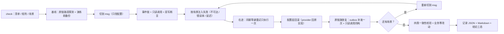

# 07-4-2 回滚演练与记录 · 详细设计

> 08B · 07 部署迁移与验收 · 07-4 bms 迁移与回滚 · 子任务 02（需求 07-4）

[文档首页](../../../../../../../文档首页.md) › [消息平台规划](../../../../../../../规划/01_规划_消息平台.md) › [阶段计划](../../../../../计划/01_计划_消息平台.md) › [07 部署迁移与验收](../../../07_部署迁移与验收.md) › [07-4 bms 迁移与回滚](../../07_部署迁移与验收_04_bms迁移与回滚.md) › [07-4-2 回滚演练与记录](../07_部署迁移与验收_04_bms迁移与回滚_02_回滚演练与记录.md) › 详细设计

## 0. 分章导航 <a id="toc"></a>

| 章 | 内容 |
| --- | --- |
| 1 | 任务级边界与输入基线 |
| 2 | 交付物清单 |
| 3 | 现状核对结论 |
| 4 | 回滚原则与演练闭环 |
| 5 | 场景单源（`rollback_scenarios.toml`） |
| 6 | 演练端口与步骤编排 |
| 7 | 故障注入与判据映射 |
| 8 | 在途、未确认、outbox 与双写窗口 |
| 9 | 数据一致性校验（四类） |
| 10 | 记录契约、恢复时间与结论判定 |
| 11 | 失败分支与处置 |
| 12 | 可重复、隔离、备份与清理 |
| 13 | 测试设计与验收映射 |
| 14 | 登记落点与文档同步 |
| 15 | 边界与开放项 |
| 16 | 对齐记录 |

## 1. 任务级边界与输入基线 <a id="scope"></a>

**做什么**：把「切到 msg 之后怎么退回来」落成一条**只改配置**、可重复执行、带固定字段记录的演练闭环——在隔离环境切到 msg（真路由 / 真帧 / 真数据面）→ 跑一条事件链与一个只读远程调用 → 按矩阵判据注入三类失败 → 只改 `provider` 回滚 → 验证原链路恢复 → 核对「效果一次、无丢失、位点 / 死信 / 重放不错乱、审计链可校验」→ 落 JSON + Markdown 记录。

**不做什么**：

- 不实现 bms `EventPublisher` / `BaseServiceClient` 的 msg 实现与切换装配（04-5 + bms 07B `06_01` 已交付），不改 bms 代码与文档；
- 不删除 / 改写 RocketMQ、outbox、HTTP 原链路；不执行数据库降级、不重新发布业务代码或业务镜像；
- 不在生产环境演练（`--env prod` 一律拒绝，无覆盖开关）；真实集群回滚、生产窗口与 PromQL 取值归 bms `8B_08`；
- 不实现域级白名单 / 灰度键（归 bms `8B_08`），本任务只回滚当前唯一生效的全局 `provider`；
- 不把 bms 真实业务迁移纳入本任务（归 bms `8B_08`），不做 bms 审计表行级对账；
- 不建 07-6 故障演练公用框架（本任务独立实现，记录 JSON 作为对接契约）；
- 不修改需求 / 任务文档正文的进度字段（进度只在计划表回写）。

**输入基线**：

| 输入 | 事实 |
| --- | --- |
| 07-4-1 编排 | `python -m ops.migration check / matrix / drill`；`preconditions.toml` 与 `switch_matrix.toml` 单源；`config_fingerprint`；记录 JSON/Markdown 契约；结论三态（0 / 2 / 1） |
| 开关契约 | 缺省 / 空串 = 原实现；非法值或 `msg` 配置不全 = 装配期拒启；切换只改配置 + 重启调用方 |
| 回滚判据 | 矩阵 `rollback_criteria`（错误率 / 延迟 / 积压 / 死信 / 对账差），阈值数值归 `8B_12` |
| 失败语义 | 发布失败必须抛 `EventPublishError`（不吞）；一次调用只产生一条通道 |
| outbox | bms `SqlOutboxStore` + `PollOutboxDispatcher`；失败保行计次、切回不重投、每条只成功一次（bms `06_01` 已交付，`tests/outbox/test_provider_switch.py` 为证据） |
| 备份入口 | 07-3-1 `python -m ops.backup`（CLI 演练前备份复用，不自建第二套） |
| 指标单一事实源 | `bms_msg.metrics.names` 的 `COUNTER_NAMES` / `GAUGE_NAMES` / `HISTOGRAM_NAMES` |
| 门禁 | `engkit.toml` 已有「部署资产断言」always 步；`coverage_packages` 含 `ops`；行 + 分支按 bms《AI开发规范》「覆盖率要求」节 |
| 用例号 | Kiwi **2478**（待登记后回读核对；本任务全部新用例共用） |

## 2. 交付物清单 <a id="deliverables"></a>

| 类别 | 交付物 | 说明 |
| --- | --- | --- |
| 演练命令 | `backend/ops/rollback.py` | 唯一实现：场景解析与校验、双链路演练编排、三类注入判据、四窗口处置、四类一致性校验、记录渲染、`check` / `drill` 两子命令 |
| 场景单源 | `deploy/migration/rollback_scenarios.toml` | 三类注入方式、阈值占位、判据锚点、期望观察、恢复时间预算 |
| 操作说明 | `deploy/migration/README.md` | 追加回滚演练命令、场景表、记录字段、禁止项（不重复设计正文） |
| 常量 | `backend/services/msg/src/bms_msg/core/config.py` | 追加「07-4-2 回滚演练」段：场景路径、报告目录、记录 schema、恢复预算、缺省注入阈值 |
| 前置清单 | `deploy/migration/preconditions.toml` | `rollback_drill` 改 `satisfied` 并补证据（演练记录 + Kiwi）；`copy_replication` 保持 `not_ready` |
| 用例 | `backend/services/msg/tests/deploy/test_rollback.py` | R1~R22（§13），全部共用 Kiwi 2478 |
| 文档 | 本设计 + 实施记录 + 测试记录 + 回滚演练记录 + 任务 / 计划 / 架构 09 / 07-6-2 回写 | §14 |

**零变更清单**：bms 任何代码与文档；`BaseServiceClient` / `EventPublisher` / `ServiceCallPolicy` 端口形状；`MsgEventPublisher` / `MsgServiceClient` 行为；`ops.migration` 的清单 / 矩阵 / 开关 / 记录语义（只把需要的判据函数保持公开）；`deploy/compose/msg.yml`；`deploy/Dockerfile`；契约快照；错误码表；数据库表结构；RocketMQ / outbox / HTTP 原链路。

## 3. 现状核对结论 <a id="current"></a>

| # | 现状 | 处置 |
| --- | --- | --- |
| 1 | 07-4-1 只演练「切到 msg + fallback」，完整回滚闭环未跑 | 本任务补闭环：注入 → 回滚 → 恢复 → 一致性（§4、§6） |
| 2 | `preconditions.toml` 的 `rollback_drill` 为 `not_ready` | 本任务交付后改 `satisfied` + 证据；`copy_replication` 不动（§14） |
| 3 | 首期只有全局 `provider`，域级键 `pending_8b08` | 只回全局键；域级回滚登记为 `8B_08` 遗留（§5、§15） |
| 4 | 本地无 Docker、无 RocketMQ broker | 主证据为进程内真应用 + 真 outbox；原链路事件侧如实标 `degraded`（§7、§10） |
| 5 | bms 已有真 outbox 投递器与切换用例 | 直接复用真 `SqlOutboxStore` + `PollOutboxDispatcher`，不自建队列替身（§8） |
| 6 | 07-3-1 备份入口可用；07-3-2 已有「演练前备份 / 演练后清理」范式 | CLI 复用 `ops.backup`；进程内演练记「不适用（内存存储）」+ 理由（§12） |
| 7 | 矩阵回滚判据是「判据形状」，阈值归 8B_12 | 场景表引用判据原文，阈值写占位并在记录中标「占位阈值」（§5、§7） |
| 8 | 07-6-2 需要机器可读演练产物 | 记录 JSON 与 07-4-1 同源并扩字段，作为对接契约（§10） |

## 4. 回滚原则与演练闭环 <a id="loop"></a>

### 4.1 回滚原则（强制） <a id="principles"></a>

| # | 原则 | 判据 |
| --- | --- | --- |
| 1 | 只改配置 | 回滚前后 `targets.config_version()` 不变；不调用任何发布 / 构建入口 |
| 2 | 不重新发布业务代码 | `business_zero_change()` 全过（真实调用点签名 + 端口方法集不变）；版本号不变 |
| 3 | 不执行数据库降级 | 全程不触达数据面表结构；位点只前进不回退 |
| 4 | 原链路保留 | RocketMQ / outbox / HTTP 端口与实现零改动，回滚后直接可用 |
| 5 | 失败不吞 | 注入期发布失败必须抛 `EventPublishError`；被吞即判失败 |

### 4.2 闭环流程 <a id="flow"></a>



### 4.3 与 07-4-1 的分工 <a id="division"></a>

| 事项 | 07-4-1 | 07-4-2（本任务） |
| --- | --- | --- |
| 前置清单 / 生产闸门 | 交付并校验 | 复用；交付后把 `rollback_drill` 改 `satisfied` |
| 切换矩阵 | 交付五域与回滚判据 | 引用判据原文做注入验收，不改矩阵 |
| 开关契约 | 交付三态 | 回滚只走「合法-原实现」一态 |
| 演练 | 切到 msg + fallback | 切到 msg → 注入 → 回滚 → 恢复 + 一致性 |
| 记录 | 切换演练记录 | 回滚演练记录（同源契约 + 新字段） |
| 归口 | 8B_05 闸门 / 8B_08 真实切换 | 真实集群回滚归 8B_08，阈值归 8B_12 |

## 5. 场景单源（`rollback_scenarios.toml`） <a id="scenarios"></a>

### 5.1 字段 <a id="scenario-fields"></a>

| 字段 | 必填 | 语义 |
| --- | --- | --- |
| `schema_version` | 是 | 固定 `1`；其它取值按非法处理 |
| `meta.updated_at` / `meta.owner` | 是 | 最近核对时间 / 责任人 |
| `meta.recovery_budget_ms` | 是 | 单个场景「回滚开始 → 双链路恢复」的预算（毫秒，正整数） |
| `scenarios[].name` | 是 | 场景标识（小写下划线，唯一） |
| `scenarios[].mode` | 是 | `unavailable` / `error_rate` / `latency`（闭集，三类必须齐备） |
| `scenarios[].target` | 是 | `both`（不可达）/ `event`（错误率）/ `readonly`（延迟）；与 `mode` 一一对应 |
| `scenarios[].criterion` | 是 | 矩阵 `rollback_criteria` 的**原文**（逐字匹配，防判据漂移） |
| `scenarios[].threshold` | 是 | 错误率百分比（`1.0` = 1%）或延迟毫秒（`200.0`）；`unavailable` 写 `0` |
| `scenarios[].samples` | 是 | 采样次数（`unavailable` / `latency` 写 1） |
| `scenarios[].expected` | 是 | 期望观察（记录用，必须非空） |
| `scenarios[].note` | 否 | 备注（阈值占位说明等） |

### 5.2 校验规则 <a id="scenario-guards"></a>

| # | 规则 | 处置 |
| --- | --- | --- |
| 1 | `schema_version != 1` / 场景为空 / `name` 重复或非法 | 退出 1，指名条目 |
| 2 | `mode` 不在闭集，或三类模式未齐备 | 退出 1，列出缺哪一类 |
| 3 | `target` 与 `mode` 不匹配（如错误率写 `both`） | 退出 1 |
| 4 | `criterion` 为空，或未在矩阵对应域（`low_risk_event` / `readonly_rpc`）的判据原文中出现 | 退出 1，列未命中项（判据必须可追溯到矩阵） |
| 5 | `threshold` 为负 / 非法；`samples < 1` | 退出 1 |
| 6 | `recovery_budget_ms <= 0` | 退出 1 |
| 7 | 指标名引用（`observe_metrics`） | 沿矩阵校验，场景表不重复登记指标 |

### 5.3 场景表（渲染结果，以 TOML 为准） <a id="scenario-table"></a>

<!-- rollback-scenarios:begin -->
| 场景 | 模式 | 目标 | 判据（矩阵原文） | 阈值 | 采样 | 期望观察 |
| --- | --- | --- | --- | --- | --- | --- |
| `msg_unavailable` | `unavailable` | `both` | 观察窗口内出现消费方报错或事件缺失 | 0（不适用） | 1 | msg 不可达：发布抛 EventPublishError，只读调用不可用 |
| `publish_error_rate` | `error_rate` | `event` | msg_publish_errors_total 5 分钟增幅 > 1% | 1% | 20 | 发布错误率 ≥ 1% 时触发回滚判据 |
| `rpc_latency` | `latency` | `readonly` | msg_rpc_duration_ms P95 > http 基线 2 倍 | 200ms | 1 | 只读调用延迟 ≥ 阈值时触发回滚判据 |
<!-- rollback-scenarios:end -->

- 文档表由 `ops.rollback scenarios` 的渲染结果粘贴，用例断言两处逐行一致；
- 阈值是**判据形状的占位值**，真实数值归 `8B_12` 压测结论；记录中标注 `threshold_source = "placeholder_8b12"`。

## 6. 演练端口与步骤编排 <a id="steps"></a>

### 6.1 端口抽象 <a id="ports"></a>

```text
RollbackTargets（协议，ops.rollback 定义）
├── original_config()          回滚前的配置解析（须为原实现）
├── switch_to_msg()            只改配置：两个 provider 切到 msg
├── switch_to_original()       只改配置：两个 provider 回原实现
├── config_version()           配置版本（回滚前后必须相同）
├── original_event_transport() 原链路事件侧载体（`recording` / `rocketmq`）
├── backup()                   演练前备份证据（或不适用说明）
├── prepare()                  建主题 + 加入消费组（幂等）
├── publish(event)             经当前 provider 发布（失败抛 EventPublishError）
├── consume()                  经 msg 数据面拉取并确认
├── read_only_msg()            msg 通道只读调用（含 latency_ms 观测）
├── read_only_original()       原链路只读调用（含 latency_ms 观测）
├── inject(mode) / clear_injection()   注入 / 解除失败
├── inflight_attempt(key)      在途：同幂等键重试（服务端执行次数）
├── enqueue_outbox(event)      写发件箱（真 bms SqlOutboxStore）
├── dispatch_outbox()          投递一轮（当前 provider）
├── snapshot()                 一致性快照（位点 / 死信 / 重放 / 审计 / outbox / 效果）
├── cleanup()                  清理隔离环境（工作区 / 临时库）
└── aclose()                   释放连接
```

- 判据只有一份：用例、CLI 共用 `run_rollback_drill()`；端口只提供观察值（延迟、错误、计数），不做判定；
- 进程内实现：`msg_app` 夹具 + `AsgiRpcTransport` + `msg_event_publisher` + 真 `HttpServiceClient` + 真 outbox；
- 网络实现：`migration.HttpTargets`（msg 侧）+ `httpx`（原链路只读）+ `SqlOutboxStore` / `PollOutboxDispatcher`（平台库）。

### 6.2 步骤表（声明序即执行序） <a id="step-table"></a>

| 步 | 名称 | 断言 | 记录字段 |
| --- | --- | --- | --- |
| 1 | `preconditions` | 清单合法；生产阻断项被识别 | `blocked_by[]` / `gate.allowed` |
| 2 | `matrix` | 矩阵合法；批次 1 含两类端口；取出 `switch_domain` | `switch_domain[]` |
| 3 | `scenarios` | 场景合法、三类齐备、判据可追溯 | `injection.scenarios[]` |
| 4 | `baseline` | 原链路两端口解析为原实现；原链路事件 + 只读各探一次成功；备份证据 | `baseline` / `backup` |
| 5 | `switch_to_msg` | 两端口解析为 `msg`；只改配置（`config_version` 不变） | `cycles[].switch_ms` / `config_fingerprint` |
| 6 | `event_chain_msg` | 一条事件链：发布 1 → 消费 1，载荷 / 属性 / 分区键一致 | `counts.published_msg` / `consumed_msg` |
| 7 | `readonly_msg` | 只读调用结果非空且与基线同构 | `readonly.digest` |
| 8 | `dual_write_msg` | msg 模式两次发布 = 恰好两条 msg 消息；原链路计数不变 | `counts.duplicates` |
| 9 | `inflight_idempotency` | 首跳失败重试，两次幂等键相同，服务端只执行一次 | `counts.executions` |
| 10 | `inject.<场景>` | 注入后观察值命中该场景判据（不可达抛错 / 错误率 ≥ 阈值 / 延迟 ≥ 阈值） | `injection.scenarios[].observed` |
| 11 | `rollback.<场景>` | 只改配置回原实现；`config_version` 与代码签名不变；记录回滚起止 | `cycles[].rollback_started_at` / `config_change_ms` |
| 12 | `recover.<场景>` | outbox 补发恰好一次、再投零次；原链路只读同构；恢复时间 ≤ 预算 | `cycles[].recovery_ms` |
| 13 | `switch_back.<场景>` | 非末场景：重新切到 msg 并冒烟一条事件链（证明可再次切换） | `cycles[]` |
| 14 | `consistency` | 四类一致性全过（§9） | `integrity` |
| 15 | `business_zero_change` | 真实调用点签名 + 端口方法集不变 | `callables` |
| 16 | `repeatability` | 结论 / 步骤 / 计数摘要可复算（`--repeat` 复跑一致） | `signature` |

- 任一步硬失败即中止后续步（后续记 `skipped`），结论 `失败`、退出 1；
- 原链路事件侧为记录型替身时 `recover.*` 记 `degraded`，结论 `降级通过`、退出 2（不冒充全绿）；
- 每步用注入的单调时钟取 `elapsed_ms`；恢复时间用同一时钟差值，用例注入假时钟避免真实等待。

## 7. 故障注入与判据映射 <a id="injection"></a>

| 场景 | 注入点 | 观察方式 | 判据（矩阵原文） | 通过条件 |
| --- | --- | --- | --- | --- |
| `msg_unavailable` | msg 实例不可达（网络实现 = 指向不可达地址；进程内 = 503 替身） | `publish` 抛异常；`read_only_msg` 失败 | 观察窗口内出现消费方报错或事件缺失 | 必须是 `EventPublishError`（其它异常或吞掉即失败） |
| `publish_error_rate` | 每第 N 次发布失败（N = `round(100 / threshold)`） | 采样 `samples` 次，统计失败率 | msg_publish_errors_total 5 分钟增幅 > 1% | `failures / attempts * 100 >= threshold` |
| `rpc_latency` | 只读调用增加 `threshold` 毫秒延迟 | 读取 `read_only_msg().latency_ms` | msg_rpc_duration_ms P95 > http 基线 2 倍 | `latency_ms >= threshold` |

- **阈值语义**：错误率是百分比，延迟是毫秒；`unavailable` 不使用阈值；
- **判据可追溯**：`criterion` 必须逐字出现在矩阵对应域的 `rollback_criteria` 中，改判据必须先改矩阵；
- **延迟来源**：记录 `latency_source = simulated`（进程内注入）或 `measured`（网络实测），不把模拟值冒充实测；
- **不真实等待**：进程内延迟以观测值注入（`latency_ms` 由端口给出），单元测试不 `sleep`；网络实现按真实延迟观测。

## 8. 在途、未确认、outbox 与双写窗口 <a id="windows"></a>

| 窗口 | 处置（生产） | 本任务断言 | 落点 |
| --- | --- | --- | --- |
| 在途请求 | 切换前 drain；无法 drain 时以同一幂等键 + 服务端去重兜底 | 首跳失败重试两次，两次 `idempotency_key` 相同，服务端执行 1 次 | `inflight_idempotency` |
| 未确认事件 | 发布失败必须抛 `EventPublishError`；未确认行留在 outbox，由既有投递器补发 | 注入期发布抛错且 outbox 行保留（`pending > 0`、`delivered == 0`） | `inject.*` + `counts.outbox_pending` |
| outbox 重投 | 投递器按 `event_id` 标记已投递，切回不重投 | 回滚后投递恰好 1 条；再投 0 条；`duplicates == 0` | `recover.*` |
| 双写窗口 | 首期禁止双写：单值解析、装配只产出一个实现 | msg 模式两发 = 2 条 msg、原链路 0 条；原链路模式两投 = 2 条、msg 计数不变 | `dual_write_msg` + `recover.*` |
| 切回 | 先确认失败路径可观测，再切回；切回后不重投已确认行 | 上述四项合并成立 | 全链 |

- 真 outbox：`SqlOutboxStore` + `PollOutboxDispatcher`（零退避），失败保行、成功标记、再投不重复；
- 效果一次：端口按 `event_id` 维护业务效果账本（幂等消费替身），同一事件无论投几次只记 1 次；
- **无法确认的残留显式登记**：如原链路事件侧为记录型替身，`recover.*` 标 `degraded` 并在 `leftovers` 写明归口，不默认通过。

## 9. 数据一致性校验（四类） <a id="integrity"></a>

| # | 类别 | 判据 | 数据来源 |
| --- | --- | --- | --- |
| 1 | 效果一次 | 效果账本每条计数恰为 1；`duplicates == 0` | 端口 `snapshot().effects` |
| 2 | 无丢失 | `outbox_enqueued == delivered_original + outbox_pending`；`published_msg == consumed_msg` | 步骤计数 |
| 3 | 位点 / 死信 / 重放 | 位点单调不回退且键集不缩小；死信数与重放任务快照与切换前一致 | `snapshot()` 前后对比 |
| 4 | 审计链 | `audit_chain_ok` 为真；审计条数单调不减；摘要可复算 | 端口 `snapshot()` |

- 四类各自独立断言，任一类失败即 `consistency` 失败，结论 `失败`；
- `snapshot()` 取三次：切到 msg 后（基线）、每次回滚后、演练结束；位点只允许前进；
- bms 审计表行级对账不在本任务（`8B_08`），本任务校验的是审计出口链路完整性。

## 10. 记录契约、恢复时间与结论判定 <a id="record"></a>

### 10.1 JSON 字段 <a id="json"></a>

| 字段 | 类型 | 说明 |
| --- | --- | --- |
| `schema_version` | int | 记录格式版本（`1`），后续只增字段 |
| `task` / `mode` | str | 固定 `07-4-2`；`check` / `drill` |
| `environment` | object | `os` / `arch` / `python` / `env`（不含主机名、地址、账号） |
| `service` | object | `name` / `version` / `contract_version` |
| `config_version` | str | 回滚前后一致的配置版本（摘要） |
| `switch_domain` | array | 切换域（批次 1 的 `low_risk_event` + `readonly_rpc`） |
| `baseline` | object | 原链路两端口 / 两探测 / `config_fingerprint` |
| `switch` | object | 切到 msg 后的两端口判定与指纹 |
| `injection` | object | `scenarios[]`（模式 / 目标 / 判据 / 阈值 / 观测 / 是否命中）/ `total` / `threshold_source` |
| `observe_metrics` | object | 矩阵指标名 → 本次本地观测值（错误率 / 延迟 / 积压 / 死信） |
| `rollback` | object | `cycles[]`（回滚开始 / 结束 / 配置改完耗时 / 恢复耗时）/ `recovery_ms` / `config_change_ms` / `recovery_budget_ms` |
| `production_gate` | object | `allowed` / `blocked_by[]` / `checked_env` |
| `steps[]` | array | `step` / `result`（`ok` / `degraded` / `failed` / `skipped`）/ `elapsed_ms` / `detail` |
| `counts` | object | `published_msg` / `consumed_msg` / `delivered_original` / `outbox_pending` / `duplicates` / `executions` / `cycles` |
| `integrity` | object | `effect_once` / `no_loss` / `state` / `audit_chain` / `detail[]` |
| `backup` | object | `mode`（`backup` / `not_applicable`）/ `backup_id` / `note` |
| `conclusion` | object | `result`（`通过` / `降级通过` / `失败`）/ `data_integrity`（`完整` / `有缺口` / `不可用`）/ `reasons[]` / `requires_review` |
| `issues[]` / `leftovers[]` | array | 问题与处置 / 遗留与归口 |
| `artifacts` | object | `report_json` / `report_md` |

- 与 07-4-1 同源：字段命名、三态结论、失败也写记录、Markdown 由同一份 JSON 渲染；
- 记录不含真实地址 / 账号 / 凭据；默认落工作区根 `tmp/msg/rollback/`（已忽略），入库的人工记录另存任务 `测试/`。

### 10.2 时间口径 <a id="time"></a>

| 字段 | 定义 |
| --- | --- |
| `config_change_ms` | 回滚开始 → `switch_to_original()` 完成（只改配置的耗时） |
| `recovery_ms` | 回滚开始 → 原链路事件链与只读调用均通过（业务恢复耗时） |
| `recovery_budget_ms` | 场景表预算；`recovery_ms > budget` 判失败（不静默放行） |
| `cycles[].started_at` / `finished_at` | 单场景回滚起止（UTC ISO8601） |

### 10.3 结论与退出码 <a id="conclusion"></a>

| 结论 | 条件 | 退出码 |
| --- | --- | --- |
| `通过` | 无硬失败、无降级项（三类注入全命中、原链路真实载体、四类一致性全过） | 0 |
| `降级通过` | 无硬失败，但原链路事件侧为记录型替身（broker 未部署）或某窗口显式跳过 | 2 |
| `失败` | 任一步硬失败（判据未命中 / 回滚未生效 / 恢复超预算 / 一致性失败） | 1 |

- `data_integrity`：`完整`（四类全过）/ `有缺口`（有降级项但无硬失败）/ `不可用`（任一硬失败）；
- `requires_review`：`降级通过` 为 `true`，需人工确认后可用于生产迁移证据；
- 生产闸门与演练结论分离：`production_gate.allowed = false` 不影响隔离环境演练结论，但 `check --env prod` 仍退出 1。

## 11. 失败分支与处置 <a id="failures"></a>

| # | 失败 | 触发（用例构造） | 表现 | 处置 |
| --- | --- | --- | --- | --- |
| 1 | 场景文件缺失 / 解析失败 | 删文件 / 写坏 TOML | `rollback.scenarios`，退出 1 | 修复场景表；不猜默认值 |
| 2 | 场景字段非法 | `mode = "timeout"` / 三类缺一 / `threshold = -1` | 退出 1，指名场景与字段 | 按 §5.2 修正 |
| 3 | 判据未追溯 | `criterion` 写自造文案 | 退出 1，列未命中项 | 从矩阵原文复制 |
| 4 | 生产环境 | `drill --env prod` | 退出 2，拒绝执行 | 生产回滚走 bms 8B_08 |
| 5 | 回滚未生效 | 回滚后仍解析到 `msg` | `rollback.*` 失败 | 停演练，查配置与重启 |
| 6 | 发布失败被吞 | 不可达时不抛 `EventPublishError` | `inject.*` 失败 | 属实现缺陷，回写设计 / 报 bms |
| 7 | 判据未命中 | 注入后错误率 / 延迟低于阈值 | `inject.*` 失败 | 调整注入强度或阈值口径（先改设计） |
| 8 | outbox 重复投递 | 回滚后同一 `event_id` 投两次 | `recover.*` 失败，`duplicates > 0` | 停切换，查第二条通道 |
| 9 | 事件丢失 | `outbox_enqueued != delivered + pending` | `consistency` 失败 | 停切换，查投递器与事务边界 |
| 10 | 位点回退 / 死信变化 / 重放错乱 | 快照前后对比不符 | `consistency` 失败 | 停切换，查消费组与死信处置 |
| 11 | 审计链断 | `audit_chain_ok = false` | `consistency` 失败 | 查审计出口；回写设计 |
| 12 | 恢复超预算 | 注入慢恢复 / 预算写小 | `recover.*` 失败（超 `recovery_budget_ms`） | 查原链路可用性；预算调整须先改场景表 |
| 13 | 记录写盘失败 | 只读目录 / 无权限 | 退出 1，标准错误给路径 | 换 `--report` 目录 |
| 14 | 复跑结果不一致 | `--repeat` 两次签名不同 | 退出 1，打印差异 | 查不确定来源（时间 / 随机 / 共享状态） |

## 12. 可重复、隔离、备份与清理 <a id="repeat"></a>

- **参数化**：场景、阈值、采样、预算全在 TOML；命令行只给环境 / 路径 / 地址，不给判据；
- **可重复**：判据纯函数 + 注入时钟；`--repeat` 跑两遍比对签名（步骤结果 + 计数 + 结论），不一致即失败；
- **隔离**：进程内演练用内存库与内存存储，不触碰真实数据根；网络演练只允许 `test` / `dev`；
- **演练前备份**：CLI 给定数据根时复用 `ops.backup` 自动备份并记 `backup_id`；进程内演练记 `not_applicable`（内存存储）+ 理由；
- **演练后清理**：网络演练删除本次创建的工作区与临时库；进程内随用例结束释放；`--keep` 仅保留网络演练临时目录；
- **不写真实凭据**：记录只写相对路径与脱敏命令（沿用 07-3-2 脱敏口径，本任务不新增命令模板）。

## 13. 测试设计与验收映射 <a id="tests"></a>

自动化文件：`backend/services/msg/tests/deploy/test_rollback.py`，全部用例共用 Kiwi **2478**。

| 编号 | 用例 | 覆盖 | 对应验收 |
| --- | --- | --- | --- |
| R1 | 场景解析与字段校验（缺失 / 损坏 / 非法模式 / 非负阈值 / 预算） | §5.1 / §5.2 #1、#5、#6 | 脚本参数化、可复核 |
| R2 | 三类模式齐备 + `target` 与 `mode` 匹配 + 判据可追溯 | §5.2 #2~#4 | 判据不漂移 |
| R3 | 场景文档表与 TOML 一致（逐行比对） | §5.3 | 单源不漂移 |
| R4 | 前置清单 / 矩阵校验与生产闸门（阻断项只记录） | §6.2 步 1~2 | 复用 07-4-1 闸门 |
| R5 | 基线：原链路两端口 + 事件 / 只读探测 + 备份证据 | §6.2 步 4 | 回滚后可比对 |
| R6 | 切到 msg：两端口解析 `msg`、配置版本不变 | §6.2 步 5 / §4.1 #1 | 只改配置 |
| R7 | 事件链与只读调用（真应用往返、同构摘要） | §6.2 步 6~7 | 切换后行为可用 |
| R8 | 双写窗口：msg 两条 / 原链路零条；原链路两条 / msg 不变 | §8 双写 | 无第二通道 |
| R9 | 在途：同幂等键重试、服务端执行一次 | §8 在途 | 无重复副作用 |
| R10 | 不可达注入：发布抛 `EventPublishError`、只读失败、outbox 行保留 | §7 / §8 未确认 | 失败不吞、不丢 |
| R11 | 错误率注入：阈值命中 / 未命中两种结果 | §7 | 判据可验收 |
| R12 | 延迟注入：阈值命中 / 超预算两种结果 | §7 / §10.2 | 恢复时间可判定 |
| R13 | 回滚：只改配置、两端口回原实现、代码签名不变 | §6.2 步 11 / §4.1 #2 | 只改配置回滚 |
| R14 | 恢复：outbox 恰好一次、再投零次、原链路只读同构 | §6.2 步 12 | 无丢失 / 不重投 |
| R15 | 重切：非末场景重新切到 msg 并冒烟 | §6.2 步 13 | 可重复切换 |
| R16 | 一致性：效果一次 / 无丢失 / 位点死信重放 / 审计链（含四类失败分支） | §9 | 数据完整性可校验 |
| R17 | 记录契约：字段齐备、三态退出码、Markdown 同源、失败也落盘 | §10 | 记录可复核 |
| R18 | 可重复：固定时钟两次演练签名一致；`--repeat` 不一致即失败 | §12 | 脚本可复跑 |
| R19 | CLI：`check` / `drill` 三态、生产拒绝、未知环境拒绝、坏文件拒绝 | §11 #1~#4 | 入口可自动化 |
| R20 | 网络目标：msg 往返、原链路只读、注入传输（错误率 / 延迟） | §6.1 / §7 | 部署窗口可复跑 |
| R21 | 业务零改动：真实调用点签名 + 端口方法集不变 | §4.1 #2 | 业务代码不改 |
| R22 | 常量与键位一致：`core/config.py` 场景路径 / 报告目录 / schema 与门禁一致 | §2 / §12 | 配置单一来源 |

- 覆盖率：`ops.rollback` 与 `bms_msg.core.config` 变更段行 + 分支 100%（推送环口径），本地提交环判改动行；
- 失败分支用例用真实损坏文件 / 可控端口构造，不用 `pragma: no cover` 掩盖。

## 14. 登记落点与文档同步 <a id="register"></a>

| 落点 | 内容 |
| --- | --- |
| 07-4-2 任务文档 §5 / §6 | 补「前置契约（已交付）」与收口说明：场景单源、记录契约、回滚只改配置、恢复时间口径 |
| 07-4 父任务 / 07-7 | 子任务 02 交付证据引用本任务测试与演练记录 |
| 阶段计划 §3 / §4 | 07-4 行状态、偏差与遗留；§4 已完成表新增 07-4-2 行 |
| 架构 09 §2.6 | 只补语义：回滚只改配置、演练可重复、判据可追溯、记录必备字段、无法确认的残留显式登记 |
| 07-6-2 任务文档 | 「协同契约」补：本任务记录 JSON 可作为故障演练证据（不建公用框架） |
| `deploy/migration/preconditions.toml` | `rollback_drill` → `satisfied` + 证据；`copy_replication` 不动 |
| `deploy/migration/README.md` | 回滚演练命令、场景表、记录字段、禁止项 |
| 实施 / 测试 / 演练记录 | 任务目录 `实施/`、`测试/` 各一份，演练记录独立成文 |

## 15. 边界与开放项 <a id="open"></a>

| # | 开放项 | 影响 | 归口 |
| --- | --- | --- | --- |
| 1 | 8B_05 复制未交付 | 生产迁移仍被硬闸门阻断 | 8B_05（02-4 / 02-5） |
| 2 | 真实 RocketMQ broker 未部署 | 原链路事件侧只验到 outbox → 发布端口的语义，结论降级 | bms `8B_08` + 部署阶段 |
| 3 | 域级白名单 / 灰度未实现 | 回滚粒度只能整端口 | bms `8B_08` |
| 4 | 阈值多为占位值 | 「超阈值」数值未定 | `8B_12` |
| 5 | 真实集群回滚与生产窗口未执行 | 本任务证据为隔离环境（进程内真应用） | bms `8B_08` |
| 6 | bms 审计表行级对账 | 本任务只校验审计出口链路完整性 | bms `8B_08` |
| 7 | 07-6 故障演练公用框架 | 本任务只提供记录 JSON 契约 | 07-6 |
| 8 | outbox 投递器多实例竞争 | 单进程演练，不覆盖多实例 | 8B_05 |

## 16. 对齐记录 <a id="align"></a>

2026-11-10 逐项拍板（16 项全部取推荐项），汇总回显无异议后执行：

| # | 待决项 | 结论 |
| --- | --- | --- |
| 1 | 命令落点 | 新增 `backend/ops/rollback.py`，复用 `ops.migration` 公共判据 |
| 2 | 执行形态 | 进程内双链路（msg 真应用 + 原链路真客户端 + 真 outbox），CLI 网络形态共用判据 |
| 3 | 原链路事件侧定性 | broker 未部署时显式 `degraded` + 登记 8B_08 遗留 |
| 4 | 注入场景 | `unavailable` / `error_rate` / `latency` 三类全做 |
| 5 | 场景参数 | 新增 `deploy/migration/rollback_scenarios.toml` 单源 |
| 6 | 回滚粒度 | 只回全局 `provider`，域级键登记 8B_08 |
| 7 | 记录契约 | 沿用 07-4-1 并扩字段 |
| 8 | 一致性校验 | 四类全验 |
| 9 | 前置清单 | `rollback_drill` 改 `satisfied`，`copy_replication` 不动 |
| 10 | 用例 | 新增 `test_rollback.py`，模块级行 + 分支 100% |
| 11 | 常量 | `bms_msg/core/config.py` 新段 |
| 12 | 文档回写 | 架构语义 + 任务 + 计划 + 07-6-2 消费契约 |
| 13 | Kiwi | 新登记一条，回读一致后编码 |
| 14 | outbox 载体 | 真 `SqlOutboxStore` + `PollOutboxDispatcher` |
| 15 | 恢复时间 | 回滚开始 → 双链路恢复；另记配置改完耗时 |
| 16 | 演练前备份 | CLI 复用 `ops.backup`；进程内记不适用 + 理由 |

> 依《[文档生成规范](../../../../../../../../bms文档/规范/文档生成规范.md)》编写 · 回滚语义见《[架构设计 · 决策与风险](../../../../../../../设计/架构设计/09_架构设计_决策与风险.md)》第 2.6 节（D23 / D24）· 覆盖率口径见 bms《[AI开发规范](../../../../../../../../bms文档/规范/AI开发规范.md)》「覆盖率要求」节
