# 07-6-1 六类故障注入脚本 · 详细设计

> 08B · 07 部署迁移与验收 · 07-6 故障演练 · 子任务 01（需求 07-6）

[文档首页](../../../../../../../文档首页.md) › [消息平台规划](../../../../../../../规划/01_规划_消息平台.md) › [阶段计划](../../../../../计划/01_计划_消息平台.md) › [07 部署迁移与验收](../../../07_部署迁移与验收.md) › [07-6 故障演练](../../07_部署迁移与验收_06_故障演练.md) › [07-6-1](../07_部署迁移与验收_06_故障演练_01_六类故障注入脚本.md) › 详细设计

## 0. 分章导航 <a id="toc"></a>

| 章 | 内容 |
| --- | --- |
| 1 | 任务级边界与输入基线 |
| 2 | 交付物清单 |
| 3 | 现状核对结论 |
| 4 | 执行模型：隔离实例与驱动方式 |
| 5 | 键位与场景单源 |
| 6 | 六类场景：注入、观测与判据 |
| 7 | 记录契约与退出码 |
| 8 | 失败分支、超时与清理 |
| 9 | 测试设计与验收映射 |
| 10 | 登记落点与文档同步 |
| 11 | 边界与开放项 |
| 12 | 对齐记录 |

## 1. 任务级边界与输入基线 <a id="scope"></a>

**做什么**：把「进程崩溃 / 磁盘满 / 慢盘 / 网络分区 / 消费者卡死 / 毒消息」六类故障，落成一套参数化、可重复执行、默认拒绝生产的注入与清理脚本；每类产出可被 07-6-2 消费的机器可读记录（注入方式、三段观测、恢复时间、是否丢数据、结论）。

**不做什么**：

- 不实现演练判据表与阶段验收口径（归 07-6-2 / 07-7），本任务只产证据；
- 不做多实例选主、分区迁移、脑裂（归 8B_05 / 8B_09）；
- 不修改业务逻辑规避故障；不在生产环境注入；
- 不改 `deploy/compose/msg.yml` 与镜像构建、不新增容器卷；
- 不接告警通道（06-3）；不落任何凭据、不在仓内写死服务器地址与账号；
- 不修改需求 / 任务文档正文（进度只在计划表回写）。

**输入基线**：

| 输入 | 事实 |
| --- | --- |
| 数据面契约 | `/api/v1/msg/{publish,consume,ack,nack,join,leave,heartbeat}`；探针 `/healthz` `/readyz`；指标 `/metrics`（基座 prometheus 端点，`msg_*` 命名） |
| 关键旋钮 | `MAX_DELIVERY_ATTEMPTS=5`（重投上限 → 死信）、`DEFAULT_VISIBILITY_TIMEOUT_MS=30s`、`INFLIGHT_MAX_MESSAGES/BYTES`（背压）、`RECONNECT_BASE_MS..MAX` + `JITTER`（退避）、`STORAGE_REJECT_RATIO` + `350022`/507、`/readyz` 写探测（02-6） |
| 观测指标 | `msg_messages_in_total` / `msg_messages_out_total` / `msg_consume_latency_ms` / `msg_publish_latency_ms` / `msg_consumer_lag` / `msg_dlq_total` / `msg_disk_used_ratio` / `msg_storage_rejected_total` / `msg_publish_errors_total` / `msg_inflight_messages` / `msg_inflight_bytes` / `msg_fsync_duration_ms` |
| 真实启动 | `python -m bms_msg`（读 `[server]`，SIGTERM 先摘流）；真装配需要平台库、租户源、服务令牌签名私钥 |
| 既有形态 | 07-1~07-4 的宿主侧离线命令在 `backend/ops/`，`coverage_packages` 含 `ops`；用例落 `services/msg/tests/deploy/`，由 `engkit.toml` 的部署资产 always 步收集 |
| 门禁 | 覆盖率行 + 分支 100%（bms《AI开发规范》「覆盖率要求」节）；裸集合护栏；行尾；链接；docs-scope |

## 2. 交付物清单 <a id="deliverables"></a>

| 类别 | 交付物 | 说明 |
| --- | --- | --- |
| 演练包 | `backend/ops/drill/`（`__init__` / `__main__` / `model` / `env` / `observe` / `instance` / `engine` / `record`） | 统一入口、判据、观测、编排、记录 |
| 场景实现 | `backend/ops/drill/scenarios/{crash,disk_full,slow_disk,partition,stuck_consumer,poison}.py` | 一场景一文件：注入 / 解除 / 判据 / 期望 |
| 场景单源 | `deploy/drill/scenarios.toml` | 六场景的注入方式、观测指标、判据锚点、预算、恢复判据 |
| 演练键位 | `deploy/drill/README.md`、`deploy/drill/drill.env.example` | 宿主侧旋钮与安装说明；值全空，独立于 07-2 注册表 |
| 常量 | `backend/services/msg/src/bms_msg/core/config.py` | 「07-6-1 故障演练」段（环境变量名、目录、预算、判定阈值） |
| 用例 | `backend/services/msg/tests/deploy/test_drill_*.py` | 复用部署资产 always 步；共用一条新 Kiwi 编号 |
| 记录 | 任务目录 `测试/02_六类故障演练记录_07-6-1.md` + `deploy/drill/records/*.json` | 六份明细（JSON + Markdown）+ 一份汇总 |
| 缺陷修复 | `main.py` / `api/deps.py`（限流器状态键）、`broker/record.py`（大 id 编码） | 见 §3；不修则六类演练无法取证 |
| 文档 | 本设计 + 实施记录 + 测试记录 + 计划 / 架构回写 + 07-6-2 消费契约 | §10 |

## 3. 现状核对结论 <a id="current"></a>

| # | 现状 | 处置 |
| --- | --- | --- |
| 1 | 仓内无任何故障注入脚本；07-6-2 无证据输入 | 本任务落唯一实现与记录契约（§7） |
| 2 | 本机无 docker；服务器无 msg 检出且宿主解释器 3.12（仓要求 3.14） | 主证据走**本机真装配隔离实例**（§4.1）；容器通道以 Engine API 形态交付，实跑归部署阶段（§4.3、§11 #1） |
| 3 | 真实启动后 `publish` 恒 500：`app.state.rate_limiter` 被基座 `PluginWiring` 覆盖 | 改 msg 侧键名 `msg_rate_limiter`（实测修复）；补护栏断言（§9 T1） |
| 4 | 真实启动后 `publish` 仍 500：记录头把 126 位雪花按 int 打进 MessagePack | 超 2^64-1 改十进制字符串，读侧 `int()` 已兼容（实测修复）；补大 id 回归（§9 T1） |
| 5 | 真装配需要租户源与权限：默认 `remote`（要租户服务）+ `rbac` | 隔离实例用「租户源替身 + 权限占位」启动，记录标注偏离项（§4.1） |
| 6 | 六类注入手段在无 root 环境不可全真 | 磁盘满/慢盘用「受控填充 + 阈值收紧 / 受控写入」等价实现，容器通道保留 `tmpfs` 限额卷与 `dd` 填卷（§6、§11 #2） |
| 7 | `MAX_DELIVERY_ATTEMPTS` 与可见性超时是常量，不可配 | 毒消息「重投超限」路径需 `5 × 30s`；单场景预算按 240s 给（§6.6） |

```mermaid
flowchart LR
    D["ops.drill run <场景>"] --> P["prepare：建临时根 / SQLite / 签名密钥"]
    P --> S["起子进程<br/>ops.drill.instance"]
    S --> R["/readyz 就绪轮询"]
    R --> B["三段观测：注入前"]
    B --> I["注入（六类各一实现）"]
    I --> M["三段观测：注入中"]
    M --> U["解除注入 / 重启实例"]
    U --> A["三段观测：恢复后"]
    A --> J["判据 + 记录 + 退出码"]
    J --> C["cleanup：停子进程 / 删临时根"]
```

## 4. 执行模型 <a id="model"></a>

### 4.1 本机隔离实例（主证据通道）<a id="instance"></a>



- 隔离实例是**真装配**（真路由、真文件存储、真水位、真探针、真指标），只有三处演练专用替代，全部写入记录 `deviations[]`：租户源替身（固定单租户，`tenant_id` 由环境给）、`[permission] provider=null`（权限链不在判据范围）、SQLite 元数据库。
- 数据根、元数据库、签名密钥、日志全部落 `MSG_DRILL_WORK_DIR` 下的临时目录；实例只绑 `127.0.0.1`，端口由脚本选空闲端口。
- 实例由 `ops.drill.instance` 拉起（`subprocess`，独立进程组），崩溃场景才有「真进程被杀」可言；重启沿用同一数据根，用于验证重启后已确认消息可读。

### 4.2 观测与操作客户端 <a id="client"></a>

- 探针 / 指标 / 数据面 / 管理面全部走 HTTP：`/healthz`、`/readyz`、`/metrics`（文本解析，不依赖 Prometheus 可达）。
- 时间口径：`started_at` / `finished_at` 为 UTC ISO8601；`rto_ms` 为注入开始到恢复判据通过的墙钟。
- 三段采样固定为「注入前 / 注入中 / 恢复后」，每段落一份 `Sample`（指标子集 + 探针状态 + 计数）。

### 4.3 容器通道（可选执行器）<a id="docker"></a>

- `--target docker` 时，实例生命周期改为一次性容器：`tmpfs` 限额数据卷、独立演练库、名称 `msg-drill`；容器操作经 Docker Engine API（`/var/run/docker.sock`）完成，**不经 shell 模板**，避免注入面变成任意命令执行。
- 本任务交付该通道的**命令构造与判据**（含 `dry-run` 渲染），实跑需要「服务器演练库 + 镜像驱动容器 + 权限旁路」的一次性部署，登记为部署阶段遗留（§11 #1）。

## 5. 键位与场景单源 <a id="config"></a>

### 5.1 环境变量（唯一配置入口）<a id="env"></a>

| 键 | 必填 | 缺省 | 用途 |
| --- | --- | --- | --- |
| `MSG_DRILL_WORK_DIR` | 是 | — | 演练工作根（临时数据根 / 记录 / 填充文件都在其下） |
| `MSG_DRILL_ENV` | 否 | `test` | 环境标识；`prod` / `production` 一律拒绝 |
| `MSG_DRILL_BASE_PORT` | 否 | `18080` | 隔离实例起始端口（占用则递增探测） |
| `MSG_DRILL_REPORT_DIR` | 否 | `../tmp/msg/drill`（相对仓根，即工作区根 `tmp/msg/drill`） | 记录落点 |
| `MSG_DRILL_RECOVERY_BUDGET_MS` | 否 | `240000` | 单场景恢复预算 |
| `MSG_DRILL_FILL_MB` | 否 | `64` | 磁盘满场景的受控填充量 |
| `MSG_DRILL_SLOW_WRITE_MB` | 否 | `128` | 慢盘场景的受控写入量 |
| `MSG_DRILL_REJECT_RATIO` | 否 | `0.0001` | 磁盘满场景的拒绝水位（本机无隔离卷配额时的等价手段） |
| `MSG_DRILL_DOCKER_IMAGE` | 否 | 空 | 容器通道的镜像（给了才允许 `--target docker`） |

- 脚本**不读 `.env` 明文**，只消费进程环境变量；缺必填键、非法数值立刻失败并指名键名。
- 键位单一事实源在 `core/config.py` 的「07-6-1 故障演练」段；`drill.env.example` 与 README 的键位由用例对照，防三处漂移。

### 5.2 场景单源 <a id="scenarios"></a>

`deploy/drill/scenarios.toml` 一条场景登记：`name`、`title`、`inject`（方式标识）、`observe[]`（指标名）、`criterion[]`（判据锚点，逐条可读）、`recovery_budget_ms`、`expect`（期望观察）。校验器保证：六类**齐备**、`inject` 落在闭集、`observe`/`criterion` 非空、`name` 唯一、`schema_version = 1`。

## 6. 六类场景：注入、观测与判据 <a id="plays"></a>

> 下表由 `python -m ops.drill plan` 渲染（场景单源为唯一输入），与 `scenarios.toml` 逐行一致。

| 场景 | 注入方式 | 观测指标 | 恢复判据 |
| --- | --- | --- | --- |
| `process_crash` | 对实例进程发 SIGKILL（崩溃）/ SIGTERM（优雅关闭）两档，重启同一数据根 | 位点、LEO、`msg_messages_in_total`、`msg_consumer_lag` | 已确认消息可读、未确认可重投、位点不越尾 |
| `disk_full` | 受控填充数据卷 + 收紧拒绝水位（容器通道为 `tmpfs` 限额卷填满） | `/readyz`、`msg_disk_used_ratio`、`msg_storage_rejected_total`、`msg_publish_errors_total` | 发布被拒（`350022`/507）、`/readyz` 503、清理后恢复 |
| `slow_disk` | 受控写入（持续 `fsync` 压同一卷） | `msg_fsync_duration_ms`、`msg_publish_latency_ms`、`msg_consumer_lag` | 无假确认、超时可观测、停压后积压追平 |
| `network_partition` | 客户端侧本地 TCP 代理：断连 / 丢包 / 延迟 | `msg_publish_errors_total`、`msg_rpc_duration_ms`、`msg_consumer_lag` | 可重连、退避生效、无重复消费 |
| `stuck_consumer` | 成员已加入但不确认，填满 inflight 窗口 | `msg_inflight_messages`、`msg_inflight_bytes`、`msg_consumer_lag` | 积压可见、背压生效、恢复后继续消费且不超上限 |
| `poison_message` | 非法载荷（入口拒绝）+ 反复失败消息（重投超限） | `msg_dlq_total`、`msg_consume_errors_total`、`msg_consumer_lag` | 进死信、可查询、不阻塞同分区后续消息 |

### 6.1 进程崩溃 <a id="p-crash"></a>

- 注入前：发布 N 条并确认前 `N-2` 条（留 2 条未确认），记录已确认位点与消息 id 集合。
- 注入：`SIGKILL`（`Popen.kill()` / POSIX `SIGKILL`）与 `SIGTERM`（`Popen.terminate()` / POSIX `SIGTERM`）两档各跑一次，`SIGTERM` 档走优雅收尾。
- 恢复：以同一数据根重启实例，等 `/readyz` 200。
- 判据：① 已确认的 N-2 条不回退（恢复后不再投出）；② 未确认的 2 条重新投递（**在途状态是进程内存，重启后 `delivery_count` 从 1 重新计**，故不以计数为判据）；③ 重启不重排 offset（新消息 offset 连续）；④ 确为信号终止且恢复耗时在预算内。

### 6.2 磁盘满 <a id="p-disk"></a>

- 注入：实例以 `MSG_STORAGE_REJECT_RATIO` 收紧启动；用受控填充在数据根写入 `MSG_DRILL_FILL_MB`（等价容器通道的 `tmpfs` 限额卷被填满）。
- 判据：① 发布返回 `350022` 且 HTTP 507；② `/readyz` 由 200 转 503 且 `msg_disk_used_ratio` 上升；③ 进程存活（`/healthz` 仍 200，不崩溃）；④ 清理填充文件、水位采样 TTL 过后发布成功、`/readyz` 回 200。

### 6.3 慢盘 <a id="p-slow"></a>

- 注入：后台线程持续对数据卷同名目录写 `MSG_DRILL_SLOW_WRITE_MB` 并 `fsync`（受控写入），同时以固定速率发布并确认。
- 判据：① `msg_fsync_duration_ms` / 发布延迟相对基线上升（可观测，不要求绝对阈值）；② **无假确认**：注入期被确认的消息在停压后立即可读，位点不越尾；③ 停压后积压（`msg_consumer_lag`）回到 0。

### 6.4 网络分区 <a id="p-partition"></a>

- 注入：客户端经本地 TCP 代理连实例；代理切 `drop`（新连接拒绝 + 现有连接断开）、`loss`（按比例丢包）、`delay`（固定延迟）三档。
- 判据：① 断开期发布失败且错误分类可判（可重试）；② 恢复后客户端按 `RECONNECT_BASE_MS..MAX` 退避重连成功；③ 无重复消费：已确认消息的 `offset` 不重复投递，位点单调；④ 恢复后积压追平。

### 6.5 消费者卡死 <a id="p-stuck"></a>

- 注入：成员 `join` 后**只拉取不确认**，持续发布直到 inflight 达上限（`INFLIGHT_MAX_MESSAGES`）。
- 判据：① `msg_consumer_lag` 随发布单调增长且可见；② `consume` 返回 `paused=true`，`inflight_messages` 不超过上限（背压生效、内存有界）；③ 恢复确认后积压归零、消息不重复（效果一次）。

### 6.6 毒消息 <a id="p-poison"></a>

- 注入：① 非法载荷（非 base64 / 超 1 MiB）→ 入口拒绝，不进日志；② 一条反复失败的消息：拉取后不确认，反复投递直到 `attempts > MAX_DELIVERY_ATTEMPTS` 转死信（`delivery_exhausted`）；③ 消费端主动 `nack(schema_invalid)` 一条，验证即时转死信。
- 判据：① 死信落库且 `msg_dlq_total` 增长、管理面可查询到该 `message_id`；② 重投次数不超过上限（不死循环）；③ 同分区后续正常消息仍可被消费（不被阻塞）。

## 7. 记录契约与退出码 <a id="record"></a>

```json
{
  "schema_version": 1,
  "task": "07-6-1",
  "scenario": "process_crash",
  "mode": "run",
  "environment": {"env": "test", "target": "local", "os": "...", "python": "..."},
  "service": {"name": "msg", "version": "...", "contract_version": "..."},
  "started_at": "...",
  "finished_at": "...",
  "injection": {"method": "sigkill", "detail": "...", "artifact": "..."},
  "samples": {"before": {...}, "during": {...}, "after": {...}},
  "criteria": [{"key": "...", "expect": "...", "actual": "...", "passed": true}],
  "rto_ms": 0,
  "data_loss": false,
  "conclusion": {"result": "通过", "reasons": []},
  "deviations": [...],
  "issues": [...],
  "leftovers": [...]
}
```

- 结论三态 **通过 / 降级通过 / 失败**，退出码 **0 / 2 / 1**，与 07-3-2、07-4-1、07-4-2 同口径；`data_loss` 只有「已确认消息丢失」为 `true`。
- 失败也写记录（JSON + Markdown 同源），不出现「失败无产物」；`--report` 缺省落 `MSG_DRILL_REPORT_DIR/<scenario>.json`。
- 记录消费方 07-6-2 按 `criteria[]` + `samples` 组「场景 × 判据 × 证据」对照表，不改字段语义、只增字段。

## 8. 失败分支、超时与清理 <a id="failure"></a>

| # | 触发 | 表现 | 处置 |
| --- | --- | --- | --- |
| 1 | 缺必填键 / 数值非法 | `[FAIL] drill.config …` 指名键，退出 1 | 补键位；不改代码缺省 |
| 2 | `--env prod` / `production` | 直接拒绝，退出 2，零注入 | 生产演练不提供入口 |
| 3 | 未给 `--confirm <场景名>` | 拒绝执行，退出 2 | 二次确认是硬前置 |
| 4 | 实例未在预算内就绪 | `[FAIL] drill.ready …`，退出 1，清理已建临时根 | 看实例日志尾部（记录留 2 KiB） |
| 5 | 注入未命中（如发布未被拒） | 判据记 `passed=false`，结论失败 | 记录三段样本与命令，复跑同一场景 |
| 6 | 恢复超预算 | 结论失败，`rto_ms` 超预算 | 先看 `msg_consumer_lag` / 探针，再扩预算 |
| 7 | 清理失败（子进程未退出 / 临时根删不掉） | `[ALERT] drill.cleanup …`，结论不因此转失败 | 下一轮重试；`cleanup` 子命令幂等 |
| 8 | `--dry-run` | 只渲染注入命令与判据，零执行、零写盘 | 参数与场景校验照跑 |
| 9 | 非隔离环境且无备份证据 | 拒绝注入 | 演练前备份是硬前置（§11 #3） |

- 所有注入都有超时（单场景预算封顶），实例崩溃时兜底 `SIGKILL` 并清理临时根；子进程以独立进程组启动，退出时整组回收，避免残留。

## 9. 测试设计与验收映射 <a id="test"></a>

用例落 `backend/services/msg/tests/deploy/test_drill.py`，**先在 Kiwi 平台登记一条新编号再编码**，全部用例共用该编号；实例层用进程内替换与假传输，真注入只在演练命令里执行。

| 用例 | 断言 | 映射任务条目 |
| --- | --- | --- |
| T1 装配护栏 | 限流器状态键不与基座 `rate_limiter` 冲突（读 `msg_rate_limiter`）；记录头在 126 位 id 下可编可解（小 id 字节不变） | §2 任务内容 9、完成标准 6 |
| T2 键位与场景单源 | 九键缺一即失败、非法数值指名键；`scenarios.toml` 六类齐备、`inject` 闭集、`plan` 渲染表与文档一致 | 任务内容 1 / 8 |
| T3 生产拒绝与确认 | `prod` / `production` 拒绝且零动作；缺 `--confirm` 拒绝；非隔离且无备份拒绝 | 任务内容 8、完成标准 1 |
| T4 六类注入构造 | 每类 `inject`/`recover` 产生的命令、目标、顺序与场景单源一致；`--dry-run` 零执行 | 任务内容 2~7 |
| T5 观测解析 | `/metrics` 文本解析（含缺失指标记 0 而非崩）、`/readyz` 三态、数据面响应解析 | 任务内容 2~7、完成标准 4 |
| T6 判据 | 六类判据在正例 / 反例下的取值（含位点越尾、假确认、无限重投、死信不可查、背压超限） | 完成标准 2 / 3 |
| T7 记录契约 | 三态结论与退出码映射、JSON / Markdown 同源、失败也落盘、`data_loss` 判定 | 完成标准 4 |
| T8 清理与幂等 | `cleanup` 重复执行结果一致；实例未退出时兜底强杀；临时根删除失败只告警不改结论 | 完成标准 3 |
| T9 命令与覆盖率 | `run` / `plan` / `cleanup` / `__main__` 正反例退出码；新增模块行 + 分支达标，静态 / 类型 / 链接 / 口径 / 行尾 / 裸集合全绿 | 完成标准 6 |

## 10. 登记落点与文档同步 <a id="register"></a>

| 落点 | 内容 |
| --- | --- |
| 阶段计划（进度唯一落点） | 07-6 父行留剩余任务区、状态「部分完成」；偏差与遗留列登记本子任务已交付与 07-6-2 待做 |
| 《[架构设计 · 部署与运维](../../../../../../../设计/架构设计/08_架构设计_部署与运维.md)》「故障演练」节 | 只回写语义：六类场景脚本化、默认拒绝生产、演练前备份与演练后清理、三段观测与恢复判据、记录可机器判读；**不写脚本名、键位与命令** |
| [07-6-2 演练判据与回写](../../07_部署迁移与验收_06_故障演练_02_演练判据与回写/07_部署迁移与验收_06_故障演练_02_演练判据与回写.md) | 补「前置契约（已交付）」：记录字段、三态退出码、六类场景键名与判据锚点 |
| `deploy/drill/README.md` | 键位、实例形态、六类注入与恢复、记录字段、禁止项 |
| 实施记录 / 测试记录 / 演练记录 | 任务目录 `实施/`、`测试/`；六份明细 + 一份汇总 |
| 需求 07-6 / 任务 07-6-1 | 不改（进度不落需求与任务文档） |

## 11. 边界与开放项 <a id="open"></a>

| # | 事项 | 归口 |
| --- | --- | --- |
| 1 | 容器通道在服务器上的实跑（演练库 / 限额卷 / 权限旁路） | 部署阶段；本任务只交代码与命令构造 |
| 2 | 真盘满与真 I/O 延迟（`dm-delay` / 设备配额） | 部署阶段（需 root 与独立卷）；本机为受控填充 + 阈值收紧 |
| 3 | 演练前备份在隔离实例上的「不适用」判定 | 07-3-1 备份命令；非隔离环境必须给备份证据 |
| 4 | 重投上限路径耗时（`5 × 30s`） | 常量不可配；如需提速由 02-2/02-3 开放可见性超时旋钮 |
| 5 | 多实例选主 / 分区迁移 / 脑裂 | 8B_05 / 8B_09 |
| 6 | 告警规则与通知通道 | 06-3 |
| 7 | 判据阈值真实数值（延迟 / 积压绝对值） | 8B_12 |
| 8 | 演练编排进发版前检查清单 | 07-6-2 与发布流程；本任务只提供可复跑命令 |
| 9 | 管理面死信列表在有数据时 500（ACL 释放会话后读 ORM 属性 → `MissingGreenlet`），毒消息重投到上限后未在预算内转死信 | 06-4 死信管理；修好后复跑 `poison_message` 转「通过」 |
| 10 | 位点文件头 int64 装不下 126 位雪花（刷盘每轮失败、位点永不落盘） | 实施期已修：格式版本 2 用 40 字节定宽 ASCII，v1 文件仍可读 |
| 11 | 真实启动后 `publish` 恒 500（限流器状态键被基座覆盖 / 记录头大 id 越界） | 实施期已修：独立键 `msg_rate_limiter`；记录头超限编字符串 |

## 12. 对齐记录 <a id="align"></a>

2026-11-11 逐项拍板（均取推荐项），汇总回显无异议后执行：

| # | 待决项 | 结论 |
| --- | --- | --- |
| 1 | 脚本落点 | `backend/ops/drill/` 包，六场景一文件，受 `ops` 覆盖率门禁 |
| 2 | 真跑范围 | 本机真装配隔离实例跑六类（原选「服务器一次性容器」，核实环境事实后改为本机主证据 + 容器通道交代码） |
| 3 | 注入通道 | 键位走进程环境变量；容器通道经 Engine API，不用 shell 模板 |
| 4 | 磁盘满 | 受控填充 + 收紧拒绝水位（容器通道为 `tmpfs` 限额卷） |
| 5 | 慢盘 | 受控写入（持续 fsync 压同卷） |
| 6 | 网络分区 | 客户端侧本地 TCP 代理（drop / loss / delay） |
| 7 | 观测口径 | 直读 `/metrics` + `/readyz` + 数据面 / 管理面 |
| 8 | 生产防护 | `--env prod` 硬拒绝 + `--confirm <场景>` 二次确认 |
| 9 | 场景单源 | `deploy/drill/scenarios.toml` |
| 10 | 记录契约 | 一条新 Kiwi 编号共用；JSON + Markdown 同源、三态 0/2/1 |
| 11 | 演练库 | 平台 MySQL 建专用演练库（容器通道）；本机实例用 SQLite |
| 12 | 键位模板 | 独立 `deploy/drill/drill.env.example`，不碰 07-2 注册表 |
| 13 | 演练前备份 | 隔离实例记 `not_applicable` + 理由；非隔离必须给备份证据 |
| 14 | 记录留痕 | 六份明细 + 任务 `测试/` 一份汇总 |
| 15 | 实施期补拍板 | publish 恒 500 的两个缺陷：限流器状态键改 `msg_rate_limiter`；记录头大 id 超限编为字符串（读侧兼容），均在本任务内修并补回归 |

---

> 依《[文档生成规范](../../../../../../../../bms文档/规范/文档生成规范.md)》编写 · 覆盖率口径见 bms《[AI开发规范](../../../../../../../../bms文档/规范/AI开发规范.md)》「覆盖率要求」节
