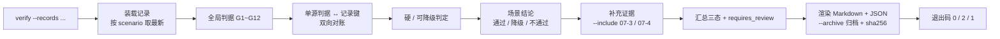
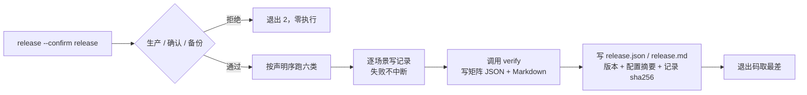

# 07-6-2 演练判据与回写 · 详细设计

> 08B · 07 部署迁移与验收 · 07-6 故障演练 · 子任务 02（需求 07-6）

[文档首页](../../../../../../../文档首页.md) › [消息平台规划](../../../../../../../规划/01_规划_消息平台.md) › [阶段计划](../../../../../计划/01_计划_消息平台.md) › [07 部署迁移与验收](../../../07_部署迁移与验收.md) › [07-6 故障演练](../../07_部署迁移与验收_06_故障演练.md) › [07-6-2](../07_部署迁移与验收_06_故障演练_02_演练判据与回写.md) › 详细设计

## 0. 分章导航 <a id="toc"></a>

| 章 | 内容 |
| --- | --- |
| 1 | 任务级边界与输入基线 |
| 2 | 交付物清单 |
| 3 | 现状核对结论 |
| 4 | 判据模型与单源结构 |
| 5 | 六类场景判据表 |
| 6 | 记录契约增强（只增字段） |
| 7 | 验证器：对账、判定与矩阵 |
| 8 | 发版前复跑与检查清单 |
| 9 | 失败分支、超时与清理 |
| 10 | 测试设计与验收映射 |
| 11 | 登记落点与文档同步 |
| 12 | 边界与开放项 |
| 13 | 对齐记录 |

## 1. 任务级边界与输入基线 <a id="scope"></a>

**做什么**：把 07-6-1 的六类注入证据收口成三件可复用的东西——① 机器可判读的**判据表**（存在 `deploy/drill/scenarios.toml`，注入与判据同源）；② **场景 × 判据 × 证据**对照表（Markdown 供人读、JSON 供平台级验收机器核对）；③ **发版前复跑**编排与检查清单（同一命令、同一判据、可比较）。演练发现的问题回写架构、详细设计与计划。

**不做什么**：

- 不重写注入实现：六类注入、隔离实例与观测客户端仍归 07-6-1，本任务只扩展记录字段与判据语义；
- 不新增公用框架：扩展 `ops.drill` 包，不另起包、不复制 CLI 与守护；
- 不做多实例选主 / 分区迁移 / 脑裂（归 8B_05 / 平台级验收），不接告警通道（归 06-3）；
- 不在本任务修 06-5 死信管理面 500 与 02-3 位点推进问题（登记遗留与平台级验收阻断项，见 §12）；
- 不改数据表、不改对外 API 契约、不动前端；
- 不修改需求 / 任务文档正文（进度只在计划表回写）。

**输入基线**：

| 输入 | 事实 |
| --- | --- |
| 六类注入与记录 | [07-6-1 详细设计](../../07_部署迁移与验收_06_故障演练_01_六类故障注入脚本/设计/01_详细设计_07-6-1_六类故障注入脚本.md) §7：JSON / Markdown 同源，三态 0 / 2 / 1，字段只增不改语义 |
| 场景单源 | `deploy/drill/scenarios.toml`（schema 1）：`name` / `inject` / `observe` / `criterion` / `recovery_budget_ms` / `expect` |
| 六份实跑记录 | 07-6-1 任务 `测试/*.json`：4 通过 / 2 降级 / 0 失败，`data_loss` 全为 `false` |
| 恢复演练记录 | [07-3-2 详细设计](../../../07_部署迁移与验收_03_备份与恢复/07_部署迁移与验收_03_备份与恢复_02_恢复演练与记录/设计/01_详细设计_07-3-2_恢复演练与记录.md#report) §10：`conclusion.result` / `data_integrity` / `steps[]` / `issues[]` |
| 迁移与回滚记录 | 07-4-1 / 07-4-2：`conclusion.result` / `production_gate` / `injection.scenarios[]` / `integrity` / `counts` |
| 架构语义 | 《[架构设计 · 部署与运维](../../../../../../../设计/架构设计/08_架构设计_部署与运维.md#drill)》§9：判据、证据、发版前复跑；「不允许多份手写清单并存」 |
| 门禁 | 覆盖率行 + 分支 100%（bms《AI开发规范》「覆盖率要求」节）；裸集合、行尾、链接、docs-scope |

## 2. 交付物清单 <a id="deliverables"></a>

| 类别 | 交付物 | 说明 |
| --- | --- | --- |
| 判据单源 | `deploy/drill/scenarios.toml`（schema 2） | `criterion` 升为结构化条目；新增 `aux_record_keys`；`plan` / `criteria` / `checklist` 共用 |
| 数据模型 | `backend/ops/drill/model.py` | 新增 `DrillCriterionSpec`；`DrillScenario` 增 `criterion` 结构化字段与 `aux_record_keys` |
| 单源解析 | `backend/ops/drill/env.py` | 解析 schema 2、校验判据键 / 级别 / 记录键唯一、渲染场景表与判据表 |
| 执行上下文 | `backend/ops/drill/context.py`、`runtime.py` | 记录动作轨迹（`commands[]`）；毒消息判据拆分所需的指标读取 |
| 记录渲染 | `backend/ops/drill/record.py` | 记录 schema 升 2：新增 `commands[]` / `artifacts[]` / `logs` / `config_digest` / `rerun`，路径相对化 |
| 验证器 | `backend/ops/drill/evidence.py`（新） | 装载记录、全局判据、硬/可降级判定、双向对账、复跑闭环、矩阵渲染、归档与链接校验 |
| 发版编排 | `backend/ops/drill/release.py`（新） | 顺序跑六类 → 写记录 → 汇总验证 → 发版记录；失败不中断 |
| 检查清单 | `backend/ops/drill/checklist.py`（新）、`deploy/drill/RELEASE_CHECKLIST.md`（生成物） | 由单源生成，`--check` 判漂移 |
| 命令行 | `backend/ops/drill/__main__.py` | 新增 `criteria` / `verify` / `release` / `checklist` 四个子命令 |
| 毒消息判据 | `backend/ops/drill/scenarios/poison_message.py` | 拆出 `dead_letter_created` / `dead_letter_queryable` / `nack_queryable`，按指标与查询分别判定 |
| 常量 | `backend/services/msg/src/bms_msg/core/config.py` | 「07-6-2 演练判据」段：场景单源版本、记录版本、证据版本、清单路径、动作上限 |
| 用例 | `backend/services/msg/tests/deploy/test_drill_evidence.py` | 新 Kiwi 编号；复用部署资产 always 步 |
| 记录 | 任务 `测试/记录/` 六份 JSON + Markdown、`release.json` / `release.md` | 增强后的原始证据 |
| 矩阵 | 任务 `测试/02_场景×判据×证据对照表_07-6-2.md` + `02_..._evidence.json` | 同源两份，平台级验收直接引用 |
| 文档 | 本设计、实施记录、测试记录、`deploy/drill/README.md` 更新、五处详细设计回写、架构 08 §9、计划 | §11 |

## 3. 现状核对结论 <a id="current"></a>

| # | 现状 | 处置 |
| --- | --- | --- |
| 1 | `criterion` 只有中文锚点，没有「记录键 ↔ 判据」映射、没有硬判据 / 可降级之分 | 单源升 schema 2，判据结构化（§4） |
| 2 | 记录缺命令轨迹、日志摘要、配置摘要与复跑标识，无法独立复现与比较 | 记录只增字段并复跑六类（§6） |
| 3 | 毒消息把「进死信」与「管理面可查」捆在一个键里，结论只能整体降级 | 拆成独立记录键；进死信按 `msg_dlq_total` 判、可查按管理面判（§5.6） |
| 4 | 没有验收矩阵生成器，平台级验收只能人工拼接 | 新增 `evidence.py`：对账 + 判定 + 同源矩阵（§7） |
| 5 | 没有发版前编排，六类场景只能逐条手敲 | 新增 `release` 与生成的检查清单（§8） |
| 6 | 架构 §9 要求「不允许多份手写清单并存」 | 清单与判据表都从 `scenarios.toml` 渲染；`--check` 判漂移 |
| 7 | 07-3 / 07-4 记录 schema 与演练记录不同 | 只取 `conclusion` / `issues` / `leftovers` / 模式标识作补充证据，不并入六类统计（§7.5） |
| 8 | 现有记录 `artifact` 是宿主绝对路径，跨机不可复现 | 新增相对路径 + sha256，旧字段保留只作兼容 |

## 4. 判据模型与单源结构 <a id="model"></a>

### 4.1 判据条目 <a id="spec"></a>

一条判据由五部分组成，全部写在 `scenarios.toml`：

| 字段 | 含义 | 约束 |
| --- | --- | --- |
| `key` | 判据标识（场景内唯一，小写下划线） | 非空、场景内唯一 |
| `text` | 人读判据原文 | 非空；`plan` 渲染的「恢复判据」列即它 |
| `record_keys` | 该判据在记录 `criteria[]` 中的键 | 至少一条；同一场景内不得重复；**双向对账的锚点** |
| `severity` | `hard` / `degradable` | 闭集；`hard` 任一记录键非 `ok` 即场景不通过 |
| `evidence` | 证据要求（看哪段样本 / 哪个字段 / 哪份记录） | 非空；矩阵按此列取证 |

`aux_record_keys`（场景级）登记**注入前置**类记录键（如 `pressure_written`、`proxy_passthrough`），它们参与「孤儿键」检查，但不构成通过判据。

### 4.2 单源片段 <a id="toml"></a>

```toml
schema_version = 2

[[scenarios]]
name = "process_crash"
title = "进程崩溃（SIGKILL / SIGTERM 两档）"
inject = "sigkill_sigterm"
observe = ["msg_messages_in_total", "msg_consumer_lag", "msg_publish_errors_total"]
recovery_budget_ms = 240000
expect = "两档各一轮：杀进程后以同一数据根重启，已确认不丢、未确认重投、offset 连续"

  [[scenarios.criterion]]
  key = "confirmed_not_rewound"
  text = "已确认消息不回退（恢复后不重投已确认 offset）"
  record_keys = ["SIGKILL.confirmed_not_rewound", "SIGTERM.confirmed_not_rewound"]
  severity = "hard"
  evidence = "记录 criteria[] + after 段 offset"
```

- 一个场景的判据全部用 `[[scenarios.criterion]]` 追加，声明序即渲染序；
- 解析失败（缺 `key` / `severity` 不在闭集 / `record_keys` 为空）一律报「场景单源非法」并指出场景与条目序号，不静默降级。

### 4.3 全局判据 <a id="global"></a>

与场景无关、对六份记录一律适用的判据，由验证器实现（不写进 `scenarios.toml`，避免每个场景重复抄）：

| 编号 | 全局判据 | 判定 |
| --- | --- | --- |
| G1 | 记录齐备 | 六类各一份、`mode=run`；缺一即失败 |
| G2 | 字段完整 | `schema_version` / `task` / `scenario` / `environment` / `service` / 起止 / `injection` / 三段样本 / `criteria` / `rto_ms` / `data_loss` / `backup` / `conclusion` / `deviations` / `issues` / `leftovers` |
| G3 | 三段样本 | `before` / `during` / `after` 齐备，各含 `captured_at` / `/readyz` / `/healthz` / 指标子集 |
| G4 | 记录自洽 | `passed == (result == "ok")`；`criteria` 汇总 = `conclusion.result`；退出码 0 / 2 / 1 与结论一一对应 |
| G5 | 恢复预算 | `rto_ms ≤ recovery_budget_ms`；记录若含 `rto_within_budget` 键，其值必须为 `ok` |
| G6 | 无数据丢失 | `data_loss=false`；为真即失败并阻断发版 |
| G7 | 备份证据 | 隔离环境 `backup.mode=not_applicable` + 理由；非隔离 `provided` + 证据 |
| G8 | 版本可比 | 六份 `service.version` / `contract_version` 一致；`environment` 四项非空 |
| G9 | 判据双向对齐 | 单源每条判据的记录键全部出现；记录每个键都能归属到单源判据 / `aux_record_keys` / 全局键 |
| G10 | 硬判据全过 | 任一 `hard` 判据非 `ok` 即场景不通过 |
| G11 | 复跑闭环 | 历史非通过记录必须有后继同场景记录（`rerun.previous_started_at` 指向前次）；最新记录非通过时必须带 owner 的处置，否则失败 |
| G12 | 证据可达 | 矩阵引用的记录文件与 `--check-doc` 指定的文档链接必须存在 |

## 5. 六类场景判据表 <a id="table"></a>

> 下表由 `python -m ops.drill criteria` 渲染（场景单源为唯一输入），用例断言两处逐行一致。

| 场景 | # | 判据 | 级别 | 记录键 | 证据要求 |
| --- | --- | --- | --- | --- | --- |
| `process_crash` | 1 | 已确认消息不回退（恢复后不重投已确认 offset） | 硬 | `SIGKILL.confirmed_not_rewound`、`SIGTERM.confirmed_not_rewound` | 记录 criteria[] + after 段 offset |
| `process_crash` | 2 | 未确认消息重新投递（至少一次语义） | 硬 | `SIGKILL.unacked_redelivered`、`SIGTERM.unacked_redelivered` | 记录 criteria[] + after 段投出 offset |
| `process_crash` | 3 | 重启不重排 offset（新消息 offset 连续） | 硬 | `SIGKILL.leo_not_rewound`、`SIGTERM.leo_not_rewound` | 记录 criteria[] + 新消息 offset |
| `process_crash` | 4 | 实例确实被信号终止（恢复耗时由 G5 判） | 硬 | `SIGKILL.killed_by_signal`、`SIGTERM.killed_by_signal` | 记录 criteria[] + injection.method |
| `disk_full` | 1 | 满盘期发布被拒（HTTP 507 + 业务码 350022） | 硬 | `publish_rejected` | 记录 criteria[] + during 段 readyz / 指标 |
| `disk_full` | 2 | 满盘期 /readyz 转 503 | 硬 | `readyz_degraded` | during 段 readyz_status |
| `disk_full` | 3 | 用量指标随填充上升且进程存活 | 硬 | `ratio_risen`、`process_alive` | before / during 段 `msg_disk_used_ratio` + healthz |
| `disk_full` | 4 | 清理填充后恢复可写、/readyz 回 200 | 硬 | `recovered` | after 段 readyz + 发布结果 |
| `slow_disk` | 1 | 无假确认（已确认消息停压后不再投递） | 硬 | `no_fake_ack` | 记录 criteria[] + after 段投出 offset |
| `slow_disk` | 2 | 位点不越尾（已确认位点与发布条数一致） | 硬 | `offset_within_leo` | 记录 criteria[] + 位点读数 |
| `slow_disk` | 3 | 停压后积压归零 | 硬 | `lag_drained` | after 段 `msg_consumer_lag` |
| `slow_disk` | 4 | fsync / 发布延迟相对基线上涨（方向性） | 可降级 | `latency_visible` | before / during 段 `msg_fsync_duration_ms`、`msg_publish_latency_ms` |
| `network_partition` | 1 | 断连档发布失败（客户端可见的连接错误） | 硬 | `drop_blocks_publish` | 记录 criteria[] + during 段错误 |
| `network_partition` | 2 | 断连期实例本身健康（故障只在链路） | 硬 | `instance_alive_during_partition` | during 段 readyz / healthz |
| `network_partition` | 3 | 恢复后客户端可重连并发布成功 | 硬 | `reconnected` | 记录 criteria[] + after 段发布结果 |
| `network_partition` | 4 | 已确认消息不重复投递、积压追平 | 硬 | `no_duplicate_delivery`、`lag_drained` | after 段 offset 集合 + `msg_consumer_lag` |
| `stuck_consumer` | 1 | 在途填满后 consume 返回 paused=true（背压生效） | 硬 | `backpressure_applied` | 记录 criteria[] + during 段响应 |
| `stuck_consumer` | 2 | 在途条数不超过上限（内存有界） | 硬 | `inflight_bounded` | during 段 `msg_inflight_messages` |
| `stuck_consumer` | 3 | 积压可观测（msg_consumer_lag 上升） | 硬 | `backlog_visible` | during 段 `msg_consumer_lag` |
| `stuck_consumer` | 4 | 确认后恢复消费、积压归零且不重复 | 硬 | `resumed_after_ack`、`no_duplicate` | after 段拉取结果 + offset 集合 |
| `poison_message` | 1 | 非法载荷被入口拒绝（HTTP 4xx 或业务码非 0） | 硬 | `invalid_payload_rejected` | 记录 criteria[] + logs 摘要无载荷 |
| `poison_message` | 2 | 重投次数不超过上限（5） | 硬 | `redelivery_bounded` | 记录 criteria[] + 最大 `delivery_count` |
| `poison_message` | 3 | 重投超限后进死信（msg_dlq_total 增长） | 硬 | `dead_letter_created` | `msg_dlq_total` 前后差 |
| `poison_message` | 4 | 死信管理面可查（按 message_id 命中） | 可降级 | `dead_letter_queryable` | 管理面响应 |
| `poison_message` | 5 | 毒消息终结后同分区后续消息可消费（不阻塞） | 可降级 | `not_blocking_followers` | 记录 criteria[] + 后续消息 offset |
| `poison_message` | 6 | 主动 nack 即时转死信 | 硬 | `nack_to_dlq` | nack 响应 + `msg_dlq_total` 增量 |
| `poison_message` | 7 | 主动 nack 的死信管理面可查 | 可降级 | `nack_queryable` | 管理面响应 |

**注入前置键（aux，不构成通过判据）**：

| 场景 | 前置键 | 说明 |
| --- | --- | --- |
| `disk_full` | `rto_within_budget` | 全局 G5 的等价记录键，存在即核 |
| `slow_disk` | `pressure_written` | 受控写入已执行 |
| `network_partition` | `proxy_passthrough`、`modes_switchable` | 代理基线可用、四档可切换 |

## 6. 记录契约增强（只增字段） <a id="record"></a>

记录 `schema_version` 升 2；**只增字段，不删不改旧字段语义**。v1 记录仍可判读，但缺增强字段的项在矩阵里记「降级 / 待复跑」。

```json
{
  "schema_version": 2,
  "environment": {"env": "test", "target": "local", "os": "...", "python": "...", "config_digest": "..."},
  "injection": {"method": "...", "detail": "...", "artifact": "var", "artifact_rel": "var", "artifact_sha256": null},
  "commands": [{"seq": 1, "action": "POST /api/v1/msg/publish", "detail": "163 字节"}],
  "artifacts": [{"path": "instance.log", "role": "log", "bytes": 2048, "sha256": "..."}],
  "logs": {"path": "instance.log", "lines": 42, "bytes": 2048, "sha256": "...", "excerpt": "..."},
  "rerun": {"attempt": 2, "previous_started_at": "...", "previous_conclusion": "降级通过", "reason": "..."}
}
```

| 字段 | 内容 | 口径 |
| --- | --- | --- |
| `environment.config_digest` | 生效配置摘要 | 环境、目标、预算、填充量、慢盘写入量、拒绝水位、场景名的规范 JSON 的 sha256 |
| `injection.artifact_rel` | 注入产物相对工作根 | 不出现宿主盘符；旧 `artifact` 保留 |
| `commands[]` | 动作轨迹 | 只记方法 + 路径 + 关键参数；不含请求头、载荷与凭据；上限 200 条，超出保留首尾并标 `truncated` |
| `artifacts[]` | 原始产物清单 | 相对工作根；文件给 `bytes` + `sha256`，目录只给 `path` / `role` |
| `logs` | 实例日志摘要 | 总行数 / 字节 / sha256 + 末尾 `msg_drill_output_tail_chars` 字符；排障线索，不作判据 |
| `rerun` | 复跑标识 | `attempt` 从 1 起；`previous_started_at` 指前一份记录；`reason` 为复跑原因（缺省空） |

- 失败也照常落盘；`conclusion`、`exit_code`、`reasons` 口径不变。
- `commands[]` 与 `logs` 只作复现线索，**不进入通过判据**；判据只认 `criteria[]` 与 `samples`。
- 相对路径以工作根为基准，矩阵与归档只引用记录文件本身，不引用演练临时目录。

## 7. 验证器：对账、判定与矩阵 <a id="verify"></a>

### 7.1 流程 <a id="flow"></a>



### 7.2 结论聚合 <a id="aggregate"></a>

| 汇总结论 | 条件 | 退出码 |
| --- | --- | --- |
| `通过` | 六类场景全为通过、全局判据全过、无降级项 | 0 |
| `降级通过` | 无失败；存在可降级项非 `ok`、或最新非通过记录已登记 owner、或 v1 记录缺增强字段 | 2 |
| `失败` | 任一硬判据非 `ok`、`data_loss=true`、记录缺失 / 不可解析、孤儿判据、未归口的未通过项、历史非通过无后继复跑、证据链接失效 | 1 |

- `降级通过` 一律 `requires_review=true`，并在矩阵「未闭环与遗留」列逐条给 owner；**不得按通过计入平台级验收九域结论**。
- 场景结论与记录自带 `conclusion` 不一致时：记录高报（记录通过、判定非通过）记失败；记录低报只记降级提示。

### 7.3 双向对账 <a id="mapping"></a>

- 单源每条判据的 `record_keys` 必须全部出现在记录 `criteria[]`；缺一 → 失败（漏判）。
- 记录每个键必须能归属到：单源判据的 `record_keys`、场景 `aux_record_keys`、全局键（`rto_within_budget`）；否则 → 失败（孤儿判据）。
- 同一记录键被两条判据声明 → 场景单源校验阶段即失败。

### 7.4 输出 <a id="output"></a>

| 产物 | 落点 | 用途 |
| --- | --- | --- |
| 矩阵 Markdown | `--out`（缺省 `MSG_DRILL_EVIDENCE_DIR`）或 `--archive` 目录 | 平台级验收人读；每条判据一行，含级别 / 记录键 / 实测 / 结果 / 证据链接 |
| 矩阵 JSON | 与 Markdown 同源同名 | 平台级验收机器核对；含 `scenarios[]` / `criteria[]` / `globals[]` / `supplementary[]` / `conclusion` / `artifacts[]` |
| 归档记录 | `--archive <目录>/记录/` | 六份 JSON + Markdown（以及同目录 `release*.json|md` 若存在）；每份给 sha256 |

- 矩阵中的记录链接按输出目录到记录目录的相对路径生成；链接必须可达（G12）。
- `--check-doc <路径>` 额外检查该 Markdown 里的相对链接是否存在，供测试记录引用矩阵时自查。

### 7.5 补充证据 <a id="supplementary"></a>

- `--include <json>` 可重复，接受 07-3-2 / 07-4-1 / 07-4-2 记录；只读 `task` / `mode` / `conclusion` / `data_integrity` / `issues` / `leftovers` / `environment.isolated`。
- 补充证据在矩阵中**单列一节**，结论与六类分开统计；`environment.isolated` 与 `mode=drill|live` 原样保留，供判据表区分两类证据。

## 8. 发版前复跑与检查清单 <a id="release"></a>

### 8.1 检查清单（生成物） <a id="checklist"></a>

- 落点 `deploy/drill/RELEASE_CHECKLIST.md`，由 `python -m ops.drill checklist` 从 `scenarios.toml` 渲染；文件头写明「生成物，勿手改，重新生成命令」。
- 内容：前置门禁（生产拒绝、二次确认、备份证据、工作根隔离）→ 六类逐项（命令 / 期望判据 / 记录落点 / 恢复预算）→ 判定口径（三态与「降级不计通过」）→ 版本与环境记录栏 → 签核栏。
- `--check` 与仓内文件逐行比对（忽略行尾与末尾空行），漂移即失败（与 `contract_snapshot check` 同思路）。

### 8.2 复跑编排 <a id="release-flow"></a>



- 顺序取 `scenarios.toml` 声明序（六类全跑），任一场景失败或异常都继续跑完；汇总退出码按严重度取最差（失败 > 降级 > 通过）。
- `--rerun-reason <文本>` 写入每份记录的 `rerun.reason`；缺省为「发版前复跑」。
- 发版记录含：`environment`（env / target / os / python / `config_digest` / git 提交与工作树状态，取不到时置 `null`）、`service`（版本 / 契约版本）、`steps[]`（场景 / 结论 / 退出码 / `rto_ms` / 记录路径 / sha256）、`verification`（矩阵结论）、`conclusion`。
- `--dry-run` 只渲染六类动作，零执行、零写盘。

## 9. 失败分支、超时与清理 <a id="failure"></a>

| # | 触发 | 表现 | 处置 |
| --- | --- | --- | --- |
| 1 | `--records` 缺省或目录不存在 | `[FAIL] drill.evidence …` 指名目录，退出 1 | 补目录；不猜默认文档路径 |
| 2 | 六类记录缺一 | 失败并列出缺失场景 | 先跑 `release` 或对应 `run` |
| 3 | 记录 JSON 解析失败 / 非对象 | 失败并指名文件与解析错误 | 修复记录；不跳过 |
| 4 | 单源判据缺记录键 / 记录出现孤儿键 | 失败，逐条列出键名 | 补齐记录或修单源；禁止沉默 |
| 5 | 记录 v1（缺增强字段） | 降级，提示复跑 | 用新版本复跑转 v2 |
| 6 | 硬判据 `failed` / `degraded` / `skipped` | 场景不通过，汇总失败 | 修问题后复跑 |
| 7 | `data_loss=true` | 失败并阻断发版 | 按数据丢失级问题处理 |
| 8 | 历史非通过记录无后继复跑 | 失败（未闭环） | 用同场景重跑并写 `rerun` |
| 9 | 最新非通过记录无 owner 处置 | 失败 | 在 `issues[]` / `leftovers[]` 补 owner |
| 10 | 矩阵链接失效 / `--check-doc` 链接失效 | 失败并列出失效路径 | 修链接或补文件 |
| 11 | 检查清单漂移 | `checklist --check` 退出 1 | 重新生成清单 |
| 12 | `release` 中单场景异常（实例未就绪 / 注入异常） | 该场景写 `aborted` 记录，继续其余；汇总取最差 | 看记录 `reasons` 与日志摘要后复跑 |
| 13 | `--env prod` / 缺 `--confirm` | 退出 2，零执行 | 生产演练不提供入口 |
| 14 | 归档目录不可写 / 复制失败 | 失败并指名路径 | 不静默跳过归档 |
| 15 | `cleanup` 失败 | `[ALERT]` 告警，不改变本次结论 | 下一轮重试；`cleanup` 幂等 |

- 所有命令沿用 07-6-1 的超时与清理口径：单场景预算封顶、实例独立进程组、退出整组回收。
- `release` 跑完六类后才汇总；任何单场景失败不得中断后续场景。

## 10. 测试设计与验收映射 <a id="test"></a>

用例落 `backend/services/msg/tests/deploy/test_drill_evidence.py`，**先在 Kiwi 平台登记一条新编号再编码**，全部用例共用该编号；不启动真实实例，真实注入由 `release` / `run` 执行。

| 用例 | 断言 | 映射任务条目 |
| --- | --- | --- |
| T1 单源结构 | `criterion` 解析为结构化条目；`key` 场景内唯一、`severity` 闭集、`record_keys` 非空且不重复、`aux_record_keys` 与判据键不相交 | 内容 1、8 |
| T2 判据渲染 | `criteria` 渲染表与详细设计 §5 逐行一致；`plan` 的恢复判据列仍取 `text` | 内容 1、8 |
| T3 记录装载 | v2 记录通过；v1 记录降级；缺字段 / 坏 JSON / 非对象逐项指名 | 内容 2、8 |
| T4 双向对账 | 漏判（单源键缺记录）、孤儿键、`aux` 键、全局键四类正反例 | 内容 1、8 |
| T5 硬 / 可降级 | 硬判据 `degraded` / `failed` / `skipped` → 场景不通过；可降级 `degraded` → 场景降级；全 `ok` → 通过 | 内容 1、7 |
| T6 全局判据 | RTO 超预算、`data_loss`、备份口径（隔离 / 非隔离）、版本不一致、三段样本缺失 | 内容 3、7 |
| T7 复跑闭环 | 历史非通过无后继 → 失败；后继 `rerun.previous_started_at` 对齐 → 闭环；最新非通过无 owner → 失败、有 owner → 降级 | 内容 4、5 |
| T8 矩阵与 JSON | Markdown / JSON 同源；每条判据含记录键、级别、实测、结果、相对链接；sha256 与文件一致 | 内容 7、8 |
| T9 归档与链接 | `--archive` 复制六份记录且不覆盖无关文件；`--check-doc` 正反例；失效链接失败 | 内容 2、7 |
| T10 发版编排 | 顺序、失败不中断、退出码取最差、`--dry-run` 零执行、`--confirm` / 生产拒绝 | 内容 6 |
| T11 检查清单 | 生成内容含六类与门禁；`--check` 对漂移失败、对一致通过 | 内容 6 |
| T12 命令行与覆盖率 | 四个子命令正反例退出码；新增 / 变更模块行 + 分支 100%；静态 / 类型 / 链接 / 口径 / 行尾 / 裸集合全绿 | 完成标准 6 |

## 11. 登记落点与文档同步 <a id="register"></a>

| 落点 | 内容 |
| --- | --- |
| 阶段计划（进度唯一落点） | 07-6 行：完成日期、偏差与遗留（毒消息两项降级、容器 / 真盘归部署阶段）；§5 门禁状态与 §6.1 台账同步 |
| 《[架构设计 · 部署与运维](../../../../../../../设计/架构设计/08_架构设计_部署与运维.md#drill)》§9 | 只回写语义：判据表与发版清单由单源生成、证据机器判读、降级不计通过、复跑闭环；**不写脚本名、键位与命令** |
| [02-01 分区追加日志](../../../../02_存储与复制/02_存储与复制_01_分区追加日志/设计/01_详细设计_01_分区追加日志.md) | 记录头 id 超 2^64-1 编十进制字符串，读侧兼容（演练实测结论） |
| [02-03 消费位点管理](../../../../02_存储与复制/02_存储与复制_03_消费位点管理/设计/01_详细设计_02_消费位点管理.md) | 位点文件格式版本 2：头部 `topic_id` 用 40 字节定宽 ASCII；v1 仍可读 |
| [02-06 存储水位与拒绝策略](../../../../02_存储与复制/02_存储与复制_06_存储水位与拒绝策略/设计/01_详细设计_02_存储水位与拒绝策略.md) | 滞回阈值必须夹住当前基线（`warn` 在基线与 `reject` 之间），否则拒绝态不可解除 |
| [01-04 消费组](../../../../01_消息模型与投递/01_消息模型与投递_04_消费组/设计/01_详细设计_01_消费组.md) | 成员会话为进程内存：重启须重新加入；成员标识按主题唯一，不跨主题复用 |
| [03-05 背压与流控](../../../../03_传输与协议/03_传输与协议_05_背压与流控/设计/01_详细设计_05_背压与流控.md) | 插件状态属性键加产品前缀（`msg_rate_limiter`），避免基座装配覆盖 |
| `deploy/drill/README.md` | 四条新命令、记录字段、判据口径、发版前清单位置 |
| 实施记录 / 测试记录 | 任务目录 `实施/`、`测试/`；测试记录含矩阵与记录引用 |
| 需求 07-6 / 任务 07-6-2 | 不改正文（进度不落需求与任务文档） |

## 12. 边界与开放项 <a id="open"></a>

| # | 事项 | 归口 |
| --- | --- | --- |
| 1 | 真容器（`tmpfs` 限额卷）与真盘 I/O 延迟注入 | 部署阶段（平台级生产部署架构） |
| 2 | 慢盘延迟绝对阈值 | 平台级容量模型 |
| 3 | 管理面死信列表有数据时 500（`MissingGreenlet`） | 06-5；修复后复跑 `poison_message` 转通过 |
| 4 | 毒消息终结后同分区后续消息未在预算内证明可消费 | 02-3 / 02-2；需定位位点推进与死信转移的先后 |
| 5 | 重投上限路径耗时（`5 × 30s`，可见性超时为常量） | 02-2 / 02-3 开放可见性超时旋钮 |
| 6 | 多实例故障切换 / 分区迁移 / 脑裂 | 8B_05 / 平台级验收 |
| 7 | 发版流水线自动接入（CI job 调用 `release`） | 发布流程 / 平台级生产部署架构 |
| 8 | 补充证据（07-3 / 07-4）生产窗口与真实集群 | 平台级生产部署架构 |

## 13. 对齐记录 <a id="align"></a>

2026-11-11 逐项拍板（均取推荐项），汇总回显无异议后执行：

| # | 待决项 | 结论 |
| --- | --- | --- |
| 1 | 判据表单源 | 扩展 `scenarios.toml`，`criterion` 结构化，schema 升 2 |
| 2 | 判定口径 | 三态 0 / 2 / 1 + 硬 / 可降级；降级不计通过；`data_loss` 直接失败 |
| 3 | 记录增强与复跑 | 只增字段（命令 / 产物 / 日志 / 配置摘要 / 复跑）+ `release` 重跑六类 |
| 4 | 毒消息未达标项 | 如实判定 + 登记遗留，拆分「进死信 / 可查 / 不阻塞 / nack」记录键 |
| 5 | 命令形态 | 扩展 `ops.drill`：`criteria` / `verify` / `release` / `checklist` |
| 6 | 发版前清单 | 由 `scenarios.toml` 生成 + 漂移校验 |
| 7 | 验收矩阵 | Markdown + JSON 同源入库任务 `测试/` |
| 8 | 证据范围 | 六类为主 + `--include` 追加 07-3 / 07-4，单列不合并 |
| 9 | 记录定位 | `--records` 可重复 + `--archive` 归档写 sha256 |
| 10 | 对账方向 | 双向对齐（防漏判 + 防孤儿） |
| 11 | 复跑闭环 | `rerun` 块 + 后继记录 + owner 处置，否则未闭环 |
| 12 | 问题回写 | 架构 08 §9 + 五处详细设计 + 计划 |
| 13 | 测试与编号 | 新文件 `test_drill_evidence.py` + 新 Kiwi 编号 |
| 14 | release 失败策略 | 六类跑完再汇总，退出码取最差 |
| 15 | 判据表文档 | 详细设计内由命令渲染，用例断言一致 |
| 16 | 消费方回写 | 平台级验收补证据入口（按规范自动执行） |
| 17 | 提交与推送 | `feat` / `docs` 两次提交；推送前单独确认（按规范自动执行） |

---

> 依《[文档生成规范](../../../../../../../../bms文档/规范/文档生成规范.md)》编写 · 覆盖率口径见 bms《[AI开发规范](../../../../../../../../bms文档/规范/AI开发规范.md)》「覆盖率要求」节
