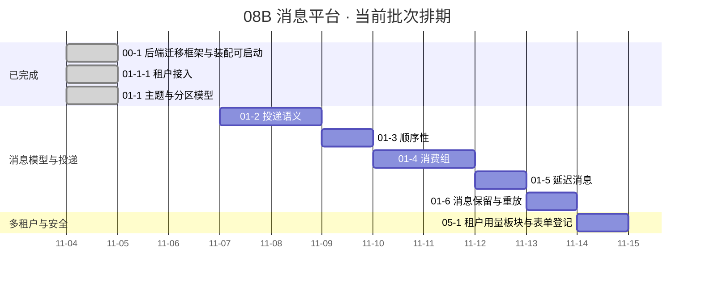

# 消息平台阶段计划

> 08B 消息平台 · 任务排期与门禁达成路径（进度唯一落点）

[文档首页](../../../文档首页.md) › [消息平台规划](../../../规划/01_规划_消息平台.md) › 08B 消息平台 › 阶段计划

---

## 1. 计划说明 

| 项 | 值 |
| --- | --- |
| 排期对象 | 08B 消息平台（阶段 `8B`）全部已拆解任务；未拆解需求域见 §6「后续阶段待办」 |
| 上游依据 | [消息平台规划](../../../规划/01_规划_消息平台.md) §7 阶段路线、[需求总览](../需求/00_需求_消息平台.md) §3 需求总清单（7 域 42 条） |
| 负责人 | minjian |
| 基准日 | 2026-11-04 |
| 排期口径 | 自然日连续、每日 8h；窗口格式按《[计划文档规范](../../../../bms文档/规范/计划文档规范.md)》§5.1（区间 / 单日 / 搁置） |
| 工时口径 | 「AI 实施 + 人工评审」的实际投入（含代码、用例、实施 / 测试记录与门禁）；首次排期**无历史基线**，偏差在「偏差与遗留」列滚动修正 |
| 进度落点 | 状态 / 完成日期 / 工时 / 排期窗口**只在本表维护**；需求与任务文档不承载进度 |

**嵌套子任务口径**：子任务不单列**排期**行，工时与状态随其直属父任务行维护；但**已完成的子任务**在 §2「已完成任务」单列（保留完成日期与 Kiwi 用例号，便于追溯），父任务行工时含该子任务合计。

**里程碑锚点**：8B_00 ~ 8B_09 的阶段目标、退出条件与硬依赖见《[消息平台规划](../../../规划/01_规划_消息平台.md)》§7（本表不复制明细）。当前批次覆盖 `8B_00` 收口后的任务域 01（消息模型与投递）与任务域 05（多租户与安全）中的已拆解任务。

## 2. 已完成任务（2026-11-04 ~ 2026-11-04） 

| 编号 | 任务 | 工时（重估） | 完成日期 | 任务文件 | 偏差与遗留 |
| --- | --- | --- | --- | --- | --- |
| 00-1 | 后端迁移框架与装配可启动 | 4h | 2026-11-04 | [00-1 后端迁移框架与装配可启动](../任务/00_工程骨架/00_工程骨架_01_后端迁移框架与装配可启动/00_工程骨架_01_后端迁移框架与装配可启动.md) | 偏差：无；遗留：业务域 `msg` 未在域布局登记、首批迁移脚本为空（归口 8B_02 存储与表设计） |
| 01-1-1 | 租户接入 | 4h | 2026-11-04 | [01-1-1 租户接入](../任务/01_消息模型与投递/01_消息模型与投递_01_主题与分区模型/01_消息模型与投递_01_主题与分区模型_01_租户接入/01_消息模型与投递_01_主题与分区模型_01_租户接入.md) | 偏差：错误码由 5 位定稿为 6 位（平台产品码强制 6 位）、管理面原无改写点（经基座新增 `error_mapper` 能力域解决）；遗留：`errcode_segment = "35"` 暂定（归口 07C）、h2 帧服务未建（归口 01-2 起的 broker 任务）、契约快照人工导出未接预检（归口 8B_01）；详见[实施记录](../任务/01_消息模型与投递/01_消息模型与投递_01_主题与分区模型/01_消息模型与投递_01_主题与分区模型_01_租户接入/实施/01_实施记录_01_消息模型与投递_01_主题与分区模型_01_租户接入.md) §6 |
| 01-1 | 主题与分区模型 | 6h（本体 2h + 子任务 01-1-1 4h） | 2026-11-04 | [01-1 主题与分区模型](../任务/01_消息模型与投递/01_消息模型与投递_01_主题与分区模型/01_消息模型与投递_01_主题与分区模型.md) | 偏差：设计 8 项口径按确认回写（`tenant_id` 改雪花、分页改 `page/size`、不写迁移脚本、`package_prefix` 修正为 `bms`、只挂权限码、增分区只服务层、保留期常量、库设计文档与 mdm 同构）；域布局改走装载注册（清单 `[[domains]]`），不手写 `domain_layout.json`；6 条错误码 `domain` 统一为 `msg`。遗留：保留期配置化（基座扩字段）、管理面鉴权（05 域）、`domain_layout.json` 生成（8B_01 ops）、增分区端点（06 域）、契约快照接预检（8B_01）；mdm 收敛用例已本地复核（24 passed，配套锁刷新 mdm `1246a7d`）。详见[实施记录](../任务/01_消息模型与投递/01_消息模型与投递_01_主题与分区模型/实施/01_实施记录_01_消息模型与投递_01_主题与分区模型.md) §6 |

## 3. 剩余任务排期（自 2026-11-05） 

| 编号 | 任务 | 状态 | 工时 | 依赖 | 排期窗口 | 备注 | 偏差与遗留 |
| --- | --- | --- | --- | --- | --- | --- | --- |
| 01-2 | [投递语义](../任务/01_消息模型与投递/01_消息模型与投递_02_投递语义/01_消息模型与投递_02_投递语义.md) | 未开始 | 10h | 01-1（已完成） | 2026-11-07 ~ 2026-11-08 | 至少一次 + 消费端幂等 + ack / 重试 / 死信；消费入口接 `MsgTenantGuard` 与 `frame_tenant()`；复用 `core/routing.py` 选分区与 `core/message_id.py` 生成 ID。**已定（2026-11-04）**：消息存储走「端口 + 内存实现」（`MessageStore` 端口，文件段 / 索引 / CRC 归 8B_02 只换实现），不提前定文件字节格式 | 待拍板（开工先问）：① 数据面 `/msg/publish`·`/msg/consume`·`/msg/ack` 是否现在开 HTTP 端点；② 位点存储（内存 / 架构 §8 独立文件）；③ 毒消息超重投上限处置（内存死信 / 只标记） |
| 01-3 | [顺序性](../任务/01_消息模型与投递/01_消息模型与投递_03_顺序性/01_消息模型与投递_03_顺序性.md) | 未开始 | 6h | 01-1 / 01-2 | 2026-11-09 | 分区内顺序 + 聚合键校验 | 无 |
| 01-4 | [消费组](../任务/01_消息模型与投递/01_消息模型与投递_04_消费组/01_消息模型与投递_04_消费组.md) | 未开始 | 10h | 01-1 / 01-2 | 2026-11-10 ~ 2026-11-11 | 组内分摊 / rebalance / 位点提交 | 无 |
| 01-5 | [延迟消息](../任务/01_消息模型与投递/01_消息模型与投递_05_延迟消息/01_消息模型与投递_05_延迟消息.md) | 未开始 | 8h | 01-1 / 01-2 | 2026-11-12 | 定时轮 + 到期投递 | 无 |
| 01-6 | [消息保留与重放](../任务/01_消息模型与投递/01_消息模型与投递_06_消息保留与重放/01_消息模型与投递_06_消息保留与重放.md) | 未开始 | 8h | 01-1 / 01-2 | 2026-11-13 | 保留期清理 + 位点重置 + 重放 | 无 |
| 05-1 | [租户用量板块与表单登记](../任务/05_多租户与安全/05_多租户与安全_01_租户用量板块与表单登记/05_多租户与安全_01_租户用量板块与表单登记.md) | 未开始 | 6h | 01-1 | 2026-11-14 | 对应需求 05-3（配额只读回显）；前置 01-1-1 与 bms 07B `02_03` / `02_06` 已交付 | 无 |

## 4. 排期甘特图 

## 5. 阶段验收门禁 

| # | 门禁 | 判据 | 现状 |
| --- | --- | --- | --- |
| 1 | 8B_00 立项与总体设计 | 设计六块无开放 blocker（见规划 §7） | 已达成（00-1 收口） |
| 2 | 8B_01 传输与协议 PoC | 五项验证通过 + 基准达标，**go/no-go 点** | 未排期（任务未拆解，见 §6）；结论影响 02 域与 broker 实现 |
| 3 | 单任务交付门禁 | 用例绿 + 变更模块行 + 分支覆盖率 100% + 静态全绿 + 文档三项校验（links / docs-scope / eol） | 逐任务执行（每行完成时回写本表状态） |
| 4 | 登记回写 | 表归属 / 服务目录 / 错误码 `[[errcodes]]` / 基类清单按需同步 | 逐任务执行 |
| 5 | 阶段验收 | 见需求 07-7；依赖 8B_08 / 8B_09 | 未开始 |

## 6. 后续阶段待办（未拆解需求域） 

> 任务文档尚未建立，故不进 §3 排期与 §4 甘特（编号须与任务文档主键一致）。拆解后并入本表。

| 需求域 | 覆盖需求 | 对应规划阶段 | 归口 |
| --- | --- | --- | --- |
| [02 存储与复制](../需求/02_需求_存储与复制.md) | 02-1 ~ 02-6（分区日志 / 崩溃恢复 / 位点 / ISR / 选举 / 水位） | 8B_02、8B_05 | 8B_01 go/no-go 通过后拆任务 |
| [03 传输与协议](../需求/03_需求_传输与协议.md) | 03-1 ~ 03-5（h2 传输 / 帧协议 / 序列化 / 连接 / 背压） | 8B_01 | 即 8B_01 PoC 本体，优先拆解 |
| [04 RPC](../需求/04_需求_RPC.md) | 04-1 ~ 04-5（一元调用 / 取消 / 流式 / 错误语义 / bms 端口适配） | 8B_03 | 待 03 域落地 |
| [05 多租户与安全](../需求/05_需求_多租户与安全.md) 剩余 | 05-4 ~ 05-7（认证 / 授权 / 审计 / 生命周期） | 8B_07 | 待 06 域落地；05-1 / 05-2 已由 01-1-1 覆盖，05-3 见 §3 的 05-1 任务 |
| [06 管理与运维](../需求/06_需求_管理与运维.md) | 06-1 ~ 06-6（只读视图 / 写操作 / 指标告警 / 追踪 / 死信 / 重放） | 8B_06 | 待 02 域落地 |
| [07 部署、迁移与验收](../需求/07_需求_部署迁移与验收.md) | 07-1 ~ 07-7（部署 / 凭据 / 备份 / bms 迁移 / 压测 / 演练 / 验收） | 8B_07 ~ 8B_09 | 待 05 / 06 域落地 |

## 7. 风险与对策 

| # | 风险 | 影响 | 对策 |
| --- | --- | --- | --- |
| 1 | 任务域 01 先于 8B_01 刹车点实施 | 若 PoC 不达标，01 域的元数据与接口可能返工 | 01 域只落**元数据与接口**（不引真实分区日志 / 零拷贝）；存储实现归 02 域，严格排在 8B_01 之后 |
| 2 | 8B_01（h2 PoC）未拆任务、未排期 | 02 域与 broker 实现无开工依据 | 本批次收口后立即拆 03 域任务（即 PoC 本体），把结论回写 §5 门禁 2 |
| 3 | 工时为首版估算、无历史基线 | 窗口失真、里程碑后移 | 每行完成时回写重估工时与实际完成日期，偏差记入「偏差与遗留」；连续两行偏差 > 50% 时重排剩余窗口 |
| 4 | 01-1-1 遗留（`errcode_segment` 暂定、h2 帧服务未建、契约快照未接预检） | 码段登记前存在变更风险；帧入口与契约对账缺自动化 | 分别归口 07C 标识符登记、01-2 起的 broker 任务、8B_01 拆任务时接入 `contract_snapshot` 导出 / 零漂移校验（见 §2 该行） |
| 5 | 05-1 的数据源登记与 bms 装载校验跨仓耦合 | msg 侧改动可能触发 bms 装载失败 | 变更须双仓同步提交，并在 msg 实施记录登记 bms 侧影响 |
| 6 | 单人串行排期无缓冲 | 任一任务超期即整体后移 | 甘特按自然日连续；如需缓冲，优先压缩 01-5 / 01-6（优先级 3 / 2），不压缩 01-1 ~ 01-4（1 紧急） |

---

> 依《[计划文档规范](../../../../bms文档/规范/计划文档规范.md)》编写 · 与《[项目管理规范](../../../../bms文档/规范/项目管理规范.md)》、[需求总览](../需求/00_需求_消息平台.md)配套
