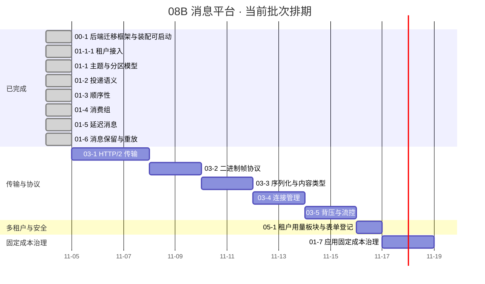

# 消息平台阶段计划

> 08B 消息平台 · 任务排期与门禁达成路径（进度唯一落点）

[文档首页](../../../文档首页.md) › [消息平台规划](../../../规划/01_规划_消息平台.md) › 08B 消息平台 › 阶段计划

---

## 1. 计划说明 

| 项 | 值 |
| --- | --- |
| 排期对象 | 08B 消息平台（阶段 `8B`）全部已拆解任务；未拆解需求域见 §6「后续阶段待办」 |
| 上游依据 | [消息平台规划](../../../规划/01_规划_消息平台.md) §7 阶段路线、[需求总览](../需求/00_需求_消息平台.md) §3 需求总清单（7 域 45 条） |
| 负责人 | minjian |
| 基准日 | 2026-11-04 |
| 排期口径 | 自然日连续、每日 8h；窗口格式按《[计划文档规范](../../../../bms文档/规范/计划文档规范.md)》§5.1（区间 / 单日 / 搁置） |
| 工时口径 | 「AI 实施 + 人工评审」的实际投入（含代码、用例、实施 / 测试记录与门禁）；首次排期**无历史基线**，偏差在「偏差与遗留」列滚动修正 |
| 进度落点 | 状态 / 完成日期 / 工时 / 排期窗口**只在本表维护**；需求与任务文档不承载进度 |

**嵌套子任务口径**：子任务不单列**排期**行，工时与状态随其直属父任务行维护；但**已完成的子任务**在 §2「已完成任务」单列（保留完成日期与 Kiwi 用例号，便于追溯），父任务行工时含该子任务合计。

**里程碑锚点**：8B_00 ~ 8B_09 与 8B_12（性能回归与容量实测）的阶段目标、退出条件与硬依赖见《[消息平台规划](../../../规划/01_规划_消息平台.md)》§7（本表不复制明细）。当前批次覆盖 `8B_00` 收口后的任务域 01（消息模型与投递）与任务域 05（多租户与安全）中的已拆解任务；任务域 03（传输与协议）已完成拆解并排期（8B_01 门禁）；任务域 02（存储与复制）已完成拆解，按硬依赖以**搁置**登记（见下）。

**任务域 03 的口径**：5 条任务与需求 03-1~03-5 一一对应，即 **8B_01 PoC 本体**；基座统一改用 **hypercorn**（2026-11-04 拍板），`core/run.py` 服务器替换与全产品回归归 **bms 仓另立任务**，本域任务以「基座已交付」为前置。**门禁判据（2026-11-05 评审后）**：五项功能验证通过即 go；吞吐 / 延迟不作门禁（原「≥2 倍且 p99 ≤50ms」降为容量观测，归 8B_12，见 §6），见[规划 §9.3](../../../规划/01_规划_消息平台.md#review-8b01)。

**任务域 02 的拆解与搁置口径**：7 条任务与需求 02-1~02-7 一一对应；其中 02-1 / 02-2 / 02-3 / 02-6 / 02-7 属 **8B_02**，待 **8B_01 功能五项验证通过（即 03 域 03-1~03-5 收口）** 后排期——2026-11-05 刹车评审结论为 **go（功能驱动）**，**性能不再作为解除条件**（见[规划 §9.3](../../../规划/01_规划_消息平台.md#review-8b01)）；02-4 / 02-5 属 **8B_05**，待 8B_04 与多实例部署后实施；分项合计 118h。搁置行不填日期、不入甘特，解除条件见 §7 风险 2 / 9。

**任务域 03 的评审结论（2026-11-05）**：8B_01 判 **go**——依据是自研的立项动因是业务功能能力（统一位点 / 重放 / 死信 / 延迟档位 / 三级命名空间），性能是附带收益；8B_01 门禁只看功能项，传输层性能降为容量观测（归 **8B_12**，独立压测机 + 编译型客户端，规划 §7）。03-1 的 1.44x / p99 70.7ms 因测量装置无效（同机闭环、客户端即瓶颈）不作裁定依据。

## 2. 已完成任务（2026-11-04 ~ 2026-11-04） 

| 编号 | 任务 | 工时（重估） | 完成日期 | 任务文件 | 偏差与遗留 |
| --- | --- | --- | --- | --- | --- |
| 00-1 | 后端迁移框架与装配可启动 | 4h | 2026-11-04 | [00-1 后端迁移框架与装配可启动](../任务/00_工程骨架/00_工程骨架_01_后端迁移框架与装配可启动/00_工程骨架_01_后端迁移框架与装配可启动.md) | 偏差：无；遗留：业务域 `msg` 未在域布局登记、首批迁移脚本为空（归口 8B_02 存储与表设计） |
| 01-1-1 | 租户接入 | 4h | 2026-11-04 | [01-1-1 租户接入](../任务/01_消息模型与投递/01_消息模型与投递_01_主题与分区模型/01_消息模型与投递_01_主题与分区模型_01_租户接入/01_消息模型与投递_01_主题与分区模型_01_租户接入.md) | 偏差：错误码由 5 位定稿为 6 位（平台产品码强制 6 位）、管理面原无改写点（经基座新增 `error_mapper` 能力域解决）；遗留：`errcode_segment = "35"` 暂定（归口 07C）、h2 帧服务未建（归口 01-2 起的 broker 任务）、契约快照人工导出未接预检（归口 8B_01）；详见[实施记录](../任务/01_消息模型与投递/01_消息模型与投递_01_主题与分区模型/01_消息模型与投递_01_主题与分区模型_01_租户接入/实施/01_实施记录_01_消息模型与投递_01_主题与分区模型_01_租户接入.md) §6 |
| 01-1 | 主题与分区模型 | 6h（本体 2h + 子任务 01-1-1 4h） | 2026-11-04 | [01-1 主题与分区模型](../任务/01_消息模型与投递/01_消息模型与投递_01_主题与分区模型/01_消息模型与投递_01_主题与分区模型.md) | 偏差：设计 8 项口径按确认回写（`tenant_id` 改雪花、分页改 `page/size`、不写迁移脚本、`package_prefix` 修正为 `bms`、只挂权限码、增分区只服务层、保留期常量、库设计文档与 mdm 同构）；域布局改走装载注册（清单 `[[domains]]`），不手写 `domain_layout.json`；6 条错误码 `domain` 统一为 `msg`。遗留：保留期配置化（基座扩字段）、管理面鉴权（05 域）、`domain_layout.json` 生成（8B_01 ops）、增分区端点（06 域）、契约快照接预检（8B_01）；mdm 收敛用例已本地复核（24 passed，配套锁刷新 mdm `1246a7d`）。详见[实施记录](../任务/01_消息模型与投递/01_消息模型与投递_01_主题与分区模型/实施/01_实施记录_01_消息模型与投递_01_主题与分区模型.md) §6 |
| 01-2 | 投递语义 | 10h（本体 10h，无嵌套子任务） | 2026-11-04 | [01-2 投递语义](../任务/01_消息模型与投递/01_消息模型与投递_02_投递语义/01_消息模型与投递_02_投递语义.md) | 偏差：计划窗口 2026-11-07 ~ 08 提前至 2026-11-04 完成（前序 01-1 亦提前，工时按计划值回填、无历史基线）；三处待拍板按确认落地（开三 HTTP 端点 / 位点端口 + 内存 / 毒消息进内存死信队列），另定 9 项口径（`/msg/consume` 命名、`frame_tenant()` 租户出口、位点含 group、错误码 350002/003/007、常量 30s/5/100、base64 载荷、`msg:publish`/`msg:consume`、必带 partition、`acks=1\|0`）；实施回写设计 2 处（负位点归契约、`acks=0` 后 ack 幂等）。遗留：消息/位点/死信为进程内态（8B_02 落盘、8B_07 位点文件、8B_05 复制）、消费组存在性未校验（01-4）、主题停用复用 350001（06 域补码）、未设载荷上限（8B_01/8B_07）、契约快照接预检（8B_01）、投递常量配置化（基座扩字段）、多分区并行消费端到端（01-4）；详见[实施记录](../任务/01_消息模型与投递/01_消息模型与投递_02_投递语义/实施/01_实施记录_01_投递语义.md) §6 |
| 01-3 | 顺序性 | 6h（本体 6h，无嵌套子任务） | 2026-11-04 | [01-3 顺序性](../任务/01_消息模型与投递/01_消息模型与投递_03_顺序性/01_消息模型与投递_03_顺序性.md) | 偏差：计划窗口 2026-11-09 提前至 2026-11-04（前序亦提前，工时按计划值回填、无历史基线）；7 项待拍板按确认落地（分区内停等、默认强制无开关、只做位点不跳、死信越过、回原 offset、`acks=0` 按序不保处理、不新增状态载体）；实施回写设计 2 处（重投批内隔离、死信跳过补记位点）；存量 `test_acks_zero_does_not_jump_unacked_gap` 断言由「不越位点」升级为「不越队头」。遗留：停等降低单分区吞吐（01-4 多分区 / 06 积压监控）、批内多条在途需客户端串行、进程内状态不跨实例（8B_02/05）、无 owner/lease（01-4）、同分区混用 acks 档位会互相阻塞（01-4）、契约快照仍人工重导（8B_01）；详见[实施记录](../任务/01_消息模型与投递/01_消息模型与投递_03_顺序性/实施/01_实施记录_01_顺序性.md) §6 |
| 01-4 | 消费组 | 10h（本体 10h，无嵌套子任务） | 2026-11-04 | [01-4 消费组](../任务/01_消息模型与投递/01_消息模型与投递_04_消费组/01_消息模型与投递_04_消费组.md) | 偏差：计划窗口 2026-11-10 ~ 11 提前至 2026-11-04（前序亦提前，工时按计划值回填、无历史基线）；13 项待拍板按确认落地（组元数据端口 + 内存 / 服务端主导 / range + 可插拔分配器 / 客户端自带 `consumer_id` / 三端点 join·heartbeat·leave / 本任务开只读 `/admin/groups` / 新占 `350013`·`350014` / 撤销只依赖已提交位点 / 空闲成员照常心跳 / `last_seen` + 30s 会话超时 / 组按 topic 维度 / 心跳 10s·超时 30s / 强制成员制）；实施回写设计 2 处（契约增量为 +5 端点、+12 schema）；`consume` / `ack` 新增必填 `consumer_id` 属破坏性契约变更（预发布阶段无外部调用方）。遗留：组元数据为进程内状态（8B_02 落 `msg_group` 两表）、多副本不共享（8B_02/8B_05）、无后台定时器（06 域可加周期扫描）、eager 全量再均衡（cooperative + sticky 已预留策略位）、请求内主题解析两次（8B_01 帧入口合并）、`consumer_id` 无身份校验（05 域成员令牌）、撤销清在途使注销计数重计（消费端幂等兜底）、`dead` 态不产生（06 域组删除）、组列表反查主题 N+1（06 域联表）、契约快照仍人工重导（8B_01）；详见[实施记录](../任务/01_消息模型与投递/01_消息模型与投递_04_消费组/实施/01_实施记录_01_消费组.md) §6 |
| 01-5 | 延迟消息（A 段） | 12h（本体 12h，无嵌套子任务） | 2026-11-04 | [01-5 延迟消息](../任务/01_消息模型与投递/01_消息模型与投递_05_延迟消息/01_消息模型与投递_05_延迟消息.md) | 偏差：计划窗口 2026-11-12 提前至 2026-11-04（前序亦提前，工时按计划值回填、无历史基线）；3 项待拍板按确认落地（待投视图过滤与发布同码同判据 / 转投 `published_at` 取 `deliver_at` / 推进器仅由首个延迟发布启动），4 项口径回写设计 §13；契约漂移比设计多 1 项（`/msg/publish` 的 `x-error-codes` 追加 `350015`，属新增错误码必声明）。遗留：延迟区与时间轮进程内（8B_02 落 `.delay` + 启动重建 + 按 `log_id` 去重）、多副本重复转投（8B_05）、转投失败无退避（06 域告警 / 指标）、配额计数全量扫描（8B_02 索引）、恢复出的存量记录需 B 段自 `ensure_started()`（8B_02）、进程级启动任务（8B_01 lifespan 钩子）、视图无改期 / 取消（06 域）、全局软上限未做（06 域）、契约快照仍人工重导（8B_01）、`PublishResult.offset` 放宽可空属破坏性变更（预发布无外部调用方）；详见[实施记录](../任务/01_消息模型与投递/01_消息模型与投递_05_延迟消息/实施/01_实施记录_01_延迟消息.md) §6 |
| 01-6 | 消息保留与重放（A 段） | 8h（本体 8h，无嵌套子任务） | 2026-11-04 | [01-6 消息保留与重放](../任务/01_消息模型与投递/01_消息模型与投递_06_消息保留与重放/01_消息模型与投递_06_消息保留与重放.md) | 偏差：计划窗口 2026-11-13 提前至 2026-11-04（前序亦提前，工时按计划值回填、无历史基线）；**计划行原写「位点重置」属描述串了**，位点重置在需求 02-3 / 06-2，本任务只保证 `350003` 契约不被破坏（已回写任务与设计）。13 项待拍板按确认落地（扁平范围字段 / `partitions` 可选缺省全分区 / 清理请求驱动 / 主题增 `retention_bytes` / 条每秒令牌限速 / 五态 + 批边界暂停 / 任务落表但不续跑 / 与发布不互斥 / 重放 `published_at` 取写入时刻 / 复用 `sys.operation.logged` / 发件箱 + 排除高频路径 / 首末 `log_id` / 审计失败不影响 / `350016`·`350017` / 定长条数段替身 / 位点重置不纳入）；实施回写设计 3 处（审计触发层落接口层、契约 +3 schema、执行器首拍等一个周期）。**审计落地顺带修了两处现状**：msg 原未配 `[outbox_store]` 导致审计事件被静默丢弃，现配 `sql` 并显式排除数据面高频路径（需求 05-6「普通读写不逐条留痕」）。遗留：真段删除与文件段（8B_02）、清理仅请求驱动（8B_02 后台清理）、重放任务不续跑（8B_06 + 8B_01 钩子）、审计跨服务一跳依赖平台事件链、独立业务审计事件类型需 bms 扩 `AuditLogWriter`、多副本重复推进（8B_05）、`total` 同步全量扫描（06 域）、位点重置端点（02-3 / 06-2）、全量 `log_id` 检索（06 域）、容量真实配额执行（8B_12）；详见[实施记录](../任务/01_消息模型与投递/01_消息模型与投递_06_消息保留与重放/实施/01_实施记录_01_消息保留与重放.md) §7 |

## 3. 剩余任务排期（自 2026-11-05） 

| 编号 | 任务 | 状态 | 工时 | 依赖 | 排期窗口 | 备注 | 偏差与遗留 |
| --- | --- | --- | --- | --- | --- | --- | --- |
| 03-1 | [HTTP/2 传输](../任务/03_传输与协议/03_传输与协议_01_HTTP2传输/03_传输与协议_01_HTTP2传输.md) | 部分完成 | 22h（重估：本体 14h + 冒烟与基准取证 4h + 缺陷定位 4h） | bms hypercorn（**已交付**，Kiwi 2419） | 2026-11-04 ~ 2026-11-06（提前于计划窗口） | h2c 单连接多 stream / SSE streaming / 连接元数据已交付；功能项全绿；**性能不作门禁**（评审 go，见 §1 评审结论段） | **偏差**：性能判据按 2026-11-05 刹车评审降为容量观测——1.44x / p99 70.7ms 系「同机闭环 + 客户端即瓶颈」装置下的客户端开销比，既非传输层上限也非达标证据，判据改为「功能五项验证 + 脚本与报告可复现」（[规划 §9.3](../../../规划/01_规划_消息平台.md#review-8b01)）；benchmark 改「最小装配 + 真 hypercorn」端口取数。**遗留**：publish 档 9 个失败（1200 条 / 0.75%，脚本只计数未记因）**按缺陷在本任务收口**——补记失败原因后定性并处置（缺陷不单立任务：无对应需求，见 AI开发规范「无需求不建任务」）；提交前预检钩子未装配——本任务收口项；MessagePack 侧与独立机容量取证归 8B_12 / 03-3；跨仓 bms `is_tenant_id` 上限已修复（缺陷 Issue 待补）；详见[实施记录](../任务/03_传输与协议/03_传输与协议_01_HTTP2传输/实施/01_实施记录_03_传输与协议_01_HTTP2传输.md) §7 |
| 03-2 | [二进制帧协议与版本演进](../任务/03_传输与协议/03_传输与协议_02_二进制帧协议与版本演进/03_传输与协议_02_二进制帧协议与版本演进.md) | 未开始 | 16h | 03-1 | 2026-11-08 ~ 2026-11-09 | 帧结构 / 版本演进 / 1 MiB / `350006` | 无 |
| 03-3 | [序列化与内容类型](../任务/03_传输与协议/03_传输与协议_03_序列化与内容类型/03_传输与协议_03_序列化与内容类型.md) | 未开始 | 12h | 03-2 | 2026-11-10 ~ 2026-11-11 | MessagePack / `content_type` / 压缩透明 / 校验失败进死信 | 无 |
| 03-4 | [连接管理](../任务/03_传输与协议/03_传输与协议_04_连接管理/03_传输与协议_04_连接管理.md) | 未开始 | 12h | 03-1 / 03-2 | 2026-11-12 ~ 2026-11-13 | 心跳 / GOAWAY / 重连测试客户端 / 并发流上限 | 无 |
| 03-5 | [背压与流控](../任务/03_传输与协议/03_传输与协议_05_背压与流控/03_传输与协议_05_背压与流控.md) | 未开始 | 12h | 03-1 / 03-2 / 03-4 | 2026-11-14 ~ 2026-11-15 | 长轮询 30s / inflight 100·16MiB / `350005` | 无 |
| 05-1 | [租户用量板块与表单登记](../任务/05_多租户与安全/05_多租户与安全_01_租户用量板块与表单登记/05_多租户与安全_01_租户用量板块与表单登记.md) | 未开始 | 6h | 01-1 | 2026-11-16 | 对应需求 05-3（配额只读回显）；前置 01-1-1 与 bms 07B `02_03` / `02_06` 已交付 | 无 |
| 01-7 | [应用固定成本治理](../任务/01_消息模型与投递/01_消息模型与投递_07_应用固定成本治理/01_消息模型与投递_07_应用固定成本治理.md) | 未开始 | 6h | 01-1 / 01-2 / 01-6（均已交付） | 2026-11-17 ~ 2026-11-18 | 对应需求 01-7（2026-11-05 补充，7 域 45 条）；主题元数据缓存 + 保留清理时间节流；验收：publish 与 connection 两档 p50 差值 ≤5ms | 无 |
| 02-1 | [分区追加日志](../任务/02_存储与复制/02_存储与复制_01_分区追加日志/02_存储与复制_01_分区追加日志.md) | 搁置 | 24h | 03-1 ~ 03-5 | 搁置（待 03 域收口） | 记录格式 / 索引 / 分段 / 读取原语；替换内存实现 | 无 |
| 02-2 | [崩溃恢复](../任务/02_存储与复制/02_存储与复制_02_崩溃恢复/02_存储与复制_02_崩溃恢复.md) | 搁置 | 12h | 02-1 | 搁置（待 03 域收口） | 恢复点 / CRC 截断 / 索引补建 / 位点回退告警 | 无 |
| 02-3 | [消费位点管理](../任务/02_存储与复制/02_存储与复制_03_消费位点管理/02_存储与复制_03_消费位点管理.md) | 搁置 | 6h | 01-4 / 01-6 / 02-2（协同） | 搁置（待 03 域收口） | 位点文件 + 损坏回退 + 重置能力（端点归 06-2） | 无 |
| 02-4 | [副本与 ISR 复制](../任务/02_存储与复制/02_存储与复制_04_副本与ISR复制/02_存储与复制_04_副本与ISR复制.md) | 搁置 | 32h | 02-1 / 02-2 / 02-3 / 8B_04 | 搁置（待 8B_05） | ISR 半同步 / HW / `min.insync.replicas` / `acks=all` | 无 |
| 02-5 | [选举、epoch 与故障切换](../任务/02_存储与复制/02_存储与复制_05_选举与故障切换/02_存储与复制_05_选举与故障切换.md) | 搁置 | 16h | 02-4 | 搁置（待 8B_05） | 手动切换 / fencing / 客户端刷新 / 切换留痕 | 无 |
| 02-6 | [存储水位与拒绝策略](../任务/02_存储与复制/02_存储与复制_06_存储水位与拒绝策略/02_存储与复制_06_存储水位与拒绝策略.md) | 搁置 | 8h | 02-1 / 02-2 | 搁置（待 03 域收口） | 高低水位滞回 / `350005` / `/ready` 可写判定 | 无 |
| 02-7 | [延迟消息持久化与到期恢复](../任务/02_存储与复制/02_存储与复制_07_延迟消息持久化与到期恢复/02_存储与复制_07_延迟消息持久化与到期恢复.md) | 搁置 | 20h | 01-5 / 02-1 / 02-2 | 搁置（待 03 域收口） | `.delay` 落盘 / 时间轮重建 / `log_id` 去重 | 无 |

## 4. 排期甘特图 

## 5. 阶段验收门禁 

| # | 门禁 | 判据 | 现状 |
| --- | --- | --- | --- |
| 1 | 8B_00 立项与总体设计 | 设计六块无开放 blocker（见规划 §7） | 已达成（00-1 收口） |
| 2 | 8B_01 传输与协议 PoC | **五项功能验证通过**（同连接多流 / 长驻流 / 取消即释放 / 契约零漂移 / 可启动）；性能不作门禁（容量结论归 8B_12） | **已评审：go（2026-11-05，功能驱动）**——03-1 功能项全绿（Kiwi 2420 / 138 passed / 变更模块覆盖率 100%），bms hypercorn 已交付（Kiwi 2419）；1.44x / p99 70.7ms 因测量装置无效（同机闭环、客户端即瓶颈）降为容量观测，不作裁定依据；见[规划 §9.3](../../../规划/01_规划_消息平台.md#review-8b01)。剩余收口项：03-1 的 9 失败缺陷定位、提交前钩子装配 |
| 3 | 8B_02 存储与恢复 | 崩溃恢复不丢已确认、位点可重放、未到期延迟消息重启后按剩余时间投递（规划 §7） | 任务已拆解（02-1 / 02-2 / 02-3 / 02-6 / 02-7），**搁置待 03 域收口**（8B_01 功能五项验证通过）；性能不再是解除条件 |
| 4 | 单任务交付门禁 | 用例绿 + 变更模块行 + 分支覆盖率 100% + 静态全绿 + 文档三项校验（links / docs-scope / eol） | 逐任务执行（每行完成时回写本表状态） |
| 5 | 登记回写 | 表归属 / 服务目录 / 错误码 `[[errcodes]]` / 基类清单按需同步 | 逐任务执行 |
| 6 | 阶段验收 | 见需求 07-7；依赖 8B_08 / 8B_09 | 未开始 |

## 6. 后续阶段待办（未拆解需求域） 

> 任务文档尚未建立的需求域列于下表；**已拆解的任务域（02 存储与复制搁置、03 传输与协议已排期）不再留在本表**。拆解后并入本表。

| 需求域 | 覆盖需求 | 对应规划阶段 | 归口 |
| --- | --- | --- | --- |
| [04 RPC](../需求/04_需求_RPC.md) | 04-1 ~ 04-6（一元调用 / 取消 / 流式 / 错误语义 / bms 端口适配 / 服务发现与负载均衡） | 8B_03 | 待 03 域落地 |
| [05 多租户与安全](../需求/05_需求_多租户与安全.md) 剩余 | 05-4 ~ 05-7（认证 / 授权 / 审计 / 生命周期） | 8B_07 | 待 06 域落地；05-1 / 05-2 已由 01-1-1 覆盖，05-3 见 §3 的 05-1 任务 |
| [06 管理与运维](../需求/06_需求_管理与运维.md) | 06-1 ~ 06-6（只读视图 / 写操作 / 指标告警 / 追踪 / 死信 / 重放） | 8B_06 | 待 02 域落地 |
| [07 部署、迁移与验收](../需求/07_需求_部署迁移与验收.md) | 07-1 ~ 07-4、07-6 ~ 07-7（部署 / 凭据 / 备份 / bms 迁移 / 演练 / 验收） | 8B_07 ~ 8B_09 | 待 05 / 06 域落地 |
| [07 部署、迁移与验收](../需求/07_需求_部署迁移与验收.md) 07-5 | 07-5 压测与容量规划（五类压测 / P50·P95·P99 / 客户端与服务端分离部署 / N−1 容量模型） | **8B_12** | 待 8B_09 后拆解，任务编号拟定 **07-5**；各文档既有的 `8B_12` 引用自此有正式定义（规划 §7） |

## 7. 风险与对策 

| # | 风险 | 影响 | 对策 |
| --- | --- | --- | --- |
| 1 | 任务域 01 先于 8B_01 功能刹车点实施 | 若功能项不通过，01 域的元数据与接口可能返工 | 01 域只落**元数据与接口**（不引真实分区日志 / 零拷贝）；存储实现归 02 域，严格排在 8B_01 之后 |
| 2 | 8B_01 已拆解排期，但基座 hypercorn 迁移跨仓 | 基座未按期交付则 03-1 阻塞，02 域继续搁置 | bms 侧另立任务并提前启动；03-1 以「基座已交付」为前置，未交付不验收；**功能五项验证通过（03 域收口）后**解除 02 域搁置 |
| 3 | 工时为首版估算、无历史基线 | 窗口失真、里程碑后移 | 每行完成时回写重估工时与实际完成日期，偏差记入「偏差与遗留」；连续两行偏差 > 50% 时重排剩余窗口 |
| 4 | 01-1-1 遗留（`errcode_segment` 暂定、h2 帧服务未建、契约快照未接预检） | 码段登记前存在变更风险；帧入口与契约对账缺自动化 | 分别归口 07C 标识符登记、03-1 帧入口、03-1 / 03-2 接入 `contract_snapshot` 导出与零漂移校验（见 §2 该行） |
| 5 | 05-1 的数据源登记与 bms 装载校验跨仓耦合 | msg 侧改动可能触发 bms 装载失败 | 变更须双仓同步提交，并在 msg 实施记录登记 bms 侧影响 |
| 6 | 单人串行排期无缓冲 | 任一任务超期即整体后移 | 甘特按自然日连续；如需缓冲，优先压缩 01-5 / 01-6（优先级 3 / 2），不压缩 01-1 ~ 01-4（1 紧急） |
| 8 | 单条消息大小上限（规划 §10 #10） | 超大消息打爆内存与段文件；或客户端各自设限导致行为不一致 | **已定 1 MiB**（03-2 帧契约），超限 `350006`；01-2 契约层补同一上限校验，避免只靠传输层拒绝 |
| 7 | 任务域 01 先于存储落地，完成标准的判据容易写成跨阶段承诺 | 验收时被判「未达成」，或被迫在内存阶段提前钉死落盘格式 | 开工前逐条判归属：只写「语义可验」，跨阶段项在完成标准里显式标注承接阶段（8B_02）；已在规划 §7 与本表 01-5 / 01-6 行的「偏差与遗留」登记 |
| 9 | 02 域任务先于 8B_01 定稿 | PoC 结论可能改变读取原语与帧契约，任务与详细设计返工 | 03 域收口后逐条回写 02-1 / 02-7 的前置口径与 02-4 的复制边界，回写完成再解除搁置 |
| 10 | 记录格式一旦落盘即受「格式不回滚」约束 | 升级后旧版本读不了新数据，回滚失败 | `format_version` + 字段只增不删 + 需要不兼容时双写过渡；发布前跑旧版本读取用例，回滚演练纳入 07-6 |
| 11 | 存储层缺陷属数据丢失级 | 生产事件丢失且难以追溯 | CRC / 崩溃恢复 / 故障注入用例 + 变更模块 100% 覆盖 + 07-6 演练；写路径与截断逻辑必须人工评审 |
| 12 | 8B_05 复制依赖多实例与分区迁移，单实例实现可能返工 | 复制与选举实现反复重做 | 复制实现可开关、单实例行为与 8B_02 完全一致；02-4 / 02-5 搁置待 8B_04，不提前锁死部署形态 |
| 13 | hypercorn 迁移跨仓（bms `core/run.py` + 全产品回归） | 基座改动遗漏回归，或与 msg 启动路径不一致 | bms 任务覆盖全部产品；msg 03-1 只依赖交付结果、不重复实现；两仓同步提交与验证 |
| 14 | hypercorn 明文吞吐低于 uvicorn httptools | 容量不足，影响容量模型 | 容量结论归 8B_12（独立压测机 + 编译型客户端）；不达容量模型按规划 §9.2 处置（扩容 / 换实现），**不以同机基准比值触发刹车**；备选（独立 h2 / Granian）须另拍板后启用 |
| 15 | h2c 明文与网关透传 | 生产暴露或网关不支持 h2c 上游 | h2c 仅限内网 / 网关一跳；07-1 验证网关 h2c；生产切 TLS + ALPN |
| 16 | 性能结论依赖测量装置（同机压测时客户端即瓶颈） | 比值不可外推，误判协议能力（03-1 已实证：1.44x 实为客户端开销比） | 容量取值条件写死在 8B_12（独立机、编译型客户端、报 P50 / P95 / P99）；同机 Python 客户端只作诊断记录，不作判据（规划 §9.3） |

## 8. 刹车评审引出的待办处置 

> 来源：2026-11-05 8B_01 刹车评审（结论与依据见[规划 §9.3](../../../规划/01_规划_消息平台.md#review-8b01)）。三项的处置口径已定，见下表；进展与工时仍在 §2 / §3 两张表维护，本节不承载进度。

| # | 事项 | 处置 | 归属 |
| --- | --- | --- | --- |
| 1 | publish 档 9 个失败（1200 条 / 0.75%，脚本只计数未记因） | **不单立任务**——缺陷无对应需求（「无需求不建任务」）；并入 03-1 收口：先给基准脚本补记失败原因（状态码 / 业务码 / 异常类型），再定性——真缺陷就修 + 补用例，装置问题就改脚本并留痕 | 03-1（工时已计入该行：18h → 22h） |
| 2 | 应用固定成本治理：主题元数据缓存 + 保留清理由「每条请求一次全量扫描」改时间节流 | **已立项 01-7**（需求 01-7 同日补充，需求总数 44 → 45 条）；验收：publish 与 connection 两档 p50 差值 ≤5ms | 01-7（§3 排期行） |
| 3 | 容量定参与性能基线回归：独立压测机 + `h2load` + 报 P50 / P95 / P99 | **暂不建任务文档**——属后续阶段内部实现，按 AI开发规范 §3.1 归对应阶段；编号拟定 **07-5**（与需求 07-5 一一对应），到 8B_12 拆解时建，见 §6 | 8B_12 |

---

> 依《[计划文档规范](../../../../bms文档/规范/计划文档规范.md)》编写 · 与《[项目管理规范](../../../../bms文档/规范/项目管理规范.md)》、[需求总览](../需求/00_需求_消息平台.md)配套
