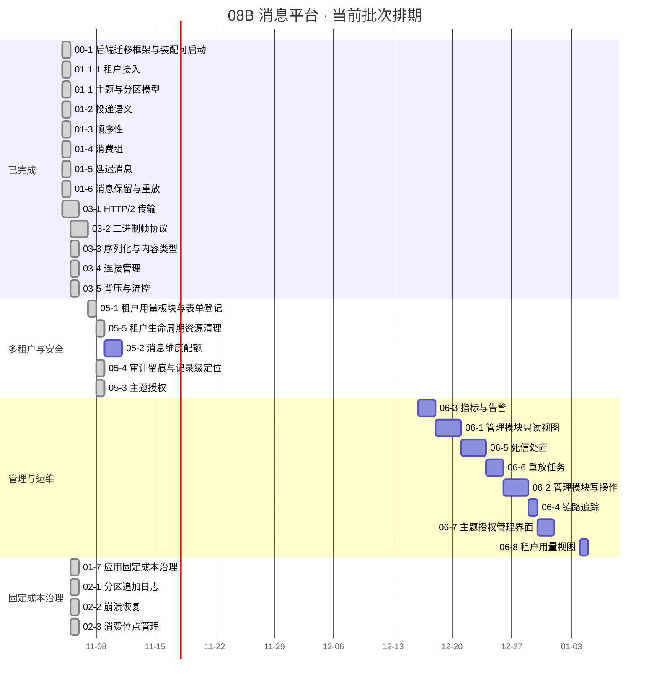

# 消息平台阶段计划

> 08B 消息平台 · 任务排期与门禁达成路径（进度唯一落点）

[文档首页](../../../文档首页.md) › [消息平台规划](../../../规划/01_规划_消息平台.md) › 08B 消息平台 › 阶段计划

---

## 1. 计划说明 

| 项 | 值 |
| --- | --- |
| 排期对象 | 08B 消息平台（阶段 `8B`）全部已拆解任务；未拆解需求域见 §6「后续阶段待办」 |
| 上游依据 | [消息平台规划](../../../规划/01_规划_消息平台.md) §7 阶段路线、[需求总览](../需求/00_需求_消息平台.md) §3 需求总清单（7 域 49 条） |
| 负责人 | minjian |
| 基准日 | 2026-11-05 |
| 排期口径 | 自然日连续、每日 8h；窗口格式按《[计划文档规范](../../../../bms文档/规范/计划文档规范.md)》§5.1（区间 / 单日 / 搁置） |
| 工时口径 | 「AI 实施 + 人工评审」的实际投入（含代码、用例、实施 / 测试记录与门禁）；首次排期**无历史基线**，偏差在「偏差与遗留」列滚动修正 |
| 进度落点 | 状态 / 完成日期 / 工时 / 排期窗口**只在本表维护**；需求与任务文档不承载进度 |

**嵌套子任务口径**：子任务不单列**排期**行，工时与状态随其直属父任务行维护；但**已完成的子任务**在 §2「已完成任务」单列（保留完成日期与 Kiwi 用例号，便于追溯），父任务行工时含该子任务合计。

**里程碑锚点**：8B_00 ~ 8B_09 与 8B_12（性能回归与容量实测）的阶段目标、退出条件与硬依赖见《[消息平台规划](../../../规划/01_规划_消息平台.md)》§7（本表不复制明细）。当前批次覆盖 `8B_00` 收口后的任务域 01、05 中的已拆解任务；任务域 03（传输与协议）已收口（8B_01 门禁 2026-11-05 达成）；任务域 02（存储与复制）已完成拆解：02-1 / 02-2 / 02-3 / 02-6 / 02-7 已于 2026-11-05 **解除搁置**（门禁 2 达成）转「待排期」，02-4 / 02-5 仍按硬依赖搁置（待 8B_04 / 8B_05，见下）；任务域 04（远程调用）已完成拆解（6 条 76h，见下）；任务域 02 的 **02-1 / 02-2 / 02-3 / 02-6 / 02-7 已交付（2026-11-05）**，仅 02-4 / 02-5 仍按 8B_05 搁置；任务域 06（管理与运维）已完成拆解（8 条父任务 + 11 个嵌套子任务，合计 120h，见下）。

**任务域 03 的口径**：5 条任务与需求 03-1~03-5 一一对应，即 **8B_01 PoC 本体**；基座统一改用 **hypercorn**（2026-11-04 拍板），`core/run.py` 服务器替换与全产品回归归 **bms 仓另立任务**，本域任务以「基座已交付」为前置。**门禁判据（2026-11-05 评审后）**：五项功能验证通过即 go；吞吐 / 延迟不作门禁（原「≥2 倍且 p99 ≤50ms」降为容量观测，归 8B_12，见 §6），见[规划 §9.3](../../../规划/01_规划_消息平台.md#review-8b01)。

**任务域 02 的拆解与搁置口径**：7 条任务与需求 02-1~02-7 一一对应，分项合计 118h。**已解除搁置（2026-11-05）**：02-1 / 02-2 / 02-3 / 02-6 / 02-7 属 **8B_02**，解除条件「**8B_01 功能五项验证通过（即 03 域 03-1~03-5 收口）**」已满足——2026-11-05 刹车评审结论为 **go（功能驱动）**，**性能不再作为解除条件**（见[规划 §9.3](../../../规划/01_规划_消息平台.md#review-8b01)）；解除前已按 §7 风险 9 完成前置回写（02-1 / 02-7 前置口径、02-4 复制边界）。五条状态改「**待排期**」：**不填日期、不入甘特**，8B_02 开工时逐条排。02-4 / 02-5 属 **8B_05**，待 8B_04 与多实例部署后实施，**仍搁置**。

**任务域 03 的评审结论（2026-11-05）**：8B_01 判 **go**——依据是自研的立项动因是业务功能能力（统一位点 / 重放 / 死信 / 延迟档位 / 三级命名空间），性能是附带收益；8B_01 门禁只看功能项，传输层性能降为容量观测（归 **8B_12**，独立压测机 + 编译型客户端，规划 §7）。03-1 的 1.44x / p99 70.7ms 因测量装置无效（同机闭环、客户端即瓶颈）不作裁定依据。

**任务域 04 的拆解与顺序口径**：7 条任务与需求 04-1~04-7 一一对应，分项合计 **92h**（04-1 14h / 04-2 12h / 04-3 14h / 04-4 12h / 04-5 12h / 04-6 12h / 04-7 16h）。04 域硬依赖 **8B_01（已达成）**，**不依赖 8B_02 存储**；按优先级与连续块，计划排在 8B_02 存储块之后——02-1 / 02-2 / 02-3 为 1 紧急且是 8B_04 / 8B_05 / 8B_06 的地基。状态「**搁置（待 8B_02 收口）**」、不填日期、不入甘特；8B_02 收口后按 `04-1 → 04-2 → 04-3 → 04-4 → 04-5 → 04-6` 排具体窗口。04-5 的 bms 适配另立 bms 任务（msg 仓只交付协议库 / stub）；04-6 首期只接 bms 服务目录，保留 `InstanceProvider` 接口，DNS / 静态列表后置。**04 域自 04-1 起解除搁置**：8B_02 门禁 3 已于 2026-11-05 达成（02-7 收口），04-1 / 04-2 已交付，04-3~04-6 按编号串行排期；**04-7 于 2026-11-06 立项**（04-2 实测发现客户端侧取消缺口：`httpx` / `httpcore` 在等待响应头期间被取消时不发 `RST_STREAM`），排 04-6 之后，服务端接收侧已在 04-2 就位。**04-7 于 2026-11-06 拆为两个嵌套子任务**：04-7-1「H2 传输层」（自持连接 / 流 / 池 / 注入面迁移，含流中止原语）与 04-7-2「取消发重置帧」（取消与超时接线、`rst_sent` 观测、真机验收）；实施前 spike 实测三条路线后定「h2 自持」（`httpx` 取消不发 RST、`httpcore` 无公开流重置出口），父任务状态按 §3.1 口径改「部分完成」留在 §3。**04-7-1 于 2026-11-06 交付**：`client/transport/` 子包（h2 自持连接 / 流 / 池）+ `RpcTransport` 协议换血（生产 h2、测试 ASGI + 脚本）+ 流中止原语 + 删 `timeout_ms` + `h2` 提直接依赖。**04-7-2 于 2026-11-06 交付**：取消 / 超时 / 异常三路中止归一为「`stream.abort(reason)` → `RST_STREAM(CANCEL)`」+ `close_reason` 六态与 `rst_sent` + 客户端事件 `msg_rpc_client_cancel` + 真机 h2c 验收（服务端 handler 中断实测 51.8~55.2ms，判据 ≤150ms）；服务端零改动。**04-7 至此整体交付**（两子任务迁入 §2），04-2 遗留 #1（精确 `RST_STREAM`）闭环。**04-3 于 2026-11-06 拆为两个嵌套子任务并解除搁置**：04-3-1「服务端流式」（`/stream` 端点、`48` + `end_of_stream` 流帧、流内错误、空闲超时 `350024`、攒批 + inflight 双阈值背压，6h）与 04-3-2「客户端流式消费」（传输层读队列、`RpcStream` 句柄、取消与端到端真机验收，8h），两段各一份设计 / 一次提交 / 一条 Kiwi；**04-3~04-6 一并解除搁置**（8B_02 门禁 3 已达成、04 域无阻塞），状态改「进行中 / 未开始」并按 `04-3 → 04-4 → 04-5 → 04-6` 填连续窗口、入甘特。**04-3 于 2026-11-06 整体交付**（两子任务迁入 §2）：04-3-1 交付 `/stream` 帧流（Kiwi 2437），04-3-2 交付客户端 `RpcStream` 句柄与端到端验收（Kiwi 2438，真机 `break` 后停推 0.4~0.5ms、同连接一元不受影响）；两段合计 368 例全绿、变更模块行 + 分支 100%。**04-4 于 2026-11-06 交付**（迁入 §2，Kiwi 2439）：五类错误分类 + full jitter 退避与调用链预算 + 幂等键去重 + 复用 bms 契约的三态熔断 + `Retry-After` 双来源，流式完全排除；一次会话 502 例 / 提交前预检 1187 例全绿、变更模块行 + 分支 100%。**04-5 于 2026-11-06 交付**（Kiwi 2442；事件发布真链路 + 租户 id 返修 2443；工时重估 12h，适配层 / 切换 / 真实调用归 bms 07B `06_01`）。**04-6 于 2026-11-06 交付**（Kiwi 2444；核心落 bms `bms_core/msgclient`，msg 仓留任务文档与跨仓契约用例），**04 域 7 条任务全部收口**（04-7 两子任务已并入本节）。

**任务域 06 的拆解与顺序口径（2026-11-09 补充 06-9）**：8 条父任务与需求 06-1~06-8 一一对应，另拆 11 个嵌套子任务，分项合计 **120h**（06-1 28h / 06-2 18h / 06-3 14h / 06-4 8h / 06-5 18h / 06-6 10h / 06-7 14h / 06-8 10h）。**补充口径（2026-11-09 拍板）**：06-1-1 契约收口暴露「msg 仓无前端契约类型自动生成链」，按《AI开发规范》「补充需求的处理方式」节顺延新增需求 06-9、在 06-1 下加嵌套子任务 06-1-3（6h），与 06-1-1 同批实施；06-1 父任务因此重开为「部分完成」并留在 §3，工时为「后端 8h + 前端 14h + 类型生成器 6h = 28h」，06 域合计 114h → 120h、需求总数 48 → 49 条。嵌套子任务不单列计划行，后续窗口按历史惯例不动。执行顺序按优先级与依赖：`06-3 → 06-1 → 06-5 → 06-6 → 06-2 → 06-4 → 06-7 → 06-8`，排在 05-3 之后连续窗口（2026-12-16 起，06-8 跨元旦后 2027-01-04）。06-1 / 06-2 / 06-5 / 06-6 含 msg 前端模块页面与原型；管理模块注册 `routes` 接入 bms 宿主并登记 1 张概览工作台卡片；06-7 补主题授权界面（独立菜单页，主体候选调 bms 平台接口、无权限降级手填），06-8 补租户用量视图（独立页 + bms 租户记录页「消息用量」页签）；指标图表走 bms Grafana，不重复自绘。06-4 只交 msg 侧头字段 / 透传 / 消费契约，SDK span 归 bms 另立。已有 01-4 / 01-5 / 01-6 / 05-1 / 05-2 / 05-3 接口复用并补齐。术语统一为“消息平台管理模块”（不再使用易与 bms 首页工作台混淆的旧称）。

## 2. 已完成任务（2026-11-04 ~ 2026-11-07） 

| 编号 | 任务 | 工时（重估） | 完成日期 | 任务文件 | 偏差与遗留 |
| --- | --- | --- | --- | --- | --- |
| 00-1 | 后端迁移框架与装配可启动 | 4h | 2026-11-04 | [00-1 后端迁移框架与装配可启动](../任务/00_工程骨架/00_工程骨架_01_后端迁移框架与装配可启动/00_工程骨架_01_后端迁移框架与装配可启动.md) | 偏差：无；遗留：业务域 `msg` 未在域布局登记、首批迁移脚本为空（归口 8B_02 存储与表设计） |
| 01-1-1 | 租户接入 | 4h | 2026-11-04 | [01-1-1 租户接入](../任务/01_消息模型与投递/01_消息模型与投递_01_主题与分区模型/01_消息模型与投递_01_主题与分区模型_01_租户接入/01_消息模型与投递_01_主题与分区模型_01_租户接入.md) | 偏差：错误码由 5 位定稿为 6 位（平台产品码强制 6 位）、管理面原无改写点（经基座新增 `error_mapper` 能力域解决）；遗留：`errcode_segment = "35"` 暂定（归口 07C）、h2 帧服务未建（归口 01-2 起的 broker 任务）、契约快照人工导出未接预检（归口 8B_01）；详见[实施记录](../任务/01_消息模型与投递/01_消息模型与投递_01_主题与分区模型/01_消息模型与投递_01_主题与分区模型_01_租户接入/实施/01_实施记录_01_消息模型与投递_01_主题与分区模型_01_租户接入.md) §6 |
| 01-1 | 主题与分区模型 | 6h（本体 2h + 子任务 01-1-1 4h） | 2026-11-04 | [01-1 主题与分区模型](../任务/01_消息模型与投递/01_消息模型与投递_01_主题与分区模型/01_消息模型与投递_01_主题与分区模型.md) | 偏差：设计 8 项口径按确认回写（`tenant_id` 改雪花、分页改 `page/size`、不写迁移脚本、`package_prefix` 修正为 `bms`、只挂权限码、增分区只服务层、保留期常量、库设计文档与 mdm 同构）；域布局改走装载注册（清单 `[[domains]]`），不手写 `domain_layout.json`；6 条错误码 `domain` 统一为 `msg`。遗留：保留期配置化（基座扩字段）、管理面鉴权（05 域）、`domain_layout.json` 生成（8B_01 ops）、增分区端点（06 域）、契约快照接预检（8B_01）；mdm 收敛用例已本地复核（24 passed，配套锁刷新 mdm `1246a7d`）。详见[实施记录](../任务/01_消息模型与投递/01_消息模型与投递_01_主题与分区模型/实施/01_实施记录_01_消息模型与投递_01_主题与分区模型.md) §6 |
| 01-2 | 投递语义 | 10h（本体 10h，无嵌套子任务） | 2026-11-04 | [01-2 投递语义](../任务/01_消息模型与投递/01_消息模型与投递_02_投递语义/01_消息模型与投递_02_投递语义.md) | 偏差：计划窗口 2026-11-07 ~ 08 提前至 2026-11-04 完成（前序 01-1 亦提前，工时按计划值回填、无历史基线）；三处待拍板按确认落地（开三 HTTP 端点 / 位点端口 + 内存 / 毒消息进内存死信队列），另定 9 项口径（`/msg/consume` 命名、`frame_tenant()` 租户出口、位点含 group、错误码 350002/003/007、常量 30s/5/100、base64 载荷、`msg:publish`/`msg:consume`、必带 partition、`acks=1\|0`）；实施回写设计 2 处（负位点归契约、`acks=0` 后 ack 幂等）。遗留：消息/位点/死信为进程内态（8B_02 落盘、8B_07 位点文件、8B_05 复制）、消费组存在性未校验（01-4）、主题停用复用 350001（06 域补码）、未设载荷上限（8B_01/8B_07）、契约快照接预检（8B_01）、投递常量配置化（基座扩字段）、多分区并行消费端到端（01-4）；详见[实施记录](../任务/01_消息模型与投递/01_消息模型与投递_02_投递语义/实施/01_实施记录_01_投递语义.md) §6 |
| 01-3 | 顺序性 | 6h（本体 6h，无嵌套子任务） | 2026-11-04 | [01-3 顺序性](../任务/01_消息模型与投递/01_消息模型与投递_03_顺序性/01_消息模型与投递_03_顺序性.md) | 偏差：计划窗口 2026-11-09 提前至 2026-11-04（前序亦提前，工时按计划值回填、无历史基线）；7 项待拍板按确认落地（分区内停等、默认强制无开关、只做位点不跳、死信越过、回原 offset、`acks=0` 按序不保处理、不新增状态载体）；实施回写设计 2 处（重投批内隔离、死信跳过补记位点）；存量 `test_acks_zero_does_not_jump_unacked_gap` 断言由「不越位点」升级为「不越队头」。遗留：停等降低单分区吞吐（01-4 多分区 / 06 积压监控）、批内多条在途需客户端串行、进程内状态不跨实例（8B_02/05）、无 owner/lease（01-4）、同分区混用 acks 档位会互相阻塞（01-4）、契约快照仍人工重导（8B_01）；详见[实施记录](../任务/01_消息模型与投递/01_消息模型与投递_03_顺序性/实施/01_实施记录_01_顺序性.md) §6 |
| 01-4 | 消费组 | 10h（本体 10h，无嵌套子任务） | 2026-11-04 | [01-4 消费组](../任务/01_消息模型与投递/01_消息模型与投递_04_消费组/01_消息模型与投递_04_消费组.md) | 偏差：计划窗口 2026-11-10 ~ 11 提前至 2026-11-04（前序亦提前，工时按计划值回填、无历史基线）；13 项待拍板按确认落地（组元数据端口 + 内存 / 服务端主导 / range + 可插拔分配器 / 客户端自带 `consumer_id` / 三端点 join·heartbeat·leave / 本任务开只读 `/admin/groups` / 新占 `350013`·`350014` / 撤销只依赖已提交位点 / 空闲成员照常心跳 / `last_seen` + 30s 会话超时 / 组按 topic 维度 / 心跳 10s·超时 30s / 强制成员制）；实施回写设计 2 处（契约增量为 +5 端点、+12 schema）；`consume` / `ack` 新增必填 `consumer_id` 属破坏性契约变更（预发布阶段无外部调用方）。遗留：组元数据为进程内状态（8B_02 落 `msg_group` 两表）、多副本不共享（8B_02/8B_05）、无后台定时器（06 域可加周期扫描）、eager 全量再均衡（cooperative + sticky 已预留策略位）、请求内主题解析两次（8B_01 帧入口合并）、`consumer_id` 无身份校验（05 域成员令牌）、撤销清在途使注销计数重计（消费端幂等兜底）、`dead` 态不产生（06 域组删除）、组列表反查主题 N+1（06 域联表）、契约快照仍人工重导（8B_01）；详见[实施记录](../任务/01_消息模型与投递/01_消息模型与投递_04_消费组/实施/01_实施记录_01_消费组.md) §6 |
| 01-5 | 延迟消息（A 段） | 12h（本体 12h，无嵌套子任务） | 2026-11-04 | [01-5 延迟消息](../任务/01_消息模型与投递/01_消息模型与投递_05_延迟消息/01_消息模型与投递_05_延迟消息.md) | 偏差：计划窗口 2026-11-12 提前至 2026-11-04（前序亦提前，工时按计划值回填、无历史基线）；3 项待拍板按确认落地（待投视图过滤与发布同码同判据 / 转投 `published_at` 取 `deliver_at` / 推进器仅由首个延迟发布启动），4 项口径回写设计 §13；契约漂移比设计多 1 项（`/msg/publish` 的 `x-error-codes` 追加 `350015`，属新增错误码必声明）。遗留：延迟区与时间轮进程内（8B_02 落 `.delay` + 启动重建 + 按 `log_id` 去重）、多副本重复转投（8B_05）、转投失败无退避（06 域告警 / 指标）、配额计数全量扫描（8B_02 索引）、恢复出的存量记录需 B 段自 `ensure_started()`（8B_02）、进程级启动任务（8B_01 lifespan 钩子）、视图无改期 / 取消（06 域）、全局软上限未做（06 域）、契约快照仍人工重导（8B_01）、`PublishResult.offset` 放宽可空属破坏性变更（预发布无外部调用方）；详见[实施记录](../任务/01_消息模型与投递/01_消息模型与投递_05_延迟消息/实施/01_实施记录_01_延迟消息.md) §6 |
| 01-6 | 消息保留与重放（A 段） | 8h（本体 8h，无嵌套子任务） | 2026-11-04 | [01-6 消息保留与重放](../任务/01_消息模型与投递/01_消息模型与投递_06_消息保留与重放/01_消息模型与投递_06_消息保留与重放.md) | 偏差：计划窗口 2026-11-13 提前至 2026-11-04（前序亦提前，工时按计划值回填、无历史基线）；**计划行原写「位点重置」属描述串了**，位点重置在需求 02-3 / 06-2，本任务只保证 `350003` 契约不被破坏（已回写任务与设计）。13 项待拍板按确认落地（扁平范围字段 / `partitions` 可选缺省全分区 / 清理请求驱动 / 主题增 `retention_bytes` / 条每秒令牌限速 / 五态 + 批边界暂停 / 任务落表但不续跑 / 与发布不互斥 / 重放 `published_at` 取写入时刻 / 复用 `sys.operation.logged` / 发件箱 + 排除高频路径 / 首末 `log_id` / 审计失败不影响 / `350016`·`350017` / 定长条数段替身 / 位点重置不纳入）；实施回写设计 3 处（审计触发层落接口层、契约 +3 schema、执行器首拍等一个周期）。**审计落地顺带修了两处现状**：msg 原未配 `[outbox_store]` 导致审计事件被静默丢弃，现配 `sql` 并显式排除数据面高频路径（需求 05-6「普通读写不逐条留痕」）。遗留：真段删除与文件段（8B_02）、清理仅请求驱动（8B_02 后台清理）、重放任务不续跑（8B_06 + 8B_01 钩子）、审计跨服务一跳依赖平台事件链、独立业务审计事件类型需 bms 扩 `AuditLogWriter`、多副本重复推进（8B_05）、`total` 同步全量扫描（06 域）、位点重置端点（02-3 / 06-2）、全量 `log_id` 检索（06 域）、容量真实配额执行（8B_12）；详见[实施记录](../任务/01_消息模型与投递/01_消息模型与投递_06_消息保留与重放/实施/01_实施记录_01_消息保留与重放.md) §7 |
| 03-1 | HTTP/2 传输 | 22h（重估：本体 14h + 冒烟与基准取证 4h + 缺陷定位与收口 4h） | 2026-11-05 | [03-1 HTTP/2 传输](../任务/03_传输与协议/03_传输与协议_01_HTTP2传输/03_传输与协议_01_HTTP2传输.md) | **偏差**：① 性能判据按 2026-11-05 刹车评审降为容量观测（1.44x / p99 70.7ms 系「同机闭环 + 客户端即瓶颈」装置下的客户端开销比，既非传输层上限也非达标证据），门禁改为「功能五项验证 + 脚本与报告可复现」（[规划 §9.3](../../../规划/01_规划_消息平台.md#review-8b01)）；② 基准装置修正两处——补失败归因（状态码 / 业务码 / 异常类型 + 原文样本）与单连接按预算分轮（`--connection-requests` 缺省 800）；③ publish 档失败定性：9 条（复跑 16 条）全为 `httpx.WriteError`，根因是 hypercorn `keep_alive_max_requests=1000` 的连接退休 + 客户端不重试在途流（实证 `last_stream_id:2001` = 第 1001 条请求），属**装置问题**，不改业务代码、不新增用例（Kiwi 2420 沿用）；④ 提交前预检钩子已装配（`scripts/tools/preflight/`），`--check` 通过、`--all-steps` 自检全绿；⑤ 基准脚手架入库（`scripts/bench/run_bench.py`）——此前「起服务」那一层只在 gitignore 的 `tmp/`，「脚本与报告可复现」这条判据其实不成立；入库后同命令复跑 0 失败、数值一致。**遗留**：独立压测机 + 编译型客户端的容量取证与 h2c publish 慢（2.3x，与失败不同根因）的真因 → 8B_12 / 03-3；服务端 GOAWAY 退休边界的客户端重连 → 03-4；应用固定成本 → 01-7；bms `is_tenant_id` 缺陷 Issue 待补；详见[实施记录](../任务/03_传输与协议/03_传输与协议_01_HTTP2传输/实施/01_实施记录_03_传输与协议_01_HTTP2传输.md) §7 |
| 03-2 | 二进制帧协议与版本演进 | 16h（按计划值回填；含详细设计、协议层、帧闸门、测试向量与真机 h2c 冒烟） | 2026-11-05 | [03-2 二进制帧协议与版本演进](../任务/03_传输与协议/03_传输与协议_02_二进制帧协议与版本演进/03_传输与协议_02_二进制帧协议与版本演进.md) | **偏差**：① 入口形态由「同路径第二条路由」改为**依赖闸门 + 异常短路**——隐藏路由会被基座 `hidden_route_violations()` 判违规（按路径集合判），双可见路由会让 `paths` 后者覆盖前者、抹掉请求体 schema；② 新增用例文件（`test_frame_data_plane.py` / `test_payload_limit.py` 等 9 个）而非扩 03-1 的用例文件，避免 `kiwi_id` 混标；③ 超大帧状态码取注册表 **413**（与 JSON 路径同码同状态），设计 §6.5 已回写；④ 未知帧类型且未置 `need_response` 回 **200 空体**（「忽略」的 HTTP 形态）。**遗留**：帧路径消息体仍 base64 往返（03-3 定 `content_type` 后直通）、帧式订阅推送（03-5）、心跳端点与连接级 `GOAWAY`（03-4）、客户端断开义务需 SDK 落实（8B_03）、网关 / 监控按状态码统计需改看业务码（06 域）；详见[实施记录](../任务/03_传输与协议/03_传输与协议_02_二进制帧协议与版本演进/实施/01_实施记录_03_传输与协议_02_二进制帧协议与版本演进.md) §7 |
| 03-3 | 序列化与内容类型 | 12h（按计划值回填；含详细设计、内容类型与压缩口径、payload 直通改造、`nack` 端点与死信归口、用例与冻结向量） | 2026-11-05 | [03-3 序列化与内容类型](../任务/03_传输与协议/03_传输与协议_03_序列化与内容类型/03_传输与协议_03_序列化与内容类型.md) | **偏差**：① 压缩粒度按 **payload 段整体** 落地（任务 §2.5 原写「按批」；批帧归 03-5，届时同一语义自然成为按批、协议不改）；② 校验失败的**判定点在消费端**（broker 不解 payload），broker 只提供 `nack` 通道与死信归口，01-2 / 01-3 投递路径未改；③ **不新增错误码**——值形态非法 `10001`、压缩标记矛盾 `350018`、未投递 `350003`；④ 契约键 `x-msg-frame.content_type` 改名 `frame_media_type`（与消息体 `content_type` 消歧）；⑤ 03-2 用例「未知标志位」由 `0xFFFF` 改为 `0xFFE0`（bit0 `compressed` 自本任务起为已定义位）。**遗留**：per-topic 默认 `content_type`（8B_02 存储 / 06 域）、压缩与解压真实实现及校验器调用方（8B_03）、帧式推送携带三字段（03-5）、`acks=0` 的消息无法 `nack`（已知限制：该档位不登记在途）；详见[实施记录](../任务/03_传输与协议/03_传输与协议_03_序列化与内容类型/实施/01_实施记录_03_序列化与内容类型.md) §7 |
| 03-4 | 连接管理 | 12h（按计划值回填；含详细设计、bms 连接层配置、连接登记与半开清扫、心跳端点、两处上限、drain 协商、最小客户端与真机演练） | 2026-11-05 | [03-4 连接管理](../任务/03_传输与协议/03_传输与协议_04_连接管理/03_传输与协议_04_连接管理.md) | **偏差**：① 守卫形态由「`mount_data_plane(connection_guard=…)` 传参」改为**路由级依赖 + 三条路由**——「连接自报不判上限」用独立路由表达，不在守卫里判路径；② `is_frame_request` 从 `gate.py` 下移到 `api/frame/media.py`（守卫 → 闸门 → 数据面 → 守卫会成环）；③ 心跳路径定为 `POST /msg/connection/heartbeat`（避开 `/api/v1/msg/heartbeat` 成员心跳的同名歧义）；④ 日志事件名定型 `msg_connection_<子事件>`（基座 `info(event, **kwargs)` 不接受 `event=` 关键字）；⑤ **同批改 bms**：`[server]` 暴露 `h2_max_concurrent_streams` / `h2_max_header_list_size` / `keep_alive_timeout_seconds` / `keep_alive_max_requests`（默认值保持 hypercorn 缺省，不配即行为不变，bms `4b82f1924`）；⑥ 客户端演练暴露两个缺陷并已修：只发连接心跳会在 30s 后丢成员（补成员心跳）、轮次到期挂在 SSE 事件循环里永不被求值（改「读任务 + 轮询」）；⑦ 24 个改动文件被 Windows 写盘写成 CRLF 并提交，事后单独 `style` 提交统一回 LF。**遗留**：msg 仓缺 `.gitattributes` 致 `engkit eol` 实际空转（工程化）、连接登记为进程内状态（8B_05）、连接元数据无鉴权（05 域）、连接列表端点（06 域）、全栈演练含真 SIGTERM（07 域 / 8B_12）、空闲阈值依赖 bms 新字段（两仓同步发布）；详见[实施记录](../任务/03_传输与协议/03_传输与协议_04_连接管理/实施/01_实施记录_03_传输与协议_04_连接管理.md) §7 |
| 03-5 | [背压与流控](../任务/03_传输与协议/03_传输与协议_05_背压与流控/03_传输与协议_05_背压与流控.md) | 12h（按计划值回填；含详细设计、等待器、inflight 双阈值、预取、两级限流、帧式推送、指标 collector 与真机停读实验） | 2026-11-05 | [03-5 背压与流控](../任务/03_传输与协议/03_传输与协议_05_背压与流控/03_传输与协议_05_背压与流控.md) | **偏差**：① 长轮询落 `/msg/consume` 的 `max_wait_ms`（缺省 30s / 上限 60s / 0=不等待），SSE 与帧流同步改事件唤醒（Event + 版本号）；② inflight 键沿用 `(group, topic_id, partition_no)`——01-4 成员制保证同分区单持有者，字节按 `len(payload)`；③ 超限**不返错误**（空批 + `paused` 与两个用量字段），`350005` 只用于生产限流；④ 生产限速两级令牌桶**缺省关闭**（不改变既有 586 条用例与基准行为），覆盖延迟发布；⑤ 帧式推送取 `MESSAGE=6` + `POST /msg/subscribe`（open 帧 / message 帧 / error 帧，EOF 即结束、不发 close 帧），`reserved_types` 顺延 `7-15`、`known_unsupported` 清空；⑥ 预取**不能越过分区停等**（实测），收益在「批未满」与「批 ack」；⑦ `Retry-After` 由专属异常处理器写（未改基座）。**遗留**：等待器 / 令牌桶 / 指标为进程内（8B_05，指标出口 06-3（已闭环 2026-11-09））、限速数值与 `window_stall` 阈值（05-3 / 8B_12）、预取收益依赖客户端批 ack（8B_03）、帧流无 close 帧（SDK 依 EOF 判结束）、长轮询挂起数内存影响未实测（8B_12）；详见[实施记录](../任务/03_传输与协议/03_传输与协议_05_背压与流控/实施/01_实施记录_05_背压与流控.md) §7 |
| 01-7 | [应用固定成本治理](../任务/01_消息模型与投递/01_消息模型与投递_07_应用固定成本治理/01_消息模型与投递_07_应用固定成本治理.md) | 6h（按计划值回填；含详细设计、快照缓存、节流窗口、8 处接线、3 份用例与两档基准前后对比） | 2026-11-05 | [01-7 应用固定成本治理](../任务/01_消息模型与投递/01_消息模型与投递_07_应用固定成本治理/01_消息模型与投递_07_应用固定成本治理.md) | **偏差**：① 判据并发由「同一并发」明确为 **`concurrency=1`**——03-1 已实证 16 并发下装置跑满（`p50 ≈ 并发数 × 单请求服务时间`），16 并发时 5ms 阈值等价于要求固定成本降到 0.3ms；16 并发只作参考值（治理后 p50 41.04ms / 352.3 条/s）。② 节流粒度定稿为**同一（主题, 分区）每窗口一次**（清理本就按分区执行，按主题分键会改扫描范围），任务 §3 与需求 01-7 已回写。③ **帧闸门需单独接线**（`api/frame/gate.py` 直调数据面函数，不接就会在 `/msg/publish` 帧路径绕过缓存与节流）。**结果**：两档 p50 差值 8.11 / 14.41ms → **1.66ms**（≤5ms，两轮一致），publish p50 12.47 / 16.63 → 3.92 / 3.88ms（详见[测试记录 §4](../任务/01_消息模型与投递/01_消息模型与投递_07_应用固定成本治理/测试/01_测试记录_01_应用固定成本治理.md#bench)）。**遗留**：Kiwi 2426 远端登记待凭据；直改库不触发失效、多 worker 缓存不一致归 8B_05；窗口键表生命周期归 8B_02、`connection` 档取数入库归 8B_12（详见[实施记录 §7](../任务/01_消息模型与投递/01_消息模型与投递_07_应用固定成本治理/实施/01_实施记录_01_应用固定成本治理.md#leftovers)） |
| 02-1 | [分区追加日志](../任务/02_存储与复制/02_存储与复制_01_分区追加日志/02_存储与复制_01_分区追加日志.md) | 24h（按计划值回填；含详细设计、记录格式 / 段与三种索引 / 读取原语 / length 级截断 / 4 份用例与覆盖率补口） | 2026-11-05 | [02-1 分区追加日志](../任务/02_存储与复制/02_存储与复制_01_分区追加日志/02_存储与复制_01_分区追加日志.md) | **偏差**：① 目录名由 `{topic}` 改为 `{topic}.{topic_id}`（删除重建同名绝不读到旧段），架构 04 §2.1 已回写；② 记录头除任务清单外补 `headers` / `published_at` / `content_type` / `compression` / `uncompressed_len`（端口入参的回显字段）；③ 内存实现 `truncate_before` 保持任意切片、文件实现向下取整到段边界（非段边界属调用方违约，不作契约）；④ Kiwi 首次自增给 2426（与 01-7 预留号冲突）已删除，重取 **2427**；⑤ `os.open` 在 Windows 默认文本模式致每条记录多 1 字节（0x0A→0x0D0A），写入标志补 `O_BINARY`；⑥ 01-7 交接的节流键表加上限 + 淘汰 + `forget()`，未另建窗口表。**遗留**：CRC / recovery-point / 索引补建 / 位点对齐 → 02-2；`.delay` 落盘与 `log_id` 去重 → 02-7；位点文件 → 02-3；存储水位 → 02-6；后台清理与主题删除钩子 → 06 域；目录登记表 / `log_id` LRU 进程内、多 worker 不一致 → 8B_05；索引比实测 35.0 倍、`log_id` 冷查询未压测 → 8B_12；详见[实施记录 §7](../任务/02_存储与复制/02_存储与复制_01_分区追加日志/实施/01_实施记录_01_分区追加日志.md#leftovers) |
| 02-2 | [崩溃恢复](../任务/02_存储与复制/02_存储与复制_02_崩溃恢复/02_存储与复制_02_崩溃恢复.md) | 14h（重估：计划 12h；多出的是新增 `broker/recovery.py`、索引残条缺陷修复与 8 个覆盖率边界用例） | 2026-11-05 | [02-2 崩溃恢复](../任务/02_存储与复制/02_存储与复制_02_崩溃恢复/02_存储与复制_02_崩溃恢复.md) | **偏差**：① 「启动只信恢复点」精化为「恢复点给锚点、文件长度给上界、索引项兜底」——恢复点落后是 `os` 档常态，当唯一真相会丢掉未 fsync 但已落盘的好数据（设计 §15.2 #2）；② **修掉 02-1 遗留的数据级缺陷**：索引尾部残条（条目写一半）会让后续 `O_APPEND` 条目整体错位，加载末段时截到条目整数倍（`index_repair_bytes`）；③ 段对账的 `verify_stamp` 补捕获框架非法——否则一个损坏段会把「拒绝启动」放大成「服务不可用」；④ 位点对齐单开 `OffsetRealigner` 协议，`OffsetStore` 两方法未动（02-3 只需实现同一协议）；⑤ 新增 `RecoveryProbe` 把「只扫尾部」从文档承诺变成可断言判据（3 段实测读 750 字节 / 全量 1 125 字节）；⑥ 截断前把被截字节另存 `{base}.log.corrupt-{ts}`（保留 8 份），丢数据事件留现场。**遗留**：位点文件与跨重启回退 → **02-3**（交接：位点刷盘的关闭钩子须注册在 `StorageCloser` 之后）；`.delay` 恢复期 `log_id` 去重复用 `scan_tail` 的 `entries` → **02-7**；中间记录的静默翻转检不出（只做段尾对账）→ **8B_05** 副本比对；恢复告警不降级 `/ready` → **02-6**；恢复指标只出日志 → **06-3**；`each` 档写恢复点的代价与恢复点体积（约 120 字节/段）→ **8B_12**；取证副本含业务载荷（同权限 + 8 份上限控制暴露面）；详见[实施记录 §7](../任务/02_存储与复制/02_存储与复制_02_崩溃恢复/实施/01_实施记录_02_崩溃恢复.md#leftovers) |
| 02-3 | [消费位点管理](../任务/02_存储与复制/02_存储与复制_03_消费位点管理/02_存储与复制_03_消费位点管理.md) | 8h（重估：计划 6h；多出的是三个写侧协议、单文件双槽、刷盘循环与 57 例覆盖率补口） | 2026-11-05 | [02-3 消费位点管理](../任务/02_存储与复制/02_存储与复制_03_消费位点管理/02_存储与复制_03_消费位点管理.md) | **偏差**：① 位点目录由 `data/{tenant_id}/offsets/...` 改为 `offsets/{tenant_id}/...`（与 `data/` 平级）——`offsets` 与命名空间目录平级会撞名，且位点与日志备份口径不同（架构 04 §2.1 / 架构 08 §4 / 任务 §2.1 已回写）；② 组目录名加 8 位 sha1 后缀（`Audit` 与 `audit` 在大小写不敏感文件系统上会串组，属数据级错误）；③ 任务 §2.3 的 `10001` 落实为「存储层注入只读 `leo()` 协议自判」，对外接口仍由投递层给 `350002`（契约零变更）；④ `PartitionNotBoundError` 从 `file_store` 下沉到 `log`（`offset → file_store` 会成环）；⑤ **修掉 02-2 交接项的方向错误**：位点关闭钩子须「早于」`StorageCloser` 注册（逆序释放更晚）才能「先日志后位点」，原写「之后」会让位点越过日志尾、重启对齐时跳过消息（丢消息）；⑥ 两处存量用例适配（`test_lifecycle` 补 `offset_store` 替身、`test_skeleton` 断言换文件实现），Kiwi 编号未改。**遗留**：位点指标 → 06-3；重置 / 查询 / 清理端点与二次确认 → 06-2；多 worker 缓存一致 → 8B_05；断电实测与千组 fsync 容量 → 8B_12；位点快照备份 → 07 域；组目录扫描 O(组数) 仅罕见路径触发；详见[实施记录 §7](../任务/02_存储与复制/02_存储与复制_03_消费位点管理/实施/01_实施记录_02_消费位点管理.md#leftovers) |
| 02-6 | [存储水位与拒绝策略](../任务/02_存储与复制/02_存储与复制_06_存储水位与拒绝策略/02_存储与复制_06_存储水位与拒绝策略.md) | 10h（重估：计划 8h；多出的是健康检查自持注册表插件、恢复台账与帧闸门第二装配路径） | 2026-11-05 | [02-6 存储水位与拒绝策略](../任务/02_存储与复制/02_存储与复制_06_存储水位与拒绝策略/02_存储与复制_06_存储水位与拒绝策略.md) | **偏差**：① 帧闸门 `api/frame/gate.py::_invoke` 直接调用端点函数，属**第二条装配路径**（设计 §10 装配表漏列），补 `StorageGateDep` 一路透传；② 延迟发布的水位判定落在档位映射之后（契约层 `10001` 优先于系统性故障码）；③ 转投失败日志的 `reason` 取异常类名（盘满表现为 `OSError(ENOSPC)` + `errno`），不是自造枚举；④ `/readyz` 对 msg 从「恒 200」变为「可能 503」（任务 §2.4 的目的，上线需确认探针已配 `failureThreshold`）。**遗留**：指标出口与告警 → 06-3（已闭环 2026-11-09）；`force_refresh()` 留口未接线 → 06-2；`msg_recovery` 只覆盖已打开分区；容器 quota 下读数偏乐观 → 8B_12；多实例共享卷各判各的 → 8B_05；`.cache/coverage/.coverage.json` 坏文件告警 → 工程化；详见[实施记录 §7](../任务/02_存储与复制/02_存储与复制_06_存储水位与拒绝策略/实施/01_实施记录_02_存储水位与拒绝策略.md#leftovers) |

| 02-7 | [延迟消息持久化与到期恢复](../任务/02_存储与复制/02_存储与复制_07_延迟消息持久化与到期恢复/02_存储与复制_07_延迟消息持久化与到期恢复.md) | 20h（按计划值回填；含详细设计、`.delay` 段与文件延迟区、重建与去重、4 份新用例与 5 轮门禁补口） | 2026-11-05 | [02-7 延迟消息持久化与到期恢复](../任务/02_存储与复制/02_存储与复制_07_延迟消息持久化与到期恢复/02_存储与复制_07_延迟消息持久化与到期恢复.md) | **偏差**：① Kiwi 回读最大号已是 **2431**（bms `01_07` 占用），本任务取 **2432**；② `350015` 的 `data` 由 `ConcurrentStableDict` 改为普通 dict（HTTP 路径 pydantic 序列化自定义 Mapping 直接 500）；③ 容量判定下沉到 `enqueue()`（全局上限要判总条数而端口不新增方法），`DelayService` 原配额预检删除、错误码优先级不变；④ **实测发现并修掉重建句柄泄漏**（`rebuild()` 只清表不关旧段写句柄 → 孤儿 fd，Windows 锁文件）；⑤ 转投由「append → 清」改为「append → 显式 fsync → 清」，`os` 档下偏序才成立。**遗留**：02-6 `350022` 的 `data` 同类写法在 HTTP 路径会 500（本项目发现但未修，范围外，待定 02-6 / 06-3）；全量驻留与启动读全量的容量数字 → 8B_12；字节级配额 → 05-3；转投退避与告警分级 → 06 域；多副本重复转投 → 8B_05；改期 / 取消 / 主题删除清理 → 06 域；详见[实施记录 §7](../任务/02_存储与复制/02_存储与复制_07_延迟消息持久化与到期恢复/实施/01_实施记录_02_延迟消息持久化与到期恢复.md#leftovers) |
| 04-1 | [一元调用](../任务/04_远程调用/04_远程调用_01_一元调用/04_远程调用_01_一元调用.md) | 14h（按计划值回填；含详细设计、帧类型 48、注册表与双形态端点、`350023`、`(tenant,service)` 配额、最小 `RpcClient`、5 组用例与覆盖率补口） | 2026-11-05 | [04-1 一元调用](../任务/04_远程调用/04_远程调用_01_一元调用/04_远程调用_01_一元调用.md) | **偏差**：① 帧类型取 `48` 而非任务 §2.4 字面的「7~15」（`reserved_types` 已把 `7-15` 登记为数据面预留、`48-63` 为 rpc；响应沿用同 type + response 位）；② 「按 path 分配配额」落为 `(tenant, service)` 独立令牌桶（03-5 只有 tenant / topic 两维，无 path 维度）；③ 端点双形态用**路由级依赖闸门**，路径参数从 `request.path_params` 取（声明成依赖参数会把端点的 `Path` 约束挤出公开契约，实测）；④ 客户端增 `tenant`（写 `X-Tenant-ID`）——设计与计划均漏了租户传递，不带则全链路 `350012`；⑤ 补掉 03-2 / 03-3 两处存量缺口（帧形态 `nack` 无用例、契约快照断言仍写旧键 `content_type`）。**遗留**：deadline / 取消 → 04-2；流式 → 04-3；重试幂等 → 04-4；bms 适配 → 04-5；实例摘除 → 04-6；`msg:rpc` 现为占位（无 provider 恒放行）→ 05 域；注册表进程内 → 8B_05；远程调用配额数值 → 05-3 / 8B_12；远程调用指标只有日志事件 `msg_rpc` → 06-3；`{service}` 与服务目录不联动 → 04-6；详见[实施记录 §7](../任务/04_远程调用/04_远程调用_01_一元调用/实施/01_实施记录_04_远程调用_01_一元调用.md#leftovers) |
| 04-2 | [超时传播与取消](../任务/04_远程调用/04_远程调用_02_超时传播与取消/04_远程调用_02_超时传播与取消.md) | 12h（按计划值回填；含详细设计、`deadline_ms` 相对预算、预检 + `asyncio.timeout` 硬兜底、逐跳扣减与 50ms 返回余量、`350004`（business / 不重试 / 504）、断开探测取消、客户端 `deadline_ms` 统一 `350004`、4 组用例与覆盖率补口） | 2026-11-06 | [04-2 超时传播与取消](../任务/04_远程调用/04_远程调用_02_超时传播与取消/04_远程调用_02_超时传播与取消.md) | **偏差**：① 取消判据从「`CancelledError` 单一判据」改为「`CancelledError` + 50ms `is_disconnected` 轮询」并存（实测 hypercorn 收到 `RST_STREAM` 只投 `http.disconnect`、不取消任务）；② 实测 `httpx 0.28` / `httpcore 1.0` 在等待响应头期间被取消**不发 `RST_STREAM`**，一元调用上的取消只能「不再等 + 预算兜底」，精确取消**立项 04-7**；③ 预算预检插在限流之前（耗尽的请求不消耗配额，否则刷 `deadline_ms=0` 能打穿配额桶）；④ `used_ms` / `remaining_ms` 走响应头与结果帧头，不进 `RpcReply`（不动 04-5 适配面）。**遗留**：精确 `RST_STREAM` → 04-7（**已闭环 2026-11-06，Kiwi 2435 / 2436**）；`outcome` 升为正式枚举与 `retryable` 全量分类 → 04-4；流式 deadline → 04-3；远程调用指标出口 → 06-3（已闭环 2026-11-09）；客户端不暴露 `used_ms`（按需再加）；详见[实施记录 §7](../任务/04_远程调用/04_远程调用_02_超时传播与取消/实施/01_实施记录_04_远程调用_02_超时传播与取消.md#leftovers) |
| 04-7-1 | [H2 传输层](../任务/04_远程调用/04_远程调用_07_客户端精确取消/04_远程调用_07_客户端精确取消_01_H2传输层/04_远程调用_07_客户端精确取消_01_H2传输层.md) | 10h（按计划值回填；含详细设计、`client/transport/` 子包、`RpcTransport` 协议换血与注入面迁移、流中止原语、依赖调整与覆盖率补口） | 2026-11-06 | [04-7-1 H2 传输层](../任务/04_远程调用/04_远程调用_07_客户端精确取消/04_远程调用_07_客户端精确取消_01_H2传输层/04_远程调用_07_客户端精确取消_01_H2传输层.md) | **偏差**：① 原路线「复用 `httpcore` 流对象并显式关闭」经实施前 spike 实测否决（`httpcore 1.0.9` 无公开的流重置出口、`stream_id` 只能从私有属性反推；`httpx 0.28.1` 取消根本不发 RST），改为 **h2 自持连接**；② 测试注入面由 httpx 的 `ASGITransport` / `MockTransport` 换为自造 `RpcTransport` 协议；③ 写路径不用锁（持锁跨越等窗口会与读取任务互锁），改「同步段原子性」；④ 超时只在 `H2Transport.send()` 一处判（原设计的流级超时并入）；⑤ 事件分派显式枚举四类流事件（`SettingsAcknowledged` 等不带 `stream_id`，`else` 兜底会炸整条连接）；⑥ 并发上限用「在途数 + 事件」而非信号量；⑦ `httpx` 未能真正移出运行时（基座 `bms-core` 自身依赖它），只做到「本服务不再声明 `httpx[http2]`」，`h2` 提为直接依赖；⑧ `timeout_ms` 弃用别名借本任务删除（04-5 尚未适配）。**遗留**：压测脚本仍用 httpx → 8B_12；多连接 / 摘除 → 04-6；TLS 用例依赖静态自签证书（2056-11 到期）；详见[04-7-1 实施记录 §7](../任务/04_远程调用/04_远程调用_07_客户端精确取消/04_远程调用_07_客户端精确取消_01_H2传输层/实施/01_实施记录_04_远程调用_07_客户端精确取消_01_H2传输层.md#leftovers) |
| 04-7-2 | [取消发重置帧](../任务/04_远程调用/04_远程调用_07_客户端精确取消/04_远程调用_07_客户端精确取消_02_取消发重置帧/04_远程调用_07_客户端精确取消_02_取消发重置帧.md) | 6h（按计划值回填；含详细设计、取消 / 超时 / 异常三路中止归一、`close_reason` 六态与 `rst_sent`、客户端事件 `msg_rpc_client_cancel`、真机 h2c 验收与覆盖率补口） | 2026-11-06 | [04-7-2 取消发重置帧](../任务/04_远程调用/04_远程调用_07_客户端精确取消/04_远程调用_07_客户端精确取消_02_取消发重置帧/04_远程调用_07_客户端精确取消_02_取消发重置帧.md) | **偏差**：① 超时仍只在 `H2Transport.send()` 一处判（设计 §5.2 原定在 `RpcClient` 加 `asyncio.timeout`，但两处同阈值必然同时到点，已回写）；② 中止不做 drain（取消上下文里任何 `await` 含 `shield` 都立刻抛 `CancelledError`，`write` 已入缓冲即可）；③ 中止原语沿用 04-7-1 的 `abort()`，未改名 `reset()`；④ `send_request` 增必需参数 `on_open`（请求体发送中被取消时拿不到返回值，否则观测会漏这一子类）；⑤ `elapsed_ms` 起点取 `send()` 进入时刻（覆盖建连 + 等头 + 读体，回答「取消发生在哪一阶段」）。**遗留**：取消密集场景压测 → 8B_12；`close_reason` / `rst_sent` 的对外快照出口 → 06-3；handler 违约照跑不在本任务范围；重试 / 幂等补偿 → 04-4；详见[04-7-2 实施记录 §7](../任务/04_远程调用/04_远程调用_07_客户端精确取消/04_远程调用_07_客户端精确取消_02_取消发重置帧/实施/01_实施记录_04_远程调用_07_客户端精确取消_02_取消发重置帧.md#leftovers) |
| 04-7 | [客户端精确取消（重置帧）](../任务/04_远程调用/04_远程调用_07_客户端精确取消/04_远程调用_07_客户端精确取消.md) | 16h（04-7-1 10h + 04-7-2 6h；两子任务均按计划值回填） | 2026-11-06 | [04-7 客户端精确取消](../任务/04_远程调用/04_远程调用_07_客户端精确取消/04_远程调用_07_客户端精确取消.md) | 客户端取消 / 本地超时即发 `RST_STREAM(CANCEL)`，同连接其它流不受影响；h2 自持传输层（不依赖 `httpx` 取消行为）；服务端**零改动**（沿用 04-2 的 50ms 断开探测）。**验收**：真机 h2c + 生产 `RpcClient` 实测服务端 handler 中断 51.8 / 54.1 / 54.4 / 55.2ms（判据 ≤150ms，100ms 观测值亦满足），同连接后续调用正常、连接数不涨、收尾在途流归零。**偏差与遗留**：见两子任务行；**本任务闭环 04-2 遗留 #1（精确 `RST_STREAM`）**；04-2 的连接关闭用例保留（两条失效路径各有回归网） |
| 04-3 | [流式调用](../任务/04_远程调用/04_远程调用_03_流式调用/04_远程调用_03_流式调用.md) | 14h（拆两段：04-3-1 6h + 04-3-2 8h；两子任务均按计划值回填） | 2026-11-06 | [04-3 流式调用](../任务/04_远程调用/04_远程调用_03_流式调用/04_远程调用_03_流式调用.md) | 服务端 `POST /rpc/{service}/{method}/stream` 一请求多响应（`48` + `end_of_stream` + 帧头 `seq`），客户端 `RpcStream` 句柄（`async for` + `async with` + `aclose` 幂等），`break` 后 `RST_STREAM(CANCEL)` 真机实测停推 **0.4~0.5ms**（判据 ≤150ms）、同连接一元不受影响；客户端 90s 空闲兜底。**验收**：368 例全绿（新增 42 条），7 个变更模块行 + 分支 100%。**偏差**：① 服务端攒批留最后一帧 + 停顿即交付；② 客户端切帧缓冲挂句柄（伪代码的局部 buffer 会丢跨块半帧）、空 DATA 不入队、收口事件也唤醒读者；③ 非 200 在打开阶段判掉（`status` 不进 `TransportStream`）；④ 决策「读得慢 → 窗口不回补」实测**不成立**（客户端 ack 在 `DataReceived` 即回补），客户端侧无端到端背压，口径「不另设额度」不变。**遗留**：客户端读队列无上限与客户端侧真背压 → 8B_12 / 后续；`break` 不自动发 RST（语言层限制）→ SDK 8B_03 强制 `async with`；流式 `deadline_ms` 缺省 30s → 04-5 按业务给值；观测指标出口 → 06-3（已闭环 2026-11-09）；慢消费内存曲线与 90s 阈值容量 → 8B_12。详见[实施记录 §7](../任务/04_远程调用/04_远程调用_03_流式调用/04_远程调用_03_流式调用_02_客户端流式消费/实施/01_实施记录_04_远程调用_03_流式调用_02_客户端流式消费.md#leftovers)
| 04-4 | [错误语义与幂等重试](../任务/04_远程调用/04_远程调用_04_错误语义与幂等重试/04_远程调用_04_错误语义与幂等重试.md) | 12h（按计划值回填；含详细设计、五类 `ErrorCategory` 与 `classify` 三元组、`Outcome` 三值枚举、full jitter 退避与调用链预算、幂等键进程内去重、bms 契约三态熔断、`Retry-After` 双来源、帧契约重导、3 组用例与覆盖率补口） | 2026-11-06 | [04-4 错误语义与幂等重试](../任务/04_远程调用/04_远程调用_04_错误语义与幂等重试/04_远程调用_04_错误语义与幂等重试.md) | `ErrorCategory` 五类 + `classify` 三元组（既有 `layer` / `retryable` 值不变）、`350004` 保持不重试仅在带键时谨慎重试、**不新增产品码**；`RetryPolicy` 对齐 bms 默认（2 次 / 100ms / ×2 / 封顶 2s）+ full jitter；帧头 `idempotency_key` / `retry_budget` + `ContextVar` 共享；复用 bms `BaseCircuitBreaker` 契约的进程内三态；流式完全排除、`RpcStream` 零改动。**验收**：一次会话 502 条 / 提交前预检 1187 条全绿，27 个变更模块行 + 分支 100%（`missing_lines=0 partial_branches=0`）。**偏差**：① 幂等存储提供者增惰性装配（自建 app 兼容）；② 错误码对账按 `MsgErrorCode` 过滤平台码 `10007`；③ 退避结果夹到 `raw_cap`；④ 上游预算收紧本跳预算对象；⑤ 契约方法条目增 `form`；⑥ `classify` 三元组同步存量断言。**遗留**：进程内去重不跨实例 / 重启 → 8B_05；流式错误重试 → 8B_12（闭环 04-3-2 遗留）；缺省 Null 熔断是否默认开启 → 04-5；`350022` 文案与判定矛盾 → 02-6；指标出口 → 06-3（已闭环 2026-11-09）；预算与实例摘除联动 → 04-6；熔断阈值未压测 → 8B_12；bms 错误映射 → 04-5。详见[实施记录 §7](../任务/04_远程调用/04_远程调用_04_错误语义与幂等重试/实施/01_实施记录_04_远程调用_04_错误语义与幂等重试.md#leftovers) |
| 04-5 | [与 bms 端口适配](../任务/04_远程调用/04_远程调用_05_与bms端口适配/04_远程调用_05_与bms端口适配.md) | 12h（重估：协议链上移 + 两仓契约用例 + 收口；适配层 / 切换 / 真实调用由 bms 07B `06_01` 承担，不重复计） | 2026-11-06 | [04-5 与 bms 端口适配](../任务/04_远程调用/04_远程调用_05_与bms端口适配/04_远程调用_05_与bms端口适配.md) | **偏差**：① 协议链整条上移 `bms_core/msgclient`（原任务写 msg 侧交付协议库，按 bms `06_01` 定稿改上移）；② 适配层 / `provider` 切换 / 真实调用替换由 bms 07B `06_01` 承担；③ 事件发布走 JSON `/api/v1/msg/publish`（帧入口后续再评估）；④ 事件发布真链路发现租户 id 被当编码，重开 bms `06_01` 修解析链（Kiwi 2443）。**遗留**：生产集群联调 → 部署阶段；跨服务真实迁移 → 8B_08；流式适配 → 8B_03 SDK；事务消息 / outbox relay → 8B_04；进程内去重 → 8B_05；熔断阈值压测 → 8B_12。详见[测试记录](../任务/04_远程调用/04_远程调用_05_与bms端口适配/测试/01_测试记录_04_远程调用_05_与bms端口适配.md) |
| 04-6 | [服务发现与负载均衡](../任务/04_远程调用/04_远程调用_06_服务发现与负载均衡/04_远程调用_06_服务发现与负载均衡.md) | 12h（按计划值回填；含详细设计、来源 / 选择分离、目录来源与多实例配置、换实例判定矩阵、半开摘除、流式接入、两仓用例与覆盖率补口） | 2026-11-06 | [04-6 服务发现与负载均衡](../任务/04_远程调用/04_远程调用_06_服务发现与负载均衡/04_远程调用_06_服务发现与负载均衡.md) | **核心落 bms 仓** `bms_core/msgclient`（04-5 已把协议链上移，msg 仓再持客户端会形成仓级循环依赖），msg 仓只留任务文档与跨仓契约用例。**偏差**：① 任务原写「msg 侧定义 `InstanceProvider`」→ 落 `bms_core/msgclient/instances.py`；② 实例语义为 **msg 平台节点**（`service` 只是逻辑路由键），不是被调目标服务，地址取 `[service_client].instances.msg` > `endpoints.msg` > `base_url_template`；③ 「连接错误 / 可重试错误换实例」细化为**只对「确定未执行」换**（传输层 `phase` = `connect` / `send`），超时 / `350004` / `unknown` / 协议错一律同实例重试；④ 目录提供者由本任务实现并接线（原计划「随 bms 适配交付」，但 `06_01` 只用了静态来源）；⑤ 摘除恢复取「被动连续失败 3 次 + TTL 30s + 半开 1 个探测」，不做主动探活；⑥ `RpcClient` 构造破坏性改为 `selector`（提供 `selector_for()` / `StaticInstanceSelector()`）；⑦ 全量预检首次暴露 `msgclient` 23 处基类继承违规（17 处为 `06_01` 存量），按铁律全量归位基座体系（另一次 `fix(bms-core)` 提交，Kiwi 2444）。**验收**：bms 334 例 + msg 跨仓 191 例全绿；变更模块行 + 分支 100%（推送环口径）。**遗留**：事件发布侧多实例 LB / 故障切换 → 8B_04 / 后续（现取首个实例）；跨实例幂等去重 → 8B_05；配置热加载 → 配置中心 / 部署阶段；真实多进程联调 → 部署阶段；实例选择指标出口 → 06-3（已闭环 2026-11-09）（现为四个结构化日志事件）。详见[实施记录 §7](../任务/04_远程调用/04_远程调用_06_服务发现与负载均衡/实施/01_实施记录_04_远程调用_06_服务发现与负载均衡.md#leftovers) |
| 05-1 | [租户用量板块与表单登记](../任务/05_多租户与安全/05_多租户与安全_01_租户用量板块与表单登记/05_多租户与安全_01_租户用量板块与表单登记.md) | 6h（按计划值回填；含详细设计、allowlist 四键、三表种子、form_key、usage/quota 双端点、tenant.created 目录初始化、5 份用例与覆盖率补口） | 2026-11-07 | [05-1 租户用量板块与表单登记](../任务/05_多租户与安全/05_多租户与安全_01_租户用量板块与表单登记/05_多租户与安全_01_租户用量板块与表单登记.md) | **偏差**：① 端点拆两条（usage `/api/v1/msg/tenant-usage` + quota `/api/v1/msg/tenant-usage/quota`），quota 声明 path 随之调整；② 任务文档 `module=msg.seeds.forms` → `bms_msg.seeds.forms`；③ `sys_business.form_key` 保持 `business`；④ `tenant.created` 只预创建租户目录 + `.lifecycle.json`，不建命名空间 / 配额（架构 §5.1 懒初始化）；⑤ 数据范围过滤与前端不纳入本期。**遗留**：前端页面（msg 管理模块 / bms 内嵌）→ 06-8；数据范围过滤 → 05-2 / bms 契约；平台 `/api/v1/form-keys` 聚合产品表单缺口 → bms（mdm 同项）；`msg_quota_projection` 真实 items 与配额实现 → 05-2；生命周期指标外部出口 → 06-3。Kiwi 2452；详见[实施记录](../任务/05_多租户与安全/05_多租户与安全_01_租户用量板块与表单登记/实施/01_实施记录_05-1_租户用量板块与表单登记.md) / [测试记录](../任务/05_多租户与安全/05_多租户与安全_01_租户用量板块与表单登记/测试/01_测试记录_05-1_租户用量板块与表单登记.md) |
| 05-5 | [租户生命周期资源清理](../任务/05_多租户与安全/05_多租户与安全_05_租户生命周期资源清理/05_多租户与安全_05_租户生命周期资源清理.md) | 8h（按计划值回填；含详细设计、`msg_tenant_lifecycle` 表 / 账本、四事件动作、连接 / 流身份、延迟转投守卫、到期清扫与 55 例新增用例） | 2026-11-08 | [05-5 租户生命周期资源清理](../任务/05_多租户与安全/05_多租户与安全_05_租户生命周期资源清理/05_多租户与安全_05_租户生命周期资源清理.md) | **偏差**：① 事件名按 bms 契约 `suspended` / `activated`；② 账本落 `msg_tenant_lifecycle`，05-1 `.lifecycle.json` 仅兼容读；③ 不改 `msg_topic.status`，只读由基座租户守卫承担；④ 延迟转投加基座租户守卫，停用期间暂停；⑤ 05-1 租户目录路径由 `data_root/{tenant}` 修正为 `data_root/data/{tenant}`；⑥ 无新增 HTTP 端点。**已闭环（2026-11-09）**：两步删除代码接线——`tenant.deleted` 只停写（不写 `purge_after`）、`tenant.purged` 触发一次性物理清理（`on_purged` + `TenantPurgeService.purge_tenant`，强制全量 / 活跃重放同轮取消 / `purged_at` 幂等 / 审计 `trigger`），消费声明 4 → 5 条，并有跨仓契约快照用例。管理面只读放行**已闭环（2026-11-09）**：`config.toml` 的 `[tenant_guard].readonly_routes` 登记 `msg:/api/v1/msg/admin/` 与 `msg:/api/v1/msg/tenant-usage`，窗口内 `GET` 可读、写方法与数据面仍拒。**遗留**：TCP 强关 / 多实例清扫租约 / 指标出口 / 手动 purge 端点 / 05-4 审计口径。Kiwi 2453；详见[实施记录](../任务/05_多租户与安全/05_多租户与安全_05_租户生命周期资源清理/实施/01_实施记录_05-5_租户生命周期资源清理.md) / [测试记录](../任务/05_多租户与安全/05_多租户与安全_05_租户生命周期资源清理/测试/01_测试记录_05-5_租户生命周期资源清理.md) |
| 05-4 | [审计留痕与记录级定位](../任务/05_多租户与安全/05_多租户与安全_04_审计留痕与记录级定位/05_多租户与安全_04_审计留痕与记录级定位.md) | 6h（按计划值回填；含详细设计、四类留痕矩阵、`audit/trail.py`、配置变更强审计、访问异常中间件、延迟处置服务原语、删消息 / 授权契约、排除清单与 7 模块覆盖率补口） | 2026-11-08 | [05-4 审计留痕与记录级定位](../任务/05_多租户与安全/05_多租户与安全_04_审计留痕与记录级定位/05_多租户与安全_04_审计留痕与记录级定位.md) | **偏差**：① 删消息只出契约、实际端点与存储删除语义归 06-2；② 权限变更只出授权契约、实际实现归 05-3；③ 延迟转投异常处置落服务原语，HTTP 端点归 06-2；④ 配置变更为显式动作审计 + 路径排除，配额重复记录消除；⑤ 新增访问异常拒绝审计中间件（数据面 / GET / 停用租户，60s 窗口节流）；⑥ 重放 / 位点保持 07D `03` 现状，文档写明任务级 / 位点级 / 消息级三类定位对象。**遗留**：删消息端点（06-2）、授权实际留痕（05-3）、强审计提交后残留、延迟处置崩溃 / 并发窗口、访问异常跨实例节流（8B_05）、审计表列（bms 阶段六）。Kiwi 2455；详见[实施记录](../任务/05_多租户与安全/05_多租户与安全_04_审计留痕与记录级定位/实施/01_实施记录_05-4_审计留痕与记录级定位.md) / [测试记录](../任务/05_多租户与安全/05_多租户与安全_04_审计留痕与记录级定位/测试/01_测试记录_05-4_审计留痕与记录级定位.md) |
| 05-3 | [主题授权](../任务/05_多租户与安全/05_多租户与安全_03_主题授权/05_多租户与安全_03_主题授权.md) | 24h（原 10h；含授权两表 / 端口 / 版本戳快照 / 管理端点 / 数据面与管理面接线 / 真实角色权限 / 角色主体 bms 协同 / 53 例新增用例） | 2026-11-08 | [05-3 主题授权](../任务/05_多租户与安全/05_多租户与安全_03_主题授权/05_多租户与安全_03_主题授权.md) | **偏差**：① 接入基座 `resource_acl` 端口 + msg 异步守卫，不用 `require_resource_access`（主题名带点 / 主题在 body / `check` 同步）；② 新增 `msg_topic_acl` + `msg_topic_acl_scope` 两表；③ 新增 `350027`（`maps_from=[82013]`）；④ 真实角色权限与 `msg-permissions` 种子一并交付；⑤ bms `PermissionSnapshot.role_ids` + `current_roles()` 协同，支持 user / role 主体；⑥ 默认允许 + deny 优先，收回软停用；⑦ 帧路径补 `BizError` error 帧。**遗留**：直改库不触发版本戳、服务身份不受授权限制、主题授权管理前端未做（→ 06-7）、强审计提交后残留（05-4 同口径）。Kiwi 2456；详见[实施记录](../任务/05_多租户与安全/05_多租户与安全_03_主题授权/实施/01_实施记录_05-3_主题授权.md) / [测试记录](../任务/05_多租户与安全/05_多租户与安全_03_主题授权/测试/01_测试记录_05-3_主题授权.md) |
| 06-3 | [指标与告警](../任务/06_管理与运维/06_管理与运维_03_指标与告警/06_管理与运维_03_指标与告警.md) | 14h（按计划值回填；含详细设计、基座 Collector 注册通道、指标域五模块、15s 采样、14 条规则与看板、跨仓接入） | 2026-11-09 | [06-3 指标与告警](../任务/06_管理与运维/06_管理与运维_03_指标与告警/06_管理与运维_03_指标与告警.md) | **偏差**：① 基座 `BaseMetrics` 新增非抽象 `register_collector()`（跨仓 bms，契约版本不变）；② 重放 / 死信增长改由采样器按任务表与存量正差值输出（事件点拿不到租户 / 主题名，且避免同名指标冲突）；③ 直方图为毫秒 10 桶；④ 磁盘使用率多卷取最大值、不带卷标签；⑤ `send_resolved` 由渲染脚本写入渠道块（receiver 根非法）；⑥ 抑制规则扩为 3 条（同实例 / 同主题）。**验收**：msg 指标 38 例 + 静态断言 6 例 + 受影响回归 174 例全绿；`promtool check rules` / `promtool test rules` 与 `amtool check-config` 在服务器容器通过；改动行覆盖率 100%。**遗留**：真机 `/metrics` 与告警触发（服务器尚无 msg 服务）→ 部署窗口；阈值占位 → 8B_12；多实例聚合 / 告警去重 → 8B_05；`msg_isr_shrink_total` 恒 0 → 02-5；产品资产聚合脚本化 → 平台运维。Kiwi 2460 / 2461；详见[06-3-1 实施记录](../任务/06_管理与运维/06_管理与运维_03_指标与告警/06_管理与运维_03_指标与告警_01_指标采集与Prometheus出口/实施/01_实施记录_06-3-1_指标采集与Prometheus出口.md#leftovers) / [06-3-2 实施记录](../任务/06_管理与运维/06_管理与运维_03_指标与告警/06_管理与运维_03_指标与告警_02_告警规则与分级抑制恢复/实施/01_实施记录_06-3-2_告警规则与分级抑制恢复.md#leftovers) |

| 06-1-1 | [只读视图后端接口](../任务/06_管理与运维/06_管理与运维_01_管理模块只读视图/06_管理与运维_01_管理模块只读视图_01_只读视图后端接口/06_管理与运维_01_管理模块只读视图_01_只读视图后端接口.md) | 8h（按计划值回填；含详细设计、四条只读端点、存储端口扩展、速率快照、02-6 缺陷修复、契约重导与覆盖率补口） | 2026-11-09 | [06-1-1 只读视图后端接口](../任务/06_管理与运维/06_管理与运维_01_管理模块只读视图/06_管理与运维_01_管理模块只读视图_01_只读视图后端接口/06_管理与运维_01_管理模块只读视图_01_只读视图后端接口.md) | **偏差**：① 端口方法改名 `find_by_log_id()` 避让 `FileMessageStore.locate_by_log_id()`（后者返回磁盘坐标）；② 前置契约 `DelayStore.list_all()` 纠偏为 `list_for_tenant()`；③ 概览无主题参数、不输出分项，按租户级汇总不逐主题判 describe（追加确认）；④ `DELAY_STUCK_TTL_MS` 是恢复台账判据，堆积提示改按「已到期未转投」计数；⑤ 修掉汇总 `min_remaining_ms` 恒 0 的实现缺陷。**遗留**：`log_id` 冷记录漏查（02-1 / 8B_05）、HW / ISR 占位（02-4 / 02-5）、快照进程内（8B_05）、顺序扫描（8B_12）、手写 `domain.ts` 迁移（06-1-2）。**验收**：1539 例全绿，14 个变更模块行 + 分支 100%。Kiwi 2462；详见[实施记录](../任务/06_管理与运维/06_管理与运维_01_管理模块只读视图/06_管理与运维_01_管理模块只读视图_01_只读视图后端接口/实施/01_实施记录_06-1-1_只读视图后端接口.md) / [测试记录](../任务/06_管理与运维/06_管理与运维_01_管理模块只读视图/06_管理与运维_01_管理模块只读视图_01_只读视图后端接口/测试/01_测试记录_06-1-1_只读视图后端接口.md) |
| 06-1-3 | [前端契约类型自动生成](../任务/06_管理与运维/06_管理与运维_01_管理模块只读视图/06_管理与运维_01_管理模块只读视图_03_前端契约类型自动生成/06_管理与运维_01_管理模块只读视图_03_前端契约类型自动生成.md) | 6h（按计划值回填；含新包、生成器、生成物、门禁步骤、锁文件与零漂移用例） | 2026-11-09 | [06-1-3 前端契约类型自动生成](../任务/06_管理与运维/06_管理与运维_01_管理模块只读视图/06_管理与运维_01_管理模块只读视图_03_前端契约类型自动生成/06_管理与运维_01_管理模块只读视图_03_前端契约类型自动生成.md) | **偏差**：① `pnpm-workspace.yaml` 已含 `packages/*`，无需改动；② 生成物为 `msg.ts` + `index.ts` 两份；③ 零漂移用例合并为单用例串行，消除并行下共享生成物竞态。**遗留**：存量手写 `domain.ts` 迁移（06-1-2）、三仓生成器统一到基座（工程化专项）。**验收**：`--check` 零漂移、四条新端点在生成物中、提交前预检全绿。Kiwi 2463；详见[实施记录](../任务/06_管理与运维/06_管理与运维_01_管理模块只读视图/06_管理与运维_01_管理模块只读视图_03_前端契约类型自动生成/实施/01_实施记录_06-1-3_前端契约类型自动生成.md) / [测试记录](../任务/06_管理与运维/06_管理与运维_01_管理模块只读视图/06_管理与运维_01_管理模块只读视图_03_前端契约类型自动生成/测试/01_测试记录_06-1-3_前端契约类型自动生成.md) |

## 3. 剩余任务排期（自 2026-11-05） 

| 编号 | 任务 | 状态 | 工时 | 依赖 | 排期窗口 | 备注 | 偏差与遗留 |
| --- | --- | --- | --- | --- | --- | --- | --- |
| 05-2 | [消息维度配额](../任务/05_多租户与安全/05_多租户与安全_02_消息维度配额/05_多租户与安全_02_消息维度配额.md) | 已完成（2026-11-08） | 20h（原 8h） | 01-1、05-1、05-5、bms 07D `02-3` | 2026-11-08 | 对应需求 05-3；六维自维护 + 六执行点 + 平台三条投影 + bms 通用记录页插槽 + msg 前端只读插件 | 新增 350025 / 350026；工时上调（跨 bms 插槽与 msg 前端工程）；组级未确认 / 多实例缓存 / 存储扫描成本登记开放项 |
| 06-1 | [管理模块只读视图](../任务/06_管理与运维/06_管理与运维_01_管理模块只读视图/06_管理与运维_01_管理模块只读视图.md) | 部分完成 | 28h（后端 8h + 前端 14h + 类型生成器 6h） | 06-3、01-4、01-5、02-1、02-3 | 2026-12-18 ~ 2026-12-20 | 对应需求 06-1（补充需求 06-9）；分区 / 消息 / 概览 / 延迟汇总只读接口 + 只读页面 + 1 张概览卡 + 契约类型生成器（06-1-3）；原型先行 | 偏差：按《AI开发规范》「补充需求的处理方式」节顺延新增需求 06-9 与嵌套子任务 06-1-3（6h），父任务重开为部分完成并留在本表，06 域合计 114h → 120h；**06-1-1 / 06-1-3 已于 2026-11-09 交付并迁入 §2（Kiwi 2462 / 2463）**，仅 06-1-2 前端页面待做；计划窗口 2026-12-18 ~ 20 提前推进，工时按计划值回填、后续窗口不动 |
| 06-5 | [死信处置](../任务/06_管理与运维/06_管理与运维_05_死信处置/06_管理与运维_05_死信处置.md) | 未开始 | 18h | 01-2 / 03-3 / 05-4 / 01-6、06-3 | 2026-12-21 ~ 2026-12-23 | 对应需求 06-5；`msg_dlq` 表 + 五态 + 处置接口 / 页面 | 无 |
| 06-6 | [重放任务](../任务/06_管理与运维/06_管理与运维_06_重放任务/06_管理与运维_06_重放任务.md) | 未开始 | 10h | 01-6、06-1、06-5 | 2026-12-24 ~ 2026-12-25 | 对应需求 06-6；复用 01-6，补列表 / 影响可见 / 页面 | 无 |
| 06-2 | [管理模块写操作](../任务/06_管理与运维/06_管理与运维_02_管理模块写操作/06_管理与运维_02_管理模块写操作.md) | 未开始 | 18h | 06-1、06-6、02-1 / 02-3 / 02-6 / 02-7、05-2 / 05-4 | 2026-12-26 ~ 2026-12-28 | 对应需求 06-2；删主题异步清理 + 扩分区 + 保留期 + 位点重置 + 写页面 | 无 |
| 06-4 | [链路追踪](../任务/06_管理与运维/06_管理与运维_04_链路追踪/06_管理与运维_04_链路追踪.md) | 未开始 | 8h | 03-2、01-1 / 01-2 / 01-5 / 01-6；bms SDK 另立 | 2026-12-29 | 对应需求 06-4；msg 侧头字段与消费契约，SDK span 归 bms | 无 |
| 06-7 | [主题授权管理界面](../任务/06_管理与运维/06_管理与运维_07_主题授权管理界面/06_管理与运维_07_主题授权管理界面.md) | 未开始 | 14h | 05-3、06-1、bms 前端模块契约；bms 平台用户 / 角色查询接口 | 2026-12-30 ~ 2026-12-31 | 对应需求 06-7；独立菜单页 + 原型 09（待补）；列表 / 批量授予 / 收回 / 主体解析与降级手填 | 无 |
| 06-8 | [租户用量视图](../任务/06_管理与运维/06_管理与运维_08_租户用量视图/06_管理与运维_08_租户用量视图.md) | 未开始 | 10h | 05-1、05-2、06-1 | 2027-01-04 | 对应需求 06-8；独立页 + bms 租户记录页「消息用量」页签 + 原型 10（待补） | 无 |
| 02-4 | [副本与 ISR 复制](../任务/02_存储与复制/02_存储与复制_04_副本与ISR复制/02_存储与复制_04_副本与ISR复制.md) | 搁置 | 32h | 02-1 / 02-2 / 02-3 / 8B_04 | 搁置（待 8B_05） | ISR 半同步 / HW / `min.insync.replicas` / `acks=all` | 无 |
| 02-5 | [选举、epoch 与故障切换](../任务/02_存储与复制/02_存储与复制_05_选举与故障切换/02_存储与复制_05_选举与故障切换.md) | 搁置 | 16h | 02-4 | 搁置（待 8B_05） | 手动切换 / fencing / 客户端刷新 / 切换留痕 | 无 |

## 4. 排期甘特图 

## 5. 阶段验收门禁 

| # | 门禁 | 判据 | 现状 |
| --- | --- | --- | --- |
| 1 | 8B_00 立项与总体设计 | 设计六块无开放 blocker（见规划 §7） | 已达成（00-1 收口） |
| 2 | 8B_01 传输与协议 PoC | **五项功能验证通过**（同连接多流 / 长驻流 / 取消即释放 / 契约零漂移 / 可启动）；性能不作门禁（容量结论归 8B_12） | **已达成（2026-11-05，03 域 03-1~03-5 收口后复核）**——① 同连接多流 + ② 长驻流 + ③ 取消即释放 + ⑤ 可启动由 03-1 交付（Kiwi 2420 / 138 passed / 变更模块覆盖率 100%，bms hypercorn Kiwi 2419）；② 的帧形态端到端由 03-2 补（Kiwi 2421：帧 publish / consume / ack + 真机 h2c 冒烟，见[测试记录 §6](../任务/03_传输与协议/03_传输与协议_02_二进制帧协议与版本演进/测试/01_测试记录_02_二进制帧协议与版本演进.md#smoke)）；④ 契约零漂移由 03-2 / 03-3 / 03-5 三次重导 + `contract_snapshot check` 持续把关；承载能力由 03-4（Kiwi 2424：连接登记与半开清扫 / 心跳与阈值自报 / 两码 × 两承载 / drain 协商 + 真机 h2c 连接退休重连，见[测试记录 §6](../任务/03_传输与协议/03_传输与协议_04_连接管理/测试/01_测试记录_04_连接管理.md#drill)）与 03-5（Kiwi 2425：长轮询 / inflight 100 条·16 MiB / h2 窗口停读实验 / 两级限流 / 帧式推送，见[测试记录 §4](../任务/03_传输与协议/03_传输与协议_05_背压与流控/测试/01_测试记录_05_背压与流控.md#window)）补齐。评审结论仍为 **go（功能驱动）**：1.44x / p99 70.7ms 系「同机闭环 + 客户端即瓶颈」装置下的客户端开销比，降为容量观测、不作裁定依据；03-1 的 9 个基准失败定性为**装置问题**（hypercorn 单连接满 1000 条退休 + 客户端不重试在途流，业务侧零失败），不改业务代码、不新增用例（[规划 §9.3](../../../规划/01_规划_消息平台.md#review-8b01)） |
| 3 | 8B_02 存储与恢复 | 崩溃恢复不丢已确认、位点可重放、未到期延迟消息重启后按剩余时间投递（规划 §7） | **02-1 已交付（2026-11-05）**：文件段 + 三种索引 + 读取原语 + length 级尾部恢复，Kiwi 2427、551 例全绿、12 个变更模块行 + 分支 100%；**02-2 已交付（2026-11-05）**：恢复点 + CRC 尾部扫描与截断取证 + 索引残条修复与补建 + 非末段对账 + 位点对齐协议 + 优雅关闭，Kiwi 2428、595 例全绿、7 个变更模块行 + 分支 100%（3 段实测恢复读 750 / 全量 1 125 字节）；**02-3 已交付（2026-11-05）**：位点文件单文件双槽 + 内存为准与后台刷盘 + 关闭偏序 + 三个写侧协议，Kiwi 2429、57 例全绿、6 个变更模块行 + 分支 100%；**02-6 已交付（2026-11-05）**：卷级水位（`disk_usage`）+ 惰性 TTL 采样与滞回 + `350022`/507 闸门（发布与延迟发布拒、转投与重放放）+ `/readyz` 的 `msg_storage`（必需）与 `msg_recovery`（非必需）+ 指标采集点，Kiwi 2430、36 例全绿、14 个变更模块行 + 分支 100%；**02-7 已交付（2026-11-05）**：`.delay` 独立序号段 + 记录头延迟子结构 + tombstone 段回收 + 启动全量重建与 `log_id` 时间锚点去重 + 损坏隔离进恢复台账，Kiwi 2432、870 例全绿、11 个变更模块行 + 分支 100%（500 条 / 626 KB 实测重建 23ms）；**02 域 7 条任务已全部收口**（02-4 / 02-5 仍搁置，待 8B_04 / 8B_05） |
| 4 | 8B_03 远程调用 | 能替换一个真实 `HttpServiceClient` 调用；deadline / 取消 / 错误码 / 流式行为与设计一致（规划 §7） | 任务已拆解（04-1~04-6，76h），**搁置已解除**（8B_02 门禁 3 于 2026-11-05 达成）；04-1 / 04-2 / 04-7 已交付（Kiwi 2433 / 2434 / 2435+2436）；**04-3 已于 2026-11-06 整体交付**（Kiwi 2437 服务端 + 2438 客户端）——服务端 `/stream` 帧流与结束三态、背压暂停、空闲 `350024`、名额归还；客户端 `RpcStream` 句柄（`async for` + `async with` + `aclose` 幂等）、`seq` / `request_id` 校验、90s 空闲兜底，真机 `break` 后停推实测 0.4~0.5ms（判据 ≤150ms）、同连接一元不受影响；**04-4 已于 2026-11-06 整体交付**（Kiwi 2439）——五类 `ErrorCategory` + `classify` 三元组、full jitter 退避与调用链共享预算、幂等键进程内去重、复用 bms 契约的三态熔断、`Retry-After` 双来源；502 例 / 预检 1187 例全绿、27 个模块行 + 分支 100%，流式错误重试明确排除归后续阶段；**04-5 已于 2026-11-06 交付**（Kiwi 2442；事件发布真链路 + 租户 id 返修 2443；适配层 / 切换 / 真实调用归 bms 07B `06_01`，8B_03 退出条件按进程内真应用判定达成，生产集群联调归部署阶段）；**04-6 已于 2026-11-06 交付**（Kiwi 2444；核心落 bms `bms_core/msgclient`，msg 仓留任务文档与跨仓契约用例），**8B_03 的 7 条任务全部收口**，生产集群联调归部署阶段 |
| 5 | 单任务交付门禁 | 用例绿 + 变更模块行 + 分支覆盖率 100% + 静态全绿 + 文档三项校验（links / docs-scope / eol） | 逐任务执行（每行完成时回写本表状态） |
| 6 | 登记回写 | 表归属 / 服务目录 / 错误码 `[[errcodes]]` / 基类清单按需同步 | 逐任务执行 |
| 7 | 8B_06 管理与运维 | 积压 / 死信 / 重放可操作；消息平台管理模块只读与写操作可用；主题授权与租户用量可在界面查看 / 维护；指标告警可触发与恢复；链路追踪头字段可透传 | 未开始（06 域已拆解，8 条父任务 + 11 个嵌套子任务，120h） |
| 8 | 阶段验收 | 见需求 07-7；依赖 8B_08 / 8B_09 | 未开始 |

## 6. 后续阶段待办（未拆解需求域） 

> 任务文档尚未建立的需求域列于下表；**已拆解的任务域（02 存储与复制：02-7 已交付、02-4/02-5 搁置；03 传输与协议已收口；04 远程调用：04-1 ~ 04-7 已全部交付；05 多租户与安全：01~05 五条已拆解；06 管理与运维：8 条父任务 + 11 个嵌套子任务已拆解）不再留在本表**。拆解后并入本表。

| 需求域 | 覆盖需求 | 对应规划阶段 | 归口 |
| --- | --- | --- | --- |
| [07 部署、迁移与验收](../需求/07_需求_部署迁移与验收.md) | 07-1 ~ 07-4、07-6 ~ 07-7（部署 / 凭据 / 备份 / bms 迁移 / 演练 / 验收） | 8B_07 ~ 8B_09 | 待 05 / 06 域落地 |
| [07 部署、迁移与验收](../需求/07_需求_部署迁移与验收.md) 07-5 | 07-5 压测与容量规划（五类压测 / P50·P95·P99 / 客户端与服务端分离部署 / N−1 容量模型） | **8B_12** | 待 8B_09 后拆解，任务编号拟定 **07-5**；各文档既有的 `8B_12` 引用自此有正式定义（规划 §7） |

## 7. 风险与对策 

| # | 风险 | 影响 | 对策 |
| --- | --- | --- | --- |
| 1 | 任务域 01 先于 8B_01 功能刹车点实施 | 若功能项不通过，01 域的元数据与接口可能返工 | 01 域只落**元数据与接口**（不引真实分区日志 / 零拷贝）；存储实现归 02 域，严格排在 8B_01 之后 |
| 2 | 8B_01 已拆解排期，但基座 hypercorn 迁移跨仓 | 基座未按期交付则 03-1 阻塞，02 域继续搁置 | bms 侧另立任务并提前启动；03-1 以「基座已交付」为前置，未交付不验收；**功能五项验证通过（03 域收口）后**解除 02 域搁置——**已闭环（2026-11-05）**：门禁 2 已达成，02-1 / 02-2 / 02-3 / 02-6 / 02-7 解除搁置（其中 02-1 / 02-2 / 02-3 / 02-6 已于 2026-11-05 交付） |
| 3 | 工时为首版估算、无历史基线 | 窗口失真、里程碑后移 | 每行完成时回写重估工时与实际完成日期，偏差记入「偏差与遗留」；连续两行偏差 > 50% 时重排剩余窗口 |
| 4 | 01-1-1 遗留（`errcode_segment` 暂定、h2 帧服务未建、契约快照未接预检） | 码段登记前存在变更风险；帧入口与契约对账缺自动化 | 分别归口 07C 标识符登记、03-1 帧入口、03-1 / 03-2 接入 `contract_snapshot` 导出与零漂移校验（见 §2 该行） |
| 5 | 05-1 的数据源登记与 bms 装载校验跨仓耦合 | msg 侧改动可能触发 bms 装载失败 | 变更须双仓同步提交，并在 msg 实施记录登记 bms 侧影响 |
| 6 | 单人串行排期无缓冲 | 任一任务超期即整体后移 | 甘特按自然日连续；如需缓冲，优先压缩 01-5 / 01-6（优先级 3 / 2），不压缩 01-1 ~ 01-4（1 紧急） |
| 8 | 单条消息大小上限（规划 §10 #10） | 超大消息打爆内存与段文件；或客户端各自设限导致行为不一致 | **已定 1 MiB**（03-2 帧契约），超限 `350006`；03-2 已在 `decode_payload` 落同一上限（JSON 与帧两路共用一处判据），不再只靠传输层拒绝 |
| 7 | 任务域 01 先于存储落地，完成标准的判据容易写成跨阶段承诺 | 验收时被判「未达成」，或被迫在内存阶段提前钉死落盘格式 | 开工前逐条判归属：只写「语义可验」，跨阶段项在完成标准里显式标注承接阶段（8B_02）；已在规划 §7 与本表 01-5 / 01-6 行的「偏差与遗留」登记 |
| 9 | 02 域任务先于 8B_01 定稿 | PoC 结论可能改变读取原语与帧契约，任务与详细设计返工 | 03 域收口后逐条回写 02-1 / 02-7 的前置口径与 02-4 的复制边界，回写完成再解除搁置——**已闭环（2026-11-05）**：02-1（`MessageStore` 端口签名不变、唤醒归传输层包装器、payload 原样字节）、02-7（转投走 `append` 自动唤醒、转投不过生产限流桶）、02-4（inflight 进程内按分区、`acks=all` 与 HW 推进不影响 inflight、错误码不复用 `350022` / `350005`）已回写，随后解除搁置 |
| 10 | 记录格式一旦落盘即受「格式不回滚」约束 | 升级后旧版本读不了新数据，回滚失败 | `format_version` + 字段只增不删 + 需要不兼容时双写过渡；发布前跑旧版本读取用例，回滚演练纳入 07-6 |
| 11 | 存储层缺陷属数据丢失级 | 生产事件丢失且难以追溯 | CRC / 崩溃恢复 / 故障注入用例 + 变更模块 100% 覆盖 + 07-6 演练；写路径与截断逻辑必须人工评审 |
| 12 | 8B_05 复制依赖多实例与分区迁移，单实例实现可能返工 | 复制与选举实现反复重做 | 复制实现可开关、单实例行为与 8B_02 完全一致；02-4 / 02-5 搁置待 8B_04，不提前锁死部署形态 |
| 13 | hypercorn 迁移跨仓（bms `core/run.py` + 全产品回归） | 基座改动遗漏回归，或与 msg 启动路径不一致 | bms 任务覆盖全部产品；msg 03-1 只依赖交付结果、不重复实现；两仓同步提交与验证 |
| 14 | hypercorn 明文吞吐低于 uvicorn httptools | 容量不足，影响容量模型 | 容量结论归 8B_12（独立压测机 + 编译型客户端）；不达容量模型按规划 §9.2 处置（扩容 / 换实现），**不以同机基准比值触发刹车**；备选（独立 h2 / Granian）须另拍板后启用 |
| 15 | h2c 明文与网关透传 | 生产暴露或网关不支持 h2c 上游 | h2c 仅限内网 / 网关一跳；07-1 验证网关 h2c；生产切 TLS + ALPN |
| 16 | 性能结论依赖测量装置（同机压测时客户端即瓶颈） | 比值不可外推，误判协议能力（03-1 已实证：1.44x 实为客户端开销比） | 容量取值条件写死在 8B_12（独立机、编译型客户端、报 P50 / P95 / P99）；同机 Python 客户端只作诊断记录，不作判据（规划 §9.3） |
| 18 | 02-6 的 `350022` 以 `ConcurrentStableDict` 作 `data`，HTTP 路径会 500（02-7 实施时发现） | 磁盘满时客户端拿不到 507 而是 500，排障方向被带偏（`data` 四字段也拿不到） | **已闭环（2026-11-09，06-1-1 顺手修）**：`broker/watermark._payload` 改普通 `dict` 并加框架边界白名单注释，补端点级 507 断言（`test_admin_readonly_views.py`）；02-6 实施记录已回写，见 [06-1-1 实施记录](../任务/06_管理与运维/06_管理与运维_01_管理模块只读视图/06_管理与运维_01_管理模块只读视图_01_只读视图后端接口/实施/01_实施记录_06-1-1_只读视图后端接口.md#issues) |
| 17 | 远程调用与事件共用连接、路径配额不隔离 | 大消息发布挤占远程调用，同步链延迟抖动 | 04-1 按 path 分配配额并复用 03-5 限流；8B_12 容量观测复核 |
| 18 | deadline / 取消在 Python asyncio 下响应不及时 | 上游超时后下游继续跑、资源泄漏 | 04-2 多跳假服务用例 + 真机 h2c 取消；预算逐跳扣减、handler 协作取消；超时按「结果未知」处理 |
| 19 | 非幂等操作被自动重试 | 重复创建 / 重复扣款 | **04-4 已闭环**：强制幂等键 + 五类 `category` 分类；无键不自动重试（`RpcRetryBlockedError`）；带键按 `(tenant, service, method, key)` 去重复用首次结果。残留限制：首期去重不跨实例 / 重启 → 8B_05 |
| 20 | bms 适配跨仓（msg 协议库 + bms 插件装配） | 两仓版本错配、切换回滚失败 | 04-5 契约测试 + 两仓同步发布 / 独立提交；bms 适配另立任务；切换与回滚演练 |
| 21 | 04-6 首期只有 bms 服务目录实现 | 非 bms 调用方与多实例场景无法选实例 | 保留 `InstanceProvider` 接口；DNS / 静态列表后置；8B_05 多副本时补分区路由 |
| 22 | 远程调用错误码段未最终登记（`35xxxx` 暂定） | 码值变更导致契约漂移 | 任务阶段只列分类与既有 `350004`；新码在详细设计定稿并按 07C 登记，契约快照把关 |
| 23 | 消息平台管理模块前端依赖 bms 宿主模块契约与菜单 / 权限装配 | 契约版本变化导致页面返工，或模块越权改写宿主 | 只注册 `routes` / `cards` / `regions` / `i18nPacks`，经注入 `api.product('msg','msg')` 取数；契约测试随模块交付；不写宿主内部状态 |
| 24 | 06-3 指标标签基数失控 | Prometheus 内存与查询被高基数拖垮 | 只按 `service` / `tenant` / `topic` 聚合；`partition` / `group` 明细走管理模块；`(tenant, topic)` 超限归 `__other__`；压测归 8B_12 |
| 25 | 06-2 删主题异步清理部分失败 | 资源残留、主题状态卡在 `deleting`、重复清理产生副作用 | 清理任务幂等、可重试、留审计与结构化日志；`deleting` 状态停止读写；失败下一轮重试；不阻塞请求 |
| 26 | 06-5 新增 `msg_dlq` 表与五态状态机 | 表结构 / 状态机与既有死信端口不一致，重启丢死信或重复投递 | 先改表文件并登记总览，再改模型；保持 `DeadLetterQueue` 端口签名；状态迁移矩阵用例；启动恢复与主题删除清理用例 |
| 27 | 06-7 主体候选依赖 bms 平台用户 / 角色查询权限 | 操作人只有 `msg:manage`、没有 `user:query` / `role:query` 时无法选主体，界面不可用 | 优先调平台接口做可搜索选择与批量名称解析；接口失败或无权限降级手填主体标识，不阻断授权；不在 msg 侧自建用户 / 角色目录 |
| 28 | 06-8 租户用量页与 05-2 配额页签数字重叠 | 两处展示的用量口径被误读为不一致，或重复请求拖慢宿主页 | 固定分工：用量页 / 页签只展示四列总量，配额页签只展示限额与软硬限状态；两者同源于 05-1 端点；不做前端重算；失败降级不阻塞宿主页 |

## 8. 刹车评审引出的待办处置 

> 来源：2026-11-05 8B_01 刹车评审（结论与依据见[规划 §9.3](../../../规划/01_规划_消息平台.md#review-8b01)）。三项的处置口径已定，见下表；进展与工时仍在 §2 / §3 两张表维护，本节不承载进度。

| # | 事项 | 处置 | 归属 |
| --- | --- | --- | --- |
| 1 | publish 档 9 个失败（1200 条 / 0.75%，脚本只计数未记因） | **不单立任务**——缺陷无对应需求（「无需求不建任务」）；并入 03-1 收口：先给基准脚本补记失败原因（状态码 / 业务码 / 异常类型），再定性——真缺陷就修 + 补用例，装置问题就改脚本并留痕。**已闭环（2026-11-05）**：复跑失败全为 `httpx.WriteError`，根因 hypercorn `keep_alive_max_requests=1000` 的连接退休（`last_stream_id:2001` = 第 1001 条请求），属装置问题——脚本补失败归因 + 单连接按预算分轮，业务代码未改、Kiwi 2420 未新增（见[测试记录 §4.5](../任务/03_传输与协议/03_传输与协议_01_HTTP2传输/测试/01_测试记录_01_HTTP2传输.md#failure-rca)） | 03-1（工时已计入该行：18h → 22h；已完成 2026-11-05） |
| 2 | 应用固定成本治理：主题元数据缓存 + 保留清理由「每条请求一次全量扫描」改时间节流 | **已立项 01-7**（需求 01-7 同日补充，需求总数 44 → 45 条）；验收：publish 与 connection 两档 p50 差值 ≤5ms。**已交付（2026-11-05）**：差值 8.11 / 14.41ms → 1.66ms（并发 1，两轮一致），见[测试记录 §4](../任务/01_消息模型与投递/01_消息模型与投递_07_应用固定成本治理/测试/01_测试记录_01_应用固定成本治理.md#bench) | 01-7（已完成 2026-11-05，工时已计入该行） |
| 3 | 容量定参与性能基线回归：独立压测机 + `h2load` + 报 P50 / P95 / P99 | **暂不建任务文档**——属后续阶段内部实现，按 AI开发规范 §3.1 归对应阶段；编号拟定 **07-5**（与需求 07-5 一一对应），到 8B_12 拆解时建，见 §6 | 8B_12 |

---

> 依《[计划文档规范](../../../../bms文档/规范/计划文档规范.md)》编写 · 与《[项目管理规范](../../../../bms文档/规范/项目管理规范.md)》、[需求总览](../需求/00_需求_消息平台.md)配套
