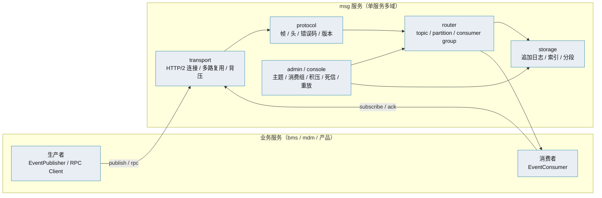
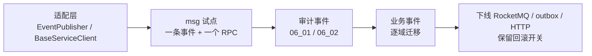

# 8B_00 消息平台总体设计

> HTTP/2 + 二进制 · 事件总线 + RPC · 追加日志 · 单机先行 · 可迁移

[文档首页](../../../文档首页.md) › [08B 消息平台](../08B_消息平台.md) › 设计 › 8B_00 总体设计　|　[需求](../需求/01_需求_消息平台.md) · [计划](../计划/01_计划_消息平台.md)

---

## 1. 概述 <a id="overview"></a>

- **目标**：设计一套自研消息平台 L3，统一承载**事件总线**与**同步 RPC**，逐步替换 bms 的 RocketMQ 事件投递、事务性发件箱与 `HttpServiceClient`。
- **形态**：独立产品仓 `msg/`，单服务多域（`broker` / `rpc` / `console` / `admin`），独立库、独立部署，经产品声明接入 bms 基座；与 mdm 同构。
- **传输**：HTTP/2（h2c）+ 二进制序列化（MessagePack 默认，Protobuf 可选）。
- **存储**：分区追加日志（append-only log）+ 偏移索引 + 分段；先单机，复制与高可用后置。
- **可靠性**：至少一次投递 + 消费幂等；事务消息 / outbox 在 8B_04 兼容，不在本期造齐。
- **范围**：本设计只覆盖 8B_00（总体设计）与 8B_01（PoC）的边界；8B_02~09 在各自详细设计中细化。
- **不含**：业务事件语义、bms 基座业务、对外商业化计费。

## 2. 现状与差距 <a id="gap"></a>

| 关注点 | bms 现状 | msg 目标 | 差距 |
| --- | --- | --- | --- |
| 事件传输 | RocketMQ 5.x | 自研 broker，HTTP/2 + 二进制 | 需自研连接、协议、路由 |
| 事件可靠性 | 本地 outbox + 轮询投递 | broker 持久化 + ack + 重试 + 死信 | 需自研存储与消费组 |
| 同步调用 | `HttpServiceClient`（httpx + JSON）调 FastAPI 服务；主要开销在框架栈与序列化 | 同一传输上的 RPC | 需自研 RPC 帧与超时 |
| 顺序 | RocketMQ 分区有序 | 分区 / 聚合键有序 | 需自研分区与 offset |
| 账本 / 重放 | outbox 表 | 分区日志保留期 + 重放 | 需自研索引与重放 |
| 运维 | RocketMQ 自带 + bms 指标 | 自研管理台 / 指标 | 需自研管理面 |
| 多租户 | 平台租户体系 | 消息命名空间 + 配额 | 需与 bms 租户对齐 |

## 3. 总体架构 <a id="architecture"></a>



设计原则：

1. **单服务多域**：初期一个 `msg` 服务承载 broker / rpc / console / admin，按域分目录；后续按需拆。
2. **一套传输、两种模式**：事件（单向、可批量、可持久）与 RPC（请求/响应、超时、取消）共用 HTTP/2 连接与二进制帧。
3. **先单机、后复制**：8B_01~04 单机可验证；8B_05 再做主从 / 分区复制，避免过早陷入共识算法。
4. **适配而非重写业务**：bms 通过 `EventPublisher` / `BaseServiceClient` 适配层接入，业务代码不改。
5. **保留回滚**：迁移期保留 RocketMQ / outbox / HTTP 作为 fallback，配置切换。

## 4. 传输与协议 <a id="transport"></a>

### 4.1 传输

- **HTTP/2（h2c）**：单连接多路复用，降低连接开销；请求/响应与流式共用。
- **连接管理**：keepalive、最大并发流、空闲回收、断线重连（指数退避）。
- **背压**：按连接 / topic / consumer group 设上限；超限快速失败或阻塞（可配）。
- **TLS**：生产启用 TLS；内网可先 h2c，后续 mTLS。

### 4.2 帧格式

```text
+--------+--------+--------+-------------------+
| magic  | type   | flags  | header length     |
+--------+--------+--------+-------------------+
| header (MessagePack / Protobuf)              |
+----------------------------------------------+
| payload (bytes)                              |
+----------------------------------------------+
```

| 字段 | 说明 |
| --- | --- |
| `magic` | 协议魔数 + 版本 |
| `type` | `publish` / `ack` / `subscribe` / `rpc_request` / `rpc_response` / `heartbeat` / `error` |
| `flags` | 压缩、流结束、是否需要响应 |
| `header` | 结构化头（topic、partition、key、tenant、trace、correlation id、timeout） |
| `payload` | 业务负载（二进制） |

### 4.3 序列化

- **默认 MessagePack**：Python 原生、紧凑、无需 schema；适合内部事件与 RPC。
- **可选 Protobuf**：跨语言 / 强类型场景；同一 header 支持 `content_type` 区分。
- **契约**：事件沿用 bms `{域}.{对象}.{动作}` 与「字段只增不删」；RPC 用请求/响应 schema 版本。

### 4.4 错误码

| 码段 | 含义 |
| --- | --- |
| `35xxx` | msg 产品错误（暂定段位，最终以 07C 为准） |
| `35001` | 主题不存在 |
| `35002` | 分区不可用 |
| `35003` | 消费组不存在 |
| `35004` | 超时 |
| `35005` | 背压 / 限流 |
| `35006` | 消息过大 |
| `35007` | 认证 / 授权失败 |

> 具体码表在 8B_01 详细设计中定稿；本表只占段。

## 5. 消息模型 <a id="model"></a>

| 概念 | 说明 |
| --- | --- |
| Topic | 逻辑消息类别；按租户命名空间隔离 |
| Partition | 分区；同分区内按 offset 有序 |
| Offset | 分区内消息序号（单调递增） |
| Key / Partition Key | 决定分区；同 key 有序 |
| Consumer Group | 消费组；组内分区分配与 rebalance |
| Ack | 消费确认；未 ack 超时重投 |
| Visibility Timeout | 消费可见性超时（防重复处理） |
| Retry | 失败重试（次数 / 退避） |
| DLQ | 死信队列（重试超限） |
| Replay | 按 offset / 时间 / key 重放 |

消息信封（建议字段）：

```text
id / topic / partition / offset / key / headers / payload /
tenant_id / trace_id / created_at / content_type / version
```

> 字段最终以 8B_02 表/文件设计为准；本设计只定语义。

## 6. 存储 <a id="storage"></a>

### 6.1 追加日志

每个分区一个 append-only 日志：

```text
partitions/{topic}/{partition}/
├── 00000000000000000000.log     # 消息追加（offset 顺序）
├── 00000000000000000000.index   # offset -> 文件位置
└── ...
```

- **写入**：追加 + fsync（可配置批量刷盘）；返回 offset。
- **读取**：按 offset 定位 index → log；支持批量与流式。
- **分段**：按大小 / 时间切段；保留期到期删除整段。
- **崩溃恢复**：扫描段尾，截断不完整记录；重建 index。
- **索引**：offset → position；可选时间索引。

### 6.2 存储抽象

```text
StorageEngine（端口）
├── FileStorageEngine     # 追加日志（默认，L3 目标）
└── DbStorageEngine       # 数据库表（PoC / 小规模 / 兼容期）
```

- PoC 可先用 `DbStorageEngine` 快速验证协议与消费模型；正式实现走 `FileStorageEngine`。
- 通过插件选择（与 bms 插件化口径一致），不把存储写死。

### 6.3 多租户与配额

- 命名空间：`{tenant}/{topic}`；物理隔离可选（独立目录 / 独立库）。
- 配额：按租户限制 topic 数、存储、吞吐、消费组数；超限拒绝并告警。

## 7. RPC <a id="rpc"></a>

| 能力 | 说明 |
| --- | --- |
| 请求/响应 | `rpc_request` / `rpc_response`，`correlation_id` 关联 |
| 超时 | 请求头带 timeout；服务端超时取消 |
| 取消 | 客户端取消 → 服务端停止处理（尽力） |
| 流式 | 多帧流（`flags` 标记流结束） |
| 错误 | 统一错误码 + 错误详情 |
| 韧性 | 超时、重试（仅幂等）、熔断、限流（复用 bms 基座策略） |

- 服务发现：初期沿用 Compose DNS / K8s Service；后续可接注册中心。
- 适配：实现 bms `BaseServiceClient` 的 msg 版本，业务代码不改。

## 8. 可靠性与事务 <a id="reliability"></a>

- **投递语义**：至少一次；消费端按 `message_id` / 业务幂等键去重。
- **ack**：消费成功才 ack；未 ack 超时重投；重试超限进 DLQ。
- **顺序**：同分区 / 同 key 有序；跨分区不承诺全局有序。
- **事务**：
  - 8B_04 先做 **outbox 适配**：bms 仍写本地 outbox，由 msg 的 relay 投递；不改变现有可靠性口径。
  - 原生事务消息（半消息 + 本地事务 + 回查）作为后续能力，不要求在 8B_01 实现。
  - 跨服务写仍走 bms TM + XA，不用消息替代。
- **审计**：管理操作（建 topic / 删消费组 / 重放 / 改配额）落审计日志。

## 9. 高可用与复制 <a id="ha"></a>

- **8B_01~04 单机**：先验证协议、存储、消费模型与性能。
- **8B_05 复制**：分区主从 / 多副本；leader 处理读写，follower 复制日志；故障切换。
- **不预设共识算法**：主从 + 手动/自动切换优先；Raft 级共识作为后续选项，需单独评估。
- **降级**：副本不足时按配置拒绝写或降级读；不静默丢消息。

## 10. 多租户、安全与审计 <a id="security"></a>

- **租户**：消息命名空间 + 配额；与 bms 租户上下文对齐。
- **身份**：服务 JWT（bms 基座签发）或 mTLS；按 topic / 操作做 ACL。
- **审计**：管理面操作、配额变更、重放、删除主题等留痕；消息内容审计可选（合规场景）。

## 11. 部署与运维 <a id="ops"></a>

```text
backend/services/msg/src/bms_msg/
├── main.py / asgi.py / __main__.py
├── broker/            # 连接、协议、路由、存储、消费组
├── rpc/               # RPC 帧与处理
├── console/           # 管理台 API
├── admin/             # 运维端点（健康 / 指标 / 重放）
└── models/ · repositories/ · services/ · schemas/
```

- **部署**：单服务 `msg`（容器内 8000），按需加 `msg-jobs`（定时清理 / 重放）；compose 见 `deploy/compose/`。
- **配置**：`[msg]` 段（存储路径、保留期、分段大小、fsync、限额、TLS）。
- **可观测**：Prometheus 指标（吞吐 / 积压 / 延迟 / 死信 / 连接）、结构化日志、OTel 追踪。
- **管理台**：主题 / 消费组 / 积压 / 死信 / 重放 / 配额；权限码 `msg:query` / `msg:manage`。

## 12. bms 迁移 <a id="migration"></a>



| 阶段 | 内容 | 回滚 |
| --- | --- | --- |
| 适配 | 实现 bms 端口的 msg 版本 | 配置切回原实现 |
| 试点 | 一条低风险事件 + 一个只读 RPC | 切回 HTTP / RocketMQ |
| 审计 | 操作 / 登录 / 字段审计事件 | 切回 outbox |
| 业务 | 逐域迁移 | 按域切回 |
| 收尾 | 删除旧链路 | 保留一个版本 |

> 06_02（字段级审计）当前暂停，等 8B 结论；恢复时优先复用适配层，避免二次改造。

## 13. 8B_01 PoC 计划 <a id="poc"></a>

| 项 | 内容 |
| --- | --- |
| 目标 | 验证 HTTP/2 + 二进制、单机 broker、收发 / ack / 重试 / 死信，以及与 HTTP/JSON、RocketMQ 的基准 |
| 范围 | 单进程、单 topic、单分区、单消费组；`DbStorageEngine` 或最小文件日志 |
| 验证 | ① 发布 / 订阅 / ack；② 未 ack 重投；③ 重试超限进 DLQ；④ 进程重启不丢已确认消息；⑤ 基准：吞吐 / P50 / P99 / CPU / 内存 |
| 非目标 | 高可用、多租户、管理台、事务消息、RPC 全量 |
| 退出 | 五项验证通过 + 基准数据达到设计目标（目标值在 8B_01 详细设计中定） |
| 依据 | 见[阶段计划](../计划/01_计划_消息平台.md) |

## 14. 风险与开放项 <a id="risk"></a>

| # | 风险 / 开放项 | 影响 | 处置 |
| --- | --- | --- | --- |
| 1 | HTTP/2 在 Python 侧（hypercorn / httpx）成熟度 | 传输性能与稳定性 | PoC 先验证；必要时 h2 + 自定义帧 |
| 2 | 文件日志的 fsync / 崩溃恢复 | 可靠性 | 先单机验证；HA 后置 |
| 3 | 消费组 rebalance | 顺序与重复 | 先单消费组；后续细化 |
| 4 | 复制与故障切换 | 可用性 | 8B_05 单独设计，不预设共识算法 |
| 5 | 事务消息 / outbox 兼容 | 审计不丢 | 8B_04 先做 outbox 适配 |
| 6 | 多租户配额 | 隔离与公平 | 8B_07 与 bms 租户对齐 |
| 7 | 与 bms 迁移耦合 | 生产风险 | 适配层 + 回滚开关 + 分域切换 |
| 8 | 单人运维 | 可持续性 | 管理台 / 指标先行；不追求一步到位 |

## 15. 对齐记录 <a id="align"></a>

| # | 事项 | 结论 |
| --- | --- | --- |
| 1 | 自研深度 | L3（独立 broker + 管理台 + 多租户 + 高可用） |
| 2 | 产品形态 | 类 mdm：独立仓 `msg/`、独立服务、独立库、产品声明接入 |
| 3 | 传输 | HTTP/2 + 二进制序列化 |
| 4 | 服务形态 | 单服务多域（broker / rpc / console / admin），后续按需拆 |
| 5 | 阶段 | 独立 08B，先 8B_00 设计 + 8B_01 PoC |
| 6 | 06_02 | 继续暂停，等 8B 结论 |
| 7 | 错误码段 | 暂定 `35`，最终以 07C 登记为准 |

## 16. 参考 <a id="refs"></a>

- [事件驱动知识档案](../../../../bms文档/资料/知识档案/消息与事件驱动/01_事件驱动_总览.md)
- [分布式事务总览](../../../../bms文档/资料/知识档案/分布式事务/01_分布式事务_总览.md)
- [微服务 · 通信与分布式一致性](../../../../bms文档/资料/知识档案/微服务/05_微服务_通信与分布式一致性.md)
- [架构设计 · 服务间通信与一致性](../../../../bms文档/设计/架构设计/37_架构设计_子系统_服务间通信与一致性.md)
- [架构设计 · 事件总线](../../../../bms文档/设计/架构设计/16_架构设计_子系统_事件总线.md)
- [平台可扩展性规划](../../../../bms文档/规划/平台可扩展性规划.md)

---

> 详细设计 · 依 bms《[文档生成规范](../../../../bms文档/规范/文档生成规范.md)》编写 · 进度以[阶段计划](../计划/01_计划_消息平台.md)为唯一落点
